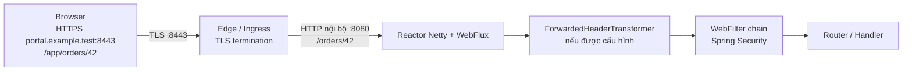
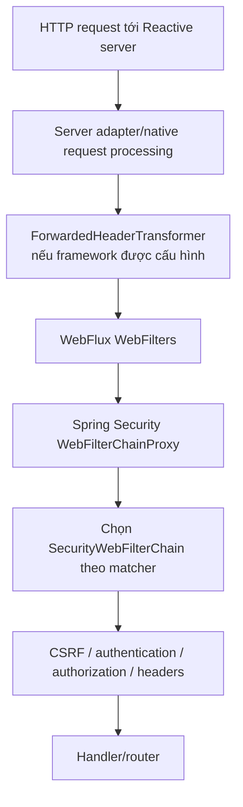
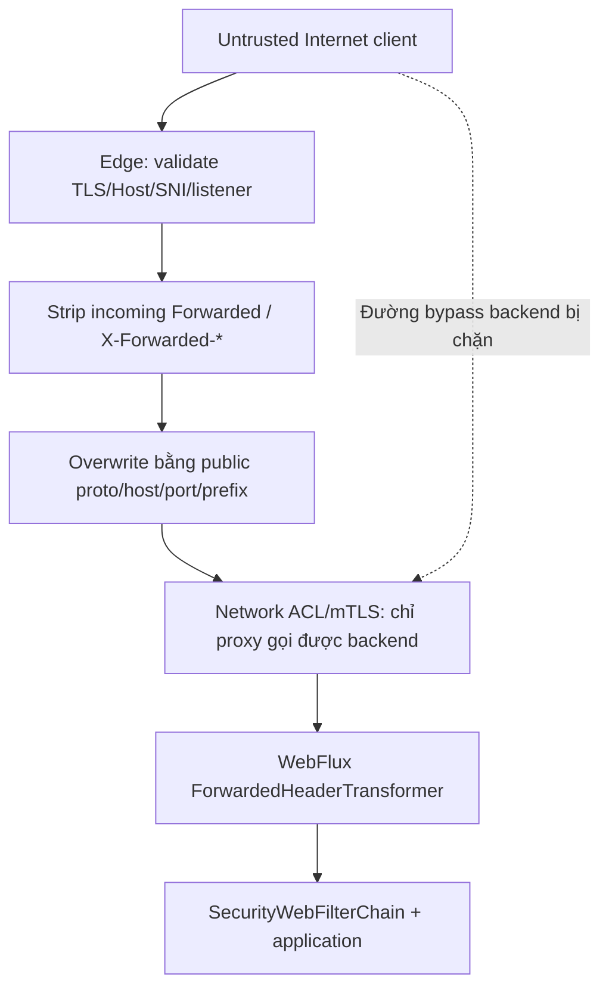

# ForwardedHeaderTransformer và cấu hình tương ứng trên WebFlux

> **Chương:** Proxy và nguồn gốc  
> **Module:** `SPRING_SECURITY_HTTP_PROTECTION` — áp dụng các lớp phòng vệ HTTP và trình duyệt bằng Spring Security, gồm CSRF, CORS, security headers, CSP, HSTS, HTTP firewall và bảo vệ session trên Servlet lẫn Reactive.  
> **Trọng tâm:** Cấu hình `ForwardedHeaderTransformer` đúng cách trong **Spring WebFlux**, phân biệt với xử lý native của web server, và chứng minh các header forwarded do **proxy tin cậy** cung cấp chứ không phải do client giả mạo.

## 1. Mục tiêu học tập

Sau bài này, người học có thể:

1. Giải thích vì sao `ServerHttpRequest` của ứng dụng WebFlux chạy sau TLS-terminating proxy thường thấy URL nội bộ khác URL browser.
2. Mô tả vai trò và vị trí của `ForwardedHeaderTransformer` trong pipeline WebFlux, phân biệt với `WebFilter`, `SecurityWebFilterChain` và API Servlet.
3. Chọn có chủ đích `server.forward-headers-strategy=framework`, `native` hoặc `none` trong Spring Boot WebFlux.
4. Biết khi nào khai báo bean `ForwardedHeaderTransformer` thủ công, khi nào dùng `setRemoveOnly(true)` và tại sao không nên xử lý forwarded metadata trùng lặp.
5. Đọc đúng `Forwarded`, `X-Forwarded-Proto`, `X-Forwarded-Host`, `X-Forwarded-Port` và `X-Forwarded-Prefix` với URL công khai, bao gồm cổng HTTPS khác 443.
6. Thiết kế **trust boundary** với CDN/load balancer/ingress: strip/overwrite header từ client, host allowlist và bảo vệ đường truy cập backend.
7. Kiểm thử WebFlux bằng `WebTestClient` và một web server thật để xác minh URI, path, redirect, HTTPS/HSTS, cookie và security chain.
8. Phân biệt kiểm thử “Spring diễn giải header đúng” với kiểm thử “client ngoài Internet không thể giả header thành công”.
9. Chẩn đoán xung đột CORS, CSRF, login/OAuth2, CSP, security headers, session và path rewriting khi thêm proxy.

**Nguyên tắc then chốt:** `ForwardedHeaderTransformer` chỉ **biến đổi cách ứng dụng nhìn request**; nó **không xác minh nguồn gốc** của các header được cung cấp. Điều kiện tin cậy phải được thực thi tại proxy và ranh giới mạng **trước** khi dữ liệu đến WebFlux.

## 2. WebFlux nhìn request khác browser như thế nào?

Giả sử người dùng mở URL:

```text
https://portal.example.test:8443/app/orders/42
```

Hệ thống triển khai:



Đây là **sơ đồ luồng khái niệm**. Transformer được tích hợp vào tầng xử lý request của WebFlux trước các web filters dựa trên request đã biến đổi khi cấu hình đúng; thứ tự thực tế với các bộ xử lý native của server phụ thuộc cách triển khai và phải được test.

Proxy có thể gửi upstream:

```http
GET /orders/42 HTTP/1.1
Host: app.internal:8080
X-Forwarded-Proto: https
X-Forwarded-Host: portal.example.test
X-Forwarded-Port: 8443
X-Forwarded-Prefix: /app
X-Forwarded-For: 198.51.100.25
```

Không có xử lý forwarded metadata, request mà handler quan sát có thể có:

```text
request.getURI() = http://app.internal:8080/orders/42
request.getPath() = /orders/42
remote peer = ingress hoặc load balancer gần nhất
```

Khi transformer diễn giải metadata đáng tin theo hợp đồng, `getURI()` có thể phản ánh **scheme/authority/path bên ngoài** cho việc xây redirect và URI. **Không được mặc định** rằng `X-Forwarded-Prefix` luôn thay đổi `pathWithinApplication()` và `securityMatcher` giống nhau trong mọi phiên bản, server, context path hoặc cấu hình rewrite; test là nguồn xác nhận hành vi thật.

### 2.1. Phân biệt bốn khái niệm

| Khái niệm | Ví dụ | Ý nghĩa |
|---|---|---|
| External origin | `https://portal.example.test:8443` | Scheme + host + port mà browser gọi |
| External base URL | `https://portal.example.test:8443/app` | Origin + public prefix |
| Backend URL | `http://app.internal:8080/orders/42` | URL tới hop Java WebFlux |
| Peer IP tại backend | IP ingress | Nguồn của kết nối mạng gần nhất, không mặc nhiên là IP user |

**Origin không chứa path.** `https://portal.example.test` và `https://portal.example.test:8443` là hai origin khác nhau. Cookie có thể không được scope theo port, nhưng CORS, redirect URI, OAuth2 callback và liên kết tuyệt đối thường nhạy với port.

### 2.2. Địa chỉ client thật không phải một URI

`ServerHttpRequest.getRemoteAddress()` mô tả thông tin kết nối mà tầng server cung cấp; xử lý forwarded metadata có thể phụ thuộc web server/chiến lược đã chọn. **Không suy rằng** chỉ vì `ForwardedHeaderTransformer` khôi phục host/scheme thì nó cũng đã giải quyết chính xác và đáng tin client IP từ chuỗi `X-Forwarded-For`.

Xác định IP hiệu dụng cho rate limit/audit cần một **trusted proxy chain** riêng: nguồn TCP đến, các hop đã được xác minh, cách edge strip/append metadata và xử lý thiếu/sai cú pháp. IP không được thay thế principal hay authorization.

## 3. Những header WebFlux có thể dùng để khôi phục URL

### 3.1. Header chuẩn `Forwarded` — RFC 7239

Một edge đáng tin có thể phát:

```http
Forwarded: for=198.51.100.25;proto=https;host="portal.example.test:8443"
```

| Tham số | Diễn giải |
|---|---|
| `for` | Địa chỉ nguồn do hop proxy báo; **không tự xác thực** |
| `by` | Danh tính hop proxy theo quy ước RFC, có thể vắng mặt |
| `proto` | Scheme do proxy mô tả ở phía bên ngoài |
| `host` | External authority, có thể gồm port |

Các lưu ý quan trọng:

- `host="portal.example.test:8443"` chứa **host và port ngoài**; đừng ghép `:8443` lần nữa.
- Host IPv6 literal có cú pháp dấu ngoặc vuông, dấu `:` không phải lúc nào cũng phân tách host và port.
- Nhiều proxy có thể thêm nhiều phần tử `Forwarded`, phân tách bằng dấu phẩy.
- Không tự `split(",")`/`split(":")` rồi dùng kết quả làm security decision vì quoted strings, IPv6 và nhiều hop.
- `Forwarded` là một HTTP header **có thể do client tự khai** nếu chưa được proxy loại/ghi đè.

### 3.2. Header `X-Forwarded-*`

```http
X-Forwarded-Proto: https
X-Forwarded-Host: portal.example.test
X-Forwarded-Port: 8443
X-Forwarded-Prefix: /app
X-Forwarded-For: 198.51.100.25
```

| Header | Tác dụng mong đợi | Nguy cơ nếu nhận từ nguồn không đáng tin |
|---|---|---|
| `X-Forwarded-Proto` | Đưa request public từ HTTP nội bộ về HTTPS | Giả HTTPS dẫn đến redirect/HSTS/secure-state sai |
| `X-Forwarded-Host` | Phục hồi host công khai | Host poisoning, link reset/callback bị đổi domain |
| `X-Forwarded-Port` | Phục hồi port ngoài | Đổi origin, redirect sang port sai |
| `X-Forwarded-Prefix` | Mô tả public prefix bị proxy bỏ | Lặp prefix, sai routing hoặc URL building |
| `X-Forwarded-For` | Chuỗi IP phía trước hop hiện tại | Giả loopback/internal IP để né giới hạn |
| `X-Real-IP` | Giá trị IP theo quy ước một số proxies | Không có độ tin cậy nếu edge không kiểm tra |

`X-Forwarded-Prefix` là quy ước phổ biến, **không phải tham số trong RFC 7239**. Hỗ trợ/điều chỉnh prefix giữa framework và native web server có thể khác nhau; kiểm thử path public → handler → Location thực tế.

### 3.3. `Origin` và `Host` không phải cùng trường

Giả sử SPA ở `https://app.example.test` gọi API `https://portal.example.test:8443`:

```http
POST /api/web/orders HTTP/1.1
Host: portal.example.test:8443
Origin: https://app.example.test
Cookie: SESSION=<session>
X-CSRF-TOKEN: <csrf-token>
```

- `Origin` cho biết **nguồn trang web** đã kích hoạt request theo mô hình browser, dùng trong CORS.
- `Host` hoặc HTTP/2 `:authority` xác định **đích request** trên kết nối công khai.
- `X-Forwarded-Host`/`Forwarded: host` mô tả **host đích phía ngoài**, theo lời khai của proxy.
- Không dùng forwarded host làm CORS allowlist động, và không dùng `Origin` như bằng chứng user đã xác thực.

## 4. `ForwardedHeaderTransformer` thực sự làm gì?

`ForwardedHeaderTransformer` thuộc Spring WebFlux, xử lý `ServerHttpRequest` và tạo request đã được điều chỉnh từ forwarded metadata khi được cấu hình.

Trong một ứng dụng Spring WebFlux chuẩn, `WebHttpHandlerBuilder`/HTTP handler infrastructure có thể phát hiện bean transformer để xử lý request **trước các `WebFilter` của ứng dụng**. Từ phía handler hoặc Spring Security, việc xây URI/redirect có thể dựa trên request đã được diễn giải lại.

### 4.1. Nó có thể hỗ trợ

- Phản ánh public scheme, host và port từ thông tin `Forwarded`/`X-Forwarded-*`.
- Xử lý metadata prefix theo cơ chế của Spring Framework cho các phiên bản tương ứng.
- Loại forwarded headers mà transformer nhận diện khỏi request downstream sau khi đã xử lý.
- Ở chế độ remove-only, loại header mà **không áp dụng giá trị** vào URI.

### 4.2. Nó không đảm nhận

- **Không** xác thực nguồn TCP đến từ trusted CDN/LB/ingress.
- **Không** tự bảo đảm client IP được giải quyết bằng trusted-proxy algorithm.
- **Không** xác thực user, JWT, cookie hoặc chữ ký webhook.
- **Không** tự bật `CsrfWebFilter`, CORS policy, HSTS hay CSP.
- **Không** sửa lại cấu hình ingress rewrite hoặc đảm bảo mọi matcher theo path đều đúng.
- **Không** thay thế authentication/authorization trong `SecurityWebFilterChain`.
- **Không** đủ để ngăn client gọi trực tiếp cổng backend nếu firewall/network policy cho phép.

Hãy coi transformer là **bước diễn giải HTTP metadata**, không phải security gate.

### 4.3. Đối chiếu nhanh với Servlet

| Điểm | WebFlux / Reactive | Spring MVC / Servlet |
|---|---|---|
| Loại request | `ServerHttpRequest` / `ServerWebExchange` | `HttpServletRequest` |
| Xử lý framework | `ForwardedHeaderTransformer` | `ForwardedHeaderFilter` |
| Vị trí xử lý | HTTP handler adapter / WebFlux infrastructure | Servlet filter chain |
| Security | `SecurityWebFilterChain`, `WebFilter`, `CsrfWebFilter` | `SecurityFilterChain`, `Filter`, `CsrfFilter` |
| Container native | Phụ thuộc Reactive server, ví dụ Reactor Netty | Phụ thuộc Servlet container, ví dụ Tomcat `RemoteIpValve` |
| Loại bỏ header | `setRemoveOnly(true)` | `setRemoveOnly(true)` trên filter |
| Mối nguy chung | Tin metadata giả từ client nếu edge chưa sanitize | Cùng mối nguy |

**Không bê `ForwardedHeaderFilter` vào cấu hình WebFlux thuần.** Nó là Servlet Filter. Ngược lại, `ForwardedHeaderTransformer` không phải một `jakarta.servlet.Filter`.

## 5. Spring Boot WebFlux: chọn `framework`, `native` hay `none`

Spring Boot cung cấp property:

```yaml
server:
  forward-headers-strategy: framework
```

Hãy chọn đúng một chiến lược cho ứng dụng theo topology:

| Giá trị | Ai diễn giải forwarded metadata? | Khi nào phù hợp? |
|---|---|---|
| `framework` | Spring Framework/WebFlux | Muốn WebFlux khôi phục URI/redirect và prefix từ proxy đáng tin |
| `native` | Web server/engine theo khả năng native | Đã có native forwarding behavior và trust configuration được kiểm chứng |
| `none` | Không chủ động khôi phục qua chiến lược Boot này | Không dùng forwarded headers hoặc dùng canonical public URL riêng |

Các phiên bản Spring Boot, Reactor Netty và server adapters có thể khác nhau về tự cấu hình, ưu tiên header và trusted proxy behavior. **Đừng giả định `native` có cùng chức năng, header support hay IP trust policy với Tomcat Servlet**.

### 5.1. Khuyến nghị cho WebFlux sau trusted reverse proxy

```yaml
# application.yml
# Edge đã strip incoming Forwarded / X-Forwarded-* giả từ client.
# Backend chỉ nhận request từ trusted proxy/service identity.
server:
  forward-headers-strategy: framework
```

Khi Spring Boot tự cấu hình transformer cho WebFlux, **không khai báo thêm một transformer thủ công trùng vai trò** chỉ để “bảo đảm” nó chạy. Kiểm chứng bean/runtime config bằng integration test ở profile triển khai.

### 5.2. Chọn `native` có nghĩa gì trên Reactive?

```yaml
server:
  forward-headers-strategy: native
```

Đây là yêu cầu để web server được Boot tích hợp xử lý metadata theo khả năng native. Với WebFlux dùng Reactor Netty, cần **xác minh chính xác Reactor Netty/Boot version**:

- Native handler có đọc `Forwarded` hay `X-Forwarded-*`, những header nào?
- Hành vi host/port có giống framework strategy không?
- `X-Forwarded-Prefix` có được xử lý như WebFlux framework không?
- Peer nào được coi là trusted để native metadata có hiệu lực?
- Khi có nhiều proxy và XFF, server xác định remote address ra sao?
- Khi backend được truy cập trực tiếp, các header giả có thể bị tin không?

**Không dùng config Tomcat `server.tomcat.remoteip.*` như lời giải cho Reactor Netty.** Đó là cấu hình dành cho Tomcat Servlet. Trên Netty, trust boundary và server-specific forwarding phải được kiểm tra theo runtime thực tế.

### 5.3. Chọn `none` khi không có trust boundary phù hợp

```yaml
server:
  forward-headers-strategy: none
```

Nếu application không cần khôi phục URL từ request hoặc backend có thể nhận headers từ nguồn chưa kiểm soát, không nên tự động tin forwarding metadata. Khi cần tạo liên kết tuyệt đối, có thể dùng canonical public base URL được cấu hình bởi vận hành:

```yaml
app:
  public-base-url: "https://portal.example.test:8443/app"
```

Chọn `none` không bảo đảm **mọi custom WebFilter hoặc server native component** đã ngừng đọc các header này. Đặc biệt kiểm tra mã dùng `getHeaders().getFirst("X-Forwarded-Host")` hoặc các header vendor-specific.

## 6. Tự đăng ký bean `ForwardedHeaderTransformer`

Trong một WebFlux application **không dùng Boot auto-registration cho cùng transformer**, có thể khai báo:

```java
import org.springframework.context.annotation.Bean;
import org.springframework.web.server.adapter.ForwardedHeaderTransformer;

@Bean
ForwardedHeaderTransformer forwardedHeaderTransformer() {
    return new ForwardedHeaderTransformer();
}
```

### 6.1. Những điểm phải làm đúng

1. Bean phải được đặt tên/được WebFlux infrastructure tìm thấy theo cơ chế framework. Tên phương thức `forwardedHeaderTransformer` là tên thông dụng và được kỳ vọng trong cách cấu hình WebFlux.
2. Chỉ đăng ký trong **Reactive WebFlux context** mà bạn thực sự sử dụng.
3. Nếu Boot đã thiết lập `server.forward-headers-strategy=framework` và đăng ký transformer phù hợp, không khai báo thêm một bean cùng chức năng khi chưa xác minh cách cấu hình hiện hành.
4. Đừng tự tạo một `WebFilter` khác tiếp tục diễn giải `Forwarded`/`X-*` sau transformer.
5. Đừng để web server native xử lý rồi để framework xử lý lại cùng metadata mà không có test thống nhất.
6. Đừng đưa transformer vào security chain như một `SecurityWebFilterChain`: đó là **khác loại thành phần**.
7. Không coi việc bean tồn tại là bằng chứng edge đang strip/overwrite header giả.

### 6.2. Thứ tự so với Spring Security

Các lớp có trách nhiệm khác nhau:



Sơ đồ nhấn mạnh **chuyển đổi metadata** xảy ra trước quyết định ở các WebFilters trong cấu hình framework chuẩn. Vị trí của các bộ xử lý native hoặc custom gateway filters phụ thuộc triển khai. Nếu app tự thêm WebFilter đọc raw forwarded headers trước/sau transformer, phải rà soát pipeline thay vì suy từ `@Order` của một bean không cùng loại.

### 6.3. Vì sao không dùng một WebFilter tự đọc header?

Một phản ví dụ tư duy:

```java
// KHÔNG dùng làm ranh giới tin cậy.
String reportedHost = exchange.getRequest()
    .getHeaders().getFirst("X-Forwarded-Host");

// Sai nếu dùng reportedHost chưa xác thực để tạo callback,
// quyết định tenant hoặc cấp quyền.
```

WebFilter không biết raw header có đến từ CDN/ingress đáng tin hay client Internet nếu hạ tầng không xác minh nguồn. Nếu cần host-based tenant routing, ánh xạ host phải được allowlist tại edge và kiểm chứng trong ứng dụng theo hợp đồng tenant/domain đã đăng ký.

## 7. `setRemoveOnly(true)`: xóa thay vì tin

`ForwardedHeaderTransformer` có khả năng **remove-only**:

```java
import org.springframework.context.annotation.Bean;
import org.springframework.web.server.adapter.ForwardedHeaderTransformer;

@Bean
ForwardedHeaderTransformer forwardedHeaderTransformer() {
    ForwardedHeaderTransformer transformer =
        new ForwardedHeaderTransformer();
    transformer.setRemoveOnly(true);
    return transformer;
}
```

**Chọn ví dụ này thay thế bean sử dụng mặc định**, không đăng ký cả hai. Chế độ remove-only loại những forwarding headers mà transformer nhận diện và **không thay đổi URI dựa vào chúng**.

### 7.1. Khi nào nên dùng?

- Không muốn ứng dụng tin forwarding metadata từ request đầu vào.
- Có canonical base URL ở cấu hình hoặc frontend URL được xác định theo con đường khác.
- Muốn giảm khả năng các downstream handlers/WebFilters đọc nhầm raw `Forwarded`/`X-*`.
- Đang thực hiện một kiến trúc mà TLS/host quyết định chỉ ở edge, ứng dụng không cần thông tin public từ request.

### 7.2. Những điều remove-only không làm được

- **Không** tạo lại external host/scheme/port/prefix.
- **Không** chặn direct-origin access đến server.
- **Không** quay ngược một phép biến đổi mà native server đã thực hiện trước đó.
- **Không** vô hiệu hóa mọi custom header khác mà code có thể sử dụng.
- **Không** tự cấu hình CSRF, CORS, HSTS hoặc authentication.
- **Không** sửa một proxy đã dùng XFF giả để quyết định rate limit hoặc cấp quyền.

Khi dùng remove-only, kỳ vọng `getURI()` vẫn phản ánh URI từ server sau những xử lý khác mà nó đã thực hiện, không phải public URL được suy từ header bị bỏ.

### 7.3. Không nhầm “header đã bị xóa” với “đã an toàn”

Giả sử Reactor Netty native server đã tin `X-Forwarded-Proto=https` và điều chỉnh request **trước khi** transformer remove-only chạy. Việc transformer xóa header khỏi request downstream không chứng minh scheme đã được xác thực. Test pipeline theo server/Boot version và trust boundary thực tế.

## 8. Ranh giới tin cậy: proxy phải chuẩn hóa header trước WebFlux

Một Internet client có thể cố gửi:

```http
GET /reset-password HTTP/1.1
Host: portal.example.test
Forwarded: proto=https;host=attacker.example
X-Forwarded-Host: attacker.example
X-Forwarded-Proto: https
X-Forwarded-For: 127.0.0.1
```

Đừng vì backend thấy `request.getURI().getHost() == "attacker.example"` mà nghĩ host này đã được xác nhận. Điều đó có thể cho thấy ứng dụng **đã tin dữ liệu tấn công**.

### 8.1. Phân định trách nhiệm



| Thuộc tính | Nguồn authoritative | Không tin nguồn |
|---|---|---|
| Public scheme | TLS edge được xác minh | `X-Forwarded-Proto` client tự khai |
| Public host | Host allowlist/vhost/tenant mapping hợp lệ | `Host` bất kỳ hoặc `X-Forwarded-Host` tùy ý |
| Public port | Listener public của edge | `X-Forwarded-Port` không được kiểm soát |
| Public prefix | Proxy routing/rewrite rule | `X-Forwarded-Prefix` client gửi |
| Effective client IP | Trusted proxy chain từ TCP peer đã xác nhận | Phần tử đầu tiên của XFF không kiểm chứng |
| User/tenant quyền truy cập | Spring Security principal và authorization | Host/IP metadata chưa được xác thực |

### 8.2. Strip, overwrite và append khác nhau

- **Strip:** loại giá trị `Forwarded`/`X-*` từ nguồn Internet; không truyền nguyên chuỗi vào WebFlux.
- **Overwrite:** ghi metadata mới dựa vào vhost, TLS, listener, prefix rule và remote peer thực.
- **Append:** nối thêm hop vào thông tin trước đó; chỉ an toàn khi phần upstream đã nằm trong **trusted chain** hoặc edge đầu đã canonicalize dữ liệu.

Một Nginx Internet edge dùng `$proxy_add_x_forwarded_for` khi chưa strip incoming XFF có thể giữ lại phần tử `127.0.0.1` do client tự thêm. Nếu ứng dụng lấy IP đầu tiên, khả năng bypass IP allowlist xuất hiện.

### 8.3. Multi-hop: CDN → LB → ingress → WebFlux

```text
Browser -> CDN (TLS public) -> LB -> ingress -> WebFlux
```

- CDN phải xác minh HTTP Host/TLS/peer IP từ phía ngoài và làm sạch header client.
- LB chỉ được tin giá trị từ CDN khi **xác thực nguồn CDN**; nguồn không qua CDN không nên có quyền tương tự.
- Ingress giữ public scheme/host/port **nếu upstream đáng tin**; không tự đổi HTTPS public thành HTTP vì hop nội bộ giao tiếp HTTP.
- WebFlux chỉ nhận metadata đã thống nhất từ ingress được phép kết nối.
- Nếu CDN/LB/ingress dùng cả `Forwarded` và `X-*`, phải bảo đảm nhất quán; precedence có thể khác tùy phiên bản server/framework.

**Đổi CDN, ingress, TLS termination hoặc đường truy cập backend là một security change**, dù không sửa Java code. Mọi test boundary phải được chạy lại.

### 8.4. Client IP: một ranh giới khác với URL

Nếu backend nhận peer IP `10.0.2.9` của ingress và XFF `127.0.0.1, 198.51.100.25`, **không** lấy `127.0.0.1` làm user IP chỉ vì đứng đầu. Trusted proxy chain có thể xác định một địa chỉ khác dựa trên hop đã xác minh.

Đừng dùng raw XFF, `Forwarded: for` hoặc `X-Real-IP` làm authentication/authorization. IP cho phép rate limiting và network policy bổ sung, nhưng không định danh một người dùng đang đăng nhập.

## 9. Nginx minh họa cho WebFlux sau HTTPS edge

Giả định:

- Nginx là **edge trực tiếp từ Internet**, không đứng sau CDN/LB.
- Public `https://portal.example.test:8443/app/**`.
- Upstream WebFlux dùng HTTP tại `webflux.internal:8080`, không public.
- Nginx strip `/app` trước khi gửi tới ứng dụng.
- Hạ tầng đã cấu hình TLS certificate, default vhost từ chối Host lạ, network controls và logs riêng.

```nginx
server {
    listen 8443 ssl;
    server_name portal.example.test;

    # Certificate, TLS ciphers và default deny vhost
    # được quản lý ở cấu hình edge đầy đủ.

    location /app/ {
        # /app/orders -> /orders (trailing slash có ý nghĩa).
        proxy_pass http://webflux.internal:8080/;

        # Giá trị public dựa trên vhost đã xác thực.
        proxy_set_header Host portal.example.test:8443;

        # Không gửi nguyên RFC Forwarded client khai.
        proxy_set_header Forwarded "";

        # Ghi đè authoritative public URL metadata.
        proxy_set_header X-Forwarded-Proto https;
        proxy_set_header X-Forwarded-Host portal.example.test;
        proxy_set_header X-Forwarded-Port 8443;
        proxy_set_header X-Forwarded-Prefix /app;

        # Với edge trực tiếp, $remote_addr là TCP peer.
        # Không giữ tiền tố XFF giả do Internet gửi.
        proxy_set_header X-Forwarded-For $remote_addr;
        proxy_set_header X-Real-IP $remote_addr;
    }
}
```

Đây là **mẫu minh họa**, không phải cấu hình production hoàn chỉnh. `server_name` **một mình** không đảm bảo host lạ bị chặn; cần default server/vhost policy. Nếu Nginx ở sau CDN, `$remote_addr` có thể là IP CDN, phải cấu hình trusted upstream và real-IP chính xác, không chép nguyên mẫu.

### 9.1. Những đoạn Nginx cần tránh ở public edge

```nginx
# PHẢN VÍ DỤ: không phản chiếu headers do client gửi.
proxy_set_header X-Forwarded-Host $http_x_forwarded_host;
proxy_set_header X-Forwarded-Proto $http_x_forwarded_proto;

# PHẢN VÍ DỤ: không append XFF chưa sanitize ở Internet edge.
proxy_set_header X-Forwarded-For $proxy_add_x_forwarded_for;
```

Append có thể hợp lệ trong **trusted internal hop**; rủi ro nằm ở việc giữ dữ liệu chưa tin và cho component khác đọc như IP thật.

### 9.2. Xử lý `X-Forwarded-Prefix` đúng scope

Nếu edge bỏ `/app`, `X-Forwarded-Prefix: /app` có thể giúp framework xây public URI/redirect. Nhưng cần kiểm tra liệu:

- Handler routes được định nghĩa tại `/orders` hay `/app/orders`.
- Reactor Netty hoặc WebFlux infrastructure có áp prefix vào URI nào.
- `getPath().pathWithinApplication()` mà matcher đọc có còn `/orders` không.
- `Location` trả về browser có một lần `/app`, không lặp `/app/app`.
- Cookie `Path` và static assets sử dụng public prefix đúng.
- Security chain browser và API bearer-only vẫn chọn đúng route.

Không cộng prefix thủ công cả ở proxy, Spring config và controller, vì có thể làm URL bị lặp.

## 10. HTTPS, redirect và OAuth2/OIDC trên WebFlux

Một trình duyệt có thể bị chuyển hướng tới login hoặc IdP khi chưa authenticated. Nếu WebFlux thấy backend `http://webflux.internal:8080`, redirect có thể sinh sai origin.

### 10.1. Sai và đúng

```http
HTTP/1.1 302 Found
Location: http://webflux.internal:8080/login
```

Kỳ vọng trong kiến trúc giả định:

```http
HTTP/1.1 302 Found
Location: https://portal.example.test:8443/app/login
```

Cần kiểm thử từ URL public, vì code có thể sinh **relative redirect** trong một số flow. Một relative Location không tự sai; test phải kiểm tra kết quả browser nhận và đường đi cuối cùng, không áp đặt mọi redirect bắt buộc là absolute.

### 10.2. OAuth2/OIDC redirect URI

Spring Security OAuth2 Login có thể tính redirect URI từ base URL theo template như:

```text
{baseUrl}/login/oauth2/code/{registrationId}
```

Nếu thiếu `:8443` hoặc `/app`, IdP có thể báo redirect URI mismatch. Kiểm tra:

1. Public origin và prefix mà browser thực gọi.
2. Trusted forwarded scheme/host/port/prefix đến WebFlux.
3. URI/redirect mà framework nhìn thấy.
4. Redirect URI đã đăng ký tại identity provider.
5. Các kiểm tra `state`/`nonce` và session/correlation cookies trong login flow.

Không nới wildcard callback URIs để che một lỗi host/proxy; với các link reset password/activation, ưu tiên canonical public base URL/host allowlist có chủ đích để chống host poisoning.

### 10.3. Redirect loop giữa HTTP và HTTPS

TLS kết thúc ở edge, upstream nội bộ HTTP. Nếu Spring Security yêu cầu HTTPS nhưng WebFlux luôn thấy HTTP, request có thể bị chuyển hướng lặp dù browser đã HTTPS.

Sửa **nguồn public scheme** và forwarded processing trước, không tắt HTTPS enforcement/HSTS chỉ để giảm lỗi tích hợp.

## 11. HSTS, security headers và CSP

Spring Security Reactive có các HTTP header writers. HSTS (`Strict-Transport-Security`) theo chính sách thường chỉ được phát trên request được xem là HTTPS. Nếu WebFlux thấy HTTP nội bộ thay vì HTTPS công khai, kết quả có thể khác kỳ vọng.

Hai mô hình hợp lệ:

- **Edge sở hữu HSTS:** TLS edge thêm HSTS vào response trình duyệt nhận, Spring backend không phải nơi duy nhất tạo header này.
- **Spring Security sở hữu HSTS:** WebFlux nhận đúng public HTTPS metadata từ trusted proxy và header writer được bật trên chain phù hợp.

Không để hai tầng phát chính sách mâu thuẫn. Kiểm thử **response công khai** sau proxy, không chỉ response khi gọi thẳng cổng 8080.

CSP cũng cần cấu hình chủ động cho ứng dụng; nó **không tự đầy đủ** chỉ vì Spring Security đang được bật. Nếu public host/port bị đổi hoặc redirect sang origin khác, `connect-src`, `form-action` và những directive có liên quan có thể chặn hành vi frontend.

Các header như `X-Content-Type-Options`, frame protection hoặc `Referrer-Policy` phục vụ mục tiêu riêng. **Không coi HSTS/CSP/security headers thay thế CSRF hoặc proxy trust validation**.

## 12. Cookie, WebSession và CSRF khi có proxy

### 12.1. Cookie browser phải đúng với public URL

WebFlux có thể quản lý session qua `WebSession`. Khi browser đăng nhập và nhận cookie, cần kiểm chứng:

- `Secure` phù hợp HTTPS public; backend HTTP nội bộ không làm cookie public được phép thiếu Secure.
- `HttpOnly` hạn chế JavaScript đọc trực tiếp cookie.
- `SameSite` phù hợp luồng same-site/cross-site nhưng **không thay CSRF token**.
- `Domain` và `Path` phù hợp public hostname và prefix `/app`.
- Vòng đời session/login/logout và CSRF token repository có hoạt động sau redirect không.

Một cookie gửi sai Path có thể làm request tiếp theo không có session, từ đó dẫn tới 302 về login hoặc 403 CSRF. Đừng kết luận CSRF filter sai trước khi kiểm tra `Set-Cookie` và cookie browser thực sự gửi lại.

### 12.2. CSRF của WebFlux vẫn độc lập

Forwarding transformer **không** kiểm tra CSRF token. Với browser dùng session/JWT cookie, unsafe methods thường phải có token hợp lệ theo `CsrfWebFilter`.

| Request | CSRF theo mô hình thông dụng |
|---|---|
| `POST /api/web/orders`, session cookie hợp lệ | **Yêu cầu token** |
| `PATCH /api/web/profile`, JWT trong cookie | **Yêu cầu token** |
| `POST /auth/logout`, browser session | **Đánh giá và bảo vệ theo luồng CSRF** |
| `POST /api/m2m/orders`, bearer-only không cookie fallback | Có thể miễn CSRF trong chain riêng |
| `POST /integrations/payment-events`, HMAC webhook | Chỉ miễn đúng contract/path/method; verifier độc lập |

Với một SPA lấy CSRF token từ cookie, phải khớp `ServerCsrfTokenRepository` và request handler theo phiên bản Spring Security thực tế. Token được dùng để chứng minh ý định request không đồng nghĩa cookie xác thực trở nên an toàn trước mọi XSS.

### 12.3. Bearer-only và cookie fallback

Nếu một chain dưới `/api/**` đã tắt CSRF vì trước đây chỉ có mobile bearer, rồi nhóm phát triển thêm WebFlux SPA dùng session cookie ở `/api/web/**`, request có thể rơi vào chain không phù hợp. **Tách security chains hoặc bảo vệ CSRF theo credential thực tế**, không dùng `X-Forwarded-Host` hay `Origin` như điều kiện miễn token.

Cần test một session browser **hợp lệ** gửi đến bearer-only API mà không có bearer: phải bị từ chối, kể cả khi request đi qua trusted proxy. JWT trong cookie không biến thành bearer-only chỉ vì token có định dạng JWT.

## 13. CORS và Origin khi frontend ở host khác

Giả sử frontend `https://app.example.test` gửi AJAX tới `https://portal.example.test:8443`. Browser có thể phát preflight:

```http
OPTIONS /api/web/orders HTTP/1.1
Host: portal.example.test:8443
Origin: https://app.example.test
Access-Control-Request-Method: POST
Access-Control-Request-Headers: content-type,x-csrf-token
```

CORS policy phải xét **origin caller `https://app.example.test`**, không phải `portal.example.test` từ `X-Forwarded-Host` hoặc backend `webflux.internal`.

- CORS có thể yêu cầu allowlist origin, methods, allowed headers và credential policy.
- Với cookie cross-origin, frontend phải chủ động chọn gửi credentials theo browser API và server phải cấu hình chính sách phù hợp.
- OPTIONS preflight thường không có credential; nếu security filters chặn trước CORS handling có thể gây lỗi.
- CORS **không ngăn mọi cross-site form submission** và không thay CSRF cho cookie-session routes.
- Origin và effective port quan trọng: HTTPS 443 khác HTTPS 8443.

Không nới `Access-Control-Allow-Origin: *` cho các luồng credentials để chữa một redirect hoặc port sai. Sửa forwarding/redirect đúng origin trước.

## 14. `SecurityWebFilterChain` vẫn phải chọn đúng path

Một WebFlux application có thể gồm API máy–máy bearer-only và browser routes:

```java
import org.springframework.context.annotation.Bean;
import org.springframework.core.annotation.Order;
import org.springframework.http.HttpMethod;
import org.springframework.security.config.Customizer;
import org.springframework.security.config.web.server.ServerHttpSecurity;
import org.springframework.security.web.server.SecurityWebFilterChain;
import org.springframework.security.web.server.context.NoOpServerSecurityContextRepository;
import org.springframework.security.web.server.util.matcher.PathPatternParserServerWebExchangeMatcher;

@Bean
@Order(1)
SecurityWebFilterChain machineApi(ServerHttpSecurity http) {
    return http
        .securityMatcher(
            new PathPatternParserServerWebExchangeMatcher("/api/m2m/**"))
        .securityContextRepository(
            NoOpServerSecurityContextRepository.getInstance())
        .csrf(ServerHttpSecurity.CsrfSpec::disable)
        .oauth2ResourceServer(resource -> resource
            .jwt(Customizer.withDefaults()))
        .authorizeExchange(auth -> auth
            .pathMatchers(HttpMethod.POST, "/api/m2m/orders")
                .hasAuthority("SCOPE_orders.write")
            .anyExchange().denyAll())
        .build();
}

@Bean
@Order(2)
SecurityWebFilterChain browserFallback(ServerHttpSecurity http) {
    return http
        .authorizeExchange(auth -> auth
            .pathMatchers("/login", "/assets/**").permitAll()
            .pathMatchers(HttpMethod.POST, "/api/web/orders")
                .hasAuthority("ROLE_USER")
            .anyExchange().authenticated())
        .formLogin(Customizer.withDefaults())
        // CSRF mặc định vẫn bật cho unsafe browser requests.
        .build();
}
```

**Những điều phải kiểm tra sau proxy:**

1. Public `/app/api/m2m/orders` có được rewrite thành backend path khớp machine chain đúng không?
2. Browser `/app/api/web/orders` có vào fallback CSRF-on không?
3. WebFlux matcher nhìn thấy path nào sau xử lý `X-Forwarded-Prefix` và rewrite?
4. Bearer chain có nhận session cookie/custom authentication fallback không? Nếu có, `csrf.disable()` không còn dựa trên hợp đồng bearer-only.
5. Có route nào không khớp chain nào không? Browser fallback trong ví dụ giúp có chain cho phần còn lại.
6. Token CSRF được frontend cấp/gửi ra sao sau thay đổi public host, port hoặc prefix?

**Giới hạn ví dụ:** Cần cấu hình JWT decoder, form authentication provider, session/cookie policy, controller và quyền tài nguyên cho ứng dụng thực. `NoOpServerSecurityContextRepository` không chứng minh mọi custom WebFilter đều bỏ qua cookie; test cookie-only là bằng chứng cần thiết.

## 15. Kiểm thử WebFlux: quan sát URI sau transformer

Một test tốt phải tách hai câu hỏi:

1. Khi metadata **đã đến** WebFlux, transformer có diễn giải đúng scheme/host/port/prefix không?
2. Có chắc client Internet **không thể** gửi metadata giả tới nơi transformer tin không?

Câu 1 dùng application integration test; câu 2 dùng **edge/network integration tests**. Không tuyên bố câu 2 đạt chỉ vì WebTestClient test pass.

### 15.1. Controller probe chỉ dành cho môi trường test

```java
import java.net.URI;
import java.util.Map;
import org.springframework.web.bind.annotation.GetMapping;
import org.springframework.web.bind.annotation.RestController;
import org.springframework.web.server.ServerWebExchange;

@RestController
class PublicAddressProbe {

    @GetMapping("/__test/request-address")
    Map<String, Object> requestAddress(ServerWebExchange exchange) {
        URI uri = exchange.getRequest().getURI();
        return Map.of(
            "scheme", uri.getScheme(),
            "host", uri.getHost(),
            "port", uri.getPort(),
            "contextPath",
                exchange.getRequest().getPath().contextPath().value(),
            "pathWithinApplication",
                exchange.getRequest().getPath()
                    .pathWithinApplication().value());
    }
}
```

Probe này **chỉ dành cho test**. Đừng expose công khai thông tin hạ tầng hoặc phản chiếu raw headers ở production. Với URL có port không khai báo tường minh, `URI.getPort()` có thể trả `-1`; phải hiểu default-port semantics thay vì coi `-1` là một cổng TCP.

### 15.2. Integration test `WebTestClient` với web server thật

Trong ứng dụng test WebFlux có controller probe ở trên và route `/__test/request-address` được **permit** trong test profile:

```java
import org.junit.jupiter.api.Test;
import org.springframework.beans.factory.annotation.Autowired;
import org.springframework.boot.test.autoconfigure.web.reactive.AutoConfigureWebTestClient;
import org.springframework.boot.test.context.SpringBootTest;
import org.springframework.test.web.reactive.server.WebTestClient;

@SpringBootTest(
    webEnvironment = SpringBootTest.WebEnvironment.RANDOM_PORT,
    properties = "server.forward-headers-strategy=framework")
@AutoConfigureWebTestClient
class WebFluxForwardedHeaderIT {

    @Autowired
    WebTestClient webTestClient;

    @Test
    void restoresHttpsExternalHostAndPort() {
        webTestClient.get()
            .uri("/__test/request-address")
            .header("X-Forwarded-Proto", "https")
            .header("X-Forwarded-Host", "portal.example.test")
            .header("X-Forwarded-Port", "8443")
            .exchange()
            .expectStatus().isOk()
            .expectBody()
            .jsonPath("$.scheme").isEqualTo("https")
            .jsonPath("$.host").isEqualTo("portal.example.test")
            .jsonPath("$.port").isEqualTo(8443);
    }
}
```

**Giả định cần bổ sung vào fixture:** App khởi động với WebFlux/Reactive server, controller probe được đăng ký, Spring Security cho phép endpoint probe **chỉ trong test**, và Boot/Framework version hỗ trợ property này. Test khởi động web server nhưng vẫn **tự gắn forwarded headers**, do đó **chỉ chứng minh transformer đọc metadata**, không chứng minh edge đã chặn spoofing.

### 15.3. Kiểm thử prefix/public path

Nếu edge gửi:

```http
X-Forwarded-Prefix: /app
```

cần test đồng thời:

- `exchange.getRequest().getURI()` được tạo theo host/port/scheme/prefix đúng kỳ vọng của phiên bản đang chạy.
- `getPath().contextPath()` và `pathWithinApplication()` được ghi nhận, không đoán.
- Route/controller thực `/api/web/orders` vẫn được gọi theo mapping thiết kế.
- `Location` ngoài browser chỉ chứa `/app` **một lần**, không bị thiếu hoặc nhân đôi.
- Cookie `Path` và CSRF token flow hoạt động trên public URL `/app/...`.
- Security chain chọn đúng route trước/sau prefix theo request handler thực.

Đừng cố test bằng cách đưa `/app` vào URI tới backend **và** gửi `X-Forwarded-Prefix: /app` nếu proxy production thực sự đã strip prefix; cách đó dễ làm test sai mô hình.

### 15.4. Test `removeOnly`

Khi cấu hình một transformer remove-only, gửi `X-Forwarded-Proto=https` vào request HTTP nội bộ rồi xác nhận downstream **không được đổi scheme thành HTTPS chỉ nhờ header**. Test phải chạy qua pipeline thực, vì server-native forwarding trước transformer có thể đã áp dụng metadata trước khi nó bị xóa.

Chỉ xác nhận header vắng mặt trong handler là chưa đủ nếu bất kỳ component nào đã tin nó ở bước trước.

## 16. Kiểm thử Spring Security trên Reactive

WebTestClient có hỗ trợ `spring-security-test` để cô lập auth/CSRF. Ví dụ giả định controller `POST /api/web/orders` trả 201 khi body hợp lệ và user `alice` có `ROLE_USER`:

```java
import org.springframework.http.MediaType;
import static org.springframework.security.test.web.reactive.server.SecurityMockServerConfigurers.csrf;
import static org.springframework.security.test.web.reactive.server.SecurityMockServerConfigurers.mockUser;

@Test
void browserPostWithoutCsrfIsRejected() {
    webTestClient.mutateWith(mockUser("alice").roles("USER"))
        .post().uri("/api/web/orders")
        .contentType(MediaType.APPLICATION_JSON)
        .bodyValue("{\"sku\":\"A42\",\"quantity\":1}")
        .exchange()
        .expectStatus().isForbidden();
}

@Test
void browserPostWithValidCsrfCanProceed() {
    webTestClient.mutateWith(mockUser("alice").roles("USER"))
        .mutateWith(csrf())
        .post().uri("/api/web/orders")
        .contentType(MediaType.APPLICATION_JSON)
        .bodyValue("{\"sku\":\"A42\",\"quantity\":1}")
        .exchange()
        .expectStatus().isCreated();
}
```

Điều kiện: `webTestClient` phải đi qua `SecurityWebFilterChain`/`CsrfWebFilter` thật hoặc test setup tương đương, không chỉ gọi handler. `mockUser` giúp kiểm tra authorization + CSRF, **không chứng minh** cookie/session fallback hay JWT decoder.

### 16.1. Bearer-only regression test

Với `/api/m2m/**`:

- JWT hợp lệ đủ scope, không CSRF token: được phép theo hợp đồng bearer-only.
- JWT sai/thiếu/thiếu scope: bị từ chối.
- **WebSession/browser cookie hợp lệ**, không có bearer: phải bị từ chối.
- Bearer sai và cookie hợp lệ: không được fallback sang cookie.
- Browser cookie POST trên `/api/web/**` thiếu token: phải bị CSRF chặn.

Không dùng chỉ `mockUser()` hay `mockJwt()` để chứng minh backend **không** chấp nhận cookie. Test đường session thực bằng WebTestClient có lưu/truyền cookie/session từ login flow hoặc fixture tích hợp đầy đủ.

### 16.2. HSTS/headers qua proxy

Một negative/positive test có thể xác minh HSTS phát từ tầng được sở hữu khi public URL HTTPS và không do header `X-Forwarded-Proto` **client tự khai** quyết định. Test qua Spring đơn thuần kiểm tra header writer; test qua proxy xác minh metadata đã được làm sạch.

**CORS preflight** từ origin hợp lệ/không hợp lệ cần test riêng: OPTIONS và `Access-Control-Request-*` không đồng nghĩa POST đã vượt CSRF. Tránh suy mọi 403 là lỗi token.

## 17. Kiểm thử bảo mật qua edge thật

Ứng dụng có thể pass toàn bộ WebTestClient tests nhưng vẫn dễ bị host poisoning nếu edge chuyển tiếp header giả. Kiểm thử trực tiếp trên **staging do dự án sở hữu**, không trên hệ thống ngoài quyền.

### 17.1. Positive test

```bash
# Kiểm tra response công khai; kiểm tra Location và Set-Cookie nếu có.
curl -i 'https://portal.example.test:8443/app/login'
```

Kỳ vọng:

- Không lộ `webflux.internal:8080` trong redirect.
- Scheme/host/port/prefix đúng.
- Cookie flags và HSTS đúng policy tại browser-facing response.
- CORS và CSRF vẫn hoạt động cho các route liên quan.

### 17.2. Negative tests chống header giả

```bash
curl -i \
  -H 'Forwarded: for=127.0.0.1;proto=http;host=attacker.example' \
  -H 'X-Forwarded-For: 127.0.0.1' \
  -H 'X-Forwarded-Proto: http' \
  -H 'X-Forwarded-Host: attacker.example' \
  -H 'X-Forwarded-Port: 8080' \
  -H 'X-Forwarded-Prefix: /admin' \
  'https://portal.example.test:8443/app/login'
```

Proxy có thể **từ chối request** theo policy hoặc **ghi đè metadata** bằng giá trị canonical. Điều không được xảy ra:

- `Location`/reset link chứa `attacker.example`.
- Redirect rơi về HTTP hay port 8080 vì header giả.
- URL được tạo theo prefix `/admin` do client tự chọn.
- IP `127.0.0.1` làm request được cấp quyền nội bộ.
- Request đi thẳng tới backend bypass trusted edge.

**Test bổ sung:** gửi `Forwarded` và `X-*` mâu thuẫn, lặp header/mixed-case hoặc XFF nhiều phần tử. Edge phải normalize/từ chối theo policy; không để tầng A hiểu host khác tầng B.

### 17.3. Kiểm tra direct-origin access

Một kết nối từ nguồn **không được ủy quyền** tới cổng Reactor Netty phải bị security group/NetworkPolicy/mTLS ngăn. Một test thông qua CDN thành công không chứng minh backend không public. Hạ tầng nhiều đường vào (admin/health/internal ingress) cần có policy riêng theo độ tin cậy nguồn.

### 17.4. Matrix nghiệm thu

| Trường hợp | Kết luận cần chứng minh |
|---|---|
| Trusted HTTPS edge, port 8443 | WebFlux khôi phục public scheme/host/port |
| Reverse proxy strip `/app` | Redirect, route, cookie path và matcher đúng |
| Client giả `X-Forwarded-Host` | Không đổi host/link/reset/redirect |
| Client giả `Forwarded: proto` | Không điều khiển HTTPS/HSTS |
| Client giả `X-Forwarded-Port` | Không làm thay public port |
| Client giả `X-Forwarded-Prefix` | Không thay routing/public path trái policy |
| Client giả XFF loopback | Không qua IP allowlist/rate limit nội bộ |
| Nguồn trực tiếp không trusted | Backend không chấp nhận kết nối |
| Proxy nhiều hop | Trusted chain được kiểm tra theo từng source |
| CSRF browser POST | Token thiếu/sai bị chặn, token đúng đi tiếp |
| Bearer-only API | Không chấp nhận WebSession cookie fallback |
| CORS preflight | Origin/method/header/credentials theo allowlist |
| OAuth callback | Redirect URI đúng external origin + prefix |
| HSTS/CSP/headers | Header bảo vệ có mặt ở tầng đã thiết kế |
| Header bất thường | Parser/edge policy không tạo ambiguity |

Không dùng một status 200/302/403 làm bằng chứng duy nhất; kiểm tra **Location, headers, selected chain và side effects**.

## 18. Chẩn đoán các lỗi thường gặp

### 18.1. `ForwardedHeaderTransformer` không được áp dụng

**Triệu chứng:** Request URI trong WebFlux vẫn là `http://webflux.internal:8080`.

Kiểm tra:

1. Ứng dụng thật sự chạy WebFlux/Reactive hay Servlet/MVC.
2. `server.forward-headers-strategy` đã được nạp ở profile đúng chưa.
3. Bean tên `forwardedHeaderTransformer` có được WebFlux infrastructure nhận diện không.
4. Có auto-config và manual bean chồng nhau không.
5. Edge có gửi đúng `Forwarded`/`X-Forwarded-Proto/Host/Port` không.
6. Request có đi qua trusted proxy không, hay test đang gọi thẳng backend.

Không chữa bằng tắt Spring Security hoặc viết một custom WebFilter tùy tiện.

### 18.2. URI đúng scheme nhưng thiếu port 8443

Có thể proxy không gửi `X-Forwarded-Port`, framework ưu tiên `Forwarded: host` khác, hoặc URI builder đang bỏ cổng không mặc định. Kiểm tra cả `URI.getPort()` và absolute Location mà browser nhận; `https://portal.example.test` là origin khác `https://portal.example.test:8443`.

### 18.3. `/app/app` xuất hiện trong redirect

Có thể proxy chưa strip prefix nhưng transformer/app code còn thêm `X-Forwarded-Prefix`, hoặc cùng prefix được nối ở nhiều tầng. Xác minh request URI upstream và public, `getPath().contextPath()`, `pathWithinApplication()` và Location thực tế. Chỉ một tầng chịu trách nhiệm tạo prefix theo policy.

### 18.4. OAuth2/OIDC báo redirect URI mismatch

Sai scheme/host/port/prefix khi tạo `{baseUrl}` hoặc canonical host sai. Kiểm tra login flow qua public URL và callback đăng ký với IdP; không mở wildcard redirect URIs để chữa lỗi.

### 18.5. Browser login thành công rồi mất session

Cookie `Secure`/`Domain`/`Path`/`SameSite` có thể sai khi host/prefix/redirect đổi, hoặc browser không gửi cookie trong request kế tiếp. Kiểm tra `Set-Cookie` công khai, `WebSession` lifecycle và CSRF token. Không tắt CSRF để làm request đi tiếp trong khi phiên bị mất.

### 18.6. HSTS không được phát

Spring Security có thể không coi request là HTTPS vì transformer chưa chạy/hạ tầng gửi sai proto. Hoặc HSTS thuộc sở hữu TLS edge. Kiểm tra response public và tầng tạo header, không chỉ Spring internal response.

### 18.7. CORS lỗi nhưng curl gọi được

CORS là quy tắc browser. URL redirect sai port hoặc origin frontend chưa có trong allowlist có thể gây lỗi. Kiểm tra preflight OPTIONS, allowed headers `X-CSRF-TOKEN`/`Authorization` khi cần, credentials và policy. Không nhầm CORS với CSRF.

### 18.8. 403 CSRF sau khi đổi prefix

Request có thể vào security chain khác, cookie/session thiếu hoặc token không khớp repository. Kiểm tra path sau proxy rewrite và cách framework transformer xử lý prefix, selected chain, browser cookie và CSRF header. Không tắt CSRF toàn API.

### 18.9. Native Netty và framework cho kết quả khác

Có thể do mức hỗ trợ/precedence `Forwarded` so với `X-*`, cách xử lý remote IP, prefix hoặc phiên bản server. Đừng bật cả hai để “bù”; chọn một strategy, đồng bộ edge và viết integration tests cho hành vi cần thiết.

### 18.10. Header giả vượt qua staging

Edge có thể phản chiếu `$http_x_forwarded_host`, không strip RFC `Forwarded` hoặc backend public. Ưu tiên **sửa network + proxy**, sau đó chạy lại edge negative tests. `removeOnly` ở WebFlux không phải biện pháp thay thế cho một origin đang bị truy cập trực tiếp.

## 19. Bài tập tình huống: đổi từ Servlet sang WebFlux sau ingress

Một nhóm chuyển service từ Spring MVC/Tomcat sang Spring WebFlux/Reactor Netty, giữ Nginx ingress:

```text
Browser -> https://portal.example.test:9443/app/
        -> Nginx -> http://webflux.internal:8080/
```

Trước đây service MVC dùng Tomcat `RemoteIpValve`. Sau migration, nhóm giữ:

```yaml
server:
  forward-headers-strategy: native
  tomcat:
    remoteip:
      remote-ip-header: x-forwarded-for
      protocol-header: x-forwarded-proto
```

Và Nginx đang gửi:

```nginx
proxy_set_header X-Forwarded-Host $http_x_forwarded_host;
proxy_set_header X-Forwarded-Proto $http_x_forwarded_proto;
proxy_set_header X-Forwarded-For $proxy_add_x_forwarded_for;
```

Các triệu chứng:

- Redirect về `http://webflux.internal:8080/login`.
- OAuth2 callback thiếu `:9443`/`/app`.
- Header `X-Forwarded-Host: attacker.example` gây thay đổi một số absolute links.
- Browser dùng session cookie nhận 403 khi POST do path/token sai.
- Một thành phần rate limiter đọc IP `127.0.0.1` từ XFF.

### 19.1. Câu hỏi

1. Vì sao không nên giữ Tomcat `server.tomcat.remoteip.*` như cấu hình chính cho Reactor Netty?
2. Khi nào chọn WebFlux `framework`/`ForwardedHeaderTransformer` thay vì `native`?
3. Proxy phải thay đổi điều gì trước khi WebFlux tin metadata?
4. Những test nào chứng minh migration an toàn?
5. Có nên tắt `csrf.disable()` để loại 403 sau migration không?

### 19.2. Phân tích đáp án

1. `server.tomcat.remoteip.*` nhắm tới Tomcat; WebFlux trên Reactor Netty có server adapter và hành vi native riêng. Không thể giả định property Tomcat còn có tác dụng tương đương.
2. Chọn `framework` khi muốn Spring WebFlux xử lý URL/prefix theo cơ chế Spring và edge đã sanitize đúng. Chọn `native` chỉ khi tính năng/trust model của Reactive server đã được xác minh. Không chạy cả hai tùy tiện.
3. Edge kiểm soát public Host/TLS/port, strip `Forwarded`/`X-*` từ client và xuất metadata canonical; bảo vệ backend khỏi direct-origin và quản lý trusted proxy ranges.
4. Test scheme/host/9443/prefix, Location/OAuth callback, Set-Cookie/WebSession/HSTS, CORS preflight, CSRF POST thiếu/sai/đúng, cookie-only vào bearer chain, header spoofing và bypass backend.
5. **Không.** 403 có thể do CSRF token/session/path khác sau proxy rewrite. Sửa đúng nguồn gây lỗi, giữ CSRF cho browser cookie routes; không disable CSRF toàn cục.

**Kết luận tình huống:** Migration Servlet → Reactive là thay đổi **pipeline xử lý metadata** và **cơ chế server native**. Phải xác minh trust chain/proxy và WebFlux transformer bằng test, không sao chép property Tomcat rồi coi là tương đương.

## 20. Checklist trước khi merge và triển khai

- [ ] Đã ghi external origin, base URL, public prefix và backend URI, gồm cổng khác 443 nếu có.
- [ ] Đã phân biệt `Origin` caller, `Host` target, `Forwarded` và `X-Forwarded-*`, peer IP và principal.
- [ ] Edge xác minh TLS/Host/vhost, strip/overwrite forwarded headers do client không đáng tin.
- [ ] Backend không nhận direct-origin traffic ngoài trusted proxies/service identities.
- [ ] Trusted-hop policy đúng khi có CDN/LB/ingress nhiều tầng.
- [ ] Không dùng raw `X-Forwarded-For` hoặc IP đầu tiên để cấp quyền.
- [ ] Chọn `server.forward-headers-strategy` là `framework`, `native` hoặc `none` theo mục tiêu thực.
- [ ] Khi chọn `framework`, WebFlux có `ForwardedHeaderTransformer` phù hợp và không bị đăng ký trùng.
- [ ] Không dùng Servlet `ForwardedHeaderFilter` hoặc Tomcat `RemoteIpValve` như API WebFlux.
- [ ] Không giả định `native` trên Reactor Netty tương đương Tomcat về header/IP/prefix.
- [ ] Nếu tự khai báo bean transformer, tên/registration được WebFlux infrastructure nhận diện.
- [ ] Nếu dùng `setRemoveOnly(true)`, hiểu rằng URI không được khôi phục từ header và native processing trước đó có thể đã áp metadata.
- [ ] Không có custom WebFilter đọc raw forwarding header để quyết định quyền/tenant/host chưa xác minh.
- [ ] `Forwarded`/`X-*` từ edge nhất quán, không mâu thuẫn host/proto/port.
- [ ] Đã test IPv6 literal, multiple values, port và prefix khi hạ tầng có các trường hợp đó.
- [ ] URI scheme/host/port/prefix ở WebFlux phù hợp URL public mà browser dùng.
- [ ] Không bị nhân đôi `/app` khi proxy rewrite và transformer cùng xử lý prefix.
- [ ] SecurityWebFilterChain matcher được test với path thực sau forwarding.
- [ ] OAuth2/OIDC redirect URI, login Location và absolute links dùng public hostname/port đã kiểm soát.
- [ ] Cookie `Secure`, `HttpOnly`, `SameSite`, `Domain`, `Path` và WebSession lifecycle phù hợp public URL.
- [ ] HSTS/CSP/headers được test ở tầng sở hữu, không mặc định đã bật đủ.
- [ ] CORS allowlist xét `Origin` của frontend, không lấy forwarded host làm allowlist.
- [ ] CSRF vẫn bắt buộc trên unsafe browser-cookie requests; tắt CSRF chỉ trong bearer-only chain được chứng minh không fallback.
- [ ] WebTestClient chạy qua WebFlux transformer và security chain khi test các thuộc tính đó.
- [ ] Có test tích hợp web server thật khi cần kiểm tra Boot configuration và native behavior.
- [ ] Có test âm chống `Forwarded`/XFF/host/proto/port/prefix spoofing **qua edge thật**.
- [ ] Có test chặn direct-origin bypass và nguồn không thuộc trusted CDN.
- [ ] Không suy bảo mật chỉ từ 200/302/403; đã kiểm tra Location, Set-Cookie, filter/chain và side effect.
- [ ] Log/tracing không ghi raw cookie, access JWT, CSRF token, signature hoặc secret.
- [ ] Thay CDN/LB/ingress, TLS termination, Boot/Netty/Spring Security version hoặc browser client sẽ kích hoạt review lại.

**Ghi nhớ:** Trong WebFlux, `ForwardedHeaderTransformer` giúp `ServerHttpRequest` phản ánh **scheme, host, port và prefix công khai** mà browser sử dụng. **Nó không chứng minh các giá trị đó đáng tin.** Hãy dùng `server.forward-headers-strategy=framework` hoặc một chiến lược native được kiểm chứng, không đăng ký transformer trùng, và bảo đảm edge đã loại header giả cùng network boundary không cho bypass. Kiểm thử đủ ba tầng — **WebFlux request semantics, Spring Security behavior và proxy chống giả mạo** — để giữ redirect, OAuth2, cookie, HSTS, CORS, CSRF và authorization đúng khi triển khai Reactive.
