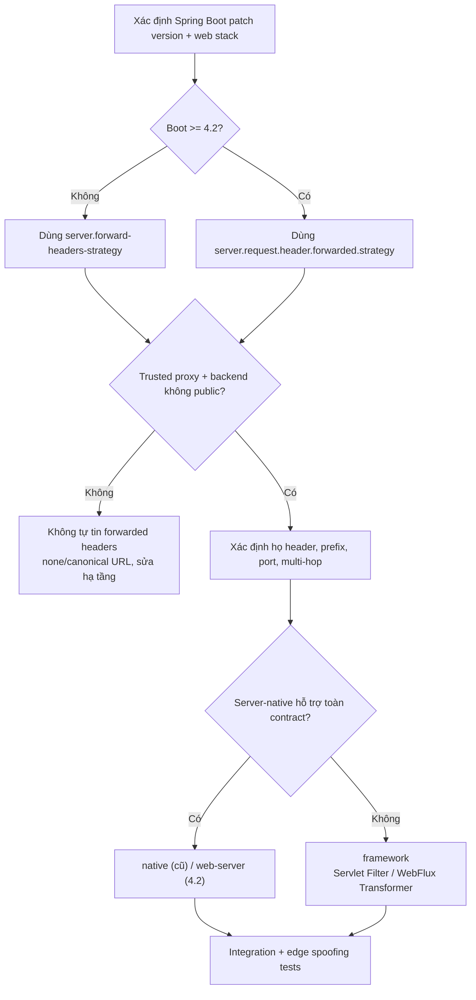
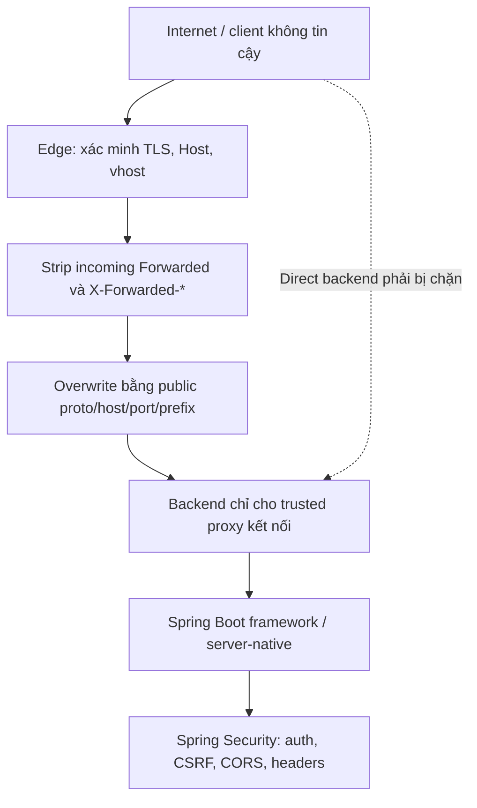

# Chọn cơ chế xử lý forwarded headers theo phiên bản Spring Boot

> **Chương:** Proxy và nguồn gốc  
> **Module:** `SPRING_SECURITY_HTTP_PROTECTION` — áp dụng CSRF, CORS, security headers, CSP, HSTS, HTTP firewall và bảo vệ session cho Servlet và Reactive trong Spring Security.  
> **Phạm vi:** So sánh cách chọn cơ chế forwarded headers qua các thế hệ **Spring Boot 2.x, 3.x và 4.x**, đặc biệt thay đổi **Spring Boot 4.2** so với 4.1 và các phiên bản trước. Nội dung hướng tới cấu hình triển khai, migration an toàn và kiểm thử qua reverse proxy.

## 1. Vì sao phải xét phiên bản Spring Boot trước khi chọn cấu hình?

Một ứng dụng Spring Boot chạy trên máy nội bộ có thể thấy request là:

```text
http://orders.internal:8080/api/orders
```

Trong khi trình duyệt truy cập:

```text
https://shop.example.test:8443/app/api/orders
```

Reverse proxy có thể đã terminate TLS, chuyển port và bỏ tiền tố `/app`. Nếu ứng dụng dùng URL nội bộ để sinh redirect, OAuth2/OIDC callback, liên kết reset mật khẩu hoặc cookie, luồng HTTP sẽ sai.

Hạ tầng có thể báo lại địa chỉ public qua:

```http
Host: orders.internal:8080
X-Forwarded-Proto: https
X-Forwarded-Host: shop.example.test
X-Forwarded-Port: 8443
X-Forwarded-Prefix: /app
X-Forwarded-For: 198.51.100.24
```

Vấn đề là **Spring Boot không dùng cùng tên property và cùng quy tắc trên mọi phiên bản**:

- Ở các dòng cũ, `server.forward-headers-strategy` có các giá trị `native`, `framework`, `none`.
- Từ **Spring Boot 4.2**, namespace mới là `server.request.header.forwarded.strategy`; giá trị server-native đổi tên thành `web-server`.
- Từ **Spring Boot 4.2**, việc dùng header chuẩn `Forwarded` hay họ `X-Forwarded-*` cần được lựa chọn có chủ đích; hỗ trợ `X-Forwarded-Prefix` **không còn bật mặc định**.
- Cơ chế native phụ thuộc Tomcat, Jetty, Reactor Netty và các giới hạn được Boot công bố cho phiên bản đó.

Nếu sao chép một snippet dành cho 3.x sang 4.2 mà không kiểm tra, cấu hình có thể bị deprecated, không còn hành vi mong đợi hoặc **làm ứng dụng không khởi động** khi trùng property.

**Mục tiêu:** Không thuộc lòng một dòng YAML duy nhất, mà xây **quy trình ra quyết định theo version × web stack × proxy topology × yêu cầu bảo mật**.

## 2. Mục tiêu học tập

Sau bài học, người học có thể:

1. Lập bảng tương thích của tên property và các giá trị forwarded-header strategy theo Spring Boot.
2. Phân biệt `native` ở Boot 2.2–4.1 với `web-server` ở Boot 4.2, cùng chiến lược `framework` và `none`.
3. Cấu hình `server.request.header.forwarded.naming` và `server.request.header.forwarded.use-prefix` trên Spring Boot 4.2.
4. Nhận biết giới hạn native xử lý RFC 7239 và prefix của Tomcat/Jetty trong Boot 4.2, chọn `framework` khi cần.
5. Giải thích sự khác biệt giữa Servlet `ForwardedHeaderFilter`/Tomcat `RemoteIpValve` và Reactive `ForwardedHeaderTransformer`/server-native handling.
6. Đánh giá `Forwarded`, `X-Forwarded-Proto`, `X-Forwarded-Host`, `X-Forwarded-Port`, `X-Forwarded-Prefix` và `X-Forwarded-For` trên một trust boundary.
7. Viết kiểm thử chống regression cho public URL, redirect/OAuth, HSTS, cookie, CORS, CSRF, security chain và header spoofing.
8. Xây kế hoạch nâng cấp Boot 3.x/4.1 → 4.2 mà không suy yếu Spring Security.

## 3. Bảng tương thích quan trọng nhất

Tại thời điểm biên soạn **26/11/2026**, tài liệu Spring Boot 4.2.0 xác nhận thay đổi cấu hình forwarded headers dưới namespace mới. Khi sử dụng các patch release hoặc version tương lai, vẫn phải đối chiếu documentation và configuration metadata tương ứng.

| Dòng Spring Boot | Property chọn chiến lược | Giá trị xử lý tại server | Giá trị xử lý tại Spring Framework | Giá trị không dùng forwarding |
|---|---|---|---|---|
| 2.1 trở về trước (legacy, tùy minor) | Thường gặp `server.use-forward-headers` | Cấu hình kiểu boolean theo version | Có thể phải khai báo filter thủ công | Theo cấu hình legacy |
| **2.2–2.7** | `server.forward-headers-strategy` | `native` | `framework` | `none` |
| **3.0–3.5** | `server.forward-headers-strategy` | `native` | `framework` | `none` |
| **4.0–4.1** | `server.forward-headers-strategy` | `native` | `framework` | `none` |
| **4.2** | **`server.request.header.forwarded.strategy`** | **`web-server`** | `framework` | `none` |

**Không chuyển `native` thành `web-server` trong Boot 3.x/4.1**: đó không phải tên strategy được tài liệu của những dòng này sử dụng.

**Không giữ song song property cũ và mới ở Boot 4.2**: theo release notes, nếu cấu hình cả `server.forward-headers-strategy` lẫn `server.request.header.forwarded.strategy`, **startup thất bại**. Property cũ bị deprecated ở 4.2 và cần được chuyển sang namespace mới.

### 3.1. Điều gì đã đổi riêng ở Spring Boot 4.2?

| Khía cạnh | 4.1 trở về trước (các dòng dùng strategy cũ) | Boot 4.2 |
|---|---|---|
| Tên property | `server.forward-headers-strategy` | `server.request.header.forwarded.strategy` |
| Cơ chế xử lý từ web server | `native` | `web-server` |
| Framework-level | `framework` | `framework` |
| Tắt xử lý | `none` | `none` |
| Header naming | Tùy cơ chế/framework/parser; không có bộ property 4.2 tương đương | `server.request.header.forwarded.naming`; mặc định họ `X-Forwarded-*`, có thể chọn `rfc-7239` |
| Header `X-Forwarded-Prefix` | Tùy framework/container và cấu hình thực tế | **Mặc định bỏ qua**; muốn sử dụng cần `server.request.header.forwarded.use-prefix=true` |
| Bật cả property cũ và mới | Không áp dụng như migration 4.2 | **Fail startup** |
| Native có đủ RFC/prefix? | Tùy server/version; test | Boot **kiểm tra capability và có thể fail startup** nếu chọn tổ hợp không được hỗ trợ |
| Tomcat context-root redirect | `server.tomcat.redirect-context-root` trong docs 4.1 | Đổi thành `server.tomcat.servlet.redirect-context-root` |

Điểm khác biệt 4.2 không chỉ là **đổi tên một property**. Nếu ứng dụng trước đây dùng `X-Forwarded-Prefix` để tạo redirect có `/app`, nâng cấp có thể tạo URL thiếu prefix nếu quên bật `use-prefix`; một thay đổi nhỏ ở URL builder có thể khiến login/cookie/CSRF thất bại ở browser.

### 3.2. Lưu ý về ứng dụng legacy Boot 2.1 hoặc cũ hơn

Các dự án rất cũ có thể dùng `server.use-forward-headers`, nhưng property kiểu boolean đó **không đồng nghĩa** với các lựa chọn hiện đại và không thể tự động suy nó tương đương `framework`. Khi nâng cấp:

1. Xác định chính xác version từ dependency/build metadata **của dự án**.
2. Đọc hướng dẫn version đó, không copy config của Boot 4.2.
3. Tìm chỗ khai báo filter/valve thủ công cùng các settings cũ.
4. Migrate một lần sang namespace được version đích hỗ trợ.
5. So sánh hành vi thực qua proxy trong integration tests.

Bài học này **không yêu cầu sửa các file build**: các bước trên là quy trình áp dụng vào một dự án thực, không phải thao tác trên repository nội dung khóa học.

## 4. Phân biệt ba chiến lược trước khi xem YAML

### 4.1. Web-server/native strategy

Khi chọn `native` (Boot 2.2–4.1) hoặc `web-server` (Boot 4.2), **web server** chịu trách nhiệm diễn giải forwarded metadata trong khả năng được nó hỗ trợ.

Ví dụ:

- Servlet Tomcat có cơ chế như `RemoteIpValve` cho remote IP và protocol, với `internalProxies`/`trustedProxies`.
- Jetty có cơ chế forwarding của chính Jetty.
- WebFlux chạy Reactor Netty có cách xử lý server-native riêng, **không giống Tomcat**.

**Ưu điểm:** Tích hợp ở tầng server, phù hợp khi chỉ cần các header phổ biến mà server hỗ trợ, có thể xử lý thông tin request trước Servlet/WebFlux application.

**Giới hạn:** Không mặc nhiên hỗ trợ mọi header, đặc biệt RFC `Forwarded`, prefix, IPv6, nhiều hop hoặc remote IP theo cùng quy tắc ở mọi server. Native không miễn nghĩa vụ kiểm tra trusted proxy.

### 4.2. Framework strategy

Khi chọn `framework`:

- **Servlet:** Spring Framework dùng `ForwardedHeaderFilter`.
- **Reactive/WebFlux:** Spring Framework dùng `ForwardedHeaderTransformer`.

Cơ chế này hữu ích nếu web server không hỗ trợ đúng kiểu header hoặc prefix mà proxy sử dụng.

**Lưu ý bảo mật:** Các thành phần Spring Framework không tự bảo đảm dữ liệu đến từ IP proxy đáng tin. Chúng **biến đổi request dựa vào header**, nên cần chặn direct backend và strip/overwrite forwarded headers ở edge.

### 4.3. None strategy

`none` có nghĩa Boot không bật một cơ chế forwarded-header processing theo strategy được chọn. Khi đó backend thường quan sát địa chỉ của hop nội bộ.

Chọn `none` khi:

- App không cần dựa vào request để xây public URL.
- Proxy không đáng tin hoặc backend có thể bị truy cập từ nguồn không kiểm soát.
- App dùng canonical public base URL được quản lý riêng cho các link quan trọng.

**Đừng nhầm `none` là biện pháp chặn mọi header giả.** Một container custom, WebFilter/Servlet Filter tự viết hoặc gateway khác vẫn có thể đọc `X-Forwarded-Host` trực tiếp. Nếu không tin dữ liệu, phải ngăn chúng được sử dụng ở mọi consumer.

### 4.4. So sánh theo mục tiêu triển khai

| Mục tiêu | Ưu tiên xem xét | Điều phải chứng minh |
|---|---|---|
| Chỉ HTTPS proto/remote IP qua trusted LB | Web server/native | Server hỗ trợ đúng header và trusted peer |
| Cần `Forwarded: proto/host` RFC 7239 | 4.2: `naming=rfc-7239` với server hỗ trợ, hoặc `framework` | Cấu hình không fail startup; URI đúng |
| Cần `X-Forwarded-Prefix` để tạo URL public | 4.2: `use-prefix=true` và chọn strategy tương thích | Redirect, context path và matcher đúng |
| Tomcat + `use-prefix=true` ở Boot 4.2 | **Framework**, không chọn web-server | Tomcat native không hỗ trợ `use-prefix` theo release notes |
| Tomcat + `naming=rfc-7239` ở Boot 4.2 | **Framework**, không chọn web-server | Tomcat native không hỗ trợ RFC naming đó theo release notes |
| Jetty + `use-prefix=true` ở Boot 4.2 | **Framework** | Jetty native không hỗ trợ prefix theo release notes |
| Không có trust boundary | `none` và/hoặc canonical URL | Không consumer nào tin header client giả |
| App nhận session cookie qua proxy | Bất kỳ strategy phù hợp trust boundary | **CSRF, authentication, authorization vẫn riêng biệt** |

## 5. Trước Boot 4.2: các cấu hình chuẩn theo từng chiến lược

Các đoạn sau áp dụng cho **Boot 2.2–2.7, 3.x và 4.0–4.1**, dựa trên contract `server.forward-headers-strategy`. Không dùng nguyên đoạn này làm cấu hình ưu tiên cho 4.2.

### 5.1. Dùng Spring Framework

```yaml
# Spring Boot 2.2–4.1
server:
  forward-headers-strategy: framework
```

- Servlet: `ForwardedHeaderFilter` xử lý metadata.
- WebFlux: `ForwardedHeaderTransformer` xử lý metadata.
- Cần kiểm thử `Forwarded` vs `X-Forwarded-*` được stack hiện tại diễn giải theo policy nào.
- Nếu ứng dụng đã có filter/transformer thủ công, tránh xử lý trùng.
- Trust boundary phải được thiết lập **trước** application.

### 5.2. Dùng native server

```yaml
# Spring Boot 2.2–4.1
server:
  forward-headers-strategy: native
```

Đây là lựa chọn quen thuộc khi edge xuất các header `X-Forwarded-For` và `X-Forwarded-Proto`, và web server hỗ trợ chúng.

**Không suy native đồng nghĩa hoàn hảo:** Test `X-Forwarded-Host`, port 8443 và prefix nếu ứng dụng dùng chúng. Các trường hợp này có thể không được hỗ trợ hoặc có precedence khác kỳ vọng.

### 5.3. Không sử dụng forwarded strategy

```yaml
# Spring Boot 2.2–4.1
server:
  forward-headers-strategy: none
```

Nếu cần xây liên kết reset mật khẩu hoặc callback từ URL cố định, có thể dùng một application property riêng, ví dụ:

```yaml
app:
  public-base-url: "https://portal.example.test:8443/app"
```

`app.public-base-url` là **property minh họa do ứng dụng tự định nghĩa**, không phải property Spring Boot tự hiểu. Muốn dùng phải có code đọc cấu hình và builder URI đúng; không làm phát sinh tự động các redirect Spring Security.

### 5.4. Tomcat + TLS termination: redirect context root

Trong tài liệu Boot 2.x–4.1 có lưu ý về:

```properties
server.tomcat.redirect-context-root=false
```

Khi Tomcat tự redirect context root ở tầng container **trước khi** áp `X-Forwarded-Proto`, một redirect có thể dùng HTTP nội bộ. Tùy cấu hình container/relative redirects, property này giúp proxy scheme được dùng đúng.

**Không copy mù quáng sang Boot 4.2:** Property liên quan đã chuyển vào `server.tomcat.servlet.redirect-context-root`. Ngoài ra, thay đổi redirect context root **không thay** trust boundary hoặc giải pháp cho mọi callback.

## 6. Spring Boot 4.2: cấu hình mới đúng version

Theo release notes Spring Boot **4.2.0**, các cấu hình forwarded headers được nhóm dưới:

```text
server.request.header.forwarded
```

### 6.1. Chọn native web-server handling

```yaml
# Spring Boot 4.2+
server:
  request:
    header:
      forwarded:
        strategy: web-server
```

Hoặc:

```properties
server.request.header.forwarded.strategy=web-server
```

`web-server` là tên mới thay cho `native` trong contract này. Nên thử trước nếu web server hỗ trợ đầy đủ các header mà proxy sử dụng; bản thân Boot 4.2 cũng khuyến nghị ưu tiên server-level support khi có thể.

### 6.2. Chọn Spring Framework handling

```yaml
# Spring Boot 4.2+
server:
  request:
    header:
      forwarded:
        strategy: framework
```

Hoặc:

```properties
server.request.header.forwarded.strategy=framework
```

Servlet dùng `ForwardedHeaderFilter`; Reactive dùng `ForwardedHeaderTransformer` theo cách Boot quản lý. Đây là phương án khi server không hỗ trợ naming/prefix cần thiết hoặc khi muốn framework-level behavior đã được kiểm chứng.

### 6.3. Tắt chuyển đổi forwarded metadata

```yaml
# Spring Boot 4.2+
server:
  request:
    header:
      forwarded:
        strategy: none
```

Dù `none`, vẫn phải rà soát custom filters đọc header trực tiếp, proxy route và canonical link builder. Không dùng `none` để né một vấn đề CSRF còn tồn tại trong browser-session flows.

### 6.4. Chọn họ header: mặc định X-Forwarded hay RFC 7239?

Trong Spring Framework 7.1 và Boot 4.2, cấu hình xử lý forwarded headers **phân biệt họ header**. Boot 4.2 mặc định dùng họ phổ biến `X-Forwarded-*`.

Nếu proxy của bạn chỉ xuất header chuẩn RFC 7239:

```http
Forwarded: for=198.51.100.24;proto=https;host="portal.example.test:8443"
```

cấu hình:

```yaml
# Boot 4.2: chọn naming RFC 7239
server:
  request:
    header:
      forwarded:
        strategy: framework
        naming: rfc-7239
```

`server.request.header.forwarded.naming=rfc-7239` là property của 4.2. **Không thêm property này vào Boot 3.x và kỳ vọng nó được hỗ trợ.**

Khi chọn `rfc-7239`, phải test rằng:

- Edge thật xuất `Forwarded` đúng cú pháp, có host/port public cần thiết.
- Client không thể tự đặt header rồi được backend tin.
- Không có họ `X-*` mâu thuẫn được một component khác đọc như dữ liệu authoritative.
- Filter/transformer thực sự sử dụng đúng họ đã chọn.
- Cấu hình naming được web server hoặc strategy framework hỗ trợ.

**Giới hạn Boot 4.2:** Theo release notes, Tomcat native **không** hỗ trợ `rfc-7239` theo lựa chọn này; với Tomcat hãy chuyển sang `framework` nếu cần RFC naming. Boot có thể **fail startup** khi lựa chọn không được server hỗ trợ.

### 6.5. Bật X-Forwarded-Prefix có chủ đích

Đây là thay đổi migration rất dễ bị bỏ qua. Trong Boot 4.2, **`X-Forwarded-Prefix` mặc định bị bỏ qua**, bất kể strategy.

Nếu public path là:

```text
https://portal.example.test/app/api/orders
```

nhưng ingress chuyển thành:

```text
http://app.internal:8080/api/orders
```

và xuất:

```http
X-Forwarded-Prefix: /app
```

muốn ứng dụng xử lý prefix theo cơ chế forwarded tương ứng, hãy chọn:

```yaml
# Spring Boot 4.2: framework hỗ trợ prefix
server:
  request:
    header:
      forwarded:
        strategy: framework
        use-prefix: true
```

Hoặc khi server-native **thực sự hỗ trợ** prefix:

```yaml
# Chỉ dùng khi web server đã được xác minh có hỗ trợ.
server:
  request:
    header:
      forwarded:
        strategy: web-server
        use-prefix: true
```

**Cảnh báo khả năng:** Boot 4.2 công bố **Tomcat và Jetty không hỗ trợ `use-prefix` ở chế độ web-server**. Startup có thể thất bại với tổ hợp không được hỗ trợ; giải pháp là chọn `framework` hoặc thay hợp đồng proxy. Không nên “bỏ use-prefix” chỉ để server khởi động nếu ứng dụng cần nó cho redirect/cookie path.

### 6.6. Kết hợp prefix với RFC naming

Một cấu hình ứng dụng Boot 4.2 có thể chọn:

```yaml
server:
  request:
    header:
      forwarded:
        strategy: framework
        naming: rfc-7239
        use-prefix: true
```

Tuy nhiên, cần hiểu hai đầu vào: `Forwarded` chuẩn có các tham số `for/proto/host`, **không có `X-Forwarded-Prefix` trong RFC 7239**. Do đó, **đừng giả định** rằng chọn RFC naming và `use-prefix=true` tự động khiến mọi prefix độc lập hoạt động theo cùng cách trong mọi setup. Xác định header prefix do proxy phát, contract framework thực tế và kiểm tra URI/context path/redirect bằng test. Nếu cần, chọn một quy ước proxy + framework thực sự hỗ trợ.

### 6.7. Tên property cũ có được dùng tiếp không?

Ở Boot 4.2, `server.forward-headers-strategy` **đã deprecated** để chuyển sang `server.request.header.forwarded.strategy`. Đừng dựa lâu dài vào khả năng backward compatibility.

Trường hợp nguy hiểm:

```yaml
# PHẢN VÍ DỤ trên Spring Boot 4.2: hai property trùng chủ đích.
server:
  forward-headers-strategy: native
  request:
    header:
      forwarded:
        strategy: web-server
```

Theo release notes 4.2, **cấu hình đồng thời hai tên property sẽ khiến startup thất bại**, kể cả khi giá trị có vẻ tương đương. Phải xóa property cũ khỏi tất cả nguồn configuration trước rollout.

**Tìm ở nhiều nguồn:** `application.yml`, profile-specific configs, environment variables, Helm values, ConfigMaps, deployment descriptors, config server, command-line arguments và secret/config mounting. Giá trị một property có thể nằm ngoài mã nguồn.

## 7. Cây quyết định chọn strategy đúng phiên bản



### Bước 1 — Xác định version thực sự chạy

Không suy từ README hoặc một artifact cache cũ. Cần kiểm tra:

- Spring Boot version đã được resolution trong build thực tế.
- Spring Framework version tương ứng; Boot 4.2 đi cùng thay đổi forwarding behavior của Framework 7.1.
- Web stack: **Spring MVC/Servlet** hay **WebFlux/Reactive**.
- Embedded server thật: Tomcat, Jetty, Reactor Netty hoặc server thay thế.
- Version running trong staging/production có đúng artifact vừa build hay không.

**Không cần bật Actuator `/env` công khai** để xem property; có thể dùng build metadata, test runtime hoặc kiểm tra configuration trong môi trường quản lý nội bộ.

### Bước 2 — Xác định external request contract

Ghi rõ:

```text
Public URL:       https://portal.example.test:8443/app/orders
Backend URL:      http://orders.internal:8080/orders
Trusted edge:     ingress-a (mTLS hoặc trusted network)
Forwarding family: X-Forwarded-*
Public prefix:    /app (edge strip trước upstream)
Client IP policy: trusted ingress + CDN chain nếu có
```

Nếu proxy dùng RFC `Forwarded` nhưng ứng dụng đang cấu hình X-family, việc bật strategy có thể không mang lại scheme/host mong muốn. Nếu dùng port 8443 mà proxy không báo port, redirect có thể nhầm sang 443.

### Bước 3 — Xác định trust boundary

Các điều kiện tiên quyết:

1. Edge xác minh public Host/`:authority` và TLS listener.
2. Edge **strip hoặc overwrite** mọi `Forwarded`/`X-Forwarded-*` do client Internet tự gửi.
3. Backend chỉ nhận kết nối từ trusted proxy hoặc có xác thực service identity tương đương.
4. Các hop CDN/LB/ingress có quy định rõ ai được tạo và ai được append metadata.
5. Không dùng raw `X-Forwarded-For` làm authentication hoặc quyết định cấp quyền.
6. Không cấp quyền admin dựa trên `Host`/`X-Forwarded-Host` chưa được xác minh.

Nếu thiếu trust boundary, **đừng chọn framework/native rồi mong library sẽ tự chống spoofing**.

### Bước 4 — Chọn strategy theo nhu cầu

- **Không cần URL public từ request:** `none` và canonical URL phù hợp.
- **Cần scheme/host/port từ trusted proxy, server hỗ trợ:** `native` (trước 4.2) hoặc `web-server` (4.2).
- **Cần prefix/RFC naming server không hỗ trợ:** `framework`.
- **Không chắc hỗ trợ:** test trên đúng version, không suy đoán từ một servlet/reactive stack khác.

### Bước 5 — Kiểm thử nguyên contract, không chỉ startup

Startup thành công là cần nhưng **không đủ**. App vẫn có thể tạo redirect HTTP, mất prefix, cookie Path sai hoặc CSRF matcher lệch. Chạy các test đã thiết kế ở phần 12–15.

## 8. Servlet: cấu hình theo phiên bản và server

### 8.1. Cấu hình framework

Boot 3.x/4.1:

```yaml
server:
  forward-headers-strategy: framework
```

Boot 4.2:

```yaml
server:
  request:
    header:
      forwarded:
        strategy: framework
        use-prefix: true  # Chỉ bật khi proxy có tiền tố /app hợp lệ
```

Spring MVC sử dụng `ForwardedHeaderFilter` để ứng dụng hiểu scheme/host/port và có thể hỗ trợ prefix/redirect theo framework.

**Không tự đăng ký thêm cùng một `ForwardedHeaderFilter`** nếu Boot đã tự cấu hình nó theo property. Tránh container-native valve và framework filter cùng diễn giải metadata, làm host/port/prefix không nhất quán.

### 8.2. Tomcat native

Boot 3.x/4.1:

```yaml
server:
  forward-headers-strategy: native
  tomcat:
    remoteip:
      remote-ip-header: x-forwarded-for
      protocol-header: x-forwarded-proto
```

Boot 4.2 với web-server:

```yaml
server:
  request:
    header:
      forwarded:
        strategy: web-server
  tomcat:
    remoteip:
      remote-ip-header: x-forwarded-for
      protocol-header: x-forwarded-proto
```

Tùy container, Tomcat `RemoteIpValve` xử lý client IP/protocol theo danh sách `internalProxies` và `trustedProxies`. **Không bao giờ đặt trust regex rộng chỉ để mọi request được coi là proxy**. Đặc biệt nếu một pod/container không phải ingress vẫn có thể kết nối trong dải private.

**Giới hạn Boot 4.2:** Với Tomcat, nếu cần `naming=rfc-7239` hoặc `use-prefix=true`, tài liệu release notes hướng dẫn dùng `framework` vì tổ hợp native đó không được hỗ trợ.

### 8.3. Tomcat context-root redirect theo version

| Version | Property cần kiểm tra khi TLS terminate ở proxy |
|---|---|
| Boot 2.2–4.1 | `server.tomcat.redirect-context-root=false` |
| Boot 4.2 | `server.tomcat.servlet.redirect-context-root=false` |

Lưu ý version 4.2 giải thích khi `use-relative-redirects` đang là false và Tomcat tự tạo absolute context-root redirect, cấu hình trên cho phép protocol forwarding được xét đúng trước redirect. Nếu ứng dụng đã dùng relative redirects, hành vi có thể khác.

Đừng bật property này như một “fix mọi lỗi proxy”; test `Location` thực tế.

### 8.4. Header được Tomcat xử lý không đồng nghĩa tự đủ quyền

`RemoteIpValve` có thể cập nhật thông tin remote IP/proto của Servlet request. Nhưng:

- Authentication/authorization vẫn do Spring Security hoặc IAM phù hợp xử lý.
- `CsrfFilter` vẫn cần kiểm tra token cho unsafe browser-cookie routes.
- CORS cần allowlist `Origin` caller.
- HSTS/CSP/security headers cần policy và test riêng.
- Servlet `StrictHttpFirewall` không tự xác minh forwarded host.

Một địa chỉ IP “trông như nội bộ” không được quyền bỏ qua `authenticated()` hoặc `hasAuthority(...)`.

## 9. WebFlux Reactive: framework vs web-server strategy

WebFlux sử dụng `ServerHttpRequest`, `ServerWebExchange` và `SecurityWebFilterChain`, không dùng `HttpServletRequest`.

### 9.1. Framework-level WebFlux

Boot 4.2:

```yaml
server:
  request:
    header:
      forwarded:
        strategy: framework
        use-prefix: true
```

Khi dùng Spring Framework support, WebFlux có `ForwardedHeaderTransformer` xử lý forwarded metadata **trước các WebFilters** tiêu thụ request theo pipeline chuẩn. Nếu app không dùng Boot auto-config, có thể khai báo thủ công trong đúng context:

```java
import org.springframework.context.annotation.Bean;
import org.springframework.web.server.adapter.ForwardedHeaderTransformer;

@Bean
ForwardedHeaderTransformer forwardedHeaderTransformer() {
    return new ForwardedHeaderTransformer();
}
```

**Quan trọng ở Boot 4.2:** Khi cấu hình thủ công với Spring Framework 7.1, yêu cầu chọn family/naming cần được xác minh theo API version thực tế. Đừng coi bean no-arg ví dụ là bằng chứng header RFC và X-family sẽ được xử lý đồng thời theo cùng một quy tắc. Nếu dùng Boot property, để auto-configuration đảm nhiệm contract và test behavior.

### 9.2. Native Reactive server

Trên WebFlux, `web-server` của Boot 4.2 dựa vào server runtime (thường là Reactor Netty, nhưng WebFlux có thể chạy trên container khác). Không mang các property `server.tomcat.remoteip.*` sang Reactor Netty rồi nghĩ sẽ có tác dụng.

Cần hỏi:

- Reactor Netty/Jetty version có đọc `Forwarded`, `X-Forwarded-Host`, port ngoài theo naming đã chọn không?
- Native server có hỗ trợ `X-Forwarded-Prefix` theo Boot 4.2 không?
- Peer IP nào được tin để xử lý forwarded client IP?
- Khi header mâu thuẫn, server có từ chối hay dùng precedence cụ thể?
- Nếu proxy chuyển giữa TLS termination và HTTP nội bộ, URI/redirect có phản ánh external scheme không?

Trả lời bằng **documentation cho đúng version + integration tests**, không bằng một câu “WebFlux stateless”.

### 9.3. Chế độ remove-only trong framework

`ForwardedHeaderFilter` (Servlet) và `ForwardedHeaderTransformer` (Reactive) có chế độ remove-only ở những API tương ứng:

```java
ForwardedHeaderTransformer transformer =
    new ForwardedHeaderTransformer();
transformer.setRemoveOnly(true);
```

Mục đích là **loại các forwarded headers được implementation nhận diện** mà không dùng chúng để biến đổi URI. Không mong có public host/proto nếu chỉ dùng remove-only.

Remove-only cũng không thể “đảo ngược” một container/server-native step đã đọc dữ liệu giả trước đó. Bảo vệ hiệu quả phải xảy ra ở trusted edge.

## 10. Mẫu edge Nginx thống nhất cho cả hai thế hệ Boot

Giả sử public URL là `https://portal.example.test:8443/app/...` và upstream là `http://app.internal:8080/...`. Nginx là TLS edge trực tiếp, backend không mở cho Internet, và ingress bỏ `/app` trước khi proxy.

```nginx
server {
    listen 8443 ssl;
    server_name portal.example.test;

    # Certificate/TLS, default deny vhost, access control và network
    # policy phải có trong cấu hình production đầy đủ.

    location /app/ {
        proxy_pass http://app.internal:8080/;

        # Host đích public đã được vhost kiểm soát.
        proxy_set_header Host portal.example.test:8443;

        # Không gửi nguyên RFC Forwarded client khai.
        proxy_set_header Forwarded "";

        # Metadata authoritative, không lấy từ $http_x_forwarded_*.
        proxy_set_header X-Forwarded-Proto https;
        proxy_set_header X-Forwarded-Host portal.example.test;
        proxy_set_header X-Forwarded-Port 8443;
        proxy_set_header X-Forwarded-Prefix /app;

        # Edge trực tiếp: ghi đè XFF bằng TCP peer được quan sát.
        proxy_set_header X-Forwarded-For $remote_addr;
    }
}
```

**Giới hạn ví dụ:** Đoạn này minh họa một ingress với public host cố định, không phải file Nginx production hoàn chỉnh. Không dùng nguyên `$remote_addr` làm client IP khi Nginx ở sau CDN/LB chưa có trusted real-IP setup.

**Đặc biệt cho Boot 4.2:** Nếu Spring cần `/app` khi xây public URL, cấu hình app phải bật `use-prefix=true` và chọn strategy có hỗ trợ. Trước đó, một version/framework có thể đã xử lý prefix theo behavior khác; đừng nghĩ migration giữ nguyên.

### 10.1. Khi proxy dùng RFC `Forwarded` thay vì X-family

Một edge đáng tin có thể xuất:

```http
Forwarded: for=198.51.100.24;proto=https;host="portal.example.test:8443"
```

Boot 4.2:

```yaml
server:
  request:
    header:
      forwarded:
        strategy: framework
        naming: rfc-7239
```

Không dùng đồng thời config Nginx X-family ở trên và RFC header mâu thuẫn. Quy định **một nguồn authoritative** cho scheme/host/port. Trường hợp proxy còn có `X-Forwarded-Prefix` cần test riêng quy tắc naming/prefix khi Boot 4.2 được cấu hình.

## 11. Trust boundary không phụ thuộc Spring Boot version

Cả Boot 2.x, 3.x lẫn 4.x đều phải giải quyết cùng một nguy cơ: **header HTTP là dữ liệu có thể do client tự gửi**.

### 11.1. Tấn công host/proto/IP forwarding

```http
GET /forgot-password HTTP/1.1
Host: portal.example.test
Forwarded: proto=https;host=attacker.example;for=127.0.0.1
X-Forwarded-Host: attacker.example
X-Forwarded-Proto: http
X-Forwarded-For: 127.0.0.1
```

Nếu backend trực tiếp accessible hoặc edge không strip/overwrite, URI có thể bị biến thành host giả, redirect/link sai và IP audit sai.

### 11.2. Quy trình chuẩn hóa ở trusted edge



- **Strip:** bỏ dữ liệu forwarded do client tự khai.
- **Overwrite:** ghi dữ liệu xác minh tại TLS edge/vhost/remote peer.
- **Append:** chỉ được dùng khi chuỗi trước đó đã được trusted-hop policy kiểm soát; không giữ tiền tố XFF giả rồi lấy phần tử đầu tiên làm IP thật.
- **Host allowlist:** kiểm soát domain được phép, đặc biệt nơi sinh reset-password URL, callback hoặc tenant routing.
- **Network policy:** chặn truy cập backend đi vòng edge.
- **mTLS/service identity:** cân nhắc khi nhiều workload nội bộ có thể đến port backend.

`ForwardedHeaderFilter`, `ForwardedHeaderTransformer` hoặc server-native support **không thay thế** các bước này.

### 11.3. Multi-hop và proxy CIDR

Với `Browser → CDN → LB → ingress → Spring`, không thể tin mọi header đến ingress chỉ vì request đến từ dải private. Ingress phải biết upstream nào được phép, ai phát canonical `proto/host/port` và cách `X-Forwarded-For` được giữ/append.

Một workload nội bộ có thể gửi `X-Forwarded-For: 127.0.0.1`. Không dùng dữ liệu đó để cấp quyền admin. Với Tomcat native, `internalProxies`/`trustedProxies` cần khớp topology, không đặt regex nhận toàn bộ Internet.

## 12. Migration Boot 4.1 → 4.2 từng bước

### 12.1. Trước migration: ví dụ service dùng prefix

```yaml
# Boot 4.1
server:
  forward-headers-strategy: framework
```

Ứng dụng phục vụ browser:

```text
https://portal.example.test:8443/app/login
```

Proxy strip `/app` và gửi `X-Forwarded-Prefix: /app`. Nếu version 4.1 đã xử lý prefix, redirect từ Spring có thể dùng `/app/login`.

### 12.2. Sau migration: cấu hình rõ naming và prefix

```yaml
# Boot 4.2
server:
  request:
    header:
      forwarded:
        strategy: framework
        use-prefix: true
```

Nếu edge dùng RFC `Forwarded` thay vì X-family, thêm `naming=rfc-7239` và test xem prefix được hỗ trợ như mong muốn.

Đừng giữ:

```yaml
server:
  forward-headers-strategy: framework
```

trong một profile/env khác, vì Boot 4.2 không cho cấu hình **đồng thời** cả tên cũ và mới.

### 12.3. Migration native → web-server

Cấu hình cũ:

```properties
server.forward-headers-strategy=native
```

Thay bằng:

```properties
server.request.header.forwarded.strategy=web-server
```

Nhưng nếu ứng dụng cần `X-Forwarded-Prefix` và chạy Tomcat/Jetty theo giới hạn Boot 4.2, **không** giữ `web-server` rồi bật `use-prefix=true` một cách mù quáng. Hãy chọn `framework` hoặc thiết kế lại public prefix contract theo khả năng server.

### 12.4. Kiểm kê tất cả nguồn config, không chỉ application.yml

Một property có thể đến từ:

| Nguồn | Ví dụ rủi ro |
|---|---|
| `application.yml` | Có config mới nhưng cũ chưa xóa |
| `application-prod.yml` | Còn strategy legacy khi bật profile production |
| Env var | `SERVER_FORWARD_HEADERS_STRATEGY=native` còn trong deployment |
| Helm chart/ConfigMap | Values cũ được render lại |
| Startup args | Command line override naming/strategy |
| Config server | Global property cũ từ môi trường chung |
| Unit/integration tests | Test vẫn chạy với property không còn đúng |
| Manual bean/valve | Framework/native processing bị đăng ký trùng |

Boot 4.2 hỗ trợ một cơ chế kiểm tra cấu hình deprecated; nhưng không dùng tool migration như **giải pháp thay thế** cho việc xóa property cũ và viết regression tests.

### 12.5. Checklist trước/sau nâng cấp

| Hạng mục | Trước | Sau |
|---|---|---|
| App khởi động | Boot 4.1 với tên cũ | Boot 4.2 chỉ dùng tên mới |
| Naming | Header family theo behavior cũ | `x-forwarded` mặc định hoặc `rfc-7239` được chọn |
| Prefix | App từng dùng `X-Forwarded-Prefix` | `use-prefix=true` nếu cần |
| Server capability | Native từng xử lý một số headers | Không chọn tổ hợp native không được hỗ trợ |
| URI | `https://portal.example.test:8443/app/...` | Giữ đúng external URL |
| Login/OAuth | Callback đúng scheme/port/prefix | Callback không thay đổi ngoài ý định |
| Cookie/CSRF | Browser session hoạt động | Session/CSRF vẫn hoạt động |
| Security chain | API web/m2m đi đúng chain | Không route nào rơi vào CSRF-off sai |
| Spoofing | Edge chặn header giả | Edge vẫn chặn sau thay ingress/config |
| Rollback | Có config cho version cũ | Không rollback cùng config 4.2 vào 4.1 |

**Rollback phải đi kèm config của phiên bản quay lại**. Không chỉ rollback JAR mà giữ `server.request.header.forwarded.strategy` mới trong Boot 4.1; khi đó property có thể không được nhận như mong muốn.

## 13. Tác động tới Spring Security HTTP Protection

Một chiến lược forwarding sai có thể gây lỗi ngoài URL generation. Cần đánh giá cùng các chức năng bảo vệ module.

### 13.1. HTTPS redirect và HSTS

Nếu TLS kết thúc ở proxy và backend thấy HTTP, `isSecure()` (Servlet) hoặc URI scheme (WebFlux) có thể dẫn tới:

- Redirect về `http://app.internal:8080`.
- Vòng lặp HTTPS → HTTP → HTTPS khi cả edge và Spring ép HTTPS.
- `Strict-Transport-Security` không xuất hiện từ tầng Spring Security nếu request không được xem là HTTPS.

Đặt HSTS tại **TLS edge** hoặc Spring Security theo chính sách rõ; kiểm tra browser-facing response. Không tắt HSTS/HTTPS enforcement để né sai forwarded metadata.

### 13.2. Cookie session và SameSite

Cookie auth phải được kiểm tra với **public URL**:

- `Secure` phù hợp HTTPS bên ngoài.
- `HttpOnly` giảm khả năng JS đọc cookie nhưng không ngăn browser gửi nó.
- `SameSite` hỗ trợ chống một số bối cảnh cross-site; không thay CSRF.
- `Domain`/`Path` phải đúng hostname và prefix public.
- Login/logout, session fixation và CSRF token lifecycle phải chạy qua proxy.

`X-Forwarded-Prefix` bị bỏ qua sau nâng Boot 4.2 có thể khiến Path/redirect sai; browser không gửi session cookie hoặc CSRF token đúng và request nhận 401/302/403.

### 13.3. CORS: origin caller không phải forwarded host

`Origin: https://app.example.test` mô tả **nguồn web** của request. `X-Forwarded-Host: api.example.test` mô tả **đích public** theo proxy. CORS allowlist phải dựa trên origin frontend đã được phê duyệt, không lấy forwarded host làm allowed origin động.

Nếu redirect thiếu cổng `:8443`, browser có thể gặp lỗi CORS vì đổi origin ngoài dự tính. Sửa port/redirect trước; không nới `Access-Control-Allow-Origin: *` để cứu một luồng credentials.

### 13.4. CSRF và phạm vi chain

Với cookie session hoặc JWT cookie, các phương thức thay đổi trạng thái cần CSRF token theo chính sách. `framework`/`web-server`/`native` không thay `CsrfFilter` hay `CsrfWebFilter`.

Tình huống nguy hiểm:

```text
Public /app/api/web/orders
   -> proxy rewrite
   -> backend /api/web/orders
   -> securityMatcher bất ngờ chọn bearer-only CSRF-off chain
```

Không tự cho rằng `X-Forwarded-Prefix` chỉ ảnh hưởng redirect mà không thể tương tác với cách request path/contextPath được quan sát. Phải kiểm chứng matcher trên stack thực, đặc biệt sau Boot 4.2 và `use-prefix`.

### 13.5. CSP, headers và HTTP firewall

CSP có thể giới hạn `connect-src`/`form-action` với origin cụ thể. Redirect sai host/port có thể khiến frontend vi phạm CSP, nhưng CSP không xác thực forwarded host.

Servlet `StrictHttpFirewall` có thể chặn URL encoding/method bất thường trước khi CSRF được xử lý; nó không mặc định kiểm tra proxy trusted CIDRs. Đừng nới HTTP firewall khi path rewrite/forwarded prefix sai.

Các security headers khác phải được kiểm tra trên **response thật sau edge**, vì một số được proxy thêm, một số đến từ chain Spring Security.

## 14. Mô hình kiểm thử bắt buộc qua các phiên bản

Không đủ nếu ứng dụng khởi động và GET `/health` trả 200. Cần kiểm thử ba tầng:

| Tầng | Điều cần chứng minh | Công cụ |
|---|---|---|
| Framework/server | Request được diễn giải đúng theo strategy/version | Spring Boot integration test, MockMvc/WebTestClient hoặc server thật |
| Spring Security | Filter chain, CSRF, authn/authz, CORS, HSTS, cookie hoạt động | Security integration tests |
| Edge/network | Client không giả forwarded metadata được, không direct-origin bypass | Nginx/ingress/CDN staging tests, network validation |

### 14.1. Ma trận version và stack

| Case | Boot 3.x/4.1 | Boot 4.2 |
|---|---|---|
| Config Framework | Property cũ `framework` | Property mới `framework` |
| Config server-native | Property cũ `native` | Property mới `web-server` |
| Config none | Property cũ `none` | Property mới `none` |
| RFC `Forwarded` | Theo stack/framework trước nâng cấp | `naming=rfc-7239` khi cần |
| X-Forwarded-Prefix | Kiểm thử behavior cũ | `use-prefix=true` nếu cần |
| Tomcat native + RFC | Theo support của version hiện tại | Tổ hợp unsupported → chọn framework |
| Tomcat/Jetty native + prefix | Không suy tự động | 4.2 unsupported → framework |
| Config cả tên cũ và mới | Không dùng | **Phải fail startup** theo release notes |
| Edge header spoof | Phải chặn | Vẫn phải chặn |
| Security chain | Không cho browser cookie lọt CSRF-off | Không cho browser cookie lọt CSRF-off |

### 14.2. Đầu ra cần kiểm tra

Request public:

```text
https://portal.example.test:8443/app/orders
```

Hãy kiểm tra:

- `scheme=https`, `host=portal.example.test`, **port=8443**.
- External prefix `/app` được phản ánh đúng ở URI/redirect khi contract yêu cầu.
- Request đi tới handler `/orders` hoặc route tương ứng theo proxy mapping.
- `Location` không chứa `app.internal:8080`, thiếu `:8443` hay lặp `/app/app`.
- Login và OAuth2/OIDC callback đúng origin/port/prefix đã đăng ký.
- `Set-Cookie` có Secure/HttpOnly/SameSite/Path đúng.
- HSTS/CSP/CORS headers theo policy, không giả định mặc định.
- Spring Security matcher chọn đúng chain, token CSRF thiếu/sai bị chặn.

### 14.3. Không dùng status 403 đơn độc làm bằng chứng

Một POST nhận 403 có thể do CSRF, authorization, CORS hoặc business layer. Cần cặp test:

1. Browser có session cookie hợp lệ, POST không CSRF token → từ chối.
2. Cùng principal/quyền và body hợp lệ, có CSRF token đúng → request đi tới nghiệp vụ.

Tương tự, nếu bearer-only API nhận một session cookie hợp lệ nhưng không bearer, nó phải từ chối **authentication**; không chứng minh điều đó bằng một cookie giả vô hiệu.

## 15. Ví dụ kiểm thử Servlet

### 15.1. Controller probe chỉ dùng trong test

```java
import java.util.Map;
import jakarta.servlet.http.HttpServletRequest;
import org.springframework.web.bind.annotation.GetMapping;
import org.springframework.web.bind.annotation.RestController;

@RestController
class PublicUrlProbe {

    @GetMapping("/__test/public-url")
    Map<String, Object> address(HttpServletRequest request) {
        return Map.of(
            "scheme", request.getScheme(),
            "secure", request.isSecure(),
            "host", request.getServerName(),
            "port", request.getServerPort());
    }
}
```

Controller chỉ tồn tại trong test profile hoặc chịu bảo vệ phù hợp; không mở thông tin hạ tầng công khai ở production.

### 15.2. MockMvc với filter framework

Ví dụ dưới đây đo **behavior của `ForwardedHeaderFilter`**, không kiểm tra edge sanitize:

```java
import org.junit.jupiter.api.Test;
import org.springframework.test.web.servlet.MockMvc;
import org.springframework.test.web.servlet.setup.MockMvcBuilders;
import org.springframework.web.filter.ForwardedHeaderFilter;

import static org.springframework.test.web.servlet.request.MockMvcRequestBuilders.get;
import static org.springframework.test.web.servlet.result.MockMvcResultMatchers.jsonPath;
import static org.springframework.test.web.servlet.result.MockMvcResultMatchers.status;

class ServletForwardedHeaderTest {

    private final MockMvc mvc = MockMvcBuilders
        .standaloneSetup(new PublicUrlProbe())
        .addFilters(new ForwardedHeaderFilter())
        .build();

    @Test
    void frameworkRestoresExternalAuthority() throws Exception {
        mvc.perform(get("/__test/public-url")
                .header("X-Forwarded-Proto", "https")
                .header("X-Forwarded-Host", "portal.example.test")
                .header("X-Forwarded-Port", "8443"))
            .andExpect(status().isOk())
            .andExpect(jsonPath("$.scheme").value("https"))
            .andExpect(jsonPath("$.secure").value(true))
            .andExpect(jsonPath("$.host").value("portal.example.test"))
            .andExpect(jsonPath("$.port").value(8443));
    }
}
```

**Giới hạn theo version:** Ví dụ sử dụng họ X-family để minh họa. Với Spring Framework 7.1 và Boot 4.2, nếu tự đăng ký filter không qua Boot, cần kiểm tra API cấu hình naming của framework theo version; **không dùng kết quả test này để kết luận mọi họ header đều được nhận tự động**.

`standaloneSetup` không chạy Tomcat native valve và không tự chạy toàn bộ Spring Security filter chain. Muốn kiểm tra Boot auto-configuration phải khởi động context/server thực.

### 15.3. Test Tomcat native và lỗi trước Servlet filters

Với `native`/`web-server`, dùng `@SpringBootTest(webEnvironment=RANDOM_PORT)` hoặc test container thật cùng cấu hình proxy tương ứng. Đừng dùng MockMvc standalone để khẳng định `RemoteIpValve` đã chạy.

Test cần có:

- Trusted upstream với protocol/remote-IP hợp lệ.
- Peer không thuộc trusted proxies gửi header giả → không có trusted forwarding effect.
- XFF có phần tử loopback giả → không bypass IP allowlist.
- Redirect context root đúng scheme nếu được container tạo trước filter.
- Phiên bản Boot 4.2 với `use-prefix=true` + Tomcat web-server strategy: kiểm tra application startup **không được coi là thành công** nếu tổ hợp không hỗ trợ; thay bằng framework.

## 16. Ví dụ kiểm thử Reactive WebFlux

Trong ứng dụng WebFlux có `ForwardedHeaderTransformer` được Boot đăng ký theo đúng strategy, controller test có thể trả thông tin URI:

```java
import java.util.Map;
import org.springframework.web.bind.annotation.GetMapping;
import org.springframework.web.bind.annotation.RestController;
import org.springframework.web.server.ServerWebExchange;

@RestController
class ReactivePublicUrlProbe {

    @GetMapping("/__test/public-url")
    Map<String, Object> address(ServerWebExchange exchange) {
        var uri = exchange.getRequest().getURI();
        return Map.of(
            "scheme", uri.getScheme(),
            "host", uri.getHost(),
            "port", uri.getPort(),
            "contextPath", exchange.getRequest()
                .getPath().contextPath().value());
    }
}
```

Trong integration test đã đăng ký probe, security test routing và WebTestClient phù hợp:

```java
webTestClient.get()
    .uri("/__test/public-url")
    .header("X-Forwarded-Proto", "https")
    .header("X-Forwarded-Host", "portal.example.test")
    .header("X-Forwarded-Port", "8443")
    .exchange()
    .expectStatus().isOk()
    .expectBody()
    .jsonPath("$.scheme").isEqualTo("https")
    .jsonPath("$.host").isEqualTo("portal.example.test")
    .jsonPath("$.port").isEqualTo(8443);
```

**Fixture và giới hạn:** Test phải khởi động đúng Boot version/strategy, đảm bảo `/__test/public-url` chỉ mở trong test và transformer đã được tích hợp. Nó đo **WebFlux diễn giải metadata**, chưa chứng minh proxy chặn client giả header.

### 16.1. Test riêng của Boot 4.2 cho prefix

Khi bật:

```properties
server.request.header.forwarded.strategy=framework
server.request.header.forwarded.use-prefix=true
```

và gửi `X-Forwarded-Prefix: /app` qua test fixture, kiểm tra:

- URI/`contextPath`/`pathWithinApplication` theo contract framework hiện hành.
- Redirect chỉ có `/app` một lần.
- Router/`SecurityWebFilterChain` nhận path dự kiến.
- Browser session cookie Path và CSRF token hoạt động theo public path.
- Test đối chứng với `use-prefix=false` để phát hiện khác biệt 4.2.

**Không khẳng định** chỉ cần transformer là mọi path matcher sẽ tự đổi đúng; hành vi phụ thuộc web framework, proxy rewrite và cách matcher sử dụng request path.

### 16.2. CSRF security test Reactve

```java
import org.springframework.http.MediaType;
import static org.springframework.security.test.web.reactive.server.SecurityMockServerConfigurers.csrf;
import static org.springframework.security.test.web.reactive.server.SecurityMockServerConfigurers.mockUser;

@Test
void webOrderWithoutCsrfIsRejected() {
    webTestClient.mutateWith(mockUser("alice").roles("USER"))
        .post().uri("/api/web/orders")
        .contentType(MediaType.APPLICATION_JSON)
        .bodyValue("{\"sku\":\"A42\",\"quantity\":1}")
        .exchange()
        .expectStatus().isForbidden();
}

@Test
void webOrderWithCsrfCanProceed() {
    webTestClient.mutateWith(mockUser("alice").roles("USER"))
        .mutateWith(csrf())
        .post().uri("/api/web/orders")
        .contentType(MediaType.APPLICATION_JSON)
        .bodyValue("{\"sku\":\"A42\",\"quantity\":1}")
        .exchange()
        .expectStatus().isCreated();
}
```

`mockUser` giả lập authentication để cô lập CSRF và authorization. Nó không kiểm tra cookie fallback hoặc JWT decoder. Muốn chứng minh bearer-only route không nhận cookie session, tạo **phiên browser hợp lệ thật** và thử gọi bearer endpoint khi không có bearer.

## 17. Kiểm thử qua edge và hạ tầng thật

Chỉ thực hiện trên staging/hạ tầng có quyền quản lý.

### 17.1. Dương: URL công khai hoạt động

```bash
curl -i 'https://portal.example.test:8443/app/login'
```

Kiểm tra response Location, Set-Cookie, HSTS/CSP (nếu đã cấu hình), port 8443 và prefix `/app`.

### 17.2. Âm: client gửi metadata giả

```bash
curl -i \
  -H 'Forwarded: for=127.0.0.1;proto=http;host=attacker.example' \
  -H 'X-Forwarded-For: 127.0.0.1' \
  -H 'X-Forwarded-Host: attacker.example' \
  -H 'X-Forwarded-Proto: http' \
  -H 'X-Forwarded-Port: 8080' \
  -H 'X-Forwarded-Prefix: /admin' \
  'https://portal.example.test:8443/app/login'
```

Proxy có thể **từ chối** request hoặc **ghi đè** bằng metadata authoritative. Kết quả đúng là không để:

- Host `attacker.example` xuất hiện trong reset links/redirect.
- Public HTTPS bị diễn giải thành HTTP do client giả.
- Port 8443 bị đổi thành 8080.
- Prefix `/admin` lấn vào URL public hoặc routing.
- IP `127.0.0.1` làm request có quyền nội bộ.

**Đừng lấy test mock Spring với header giả làm bằng chứng chống spoofing**; chính edge phải được kiểm thử.

### 17.3. Direct-origin bypass

Ngay cả khi edge sanitize tốt, nếu Internet có thể gọi thẳng backend :8080 và tự gửi `Forwarded: host=attacker.example`, ứng dụng vẫn có thể tin dữ liệu giả. Thử kết nối từ nguồn **không được phép** trong môi trường kiểm soát; backend phải bị chặn bởi ACL/security group/NetworkPolicy/mTLS phù hợp.

### 17.4. Kiểm tra Boot startup với cấu hình sai

Trong test dành riêng cho Boot 4.2:

- Có cả property cũ và mới ⇒ test mong **startup lỗi**, xác nhận config lặp đã bị phát hiện.
- Chọn `web-server` + `naming=rfc-7239` trên Tomcat ⇒ theo release notes **không được hỗ trợ**; chọn `framework` trước rollout.
- Chọn `web-server` + `use-prefix=true` trên Tomcat/Jetty ⇒ theo release notes **không được hỗ trợ**; chọn `framework`.
- Chọn strategy không khớp web server thực tế ⇒ yêu cầu test behavior và không cho phát hành.
- Giữ `server.tomcat.redirect-context-root` khi migrate 4.2 ⇒ cập nhật property mới và kiểm tra behavior.

Đây là những test config compatibility, **không** phải phép thử HTTP CSRF.

## 18. Chẩn đoán sự cố theo triệu chứng

| Triệu chứng | Khả năng cao | Cách xác minh |
|---|---|---|
| Boot 4.2 fail startup sau migration | Cả property cũ và mới; hoặc tổ hợp strategy/naming/prefix unsupported | Log configuration binding và release notes 4.2 |
| Boot 4.2 chạy nhưng thiếu `/app` trong redirect | `use-prefix` mặc định false | Kiểm tra proxy header và bật `use-prefix=true` với strategy hỗ trợ |
| `https` đúng nhưng thiếu `:8443` | Port forwarding/builder không đúng | `Forwarded: host` hoặc `X-Forwarded-Port`, Location thực tế |
| Redirect về `http://internal:8080` | Strategy chưa được áp, header sai hoặc filter chạy muộn | Log URL quan sát trong test, chain/bean registrations |
| OAuth redirect URI mismatch | Scheme/host/port/prefix sai | Redirect URI ở IdP và public traffic |
| Context root redirect HTTP ở Tomcat | Container redirect trước protocol header | Property đúng version và redirect response |
| Cookie login mất session | Secure/Domain/Path/SameSite hoặc redirect sai | Browser Set-Cookie và request kế tiếp |
| HSTS vắng mặt trên public HTTPS | App thấy HTTP hoặc header owner là edge | `isSecure`/header writer/edge policy |
| CORS preflight fail nhưng curl POST được | Origin allowlist, preflight hoặc redirect | OPTIONS/Origin/Access-Control-Request-* |
| CSRF 403 sau upgrade | Prefix/path chain, session, token repository | CSRF token thiếu/sai/đúng và selected chain |
| IP client sai | Tin XFF không hợp lệ hoặc proxy chain thay đổi | Peer TCP, trusted CIDRs và XFF sanitized |
| Reset link sang host lạ | Host forwarding poisoning | Edge allowlist, negative spoof test |
| Native và framework cho kết quả khác | Header support/precedence khác | So behavior trên đúng server/version |
| Đổi profile làm behavior khác | Property nằm ở env/config server/chart khác | Runtime config sources và startup logs |

**Không “sửa” một lỗi redirect/port bằng cách tắt CSRF hoặc nới CORS wildcard.** Cần sửa đúng lớp: proxy trust, forwarded strategy, path/URI builder hoặc security chain.

## 19. Bài tập tổng hợp: nâng Spring Boot 4.1 lên 4.2

Một nền tảng chạy:

```text
Browser -> https://portal.example.test:9443/platform/
        -> TLS edge / ingress
        -> http://spring.internal:8080/
```

Version **4.1** dùng:

```yaml
server:
  forward-headers-strategy: framework
```

Ingress gửi:

```http
X-Forwarded-Proto: https
X-Forwarded-Host: portal.example.test
X-Forwarded-Port: 9443
X-Forwarded-Prefix: /platform
```

Sau nâng cấp **4.2**, đội phát triển:

1. Giữ property cũ trong ConfigMap.
2. Thêm `server.request.header.forwarded.strategy=web-server` trong application.yml.
3. Chuyển backend từ WebFlux/Reactor Netty sang MVC/Tomcat.
4. Không cấu hình `use-prefix` vì nghĩ mặc định vẫn như trước.
5. Đề xuất `csrf.disable()` khi SPA POST nhận 403.

### 19.1. Câu hỏi

1. Vì sao app có thể fail startup ngay sau nâng cấp?
2. Tại sao `web-server` chưa chắc là lựa chọn phù hợp dù Boot 4.2 khuyến nghị nó khi có thể?
3. Vì sao browser redirect thiếu `/platform` sau migration?
4. Cấu hình nào phù hợp nếu Tomcat cần hỗ trợ public prefix và X-family?
5. Bộ test nào cần chạy trước phát hành?
6. Có nên tắt CSRF vì 403 không?

### 19.2. Phân tích đáp án

1. Boot 4.2 không cho cấu hình đồng thời property cũ và mới. Xóa `server.forward-headers-strategy` khỏi ConfigMap và mọi nguồn config khác.
2. `web-server` phụ thuộc khả năng server. Tomcat 4.2 theo release notes **không hỗ trợ `use-prefix` ở strategy web-server**. Với nhu cầu prefix hãy chọn `framework`.
3. Từ 4.2, `X-Forwarded-Prefix` **bị bỏ qua mặc định**; phải bật `server.request.header.forwarded.use-prefix=true` và bảo đảm edge xuất prefix đáng tin.
4. Ví dụ:

```yaml
server:
  request:
    header:
      forwarded:
        strategy: framework
        use-prefix: true
```

5. Test startup config, public HTTPS:9443/platform URL, Location/OAuth callback, cookie Path/flags, HSTS, CORS preflight, browser CSRF token thiếu/sai/đúng, bearer-only cookie fallback, edge header spoofing và direct-origin bypass.
6. **Không.** 403 có thể do CSRF token không đến đúng route/session sau proxy/path migration; giữ CSRF cho cookie-bearing routes và sửa nguyên nhân ở frontend/proxy/strategy.

**Bài học:** Nâng version Spring Boot có thể thay đổi **tên property, giá trị enum, behavior prefix và capability của server**. Đây là thay đổi bảo mật vì ảnh hưởng URL công khai và cách Spring Security nhận request.

## 20. Checklist review theo version

- [ ] Biết **Spring Boot minor/patch version** của artifact thật, không suy từ dự án khác.
- [ ] Biết ứng dụng dùng Servlet MVC hay Reactive WebFlux và loại embedded server cụ thể.
- [ ] Nếu Boot 2.2–4.1, dùng `server.forward-headers-strategy`.
- [ ] Nếu Boot 4.2, ưu tiên `server.request.header.forwarded.strategy`.
- [ ] Không dùng `native` như giá trị strategy mới của Boot 4.2; dùng `web-server`.
- [ ] Không để **đồng thời** property cũ và mới ở Boot 4.2.
- [ ] Biết Boot 4.2 mặc định dùng họ `X-Forwarded-*`; chọn `naming=rfc-7239` nếu proxy dùng RFC header và strategy hỗ trợ.
- [ ] Biết `X-Forwarded-Prefix` bị bỏ qua mặc định ở Boot 4.2; bật `use-prefix=true` khi contract cần.
- [ ] Không chọn Tomcat web-server strategy với `rfc-7239` hoặc `use-prefix` trên Boot 4.2 khi unsupported.
- [ ] Không chọn Jetty web-server strategy với `use-prefix` unsupported trên Boot 4.2.
- [ ] Spring Framework handling dùng `ForwardedHeaderFilter` cho Servlet hoặc `ForwardedHeaderTransformer` cho WebFlux.
- [ ] Không tự đăng ký filter/transformer trùng với Boot auto-configuration.
- [ ] Nếu dùng Tomcat native, kiểm tra trusted/internal proxies và remote-IP/protocol header policy.
- [ ] Nếu chuyển Servlet ↔ Reactive, không giữ container properties dành riêng cho stack cũ.
- [ ] Nếu dùng context-root redirects Tomcat, kiểm tra property `server.tomcat.servlet.redirect-context-root` ở 4.2.
- [ ] Edge chỉ nhận public hosts/ports hợp lệ, strip/overwrite forwarded metadata từ Internet.
- [ ] Backend không public trực tiếp, trusted proxies/CIDRs/service identities được kiểm soát.
- [ ] Không dùng raw `X-Forwarded-For` hoặc host forwarding làm authentication/authorization.
- [ ] `Forwarded` và `X-Forwarded-*` không xuất hiện mâu thuẫn ngoài policy.
- [ ] Public scheme/host/port/prefix được test bằng actual response Location và URI.
- [ ] Có test port mặc định 443 và port tùy chỉnh 8443/9443 nếu deployment sử dụng.
- [ ] Có test `/app`/`/platform` xuất hiện đúng một lần, không bị thiếu/lặp trong redirect.
- [ ] Đã xác minh OAuth2/OIDC callback và reset links không lộ host nội bộ hoặc domain giả.
- [ ] Cookie Secure/HttpOnly/SameSite/Domain/Path và session/CSRF token lifecycle phù hợp URL public.
- [ ] HSTS, CSP và security headers được kiểm tra tại tầng sở hữu, không tự coi là đã đúng sau upgrade.
- [ ] CORS policy xét `Origin` frontend, không lấy `X-Forwarded-Host` làm allowlist động.
- [ ] CSRF vẫn bật trên unsafe browser-cookie endpoints; bearer-only API không cookie fallback.
- [ ] Security chain/matcher được test với đường dẫn đã qua proxy rewrite và prefix handling mới.
- [ ] MockMvc/WebTestClient kiểm tra framework/server behavior, **không thay** kiểm thử spoofing qua edge.
- [ ] Có negative tests với `Forwarded`/XFF/host/proto/port/prefix giả, duplicate/multi-value khi thích hợp.
- [ ] Có test chặn direct-origin bypass và nguồn không thuộc trusted CDN/LB.
- [ ] CI kiểm tra config deprecated hoặc lặp property cùng các startup-failure cases trước deploy.
- [ ] Rollback version phải rollback **cả config** về namespace/behavior tương ứng.
- [ ] Log/diagnostic không lộ cookie, raw JWT, CSRF token, signed webhook hoặc secrets.
- [ ] Có trigger review lại khi nâng Boot/Framework/server, đổi proxy chain, TLS, host, port, prefix hoặc browser client.

## 21. Tài liệu đối chiếu theo đúng phiên bản

Khi thay đổi property, hãy đọc **documentation tương ứng với version**, không dùng trang docs “latest” để cấu hình cho artifact cũ:

- [Spring Boot 2.7 — Running Behind a Front-end Proxy Server](https://docs.spring.io/spring-boot/docs/2.7.x/reference/html/howto.html#howto.webserver.use-behind-a-proxy-server) — property `server.forward-headers-strategy` và Tomcat native.
- [Spring Boot 3.5 — Embedded Web Servers](https://docs.spring.io/spring-boot/3.5/how-to/webserver.html) — family `native/framework/none` trước 4.2.
- [Spring Boot 4.1 — Embedded Web Servers](https://docs.spring.io/spring-boot/4.1/how-to/webserver.html) — property cũ vẫn là cấu hình được hướng dẫn.
- [Spring Boot 4.2 — Embedded Web Servers](https://docs.spring.io/spring-boot/4.2/how-to/webserver.html) — namespace mới, naming và prefix.
- [Spring Boot 4.2.0 Release Notes](https://github.com/spring-projects/spring-boot/wiki/Spring-Boot-4.2-Release-Notes) — thay đổi property, default prefix, giới hạn Tomcat/Jetty và startup failure khi kết hợp không hợp lệ.
- [Spring Boot 4.2 — Deprecated Application Properties](https://docs.spring.io/spring-boot/4.2/appendix/deprecated-application-properties/index.html) — xác nhận `server.forward-headers-strategy` được thay thế.

Đối với patch-version bất kỳ, kiểm tra thêm configuration metadata của artifact đang chạy; nếu nguồn trên chuyển hướng, mở trang version-specific gần nhất và xác nhận property/mapping thực tế bằng startup/integration tests.

**Ghi nhớ:** **Chọn forwarded-header strategy là một quyết định theo phiên bản Spring Boot và khả năng web server, không phải một YAML dùng mãi.** Với Boot 2.2–4.1, nhận diện `server.forward-headers-strategy=native/framework/none`. Với **Boot 4.2**, chuyển sang `server.request.header.forwarded.strategy=web-server/framework/none`; chọn naming phù hợp, bật `use-prefix=true` khi cần và tránh tổ hợp unsupported. Dù ở version nào, chỉ tin metadata **đã được edge đáng tin xác minh**, rồi kiểm thử toàn bộ URI/redirect, CSRF, CORS, HSTS, cookie, authorization và chống header spoofing trước khi phát hành.
