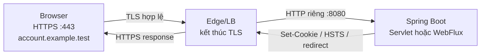
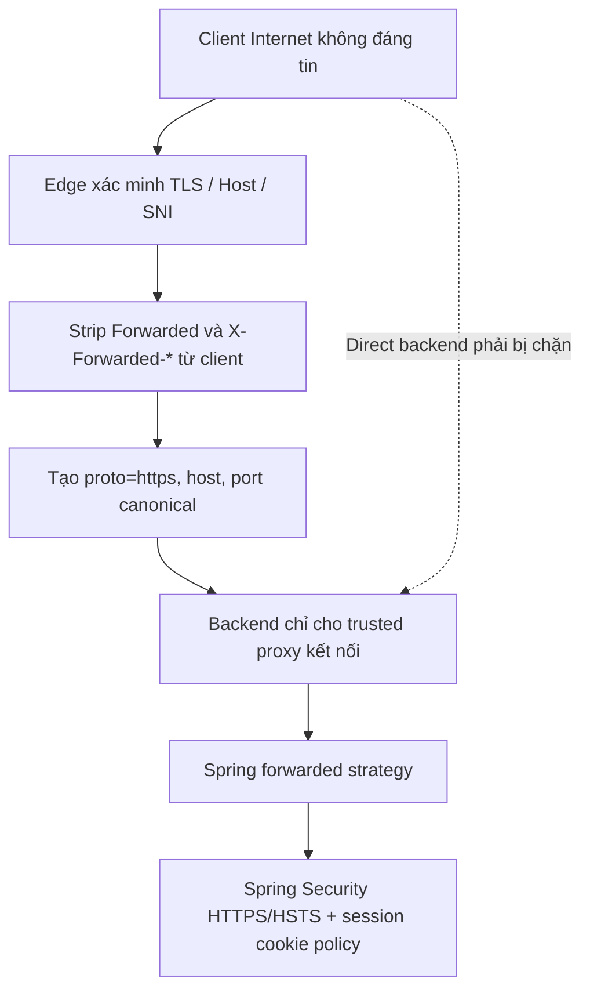

# Nhận diện HTTPS để ghi HSTS và cookie đúng

> **Chương:** Proxy và nguồn gốc  
> **Module:** `SPRING_SECURITY_HTTP_PROTECTION` — triển khai phòng vệ HTTP và trình duyệt trong Spring Security, gồm CSRF, CORS, security headers, CSP, HSTS, HTTP firewall và session trên cả Servlet lẫn Reactive.  
> **Chủ đề:** Khi TLS kết thúc ở reverse proxy hoặc load balancer, **trình duyệt truy cập HTTPS nhưng backend có thể nhận HTTP**. Ứng dụng phải nhận diện đúng HTTPS công khai để phát HSTS, tạo URL/redirect và ghi session cookie phù hợp, song không được tin `X-Forwarded-Proto` từ nguồn không được ủy quyền.

## 1. Mục tiêu học tập

Sau bài này, người học có thể:

1. Phân biệt **HTTPS của kết nối client → edge**, **HTTP/TLS của hop edge → Spring** và thuộc tính secure của request mà framework nhìn thấy.
2. Giải thích vì sao Spring Security có thể **không phát `Strict-Transport-Security`** khi backend thấy HTTP dù browser đang dùng HTTPS.
3. Cấu hình forwarded scheme bằng trusted proxy và lựa chọn cách xử lý của Servlet `ForwardedHeaderFilter`, container-native hoặc Reactive `ForwardedHeaderTransformer`.
4. Viết cấu hình HSTS rõ ràng, hiểu `max-age`, `includeSubDomains`, `preload`, rủi ro rollout và vì sao HSTS **chỉ hữu hiệu khi browser nhận qua HTTPS hợp lệ**.
5. Phân biệt việc tự nhận diện `isSecure()` với việc chủ động đặt `Secure`, `HttpOnly`, `SameSite`, `Domain` và `Path` trên **session cookie**.
6. Cấu hình session cookie trong Spring Boot cho **Servlet** và **WebFlux/Reactive**, cân nhắc Spring Session và cookie CSRF.
7. Chẩn đoán redirect HTTP↔HTTPS, OAuth2 callback sai, browser không gửi cookie và CSRF 403 khi TLS termination/prefix rewrite thay đổi.
8. Xây dựng bộ kiểm thử gồm **Servlet/Reactive tests**, kiểm tra `Set-Cookie`/HSTS ở public endpoint và **negative test chống giả mạo forwarded header** qua edge.
9. Đánh giá ranh giới HSTS/CORS/CSRF/session mà không dùng một biện pháp thay thế sai mục đích cho biện pháp khác.

**Thông điệp chính:** HSTS và session-cookie policy là **hai kết quả phản hồi khác nhau**. Forwarded scheme giúp ứng dụng biết public HTTPS; nhưng **cờ `Secure` vẫn phải được kiểm chứng trong `Set-Cookie`**, và HSTS phải được kiểm chứng trong **response HTTPS mà trình duyệt thật sự nhận**.

## 2. Một request, hai góc nhìn về HTTPS

Giả sử người dùng mở:

```text
https://account.example.test/app/settings
```

Hệ thống triển khai:



Tại browser, kết nối tới edge là HTTPS. Nhưng backend có thể quan sát:

```text
scheme       = http
host         = app.internal
port         = 8080
isSecure     = false   (Servlet)
URI.scheme   = http    (WebFlux)
```

Điều này hợp lệ ở kiến trúc TLS termination; **không tự suy** rằng phải triển khai TLS lần hai trên mọi hop. Tuy nhiên, metadata sai tại Java có thể ảnh hưởng:

- `Location` redirect về `http://app.internal:8080/login`.
- Spring Security không ghi HSTS ở vị trí mong muốn vì nó không nhận diện request là HTTPS.
- Một số cơ chế tạo session cookie tự động không gắn `Secure` vì tin request là HTTP.
- OAuth2/OIDC redirect URI thiếu `https` hoặc sai host/port.
- `Set-Cookie: ...; Path=/` không phù hợp public prefix `/app`.
- Browser gửi POST thiếu session cookie/CSRF token sau redirect → 302/401/403 khó giải thích.

**Phải tách hai câu hỏi:**

1. Browser có **thực sự** đang kết nối HTTPS hợp lệ tới domain public không? → Edge/TLS/hostname/certificate chịu trách nhiệm.
2. Spring có **quan sát đúng public scheme** để tạo header, cookie và URL không? → Trusted forwarded metadata hoặc cấu hình canonical URL/response policy.

### 2.1. Backend không tự biết giao thức của hop ngoài

Ví dụ trusted edge có thể gửi:

```http
GET /settings HTTP/1.1
Host: app.internal:8080
X-Forwarded-Proto: https
X-Forwarded-Host: account.example.test
X-Forwarded-Port: 443
X-Forwarded-Prefix: /app
```

Sau khi Spring được cấu hình xử lý forwarding **qua hạ tầng đáng tin**, request có thể phản ánh public scheme và host cho việc tạo URL. Nhưng nếu client Internet tự gửi `X-Forwarded-Proto: https` rồi đi thẳng tới backend, **không có bảo đảm TLS public nào**.

### 2.2. “TLS ở edge” và “Secure cookie” không đồng nghĩa

Một session cookie có `Secure` là **chính sách browser gửi cookie**; nó không cho biết backend có trực tiếp dùng TLS. Hệ thống có thể dùng:

```http
Set-Cookie: JSESSIONID=<opaque-session-id>; Path=/app; Secure; HttpOnly; SameSite=Lax
```

ngay khi upstream edge → Spring là HTTP nội bộ, miễn là browser nhận response qua HTTPS public.

Ngược lại, một cookie **không có `Secure`** có thể bị browser gửi qua HTTP trong những hoàn cảnh mà HTTP vẫn truy cập được; HSTS đã được ghi nhớ có thể giảm rủi ro nhưng **không thay yêu cầu đánh dấu `Secure` cho cookie xác thực**.

## 3. Ba trạng thái HTTPS cần theo dõi độc lập

| Trạng thái | Nơi kiểm chứng | Điều nó trả lời |
|---|---|---|
| **TLS public đã xác thực** | Edge, TLS listener, chứng chỉ, vhost/SNI | Browser có kết nối an toàn tới public hostname? |
| **HTTPS được phản ánh ở Spring request** | `isSecure()`/scheme Servlet, URI scheme WebFlux | Framework đang tin request là public HTTPS? |
| **HTTPS policy trên response** | HSTS, `Set-Cookie: Secure`, redirect Location | Browser sẽ lưu rule HSTS và gửi cookie đúng không? |

Một request có thể đạt trạng thái 1 nhưng không đạt 2 vì thiếu forwarding strategy. Một request có thể biểu hiện trạng thái 2 do **header giả**, dù trạng thái 1 không được xác minh. Trạng thái 3 lại phụ thuộc từng header writer/cookie serializer/session repository, nên không tự bảo đảm chỉ vì 2 đúng.

### 3.1. Bảng sự cố điển hình

| Browser → edge | Edge → backend | Spring thấy | HSTS từ Spring | Session cookie tự động |
|---|---|---|---|---|
| HTTPS hợp lệ | HTTP | HTTP nếu không forwarding | Có thể không được ghi | Có nguy cơ thiếu `Secure` nếu phụ thuộc request |
| HTTPS hợp lệ | HTTP | HTTPS do trusted forwarding | Có thể được ghi theo chain/policy | Có thể tự đánh dấu `Secure` nếu serializer dựa secure-state |
| HTTPS hợp lệ | HTTP | HTTP nhưng edge sở hữu HSTS | Edge có thể ghi HSTS | Vẫn cần cấu hình cookie riêng |
| HTTP public (không chấp nhận ở login) | HTTP | HTTPS vì header giả | Kết luận secure-state **không đáng tin** | Cookie/redirect có thể bị thao túng |
| HTTPS hợp lệ | HTTPS tới backend | HTTPS trực tiếp hoặc qua forwarding phù hợp | Có thể được ghi | Kiểm tra cookie vẫn bắt buộc |

**Không dùng HSTS hay cờ Secure làm phép đo duy nhất để chứng minh TLS public đã được triển khai đúng.** Cần cả kiểm tra certificate/hostname, network route và response thực.

## 4. HSTS là gì và được browser áp dụng như thế nào?

HTTP Strict Transport Security (HSTS), theo RFC 6797, cho phép server khai báo rằng browser nên dùng HTTPS khi truy cập hostname đó trong một khoảng thời gian.

Ví dụ:

```http
Strict-Transport-Security: max-age=86400
```

Browser nhận được header **trên kết nối HTTPS hợp lệ** sẽ lưu chính sách cho hostname tương ứng. Sau đó, nếu người dùng nhập URL HTTP cho hostname đã ghi nhớ, browser có thể nâng cấp request sang HTTPS **trước khi phát HTTP request ra mạng**.

### 4.1. HSTS bảo vệ điều gì?

HSTS giảm khả năng kẻ tấn công can thiệp vào lần truy cập **HTTP sau khi chính sách đã được ghi nhớ**. Nó bổ sung cho redirect HTTP→HTTPS, vì redirect 301/302 chỉ diễn ra **sau một request HTTP ban đầu** nếu browser chưa có HSTS policy.

HSTS **không**:

- Mã hóa kết nối edge → backend nếu hop đó dùng HTTP.
- Chứng minh `X-Forwarded-Proto` đáng tin.
- Thay chứng chỉ TLS hợp lệ và quản trị certificate.
- Xác thực principal, session hoặc JWT.
- Ngăn CSRF; browser vẫn có thể gửi cookie tự động trong những tình huống phù hợp.
- Tự thiết lập `Secure`, `HttpOnly` hay `SameSite` cho cookie.
- Thay CSP, CORS, HTTP firewall hoặc authorization.
- Bảo vệ đầy đủ lần HTTP đầu tiên nếu browser chưa biết chính sách và domain chưa được preload.

### 4.2. Các directive quan trọng

| Directive | Ví dụ | Ý nghĩa |
|---|---|---|
| `max-age` | `max-age=86400` | Thời gian (giây) browser ghi nhớ policy |
| `includeSubDomains` | Có hoặc không | Mở rộng policy từ hostname hiện tại tới các subdomain |
| `preload` | Có hoặc không | Dấu hiệu dùng trong quá trình xin preload; **chỉ ghi directive không làm domain tự được đưa vào danh sách preload** |

Ví dụ production đã được phê duyệt đầy đủ:

```http
Strict-Transport-Security: max-age=31536000; includeSubDomains
```

**Rủi ro của `includeSubDomains`:** Nếu `example.test` phát HSTS kèm directive này, browser có thể buộc HTTPS đối với `legacy.example.test`. Nếu một subdomain còn phụ thuộc HTTP, chính sách có thể làm hỏng luồng đó. Phải kiểm kê toàn bộ subdomains trước khi bật.

### 4.3. `preload` là quyết định quản trị domain, không phải mặc định an toàn cho mọi app

Preload liên quan chương trình danh sách host có HSTS policy cài sẵn trong browser; điều kiện và quy trình thay đổi có thể kéo dài.

- Chỉ dùng khi tổ chức kiểm soát hostname/domain và mọi subdomain liên quan đã sẵn sàng HTTPS theo yêu cầu chương trình.
- Kiểm tra tiêu chí hiện hành tại [hstspreload.org](https://hstspreload.org/).
- Không bật `preload=true` chỉ vì ví dụ tài liệu cấu hình có nó.
- Gỡ preload có thể cần quá trình riêng, không chỉ gửi `max-age=0` rồi coi hoàn tất.

Bài này dùng `preload(false)` trong ví dụ để minh họa **rollout có chủ đích**, không tuyên bố mặc định của mọi phiên bản Spring Security giống nhau.

### 4.4. HSTS chỉ được browser chấp nhận qua HTTPS hợp lệ

Một response HTTP không an toàn có thể chứa text:

```http
HTTP/1.1 200 OK
Strict-Transport-Security: max-age=31536000
```

Browser tuân thủ HSTS **không thiết lập chính sách từ header nhận qua HTTP không bảo mật**. Đó là lý do Spring Security chủ động chỉ ghi HSTS trên request được nhận diện là HTTPS theo cơ chế của nó.

Với response HTTPS có chứng chỉ không đáng tin, không nên giả định browser sẽ ghi nhớ HSTS. Hãy xác nhận bằng trình duyệt thực, hostname hợp lệ và TLS chain được tin.

### 4.5. HSTS có phạm vi host, không phải path

HSTS gắn với **hostname**, không với riêng `/login`, `/admin` hay `/app`; nó cũng không tạo cơ chế riêng theo port TCP. Cần cẩn thận nếu hostname có ứng dụng cũ hoặc dịch vụ trên cổng không mặc định.

**Không dùng HSTS để ép người dùng đi đúng path hoặc để thay việc cấu hình HTTPS ở reverse proxy.**

### 4.6. Rollout max-age tăng dần

Một phương án triển khai:

1. Thử HTTPS redirect và HSTS ở staging trên host test.
2. Production bắt đầu bằng `max-age=300` hoặc `86400` với hostname đã xác minh.
3. Giám sát redirect/SSO, certificate renewal, subdomains và lỗi mixed content.
4. Tăng thời gian lên `max-age=604800` rồi `31536000` khi phù hợp chính sách.
5. Cân nhắc `includeSubDomains` và `preload` **sau khi** đánh giá toàn bộ domain.
6. Có kế hoạch khắc phục lỗi certificate/HTTPS trong suốt thời gian policy được browser ghi nhớ.

Các giá trị này là **lộ trình minh họa**, không phải yêu cầu phải thực hiện đúng các khoảng thời gian trên.

## 5. Spring Security Servlet: khi nào ghi HSTS?

Trong Servlet, Spring Security có HSTS header writer; hành vi thông dụng là chỉ thêm HSTS khi request được coi là secure. Nếu TLS kết thúc ở proxy, `HttpServletRequest.isSecure()` phải phản ánh đúng request public HTTPS **bằng metadata đáng tin** trước khi header writer kiểm tra.

### 5.1. Cấu hình một `SecurityFilterChain` có HSTS rõ ràng

```java
import org.springframework.context.annotation.Bean;
import org.springframework.security.config.Customizer;
import org.springframework.security.config.annotation.web.builders.HttpSecurity;
import org.springframework.security.web.SecurityFilterChain;

@Bean
SecurityFilterChain browserSecurity(HttpSecurity http) throws Exception {
    http
        .authorizeHttpRequests(auth -> auth
            .requestMatchers("/login", "/__test/ping", "/assets/**").permitAll()
            .anyRequest().authenticated())
        .formLogin(Customizer.withDefaults())
        .headers(headers -> headers
            .httpStrictTransportSecurity(hsts -> hsts
                .includeSubDomains(false)
                .preload(false)
                .maxAgeInSeconds(86400)));

    // Không disable CSRF trên browser/session chain.
    return http.build();
}
```

Ví dụ có `max-age` ngắn để mô tả policy được quyết định; production cần thời hạn đã qua review. Bật `includeSubDomains(false)` tránh áp toàn bộ subdomains trong bài tập.

**Phải hiểu giới hạn:** Header writer không biến một HTTP request thành HTTPS; nó chỉ xử lý response của request theo security chain. Nếu request public HTTPS vẫn bị Spring nhận diện HTTP, HSTS có thể không được ghi ở backend.

### 5.2. Không nên ghi HSTS thủ công vô điều kiện trong controller

Một phản ví dụ:

```java
// KHÔNG nên coi đây là cách chữa trust boundary:
response.setHeader(
    "Strict-Transport-Security",
    "max-age=31536000; includeSubDomains");
```

Nếu mọi controller tự thêm header, chúng có thể gây khác biệt policy/đúp header và khó kiểm tra khi lỗi HTTPS detection. Đặc biệt, **header trên HTTP response không được browser nhận làm HSTS policy**.

Chọn **một tầng sở hữu HSTS** (edge hoặc Spring Security), dùng một policy thống nhất và test response mà browser thật sự nhận.

### 5.3. Nhiều security chains: HSTS có chạy ở chain đã chọn không?

```text
GET /app/api/web/orders
   -> proxy rewrite /api/web/orders
   -> Spring Security chọn SecurityFilterChain đầu tiên khớp
   -> headers writer thuộc chain đã chọn
```

HSTS có thể không xuất hiện nếu:

- Request bypass Spring Security vì bị `web.ignoring()` hoặc đường bypass tương đương.
- Chain được chọn đã vô hiệu hóa `headers`/HSTS.
- Filter chạy theo flow bất thường trước khi header writer được áp dụng.
- Scheme của request không được nhận diện là secure.
- Header chỉ được phát tại edge chứ không phải ở backend.

Một 403/404/302 không tự nói lên HSTS có chạy hay không; **đọc header thực và xác định tầng phát**.

## 6. Spring Security Reactive: HSTS với `ServerHttpSecurity`

Trong WebFlux, Spring Security có header writer cho HSTS; request được quan sát qua `ServerHttpRequest`/`ServerWebExchange`. Khi TLS kết thúc tại edge, URI scheme phải được khôi phục theo trusted forwarding nếu backend chịu trách nhiệm phát HSTS.

### 6.1. Ví dụ `SecurityWebFilterChain`

```java
import java.time.Duration;
import org.springframework.context.annotation.Bean;
import org.springframework.security.config.Customizer;
import org.springframework.security.config.web.server.ServerHttpSecurity;
import org.springframework.security.web.server.SecurityWebFilterChain;

@Bean
SecurityWebFilterChain browserSecurity(ServerHttpSecurity http) {
    return http
        .authorizeExchange(auth -> auth
            .pathMatchers("/login", "/__test/ping", "/assets/**").permitAll()
            .anyExchange().authenticated())
        .formLogin(Customizer.withDefaults())
        .headers(headers -> headers
            .hsts(hsts -> hsts
                .includeSubdomains(false)
                .preload(false)
                .maxAge(Duration.ofDays(1))))
        // CSRF giữ mặc định trên browser/session chain.
        .build();
}
```

Tên API khác Servlet: Reactive dùng `headers.hsts(...)` và `Duration` cho `maxAge`; Servlet dùng `httpStrictTransportSecurity(...)`, `maxAgeInSeconds(...)`. Không sao chép một cách máy móc giữa hai stack.

### 6.2. `ForwardedHeaderTransformer` không phải security filter

Spring WebFlux có `ForwardedHeaderTransformer` để cập nhật cách `ServerHttpRequest` được diễn giải từ metadata proxy. Nó chạy ở hạ tầng xử lý request của WebFlux, **không** phải `SecurityWebFilterChain`:

```java
import org.springframework.context.annotation.Bean;
import org.springframework.web.server.adapter.ForwardedHeaderTransformer;

// Chỉ khai báo khi Boot/framework chưa đăng ký transformer phù hợp.
@Bean
ForwardedHeaderTransformer forwardedHeaderTransformer() {
    return new ForwardedHeaderTransformer();
}
```

Nếu Boot đã tự cấu hình forwarding strategy `framework`, không đăng ký thêm transformer thứ hai. Và transformer **không chứng minh proxy đáng tin**, nên mọi giá trị từ Internet phải được strip/overwrite ở edge trước.

## 7. Cấu hình forwarded scheme theo phiên bản Spring Boot

Tên property phụ thuộc version; vì vậy kiểm tra version runtime **trước** khi triển khai.

### 7.1. Spring Boot 2.2–4.1

```yaml
# Boot 2.2–4.1, Servlet hoặc WebFlux theo web stack đã chọn.
server:
  forward-headers-strategy: framework
```

`framework` dùng xử lý của Spring Framework (Servlet `ForwardedHeaderFilter`; WebFlux `ForwardedHeaderTransformer`). Có thể chọn `native` khi web server hỗ trợ contract của proxy và trust config phù hợp.

### 7.2. Spring Boot 4.2

```yaml
# Spring Boot 4.2: namespace mới.
server:
  request:
    header:
      forwarded:
        strategy: framework
```

Nếu dùng native/server-level strategy ở 4.2, giá trị là `web-server` thay cho `native`. Đừng để đồng thời `server.forward-headers-strategy` cũ và `server.request.header.forwarded.strategy` mới: release notes Boot 4.2 nêu trường hợp này gây **lỗi khởi động**.

Nếu proxy strip prefix `/app` và bạn cần framework xử lý nó, Boot 4.2 mặc định bỏ qua `X-Forwarded-Prefix`; phải bật có chủ đích:

```yaml
server:
  request:
    header:
      forwarded:
        strategy: framework
        use-prefix: true
```

**Trong bài này, HTTPS detection chỉ cần proto, nhưng cookie `Path`, OAuth redirect và URL public có thể phụ thuộc prefix.** Đừng bỏ qua prefix khi thiết kế test end-to-end.

### 7.3. Khi nào chọn `native`/`web-server`?

Dùng web-server/native nếu server (Tomcat, Jetty, Reactor Netty...) hỗ trợ đầy đủ metadata và trusted proxy model bạn cần. Ví dụ Tomcat có `RemoteIpValve` với cấu hình proxy, còn WebFlux trên Reactor Netty có cách xử lý khác.

Đừng giả định mọi server đều hiểu `X-Forwarded-Prefix` hoặc RFC `Forwarded` giống nhau. Nếu cần capabilities server không có, chọn `framework` theo version và test.

### 7.4. `none` không giải quyết tất cả

`none` tắt việc Boot chủ động áp forwarded strategy nhưng không bảo đảm custom filters/server config khác sẽ không tin header. Khi public URL cố định, ứng dụng có thể dùng canonical base URL cho link, trong khi HSTS được quản lý tại TLS edge và session cookie đặt `Secure` tường minh.

Tuy nhiên, **không** nên xem đó là giải pháp cho ứng dụng còn cần request-aware redirect/callback hoặc host-based routing, trừ khi đã test toàn bộ flow.

## 8. Ranh giới tin cậy cho `X-Forwarded-Proto`

### 8.1. Đừng để client tuyên bố “tôi đã dùng HTTPS”

Client Internet có thể cố gửi:

```http
GET /login HTTP/1.1
Host: account.example.test
Forwarded: proto=https;host=account.example.test
X-Forwarded-Proto: https
X-Forwarded-Host: account.example.test
```

Nếu backend reachable trực tiếp hoặc proxy chuyển header nguyên trạng, `isSecure()`/URI scheme có thể trở thành HTTPS **do header giả**. HSTS header writer hoặc serializer dựa secure-state từ đó có thể xử lý response sai với kết nối public thực tế.

**Nguyên tắc:** HTTPS public phải được **TLS edge xác nhận** bằng listener/connection, rồi edge **ghi đè** forwarding scheme; Java chỉ tin metadata sau trusted hop.

### 8.2. Sơ đồ phòng vệ



Kiểm tra cả:

1. Edge phục vụ HTTPS hợp lệ cho public hostname.
2. Edge từ chối/redirect HTTP ở public boundary theo chính sách; không gửi credential ở kênh không bảo mật.
3. Edge strip hoặc overwrite **cả** RFC `Forwarded` và họ `X-Forwarded-*`.
4. Backend không cho Internet truy cập trực tiếp; chỉ proxy/service identity được phép.
5. Nếu có CDN/LB/ingress nhiều hop, từng hop phân định nguồn authoritative của proto/host/port.
6. Spring không sử dụng raw header từ một consumer khác (custom filter) trước trust boundary.
7. Không có sự mâu thuẫn kiểu `Forwarded: proto=http` nhưng `X-Forwarded-Proto=https` được các lớp diễn giải khác nhau.

### 8.3. IP client khác HTTPS detection

`X-Forwarded-For` là vấn đề **client IP**, không phải bằng chứng TLS. Không đọc `X-Forwarded-For: 127.0.0.1` rồi coi request là trusted hoặc bỏ qua CSRF.

Nếu cần IP allowlist/rate limit, phải xác định IP bằng trusted-hop policy từ peer đã xác minh. IP không thay authentication, user identity hoặc quyền.

## 9. Edge sở hữu HSTS hay Spring Security sở hữu HSTS?

Hai phương án đều có thể đúng. Quan trọng là **một chính sách rõ và test response public**.

| Tiêu chí | HSTS ở TLS edge | HSTS ở Spring Security |
|---|---|---|
| Nhận diện HTTPS | Edge biết TLS public trực tiếp | Phụ thuộc request scheme đã được khôi phục đáng tin |
| Bao phủ response edge tạo ra | Có thể gồm redirect/error từ edge theo cấu hình | Chỉ response qua Spring Security chain |
| Điều phối nhiều microservices | Tập trung trên virtual host | Có thể khác theo từng application/chain |
| Rủi ro | Sai vhost/inheritance, áp `includeSubDomains` quá rộng | Thiếu trusted forwarding, chain không chạy, HSTS vắng |
| Kiểm thử | Browser-facing headers ở mọi route quan trọng | Filter chain + browser-facing headers |
| Thích hợp | Edge tổ chức sở hữu TLS/domain policy | App sở hữu riêng public host/policy và có trusted HTTPS awareness |

### 9.1. Ví dụ Nginx sở hữu HSTS

Đây là đoạn **minh họa** cho vhost HTTPS đã được cấu hình TLS hợp lệ:

```nginx
server {
    listen 443 ssl;
    server_name account.example.test;

    # Chứng chỉ và TLS policy được cấu hình ngoài đoạn mẫu.

    # Stage policy ngắn để kiểm tra trước rollout dài hạn.
    add_header Strict-Transport-Security "max-age=86400" always;

    location /app/ {
        proxy_pass http://account.internal:8080/;
        proxy_set_header Host account.example.test;

        # Bỏ RFC Forwarded do client tự gửi.
        proxy_set_header Forwarded "";

        # Ghi đè X-* theo public connection/vhost đáng tin.
        proxy_set_header X-Forwarded-Proto https;
        proxy_set_header X-Forwarded-Host account.example.test;
        proxy_set_header X-Forwarded-Port 443;
        proxy_set_header X-Forwarded-Prefix /app;
        proxy_set_header X-Forwarded-For $remote_addr;
    }
}
```

**Cần bổ sung trong production:** Default vhost từ chối host lạ, certificate management, security groups/NetworkPolicy, HTTP→HTTPS redirect, logging và xử lý nhiều hop.

Những điểm cần review:

- `always` có tác dụng với một số response lỗi/redirect theo Nginx; kiểm tra cấu hình thực và header inheritance khi các `location` khác dùng `add_header`.
- Không phát HSTS mâu thuẫn tại edge **và** backend. Nếu backend còn phát HSTS, xác định owner và loại/chuẩn hóa bản sao khi cần, không phụ thuộc browser chọn một trong hai.
- Nginx chỉ nhận trực tiếp Internet trong ví dụ; nếu đứng sau CDN, `$remote_addr` có thể là IP CDN, cần trusted real-IP setup.
- Không chỉ định `includeSubDomains`/`preload` ở ví dụ khi chưa rà soát domain.

### 9.2. Nếu Spring sở hữu HSTS

- Edge phải xuất metadata proto/host/port đã được xác minh.
- Spring Boot config phải phù hợp version/stack.
- HSTS header writer phải hoạt động trong chain được chọn.
- Response HTTPS bên ngoài phải chứa header **một lần theo policy**.
- Proxy không được xóa header không chủ đích hoặc ghi đè khác.
- Test cả login redirect, public pages, lỗi 403/404 và các routes không chạy cùng security chain.

### 9.3. HSTS trên HTTP redirect?

Đối với public HTTP listener, ưu tiên redirect tới HTTPS an toàn và không coi header HSTS trên chính HTTP response là đủ. Một browser không ghi nhớ HSTS từ HTTP response không đáng tin.

Nếu redirect HTTP→HTTPS có `Location: https://account.example.test/app`, sau khi browser theo redirect và nhận HTTPS response, header HSTS ở HTTPS response mới có ý nghĩa.

## 10. `Secure` cookie: quyết định phản hồi riêng với HSTS

### 10.1. Các thuộc tính cookie phục vụ vai trò khác nhau

| Thuộc tính | Tác dụng | Không bảo đảm |
|---|---|---|
| `Secure` | Browser chỉ gửi cookie qua HTTPS (theo browser rules) | Không chống CSRF/XSS; không chứng minh backend dùng TLS |
| `HttpOnly` | JS không thể đọc cookie trực tiếp qua `document.cookie` | Không ngăn browser tự gửi cookie; không chống CSRF |
| `SameSite=Lax` | Hạn chế nhiều request cross-site; còn một số bối cảnh điều hướng an toàn | Không thay CSRF token |
| `SameSite=Strict` | Hạn chế cross-site mạnh hơn | Có thể ảnh hưởng login/email/deep-link workflows |
| `SameSite=None` | Cho phép gửi cookie trong ngữ cảnh cross-site thích hợp | Cần `Secure`; third-party cookie policies vẫn áp dụng |
| `Domain` | Có thể mở phạm vi cookie sang subdomains | Không phải ranh giới authorization |
| `Path` | Giới hạn URL path mà browser gửi cookie | Không phải cơ chế phân quyền/isolated security boundary |
| `Max-Age`/`Expires` | Thời gian tồn tại cookie | Không thay server-side session expiry |
| `Partitioned` | Hỗ trợ ngữ cảnh cookie phân vùng ở browser tương thích | Không tự hợp thức hóa CORS, CSRF hay tracking policy |

Cookie không scope theo **port** như origin. Nhưng redirect từ HTTPS 8443 sang 443 có thể làm thay đổi origin/cách gọi API và khiến CORS, OAuth callback hoặc session flow bị lỗi.

### 10.2. Cookie session thông thường

Ví dụ `Set-Cookie` bên ngoài:

```http
Set-Cookie: JSESSIONID=<opaque-value>; Path=/app; Secure; HttpOnly; SameSite=Lax
```

Đây là **cookie xác thực/session**, nên `HttpOnly` thông thường là lựa chọn đúng. `Path=/app` chỉ phù hợp khi browser truy cập session app dưới public `/app`; nếu backend hoặc các URL login/callback công khai nằm ngoài prefix đó, cookie có thể không được gửi nơi cần.

Một WebFlux session cookie có thể mang tên `SESSION` thay vì `JSESSIONID`. Tên thực tế phụ thuộc web stack/session integration/configuration; **test cookie app tạo ra**, không hardcode một tên cho mọi Spring service.

### 10.3. Cookie CSRF và session cookie không giống nhau

Một số SPA dùng **cookie chứa CSRF token** để JavaScript đọc rồi gửi token lên header như `X-CSRF-TOKEN`. Cookie này có thể cần `HttpOnly=false` **có chủ đích**; nó **không phải cookie chứa session secret**.

Không áp quy tắc “mọi cookie đều phải HttpOnly” một cách máy móc:

- Session/auth cookie → `HttpOnly=true` thông thường, `Secure=true` trên HTTPS public.
- Cookie CSRF cho SPA → tùy repository và frontend contract, có thể cho JS đọc; vẫn cân nhắc `Secure`, `SameSite`/Path đúng.
- Cookie analytics/đặc thù → chính sách riêng; không tự khẳng định cookie nào cũng dùng chung domain/path.

CSRF cookie có thể lộ cho JS khi ứng dụng có XSS; vì vậy CSP, input sanitization và XSS defenses vẫn quan trọng. `SameSite` là phòng vệ bổ sung, không thay token cho unsafe browser-cookie requests.

## 11. Spring Boot Servlet: cấu hình session cookie rõ ràng

Với ứng dụng MVC/Servlet mà public traffic chỉ có HTTPS, có thể cấu hình rõ:

```yaml
# Ví dụ Boot Servlet sử dụng session cookie, public URL HTTPS.
server:
  servlet:
    session:
      cookie:
        secure: true
        http-only: true
        same-site: lax
        path: /app
```

Các property phổ biến trong Spring Boot được tài liệu hóa gồm:

- `server.servlet.session.cookie.secure`
- `server.servlet.session.cookie.http-only`
- `server.servlet.session.cookie.same-site`
- `server.servlet.session.cookie.path`
- `server.servlet.session.cookie.domain` (chỉ đặt nếu thật sự cần)

**Chú ý:** Đây là policy cho **session cookie** do tích hợp session/container tương ứng quản lý. Nó không tự động đặt mọi cookie do handler hoặc thư viện tùy chỉnh phát.

### 11.1. Tại sao nên khai báo `secure: true` tường minh?

Nếu public entry bắt buộc HTTPS và backend dùng HTTP sau trusted edge, session cookie có thể được tạo dựa trên `request.isSecure()` ở một số serializer. Nếu request không được khôi phục đúng, cookie có thể thiếu `Secure`.

Đặt `secure: true` tường minh là một lớp phòng vệ, **không thay** forwarded strategy bởi URL/redirect/HSTS vẫn có thể cần biết HTTPS public.

**Không đặt `secure: false` trong production** chỉ để browser gửi cookie ở HTTP local/staging. Có thể có profile development riêng, nhưng phải bảo đảm production policies được test độc lập.

### 11.2. Nếu ứng dụng dùng Spring Session

Với `Spring Session`, có thể có `DefaultCookieSerializer` hoặc cấu hình riêng cho session repository. Tài liệu Spring Session cho biết khi không đặt `useSecureCookie` tường minh, hành vi serializer có thể dựa vào `HttpServletRequest.isSecure()`.

Ví dụ khi **chủ động quản lý serializer**:

```java
import org.springframework.context.annotation.Bean;
import org.springframework.session.web.http.DefaultCookieSerializer;
import org.springframework.session.web.http.CookieSerializer;

@Bean
CookieSerializer cookieSerializer() {
    DefaultCookieSerializer serializer =
        new DefaultCookieSerializer();
    serializer.setUseSecureCookie(true);
    serializer.setUseHttpOnlyCookie(true);
    serializer.setSameSite("Lax");
    serializer.setCookiePath("/app");
    return serializer;
}
```

Ví dụ này dành cho **Servlet Spring Session**; khi đã khai báo bean serializer tùy chỉnh, cần kiểm tra tương tác với Spring Boot session cookie properties và tránh hai nơi cấu hình mâu thuẫn. Nếu app không dùng Spring Session, không thêm dependency/bean chỉ để thiết lập `Secure`.

### 11.3. `Domain`: mặc định host-only thường có lợi

Nếu không khai báo `Domain`, browser thường giữ cookie ở hostname đã phát nó theo host-only cookie semantics. Đây là lựa chọn tốt hơn việc phát `Domain=.example.test` cho cả hệ sinh thái khi không cần share cookie giữa subdomains.

Một cookie bao phủ nhiều subdomains có thể bị tác động bởi ứng dụng/subdomain kém an toàn hơn. Không mở rộng `Domain` để “sửa” một lỗi reverse proxy sai host trước khi xác định nguyên nhân.

### 11.4. Cookie prefix `__Host-` và `__Secure-`

Browser hiện đại hỗ trợ một số prefix với yêu cầu đặc biệt:

- `__Secure-`: cần cookie được đặt qua nguồn an toàn và có `Secure`.
- `__Host-`: cần `Secure`, **không có `Domain`**, **`Path=/`**, và được đặt từ nguồn an toàn.

Do đó, nếu public app chạy dưới `/app` và bạn quyết định đặt cookie `Path=/app`, **không thể đồng thời dùng `__Host-...` một cách hợp lệ**. Muốn dùng prefix đó, phải đánh giá việc cookie có `Path=/` và bảo vệ thêm bằng route/session policy.

Không đổi cookie name sang prefix chỉ để đẹp cấu hình mà không kiểm tra browser thực sự chấp nhận cookie.

## 12. Spring Boot Reactive: cấu hình WebSession cookie

Với WebFlux, Spring Boot có nhóm property riêng:

```yaml
# Ví dụ Boot WebFlux/Reactive; public URL HTTPS.
server:
  reactive:
    session:
      cookie:
        secure: true
        http-only: true
        same-site: lax
        path: /app
```

Các tên property khác với Servlet:

| Servlet | Reactive |
|---|---|
| `server.servlet.session.cookie.secure` | `server.reactive.session.cookie.secure` |
| `server.servlet.session.cookie.http-only` | `server.reactive.session.cookie.http-only` |
| `server.servlet.session.cookie.same-site` | `server.reactive.session.cookie.same-site` |
| `server.servlet.session.cookie.path` | `server.reactive.session.cookie.path` |
| `server.servlet.session.cookie.domain` | `server.reactive.session.cookie.domain` |

**Đừng bê property Servlet sang WebFlux rồi giả định nó đã có tác dụng**. Kiểm tra `Set-Cookie` được phát trong app thực tế.

### 12.1. Spring Session WebFlux: `CookieWebSessionIdResolver`

Nếu dùng Spring Session hoặc muốn tùy chỉnh WebFlux cookie sâu hơn, có thể cấu hình `WebSessionIdResolver` tương ứng:

```java
import org.springframework.context.annotation.Bean;
import org.springframework.web.server.session.CookieWebSessionIdResolver;
import org.springframework.web.server.session.WebSessionIdResolver;

@Bean
WebSessionIdResolver webSessionIdResolver() {
    CookieWebSessionIdResolver resolver =
        new CookieWebSessionIdResolver();
    resolver.setCookieName("SESSION");
    resolver.addCookieInitializer(builder -> builder
        .secure(true)
        .httpOnly(true)
        .sameSite("Lax")
        .path("/app"));
    return resolver;
}
```

**Điều kiện áp dụng:** Chỉ thêm bean khi ứng dụng **muốn sở hữu chính sách cookie** và đã hiểu cách auto-configuration/session integration của stack/version xử lý resolver. Không đồng thời có hai cấu hình mâu thuẫn rồi trông chờ vào thứ tự ngẫu nhiên.

### 12.2. Reactve session cookie khác cookie CSRF

Nếu SPA dùng `CookieServerCsrfTokenRepository`, cookie CSRF có thể được cấp theo policy riêng. Đừng kết luận `server.reactive.session.cookie.secure=true` cũng tự đặt `Secure`/`Path` cho mọi cookie do CSRF repository hoặc controller tạo.

Cần test riêng:

- WebSession cookie xác thực.
- Cookie CSRF nếu có.
- Header `X-CSRF-TOKEN` hoặc tên custom mà frontend gửi.
- Token repository request handler/lifecycle đúng Spring Security version.

## 13. Public prefix, redirect và cookie Path

Ví dụ:

```text
Browser: https://account.example.test/app/profile
Proxy:   /app/profile -> backend /profile
```

Browser chỉ gửi cookie có `Path=/app` cho các đường phù hợp. Vì vậy:

- `Set-Cookie: ...; Path=/app` sẽ được browser gửi khi gọi `/app/profile`.
- `Set-Cookie: ...; Path=/internal` **không** được gửi cho `/app/profile`.
- `Path=/` có phạm vi rộng hơn; nếu dùng, cần cân nhắc các ứng dụng khác cùng hostname.
- Cookie Path **không phải cơ chế security isolation** đủ để tách những ứng dụng không tin cậy trên cùng domain.
- Logout phải xóa cookie với **cùng name/path/domain phù hợp** nếu không browser có thể giữ phiên cũ.

### 13.1. `X-Forwarded-Prefix` không tự cấu hình mọi cookie

Forwarded prefix giúp một số URI/redirect builder nhìn thấy public path. Nhưng `Set-Cookie` có Path đúng hay không còn tùy session manager/container, Spring Session serializer, configuration và flow.

**Với Boot 4.2:** `X-Forwarded-Prefix` bị bỏ qua mặc định trừ khi bật `server.request.header.forwarded.use-prefix=true` cùng chiến lược được hỗ trợ. Ngay cả khi bật, vẫn kiểm thử `Set-Cookie: Path=...` thực; đừng mặc định prefix biến cookie path thành `/app`.

### 13.2. OAuth2/OIDC callback và cookie phiên

Trong login OAuth2, redirect URI có thể được tính từ `{baseUrl}`. Nếu backend thấy HTTP nội bộ, có thể sinh URI sai:

```text
http://app.internal:8080/login/oauth2/code/oidc
```

Trong khi IdP yêu cầu:

```text
https://account.example.test/app/login/oauth2/code/oidc
```

Song song, session/correlation cookie dùng để giữ state giữa request login và callback phải được browser gửi lại theo đúng `Domain`, `Path`, `Secure` và `SameSite`. Với identity provider redirects cross-site, `SameSite=Strict` có thể phá một số luồng; `Lax` thường phù hợp top-level safe navigations, nhưng cần **test đúng login flow của dự án**.

Không nới redirect URI allowlist ở IdP hoặc tắt state/nonce vì proxy sai. Sửa public URL và cookie policy đúng nơi.

## 14. Phối hợp HTTPS, CORS và CSRF

### 14.1. HTTPS không bảo vệ CSRF

HSTS và `Secure` bảo vệ vận chuyển theo mục tiêu của chúng. Nhưng khi browser dùng session cookie, trình duyệt có thể **tự gắn cookie** vào request do trang khác khởi tạo trong những điều kiện phù hợp.

Vì vậy:

- `POST /api/web/orders` dùng session cookie → cần CSRF token theo policy.
- `PATCH /api/web/profile` dùng JWT **trong cookie** → vẫn cần đánh giá CSRF.
- `POST /api/m2m/orders` chỉ nhận Bearer header, không cookie fallback → có thể tách chain không CSRF.
- Webhook có chữ ký HMAC → chỉ miễn CSRF hẹp với verifier/anti-replay riêng.
- `permitAll` cho route **không tự** miễn kiểm tra CSRF.

**Không tắt CSRF khi browser POST 403 sau thay đổi proxy.** Điều tra session cookie, token repository, request path, header và chain trước.

### 14.2. `SameSite=None; Secure` và CORS credentials

Một SPA ở `https://app.example.test` gọi API `https://api.example.test` là **cross-origin** vì hostname khác, dù có thể cùng site. Nếu triển khai mô hình cookie cross-origin:

- CORS phải cho phép **origin frontend cụ thể**, methods/headers phù hợp.
- Nếu dùng credentials, response phải có allow-credentials theo policy và không dùng wildcard origin thiếu kiểm soát.
- Frontend phải gửi credentials đúng cấu hình browser API.
- Nếu cookie cần được gửi trong **ngữ cảnh cross-site**, `SameSite=None; Secure` thường là yêu cầu browser; chính sách third-party cookies có thể còn chặn.
- **Same-site** và **same-origin** là hai khái niệm khác; không đặt `SameSite=None` chỉ vì hai subdomains khác origin nếu không cần.
- CORS **không** thay CSRF vì cross-site request vẫn có thể xảy ra dù script không được đọc response.

### 14.3. `Origin` không phải `X-Forwarded-Host`

`Origin: https://app.example.test` mô tả nguồn của browser request; `X-Forwarded-Host: api.example.test` mô tả host đích theo proxy. Không tự cho phép CORS dựa trên host đích được lấy từ header forwarding.

Nếu redirect sai `https://api.example.test:8443` thành `https://api.example.test`, đó còn là **đổi origin theo port**, có thể dẫn đến lỗi CORS. Sửa HTTPS/port/url generation, không mở CORS wildcard.

### 14.4. HTTP firewall, CSP và HTTPS

`StrictHttpFirewall` ở Servlet có thể chặn path/method/encoding bất thường nhưng **không xác minh** forwarded scheme. CSP có thể giới hạn `connect-src`, `form-action` và tải script theo origin, song **không sửa sai HSTS, session cookie hoặc trust boundary**.

Đặt từng lớp đúng nhiệm vụ: TLS/HSTS, cookie policy, CSRF token, CORS allowlist, CSP/XSS defenses, request firewall và authentication/authorization.

## 15. Kiểm thử Servlet: từ `isSecure()` tới `Set-Cookie` và HSTS

Cần tách ba nhóm test:

1. **Spring interpretation:** Sau trusted forwarded processing, `getScheme()`/`isSecure()` có đúng không?
2. **Spring Security/session response:** HSTS, cookie `Secure` và security chain có ghi như dự kiến không?
3. **Edge/network:** Client Internet có thể giả header hoặc bypass proxy không?

Một MockMvc tự gắn `X-Forwarded-Proto` chỉ trả lời được 1 và một phần 2; **không** chứng minh 3.

### 15.1. Controller probe chỉ dành cho test

```java
import java.util.Map;
import jakarta.servlet.http.HttpServletRequest;
import org.springframework.web.bind.annotation.GetMapping;
import org.springframework.web.bind.annotation.RestController;

@RestController
class HttpsProbeController {
    @GetMapping("/__test/ping")
    Map<String, Object> ping(HttpServletRequest request) {
        return Map.of(
            "scheme", request.getScheme(),
            "secure", request.isSecure(),
            "host", request.getServerName(),
            "port", request.getServerPort());
    }
}
```

Probe chỉ nên tồn tại ở test profile hoặc chịu bảo vệ thích hợp; đừng public các chẩn đoán hạ tầng nhạy cảm trong production.

### 15.2. Tích hợp Spring Boot + Spring Security bằng MockMvc

```java
import org.junit.jupiter.api.Test;
import org.springframework.beans.factory.annotation.Autowired;
import org.springframework.boot.test.autoconfigure.web.servlet.AutoConfigureMockMvc;
import org.springframework.boot.test.context.SpringBootTest;
import org.springframework.test.web.servlet.MockMvc;

import static org.hamcrest.Matchers.containsString;
import static org.springframework.test.web.servlet.request.MockMvcRequestBuilders.get;
import static org.springframework.test.web.servlet.result.MockMvcResultMatchers.*;

@SpringBootTest(properties = {
    "server.forward-headers-strategy=framework"
})
@AutoConfigureMockMvc
class ServletHttpsHeaderIT {

    @Autowired MockMvc mvc;

    @Test
    void trustedForwardedHttpsGetsHsts() throws Exception {
        mvc.perform(get("/__test/ping")
                .header("X-Forwarded-Proto", "https")
                .header("X-Forwarded-Host", "account.example.test"))
            .andExpect(status().isOk())
            .andExpect(jsonPath("$.scheme").value("https"))
            .andExpect(jsonPath("$.secure").value(true))
            .andExpect(header().string(
                "Strict-Transport-Security",
                containsString("max-age=")));
    }

    @Test
    void plainHttpFixtureDoesNotEstablishHsts() throws Exception {
        mvc.perform(get("/__test/ping"))
            .andExpect(status().isOk())
            .andExpect(header().doesNotExist(
                "Strict-Transport-Security"));
    }
}
```

**Giả định:** Test dùng Spring Boot version còn hỗ trợ property cũ, controller probe được nạp, endpoint được `permitAll`, HSTS header writer bật và MockMvc sử dụng filter chain/auto-config của ứng dụng. Với **Boot 4.2**, đổi sang `server.request.header.forwarded.strategy=framework`.

**Giới hạn:** Test tự đưa trusted-looking header vào request. Nó kiểm tra *cách Spring xử lý*, **không** xác nhận edge đã strip dữ liệu giả. Test cookie cần route thực sự tạo session cookie, vì một GET vô trạng thái có thể không phát `Set-Cookie`.

### 15.3. Kiểm thử một response thực sự tạo session

Trong test có login flow/session thực, assert:

```java
// Mã kiểm tra minh họa khi response thực sự có session cookie:
mvc.perform(get("/__test/session-start")
        .header("X-Forwarded-Proto", "https")
        .header("X-Forwarded-Host", "account.example.test"))
    .andExpect(status().isOk())
    .andExpect(header().string(
        "Set-Cookie", containsString("Secure")))
    .andExpect(header().string(
        "Set-Cookie", containsString("HttpOnly")));
```

Cần có `/__test/session-start` **thực sự tạo session** trong fixture; đây không phải snippet đầy đủ tự chạy độc lập. Nếu response có **nhiều Set-Cookie headers**, đừng chỉ so một chuỗi rồi coi cookie nào cũng Secure: cần phân tích từng header theo **cookie name** và so policy từng loại. Một cookie CSRF cho SPA có thể khác session cookie.

### 15.4. Kiểm tra header writer trên mọi chain

Bổ sung test cho:

- Route public/`permitAll`.
- Route authenticated.
- `302` tới login.
- `403` CSRF từ chối.
- `404` handler không tồn tại, nếu response đi qua chain.
- Những path static resources được xử lý riêng.

Mục tiêu là biết **response nào** do Spring Security phát header, response nào do edge tạo, và không vô tình bỏ headers khi dùng `web.ignoring()`.

## 16. Kiểm thử Reactive: `WebTestClient` và WebSession cookie

Reactive dùng `ServerHttpRequest`/`ServerWebExchange`; test bằng `WebTestClient` cần có transformer và security chain thực.

### 16.1. Controller probe ở WebFlux

```java
import java.util.Map;
import org.springframework.web.bind.annotation.GetMapping;
import org.springframework.web.bind.annotation.RestController;
import org.springframework.web.server.ServerWebExchange;

@RestController
class ReactiveHttpsProbe {
    @GetMapping("/__test/ping")
    Map<String, Object> ping(ServerWebExchange exchange) {
        var uri = exchange.getRequest().getURI();
        return Map.of(
            "scheme", uri.getScheme(),
            "host", uri.getHost(),
            "port", uri.getPort());
    }
}
```

### 16.2. `WebTestClient` với trusted-looking forwarded scheme

```java
webTestClient.get()
    .uri("/__test/ping")
    .header("X-Forwarded-Proto", "https")
    .header("X-Forwarded-Host", "account.example.test")
    .exchange()
    .expectStatus().isOk()
    .expectBody()
    .jsonPath("$.scheme").isEqualTo("https");
```

Để test HSTS trên cùng request, dùng một response assertion riêng:

```java
webTestClient.get()
    .uri("/__test/ping")
    .header("X-Forwarded-Proto", "https")
    .header("X-Forwarded-Host", "account.example.test")
    .exchange()
    .expectStatus().isOk()
    .expectHeader().exists("Strict-Transport-Security");
```

**Điều kiện:** Application test đang chạy WebFlux `framework` forwarding/`ForwardedHeaderTransformer`, `SecurityWebFilterChain` có HSTS, và `/__test/ping` được phép. Một `WebTestClient.bindToController` không khởi tạo cùng pipeline với server thật; cần integration test đúng stack khi muốn chứng minh Boot auto-configuration.

### 16.3. Test WebSession cookie

Nếu một reactive handler/session login tạo `Set-Cookie: SESSION=...`, kiểm tra:

- Cookie xác thực có `Secure` và `HttpOnly` đúng.
- `SameSite` phù hợp luồng browser.
- `Path` tương ứng public URL.
- Browser gửi lại cookie sau redirect.
- Cookie CSRF (nếu có) được đánh giá riêng.
- WebSession bị invalidated khi logout và cookie xóa theo đúng name/path/domain.

Không đánh giá từ URL response nội bộ `http://reactive.internal:8080` nếu browser thực dùng `https://account.example.test`. Cần một test **qua public proxy** để biết browser có nhận và gửi cookie đúng không.

## 17. Kiểm thử public edge: bằng chứng cuối cùng

Các thao tác sau chỉ dành cho staging/hạ tầng do dự án sở hữu và cho phép kiểm thử.

### 17.1. Positive — kết nối HTTPS hợp lệ

```bash
curl -i 'https://account.example.test/app/login'
```

Kiểm tra:

- TLS/hostname/certificate hợp lệ (không mặc định dùng `-k`).
- HSTS xuất hiện trên response HTTPS do tầng đã được chỉ định sở hữu, nếu policy đã bật.
- `Set-Cookie` của session được ghi khi endpoint/login flow tạo session và có `Secure`/`HttpOnly`.
- Redirect dùng HTTPS public host, port, path; không chứa `app.internal:8080`.
- HSTS policy không áp nhầm `includeSubDomains`/`preload`.
- Nếu có gateway cache, không làm mất/set sai headers nhạy cảm.

Một request `GET /login` có thể không tạo session cookie; khi đó hãy kiểm tra **login flow thực** hoặc test fixture sinh session.

### 17.2. Negative — client giả `X-Forwarded-Proto`

```bash
curl -i \
  -H 'Forwarded: proto=http;host=attacker.example' \
  -H 'X-Forwarded-Proto: http' \
  -H 'X-Forwarded-Host: attacker.example' \
  -H 'X-Forwarded-Port: 8080' \
  'https://account.example.test/app/login'
```

Kỳ vọng theo chính sách:

- Edge **từ chối** request có header đáng ngờ **hoặc ghi đè** bằng metadata authoritative.
- Không redirect tới `attacker.example` hay `http://app.internal`.
- HSTS trên public HTTPS không bị biến mất chỉ vì proto giả được client gửi (nếu edge/Spring sở hữu policy này).
- Cookie session vẫn theo HTTPS public policy, không hạ cờ `Secure`.
- Không dùng XFF/Host giả để cấp quyền.

### 17.3. Negative — giả HTTPS khi public entry là HTTP

Nếu có HTTP listener để chuyển sang HTTPS, client có thể gửi:

```http
X-Forwarded-Proto: https
```

HTTP listener **không được** để header này khiến request bỏ qua redirect/HTTPS enforcement trước khi edge xác minh TLS. Test nên chứng minh edge hành xử theo **kết nối thực**, không theo header client tự khai.

Không phát credential hoặc session cookie nhạy cảm trên HTTP chỉ vì header báo `https`.

### 17.4. Chặn direct-origin bypass

Nếu một client bên ngoài có thể gọi thẳng `http://app.internal:8080` rồi đặt `X-Forwarded-Proto=https`, trust boundary đã thất bại dù Nginx public config có vẻ đúng.

Dùng network policy/security group/service identity/mTLS để giới hạn kết nối tới backend, và test từ một nguồn không được ủy quyền trong môi trường kiểm soát.

### 17.5. HSTS không dễ kiểm chứng bằng curl duy nhất

`curl -I` chỉ trả về headers của một HEAD request, không chứng minh browser đã **ghi nhớ HSTS** hay sau đó tự nâng cấp request. Để kiểm tra browser policy:

1. Truy cập domain HTTPS với chứng chỉ hợp lệ.
2. Xem response headers và chính sách HSTS của browser.
3. Trong profile test sạch, thử truy cập hostname qua HTTP sau khi nhận policy; quan sát browser nâng cấp theo kỳ vọng.
4. Tránh reset HSTS/preload trên domain production thật chỉ để thử nghiệm.
5. Với preload, cần kiểm tra tình trạng domain và quy trình quản trị riêng.

Cũng cần test response từ edge cho redirects/errors nếu yêu cầu bảo vệ tất cả browser-facing flows.

## 18. Ma trận kiểm thử hồi quy

| Kịch bản | Tầng cần kiểm tra | Kết quả kỳ vọng |
|---|---|---|
| Browser HTTPS → proxy HTTP → Servlet | Edge + Spring | `isSecure() == true` sau trusted forwarding nếu framework cần |
| Browser HTTPS → proxy HTTP → WebFlux | Edge + WebFlux | URI scheme public HTTPS |
| Spring Security phát HSTS trên HTTPS | Security chain/edge | `Strict-Transport-Security` theo policy |
| Spring nhận HTTP không forwarding | Framework test | Không mù quáng phát HSTS theo scheme giả |
| Edge sở hữu HSTS | Proxy test | Header nhất quán trên HTTPS response cần bao phủ |
| Public HTTP redirect sang HTTPS | Edge | Không bị `X-Forwarded-Proto` do client giả phá |
| Cookie auth được tạo trên HTTPS public | Session/login | `Secure`/`HttpOnly` theo policy |
| WebFlux WebSession cookie | Reactive session | Cờ cookie đúng; không dùng nhầm Servlet props |
| Spring Session custom serializer | Servlet session | Không bị cấu hình cookie ở hai nơi mâu thuẫn |
| SPA cookie CSRF | CSRF repository | Phân biệt HttpOnly của token cookie và auth cookie |
| `SameSite=None` | Browser | Có `Secure` và luồng browser thực được phép |
| Public prefix `/app` | Proxy + app | Cookie Path/redirect không thiếu/lặp prefix |
| OAuth2 callback qua proxy | IdP + browser | URI, state/session cookie đúng |
| Session logout | Browser | Cookie bị xóa đúng name/path/domain |
| CORS preflight | Edge + CORS | Origin/method/header/credentials đúng |
| Browser POST thiếu CSRF | Security integration | Bị từ chối, không có side effect |
| Browser POST CSRF hợp lệ | Security integration | Đi qua CSRF, tiếp tục authz/nghiệp vụ |
| Bearer-only API với cookie-only | Security integration | Không fallback sang cookie |
| Client giả proto/host | Edge negative test | Bị strip/overwrite/từ chối |
| Direct backend từ Internet | Network negative test | Bị chặn |
| HSTS includeSubDomains | Browser/domain inventory | Không phá subdomain chưa hỗ trợ HTTPS |
| HSTS preload | Domain governance | Không bật trước khi được phê duyệt |
| Cổng HTTPS 8443 | Redirect/browser | Không mất port khi tạo Location |
| Thay Boot 4.1 → 4.2 | Config + e2e | Đúng property/behavior prefix và HSTS/cookie |

**Không dùng status 200, 302 hoặc 403 như bằng chứng duy nhất.** Cần đọc `Location`, `Strict-Transport-Security`, `Set-Cookie`, selected chain, request secure-state và side effects.

## 19. Chẩn đoán theo triệu chứng

### 19.1. HTTPS public nhưng response không có HSTS

**Khả năng:**

- Backend thấy HTTP, forwarding strategy chưa chạy hoặc `X-Forwarded-Proto` bị ghi đè thành HTTP bởi hop cuối.
- HSTS writer bị tắt/chain được chọn không có security headers.
- Route bị bỏ qua Spring Security.
- Edge mới là owner HSTS nhưng chưa cấu hình cho vhost/response này.
- Header bị proxy/gateway xóa hoặc override.

**Cách kiểm tra:** So public HTTPS response, servlet `isSecure()` hoặc WebFlux URI scheme, config `framework/native` và source của HSTS. Đừng “fix” bằng phát header mọi nơi không cần policy.

### 19.2. HSTS có nhưng cookie thiếu `Secure`

HSTS và cookie là **hai bộ xử lý khác nhau**. Session serializer/container có thể dựa vào secure-state hoặc dùng config explicit khác. Kiểm tra:

- `server.servlet.session.cookie.secure` hay `server.reactive.session.cookie.secure` theo stack.
- Spring Session `DefaultCookieSerializer`/`WebSessionIdResolver` nếu được dùng.
- Có custom controller/federation library tự tạo cookie?
- Cookie có thật là auth cookie, hay là cookie CSRF/analytics?

Không kết luận “HSTS bật thì session cookie chắc chắn Secure”.

### 19.3. Cookie Secure có nhưng browser không gửi lại

Có thể do `Path`, `Domain`, `SameSite`, public host/port/redirect, cross-site credentials, browser third-party cookie policy hoặc cookie bị ghi đè cùng tên. Kiểm tra **Storage/Cookies** trong browser developer tools và request tiếp theo.

Nếu frontend chạy `http://localhost` để phát triển, `Secure` có các ngoại lệ/phân biệt theo browser và host; không dùng local behavior làm bằng chứng production.

### 19.4. Login redirect tới HTTP hoặc lặp HTTPS↔HTTP

Edge terminate TLS nhưng Spring thấy backend HTTP, hoặc app/edge cùng redirect theo những điều kiện mâu thuẫn. Kiểm tra `X-Forwarded-Proto` authoritative, request secure-state, Spring Security HTTPS config và redirect rules của edge.

Không tắt HTTPS enforcement chỉ để ngắt loop, và không đặt XFP từ raw client header.

### 19.5. HSTS phá một subdomain cũ

Có thể `includeSubDomains` đã được bật ở parent hostname/domain quá sớm. Hãy kiểm tra host đã phát policy, thời hạn `max-age` và khả năng phục vụ HTTPS của subdomain. Cân nhắc kế hoạch khôi phục TLS cho subdomain và quản trị HSTS/preload; việc gỡ header không lập tức xóa policy đã được browser ghi nhớ.

### 19.6. OAuth callback không khớp hoặc session mất giữa login và callback

Kiểm tra external scheme/host/port/prefix, callback đăng ký tại IdP, cookie `Path`/`SameSite`/`Secure`, `state`/`nonce` và login redirect. Không nới IdP redirect allowlist hoặc bỏ state để che vấn đề proxy.

### 19.7. 403 CSRF sau khi bật Secure cookie hoặc thay prefix

Cookie có thể không được browser gửi nữa vì public URL thực không phải HTTPS, path sai hoặc cross-site context bị hạn chế. CSRF token có thể không cùng phiên hoặc không được gửi đúng header. Kiểm tra request/cookie/token và selected chain, không tắt CSRF.

### 19.8. Header HSTS xuất hiện hai lần với giá trị khác nhau

Có thể edge và Spring Security cùng phát HSTS hoặc nhiều proxy layers ghi header. Chọn **một owner**, loại mâu thuẫn và test response cuối. Không mong browser tự giải quyết chính sách khác nhau một cách an toàn.

### 19.9. Boot 4.2 sau nâng cấp mất public prefix

Từ Boot 4.2, `X-Forwarded-Prefix` mặc định không được áp nếu chưa bật `server.request.header.forwarded.use-prefix=true`. Kiểm tra strategy/name config mới, khả năng server hỗ trợ prefix và URI/redirect/path/cookie thực. Không chữa bằng nối `/app` trong từng controller một cách tùy tiện.

## 20. Bài tập tình huống thực hành

Một nền tảng đào tạo dùng:

```text
Browser → https://academy.example.test:9443/portal/
        → CDN HTTPS
        → Nginx ingress HTTP
        → Spring Boot WebFlux :8080
```

CDN kết thúc TLS, ingress gửi:

```http
X-Forwarded-Proto: http
X-Forwarded-Host: academy.example.test
X-Forwarded-Port: 9443
X-Forwarded-Prefix: /portal
```

Ingress ghi `proto=http` vì **hop ingress → backend** dùng HTTP. Spring Security WebFlux sở hữu HSTS và session cookie được tạo theo policy mặc định phụ thuộc request scheme. Sau nâng cấp Boot 4.1 → 4.2, team vẫn dùng property cũ và không bật `use-prefix`.

Triệu chứng:

- Browser truy cập HTTPS nhưng không thấy HSTS.
- Session cookie phát ra không có `Secure`; một số browser/session flows không ổn định.
- OAuth2 redirect URI thiếu port/prefix.
- SPA POST nhận 403, developer muốn tắt CSRF.
- Một request tự gửi `X-Forwarded-Proto: https` qua đường bypass backend làm controller quan sát scheme HTTPS.

### 20.1. Câu hỏi

1. Điểm nào sai trong việc xác định HTTPS public?
2. HSTS nên do edge hay Spring sở hữu trong hệ thống này?
3. Cách đặt cookie Secure có thể độc lập request scheme không?
4. Boot 4.2 cần cấu hình forwarded property và prefix thế nào?
5. Có nên dùng `SameSite=None` cho mọi cookie hoặc tắt CSRF để chữa 403 không?
6. Bộ kiểm thử nào chứng minh sửa lỗi đã đạt?

### 20.2. Phân tích tham khảo

1. Ingress đã **ghi đè HTTPS public từ CDN thành HTTP nội bộ**. Nó chỉ nên giữ external scheme từ CDN **nếu kết nối CDN/LB đáng tin**; nguồn ngoài trusted chain phải được từ chối hoặc canonicalize lại ở edge.
2. Cả hai có thể hợp lệ: edge nếu muốn kiểm soát HSTS tập trung, hoặc Spring nếu forwarded HTTPS đáng tin đã được xác lập. **Không phát hai policy mâu thuẫn**. Test tại public response.
3. Có. Trong WebFlux, `server.reactive.session.cookie.secure=true` giúp đặt cờ Secure tường minh cho WebSession cookie tương ứng, trong khi HSTS và redirect vẫn cần đúng HTTPS detection. Với Spring Session/custom resolver phải đánh giá nơi thực sự ghi cookie.
4. Dùng property mới `server.request.header.forwarded.strategy=framework` và khi có prefix hợp lệ `server.request.header.forwarded.use-prefix=true`; xóa property cũ, kiểm tra support của server và test URI/Path/callback.
5. Không. `SameSite=None` chỉ khi cookie cần ngữ cảnh cross-site, đồng thời yêu cầu `Secure` và CORS/credentials policy. CSRF vẫn cần cho browser-session unsafe methods. Điều tra cookie/CSRF token/selected chain, không giảm lớp bảo vệ.
6. Test TLS certificate và HTTP→HTTPS edge redirect; HSTS public, session `Set-Cookie` Secure/HttpOnly/Path/SameSite; OAuth callback; HSTS không mâu thuẫn; WebFlux transformer; CSRF thiếu/đúng; CORS preflight; direct-origin bypass và forwarded-proto spoofing.

**Kết luận tình huống:** Một metadata `proto` sai có thể tạo **nhiều triệu chứng khác nhau**, nhưng cách sửa an toàn phải giải quyết ranh giới tin cậy ở proxy, chọn đúng chiến lược forwarding và cấu hình cookie/HSTS phù hợp, không tắt bảo vệ browser.

## 21. Checklist trước khi triển khai

- [ ] Đã ghi **public HTTPS URL** và **backend HTTP/TLS URL** riêng, rõ chỗ TLS termination.
- [ ] Có hostname/certificate/chain TLS hợp lệ ở public edge.
- [ ] Chỉ trusted edge/CDN/LB được phép khai báo public scheme/host/port.
- [ ] Edge strip/overwrite `Forwarded` và `X-Forwarded-*` do client Internet tự gửi.
- [ ] Backend không public trực tiếp hoặc được bảo vệ bằng service identity/mTLS/network policy tương đương.
- [ ] Không tin `X-Forwarded-Proto=https` chỉ vì client đã gửi header.
- [ ] Multi-hop không ghi đè HTTPS public thành HTTP do hop cuối.
- [ ] Spring Boot forwarding strategy đúng phiên bản; Servlet và WebFlux xử lý bằng component đúng stack.
- [ ] Nếu dùng Boot 4.2, không giữ trùng property cũ/mới và bật `use-prefix` khi cần.
- [ ] `isSecure()` Servlet/URI scheme WebFlux đúng với public HTTPS **sau trusted forwarding**.
- [ ] HSTS có **một owner rõ ràng**, edge hoặc Spring Security; response public không mâu thuẫn.
- [ ] HSTS chỉ được xem là có hiệu lực khi browser nhận qua HTTPS hợp lệ.
- [ ] `max-age` được rollout có kiểm soát, không bật thời hạn dài trước kiểm thử.
- [ ] `includeSubDomains` chỉ bật sau rà soát tất cả subdomains liên quan.
- [ ] `preload` chỉ bật sau khi domain governance và tiêu chí browser preload được đáp ứng.
- [ ] Đã kiểm thử HSTS trên login redirect, public page, response errors và chain khác nếu cần.
- [ ] Session cookie Servlet dùng `server.servlet.session.cookie.*` đúng policy.
- [ ] Session cookie WebFlux dùng `server.reactive.session.cookie.*` hoặc resolver phù hợp.
- [ ] Nếu dùng Spring Session, không có cấu hình serializer mâu thuẫn với Boot.
- [ ] Session/auth cookie có `Secure` và `HttpOnly` khi public HTTPS.
- [ ] `SameSite` đúng login/federation/cross-site flow; `None` có `Secure` và test browser.
- [ ] `Domain` không mở rộng sang subdomains vô cớ; `Path` phù hợp public prefix và logout.
- [ ] `__Host-` cookie prefix, nếu dùng, đáp ứng `Path=/`, không `Domain` và `Secure`.
- [ ] Cookie CSRF cho SPA được đánh giá riêng, không nhầm với session secret cookie.
- [ ] Login/redirect/OAuth2 callback có đúng public scheme/host/port/prefix.
- [ ] Session cookies thực sự được browser gửi lại sau redirect và đăng nhập.
- [ ] Browser POST dùng cookie vẫn yêu cầu CSRF token; không tắt CSRF do lỗi cookie/proxy.
- [ ] Bearer-only chain không có cookie fallback và có regression test.
- [ ] CORS allowlist dựa vào `Origin` caller, không dựa vào forwarded host.
- [ ] CSP, HTTP firewall, HSTS, cookie và CSRF được test đúng vai trò riêng.
- [ ] MockMvc/WebTestClient đã test request semantics cùng HSTS header writer ở stack thực.
- [ ] Có integration test **tạo session thực** và kiểm tra từng `Set-Cookie`, không chỉ status 200.
- [ ] Có edge negative test proto/host spoofing và network direct-origin bypass.
- [ ] Không suy browser đã ghi nhớ HSTS chỉ từ `curl -I`.
- [ ] Có test staging với public port không mặc định và prefix nếu hệ thống dùng.
- [ ] Log không chứa raw session ID, token, cookie, CSRF token hoặc OAuth secrets.
- [ ] Sau đổi CDN/ingress, Boot/server version, host/port/prefix hoặc TLS topology phải chạy lại ma trận test.

## 22. Tài liệu tham khảo chính thức

Các tài liệu nên đối chiếu với **Spring Boot/Spring Security version đang chạy**, đặc biệt khi nâng cấp Servlet/Reactive stack:

1. [Spring Security — Security HTTP Response Headers](https://docs.spring.io/spring-security/reference/features/exploits/headers.html): giải thích HSTS và điều kiện HTTPS.
2. [Spring Security — Servlet Security HTTP Response Headers](https://docs.spring.io/spring-security/reference/servlet/exploits/headers.html): cấu hình `httpStrictTransportSecurity`.
3. [Spring Security — WebFlux Security HTTP Response Headers](https://docs.spring.io/spring-security/reference/reactive/exploits/headers.html): cấu hình `ServerHttpSecurity.headers().hsts(...)`.
4. [Spring Boot — Embedded Web Servers](https://docs.spring.io/spring-boot/how-to/webserver.html): cấu hình trusted forwarded headers và proxy.
5. [Spring Boot — Application Properties](https://docs.spring.io/spring-boot/appendix/application-properties/index.html): `server.servlet.session.cookie.*`, `server.reactive.session.cookie.*`.
6. [Spring Session — Common Configurations](https://docs.spring.io/spring-session/reference/configuration/common.html): Servlet `DefaultCookieSerializer` và Reactive `CookieWebSessionIdResolver`.
7. [Spring Framework — WebFlux Forwarded Headers](https://docs.spring.io/spring-framework/reference/web/webflux/reactive-spring.html): nguyên tắc reset forwarded headers ở trust boundary.
8. [MDN — Strict-Transport-Security](https://developer.mozilla.org/en-US/docs/Web/HTTP/Reference/Headers/Strict-Transport-Security): browser semantics HSTS.
9. [MDN — Set-Cookie](https://developer.mozilla.org/en-US/docs/Web/HTTP/Reference/Headers/Set-Cookie): `Secure`, `HttpOnly`, `SameSite`, `Domain`, `Path` và cookie prefixes.
10. [HSTS Preload](https://hstspreload.org/): tiêu chí và quy trình preload hiện hành.

**Ghi nhớ:** Khi backend nằm sau TLS-terminating proxy, **HTTP ở hop nội bộ không có nghĩa browser đã dùng HTTP**. Muốn Spring Security ghi HSTS đúng, phải **nhận diện public HTTPS từ proxy đáng tin** hoặc để TLS edge sở hữu header. Muốn session cookie an toàn, cần **kiểm chứng `Secure`/`HttpOnly`/`SameSite`/`Path` trong `Set-Cookie` mà browser nhận** — và có thể đặt `Secure` tường minh cho Servlet hoặc WebFlux session cookie. Đừng tin `X-Forwarded-Proto` client tự khai, đừng bỏ CSRF vì cookie/redirect sai, và luôn kiểm thử **proxy + Spring Security + browser** như một chuỗi hoàn chỉnh.
