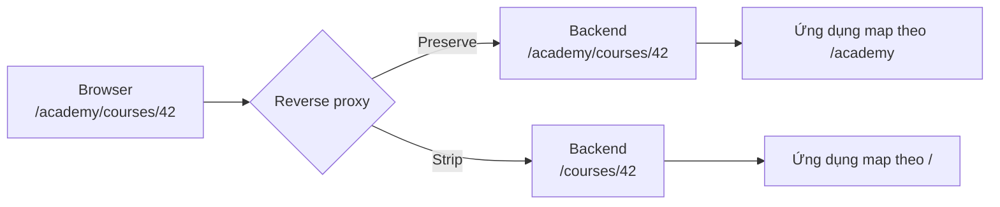

# URL redirect, context path và tiền tố do proxy thêm

> **Chương:** Proxy và nguồn gốc  
> **Module:** `SPRING_SECURITY_HTTP_PROTECTION` — áp dụng CSRF, CORS, security headers, CSP, HSTS, HTTP firewall và bảo vệ session trong Spring Security cho Servlet lẫn Reactive.  
> **Trọng tâm:** Khôi phục và tạo URL công khai đúng khi reverse proxy gắn hoặc loại tiền tố đường dẫn, phân biệt **public URL**, **Servlet context path**, **WebFlux base path**, **forwarded prefix** và các kiểu redirect; tránh làm sai route, OAuth2 callback, cookie Path và phạm vi bảo vệ CSRF.

## 1. Mục tiêu học tập

Sau bài này, người học có thể:

1. Phân biệt `scheme://host:port` (origin), `context path`, `servlet path`, path của handler, URL public và URI backend.
2. Giải thích sự khác nhau giữa proxy **giữ nguyên prefix**, proxy **strip prefix** và ứng dụng **sở hữu prefix** qua cấu hình context/base path.
3. Dự đoán ảnh hưởng của dấu `/` ở cuối `proxy_pass` trong một cấu hình Nginx `location` có prefix.
4. Cấu hình `X-Forwarded-Prefix` đúng khi reverse proxy loại một đoạn đường dẫn; biết vì sao không gửi prefix này bừa bãi và không tin nó từ client.
5. Sử dụng `ForwardedHeaderFilter`/Servlet container hoặc `ForwardedHeaderTransformer`/WebFlux theo khả năng của phiên bản Spring Boot.
6. Phân biệt redirect tương đối, redirect bắt đầu từ root, redirect tuyệt đối, response `Location` và đường dẫn tính theo context.
7. Nhận biết các lỗi thiếu `/portal`, lặp `/portal/portal`, sai HTTPS/host/port, OAuth2 redirect URI mismatch và redirect loop.
8. Kiểm chứng `SecurityFilterChain`/`SecurityWebFilterChain`, CSRF, CORS, HSTS, cookie `Path`/`Secure`/`SameSite` qua URL public sau proxy.
9. Viết regression tests cho Servlet, Reactive, proxy thật và chống spoofing các header forwarding.
10. Lập một **hợp đồng URL giữa edge và ứng dụng** để tránh sửa lẻ tẻ ở từng controller.

**Ý chính:** Không nên để proxy, Spring Boot, controller và Spring Security **cùng tự thêm một prefix**. Hãy chọn một mô hình URL rõ ràng và kiểm thử từ browser tới handler lẫn chiều ngược lại từ `Location`/`Set-Cookie` về browser.

## 2. Một URL public có thể biến thành nhiều path nội bộ

Giả sử người dùng mở:

```text
https://portal.example.test:8443/academy/courses/42
```

Các thành phần gồm:

| Thành phần | Giá trị | Ý nghĩa |
|---|---|---|
| Scheme public | `https` | Giao thức browser sử dụng |
| Public host | `portal.example.test` | Host được edge cho phép |
| Public port | `8443` | Cổng ngoài, **không phải 443** |
| Public origin | `https://portal.example.test:8443` | Scheme + host + port |
| Public prefix | `/academy` | Prefix URL mà browser thấy |
| Public resource path | `/courses/42` | Đường tới tài nguyên trong ứng dụng |
| Public URL | `https://portal.example.test:8443/academy/courses/42` | Địa chỉ user thực truy cập |
| Backend socket | `app.internal:8080` | Nơi proxy kết nối |
| Backend path (nếu strip prefix) | `/courses/42` | URI phía Spring nhận trên mạng |
| Backend path (nếu giữ prefix) | `/academy/courses/42` | URI phía Spring nhận nếu proxy không strip |

`https://portal.example.test` và `https://portal.example.test:8443` là **hai origin khác nhau**. Ngược lại, `/academy` không phải một phần của origin; nó thuộc **base URL/path**.

Một proxy có thể giữ nguyên hoặc bỏ `/academy`:



Cả hai thiết kế có thể hợp lệ. Sự cố xảy ra khi proxy chọn một thiết kế còn Spring/controller/security matcher giả định thiết kế còn lại.

### 2.1. Bốn điều cần phân biệt ngay

- **Public prefix:** Phần URL user phải gõ, ví dụ `/academy`.
- **Backend request path:** Phần đường dẫn HTTP sau khi proxy đã rewrite, ví dụ `/courses/42`.
- **Application context path hoặc base path:** Cấu hình routing của framework/container trên backend; không bắt buộc trùng với public prefix.
- **Forwarded prefix:** Metadata do proxy đáng tin khai, thông thường `X-Forwarded-Prefix: /academy`, để framework có thể dựng lại URL bên ngoài theo khả năng hỗ trợ.

**Không thể suy ra Servlet context path chỉ bằng cách nhìn URL của browser.** Một Spring MVC app có thể triển khai tại context root `/` trong Tomcat nhưng vẫn xuất hiện ở browser dưới `/academy` vì proxy strip prefix.

## 3. Ba mô hình kiến trúc URL cần lựa chọn

### 3.1. Mô hình A — Proxy giữ nguyên public prefix

```text
Browser:  GET https://portal.example.test:8443/academy/courses/42
Proxy:    chuyển GET /academy/courses/42
Backend:  GET /academy/courses/42
```

Trong mô hình này **ứng dụng/container** phải hiểu `/academy` là một phần của route hoặc context path. Ví dụ Servlet Boot:

```yaml
server:
  servlet:
    context-path: /academy
```

Với cấu hình này, handler controller có thể map `/courses/{id}`; container gắn context path `/academy`.

**Lưu ý:** `server.servlet.context-path` là cấu hình cho **Servlet web application**. Không copy property đó sang WebFlux/Reactor Netty rồi mặc định nó hoạt động như nhau.

Ưu điểm: URL public gần URL upstream, ít metadata prefix tùy chỉnh. Nhược điểm: Khi thay public prefix, có thể phải sửa deployment/config hoặc cách ứng dụng serve context.

### 3.2. Mô hình B — Proxy strip public prefix rồi khai `X-Forwarded-Prefix`

```text
Browser:  GET https://portal.example.test:8443/academy/courses/42
Proxy:    chuyển GET /courses/42
Backend:  GET /courses/42
Header:   X-Forwarded-Prefix: /academy
```

App được map tại root backend (Servlet context `""` hoặc WebFlux base path root). Proxy sở hữu quy tắc rewrite và khai báo prefix công khai cho framework khi cần sinh URL/redirect.

Ưu điểm: Một backend root app có thể được public qua những tuyến prefix khác nhau, nếu tenant/routing và security policy được thiết kế đúng. Nhược điểm: Cần trusted forwarding **và** support cụ thể của framework/server cho prefix.

Quan trọng:

- `X-Forwarded-Prefix` là quy ước, **không phải tham số `host/proto` của RFC 7239**.
- Nó **không tự có giá trị** nếu stack không áp forwarded prefix.
- Nó có thể ảnh hưởng URI/context-path mà framework sử dụng; không tự suy mọi security matcher sẽ đổi như nhau.
- Không để client tự chọn `X-Forwarded-Prefix`.
- Đừng đồng thời đặt `server.servlet.context-path=/academy` khi proxy đã strip `/academy`, trừ khi đã thiết kế mapping đặc biệt và có test.

### 3.3. Mô hình C — Ứng dụng tự sở hữu base path; proxy không strip

Tương tự A về đường đi, nhưng cần phân biệt cách thiết lập ở từng stack:

- Servlet: `server.servlet.context-path=/academy` là context root do container quản lý.
- WebFlux: `spring.webflux.base-path=/academy` là một cách cấu hình WebFlux base path trong các phiên bản Spring Boot hỗ trợ property này.
- Spring MVC cũng có thể đặt prefix ở annotation/controller mapping hoặc route group, **khác** Servlet context path.

Không nên coi ba cách này hoàn toàn tương đương. Ví dụ context path ảnh hưởng `request.getContextPath()` và URL cookie/context root; controller mapping chỉ ảnh hưởng handler route, không nhất thiết làm context path của Servlet đổi.

### 3.4. Ma trận thiết kế tránh cộng prefix hai lần

| Proxy | Backend mapping | Forwarded prefix | Kỳ vọng |
|---|---|---|---|
| Giữ `/academy` | Context/base path `/academy` | Không khai thêm cùng prefix nếu không cần | Public có một `/academy` |
| Strip `/academy` | Backend root `/` | `/academy` khi framework cần | Redirect công khai có một `/academy` |
| Giữ `/academy` | Backend root map trực tiếp `/academy/**` | Không cần nếu app tự xây đúng public URL | Test URI builder và route |
| Strip `/academy` | Context path vẫn `/academy` | `/academy` | **Dễ 404/redirect sai/đúp prefix** |
| Giữ `/academy` | Context `/academy` | Thêm `/academy` lần nữa | **Dễ lặp `/academy/academy`** |
| Strip `/academy` | Root `/` | Không có/không bật forwarded prefix | Handler có thể chạy nhưng redirect dễ **thiếu `/academy`** |

Bảng là **mô hình dự đoán**, không thay test: exact result còn phụ thuộc Spring/Boot version, URL builder và server.

## 4. Nginx `proxy_pass`: một dấu slash có thể thay đổi URI

Với một prefix location điển hình:

### 4.1. Không có URI suffix: giữ nguyên request URI

```nginx
location /academy/ {
    proxy_pass http://app.internal:8080;
}
```

Trong cấu hình proxy pass dạng không có URI, request khớp `/academy/courses/42` thường được chuyển với URI tương ứng tới upstream. Spring phải biết xử lý `/academy/courses/42`.

### 4.2. Có URI suffix `/`: thay prefix location

```nginx
location /academy/ {
    proxy_pass http://app.internal:8080/;
}
```

Với `location` prefix tĩnh như ví dụ, phần URI khớp `/academy/` được thay bằng `/`, nên upstream nhận:

```text
/courses/42
```

**Cảnh báo:** Đây là quy tắc minh họa cho `location` prefix + `proxy_pass` dạng URI rõ ràng. Nginx có thêm chi tiết với regex locations, variables, `rewrite ... break`, encoded paths và normalization; không tổng quát một cách mù quáng “thêm slash luôn strip prefix” cho mọi cấu hình.

### 4.3. Chú ý trường hợp `/academy` không có slash cuối

Hai URL:

```text
/academy
/academy/
```

có thể được xử lý khác nhau. Nginx có behavior redirect tự thêm trailing slash trong một số `location /academy/` với `proxy_pass`; nhưng không nên dựa vào behavior ngầm để thiết kế login/POST hoặc OAuth callback.

Hãy quyết định rõ:

- Public `/academy` sẽ redirect sang `/academy/` hay serve trang?
- Status code redirect là gì?
- Method `POST` có được bảo toàn không?
- Cookie Path và CSRF token flow có hoạt động khi redirect?
- `Location` có giữ `https://host:port` và prefix không?

Nếu cần redirect, chọn chính sách tại **một tầng**, tránh edge và Spring redirect qua lại.

### 4.4. Dấu slash cuối không phải thay thế cho security design

Một người có thể gọi:

```text
/academy/api/web/orders
/academy/api/m2m/orders
/academy/integrations/webhook
```

Khi proxy rewrite, Spring Security matcher phải xét **đường dẫn thực mà framework quan sát**. Đặc biệt nếu API bearer-only đã tắt CSRF nhưng web endpoint dùng session cookie, không để rewrite làm request vào sai chain.

## 5. Servlet: `contextPath`, `servletPath` và `requestURI` khác nhau

Trong Servlet MVC, có các phương thức:

```java
request.getContextPath();
request.getServletPath();
request.getPathInfo();
request.getRequestURI();
request.getRequestURL();
request.getScheme();
request.getServerName();
request.getServerPort();
```

Ví dụ một ứng dụng Servlet được deploy tại context `/academy`, `DispatcherServlet` map root và có route `/courses/42`:

```text
Public:               /academy/courses/42
Servlet context path:  /academy
Handler route:         /courses/42
Servlet path:          phụ thuộc DispatcherServlet mapping
PathInfo:              phụ thuộc servlet mapping; có thể null
Request URI:           /academy/courses/42
```

**Đừng tự gán `getServletPath() == "/courses/42"` trong mọi deployment.** Giá trị đó phụ thuộc URL pattern của servlet; với mapping khác `/`, `/*` hoặc tên servlet riêng, kết quả thay đổi.

### 5.1. Controller probe dành cho test

```java
import java.util.LinkedHashMap;
import java.util.Map;
import jakarta.servlet.http.HttpServletRequest;
import org.springframework.web.bind.annotation.GetMapping;
import org.springframework.web.bind.annotation.RestController;

@RestController
class ServletPathProbe {

    @GetMapping("/__test/path")
    Map<String, Object> path(HttpServletRequest request) {
        Map<String, Object> result = new LinkedHashMap<>();
        result.put("scheme", request.getScheme());
        result.put("host", request.getServerName());
        result.put("port", request.getServerPort());
        result.put("contextPath", request.getContextPath());
        result.put("servletPath", request.getServletPath());
        result.put("pathInfo", request.getPathInfo());
        result.put("requestURI", request.getRequestURI());
        return result;
    }
}
```

Ví dụ dùng `LinkedHashMap` thay `Map.of` vì `getPathInfo()` có thể trả `null`. Probe này chỉ dành cho test/staging nội bộ, không expose metadata hạ tầng công khai trên production.

Khi bật forwarding framework, giá trị mà probe thấy có thể là **request được wrapper cung cấp**, không thuần raw container request. Vì vậy hãy so kết quả với topology và version đang chạy, không xem probe tự nó là nguồn sự thật về trust boundary.

### 5.2. `server.servlet.context-path` không phải `X-Forwarded-Prefix`

`server.servlet.context-path=/academy`:

- Định nghĩa ngữ cảnh triển khai Servlet trong container.
- Ảnh hưởng URL mà container nhận, context root và các phép tính path của ứng dụng.
- Không tuyên bố rằng proxy đã strip hay không strip prefix.

`X-Forwarded-Prefix: /academy`:

- Là **metadata** từ reverse proxy cho một request.
- Chỉ có ý nghĩa nếu thành phần Spring/container thực tế được cấu hình xử lý.
- Cần đến từ proxy đã được tin cậy, không từ HTTP client tự khai.
- Không phải cách “khai báo context path vĩnh viễn” thay vì cấu hình ứng dụng.

Nếu proxy giữ `/academy` và Servlet context cũng là `/academy`, thường không cần thêm forwarded prefix giống hệt để build URI. Nếu proxy strip prefix và app root, framework có thể sử dụng forwarded prefix để tái tạo URL public.

### 5.3. `ForwardedHeaderFilter` cho Servlet

Với Spring Boot các dòng dùng property cũ:

```yaml
# Spring Boot 2.2–4.1 (theo phiên bản ứng dụng)
server:
  forward-headers-strategy: framework
```

Khi framework strategy được áp dụng, Servlet thường sử dụng `ForwardedHeaderFilter` để điều chỉnh metadata request/redirect theo header được proxy cấp.

Nếu không dùng auto-configuration, có thể khai báo:

```java
import org.springframework.context.annotation.Bean;
import org.springframework.web.filter.ForwardedHeaderFilter;

@Bean
ForwardedHeaderFilter forwardedHeaderFilter() {
    return new ForwardedHeaderFilter();
}
```

**Chỉ chọn một đường đăng ký.** Nếu Boot đã tự đăng ký filter theo framework, không thêm bean trùng; cũng đừng bật native container valve và framework filter chồng nhau mà chưa có thiết kế và integration test.

Filter **không xác thực** `X-Forwarded-Prefix`/host/proto của client. Edge phải strip/overwrite trước khi request đến filter.

## 6. WebFlux: `contextPath` và `pathWithinApplication`

Trong Reactive WebFlux, ứng dụng sử dụng `ServerHttpRequest`:

```java
exchange.getRequest().getURI();
exchange.getRequest().getPath().contextPath();
exchange.getRequest().getPath().pathWithinApplication();
```

Đây không phải Servlet API; không dùng `HttpServletRequest.getContextPath()` để suy luận ứng dụng WebFlux thuần.

### 6.1. Controller probe Reactive

```java
import java.net.URI;
import java.util.Map;
import org.springframework.web.bind.annotation.GetMapping;
import org.springframework.web.bind.annotation.RestController;
import org.springframework.web.server.ServerWebExchange;

@RestController
class ReactivePathProbe {

    @GetMapping("/__test/path")
    Map<String, Object> path(ServerWebExchange exchange) {
        URI uri = exchange.getRequest().getURI();
        return Map.of(
            "scheme", uri.getScheme(),
            "host", uri.getHost(),
            "port", uri.getPort(),
            "contextPath",
                exchange.getRequest().getPath().contextPath().value(),
            "pathWithinApplication",
                exchange.getRequest().getPath()
                    .pathWithinApplication().value());
    }
}
```

Ở ví dụ, `uri.getPort()` có thể bằng `-1` khi port không hiện rõ trong URI; đây là **không có port tường minh**, không phải một port TCP thực.

### 6.2. WebFlux base path nếu ứng dụng tự sở hữu prefix

Ví dụ khi proxy **không strip** `/academy` và muốn WebFlux phục vụ dưới base path này:

```yaml
spring:
  webflux:
    base-path: /academy
```

Property và cách nó phối hợp với functional endpoints/router mappings cần xác minh trên Spring Boot version thực. Đừng vừa thiết lập base path `/academy` vừa bảo proxy strip `/academy` rồi mong handler route vẫn khớp.

### 6.3. `ForwardedHeaderTransformer` khi proxy strip

Với WebFlux, Spring Framework có `ForwardedHeaderTransformer`. Khi Boot dùng forwarding strategy `framework`, framework có thể tái tạo URI/path theo forwarded metadata **trước khi các `WebFilter` tiêu thụ request**.

Nếu phải đăng ký thủ công trong đúng Reactive context:

```java
import org.springframework.context.annotation.Bean;
import org.springframework.web.server.adapter.ForwardedHeaderTransformer;

@Bean
ForwardedHeaderTransformer forwardedHeaderTransformer() {
    return new ForwardedHeaderTransformer();
}
```

Không khai báo cùng lúc một transformer auto-configured nữa. Khi có server-native forwarding, đừng xử lý metadata hai lần. `ForwardedHeaderTransformer` không phải authentication filter và không xác minh proxy CIDR.

### 6.4. Không khẳng định path matcher “luôn thấy prefix”

`SecurityWebFilterChain` có thể dùng `pathMatchers("/api/web/**")` hoặc `securityMatcher(...)`. Đường dẫn mà matcher kiểm tra phụ thuộc request path/context path **sau các bước được cấu hình** và ngữ nghĩa matcher.

Vì thế, với browser:

```text
https://portal.example.test:8443/academy/api/web/orders
```

backend sau strip có thể route `/api/web/orders`. Hãy test matcher thực, chứ không mặc định phải khai `/academy/api/web/**` chỉ vì browser nhìn thấy prefix.

## 7. Spring Boot theo phiên bản: forward scheme, host, port, prefix

### 7.1. Spring Boot 2.2–4.1

Các phiên bản này thường dùng:

```yaml
server:
  forward-headers-strategy: framework
```

Các lựa chọn khác là `native` và `none` trong những dòng hỗ trợ property này.

- Servlet: framework dùng `ForwardedHeaderFilter`.
- Reactive: framework dùng `ForwardedHeaderTransformer`.
- Server-native handling dùng cơ chế container/server tương ứng, mức hỗ trợ prefix khác nhau.

**Không suy native hiểu `X-Forwarded-Prefix` giống framework.** Tomcat `RemoteIpValve` ưu tiên remote IP/protocol theo config; khả năng xử lý public prefix cần được kiểm chứng riêng.

### 7.2. Spring Boot 4.2: namespace mới và prefix opt-in

Với Boot **4.2**, cấu hình được tổ chức dưới:

```yaml
server:
  request:
    header:
      forwarded:
        strategy: framework
        use-prefix: true
```

Điểm cần lưu ý:

1. Property chiến lược mới là `server.request.header.forwarded.strategy`, thay `server.forward-headers-strategy`.
2. Giá trị server-native mới là `web-server` thay cho `native`.
3. Framework strategy tiếp tục là `framework`.
4. Boot 4.2 **bỏ qua `X-Forwarded-Prefix` theo mặc định**; khi thực sự cần, bật `use-prefix=true`.
5. Khi cần header RFC `Forwarded` thay vì X-family, có cấu hình `server.request.header.forwarded.naming=rfc-7239` theo khả năng strategy.
6. Các tổ hợp server-native không được hỗ trợ có thể bị từ chối khi khởi động; Tomcat/Jetty native có giới hạn đối với forwarded prefix theo release notes.
7. Không đồng thời đặt property chiến lược cũ và mới trong Boot 4.2; migration cần kiểm tra cả env vars/profiles/ConfigMaps.

Ví dụ Boot 4.2 khi proxy **không** dùng prefix public khác path backend:

```yaml
server:
  request:
    header:
      forwarded:
        strategy: framework
        use-prefix: false
```

**Đừng bật `use-prefix=true` cho mọi deployment.** Nếu edge giữ nguyên prefix và ứng dụng cũng sở hữu nó, việc áp thêm forwarded prefix có thể tạo URL sai. Quyết định dựa trên contract thực và regression tests.

### 7.3. Chọn `none` với canonical public base URL

Nếu ứng dụng không nhận forwarded metadata đáng tin, có thể chọn `none` và tạo absolute URLs quan trọng từ một cấu hình do vận hành quản lý:

```yaml
app:
  public-base-url: "https://portal.example.test:8443/academy"
```

`app.public-base-url` là **property của ví dụ**, không phải Boot tự dùng để sửa toàn bộ redirect. Cần code thực hiện việc đó cho đúng use case. Với những redirect do Spring Security tự tạo, cần kiểm chứng riêng; canonical URL không tự thay mọi logic vốn dựa vào request.

## 8. Redirect: không chỉ có một loại URL

Một HTTP response có thể chứa:

```http
HTTP/1.1 302 Found
Location: /academy/login
```

hoặc:

```http
Location: https://portal.example.test:8443/academy/login
```

hoặc:

```http
Location: login
```

Tất cả đều là **URI references có ý nghĩa khác nhau**. Không kết luận cái nào đúng chỉ bằng cách nhìn tiền tố mà không biết browser đang ở URL nào và app có proxy path nào.

### 8.1. Redirect tuyệt đối

```http
Location: https://portal.example.test:8443/academy/login
```

Ưu điểm: Scheme, host, port và path được chỉ định rõ. Nhưng nếu lấy chúng từ `Host`/`X-Forwarded-Host` chưa xác minh, có nguy cơ **open redirect/host poisoning**; nhạy cảm đặc biệt với password reset và OAuth2 callbacks.

Cho các liên kết nhạy cảm và luồng có canonical domain, hãy dùng base URL do cấu hình/tenant-domain mapping đáng tin cung cấp, hoặc URI builder dựa trusted forwarding.

### 8.2. Redirect path bắt đầu bằng `/`

```http
Location: /login
```

Đối với browser ở `https://portal.example.test:8443/academy/courses`, reference này được resolve thành:

```text
https://portal.example.test:8443/login
```

Nó đi tới **root của origin**, làm **mất `/academy`**. Nếu ứng dụng chỉ được public dưới `/academy`, redirect có thể 404 hoặc đi sang ứng dụng khác.

Cần Location phù hợp:

```http
Location: /academy/login
```

### 8.3. Redirect tương đối không bắt đầu bằng `/`

```http
Location: login
```

Từ `https://portal.example.test:8443/academy/courses/42`, browser thường resolve tương đối với path hiện tại (được xác định theo quy tắc URI resolution), dễ tạo path không mong muốn:

```text
https://portal.example.test:8443/academy/courses/login
```

Đừng dùng relative redirect như một “cách tự thêm prefix” nếu không kiểm soát path hiện tại. Một relative reference có thể hợp lệ nhưng cần kiểm tra từ mọi route nguồn.

### 8.4. Redirect path context-relative của framework

Trong Spring MVC, view name `redirect:/login` có thể được `RedirectView`/view resolver diễn giải theo ngữ nghĩa context tương ứng; trong Servlet filter/container còn có sự khác nhau giữa `sendRedirect`, `RedirectView` và URL encoding.

Điểm quan trọng không phải thuộc lòng “redirect:/login luôn đúng”, mà là:

- Redirect đó được tạo bởi **component nào**?
- Context path là `""` hay `/academy`?
- Proxy có strip prefix không?
- Forwarded prefix có được áp vào request wrapper không?
- `Location` cuối cùng browser nhận là gì?
- Redirect có giữ public scheme, host và port không?

**Không tự nối `request.getContextPath() + "/academy" + ...`** nếu context path hoặc forwarded prefix đã chứa `/academy`.

### 8.5. Response `sendRedirect` từ Servlet

```java
// Ví dụ minh họa - chưa đủ để quyết định public prefix:
response.sendRedirect("/login");
```

Một servlet container có thể chuyển relative/absolute redirect theo config, nhưng `/login` là path từ root mà browser thường resolve theo origin. Với ứng dụng public dưới `/academy`, nó có thể bỏ mất prefix.

Nếu cần tạo URL rõ ràng, hãy dùng URI builder dựa **request đã được trusted-forwarding xử lý** hoặc một canonical URL tường minh; kiểm thử `Location` qua edge vì các server có thể dùng relative redirects khác nhau.

### 8.6. Redirect status ảnh hưởng phương thức request

| Status | Ý nghĩa thực tế khi redirect | Lưu ý |
|---|---|---|
| `301 Moved Permanently` | Chuyển hướng lâu dài | Browser/cache có thể ghi nhớ; không dùng bừa để chữa path tạm |
| `302 Found` | Chuyển hướng phổ biến | User agent có thể chuyển POST thành GET theo lịch sử |
| `303 See Other` | Sau POST, hướng client GET tài nguyên khác | Thích hợp cho Post/Redirect/Get có chủ đích |
| `307 Temporary Redirect` | Giữ method và body theo semantics HTTP | Không redirect unsafe POST sang origin không đáng tin |
| `308 Permanent Redirect` | Permanent và giữ method/body | Cẩn thận cache/credential và migration |

Với login, OAuth callback và API POST, **không** đổi sang 307/308 chỉ vì muốn giữ URL mà chưa đánh giá việc browser/client gửi lại body, token, cookie và Authorization.

## 9. Redirect của Spring Security cần được kiểm thử như một phần của proxy contract

Một số thành phần có thể tự sinh redirect:

- Authentication entry point chuyển request chưa login tới `/login`.
- Form-login success/failure handler và saved-request redirect.
- Logout success redirect.
- OAuth2/OIDC authorization request tới IdP và callback redirect URI.
- Một số exception handlers hoặc access-denied flows.
- Controller/View resolver/functional endpoint tạo `Location` riêng.

Ngay cả khi controller bạn viết trả redirect đúng, **Spring Security vẫn có thể tự tạo Location khác** nếu origin/path metadata sai.

### 9.1. Form login và saved request

Ví dụ browser truy cập:

```text
GET https://portal.example.test:8443/academy/private/report
```

Sau khi xác thực, saved-request handler có thể redirect về URL được lưu. Nếu lúc lưu request backend chỉ biết `http://app.internal:8080/private/report`, redirect sau login có nguy cơ lộ hostname nội bộ hoặc mất prefix.

Cần test **cả hai chiều**: request ban đầu → login → redirect thành công, không chỉ GET `/login`.

### 9.2. OAuth2/OIDC `redirect_uri`

Spring Security OAuth2 Login có thể dùng template kiểu:

```text
{baseUrl}/login/oauth2/code/{registrationId}
```

Public callback có thể là:

```text
https://portal.example.test:8443/academy/login/oauth2/code/oidc
```

Nếu `{baseUrl}` được tính từ backend `http://app.internal:8080` hoặc prefix bị bỏ, identity provider có thể từ chối vì redirect URI mismatch.

**Không nới wildcard redirect URI tại IdP hoặc bỏ `state`/`nonce` để chữa lỗi proxy.** Hãy kiểm tra URL public, trusted scheme/host/port/prefix, callback registered và session/correlation cookies.

### 9.3. Redirect ngoại miền cần chính sách riêng

`Location: https://idp.example.test/...` có thể là **cross-origin redirect hợp lệ** trong OAuth/OIDC. Nhưng `Location: https://attacker.example/...` tạo từ `X-Forwarded-Host` client tự khai là nguy hiểm.

Không cấm mọi external redirect một cách máy móc; dùng allowlist/canonical endpoint và xác định nguồn của URL. Nếu redirect có parameter `next` hoặc `returnUrl`, cần kiểm tra open redirect riêng, không cho URL ngoài không tin cậy vượt qua allowlist.

## 10. `Forwarded`, `X-Forwarded-Prefix` và ranh giới tin cậy

Header RFC 7239:

```http
Forwarded: for=198.51.100.24;proto=https;host="portal.example.test:8443"
```

có `proto`/`host`, nhưng **không định nghĩa tham số `prefix` chuẩn tương đương `X-Forwarded-Prefix`**.

Proxy có thể phát thêm:

```http
X-Forwarded-Prefix: /academy
```

### 10.1. Vì sao không được tin `X-Forwarded-Prefix` từ client?

Một client Internet có thể tự gửi:

```http
GET /courses/42 HTTP/1.1
Host: portal.example.test
X-Forwarded-Prefix: /admin
X-Forwarded-Host: attacker.example
X-Forwarded-Proto: https
```

Nếu edge chuyển nguyên header, một lớp framework/URL builder có thể sinh URL sai host/path, ảnh hưởng redirect hoặc cookie Path. Dữ liệu path từ client không thể tự trở thành **quy tắc ingress**.

**Phòng vệ:**

1. Edge kiểm soát public Host/SNI/TLS listener.
2. Edge xóa/ghi đè `Forwarded` và mọi `X-Forwarded-*` client tự khai.
3. `X-Forwarded-Prefix` chỉ được tạo từ **ingress route đã cấu hình**.
4. Backend chỉ nhận traffic từ trusted proxy/identity; ngăn direct-origin bypass.
5. Có quy tắc rõ cho CDN→LB→ingress, tránh hop sau ghi đè `proto=https` thành `http` vì nội bộ.
6. Tất cả generated URLs và chain matchers được test sau normalization.

### 10.2. Không để hai họ header mâu thuẫn

```http
Forwarded: proto=https;host="portal.example.test:8443"
X-Forwarded-Proto: http
X-Forwarded-Host: attacker.example
X-Forwarded-Port: 80
X-Forwarded-Prefix: /admin
```

Nếu lớp gateway kiểm host bằng `Forwarded` nhưng framework khác ưu tiên `X-Forwarded-Host`, request có thể được hiểu khác nhau ở các tầng.

Chính sách đúng là **strip/normalize từ nguồn authoritative**. Không bắt từng controller tự quyết header nào “đáng tin hơn”.

### 10.3. RFC `Forwarded` không đồng nghĩa client IP đáng tin

`Forwarded: for` và `X-Forwarded-For` có thể chứa giá trị giả. Không dùng phần tử đầu của XFF hoặc `for=127.0.0.1` để cấp quyền admin. Trusted proxy IP/client IP resolution là lớp riêng, không thay login, JWT hoặc authorization.

## 11. Nginx: ví dụ A giữ prefix và B strip prefix

Giả sử Nginx là TLS edge **trực tiếp từ Internet** tại `:8443`, chỉ cho public hostname `portal.example.test`, backend `app.internal:8080` trong mạng được bảo vệ.

Hai cấu hình sau là **lựa chọn loại trừ nhau**, không đặt cả hai `location /academy/` cùng một vhost.

### 11.1. Mẫu A — Giữ `/academy`, application sở hữu path

```nginx
server {
    listen 8443 ssl;
    server_name portal.example.test;

    # Cấu hình TLS/certificate, default-vhost deny,
    # firewall và network access được quản lý riêng.

    location /academy/ {
        # Không có URI suffix: upstream nhận /academy/...
        proxy_pass http://app.internal:8080;

        proxy_set_header Host portal.example.test:8443;
        proxy_set_header Forwarded "";
        proxy_set_header X-Forwarded-Proto https;
        proxy_set_header X-Forwarded-Host portal.example.test;
        proxy_set_header X-Forwarded-Port 8443;
        proxy_set_header X-Forwarded-For $remote_addr;

        # KHÔNG tự thêm X-Forwarded-Prefix /academy ở mẫu này.
    }
}
```

App phải được cấu hình hiểu đường `/academy/**` (ví dụ Servlet context path `/academy` hoặc WebFlux base path tương ứng). Do **không strip** prefix, không khai báo thêm một forwarded prefix giống hệt chỉ để “chắc”.

### 11.2. Mẫu B — Strip `/academy` và cấp prefix đáng tin

```nginx
server {
    listen 8443 ssl;
    server_name portal.example.test;

    # Cấu hình TLS/certificate, default-vhost deny,
    # firewall và network access được quản lý riêng.

    location /academy/ {
        # /academy/courses/42 -> /courses/42
        proxy_pass http://app.internal:8080/;

        # Host công khai do vhost xác định, không từ client input.
        proxy_set_header Host portal.example.test:8443;

        # Không chuyển nguyên RFC Forwarded giả từ client.
        proxy_set_header Forwarded "";

        # Metadata public authoritative.
        proxy_set_header X-Forwarded-Proto https;
        proxy_set_header X-Forwarded-Host portal.example.test;
        proxy_set_header X-Forwarded-Port 8443;
        proxy_set_header X-Forwarded-Prefix /academy;

        # Edge trực tiếp: ghi đè incoming XFF.
        proxy_set_header X-Forwarded-For $remote_addr;
    }
}
```

App backend map route `/courses/{id}` dưới root. Để sinh public redirect có `/academy`, chọn forwarded-prefix handling phù hợp version (Spring Boot 4.2 cần opt-in như đã nêu).

**Giới hạn hai snippet:** `server_name` một mình không đảm bảo mọi Host lạ bị chặn; phải cấu hình default vhost/host validation. Khi Nginx ở sau CDN/LB, `$remote_addr` có thể là IP proxy trước đó; cần real-IP/trusted-proxy chain đúng. Không dùng cấu hình demo này như production template đầy đủ.

### 11.3. Phản ví dụ cần tránh

```nginx
# PHẢN VÍ DỤ ở Internet edge chưa sanitize headers:
proxy_set_header X-Forwarded-Prefix $http_x_forwarded_prefix;
proxy_set_header X-Forwarded-Host   $http_x_forwarded_host;
proxy_set_header X-Forwarded-Proto  $http_x_forwarded_proto;
proxy_set_header X-Forwarded-For    $proxy_add_x_forwarded_for;
```

Các biến `$http_x_forwarded_*` có thể chứa dữ liệu do client tự khai. `$proxy_add_x_forwarded_for` append incoming XFF, nên nếu client gửi `127.0.0.1` trước, giá trị đó còn trong chuỗi.

Append có thể hợp lệ **giữa các hop đã tin**; rủi ro là app phân tích raw XFF chưa xác thực hoặc proxy đầu tiên không strip.

### 11.4. Bài toán redirect `/academy` → `/academy/`

Nếu muốn normalize trailing slash:

- Quy định URL public canonical từ đầu.
- Tránh tạo redirect trước khi biết HTTPS/port public, nếu không `Location` có thể thành `http://app.internal:8080/academy/`.
- Chọn status phù hợp với GET/POST, không vô ý chuyển một unsafe method sang origin khác.
- Không sinh loop giữa Nginx thêm slash và Spring bỏ slash.
- Test `GET /academy`, `GET /academy/` và `POST` liên quan ở staging.

Một số Nginx `location` có `proxy_pass` tự xử lý slash redirect; kiểm tra behavior trên **version/config thật** trước khi thêm rule viết tay.

## 12. Spring MVC: cách tạo redirect tránh phụ thuộc chuỗi hardcode

### 12.1. Controller với URL tương đối theo context

Ví dụ controller đơn giản:

```java
import org.springframework.stereotype.Controller;
import org.springframework.web.bind.annotation.GetMapping;

@Controller
class LoginUiController {
    @GetMapping("/start")
    String start() {
        return "redirect:/login";
    }
}
```

**Không bảo đảm từ đoạn code này** rằng browser sẽ thấy `/academy/login` trên mọi topology. Với Spring MVC, URL `redirect:` được xử lý bởi redirect view/resolver; context-relativity, Servlet mapping, filter wrappers và proxy prefix có thể ảnh hưởng kết quả.

Hãy đo `Location` trên response thật sau trusted forwarding. Nếu redirect sai, sửa **public URL contract** hoặc view/URI building một cách tập trung, không nối `/academy` trong từng controller ngẫu nhiên.

### 12.2. URI builder dựa vào request đã được trusted forwarding xử lý

Trong Spring MVC có thể sử dụng các helper như `ServletUriComponentsBuilder` để lấy base URI từ request. Ví dụ:

```java
import java.net.URI;
import org.springframework.web.servlet.support.ServletUriComponentsBuilder;

static URI loginUriFromTrustedRequest() {
    return ServletUriComponentsBuilder
        .fromCurrentContextPath()
        .path("/login")
        .build()
        .toUri();
}
```

**Tiền đề:** Request đã được `ForwardedHeaderFilter`/container xử lý đúng và **forwarded metadata đã được edge làm sạch**. Nếu không, builder có thể tạo URL nội bộ hoặc bị host poisoning.

Cần test `fromCurrentContextPath()` với setup A/B của `/academy`: context path quan sát có thể khác nhau do forwarded wrapper và server mapping. Đừng tự thêm prefix vào `path(...)` nếu builder đã bao gồm nó.

### 12.3. Canonical URL cho link quan trọng

Với reset password, invitation email, activation link hoặc OAuth redirect URI cố định, có thể dùng một base URL đã được quản trị:

```yaml
app:
  public-base-url: "https://portal.example.test:8443/academy"
```

Ví dụ service tự build:

```java
import java.net.URI;
import org.springframework.web.util.UriComponentsBuilder;

static URI invitationUri(String publicBaseUrl, String opaqueToken) {
    return UriComponentsBuilder.fromUriString(publicBaseUrl)
        .path("/invite/accept")
        .queryParam("token", opaqueToken)
        .build()
        .encode()
        .toUri();
}
```

**Giới hạn:** Token trong URL có thể lọt vào browser history, referrer hoặc log nếu không có chính sách giảm thiểu; cân nhắc token ngắn hạn, one-time, `Referrer-Policy` và không log secrets. Ở đây builder minh họa **canonical base URL**, không phải hướng dẫn thiết kế toàn bộ token flow.

`app.public-base-url` là property do ứng dụng định nghĩa, không phải một property Spring Boot tự dùng.

## 13. WebFlux: trả redirect đúng public path

WebFlux có thể tạo response redirect qua `ServerHttpResponse`:

```java
import java.net.URI;
import org.springframework.http.HttpStatus;
import org.springframework.web.bind.annotation.GetMapping;
import org.springframework.web.bind.annotation.RestController;
import org.springframework.web.server.ServerWebExchange;
import reactor.core.publisher.Mono;

@RestController
class ReactiveRedirectController {

    @GetMapping("/go-login")
    Mono<Void> goLogin(ServerWebExchange exchange) {
        exchange.getResponse().setStatusCode(HttpStatus.FOUND);
        exchange.getResponse().getHeaders()
            .setLocation(URI.create("/academy/login"));
        return exchange.getResponse().setComplete();
    }
}
```

Đoạn code **chỉ minh họa** một `Location` root-relative theo public URL giả định. Nó **hardcode `/academy`**, không phù hợp làm framework tổng quát cho nhiều deployment. Trong sản phẩm, nên dùng một public-base-URL builder tập trung hoặc cơ chế redirect của Spring WebFlux được kiểm chứng với trusted forwarding.

Các kiểm thử cần so:

- Redirect tạo bởi controller WebFlux.
- Redirect do Spring Security auth entry point/login.
- Redirect sau successful form-login/logout.
- Redirect OAuth2/OIDC và session state.
- Absolute vs relative Location qua edge.

### 13.1. Không suy rằng public prefix chỉ ảnh hưởng response

Khi transformer xử lý `X-Forwarded-Prefix`, những lớp khác có thể quan sát path/context khác nhau. Nếu route `/go-login` không còn khớp do cấu hình `spring.webflux.base-path` hoặc ingress rewrite, controller sẽ không được gọi.

Cần xem route mapping và `getPath().pathWithinApplication()` trong test, không chỉ nhìn response Location.

## 14. Cookie `Path` và session: URL prefix ảnh hưởng browser thật

Một browser gọi:

```text
https://portal.example.test:8443/academy/courses
```

Session cookie:

```http
Set-Cookie: SESSION=<opaque>; Path=/academy; Secure; HttpOnly; SameSite=Lax
```

Browser gửi cookie khi request path phù hợp `/academy`. Nếu app lại phát:

```http
Set-Cookie: SESSION=<opaque>; Path=/internal
```

browser không gửi cookie tới `/academy/courses`, dễ bị hiểu nhầm là “session tự mất”.

### 14.1. Phạm vi cookie cần đúng URL public

| Cookie Path | Request public | Browser thường gửi? |
|---|---|---|
| `/academy` | `/academy/courses` | Có |
| `/academy` | `/academy/login` | Có |
| `/academy` | `/academyx` | Không, do path-match boundary |
| `/academy` | `/admin` | Không |
| `/` | `/academy/courses` | Có, phạm vi rộng hơn |
| `/internal` | `/academy/courses` | Không |

Cookie Path **không phải ranh giới authorization**. Một ứng dụng cùng hostname có thể chia sẻ những bề mặt bảo mật khác; không dùng Path thay identity/permission checks.

Cookie không được scope theo TCP port như origin, nhưng redirect thiếu `:8443` vẫn có thể làm login/CORS/OAuth sai.

### 14.2. Cấu hình session cookie cho Servlet và Reactive

Servlet (nếu session cookie do Boot/container quản lý):

```yaml
server:
  servlet:
    session:
      cookie:
        secure: true
        http-only: true
        same-site: lax
        path: /academy
```

Reactive WebFlux:

```yaml
server:
  reactive:
    session:
      cookie:
        secure: true
        http-only: true
        same-site: lax
        path: /academy
```

Hai block áp dụng cho **hai web stack tương ứng**, không nên copy cả hai vào một app rồi coi đều có tác dụng. Nếu dùng Spring Session, `DefaultCookieSerializer` hoặc `CookieWebSessionIdResolver` custom có thể sở hữu cookie; cần kiểm tra cấu hình nào đang thực sự phát `Set-Cookie`.

**Quan trọng:** `X-Forwarded-Prefix` không phải bảo đảm rằng session cookie `Path` tự động theo `/academy`. Hãy test từng `Set-Cookie` được browser nhận và cookie được gửi trở lại sau login.

### 14.3. Session cookie khác CSRF cookie

Một SPA có thể cần đọc **CSRF token cookie** để gửi token qua header, nên cookie token có thể cố ý `HttpOnly=false`; điều này không có nghĩa session/auth cookie cũng nên cho JavaScript đọc.

- Session cookie: thường `Secure`, `HttpOnly`, `SameSite`/`Path` theo flow.
- Cookie CSRF: tùy repository/frontend contract, đánh giá riêng `Secure`/Path/HttpOnly.
- `SameSite` là defense-in-depth; không thay CSRF token cho unsafe browser requests.
- Cookie `__Host-...` cần `Path=/` và không có `Domain`; không thể đồng thời đặt `Path=/academy` và dùng prefix `__Host-` hợp lệ.

## 15. Security matcher và CSRF phải theo path thực, không theo cảm nhận

Một deployment có hai loại client:

- Browser SPA dùng cookie: `/academy/api/web/**` public.
- Máy–máy dùng Bearer header: `/academy/api/m2m/**` public.

Proxy strip `/academy`, backend có thể thấy `/api/web/**` và `/api/m2m/**`.

**Không dùng `csrf.disable()` chung vì tưởng mọi `/api/**` chỉ có bearer.** Hãy tách security chains và test từng path.

### 15.1. Ví dụ Servlet chain

```java
import org.springframework.context.annotation.Bean;
import org.springframework.core.annotation.Order;
import org.springframework.security.config.Customizer;
import org.springframework.security.config.annotation.web.builders.HttpSecurity;
import org.springframework.security.config.annotation.web.configurers.AbstractHttpConfigurer;
import org.springframework.security.config.http.SessionCreationPolicy;
import org.springframework.security.web.SecurityFilterChain;

@Bean
@Order(1)
SecurityFilterChain bearerMachineApi(HttpSecurity http) throws Exception {
    http
        .securityMatcher("/api/m2m/**")
        .sessionManagement(session -> session
            .sessionCreationPolicy(SessionCreationPolicy.STATELESS))
        .csrf(AbstractHttpConfigurer::disable)
        .oauth2ResourceServer(oauth -> oauth.jwt(Customizer.withDefaults()))
        .authorizeHttpRequests(auth -> auth
            .anyRequest().authenticated());
    return http.build();
}

@Bean
@Order(2)
SecurityFilterChain browserFallback(HttpSecurity http) throws Exception {
    http
        .authorizeHttpRequests(auth -> auth
            .requestMatchers("/login", "/assets/**").permitAll()
            .anyRequest().authenticated())
        .formLogin(Customizer.withDefaults());
        // CSRF giữ mặc định cho unsafe browser requests.
    return http.build();
}
```

**Cảnh báo hợp đồng:** Bearer chain phải được chứng minh **không có cookie/session fallback**, kể cả khi một custom authentication filter tồn tại. `STATELESS` không tự chứng minh không có filter tùy chỉnh tin session cookie. Test cookie-only request với session thực hợp lệ.

### 15.2. Ví dụ Reactive chain

```java
import org.springframework.context.annotation.Bean;
import org.springframework.core.annotation.Order;
import org.springframework.security.config.Customizer;
import org.springframework.security.config.web.server.ServerHttpSecurity;
import org.springframework.security.web.server.SecurityWebFilterChain;
import org.springframework.security.web.server.context.NoOpServerSecurityContextRepository;
import org.springframework.security.web.server.util.matcher.PathPatternParserServerWebExchangeMatcher;

@Bean
@Order(1)
SecurityWebFilterChain bearerMachineApi(ServerHttpSecurity http) {
    return http
        .securityMatcher(
            new PathPatternParserServerWebExchangeMatcher("/api/m2m/**"))
        .securityContextRepository(
            NoOpServerSecurityContextRepository.getInstance())
        .csrf(ServerHttpSecurity.CsrfSpec::disable)
        .oauth2ResourceServer(oauth -> oauth.jwt(Customizer.withDefaults()))
        .authorizeExchange(auth -> auth.anyExchange().authenticated())
        .build();
}

@Bean
@Order(2)
SecurityWebFilterChain browserFallback(ServerHttpSecurity http) {
    return http
        .authorizeExchange(auth -> auth
            .pathMatchers("/login", "/assets/**").permitAll()
            .anyExchange().authenticated())
        .formLogin(Customizer.withDefaults())
        // CSRF vẫn bật cho browser/session chain.
        .build();
}
```

**Điểm chính không phải câu lệnh matcher cụ thể**, mà là: sau proxy rewrite và forwarded-prefix handling, đường dẫn nào được `securityMatcher` của chain đầu tiên nhìn thấy?

### 15.3. Ma trận security path cần test

| Public URL | Backend path sau strip | Auth contract | Kỳ vọng |
|---|---|---|---|
| `/academy/api/web/orders` | `/api/web/orders` | Session cookie + CSRF | Unsafe request thiếu token bị 403 CSRF |
| `/academy/api/m2m/orders` | `/api/m2m/orders` | Bearer-only | Không chấp nhận cookie-only |
| `/academy/login` | `/login` | Public login UI | Vào web chain, không bỏ CSRF của POST login |
| `/academy/logout` | `/logout` | Browser session | Logout CSRF theo policy |
| `/academy/integrations/webhook` | `/integrations/webhook` | HMAC signature | Miễn CSRF hẹp nếu cần, verifier độc lập |
| `/academy/assets/app.js` | `/assets/app.js` | Static resource | Headers/CSP/caching theo chính sách |

Một redirect 302 đúng có thể che một lỗi chọn chain: GET được redirect nhưng unsafe POST có thể bị xử lý bởi chain khác. Phải test đủ methods, credentials và side effects.

## 16. CORS, HSTS và HTTP firewall khi prefix/redirect sai

### 16.1. CORS: path khác không làm đổi origin; scheme/host/port mới làm

`https://portal.example.test:8443/academy` và `https://portal.example.test:8443/login` cùng origin, dù path khác. Nhưng nếu redirect từ `:8443` sang `https://portal.example.test/login` trên port 443, browser đã **đổi origin**.

CORS allowlist xét `Origin` caller, không xét prefix hay `X-Forwarded-Host` để tự suy ra frontend origin được phép.

Đặc biệt với `OPTIONS` preflight, một redirect bất ngờ từ `/academy/api/web/orders` tới `/login` có thể dẫn tới lỗi browser khác với GET/POST bình thường. Không cố sửa bằng wildcard CORS khi gốc lỗi là authentication redirect hoặc sai proxy path.

### 16.2. HSTS: HTTPS public phải được nhận diện đúng

Spring Security có thể chỉ ghi `Strict-Transport-Security` khi request được nhận diện là HTTPS; nếu proxy terminate TLS rồi backend thấy HTTP, HSTS có thể vắng mặt.

HSTS có thể được sở hữu tại TLS edge hoặc Spring Security sau trusted forwarding. Không phát hai chính sách mâu thuẫn. HSTS áp theo hostname, **không** giới hạn trong `/academy`.

HSTS không thay CSRF, không sửa cookie Path, không bảo đảm callback hay redirects được xây đúng.

### 16.3. CSP và root-relative assets

Nếu HTML phục vụ ở `/academy` nhưng app generate:

```html
<script src="/assets/app.js"></script>
```

browser tìm `https://portal.example.test:8443/assets/app.js`, **không phải** `/academy/assets/app.js`. Đây là lỗi URL generation tương tự redirect.

CSP `script-src`/`connect-src` có thể làm vấn đề lộ rõ nhưng không tự sửa path. Cần public-base-path-aware frontend asset configuration hoặc proxy routing rõ.

### 16.4. HTTP firewall và encoded path

Servlet `StrictHttpFirewall` có thể từ chối một số URL encoding, semicolon, slash bất thường trước khi chain xử lý. Proxy có thể normalize path trước backend; nếu hai tầng diễn giải khác nhau, có rủi ro bypass matcher.

Không nới firewall chỉ để `/academy//api/...` hoặc encoded paths đi qua. Hãy xác minh:

- Normalization rules của edge.
- Path nhận được tại server/container.
- Security matcher path.
- Handler route cuối cùng.
- Các trường hợp `/academy/../admin`, encoded separators và redirect canonicalization.

Không đưa những đường dẫn không an toàn thành ngoại lệ CSRF rộng chỉ vì proxy rewrite khác.

## 17. Kiểm thử Servlet với `MockMvc` và backend path thực

### 17.1. Kiểm tra path được quan sát

Fixture `ServletPathProbe` ở phần 5 cho phép ghi nhận:

- `scheme`, `host`, `port` công khai sau forwarding.
- `contextPath` và `requestURI`.
- `servletPath` theo servlet mapping.
- `pathInfo` có thể null.

Nếu test dùng framework filter, ví dụ:

```java
import org.junit.jupiter.api.Test;
import org.springframework.test.web.servlet.MockMvc;
import org.springframework.test.web.servlet.setup.MockMvcBuilders;
import org.springframework.web.filter.ForwardedHeaderFilter;

import static org.springframework.test.web.servlet.request.MockMvcRequestBuilders.get;
import static org.springframework.test.web.servlet.result.MockMvcResultMatchers.jsonPath;
import static org.springframework.test.web.servlet.result.MockMvcResultMatchers.status;

class ServletPrefixSemanticsTest {

    private final MockMvc mvc = MockMvcBuilders
        .standaloneSetup(new ServletPathProbe())
        .addFilters(new ForwardedHeaderFilter())
        .build();

    @Test
    void trustedProxyMetadataRestoresPublicAddress() throws Exception {
        mvc.perform(get("/__test/path")
                .header("X-Forwarded-Proto", "https")
                .header("X-Forwarded-Host", "portal.example.test")
                .header("X-Forwarded-Port", "8443"))
            .andExpect(status().isOk())
            .andExpect(jsonPath("$.scheme").value("https"))
            .andExpect(jsonPath("$.host").value("portal.example.test"))
            .andExpect(jsonPath("$.port").value(8443));
    }
}
```

**Giới hạn:** `standaloneSetup` chỉ đo cách filter diễn giải metadata; nó không chạy container native valve, không tự gắn toàn bộ Spring Security chain và không chứng minh proxy đã strip header giả.

### 17.2. Test prefix riêng, không đoán trước giá trị

Để kiểm thử `X-Forwarded-Prefix`, gửi header `/academy` và kiểm tra `contextPath`/`requestURI`/generated Location trong **integration test đúng framework/Boot version**.

```java
// Mã minh họa phần input của test; hoàn thiện assertions
// theo contract prefix thực trên version ứng dụng.
mvc.perform(get("/__test/path")
        .header("X-Forwarded-Proto", "https")
        .header("X-Forwarded-Host", "portal.example.test")
        .header("X-Forwarded-Port", "8443")
        .header("X-Forwarded-Prefix", "/academy"))
    .andExpect(status().isOk());
```

**Không đoán** `servletPath` hoặc `pathInfo` phải là giá trị cố định cho mọi servlet mapping. Chạy test đầy đủ với application context khi cần kiểm tra request wrapper, redirect resolver và Spring Security filters.

### 17.3. Test RedirectView và Spring Security redirects

Thêm test cho:

- Controller trả `redirect:/login`.
- Form-login chuyển từ route protected tới login.
- Login success trở lại saved request.
- Logout redirect và cookie clear.
- OAuth2 authorization redirect và callback URI.
- Context-root `/academy`/`/academy/`.
- Public port 8443 và scheme HTTPS.
- 404/403 nếu handler không khớp, nhưng không coi 403 chắc chắn là CSRF.

**Assert `Location` cuối sau edge**, không chỉ string trong controller.

## 18. WebFlux `WebTestClient` kiểm tra URI và path

Controller `ReactivePathProbe` có thể dùng trong ứng dụng test WebFlux:

```java
webTestClient.get()
    .uri("/__test/path")
    .header("X-Forwarded-Proto", "https")
    .header("X-Forwarded-Host", "portal.example.test")
    .header("X-Forwarded-Port", "8443")
    .exchange()
    .expectStatus().isOk()
    .expectBody()
    .jsonPath("$.scheme").isEqualTo("https")
    .jsonPath("$.host").isEqualTo("portal.example.test")
    .jsonPath("$.port").isEqualTo(8443);
```

**Tiền đề:** WebTestClient chạy qua application test có `ForwardedHeaderTransformer`/Boot framework strategy thật và endpoint probe được phép; một test bind-to-controller riêng không chứng minh auto-configuration.

### 18.1. Test prefix với WebFlux

Nếu proxy strip `/academy` rồi đưa:

```http
X-Forwarded-Prefix: /academy
```

cần ghi nhận:

1. URI scheme/authority do transformer trả về.
2. `contextPath()` và `pathWithinApplication()` thực.
3. Handler route `/__test/path` có được gọi không.
4. Controller/redirect có một `/academy` trong Location.
5. `SecurityWebFilterChain` chọn đúng chain cho `/api/web/**` và `/api/m2m/**`.
6. Cookie `Path` của WebSession/CSRF repository phù hợp public URL.

**Với Spring Boot 4.2** test cả khi `use-prefix=false` (mặc định) và `true` để đo behavior mong muốn, không chỉ tin rằng property đã nạp.

### 18.2. Test request body, CSRF và cookie

Nếu SPA dùng `POST /academy/api/web/orders`:

- Public proxy rewrite vào đúng backend route.
- Session cookie hợp lệ được browser gửi theo `Path`/`Secure`/`SameSite`.
- CSRF token thiếu/sai → bị từ chối, không side effect.
- CSRF token đúng, có authorization → đi tới nghiệp vụ.
- Route bearer-only có session cookie hợp lệ nhưng không bearer → từ chối authentication.
- Header `Origin` của frontend được CORS xử lý theo allowlist, không suy từ forwarded host.

Một MockMvc/WebTestClient với `mockUser()` hoặc `mockJwt()` **không đủ chứng minh** thực sự không có cookie fallback; dùng session browser hợp lệ trong test đầy đủ.

## 19. Kiểm thử qua proxy thật: đường đi từ browser là nguồn sự thật

Đây là **bài kiểm tra staging/hạ tầng thuộc quyền quản lý**, không thực hiện trên host của bên khác.

### 19.1. Các request GET cần thử

```bash
# Public endpoint có prefix.
curl -i 'https://portal.example.test:8443/academy/login'

# Không slash cuối: có redirect không, Location ra đâu?
curl -i 'https://portal.example.test:8443/academy'

# Có slash cuối.
curl -i 'https://portal.example.test:8443/academy/'

# Protected route: theo dõi chuỗi redirect tới login.
curl -i 'https://portal.example.test:8443/academy/private/report'
```

Kiểm tra:

- `Location` giữ scheme HTTPS, host public, port 8443.
- Không có `app.internal:8080`, `/academy/academy` hoặc mất `/academy`.
- Public route thực sự được serve, không redirect vòng.
- Headers HSTS/CSP theo tầng sở hữu.
- Cookie session `Path` phù hợp public prefix và được browser gửi lại.

`curl -i` trên một request GET chỉ cho thấy response đầu tiên; cần tự theo dõi các redirect có chủ đích hoặc dùng `-L` cẩn thận sau khi đã kiểm tra destination để tránh gửi credential sang origin bất ngờ.

### 19.2. Negative test chống prefix/host spoofing

```bash
curl -i \
  -H 'Forwarded: proto=http;host=attacker.example' \
  -H 'X-Forwarded-Proto: http' \
  -H 'X-Forwarded-Host: attacker.example' \
  -H 'X-Forwarded-Port: 8080' \
  -H 'X-Forwarded-Prefix: /admin' \
  'https://portal.example.test:8443/academy/login'
```

Đường chính sách đúng có thể là **từ chối** request hoặc **ghi đè** các header giả bằng dữ liệu từ trusted edge. Không được để `Location`, cookie Path hay route behavior bị client khai `/admin`/`attacker.example` điều khiển.

Kiểm tra thêm:

- Edge có từ chối Host không nằm trong allowlist không?
- Backend có thể bị gọi trực tiếp từ Internet không?
- Có CDN/LB hop nào giữ incoming XFF/Forwarded giả không?
- Có cả `Forwarded` và `X-*` mâu thuẫn được các parser khác nhau dùng không?
- Nhiều header trùng tên/mixed-case có vượt được normalization policy không?

### 19.3. Negative test bypass đường backend

Một public ingress đúng không đủ khi backend `:8080` bị mở trực tiếp. Kiểm tra network boundary/security group/NetworkPolicy/mTLS từ nguồn không được phép **trong môi trường staging đã được ủy quyền**.

Nếu backend vẫn có direct path, một client có thể tự gửi `X-Forwarded-Prefix: /admin` hoặc `X-Forwarded-Host` giả mà không qua sanitize. Đó là lỗi trust boundary, không chữa bằng việc thêm controller validation rải rác.

## 20. Ma trận regression cho redirect, path và bảo mật

| Case | Request public / cấu hình | Kết quả |
|---|---|---|
| Giữ prefix | Proxy forward `/academy/hello` nguyên | App sở hữu `/academy` và handler khớp |
| Strip prefix | Proxy forward `/hello` + XFP `/academy` | Handler root khớp, public redirect đúng |
| Không slash cuối | `GET /academy` | Canonicalization rõ, không loop |
| Có slash cuối | `GET /academy/` | Route/redirect không nhân đôi prefix |
| Root-relative redirect | `Location: /login` | Phát hiện sai nếu public app chỉ dưới `/academy` |
| Context-aware redirect | Login redirect qua trusted forwarding | `Location` đúng `/academy/login` |
| Relative redirect | `Location: login` ở nhiều route nguồn | Không resolve thành nhầm nested path |
| Absolute redirect | `Location: https://...:8443/academy/login` | Scheme/host/port/prefix đúng |
| 302/303 sau POST | Browser POST thao tác nghiệp vụ | Phương thức sau redirect phù hợp contract |
| 307/308 sau POST | Redirect giữ method/body | Không leak credential/body sang origin không tin |
| Servlet context path | `server.servlet.context-path=/academy` | Backend path theo mô hình preserve |
| Reactive base path | `spring.webflux.base-path=/academy` | Route WebFlux theo mapping dự kiến |
| Boot 4.2 prefix | `use-prefix=true` khi strip | Public prefix được nhận theo version |
| Boot 4.2 prefix off | `use-prefix=false` | Test phát hiện khác biệt |
| Port 8443 | Public HTTPS không mặc định | Không mất 8443 trong Location/OAuth |
| OAuth callback | `{baseUrl}` và IdP | Redirect URI khớp allowlist đã đăng ký |
| Reset password link | Canonical domain | Không bị Host/XFP spoofing |
| Session cookie Path | `Path=/academy` | Browser gửi lại đúng path |
| Logout | Clear session cookie | Name/Path/Domain khớp cookie gốc |
| CORS preflight | OPTIONS từ origin được phép | Không redirect nhầm login, CORS policy đúng |
| CSRF negative | Cookie POST thiếu/sai token | Từ chối không side effect |
| CSRF positive | Cookie POST token đúng, có quyền | Handler thực thi |
| Bearer-only negative | Cookie hợp lệ, không bearer | Không cookie fallback |
| Webhook | Chữ ký sai, path rewrite | Không side effect dù route CSRF-exempt |
| HSTS/CSP | Public HTTPS response | Header theo owner/policy |
| HTTP firewall | Encoded/suspicious path | Không bypass matcher hoặc nới firewall |
| Header spoof | XFP/Host/Proto client giả | Strip/overwrite/reject tại edge |
| Direct-origin bypass | Client vào app :8080 | Bị chặn |
| Đổi ingress/Boot version | Cùng public routes | Không regression auth, path hay redirect |

**Đừng dùng status 200/302/403 làm bằng chứng duy nhất.** Cần assert `Location`, `Set-Cookie`, selected chain, token validation, CORS headers, URL cuối trên browser và tác dụng phụ nghiệp vụ.

## 21. Chẩn đoán nhanh theo triệu chứng

### 21.1. Redirect từ `/academy/private` thành `/login`

Nguyên nhân khả dĩ: app root nhận path sau strip nhưng không có forwarded prefix, redirect root-relative được tạo thủ công, hoặc Boot 4.2 chưa bật `use-prefix`.

Khắc phục: xác định mô hình A/B/C, kiểm tra `X-Forwarded-Prefix` từ trusted ingress, Boot strategy, generated Location; không nối `/academy` ở từng controller khi framework có thể xử lý tập trung.

### 21.2. Redirect thành `/academy/academy/login`

Có thể proxy giữ prefix nhưng app thêm forwarded prefix, hoặc cả `server.servlet.context-path=/academy` và code URI builder nối thêm `/academy`. Chọn một owner; test URI/`contextPath`/`requestURI`/Location.

### 21.3. Redirect về `http://app.internal:8080`

Sai forwarded scheme/host/port hoặc auth entry point chạy trước component forwarding; backend thấy HTTP nội bộ. Kiểm tra TLS edge, trusted header và framework/native registration order. Không tắt HTTPS enforcement để né.

### 21.4. OAuth2 callback sai cổng hoặc path

Đối chiếu URI đăng ký tại IdP với public `https://portal.example.test:8443/academy/login/oauth2/code/...`. Kiểm tra `Forwarded: host` hoặc `X-Forwarded-Port`, proxy prefix và app base URL. Không nới wildcard redirect URI để sửa.

### 21.5. Browser login thành công rồi mất session

Cookie `Path` có thể là `/`, `/internal` hoặc `/academy/academy` tùy cấu hình. `Secure`/`SameSite`/`Domain` cũng có thể ảnh hưởng. Kiểm tra `Set-Cookie`, request cookie kế tiếp, logout cookie removal và redirect cuối cùng.

### 21.6. CORS lỗi chỉ ở đường public

Preflight OPTIONS có thể bị redirect bởi Spring Security hoặc proxy do path thiếu slash, hoặc URL redirect đổi port/origin. Kiểm tra CORS allowlist `Origin`, allowed headers/methods và status+Location; không mở wildcard origin để chữa.

### 21.7. CSRF 403 sau đổi prefix

Session cookie hoặc CSRF token có thể không được gửi do Path, request khớp chain khác, hoặc repository/token header không tương ứng. Test session thật và CSRF token thiếu/sai/đúng. Không disable CSRF toàn bộ.

### 21.8. Asset HTML/JS hoặc WebSocket URL bị 404

Root-relative asset URL `/assets/...` bỏ prefix; WebSocket/SSE endpoint URL có thể bị client xây từ root sai, hoặc proxy rewrite thiếu cấu hình upgrade/streaming. Kiểm tra URL public, reverse-proxy routing và security matcher, CSP `connect-src` khi có.

### 21.9. Tomcat context-root redirect sai

Một container có thể redirect context root trước khi một Servlet filter đọc forwarded proto. Với Boot/Tomcat, property tương ứng và hành vi redirect có thể khác theo version; test trên container thực, không chỉ MockMvc. Với Boot 4.2, các tên Tomcat servlet-related properties cũng có thay đổi — kiểm tra version-specific docs.

### 21.10. Prefix giả làm Location hoặc cookie Path đổi

Đó là dấu hiệu client-supplied `X-Forwarded-Prefix` được tin ở đâu đó. Kiểm tra edge strip/overwrite, direct backend exposure và custom code đọc header. Ưu tiên sửa trust boundary, không chỉ đặt thêm một regex trong controller.

## 22. Tình huống thực hành tổng hợp

Một ứng dụng phục vụ cả SPA session và API bearer:

```text
Public:    https://learning.example.test:9443/learn/
Proxy:     Nginx ingress (TLS :9443)
Backend:   Spring Boot WebFlux :8080
Routes:    /api/web/**, /api/m2m/**, /login
```

Ingress dùng:

```nginx
location /learn/ {
    proxy_pass http://learning.internal:8080/;
    proxy_set_header X-Forwarded-Prefix /learn;
}
```

Nhóm phát triển sau đó thêm:

```yaml
spring:
  webflux:
    base-path: /learn
```

Trong khi ứng dụng đang chạy Boot 4.2 với forwarding strategy `framework` nhưng chưa bật `use-prefix`. Một controller lại trả `Location: /login` và session cookie có `Path=/internal`.

Triệu chứng:

- `GET /learn/api/web/profile` có lúc 404.
- `Location` mất `/learn` hoặc bị lặp `/learn/learn` sau thử sửa nhanh.
- SPA login thành công nhưng request kế không có session.
- OAuth2 callback không khớp IdP.
- Browser POST bị 403 CSRF.
- Có developer đề nghị tắt CSRF và đặt CORS wildcard.

### 22.1. Câu hỏi

1. Proxy đang **giữ** hay **strip** prefix?
2. Có nên đặt `spring.webflux.base-path=/learn` trong mô hình hiện tại không?
3. Boot 4.2 cần cấu hình gì khi backend root nhưng muốn xử lý forwarded prefix?
4. Redirect `Location: /login` sai thế nào?
5. Vì sao cookie `Path=/internal` có thể làm mất session?
6. Có nên tắt CSRF hoặc nới CORS để xử lý lỗi không?
7. Bộ kiểm thử tối thiểu gồm những gì?

### 22.2. Phân tích đáp án

1. `proxy_pass http://learning.internal:8080/;` có URI `/` cuối trong một `location /learn/` prefix, nên upstream nhận path **đã strip `/learn`** theo quy tắc Nginx ví dụ.
2. Không nên đồng thời áp WebFlux base path `/learn` nếu backend thực chỉ nhận `/api/web/profile` và handler được thiết kế tại root. Chọn **mô hình B**: app root, proxy strip, forwarded prefix đáng tin; hoặc đổi proxy thành preserve và app sở hữu base path, nhưng không trộn cả hai.
3. Dùng `server.request.header.forwarded.strategy=framework` và `server.request.header.forwarded.use-prefix=true` khi proxy xuất X-family prefix đáng tin, đồng thời phải test đúng WebFlux version.
4. `/login` là path từ origin root, dẫn tới `https://learning.example.test:9443/login`, trong khi public login ở `/learn/login`. Cần build redirect phù hợp public base URL.
5. Cookie có `Path=/internal` sẽ không được browser gửi vào `/learn/...`; CSRF/session fail có thể xuất hiện sau đó. Đặt cookie Path phù hợp public prefix và kiểm tra trong browser.
6. Không. CORS và CSRF giải quyết bài toán khác. Sửa URL/Path/auth chain trước; CSRF vẫn cần cho unsafe cookie-bearing requests.
7. Test URL scheme/host/9443/prefix, public `/learn`/`/learn/`, login/saved-request redirect, OAuth callback, session Set-Cookie, CORS OPTIONS, CSRF token thiếu/đúng, cookie-only bearer route, edge spoofing `X-Forwarded-Prefix` và direct-origin block.

**Điểm rút ra:** Lỗi redirect, 404, mất session và CSRF 403 có thể cùng bắt nguồn từ **một public prefix không có owner rõ**, nhưng không thể sửa bằng việc tắt security filters.

## 23. Checklist review trước khi triển khai

- [ ] Đã ghi rõ external origin, public prefix, backend socket và backend path.
- [ ] Đã chọn **một** mô hình preserve/strip/application-owned prefix; không trộn tùy tiện.
- [ ] Đã kiểm tra `proxy_pass` có hay không có URI suffix và tác động tới path upstream.
- [ ] Đã xử lý URL `/academy` và `/academy/` rõ, không redirect loop.
- [ ] Không lẫn Servlet context path với handler mapping và forwarded prefix.
- [ ] Không lẫn WebFlux `spring.webflux.base-path` với `X-Forwarded-Prefix`.
- [ ] `Forwarded`, `X-Forwarded-Proto`, `X-Forwarded-Host`, `X-Forwarded-Port` đến từ proxy đã tin.
- [ ] `X-Forwarded-Prefix` chỉ do ingress route cấp, không nhận từ client.
- [ ] Đã strip hoặc overwrite forwarded headers do Internet gửi trước khi đến app.
- [ ] Backend không mở direct-origin access ngoài trusted proxy/service identity.
- [ ] Spring Boot forwarding strategy đúng version, không duplicate filter/transformer/native handling.
- [ ] Với Boot 4.2, bật `use-prefix=true` khi cần và chọn strategy hỗ trợ.
- [ ] Không tự thêm prefix vào URI builder nếu context/forwarded prefix đã chứa nó.
- [ ] Đã kiểm tra URL root-relative vs path-relative vs absolute và cách browser resolve.
- [ ] `Location` giữ HTTPS, public host, port không mặc định và prefix đúng.
- [ ] Không redirect unsafe POST sang external origin hoặc chọn 307/308 thiếu cân nhắc.
- [ ] Form login, saved request, logout, OAuth2/OIDC callback được test từ browser public URL.
- [ ] Reset/invitation links dùng canonical domain hoặc host đã xác minh, không bị Host poisoning.
- [ ] Session cookie `Path`/`Secure`/`HttpOnly`/`SameSite`/`Domain` đúng public URL.
- [ ] Logout xóa cookie đúng name/path/domain; không để phiên cũ tồn tại.
- [ ] Cookie CSRF và session cookie được test riêng.
- [ ] Spring Security chain/matcher chọn đúng đường thực sau rewrite; web cookie không rơi vào bearer-only CSRF-off.
- [ ] Bearer-only API thực sự không cookie/session fallback, có regression test.
- [ ] Webhook CSRF exemption chỉ hẹp theo path/method và có verifier chữ ký độc lập.
- [ ] CORS preflight đúng origin/method/headers và không redirect vào login ngoài ý định.
- [ ] HSTS/CSP/HTTP firewall vẫn đúng sau đổi prefix, không nới firewall để cứu rewrite sai.
- [ ] Servlet test ghi rõ `getContextPath()`/`getServletPath()`/`getRequestURI()` theo mapping thực.
- [ ] WebFlux test ghi rõ `contextPath()`/`pathWithinApplication()`/URI theo version.
- [ ] Có tests với port 443/8443/9443 khi deployment sử dụng những cổng này.
- [ ] Có negative tests Host/Forwarded/XFP spoofing qua edge và direct-origin bypass.
- [ ] Không tự coi 302/403 là kết luận: assert Location, Set-Cookie, selected chain và side effects.
- [ ] Logs/traces không ghi session ID, access token, CSRF token, OAuth state hoặc secrets.
- [ ] Mỗi lần đổi CDN/ingress/TLS, Spring Boot version, context path hoặc frontend base URL đều chạy lại test.

## 24. Tài liệu đối chiếu

Nên đối chiếu theo đúng phiên bản Spring Boot/Spring Framework/nginx đang triển khai:

1. [Spring Framework — Forwarded Headers](https://docs.spring.io/spring-framework/reference/web/webmvc/filters.html#filters-forwarded-headers): `ForwardedHeaderFilter`, trust boundary và giới hạn xử lý metadata.
2. [Spring Framework — WebFlux HTTP Handlers](https://docs.spring.io/spring-framework/reference/web/webflux/reactive-spring.html): `ForwardedHeaderTransformer` và xử lý request.
3. [Spring Boot — Embedded Web Servers](https://docs.spring.io/spring-boot/how-to/webserver.html): forwarded strategy, native/framework, proxy environment.
4. [Spring Boot 4.2.0 Release Notes](https://github.com/spring-projects/spring-boot/wiki/Spring-Boot-4.2-Release-Notes): thay đổi namespace forwarding và `use-prefix`.
5. [Spring Security — Multiple HttpSecurity Instances](https://docs.spring.io/spring-security/reference/servlet/configuration/java.html#_multiple_httpsecurity_instances): first-matching Servlet chains.
6. [Spring Security — Reactive Security](https://docs.spring.io/spring-security/reference/reactive/configuration/webflux.html): `SecurityWebFilterChain` và reactive request matchers.
7. [Nginx — proxy_pass](https://nginx.org/en/docs/http/ngx_http_proxy_module.html#proxy_pass): ý nghĩa URI suffix và các trường hợp rewrite.
8. [MDN — Location](https://developer.mozilla.org/en-US/docs/Web/HTTP/Reference/Headers/Location): browser redirect resolution.
9. [MDN — Set-Cookie](https://developer.mozilla.org/en-US/docs/Web/HTTP/Reference/Headers/Set-Cookie): cookie Path, Secure, SameSite, Domain và prefix.
10. [RFC 7239 — Forwarded HTTP Extension](https://www.rfc-editor.org/rfc/rfc7239): tham số host/proto/for, không có prefix chuẩn.

**Ghi nhớ:** **Public prefix là một phần của URL mà browser thấy; Servlet context path, WebFlux base path và `X-Forwarded-Prefix` là những khái niệm khác nhau.** Hãy quyết định proxy giữ hay strip prefix, chọn một cơ chế khôi phục public URL theo Spring Boot version, rồi test **cả request routing lẫn response `Location`/`Set-Cookie`**. Đừng sửa redirect thiếu prefix bằng cách nối `/academy` ở nhiều tầng, đừng tin forwarded prefix client tự khai và đừng tắt CSRF để che lỗi cookie/path. Khi giữ đúng contract từ **edge → Spring Security → browser**, login, OAuth2, CORS, HSTS và session mới vận hành nhất quán.
