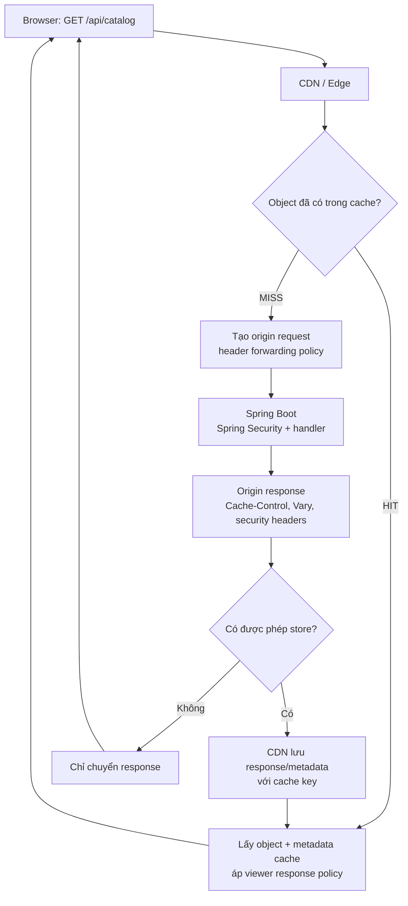
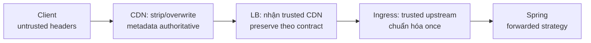

# Header do CDN thêm, sửa hoặc giữ trong cache

> **Chương:** Proxy và nguồn gốc  
> **Module:** `SPRING_SECURITY_HTTP_PROTECTION` — bảo vệ HTTP và trình duyệt bằng Spring Security, từ CSRF, CORS, security headers, CSP, HSTS, HTTP firewall đến session, trên cả Servlet và Reactive.  
> **Trọng tâm bài:** Theo dõi các **request headers** mà CDN thêm/sửa/loại/chuyển tới Spring và các **response headers** mà CDN lưu, ghi đè hoặc phát lại từ cache; thiết kế ranh giới tin cậy và cache policy để không làm sai xác thực, dữ liệu riêng tư, CORS, CSP, HSTS hay CSRF.

## 1. Mục tiêu học tập

Sau bài này, người học có thể:

1. Vẽ đường đi request/response qua browser → CDN → load balancer → Spring, phân biệt **cache HIT** và **cache MISS**.
2. Phân loại header CDN **thêm**, **ghi đè**, **bỏ**, **giữ**, **chuẩn hóa** và **tái phát từ cache**, ở cả hai chiều.
3. Giải thích khác nhau giữa **cache key policy**, **origin request policy** và **viewer response headers policy**.
4. Thiết kế hợp đồng tin cậy cho `Forwarded`, `X-Forwarded-*`, `Host`, `Origin`, `Authorization`, `Cookie` và các header vendor-specific.
5. Phân biệt chính xác `Cache-Control: no-store`, `private`, `no-cache`, `public`, `max-age`, `s-maxage` và `Vary`.
6. Tránh caching nhầm HTML/API cá nhân hóa, thông tin tenant, session, CSRF token, `Set-Cookie`, login redirect hoặc phản hồi có `Authorization`.
7. Hiểu vì sao cache HIT có thể **không đi qua Spring Security**, và vì sao một response trông “đúng ở origin” vẫn sai ở browser.
8. Giữ đúng CORS theo `Origin` và cache key, HSTS/CSP theo response policy, đồng thời không biến security headers thành tín hiệu “đã xác thực”.
9. Viết cấu hình phòng vệ cho Servlet, WebFlux và CDN, kiểm thử hai user/tenant, HIT/MISS, purge/invalidation và edge spoofing.
10. Thiết lập checklist vận hành và quy trình phản ứng khi CDN từng cache nhầm dữ liệu nhạy cảm.

**Nguyên tắc:** **“Đã gửi đến origin” khác “đã đưa vào cache key”, và “origin có phát header” khác “browser nhận đúng header”.** Không đánh giá tính an toàn của một ứng dụng Spring Security chỉ từ response khi gọi thẳng backend.

## 2. Một CDN có hai đường request hoàn toàn khác

Giả sử browser gọi:

```text
GET https://shop.example.test/api/catalog
```

Triển khai:



Sơ đồ khái niệm này đơn giản hóa revalidation, tiered cache, stale responses và các rule edge. Nhưng nó cho thấy điểm then chốt:

- **MISS:** CDN tạo origin request theo chính sách. Spring Security có thể chạy, xác thực, kiểm CSRF/CORS và handler trả response.
- **HIT:** CDN có thể trả response **không gửi request tới Spring**, vì vậy Spring Security **không xác thực lại request này** trừ khi edge có cơ chế kiểm tra riêng được thực thi trên **mọi HIT**.
- **Viewer response policy:** CDN có thể thêm/sửa/xóa header khi gửi cho browser trên **cả HIT và MISS**.
- **Cached response metadata:** CDN có thể lưu các response headers, sau đó phát lại hoặc tái tạo tùy implementation/policy. Không đồng nhất bản ghi trong cache với toàn bộ headers trên wire.
- **Revalidation:** CDN có thể hỏi origin qua `If-None-Match`/`If-Modified-Since`; một `304 Not Modified` có thể cập nhật metadata của response đã lưu.

**Điều kiện nghiệm thu:** Phải test **lần đầu MISS** và **lần sau HIT**, không chỉ gửi một request rồi xem status 200.

### 2.1. Phân biệt ba nơi quan sát

| Góc nhìn | Điều thấy được | Điều không chứng minh được |
|---|---|---|
| Browser → CDN | URL public, viewer request headers | Không nói origin request nhận đúng gì |
| CDN → origin | Các header thực được CDN gửi đến Spring | Không nói response cached HIT còn header gì |
| CDN → browser | Headers cuối sau CDN policies/cache | Không đảm bảo Spring Security đã chạy trên HIT |

Thêm một request ID tương quan có kiểm soát để đối chiếu origin logs và CDN logs; tuyệt đối không ghi raw session cookie, JWT, CSRF token hoặc webhook signature.

## 3. Các thao tác CDN có thể thực hiện với header

Một CDN không đơn giản là proxy “sao chép mọi thứ”. Theo sản phẩm và cấu hình, nó có thể:

| Thao tác | Ví dụ | Vấn đề phải hỏi |
|---|---|---|
| **Add** | Thêm trace ID, client-country, `Via`, `X-Forwarded-For` | Giá trị do CDN **tự xác minh** hay phản chiếu client? |
| **Overwrite** | Đặt `X-Forwarded-Proto` theo TLS edge; ghi đè HSTS ở viewer response | Có làm mâu thuẫn ý định origin? |
| **Strip** | Bỏ `Authorization` hoặc request header không thuộc origin policy | Có phá authentication, CSRF, CORS? |
| **Forward** | Chuyển `Origin`, `Authorization`, `Cookie` tới Spring | Có đưa chúng vào **cache key** không? |
| **Normalize** | Chuẩn hóa `Accept-Encoding`, `Host`, case hoặc multi-value | Origin/framework và cache có cùng cách hiểu không? |
| **Store** | Lưu body cùng `Cache-Control`, `ETag` hoặc security headers | Object có chứa dữ liệu theo user/tenant không? |
| **Replay** | Trả response cached trên HIT | Có trả dữ liệu/header của user A cho user B? |
| **Inject on delivery** | Thêm `Strict-Transport-Security` hoặc `Access-Control-Allow-Origin` theo policy | Có nhất quán giữa HIT, MISS, 304 và error response không? |
| **Remove on delivery** | Gỡ `Vary` hoặc `Set-Cookie` | Có tạo cache poisoning/CORS mismatch hoặc làm session mất không? |

**Không suy tính năng của một CDN thành hành vi mặc định của mọi CDN.** CloudFront, Cloudflare, Fastly, Akamai, một reverse proxy tự host và một gateway nội bộ có cách quản lý headers, cache keys và HIT behavior khác nhau.

## 4. Hai nhóm header: request và response

### 4.1. Request headers đi từ client/edge tới Spring

| Header | Nguồn thông thường | Mục đích | Nguy cơ khi thay đổi |
|---|---|---|---|
| `Host` / HTTP/2 `:authority` | Browser, được edge validate/map | Public host, multi-tenant routing | Host poisoning/callback sai |
| `Forwarded` / `X-Forwarded-Proto` | Proxy tin cậy tạo | Public HTTPS | HSTS/redirect/cookie sai |
| `X-Forwarded-Host/Port/Prefix` | Proxy tin cậy tạo | Host/port/prefix public | URL/chain/path sai |
| `X-Forwarded-For` / `X-Real-IP` | Trusted proxy chain | Audit/rate limit source | Giả client IP/bypass IP rules |
| `Authorization` | Client credential | Bearer/API auth | Mất header → 401; truyền vào shared cache sai |
| `Cookie` | Browser | Session, CSRF state | Không forward → logout/403; cache nhầm user |
| `Origin` | Browser hoặc non-browser client tự khai | CORS/origin checks | Mất header hoặc key sai → CORS mismatch |
| `Access-Control-Request-*` | Browser preflight | Phương thức/header định dùng | OPTIONS policy sai |
| `Accept-Encoding` | Client, có thể bị CDN normalize | gzip/br variants | Trả sai encoding nếu cache key/response metadata lệch |
| `Accept-Language` | Client | Ngôn ngữ | Variant không chia đúng hoặc tăng key cardinality |
| `If-None-Match` / `If-Modified-Since` | Client/cache | Revalidation | Trả 304/metadata không nhất quán |
| `Sec-Fetch-*` | Browser hỗ trợ | Fetch Metadata, defense-in-depth | Nếu bị xóa thì policy phải có fallback hợp lý |
| CDN country/device/trace headers | CDN gắn theo rule | Analytics/routing/observability | Không phải identity/authorization |
| `X-HTTP-Method-Override` và path override headers | Client/proxy nếu hỗ trợ | Routing tùy stack | Cache-key/path-parser differential |

Không phải tất cả header này Spring Security tự đọc. Chúng cần được **kiểm kê theo logic của edge, web server, filters và application**.

### 4.2. Response headers từ Spring/CDN đến browser

| Header | Công dụng | Điều CDN có thể làm hỏng |
|---|---|---|
| `Cache-Control`, `Expires` | Store/reuse/revalidate policy | Override TTL/no-store |
| `Vary` | Chọn biến thể theo request header | Gỡ/mất key dimension |
| `Set-Cookie` | Session, CSRF cookie và các cookie khác | Bỏ cookie hoặc cache/replay không đúng |
| `Strict-Transport-Security` | HSTS trên HTTPS | Thiếu, trùng, max-age khác |
| `Content-Security-Policy` | Giới hạn nguồn script, connect, form... | Gỡ, override, stale CSP, nonce tái dùng |
| `Access-Control-Allow-*` | CORS response và preflight | ACAO/credentials không theo Origin |
| `Location` | Redirect HTTPS/login/OAuth | Cache redirect cá nhân hóa/host sai |
| `X-Content-Type-Options`, `X-Frame-Options` | Browser protections | Gỡ/ghi đè policy |
| `Referrer-Policy`, `Permissions-Policy` | Giảm lộ referrer/khống chế browser APIs | Mất/khác policy |
| `ETag`, `Last-Modified` | Cache validation | Revalidation với biến thể sai |
| `Age`, `Via`, cache-status vendor headers | Chẩn đoán hành vi cache | Bị thiếu/đổi; không chứng minh quyền |
| `Content-Encoding`, `Content-Type` | Cách browser đọc body | Body/header không đồng bộ khi CDN transform |
| `WWW-Authenticate` | Thách thức authentication | 401 bị cache sai hoặc mất challenge |

CDN có thể **lưu** một object và áp policy khác khi **phát ra viewer response**. Vì vậy hãy kiểm tra đầu ra cuối, không chỉ body lưu.

## 5. Ba chính sách CDN phải được tách biệt

### 5.1. Cache key policy: “Hai request có được coi là cùng một object?”

Ví dụ hai request:

```http
GET /public/catalog HTTP/1.1
Host: shop.example.test
Accept-Language: vi
```

```http
GET /public/catalog HTTP/1.1
Host: shop.example.test
Accept-Language: en
```

Nếu response khác ngôn ngữ nhưng CDN key chỉ dựa URL, hai request có thể va chạm biến thể và nhận nội dung sai. Dùng cache key có dimensions đã được kiểm soát (ví dụ normalized language) hoặc tránh khác biệt đó ở cùng URL.

**Câu hỏi:** CDN key bao gồm hostname, scheme, path, query, selected headers/cookies và tenant identity nào? Có normalization/rule bỏ query/header không?

### 5.2. Origin request policy: “Header nào được gửi tới backend khi MISS?”

Có CDN cho phép forward thêm `Origin`, `Authorization`, cookies và các header khác đến Spring nhưng **không đưa chúng vào cache key**.

Điều này rất nguy hiểm nếu Spring dùng header đó để **thay đổi nội dung trả về** rồi CDN lưu theo một key không phân biệt variant.

Ví dụ:

```text
Cache key:             GET /api/profile
Origin request policy: forward Cookie
Origin logic:          Cookie SESSION=alice -> Alice profile
CDN store decision:    shared cache allowed by bad policy
Next request:          Cookie SESSION=bob, same key
Result:                Bob can receive Alice content on HIT
```

**Không dùng forward headers như lời hứa rằng CDN sẽ partition cache.** CloudFront là ví dụ rõ: **origin request policy và cache policy là hai cấu hình tách biệt**, header được forward không mặc nhiên tham gia key.

### 5.3. Viewer response headers policy: “Header nào browser nhận?”

CloudFront có **response headers policies** có thể thêm, bỏ, override `Cache-Control`, CORS và các security headers trên response từ origin **hoặc cache**.

Điểm quan trọng: Theo tài liệu CloudFront, thêm `Cache-Control` bằng **response headers policy cho viewer** không tự thay đổi cách CloudFront đã quyết định lưu object tại edge.

Ví dụ:

```text
Origin:     /api/private/balance -> response đã bị cache sai
CDN viewer: thêm Cache-Control: private, no-store
Browser:    nhìn thấy private, no-store
CDN edge:   object vẫn có thể tồn tại do cache policy riêng
```

**Không coi browser-facing `no-store` là bằng chứng edge không lưu object.** Phải kiểm chứng **edge cache behavior** và purge các object đã lưu sai.

### 5.4. Bảng đối chiếu quyết định

| Câu hỏi | Cấu hình/chứng cứ |
|---|---|
| CDN có chuyển `Cookie` đến Spring không? | Origin request policy / edge function |
| CDN có dùng `Cookie` để phân biệt bản cache không? | Cache key policy, cache behavior |
| CDN có cache endpoint có session không? | Route eligibility/bypass, TTL, response directives |
| CDN có thêm HSTS vào cache HIT không? | Viewer response policy |
| Spring có thấy public HTTPS không? | Trusted forwarded metadata trên origin MISS |
| Cookie có được trả về browser không? | `Set-Cookie` cuối ở viewer response |
| Ai kiểm tra authentication trên HIT? | Edge auth trên **mọi request** hoặc bắt buộc bypass |

## 6. `Cache-Control`: các directive không đồng nghĩa nhau

Theo **RFC 9111**, có những khác biệt rất quan trọng:

| Response directive | Ý nghĩa | Có phù hợp dữ liệu cá nhân? |
|---|---|---|
| `no-store` | Cache tuân chuẩn không được lưu request/response liên quan | **Ưu tiên** cho auth/session/private sensitive |
| `private` | Shared cache không được lưu; private browser cache có thể lưu theo quy tắc | Chỉ khi local caching được chấp thuận |
| `no-cache` | Có thể **lưu**, nhưng phải revalidate thành công trước khi dùng | Không thay `no-store` |
| `max-age=600` | Freshness lifetime cho cache phù hợp | Không áp vào private response thiếu bảo vệ |
| `s-maxage=600` | Freshness cho shared cache, ưu tiên hơn max-age ở shared cache | **Nguy hiểm** với response cá nhân hóa |
| `public` | Cho phép shared caching trong những trường hợp bị hạn chế nếu đủ điều kiện | Không dùng cho private auth response |
| `must-revalidate` | Khi stale, yêu cầu xác minh lại trước reuse theo RFC | Không thay private/no-store |
| `stale-while-revalidate` | Cho phép dùng stale trong thời gian quy định ở caches hỗ trợ | Không dùng cho nội dung nhạy cảm |
| `no-transform` | Giới hạn proxy biến đổi representation/content | Không kiểm soát cache key hay authentication |
| `immutable` | Gợi ý resource ít thay đổi, thường static asset versioned | Không dùng cho session/private HTML |

`Cache-Control: private, no-store` là cách diễn đạt có thể dùng cho response nhạy cảm. `no-store` là yêu cầu mạnh về **không lưu**, nhưng không bảo vệ trước một cache không tuân chuẩn, CDN rule cố tình override hay object đã được lưu từ trước.

### 6.1. Ba response đối chiếu

**Private response:**

```http
HTTP/1.1 200 OK
Cache-Control: private, no-store
Content-Type: application/json

{"account":"alice","balance":"..."}
```

**Public catalog chia sẻ được:**

```http
HTTP/1.1 200 OK
Cache-Control: public, max-age=60, s-maxage=600
Vary: Accept-Encoding
Content-Type: application/json

{"items":[...]}
```

**Static asset được fingerprint theo nội dung:**

```http
HTTP/1.1 200 OK
Cache-Control: public, max-age=31536000, immutable
Content-Type: text/javascript
```

Static file cần tên/version bất biến thực; không đặt một năm cache cho `/app.js` nếu nội dung có thể thay mà URL giữ nguyên, trừ khi có chiến lược invalidation đã thiết kế.

### 6.2. `Set-Cookie` không tự cấm caching

Một hiểu nhầm nguy hiểm là: “Response có `Set-Cookie` thì CDN chắc chắn không cache”. **Không có quy tắc HTTP phổ quát như vậy.** Nhiều CDN xử lý `Set-Cookie` khác nhau tùy mode/rule: một CDN có thể bypass, có thể strip cookie khi cache asset hoặc giữ theo policy.

Ví dụ, tài liệu Cloudflare mô tả **nhiều hành vi khác nhau** của `Set-Cookie` theo cache mode, origin cache control và edge TTL. Không dựa vào một behavior trừ khi đã xác minh cho **account, product, rule và tier** hiện tại.

Quy tắc của bài: **Không dùng `Set-Cookie` như bộ điều khiển cache chính.** Phân loại route từ edge và phát `Cache-Control` đúng từ ứng dụng.

### 6.3. `Authorization` có quy tắc đặc biệt, còn `Cookie` thì sao?

RFC 9111 giới hạn shared caches khi request có `Authorization`: chúng không được reuse response cho request đó trừ một số điều kiện/directive cho phép shared storage và caching tuân chuẩn.

Tuy nhiên:

- Nếu origin vô tình trả `public` hoặc `s-maxage` cho response đã xác thực, bạn có thể **cho phép shared caching** theo semantics HTTP.
- Request chứa `Cookie` **không hưởng cùng điều kiện cấm tự động** chỉ vì mang cookie.
- Vendor CDN có thể sửa/bỏ `Authorization` khi forward theo policy, khiến logic ở origin khác với mong đợi.
- Authentication tại Spring **không diễn ra trên CDN cache HIT** nếu CDN trả object trước khi gọi origin.

Do đó hãy **bypass caching hoàn toàn cho authenticated/personalized endpoints**, thay vì trông cậy vào `Vary: Cookie`/`Authorization` để chia sẻ object cá nhân một cách an toàn.

### 6.4. `private` vs `no-store` cho browser history

`private` ngăn shared caches nhưng cho phép private cache lưu tùy semantics; `no-store` yêu cầu caches tuân chuẩn không lưu. Với các trang/account data nhạy cảm, `no-store` là lựa chọn phòng vệ thường gặp.

Tuy nhiên, browser history/back-forward cache và dữ liệu render có cơ chế riêng; không khẳng định `no-store` đảm bảo user hoàn toàn không thấy dữ liệu sau logout trong mọi browser. Cần kiểm tra UX, session invalidation và chính sách dữ liệu thực.

## 7. Phân loại endpoint: đâu được cache, đâu phải bypass?

| Nhóm đường dẫn | Ví dụ | CDN policy khuyến nghị |
|---|---|---|
| Tài nguyên static có fingerprint | `/assets/app.4fa2.js` | Có thể cache public lâu; versioned URL |
| Public images/fonts/CSS | `/assets/logo.svg` | Cache public theo TTL/invalidations |
| Public catalog chung | `/public/catalog` | Shared cache nếu response không phụ thuộc user/tenant; key đúng |
| Public localized pages | `/public/help` | Chia variant theo normalized language khi cần |
| Trang cá nhân | `/api/me`, `/account/balance` | **Bypass; `no-store`** |
| Browser authenticated HTML | `/dashboard`, `/profile` | **Bypass; `no-store`** |
| Login/logout/refresh/session | `/login`, `/logout`, `/session` | **Bypass; `no-store`** nếu response liên quan auth/session |
| OAuth2/OIDC initiation/callback | `/oauth2/authorization/**`, `/login/oauth2/code/**` | **Bypass**; tránh cache redirect/state/cookies |
| CSRF token issuance | `/csrf`, bootstrap HTML chứa token | **Bypass; `no-store`** |
| Bearer-only private API | `/api/m2m/**` | **Bypass**, trừ thiết kế cache authorization-aware đã review riêng |
| Webhook và mọi unsafe mutation | `POST /integrations/events`, `POST /api/orders` | **Không dùng shared cache**; xử lý token/signature ở origin |
| Sensitive 401/403/error | `/api/private/**` | Không cache phản hồi theo principal; policy chặn |
| Tenant-specific catalog | `/tenant/{id}/catalog` | Chỉ cache khi tenant được phân biệt và response được công khai đúng contract |
| `OPTIONS` CORS preflight | `/api/web/**` | Policy rõ cho origin/method/headers; không nhầm browser preflight cache |
| `/.well-known/**` hoặc metadata public | Tùy nội dung | Kiểm tra có chứa secret/tenant-specific field không |

Một `GET` không mặc nhiên là public/cacheable. Còn HTTP có thể cho một số POST response cache dưới điều kiện chuẩn, nhưng **chính sách bảo mật ứng dụng** nên bypass các endpoints thay đổi trạng thái và auth-sensitive flows để tránh sai hành vi.

### 7.1. Hai phương diện “không cache” phải cùng đạt

1. **Application response:** `Cache-Control` ngăn cache theo hợp đồng endpoint.
2. **CDN cache behavior:** Route/policy xác định không store object dù origin hoặc rule khác cấu hình thiếu.

Khi một tầng bị thay đổi, tầng kia giúp phát hiện/giảm rủi ro; nhưng nếu CDN ép TTL bất chấp origin, yêu cầu response `no-store` từ Spring **không còn đủ**.

### 7.2. Quy tắc tránh cache key dựa user credential

Có thể tưởng tượng `Vary: Cookie` hoặc cache key gồm access token sẽ phân loại user, nhưng nó tạo:

- Key cardinality cực lớn, rò rỉ metadata về user/token trong logs hoặc keys.
- Rủi ro token rotation, permission changes, logout và cached data stale.
- Khả năng CDN **không** đưa cookie/token vào key theo rules đang chạy.
- Khó chứng minh authentication đã được thực hiện **trên mọi HIT**.

Đối với profile/account/order/private API, **bypass shared cache** là lựa chọn dễ audit hơn. Nếu một kiến trúc cache riêng có signed URLs/edge authorization, đó là **thiết kế riêng** cần xác thực mỗi request, expiry, key isolation và threat model, không áp dụng như mặc định.

## 8. CDN có thể thay `Authorization` hoặc `Cookie` khi gọi origin

### 8.1. Origin MISS nhận thiếu credential

Giả sử SPA gọi:

```http
GET /api/me HTTP/1.1
Host: shop.example.test
Cookie: SESSION=<opaque>
```

Nếu origin request policy không forward `Cookie`, Spring thấy request vô danh và có thể redirect `/login`. Ngược lại, nếu forward cookie đúng nhưng CDN lại cache response theo key chung, có nguy cơ dữ liệu private lọt sang user khác.

**Kiểm chứng hai ý riêng:** “Cookie có đến Spring không?” và “response có bị cache không?”.

### 8.2. Bearer-only API

```http
GET /api/m2m/orders HTTP/1.1
Authorization: Bearer <access-token>
```

CDN có thể xử lý `Authorization` theo policy và phương thức. Ví dụ CloudFront documentation cho custom origins có quy tắc mặc định khác nhau giữa `GET/HEAD` và `OPTIONS` trong một số cache configurations.

Không khẳng định “CloudFront luôn bỏ Authorization” cho mọi distribution; hãy kiểm tra **cache behavior và origin request policy thực tế**.

Nếu token bị mất, backend trả 401; nếu response 401 bị cache theo key quá rộng, request hợp lệ sau đó có thể tiếp tục nhận 401 cached. Còn nếu response authenticated được cache theo key chung, nguy cơ nghiêm trọng hơn là **cross-user data exposure**.

### 8.3. Không sửa bằng bật forward-all tùy tiện

Một thao tác “forward tất cả headers/cookies/query” có thể:

- Truyền thêm dữ liệu cá nhân đến origin không cần thiết.
- Tạo cache key cardinality lớn hoặc mâu thuẫn khi key policy vẫn chỉ chứa một phần.
- Mang header spoofable vào Spring.
- Tăng khả năng cache poisoning/unkeyed input.
- Làm hệ thống khó chẩn đoán vì phụ thuộc vendor/product mode.

Hãy allowlist những headers origin thực cần; với private routes, cấu hình **cache bypass** thay vì cố đưa credential vào cache key.

## 9. Header CDN thêm cho client IP, vị trí và trace

Một CDN có thể gắn các header kiểu `X-Forwarded-For`, request ID, country/region/device hints hoặc header vendor-specific.

### 9.1. Header “CDN nói” chỉ tin được nếu request thật qua CDN

```http
X-Forwarded-For: 198.51.100.25
X-Forwarded-Proto: https
X-Forwarded-Host: shop.example.test
X-Edge-Country: VN
X-Request-ID: <opaque-id>
```

Những tên header trên là **ví dụ minh họa**; `X-Edge-Country` không phải tên header chuẩn của mọi CDN.

Client bất kỳ có thể tự gửi header trùng tên, trừ khi edge **strip/overwrite** và backend không có đường bypass. Vì vậy:

- Edge phải xác minh TLS, public Host/SNI, peer IP và xóa header forward do client tự khai.
- CDN/ingress chỉ giữ metadata từ **trusted upstream**; nếu request bypass CDN, không được áp cùng trust policy.
- Server Spring không trực tiếp tin `X-Forwarded-For` hoặc `X-Edge-Country` như bằng chứng user đã đăng nhập.
- Geo/device hints có thể phục vụ personalization nhẹ hoặc analytics, **không thay authentication/authorization**.
- IP + geo có thể là dữ liệu cá nhân; giới hạn log/retention theo policy.

### 9.2. Chuỗi CDN → LB → ingress



XFF `append` chỉ an toàn sau khi hop đầu đã loại dữ liệu giả và mỗi hop tiếp theo được xác minh. Không parse `X-Forwarded-For.split(",")[0]` rồi dùng kết quả cho Spring Security admin privileges.

### 9.3. Cache metadata không phải credential

`Age: 120`, `X-Cache: Hit from ...` hoặc `CF-Cache-Status: HIT` (tùy vendor) giúp đo behavior cache, **không chứng minh object này đã được xác thực cho viewer hiện tại**. Một HIT sai chính là rủi ro cần kiểm thử.

## 10. CORS: CDN giữ `Origin` nhưng key có phân biệt không?

Giả sử public API trả kết quả dùng chung, nhưng CORS chỉ cho phép hai frontend:

```text
https://app.example.test
https://partner.example.test
```

Origin có thể phản chiếu một origin **sau khi đối chiếu allowlist**:

```http
HTTP/1.1 200 OK
Access-Control-Allow-Origin: https://app.example.test
Vary: Origin
Cache-Control: public, max-age=60, s-maxage=600
```

Nếu CDN cache theo URL nhưng **không phân biệt `Origin`**, request từ `partner.example.test` có thể nhận cached ACAO của `app.example.test`. Browser có thể chặn response (availability bug); với cấu hình wildcard/credentials sai, hậu quả có thể thành lỗ hổng bảo mật.

### 10.1. `Vary: Origin` cần cache hiểu và áp dụng

Theo RFC 9111, cache tuân chuẩn phải xét các request fields được liệt kê trong `Vary` khi tái sử dụng representation, nhưng **cách CDN thực thi cache key có thể có cấu hình vendor riêng**.

Do đó cần đồng thời:

1. App trả CORS headers đúng origin đã được **allowlist**, không phản chiếu mọi `Origin` tùy ý.
2. App phát `Vary: Origin` khi response thực sự phụ thuộc Origin.
3. CDN cache policy xét `Origin`/variant đúng theo sản phẩm và cấu hình.
4. CDN viewer response policy không ghi đè `Access-Control-Allow-Origin` thành `*` với credentials.
5. Test tuần tự origin A → origin B → origin A trên **MISS/HIT**, không chỉ test mỗi origin riêng lẻ.

Cloudflare tài liệu hiện hành có tính năng Vary/cache keys; CloudFront có cache-key policy rõ. Hãy đọc hướng dẫn **đúng version và plan** của CDN, tránh suy một dòng `Vary` tự giải quyết mọi configuration.

### 10.2. Credentials CORS không được mở wildcard

Nếu browser gửi cookie/credentials và server cho phép credentials, policy phải dùng origin cụ thể đã được cho phép và `Access-Control-Allow-Credentials` phù hợp. `Access-Control-Allow-Origin: *` không dùng để cấp quyền đọc response cho credentialed requests theo browser CORS semantics.

**CORS không thay CSRF.** Một trang cross-site có thể tạo request làm thay đổi trạng thái trong những trường hợp browser cho phép gửi; việc script không đọc được response không đảm bảo side effect bị chặn.

### 10.3. Preflight: hai loại cache khác nhau

Browser có thể cache kết quả preflight theo `Access-Control-Max-Age`. CDN cũng có thể cache response cho `OPTIONS` nếu policy cho phép.

Đây là **hai cache độc lập**:

| Loại cache | Ai quản lý | Điểm phải phân biệt |
|---|---|---|
| Browser preflight cache | Browser theo CORS semantics | Origin, method, requested headers, credentials/context |
| CDN edge cache cho OPTIONS | CDN cache behavior | Key phải tách các request variants mà response phụ thuộc |
| Shared HTTP cache cho GET | CDN/proxy | Không lưu API private data dù CORS đúng |

Nếu cache OPTIONS, phải test `Origin` + `Access-Control-Request-Method` + `Access-Control-Request-Headers`. Nếu không chứng minh được key/policy tương ứng, **bypass OPTIONS** ở edge là phương án an toàn hơn.

### 10.4. Cache CORS policy ở CDN hay ở Spring?

Có thể để CDN sở hữu CORS cho **tài nguyên public đơn giản**. Nhưng nếu Spring Security quyết định CORS theo API/tenant/credentials, việc CDN gắn `Access-Control-Allow-Origin` tĩnh cho toàn distribution có thể vượt khỏi chính sách dự kiến.

Chọn một owner theo route, kiểm tra origin override precedence và loại header trùng/mâu thuẫn trên viewer response.

## 11. HSTS, CSP và security headers trên cache HIT

### 11.1. HSTS có thể đến từ edge thay vì Spring

Spring Security thường chỉ ghi `Strict-Transport-Security` khi request được nhận diện là HTTPS. Khi CDN terminate TLS rồi gọi origin qua HTTP, Spring có thể không thấy HTTPS public nếu forwarded proto chưa được khôi phục.

Hai kiến trúc hợp lệ:

1. **CDN/TLS edge sở hữu HSTS** trên response HTTPS public, kể cả response từ cache.
2. **Spring Security sở hữu HSTS**, CDN giữ nguyên header và Spring nhận đúng public HTTPS qua trusted forwarding.

**Không để edge và origin phát hai HSTS policies mâu thuẫn.** `max-age`, `includeSubDomains` và `preload` cần được review ở cấp hostname/domain. HSTS áp theo host, không theo path hay cache status.

### 11.2. CSP: body và policy phải nhất quán theo phiên bản object

Ví dụ HTML có nonce CSP:

```http
Content-Security-Policy: script-src 'nonce-abc123' 'strict-dynamic'
Content-Type: text/html
```

Nếu CDN cache HTML **có nonce sinh ngẫu nhiên theo response**, body và header phải còn khớp khi serve; nhưng quan trọng hơn, **dùng lại cùng nonce qua nhiều response làm suy yếu tính bất đoán/mỗi-response của CSP nonce**. Đừng cache shared một trang động chứa CSP nonce, session state hoặc CSRF token trừ khi thiết kế an toàn đặc biệt đã được review.

Rủi ro khác:

- CDN ghi đè CSP của origin nhưng body chứa các script/resource không được allow.
- CDN chỉ cache body mà viewer policy dùng CSP khác khiến app không hoạt động.
- CDN bỏ CSP trên response HIT hoặc CDN-generated error page.
- Edge inject `Access-Control-Allow-Origin: *` trong khi CSP chặt không bảo vệ được credentialed data leaks.
- CDN stale-cache HTML sau deployment thay script hashes/policies.

CSP **không phải cache isolation control**, cũng không thay CSRF. Cần test CSP của response **cuối** cùng body tương ứng ở cả MISS/HIT.

### 11.3. Các header bảo mật khác

Kiểm tra cả:

- `X-Content-Type-Options: nosniff` trên cached scripts/styles.
- `X-Frame-Options` và CSP `frame-ancestors` trên HTML.
- `Referrer-Policy`, đặc biệt các flow có token trong URL.
- `Permissions-Policy`, `Cross-Origin-Opener-Policy`, `Cross-Origin-Resource-Policy` hoặc `Cross-Origin-Embedder-Policy` nếu app sử dụng.
- `Content-Type`/`Content-Encoding` đồng bộ với body sau CDN transformations.
- HSTS trên HTTPS errors/redirects do CDN tạo nếu tổ chức yêu cầu.

Chính sách cần phân loại **HTML, static JS/CSS và API JSON**, không ném một CSP hoặc CORS response policy lên tất cả routes rồi suy là an toàn.

## 12. HTTP cache và Spring Security mặc định

Tài liệu Spring Security công bố header cache-control mặc định cho các response chịu security filters (nếu ứng dụng chưa tự thiết lập Cache-Control):

```http
Cache-Control: no-cache, no-store, max-age=0, must-revalidate
Pragma: no-cache
Expires: 0
```

Những header này được thiết kế để giảm caching của nội dung nhạy cảm. Theo tài liệu Spring Security, **nếu ứng dụng tự cung cấp cache-control**, header writer mặc định có thể nhường chỗ; điều này cho phép cache static content khi cần.

### 12.1. Không tắt cache headers toàn cục chỉ để tối ưu static assets

Một cách sửa vội thường gặp:

```java
// PHẢN VÍ DỤ: tắt toàn bộ cache-control security defaults
// nếu vẫn có account/session endpoints trên cùng chain.
http.headers(headers -> headers
    .cacheControl(cache -> cache.disable()));
```

Nếu làm vậy mà không gắn `no-store` cho routes nhạy cảm, CDN có thể cache response theo policy khác hoặc dựa heuristic caching. Không dùng giải pháp này chỉ để tăng CDN HIT cho CSS.

**Thay vào đó:** Phân loại static/public routes, đặt explicit caching policy ở tài nguyên đủ điều kiện, giữ `no-store` cho private endpoints và cấu hình CDN cache bypass tương ứng.

### 12.2. Servlet controller: đặt `no-store` cho dữ liệu của user

Ví dụ minh họa Spring MVC/Servlet:

```java
import org.springframework.http.CacheControl;
import org.springframework.http.ResponseEntity;
import org.springframework.security.core.Authentication;
import org.springframework.web.bind.annotation.GetMapping;
import org.springframework.web.bind.annotation.RestController;

record ProfileView(String username) {}

@RestController
class ProfileController {

    @GetMapping("/api/me")
    ResponseEntity<ProfileView> me(Authentication authentication) {
        return ResponseEntity.ok()
            .cacheControl(CacheControl.noStore())
            .body(new ProfileView(authentication.getName()));
    }
}
```

**Tiền đề:** `/api/me` đã được Spring Security yêu cầu authenticated; code này chỉ mô tả policy response. Đừng dùng `getName()` làm thông tin duy nhất cho authorization thực tế. CDN route `/api/me` phải được cấu hình **bypass shared cache** bất kể response này.

### 12.3. Servlet public catalog: cache có kiểm soát

```java
import java.time.Duration;
import java.util.List;
import org.springframework.http.CacheControl;
import org.springframework.http.ResponseEntity;
import org.springframework.web.bind.annotation.GetMapping;
import org.springframework.web.bind.annotation.RestController;

@RestController
class PublicCatalogController {

    @GetMapping("/public/catalog")
    ResponseEntity<List<String>> catalog() {
        return ResponseEntity.ok()
            .cacheControl(CacheControl.maxAge(Duration.ofMinutes(5))
                .cachePublic())
            .body(List.of("book", "course"));
    }
}
```

Chỉ làm vậy khi nội dung **thật sự công khai, giống nhau cho mọi user/tenant**, không phụ thuộc Authorization/Cookie/Origin hoặc headers ngoài cache key. Nếu CDN dùng `s-maxage`/edge TTL riêng, cần thiết kế cả client TTL lẫn shared cache TTL tương ứng; ví dụ không tự đặt `s-maxage`.

### 12.4. WebFlux Controller: chính sách cache vẫn nằm trên response

```java
import java.security.Principal;
import reactor.core.publisher.Mono;
import org.springframework.http.CacheControl;
import org.springframework.http.ResponseEntity;
import org.springframework.web.bind.annotation.GetMapping;
import org.springframework.web.bind.annotation.RestController;

record ReactiveProfileView(String username) {}

@RestController
class ReactiveProfileController {

    @GetMapping("/api/me")
    Mono<ResponseEntity<ReactiveProfileView>> me(
            Mono<Principal> principal) {

        return principal.map(p -> ResponseEntity.ok()
            .cacheControl(CacheControl.noStore())
            .body(new ReactiveProfileView(p.getName())));
    }
}
```

WebFlux dùng `SecurityWebFilterChain`/`WebFilter` thay Servlet `SecurityFilterChain`/`Filter`, nhưng HTTP caching semantics ở browser/CDN là cùng một bài toán. Test response từ pipeline reactive thật; một test `bindToController` không bao gồm đầy đủ Security/edge.

### 12.5. Một controller không thể thay policy của cache HIT

Nếu CDN đã có cached response theo key chung, request HIT **không gọi controller trên**. Vì vậy việc sửa Java từ `public` sang `no-store` không tự xóa object cũ. Phải **sửa policy ở CDN, invalidate/purge cached object** và xác nhận các request mới không được serve từ bản đã lưu sai.

## 13. Session, CSRF và các endpoint dễ cache nhầm

### 13.1. Cookie-session HTML và user-specific JSON

Một trang `GET /dashboard` có thể chứa tên, số dư, CSRF hidden field hoặc bootstrap state của user. Cần:

- CDN bypass cho toàn route.
- Response `Cache-Control: private, no-store` hoặc chính sách tương đương đã review.
- Không đặt `public`/`s-maxage` chỉ để frontend “mở nhanh hơn”.
- Không dựa vào `Vary: Cookie` như biện pháp bảo mật chính.
- Không cache 302 redirect chứa URL/`state`/session-specific data.

**GET không thay trạng thái** không có nghĩa response đó an toàn để chia sẻ.

### 13.2. CSRF token issuance

Một endpoint `GET /csrf` hoặc HTML form chứa token anti-CSRF có thể trả token theo session/request. Nếu CDN cache chung:

```text
Alice GET /csrf -> token dành cho Alice -> CDN lưu
Bob   GET /csrf -> CDN HIT -> token của Alice
```

Hậu quả có thể là token mismatch/403 hoặc tạo bề mặt tấn công tùy repository/token semantics. Không nói “token Alice sẽ luôn dùng được cho Bob” — thực tế phụ thuộc cách xác thực token.

**Phòng vệ:** Bypass shared cache và `no-store` cho token issuance, HTML có token và session bootstrap. Test hai users, session cookies và thứ tự HIT/MISS.

### 13.3. POST, logout, refresh, webhook

- CDN phải chuyển method, body, `Authorization`/`Cookie`, CSRF headers hoặc webhook signature đúng tới origin.
- Một `POST` đổi trạng thái **không được đáp ứng từ một cached GET** do key/path/method override sai.
- Browser POST dùng session cookie vẫn cần CSRF token.
- Bearer-only route có thể được cấu hình CSRF exception hẹp, **nếu không có cookie fallback**.
- Webhook có chữ ký HMAC cần verifier/anti-replay riêng, không dựa vào cache.
- Logout và refresh responses có `Set-Cookie`/session state riêng, không cache chung.

### 13.4. `Sec-Fetch-*` làm defense-in-depth, không phải cache key mặc định

Fetch Metadata headers (`Sec-Fetch-Site`, `Sec-Fetch-Mode`, `Sec-Fetch-Dest`) có thể hỗ trợ chính sách chống cross-site request. Nhưng non-browser clients có thể khác; CDN có thể drop headers theo origin policy. Nếu app dựa vào chúng, cần xác minh đường forwarding, fallback và test; không cho phép unsafe operations chỉ vì một header “có vẻ same-origin” mà chưa xem toàn bộ auth/CSRF policy.

## 14. 301/302/401/403/404 có thể bị ảnh hưởng cache

Không phải cache chỉ giữ `200 OK`.

### 14.1. Login redirect hoặc OAuth2 initiation

Giả sử anonymous request tới `/account` trả:

```http
HTTP/1.1 302 Found
Location: /login
Set-Cookie: SESSION=<opaque>
Cache-Control: no-store
```

CDN không nên lưu/chia sẻ redirect và session cookie này. Nếu một rule force-cache 302 theo URL chung, user đã login vẫn có thể liên tục bị điều hướng như anonymous; tệ hơn, một số flow có token/state trong redirect URI hoặc Set-Cookie nhạy cảm.

### 14.2. 401/403 cached

Nếu user A bị 403 do thiếu quyền rồi CDN cache chung response đó, user B có quyền có thể gặp 403 HIT. Ngược lại, nếu một response 200 được lưu sai, người không đủ quyền có thể nhận dữ liệu.

Không giải quyết bằng cache key “status code”: **authorization phải xảy ra trên request hoặc endpoint phải bypass cache**.

### 14.3. 404 negative caching

CDN có thể cache 404 theo cấu hình, kể cả response do origin hoặc CDN tạo. Nếu một route mới được triển khai nhưng vẫn nhận cached 404, cần kiểm tra error caching TTL/invalidations. Với các tài nguyên có existence nhạy cảm theo user, cache 404 theo key chung còn có thể làm lộ hoặc che trạng thái tài nguyên.

Không mở toàn bộ `/api/**` để cache chỉ vì muốn giảm tải 404.

### 14.4. 304 và revalidation

`ETag`/`Last-Modified` cho phép CDN revalidate. Một 304 có thể dẫn đến cập nhật cached metadata và việc serve body đã lưu.

Test trường hợp:

1. Origin phát HSTS/CSP/CORS/Vary ở 200 đầu tiên.
2. Cache gửi conditional request, origin trả 304.
3. CDN phục vụ bản đã lưu sau revalidation.
4. Browser nhận headers cuối phù hợp policy.

Không chỉ test `200 MISS` rồi nghĩ 304 không liên quan security headers. Với private data, ưu tiên **no-store + bypass** thay vì phải chứng minh toàn bộ cơ chế validator an toàn.

## 15. CDN cache poisoning qua header không nằm trong cache key

Một input ảnh hưởng **response** nhưng không ảnh hưởng **cache key** là bề mặt cache poisoning.

### 15.1. Ví dụ Host/forwarded host gây redirect sai

```http
GET /go HTTP/1.1
Host: shop.example.test
X-Forwarded-Host: attacker.example
```

Nếu origin dùng `X-Forwarded-Host` chưa kiểm chứng để tạo:

```http
HTTP/1.1 302 Found
Location: https://attacker.example/login
Cache-Control: public, max-age=600
```

và CDN cache chỉ theo `/go`, các viewer tiếp theo có thể bị nhận redirect độc hại.

**Phòng vệ:** Trusted edge strip/overwrite forwarding headers, host allowlist, absolute URL từ canonical config/verified host, và không cache auth redirects.

### 15.2. Prefix/path override và phân vùng route

`X-Forwarded-Prefix`, `X-Original-URL` hoặc `X-Rewrite-URL` chỉ được sử dụng nếu stack thực có quy ước đó. Nếu CDN key theo path A nhưng origin route theo path B sau untrusted header rewrite, response có thể được lưu dưới key sai.

Đừng “chữa” bằng việc đưa mọi header client tự gửi vào key. Ưu tiên **loại bỏ header không tin cậy** trước khi định tuyến, thống nhất path normalization và route cache policy.

### 15.3. Query và tenant routing

Nếu CDN bỏ query parameter khỏi key nhưng origin dùng nó để trả dữ liệu khác:

```text
/api/public/products?region=vn
/api/public/products?region=sg
```

hai response có thể dùng chung object. Nếu region/tenant data có tính riêng tư, cần bypass; nếu là public, cần key đúng và normalize.

### 15.4. Cache key không phải bộ xác thực

Ngay cả khi cache key chứa user ID do header `X-User-ID` khai, client có thể tự đặt ID nếu edge chưa xác thực. Không xây cache identity từ header tự khai.

Với edge-authenticated content, phải chứng minh authentication chạy **trước cache lookup** và mọi HIT được kiểm tra entitlement; đó là một thiết kế chuyên biệt có yêu cầu phê duyệt, không phải mặc định cho Spring session API.

## 16. `Vary` không phải cây đũa thần

Ví dụ đúng cho một public resource thay đổi theo encoding:

```http
Cache-Control: public, max-age=600
Vary: Accept-Encoding
Content-Encoding: br
```

Một app có thể phát `Vary: Origin` cho CORS reflection và `Vary: Accept-Language` khi localization. Nhưng:

- Caches/CDNs có **policy riêng** về những fields thực sự tham gia key.
- `Vary: Cookie` tạo key cardinality lớn, không tự làm dữ liệu private.
- `Vary: Authorization` không thay user authorization trên cache HIT.
- `Vary: *` có semantics không reuse mà không revalidation theo HTTP; vendor có thể bypass.
- Nếu CDN response policy **xóa `Vary`**, browser/intermediate caches có thể reuse sai variant.
- Header normalized ở edge nhưng không normalized trong key cũng có thể làm variant mismatch.
- Những cached responses đã sinh trước khi sửa `Vary` cần invalidation.

Nên đo **cặp**: request headers mà origin nhận, response `Vary` từ Spring và **cache key thực** mà CDN đang dùng.

## 17. Thực hành định nghĩa một header contract

Một bảng contract giúp team platform/CDN và team Spring không suy đoán lẫn nhau.

| Route group | Viewer headers cần | Origin headers cần | Cache key dimensions | Response policy |
|---|---|---|---|---|
| `/assets/**` | `Accept-Encoding` | Tối thiểu | Host/path/version, encoding variant phù hợp | Public TTL, security headers |
| `/public/catalog` | `Accept-Language` nếu locale | Language đã normalize | Host/path/query + locale khi có variant | Public `max-age`/`s-maxage` |
| `/api/me` | `Cookie`, `Authorization` tùy auth contract | Credential hợp lệ, Origin nếu CORS | **Không cache** | `private, no-store` |
| `/api/web/**` | Cookie, CSRF header, Origin | Tất cả headers security cần | **Không cache** | `no-store` cho private responses, CORS riêng |
| `/api/m2m/**` | Authorization | Bearer + tracing | **Không cache** mặc định | `no-store` |
| `/login`/`/logout` | Cookies/session flow | Cookie, Origin, CSRF theo contract | **Không cache** | `no-store`, Set-Cookie đúng |
| `/oauth2/**` | Cookies, redirect state | Cookie/correlation metadata | **Không cache** | Không cache redirect/state |
| `/integrations/webhook` | Signature, timestamp | Signature + body nguyên vẹn | **Không cache** | Verifier ở origin |
| `OPTIONS /api/**` | Origin, requested method/headers | CORS headers cần | Bypass hoặc explicit variant-aware | CORS policy không wildcard credentials |

Thêm owner và version của CDN distribution/rule, Spring security chain, ingestion endpoints và cách rollback. Contract cần được review khi CDN thay cache behavior, không đợi Java code đổi.

## 18. Nginx minh họa ranh giới edge với origin

Đây là **Nginx reverse-proxy example**, không tự thay CDN cache config. Giả sử TLS terminate trực tiếp ở Nginx và app ở `spring.internal:8080`; hostname public `portal.example.test` đã được allowlist, backend không public.

```nginx
server {
    listen 443 ssl;
    server_name portal.example.test;

    # TLS cert, default reject vhost, firewall và logs
    # được triển khai riêng, ngoài đoạn minh họa.

    location /api/ {
        proxy_pass http://spring.internal:8080;

        # Metadata authoritative từ vhost/TLS listener.
        proxy_set_header Host portal.example.test;
        proxy_set_header Forwarded "";
        proxy_set_header X-Forwarded-Proto https;
        proxy_set_header X-Forwarded-Host portal.example.test;
        proxy_set_header X-Forwarded-Port 443;

        # Edge trực tiếp: không giữ XFF client tự gửi.
        proxy_set_header X-Forwarded-For $remote_addr;

        # Nếu Nginx còn bật proxy_cache ở tầng này,
        # tắt trên private API. CDN đứng trước Nginx
        # vẫn cần route cache bypass độc lập.
        proxy_cache off;
    }
}
```

**Giới hạn:** `server_name` không đủ để chặn Host lạ khi thiếu default deny vhost. Nginx phía sau CDN phải có trusted upstream/real-IP config khác, và không ghi đè public HTTPS thành HTTP chỉ vì hop CDN→Nginx là HTTP nội bộ.

Nếu cần cache static content, cấu hình caching **riêng** ở CDN hoặc route static, không tái sử dụng cùng rule cho `/api/me`/`/login`.

### 18.1. Hai phản ví dụ nguy hiểm

```nginx
# PHẢN VÍ DỤ 1: cạnh Internet nhận raw client header
# rồi cho origin tin nó.
proxy_set_header X-Forwarded-Proto $http_x_forwarded_proto;
proxy_set_header X-Forwarded-Host  $http_x_forwarded_host;

# PHẢN VÍ DỤ 2: ép bỏ qua Cache-Control / Set-Cookie
# tại Nginx nếu chưa có mô hình dữ liệu an toàn.
proxy_ignore_headers Cache-Control Set-Cookie;
```

Dòng `proxy_ignore_headers` được đưa ra như **phản ví dụ**, không phải khuyến nghị. Nó không chỉ làm sai cache semantics; còn có thể tạo rò rỉ dữ liệu/cookie nếu route caching được bật.

## 19. Servlet Spring Security: cache headers và browser chain

Giả sử có hai khu vực:

- `/public/**` chứa nội dung public đủ điều kiện cache.
- `/api/web/**` dùng browser session cookie, cần CSRF.
- `/api/m2m/**` chỉ nhận Bearer header, không cookie fallback.

Một ví dụ phân chain:

```java
import org.springframework.context.annotation.Bean;
import org.springframework.core.annotation.Order;
import org.springframework.security.config.Customizer;
import org.springframework.security.config.annotation.web.builders.HttpSecurity;
import org.springframework.security.config.annotation.web.configurers.AbstractHttpConfigurer;
import org.springframework.security.config.http.SessionCreationPolicy;
import org.springframework.security.web.SecurityFilterChain;

@Bean
@Order(1)
SecurityFilterChain machineApi(HttpSecurity http) throws Exception {
    return http
        .securityMatcher("/api/m2m/**")
        .sessionManagement(s -> s
            .sessionCreationPolicy(SessionCreationPolicy.STATELESS))
        .csrf(AbstractHttpConfigurer::disable)
        .oauth2ResourceServer(o -> o.jwt(Customizer.withDefaults()))
        .authorizeHttpRequests(a -> a.anyRequest().authenticated())
        .build();
}

@Bean
@Order(2)
SecurityFilterChain browserAndPublic(HttpSecurity http)
        throws Exception {
    return http
        .authorizeHttpRequests(a -> a
            .requestMatchers("/public/**", "/assets/**", "/login")
                .permitAll()
            .anyRequest().authenticated())
        .formLogin(Customizer.withDefaults())
        // Giữ CSRF và security cache-control defaults.
        .build();
}
```

**Các lưu ý kiểm thử:**

1. `permitAll` **không** tự biến response thành public-cacheable.
2. `csrf.disable()` chỉ áp trong machine chain được match chính xác; không cho cookie fallback trong đó.
3. Chain đầu tiên khớp chịu trách nhiệm, nhưng nếu CDN HIT, **không chain nào chạy**.
4. `SessionCreationPolicy.STATELESS` không chứng minh một custom authentication filter không đọc cookie; cần test cookie-only.
5. Headers `Cache-Control` trên private responses phải xuất hiện trong public response cuối.
6. Khi muốn cache public catalog, app đặt explicit Cache-Control phù hợp **và** CDN chọn đúng route/key.

Đừng dùng `web.ignoring()` để loại nhiều routes khỏi Spring Security chỉ vì muốn cache. Nếu static route cần cache, vẫn có thể có security headers/authorization policy thích hợp.

## 20. Reactive WebFlux: cùng HTTP semantics, khác filter pipeline

WebFlux sử dụng `SecurityWebFilterChain`/`CsrfWebFilter`, không dùng Servlet `Filter`. Nhưng mọi nguyên tắc cache vẫn giữ nguyên.

```java
import org.springframework.context.annotation.Bean;
import org.springframework.core.annotation.Order;
import org.springframework.security.config.Customizer;
import org.springframework.security.config.web.server.ServerHttpSecurity;
import org.springframework.security.web.server.SecurityWebFilterChain;
import org.springframework.security.web.server.context.NoOpServerSecurityContextRepository;
import org.springframework.security.web.server.util.matcher.PathPatternParserServerWebExchangeMatcher;

@Bean
@Order(1)
SecurityWebFilterChain machineApi(ServerHttpSecurity http) {
    return http
        .securityMatcher(
            new PathPatternParserServerWebExchangeMatcher("/api/m2m/**"))
        .securityContextRepository(
            NoOpServerSecurityContextRepository.getInstance())
        .csrf(ServerHttpSecurity.CsrfSpec::disable)
        .oauth2ResourceServer(o -> o.jwt(Customizer.withDefaults()))
        .authorizeExchange(a -> a.anyExchange().authenticated())
        .build();
}

@Bean
@Order(2)
SecurityWebFilterChain browserAndPublic(ServerHttpSecurity http) {
    return http
        .authorizeExchange(a -> a
            .pathMatchers("/public/**", "/assets/**", "/login")
                .permitAll()
            .anyExchange().authenticated())
        .formLogin(Customizer.withDefaults())
        // Giữ cache headers và CSRF defaults.
        .build();
}
```

Nếu app dùng Spring Boot forwarding `framework` (với WebFlux là `ForwardedHeaderTransformer`), edge vẫn phải sanitize incoming forwarded headers trước. Không suy rằng server-native Netty xử lý cache hay trusted proxy giống Servlet Tomcat.

### 20.1. Cấu hình cache response cho WebFlux không đồng nghĩa edge bypass

`Mono<ResponseEntity<T>>` có thể trả `Cache-Control: no-store`, nhưng nếu CDN có object cũ dưới key chung, request HIT không tới WebFlux handler. Do đó cả WebFlux test và CDN negative test đều phải đạt.

### 20.2. Spring Boot version khi dùng forwarded headers

Với các dòng Spring Boot 2.2–4.1, property thường là `server.forward-headers-strategy=framework/native/none`. Từ Spring Boot 4.2, namespace mới là `server.request.header.forwarded.strategy=framework/web-server/none`; nếu cần `X-Forwarded-Prefix`, phải chọn use-prefix theo version.

Dù dùng version nào, **không** để CDN hoặc một viewer-controlled header tự khai public host/proto/port/prefix cho Spring. Các thuộc tính này ảnh hưởng Location/HSTS/cookie, **không** được giải quyết chỉ bằng cache-control.

## 21. Kiểm thử origin trực tiếp: chứng minh Spring phát đúng policy

### 21.1. MockMvc với route private

Ví dụ khi `/api/me` yêu cầu authenticated và controller ở phần 12 được đăng ký:

```java
import org.junit.jupiter.api.Test;
import org.springframework.beans.factory.annotation.Autowired;
import org.springframework.boot.test.autoconfigure.web.servlet.AutoConfigureMockMvc;
import org.springframework.boot.test.context.SpringBootTest;
import org.springframework.test.web.servlet.MockMvc;

import static org.hamcrest.Matchers.containsString;
import static org.springframework.security.test.web.servlet.request.SecurityMockMvcRequestPostProcessors.user;
import static org.springframework.test.web.servlet.request.MockMvcRequestBuilders.get;
import static org.springframework.test.web.servlet.result.MockMvcResultMatchers.header;
import static org.springframework.test.web.servlet.result.MockMvcResultMatchers.status;

@SpringBootTest
@AutoConfigureMockMvc
class PrivateCacheHeadersServletIT {

    @Autowired
    MockMvc mvc;

    @Test
    void authenticatedProfileIsNotStoreable() throws Exception {
        mvc.perform(get("/api/me")
                .with(user("alice").roles("USER")))
            .andExpect(status().isOk())
            .andExpect(header().string(
                "Cache-Control", containsString("no-store")));
    }
}
```

**Giới hạn:** Test này chạy Spring Security + MVC nếu app test setup đúng; nó không chứng minh CDN route `/api/me` được bypass, cũng không mô phỏng một cache HIT.

### 21.2. Reactive WebTestClient

```java
import static org.springframework.security.test.web.reactive.server.SecurityMockServerConfigurers.mockUser;

@Test
void reactiveProfileResponseHasNoStore() {
    webTestClient.mutateWith(mockUser("alice").roles("USER"))
        .get().uri("/api/me")
        .exchange()
        .expectStatus().isOk()
        .expectHeader()
        .value("Cache-Control",
            value -> org.junit.jupiter.api.Assertions.assertTrue(
                value.contains("no-store")));
}
```

**Tiền đề:** `webTestClient` đang chạy qua Spring Security và handler thật; `mockUser` chỉ kiểm test authentication flow ở ứng dụng, **không chứng minh CDN forwarding Cookie/Authorization**, và càng không chứng minh cache HIT sẽ thực hiện authorization.

### 21.3. CORS response contract

Dùng test với hai origins:

```http
GET /public/info HTTP/1.1
Origin: https://app.example.test
```

```http
GET /public/info HTTP/1.1
Origin: https://partner.example.test
```

Nếu app thực sự phản chiếu từng origin từ allowlist, test `Access-Control-Allow-Origin` đúng từng request và `Vary: Origin`. Sau đó phải test CDN cache key/edge behavior bằng **cùng thứ tự request**.

### 21.4. Không đo session cookie bằng một GET không tạo session

Một GET public đơn thuần có thể không phát `Set-Cookie`. Nếu cần kiểm tra session security/cache policy, tạo/login session **thực** và assert từng `Set-Cookie` theo tên, `Secure`, `HttpOnly`, `SameSite`/`Path` cùng `Cache-Control`.

Đừng log cookie values vào CI artifacts.

## 22. Kiểm thử CDN thật: HIT/MISS, hai user và hai origins

Các request sau chỉ dùng **staging thuộc quyền quản lý**, không chạy trên tài nguyên ngoài phạm vi cho phép.

### 22.1. Public route: kiểm tra HIT và headers

```bash
curl -i 'https://shop.example.test/public/catalog'
curl -i 'https://shop.example.test/public/catalog'
```

Theo chính sách CDN, quan sát `Age`, `Via` hoặc cache-status vendor header như `X-Cache`/`CF-Cache-Status` **nếu có**. Chúng giúp chẩn đoán HIT/MISS nhưng không thay log/policy evidence.

Kiểm tra response cuối có:

- `Cache-Control` public đúng TTL.
- `Vary` đúng biến thể.
- HSTS/CSP/`nosniff` theo route policy.
- Không có `Set-Cookie` chứa session secret bị phát lại từ cache.
- Content-Type/Content-Encoding phù hợp body ở cả hai lần.

### 22.2. Private route: hai session thật, không dùng cookie giả

Tạo **hai phiên riêng biệt** cho Alice và Bob trong staging bằng login/test fixture có quyền.

```text
1. Alice GET /api/me  -> body Alice, no-store, CDN BYPASS
2. Bob   GET /api/me  -> body Bob,   no-store, CDN BYPASS
3. Alice GET /api/me  -> body Alice, no-store, CDN BYPASS
4. Anonymous GET      -> 401/302 theo policy, không Alice/Bob data
```

Đừng đăng access cookie/JWT thật vào shell history, CI log hoặc chat. Một request giả `Cookie: SESSION=alice` không chứng minh isolation, vì đó có thể không phải session hợp lệ.

### 22.3. Bearer API

Với token hợp lệ ở staging:

- Scope đủ → response đúng; private endpoint không được cache chung.
- Token thiếu → 401/403 theo auth policy.
- Token sai hoặc scope thiếu → không nhận cached 200.
- Cookie browser hợp lệ nhưng **không Bearer** → bearer-only endpoint không được fallback.
- Cache HIT từ unauthenticated source không được bypass Spring auth bởi cached 200.

Dùng test harness bí mật/secret store; không in token trong `curl -v` hay public build logs.

### 22.4. CORS A → B → A

```bash
curl -i -H 'Origin: https://app.example.test' \
  'https://shop.example.test/public/info'

curl -i -H 'Origin: https://partner.example.test' \
  'https://shop.example.test/public/info'

curl -i -H 'Origin: https://app.example.test' \
  'https://shop.example.test/public/info'
```

Nếu app allowlist cả hai origins và trả response tùy Origin, kiểm tra ACAO chính xác cho từng origin, `Vary` và cache key. Thử origin không được phép; đừng chỉ xem status 200, hãy xem **CORS permission có được phát không**.

### 22.5. OPTIONS preflight

```bash
curl -i -X OPTIONS \
  -H 'Origin: https://app.example.test' \
  -H 'Access-Control-Request-Method: POST' \
  -H 'Access-Control-Request-Headers: content-type,x-csrf-token' \
  'https://shop.example.test/api/web/orders'
```

Kiểm tra CORS policy cho preflight, đồng thời xác định CDN có cache OPTIONS hay không. Nếu cache, phải kiểm tra variant theo Origin, method, requested headers và policy vendor.

### 22.6. Negative forwarding header spoof

```bash
curl -i \
  -H 'Forwarded: for=127.0.0.1;proto=http;host=attacker.example' \
  -H 'X-Forwarded-Proto: http' \
  -H 'X-Forwarded-Host: attacker.example' \
  -H 'X-Forwarded-For: 127.0.0.1' \
  'https://shop.example.test/public/info'
```

Kỳ vọng: Edge **reject** hoặc **strip/overwrite** theo policy; các response/redirect/cache keys không bị host/proto/IP client giả chi phối. Cần test trực tiếp-origin network boundary để bảo đảm backend không thể bị bypass CDN.

### 22.7. Header preservation qua 304

Nếu public static resource hỗ trợ `ETag`, thử request conditional/revalidation phù hợp:

```bash
# ETag lấy từ response hợp lệ trước đó.
curl -i \
  -H 'If-None-Match: "test-etag-from-staging"' \
  'https://shop.example.test/assets/app.versioned.js'
```

Giá trị ETag minh họa không chắc được origin chấp nhận; hãy lấy ETag thật trong test harness. Kiểm tra security/cache headers sau revalidation và response cuối với cache, không suy `304` luôn do origin hay luôn được CDN chuyển nguyên.

### 22.8. Khi CDN cache-status báo MISS mãi

Có thể route đã được bypass đúng, TTL=0, `Cache-Control: no-store`, `Vary` quá rộng, request có cookie, hoặc behavior/vendor rule khiến object không lưu. **Đừng sửa bằng force-cache tất cả**; trước tiên xác định route có đáng được cache hay không.

## 23. Test matrix nghiệm thu

| Tình huống | Kỳ vọng |
|---|---|
| Public static GET lần 1/lần 2 | MISS/HIT hoặc revalidation đúng policy; headers cuối nhất quán |
| Public catalog theo locale | Không nhận nhầm ngôn ngữ khi cache |
| Private `/api/me` Alice/Bob | Bypass, không lộ chéo body/headers |
| Session login/logout | Không cache redirect, `Set-Cookie` hoặc state |
| OAuth2 callback `state` | Không cache, không replay |
| CSRF token endpoint | Bypass, không chia token giữa phiên |
| Bearer-only GET | Không cached 200 cho request thiếu/sai token |
| 401/403/404 | Không cache authorization-sensitive response sai |
| `Origin` A/B/C | ACAO, Vary và cache key chính xác |
| OPTIONS method/header variants | Không dùng preflight policy cho variant khác |
| Spring Security cache defaults | `no-store` trên private responses |
| CDN response header override | Không làm edge lưu private object dù browser thấy no-store |
| `Set-Cookie` trên public cached object | Không có session cookie phát lại sai |
| HSTS/CSP sau HIT | Đúng owner/policy, không trùng/mất |
| CSP nonce trên dynamic HTML | Không cache chung hoặc tái sử dụng nonce nguy hiểm |
| 304/ETag | Metadata/security headers đúng sau revalidation |
| Compression/`Accept-Encoding` | Body và Content-Encoding đúng variant |
| `Authorization`/`Cookie` forwarding | Backend nhận đúng trên MISS, nhưng private route vẫn bypass |
| `Forwarded`/XFF spoof | Edge loại/ghi đè hoặc reject |
| Direct-origin bypass | Network controls chặn |
| Route thay cache policy | Purge/invalidations đã thực hiện; object cũ không còn serve |
| Spring Servlet & WebFlux | Cùng HTTP policy, chain đúng và không có cookie fallback |

**Không dùng một status 200/302/403 hay một `Cache-Control` header đơn độc để kết luận an toàn.** Cần kết hợp body isolation, cache behavior, headers, logs/trace và authorization effects.

## 24. Khi phát hiện CDN đã cache nhầm dữ liệu nhạy cảm

Đây là một **sự cố bảo mật tiềm tàng**, không phải lỗi tối ưu hiệu năng thông thường.

### 24.1. Quy trình phản ứng

1. **Giới hạn ảnh hưởng:** Tắt cache eligibility/ép bypass ngay ở route private; có thể tạm vô hiệu hóa rule edge nguy hiểm.
2. **Ngăn phát thêm:** Bảo đảm origin trả `Cache-Control: no-store`/`private` phù hợp; sửa authenticated route policy, Set-Cookie handling, tenant selection và CORS key nếu liên quan.
3. **Purge/invalidate:** Xóa các objects đã cache nhầm ở edge và các tier liên quan; chỉ sửa header origin **không** tự xóa bản cached cũ.
4. **Phạm vi sự cố:** Xem logs an toàn về URL/key, thời gian, HIT count, cache tiers, path/query/tenant, headers liên quan; không đưa tokens/PII vào báo cáo rộng.
5. **Đánh giá dữ liệu lộ:** Có body thông tin cá nhân, private redirect, tokens, cookies hoặc secrets không? Ai có thể đã nhận? Phối hợp security/privacy incident response.
6. **Khôi phục có kiểm chứng:** Test Alice/Bob/anonymous, cache HIT/MISS, CORS A/B, auth fail/OK, HSTS/CSP, 304, direct bypass.
7. **Giám sát hồi quy:** Theo dõi cache HIT tại private routes (kỳ vọng không có), thay đổi cache rules và release pipelines.
8. **Hậu kiểm:** Ghi rõ owner, policy control, test gaps, invalidation procedure và cơ chế phê duyệt thay đổi.

Không khẳng định đã có rò rỉ chỉ vì một rule trông nguy hiểm; **điều tra thực tế**. Nhưng đừng trì hoãn containment nếu bằng chứng cho thấy private body được shared-cache lưu.

### 24.2. Những “cách sửa” không đủ

- Thêm `no-store` ở Spring nhưng **không** sửa CDN force-cache rule.
- Bật `Vary: Cookie` thay cho bypass private endpoints.
- Gỡ `Set-Cookie` để CDN cache trang authenticated “sạch”.
- Thêm HSTS/CSP để che data leak do cache key sai.
- Gắn `Cache-Control: private` chỉ ở viewer response policy.
- Đổi URI path để tạm né cached object nhưng giữ route cache rules nguy hiểm.
- Tắt CSRF vì browser nhận token/session response cached không đúng.

**Root cause** phải được sửa ở **policy + origin response + cache key/trust boundary**, sau đó purge và regression test.

## 25. Bài tập tình huống: CDN cache trộn hai tài khoản

Dịch vụ Spring Boot cung cấp:

```text
https://portal.example.test/assets/**
https://portal.example.test/public/catalog
https://portal.example.test/api/me
https://portal.example.test/api/web/orders
https://portal.example.test/oauth2/authorization/oidc
```

Đội platform thiết lập một CDN behavior `/api/**` để tăng HIT:

```text
Cache key:             host + path + query
Origin request policy: forward Cookie, Authorization, Origin
Edge TTL:              300 seconds, override origin Cache-Control
Viewer header policy:  thêm Cache-Control: private, no-store
CORS response:         ACAO phản chiếu Origin từ allowlist
```

Bên Spring:

- `GET /api/me` trả profile theo session cookie.
- `POST /api/web/orders` dùng CSRF token.
- `GET /public/catalog` công khai, có thể cache.
- HSTS viết ở Spring khi request được nhận diện HTTPS.
- CDN terminate TLS nhưng một LB sau nó ghi `X-Forwarded-Proto=http` vì hop nội bộ dùng HTTP.

### 25.1. Triệu chứng

- Alice gọi `/api/me` và thấy dữ liệu đúng, Bob gọi sau nhận body Alice trên cache HIT.
- Spring access log không ghi request của Bob.
- CDN viewer trả `Cache-Control: private, no-store` khiến developer tưởng đã an toàn.
- SPA phía origin B nhận ACAO của origin A hoặc bị CORS error khi response là HIT.
- HSTS đôi khi vắng trên response không do CDN response policy sở hữu.
- Một user nhận 403 CSRF vì CSRF token/session bootstrap từng bị cache sai.
- Một engineer đề nghị bỏ `Set-Cookie` hoặc tắt CSRF để hết lỗi.

### 25.2. Câu hỏi

1. Vì sao Bob có thể nhận body của Alice dù CDN **forward Cookie** đến origin?
2. Vì sao viewer `no-store` không sửa được object đã cache sai?
3. `Vary: Origin` và CDN cache key cần phối hợp thế nào?
4. HSTS nên do CDN hay Spring sở hữu? Lỗi proto nằm ở đâu?
5. Có nên giải quyết bằng `Vary: Cookie` hoặc tắt CSRF không?
6. Kế hoạch fix an toàn và bộ negative tests gồm những gì?

### 25.3. Phân tích đáp án

1. **Origin request policy ≠ cache key policy.** Spring nhận cookie Alice trên MISS và trả profile; CDN cache theo key không chứa auth context. Bob dùng cùng URL nhận HIT mà **không gọi Spring**.
2. Viewer policy chỉ thay response đến browser, không phải policy quyết định edge object eligibility/TTL. Cần **bypass route + sửa origin no-store + purge**.
3. Origin phải có CORS allowlist đúng và `Vary: Origin` nếu response thay đổi; CDN phải dùng key/policy phù hợp (hoặc bypass) và không ghi đè ACAO thành wildcard cho credentials. Test A→B→A.
4. Chọn một HSTS owner và kiểm tra HTTPS public. LB không được ghi đè external proto từ trusted CDN thành HTTP nội bộ. Trust chain cần được sửa.
5. **Không.** `Vary: Cookie` không thay auth trên HIT và tăng key cardinality. CSRF bảo vệ unsafe browser-cookie requests, cần giữ và sửa cache của token/session flow.
6. Tắt CDN cache cho `/api/me`/`/api/web/**`/OAuth/session routes, đặt `no-store`, purge, test Alice/Bob/anonymous, auth success/fail, OPTIONS CORS variants, HSTS/CSP HIT/MISS, edge forwarding spoofing và direct-origin block.

**Kết luận tình huống:** Một lỗi **cache key** có thể làm Spring Security hoàn toàn không được gọi trên HIT. Đây là lý do cache là **một phần của security perimeter**, không chỉ là lớp tăng tốc.

## 26. Checklist review và CI

- [ ] Đã vẽ sơ đồ browser → CDN → LB/ingress → Spring, gồm cache HIT/MISS và TLS termination.
- [ ] Biết chính xác request headers CDN thêm/sửa/strip/forward, theo **mỗi route/behavior**.
- [ ] Biết response headers CDN giữ, thay, xóa hoặc inject khi HIT và MISS.
- [ ] Đã tách rõ **cache key**, **origin request**, **viewer response headers** policies.
- [ ] Không coi header “được forward tới origin” là đã nằm trong cache key.
- [ ] Không coi viewer `Cache-Control: no-store` là bằng chứng edge không store.
- [ ] Không dựa vào `Set-Cookie` đơn lẻ để chặn caching.
- [ ] Không coi mọi request có cookie là tự động private theo HTTP caching.
- [ ] Response personalized/auth/session/CSRF/OAuth có `no-store` và CDN bypass.
- [ ] Không ép `public`/`s-maxage` trên response phụ thuộc Authorization/Cookie.
- [ ] Route public/static có cache TTL và invalidation/versioned URL rõ.
- [ ] Query, locale, origin, encoding và host variants có cache key phù hợp khi nội dung thay theo chúng.
- [ ] Không dùng `Vary: Cookie` như giải pháp thay thế cho private-route bypass.
- [ ] `Vary` không bị viewer response policy strip trái ý định.
- [ ] CORS `Access-Control-Allow-Origin` phản ánh **allowlist**, không phản chiếu tùy ý mọi Origin.
- [ ] CORS response với Origin variation có `Vary: Origin` và CDN key tương thích.
- [ ] CORS preflight OPTIONS có chính sách caching riêng theo Origin/method/headers hoặc bypass.
- [ ] Credentialed CORS không dùng wildcard ACAO sai policy.
- [ ] Edge chỉ tin public Host/proto/port/IP do trusted TLS/network hop xác minh.
- [ ] `Forwarded`/`X-Forwarded-*` do client khai bị strip/overwrite trước Spring.
- [ ] Backend không có direct-origin bypass hoặc được bảo vệ bằng network/service identity.
- [ ] Không dùng raw XFF, geolocation hoặc request ID header làm authorization.
- [ ] `Authorization` và `Cookie` thực sự tới Spring khi MISS trên route cần auth.
- [ ] Request HIT không bỏ qua authentication đối với private resource: **phải bypass**, trừ cơ chế edge authorization đã được review riêng.
- [ ] Spring Security cache-control defaults không bị tắt toàn cục để phục vụ static assets.
- [ ] Controller WebFlux/Servlet đặt explicit `no-store` trên private output nếu cần.
- [ ] `Set-Cookie` trên login/session không bị CDN strip, cache hoặc phát lại sai.
- [ ] CSRF token/HTML session-specific không được cache shared.
- [ ] Bearer-only API không cookie fallback, và CDN không cache auth result theo key chung.
- [ ] Login/logout/OAuth2 callback/401/403/404 có cache behavior đúng policy.
- [ ] HSTS có một owner rõ ràng và được test trên HTTPS response cuối.
- [ ] CSP và HTML body/nonce không bị cache stale hoặc replay nonce qua users.
- [ ] `nosniff`, frame controls, Referrer-Policy và security headers khác đúng trên HIT.
- [ ] `ETag`/`304`/compression variants không làm mất metadata bảo mật.
- [ ] Có kiểm thử hai sessions thật Alice/Bob/anonymous và tenant separation khi cần.
- [ ] Có kiểm thử CORS A→B→A trên cache HIT/MISS.
- [ ] Có kiểm thử header spoof `Forwarded`/XFF/Host/Origin theo contract và direct backend access.
- [ ] Có logs/trace tương quan CDN↔origin không lộ tokens/cookies/PII.
- [ ] Có runbook purge/invalidation và rollback CDN rules nếu lỡ cache private object.
- [ ] Đã định nghĩa trigger review sau thay cache policy, CDN provider/plan, ingress, Spring Boot/Security version, login/session flow hoặc routes.

## 27. Tài liệu đối chiếu

Các nguồn dưới đây nên được đọc cùng **version, plan và cache behavior đang thực sự chạy** (tham chiếu được kiểm tra tại thời điểm viết 26/11/2026):

1. [RFC 9111 — HTTP Caching](https://www.rfc-editor.org/rfc/rfc9111.html): shared cache, authorization, `Vary`, `no-store`, `private`, `public`, `s-maxage`, revalidation.
2. [Spring Security — Security HTTP Response Headers](https://docs.spring.io/spring-security/reference/features/exploits/headers.html): mặc định Cache-Control, HSTS và các HTTP security headers.
3. [Spring Security — Reactive HTTP Response Headers](https://docs.spring.io/spring-security/reference/reactive/exploits/headers.html): cache-control của WebFlux và `SecurityWebFilterChain`.
4. [OWASP — Web Cache Security Cheat Sheet](https://cheatsheetseries.owasp.org/cheatsheets/Web_Cache_Security_Cheat_Sheet.html): phân loại private responses, cache key consistency, no-store vs no-cache, không dựa Set-Cookie.
5. [Amazon CloudFront — Origin Request Policies](https://docs.aws.amazon.com/AmazonCloudFront/latest/DeveloperGuide/controlling-origin-requests.html): policy gửi headers/cookies/query tới origin và sự khác biệt với cache policy.
6. [Amazon CloudFront — Origin Request & Cache Policy Interaction](https://docs.aws.amazon.com/AmazonCloudFront/latest/DeveloperGuide/understanding-how-origin-request-policies-and-cache-policies-work-together.html): forwarded inputs không tự nằm trong cache key.
7. [Amazon CloudFront — Response Headers Policies](https://docs.aws.amazon.com/AmazonCloudFront/latest/DeveloperGuide/modifying-response-headers.html): thêm/gỡ/override security/CORS/Cache-Control ở viewer response; khác edge storage policy.
8. [Amazon CloudFront — Custom Origin Request/Response Behavior](https://docs.aws.amazon.com/AmazonCloudFront/latest/DeveloperGuide/RequestAndResponseBehaviorCustomOrigin.html): handling của `Authorization`, `X-Forwarded-*` và các header khác tùy behavior.
9. [Cloudflare — Cache Behavior and Set-Cookie](https://developers.cloudflare.com/cache/concepts/cache-behavior/): `Set-Cookie` khác nhau theo cache configuration.
10. [Cloudflare — Vary](https://developers.cloudflare.com/cache/concepts/vary/): vary/cache keys theo cấu hình và plan.
11. [Cloudflare — Cache Keys](https://developers.cloudflare.com/cache/how-to/cache-keys/): những trường nào có trong key và các customizations.
12. [Cloudflare — Cache and CORS](https://developers.cloudflare.com/cache/cache-security/cors/): `Origin`, CORS headers và cache behavior.
13. [MDN — Cache-Control](https://developer.mozilla.org/en-US/docs/Web/HTTP/Reference/Headers/Cache-Control) và [Vary](https://developer.mozilla.org/en-US/docs/Web/HTTP/Reference/Headers/Vary): HTTP browser/cache semantics.
14. [Spring Framework — Forwarded Headers](https://docs.spring.io/spring-framework/reference/web/webmvc/filters.html#filters-forwarded-headers): forwarding trust boundary đối với Servlet và Reactive.

**Ghi nhớ:** CDN có thể **thêm/sửa request header**, **forward credential tới origin nhưng không đưa vào cache key**, **lưu response nhạy cảm**, rồi **ghi đè response header trước khi browser nhận**. Vì thế hãy thiết kế **cache key + origin request + viewer response** như ba chính sách độc lập, bypass các response phụ thuộc user/session/CSRF, giữ CORS/HSTS/CSP nhất quán trên HIT/MISS và chặn mọi forwarded metadata giả ở trusted edge. Tính đúng đắn chỉ được chứng minh khi kiểm thử **Spring Security ở origin, cache behavior tại CDN và response thật ở browser** cùng nhau.
