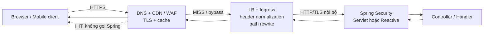
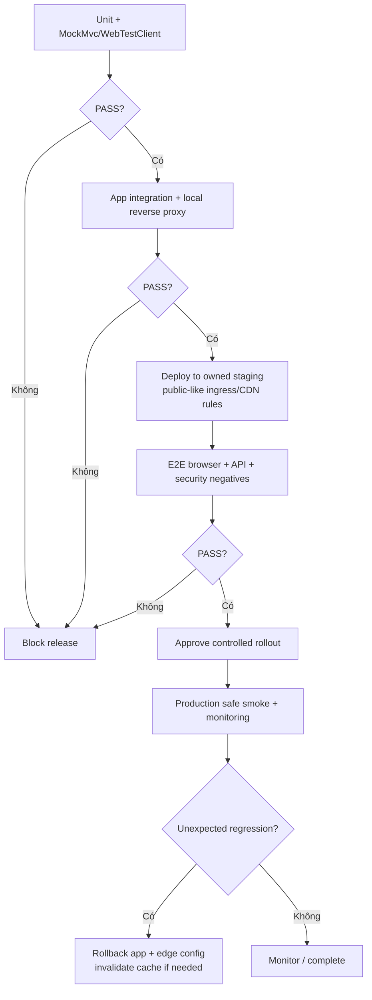

# Kiểm thử ứng dụng qua đường truy cập triển khai thực tế

> **Chương:** Proxy và nguồn gốc  
> **Module:** `SPRING_SECURITY_HTTP_PROTECTION` — cấu hình và kiểm thử các lớp phòng vệ HTTP và trình duyệt trong Spring Security: CSRF, CORS, security headers, CSP, HSTS, HTTP firewall và bảo vệ session trên Servlet lẫn Reactive.  
> **Trọng tâm bài:** Đừng dừng lại ở `MockMvc`/`WebTestClient` gọi trực tiếp Spring Boot. Cần kiểm chứng đường đi **browser → DNS/TLS/CDN/WAF/load balancer/ingress → Spring Security → ứng dụng**, kể cả cache HIT, redirects, cookies, các yêu cầu bị từ chối và đường truy cập ngoài ý định.

## 1. Mục tiêu học tập

Sau bài học, người học có thể:

1. Phân biệt **kiểm thử trực tiếp ứng dụng**, **kiểm thử tích hợp reverse proxy** và **kiểm thử qua public entry point** có DNS, TLS, CDN và browser thực.
2. Thiết lập một **deployment contract** ghi rõ public origin, path prefix, các proxy hop, TLS termination, trusted headers, cache behavior và authentication modes.
3. Kiểm chứng Spring quan sát scheme/host/port/path đúng từ trusted forwarding nhưng không bị client giả `Forwarded`/`X-Forwarded-*` điều khiển.
4. Test `Location`, OAuth2/OIDC callbacks, session cookies, logout và CSRF với cùng đường URL mà browser sử dụng.
5. Xác minh CORS preflight, HSTS, CSP, cache headers và HTTP firewall trong **response sau mọi proxy**, không chỉ response từ backend.
6. Chứng minh private data không bị CDN chia sẻ giữa hai phiên thật hoặc hai tenants và không bị lộ qua cache HIT.
7. Kiểm thử browser-cookie chain, bearer-only API, webhook verifier và authentication/authorization với cả request hợp lệ và bất hợp lệ.
8. Xây ma trận test gồm các phương thức GET/POST/OPTIONS, các host/port/prefix, hai origins và những trạng thái 200/302/401/403/404.
9. Chẩn đoán một lỗi ở đúng tầng: browser, edge, CDN, ingress, Spring Security, Servlet/WebFlux, handler hay cache.
10. Đưa các phép kiểm thử phù hợp vào CI/CD và định nghĩa ngưỡng chặn triển khai, cách rollback và quy trình xử lý sự cố.

**Nguyên tắc:** “Spring test xanh” không có nghĩa “production entry point an toàn”. Một request có thể **không đi vào Spring** vì CDN trả HIT, hoặc Spring có thể nhận URL/header khác hẳn browser vì proxy rewrite.

## 2. Mô hình đường đi thực tế cần kiểm thử

Giả sử dịch vụ có:

```text
Browser:
  https://portal.example.test:8443/academy/api/web/orders

CDN/WAF:
  kiểm tra Host, TLS, cache rules, edge headers

Load balancer / ingress:
  chuyển /academy/api/web/orders -> /api/web/orders
  truyền HTTPS/public origin metadata qua trusted headers

Spring Boot:
  http://learning.internal:8080/api/web/orders
  Spring Security + MVC/Servlet hoặc WebFlux/Reactive
```

Sơ đồ:



Khi kiểm thử, phải nhìn **hai chiều**:

- Chiều đi: Browser tạo `Origin`, `Cookie`, `Authorization`, CSRF header; CDN/LB/ingress có thể thêm/xóa/ghi đè header, rewrite path, normalize URI hoặc trả response ngay từ cache.
- Chiều về: Spring tạo status/`Location`/`Set-Cookie`/CORS/HSTS/CSP/Cache-Control; proxy/CDN có thể cache, xóa hoặc ghi đè; browser giải quyết redirect và thực thi cookie/CORS/CSP/HSTS.

**Kết quả đúng phải đúng tại browser-facing endpoint.** Không dùng một response trực tiếp ở `http://localhost:8080` để kết luận `Secure` cookie, HSTS, public redirect hoặc CORS production đã đúng.

### 2.1. Các phép thử phải phân biệt rõ

| Kiểu kiểm thử | Đường chạy | Chứng minh được | Không đủ để chứng minh |
|---|---|---|---|
| Unit test | Header writer/matcher/service riêng | Logic thành phần | Proxy/CDN/TLS |
| `MockMvc` | Servlet filter/handler test | Spring MVC/Security behavior theo fixture | Native Tomcat valve, edge headers, CDN |
| `WebTestClient` bound-to-controller | Reactive handler slice | Router/handler behavior | Full WebFlux transformer/security/web server |
| App integration, random port | Spring Boot + server thật | Security chain và một phần native config | CDN, WAF, public DNS |
| Local proxy integration | Proxy test fixture → Spring | Rewrite/forwarding contract đã mô phỏng | Chính sách CDN/cloud đang triển khai |
| Public staging E2E | Browser/curl → toàn đường staging | Entry point, response policy, routing, auth flows | Chưa tự động tương đương production |
| Production smoke (được phép) | Public production routes kiểm soát | Cấu hình triển khai thực sau release | Không nên thử phá hoại, thay đổi dữ liệu nhạy cảm |

**Không cần ép mọi phép thử chạy ở production.** Những negative tests có thể gây thay đổi trạng thái hoặc ảnh hưởng WAF nên thực hiện trên staging được kiểm soát, còn production smoke sử dụng tài nguyên ít rủi ro, có authorization và giới hạn tần suất.

## 3. Chuẩn bị deployment contract trước khi gửi request

Mẫu khai báo dưới đây là **bảng quyết định** do team vận hành cung cấp; không phải dữ liệu tự đoán từ headers:

| Thuộc tính | Giá trị ví dụ | Owner/xác minh |
|---|---|---|
| Public origin | `https://portal.example.test:8443` | DNS/TLS/edge |
| Public base path | `/academy` | Ingress routing |
| Backend origin | `http://learning.internal:8080` | Internal service discovery |
| Prefix strategy | Ingress strip `/academy` | Ingress rules |
| Trusted forward scheme | `X-Forwarded-Proto: https` | CDN/ingress sau sanitize |
| Trusted host/port | `portal.example.test:8443` | Host allowlist/vhost |
| Forwarded prefix | `X-Forwarded-Prefix: /academy` | Ingress route |
| Servlet/Reactive strategy | `framework` hoặc native đã được test | Spring Boot/runtime |
| Session cookie | `SESSION` hoặc `JSESSIONID` | Web stack/session integration |
| Cookie Path | `/academy` | Application/session owner |
| CORS allowlist | `https://app.example.test` | API/security owner |
| Browser auth | Cookie session + CSRF | Spring Security |
| Machine API auth | Bearer header, không cookie fallback | Spring Security |
| Webhook auth | Chữ ký + timestamp/anti-replay | Webhook verifier |
| CDN public cache | Chỉ static và các tài nguyên chung đã phê duyệt | CDN cache policy |
| CDN private bypass | Login/OAuth/session/`/api/web/**`/`/api/me` | CDN owner |
| HSTS owner | TLS edge **hoặc** Spring Security | Security/edge owner |
| CSP owner | App/edge theo route | Frontend/security owner |
| Trace correlation | `traceparent` hoặc request-id được kiểm soát | Observability |

Một trường hợp như `public port=8443` **khác origin** với HTTPS port 443, nên bắt buộc test redirect/callback trên cổng không mặc định.

### 3.1. Kiểm kê mọi route và kiểu client

Đừng chỉ test `GET /`. Hãy phân loại:

- Public pages/static assets (có thể cache).
- Browser pages/API dùng session cookie.
- POST login, logout, profile change, password reset, refresh session.
- OAuth2/OIDC redirect/callback.
- API machine-to-machine dùng bearer.
- Webhook server-to-server có signature.
- CORS OPTIONS preflight của SPA.
- Download/streaming, static files, WebSocket/SSE nếu hệ thống sử dụng.
- Health/admin/internal endpoints **không được public ngoài ý định**.
- Error/404/403/5xx responses do edge hoặc app tạo.

**Mỗi route** cần ghi auth contract, CSRF policy, expected status, cache eligibility, headers và host/path được phép.

### 3.2. Dữ liệu test phải không gây hại

Chuẩn bị **tài khoản synthetic** và tài nguyên kiểm thử:

1. User Alice có session/cookie thật.
2. User Bob có session/cookie thật, khác Alice.
3. User không có quyền trên một tài nguyên Alice sở hữu.
4. Token bearer hợp lệ có scope đã biết.
5. Token bearer thiếu/sai/không có scope.
6. Một webhook signature hợp lệ và một signature sai theo fixture được phê duyệt.
7. Hai frontend origins, một được allowlist, một không.
8. Một subdomain/port/prefix test dùng cho host spoofing.
9. Một path public cacheable và một path private rõ ràng.

**Không** dùng customer PII, session IDs, secrets hoặc access JWT trong chat, screenshot, logs chung và command-line history.

## 4. Quy trình kiểm thử ba tầng

### Tầng A — Kiểm thử Spring trực tiếp

Kiểm tra authentication, authorization, CSRF token, CORS config, security headers, URL builders và servlet/reactive filter chain trong test context. Đây là nơi cô lập nhanh lỗi logic Java.

### Tầng B — Kiểm thử proxy với web server thật

Chạy một ingress/reverse proxy test fixture trước app, hoặc vào staging origin từ một trusted network. Xác minh path rewrite, trusted `X-Forwarded-*`, scheme HTTPS, request body, header forwarding và filter ordering.

### Tầng C — Kiểm thử public staging entry point

Qua cùng DNS/hostname, TLS, CDN/WAF và routing rules đang triển khai:

- Kiểm tra browser nhìn thấy gì.
- Kiểm tra CDN HIT/MISS và cache bypass.
- Thử header spoofing **từ ngoài trusted edge**.
- Dùng session browser thật cho login/CSRF/cookies.
- Kiểm tra TLS/HSTS/CSP và errors/redirects ở final response.

Ba tầng trả lời **ba câu hỏi khác nhau**. Nếu chỉ kiểm A mà lỗi C, phải điều tra layer B/C; không sửa Spring Security chỉ vì response public có 403.

## 5. Baseline: xác nhận DNS, TLS, authority và port

Trước khi test Security, xác nhận public endpoint thật sự định tuyến đến đúng deployment.

### 5.1. Request đơn giản

```bash
curl -i --max-time 15 \
  'https://portal.example.test:8443/academy/login'
```

Dùng URL của **staging do dự án sở hữu** thay giá trị `example.test`. Những điều cần ghi nhận:

- TLS handshake thành công; chứng chỉ hợp lệ cho hostname và chain được tin.
- Redirect nếu có giữ public scheme `https`, host và port 8443.
- Không rò `learning.internal:8080` qua `Location` hoặc nội dung lỗi.
- `Date`/`Server`/`Via`/cache status headers nếu có; không coi một header vendor là chứng cứ duy nhất.
- HSTS/CSP và các security headers trên response **cuối** theo chính sách.
- Response đến từ đúng environment và deployment version.

**Không mặc định dùng `curl -k`** vì nó bỏ qua xác minh chứng chỉ; như vậy không kiểm thử được một phần quan trọng của đường HTTPS.

### 5.2. DNS/SNI/Host là những thực thể khác nhau

- DNS xác định địa chỉ IP/edge để kết nối.
- TLS SNI giúp edge chọn certificate/vhost.
- HTTP `Host` hoặc HTTP/2 `:authority` cho biết authority được yêu cầu.
- `Forwarded: host`/`X-Forwarded-Host` do trusted proxy cung cấp là metadata **ở hop sau**, không phải hostname đã được trình duyệt xác thực.

Test một Host bất hợp lệ hoặc host-to-tenant mapping phải xét đúng cả TLS/SNI và HTTP authority. Chỉ `curl -H 'Host: other.example'` trên một TLS connection **không mô phỏng đầy đủ** một request tới hostname khác, vì SNI vẫn gắn với hostname trong URL.

### 5.3. Pin IP khi điều tra CDN/ingress (chỉ trong staging)

Một công cụ như `curl --resolve` có thể buộc hostname public đi tới **IP staging đã xác minh** mà vẫn sử dụng hostname trong URL cho SNI và certificate validation:

```bash
# Chỉ thực hiện khi IP 192.0.2.10 là fixture
# do môi trường test cấp, không phải địa chỉ production ngẫu nhiên.
curl -i --resolve 'portal.example.test:8443:192.0.2.10' \
  'https://portal.example.test:8443/academy/login'
```

`192.0.2.10` thuộc dải tài liệu minh họa; thay bằng endpoint staging đã được phê duyệt nếu kiểm thử thực tế. Không dùng `--resolve` để đi vòng CDN/WAF của một bên thứ ba khi chưa được phép.

## 6. Xác minh TLS termination và forwarded trust boundary

Spring có thể nhận kết nối HTTP nội bộ dù browser dùng HTTPS public. Để tạo `Location`, cookie/HSTS và security decisions đúng, Spring cần biết public scheme từ **trusted forwarding** hoặc một canonical URL policy.

### 6.1. Positive test: metadata từ ingress đáng tin

Khi edge đã sanitize, origin có thể nhận:

```http
GET /login HTTP/1.1
Host: learning.internal:8080
X-Forwarded-Proto: https
X-Forwarded-Host: portal.example.test
X-Forwarded-Port: 8443
X-Forwarded-Prefix: /academy
X-Forwarded-For: 198.51.100.25
```

Kiểm tra với web server thật:

| Trường | Servlet | WebFlux |
|---|---|---|
| Scheme | `request.getScheme()` | `request.getURI().getScheme()` |
| HTTPS state | `request.isSecure()` | URI scheme và runtime security handling |
| Host | `getServerName()` | `getURI().getHost()` |
| Port | `getServerPort()` | `getURI().getPort()`; có thể `-1` khi port không tường minh |
| Prefix/context | `getContextPath()`/URI wrapper tùy setup | `getPath().contextPath()`/`pathWithinApplication()` |
| Remote peer/client IP | `getRemoteAddr()` theo server/proxy | `getRemoteAddress()` theo server |
| Response redirect | `Location` cuối | `Location` cuối |

**Không suy** rằng `X-Forwarded-For` đầu tiên luôn là client IP, hoặc `X-Forwarded-Prefix` luôn thay đổi security matcher giống nhau trên các version.

### 6.2. Spring Boot version và strategy

Với các dòng Spring Boot 2.2–4.1 thường dùng:

```yaml
server:
  forward-headers-strategy: framework
```

Trên Spring Boot 4.2, namespace mới:

```yaml
server:
  request:
    header:
      forwarded:
        strategy: framework
        use-prefix: true
```

`use-prefix=true` trong ví dụ **chỉ khi ingress strip prefix** và framework cần khôi phục `/academy`. Với 4.2, việc xử lý `X-Forwarded-Prefix` mặc định không bật; server-native được gọi `web-server` thay `native` và các server có giới hạn riêng.

Kiểm tra **đúng Boot/Framework/container đang chạy**, không chỉ file YAML. Với Servlet, framework xử lý bằng `ForwardedHeaderFilter`; Reactive dùng `ForwardedHeaderTransformer`. Native Tomcat/Jetty/Netty có thể khác về host/prefix/IP handling.

### 6.3. Negative test: client giả forwarding headers

Một request gửi từ **Internet phía trước edge**, trên staging đã được phép:

```bash
curl -i --max-time 15 \
  -H 'Forwarded: for=127.0.0.1;proto=http;host=attacker.example' \
  -H 'X-Forwarded-For: 127.0.0.1' \
  -H 'X-Forwarded-Proto: http' \
  -H 'X-Forwarded-Host: attacker.example' \
  -H 'X-Forwarded-Port: 8080' \
  -H 'X-Forwarded-Prefix: /admin' \
  'https://portal.example.test:8443/academy/login'
```

Một edge an toàn có thể **từ chối request** hoặc **loại/ghi đè giá trị không đáng tin**. Điều phải không xảy ra:

- Redirect, reset link hoặc callback chứa `attacker.example`.
- Scheme public HTTPS bị đổi thành HTTP do header client tự gửi.
- Port public 8443 bị đổi thành 8080.
- Prefix `/academy` bị thay bằng `/admin` trong `Location`.
- HSTS trên HTTPS bị bỏ do proto giả, nếu policy yêu cầu phát tại tầng tương ứng.
- Request được coi là internal admin vì `X-Forwarded-For: 127.0.0.1`.

**Ghi chú:** Đây là kiểm thử ranh giới do dự án sở hữu, không dùng để tấn công dịch vụ không được ủy quyền.

### 6.4. Negative test: direct-origin bypass

Nếu một client không tin cậy có thể gọi `http://learning.internal:8080` mà không qua edge, `Forwarded`/`X-*` tự khai có thể ảnh hưởng ứng dụng dù public CDN sanitize đúng.

Kiểm thử từ một source **không được ủy quyền trong mạng test** rằng kết nối tới backend bị firewall/NetworkPolicy/security group/mTLS chặn. Không suy “backend chỉ có DNS nội bộ” tức là không thể truy cập; cần xác minh network policy thật.

### 6.5. Nhiều proxy và nguồn HTTPS authoritative

```text
Browser HTTPS → CDN TLS termination → LB HTTP → ingress HTTP → Spring
```

Ingress không nên tự đặt `X-Forwarded-Proto: http` chỉ vì **hop cuối dùng HTTP**, nếu public browser thực dùng HTTPS và giá trị `https` đến từ CDN đã được xác minh.

Cần ghi rõ hop nào:

1. Xác minh TLS public.
2. Strip input `Forwarded`/`X-*` từ Internet.
3. Phát authoritative proto/host/port.
4. Append client IP sau khi xác minh trusted upstream.
5. Tiếp tục giữ các header không mâu thuẫn đến Spring.

Một component khác đọc raw header trước khi sanitize có thể tạo parser differential. Không sử dụng header forwarder làm authentication factor.

## 7. URL, redirect và public prefix: kiểm thử cả lượt đi và lượt về

Ví dụ:

```text
Public:  https://portal.example.test:8443/academy/private/report
Ingress: /academy/private/report → /private/report
Spring:  /private/report
```

Khi chưa login, browser nên đến public login route, ví dụ:

```http
HTTP/1.1 302 Found
Location: /academy/login
```

hoặc absolute URL tương ứng, tùy contract. Không được có:

```http
Location: http://learning.internal:8080/login
```

### 7.1. Các loại redirect cần xem riêng

| Dạng `Location` | Browser hiểu từ URL public trên |
|---|---|
| `/login` | Root của origin, **mất `/academy`** |
| `/academy/login` | Public prefix đúng trong ví dụ |
| `login` | Tương đối với path hiện tại, có thể thành nested path ngoài ý muốn |
| `https://portal.example.test:8443/academy/login` | Absolute public URL đúng |
| `http://learning.internal:8080/login` | Rò origin nội bộ, sai scheme/host |
| `https://portal.example.test/academy/login` | Thiếu port 8443; khác origin |
| `/academy/academy/login` | Duplicated prefix |

Không “sửa” bằng nối `/academy` trong nhiều tầng. Chọn mô hình **proxy giữ** prefix và app sở hữu context/base path, **hoặc proxy strip** và framework khôi phục public prefix khi cần.

### 7.2. Test các redirect do Spring Security tự tạo

Controller redirect đúng chưa đủ. Test:

- Anonymous GET protected route → login.
- Form-login success → saved request URL ban đầu.
- Login failure → error route.
- Logout success → public URL/clear cookie.
- OAuth2/OIDC initiation → IdP và `redirect_uri` đúng.
- OAuth2/OIDC callback → session/correlation cookie, state/nonce hợp lệ.
- Password reset/invitation links → host allowlist/canonical base URL.
- Redirect context root `/academy` ↔ `/academy/`.
- POST/redirect/GET với status 302/303, hoặc 307/308 khi thật sự cần giữ method/body.

**Không dùng `curl -L` với secret headers** trước khi xem destination của từng redirect; có thể vô tình gửi credential sang host ngoài ý định trong một môi trường misconfigured.

### 7.3. OAuth2 callback

Một callback public hợp lệ có thể là:

```text
https://portal.example.test:8443/academy/login/oauth2/code/oidc
```

Nếu proxy rewrite làm app thấy `http://learning.internal:8080` hoặc thiếu prefix, `redirect_uri` gửi tới IdP sẽ không khớp. Không nới wildcard redirect URIs hay tắt kiểm tra `state`/`nonce` để né lỗi triển khai.

**Phải test browser flow thật**, vì một request `GET /oauth2/authorization/oidc` đơn lẻ chưa chứng minh session cookie/state được mang qua tất cả redirects.

### 7.4. Public port, default port và host

Nếu triển khai dùng 8443, hãy assert `Location` không mất cổng. Một URI có `https` không đủ, vì `https://portal.example.test` (443) khác `https://portal.example.test:8443`.

Với một URI không khai cổng tường minh, Java `URI.getPort()` có thể trả `-1`; điều này không tự đồng nghĩa server dùng port -1.

## 8. Session cookie: browser phải nhận và gửi lại đúng

Ở public HTTPS, cookie session thường cần:

```http
Set-Cookie: SESSION=<opaque>; Path=/academy; Secure; HttpOnly; SameSite=Lax
```

Đây là ví dụ; Servlet có thể dùng `JSESSIONID`, Reactive `SESSION` hoặc cookie tên tùy chỉnh.

### 8.1. Test bốn thời điểm

1. **Trước login:** session cookie hiện có hay chưa theo flow.
2. **Sau login:** browser nhận `Set-Cookie`, giá trị thay đổi khi yêu cầu chống session fixation.
3. **Request tiếp theo:** browser thực sự gửi cookie cho `/academy/...`.
4. **Logout:** server invalidates session và cookie được xóa/đổi theo name/path/domain phù hợp; request sau logout không còn quyền.

Một GET `/login` không tạo session **có thể không phát Set-Cookie**; test cần đi qua route tạo session thực.

### 8.2. Tác động của cookie attributes

| Thuộc tính | Điều cần test trên browser |
|---|---|
| `Secure` | Cookie auth không được gửi qua HTTP thông thường; HTTPS public vẫn dùng được |
| `HttpOnly` | JavaScript không thể đọc session secret qua `document.cookie` |
| `SameSite=Lax` | Login/top-level navigation phù hợp; không coi là CSRF replacement |
| `SameSite=Strict` | Không phá deep link/SSO redirect hợp lệ |
| `SameSite=None; Secure` | Luồng cross-site có thể dùng, nhưng còn browser third-party-cookie policies |
| `Path=/academy` | Cookie đi với `/academy/**`, không đi vào `/admin` |
| `Domain` | Host-only nếu không cần chia sẻ subdomains |
| `Expires`/`Max-Age` | Browser lifetime phù hợp server-side session expiry |

Cookie `Path` **không phải** ranh giới authorization. Cùng một hostname với hai ứng dụng vẫn cần kiểm soát quyền riêng.

### 8.3. Servlet và Reactive không cùng cấu hình cookie

Servlet Boot:

```yaml
server:
  servlet:
    session:
      cookie:
        secure: true
        http-only: true
        same-site: lax
        path: /academy
```

Reactive Boot:

```yaml
server:
  reactive:
    session:
      cookie:
        secure: true
        http-only: true
        same-site: lax
        path: /academy
```

Chọn **một cấu hình đúng stack**; nếu có Spring Session/custom cookie serializer hoặc custom resolver, kiểm tra nơi thực sự ghi cookie. Đặt `Secure=true` tường minh là phòng vệ tốt trên public HTTPS, nhưng **không sửa** URL/redirect/HSTS nếu scheme forwarding vẫn sai.

### 8.4. Đừng nhầm session cookie với CSRF cookie

Một SPA có thể cần đọc CSRF cookie rồi gắn token vào header; cookie đó có thể `HttpOnly=false` có chủ đích. **Không dùng quy tắc cookie CSRF để nới quyền đọc session cookie**.

Kiểm riêng `Set-Cookie` của session và của CSRF token, vì chúng có thể khác tên, Path, SameSite và HttpOnly. Không in raw token ra test reports.

## 9. CSRF qua browser: phải chứng minh cả trường hợp bị chặn và được phép

CSRF xuất hiện khi browser **tự gửi credential** như session cookie hoặc JWT cookie trong một request unsafe không được user dự định. HTTPS, HSTS, CORS, `SameSite` và `Secure` không thay cơ chế CSRF token.

### 9.1. Hai đường POST tương ứng

```text
POST https://portal.example.test:8443/academy/api/web/orders
Cookie: SESSION=<valid-session>
Content-Type: application/json
(no CSRF token)
→ 403 do CSRF trong thiết kế bài tập, không tạo đơn

POST cùng URL, cùng session, token CSRF hợp lệ
→ qua CSRF; nếu có quyền/body hợp lệ thì nghiệp vụ xử lý
```

**Quan trọng:** Kết quả 403 đơn lẻ không chứng minh CSRF. Nó có thể do WAF, CORS, authz hoặc business validation. Test phải xác nhận qua logs/traces phù hợp/filter reason và **không có side effect**.

### 9.2. Test CSRF phải có session thật

Để chứng minh token không bị bỏ qua:

1. Đăng nhập một user synthetic bằng flow thật.
2. Gọi endpoint cấp CSRF token hoặc render form có token theo repository ứng dụng.
3. Gửi unsafe request **không có token** nhưng **có credential hợp lệ** → bị chặn.
4. Gửi token sai/khác session → bị chặn.
5. Gửi token đúng, quyền phù hợp → xử lý thành công.
6. Xác nhận token lifecycle sau login/logout/refresh, nhất là khi session bị rotate.
7. Kiểm tra ingress/CDN **forward CSRF header và cookie** nguyên vẹn, không cache token issuance.
8. Nếu SPA token đặt trong header, xác nhận tên header được CORS preflight cho phép.

Một request anonymous không có CSRF token mà bị 401 không phải bằng chứng CSRF-on. Một `mockUser()` test chứng minh behavior filter nhưng **không chứng minh session cookie thực được browser gửi qua CDN**.

### 9.3. `permitAll` không miễn CSRF

`POST /register` hoặc `POST /login` có thể được anonymous truy cập theo `permitAll` nhưng vẫn cần CSRF protection nếu endpoint tạo/đổi trạng thái dựa trên browser credentials hoặc security design yêu cầu.

Không thay CSRF exemption bằng “tắt hết cho `/api/**`”, vì `/api/web/**` có thể sử dụng session cookie. Chọn matcher theo path/method/authentication contract chính xác và test với prefix công khai sau proxy rewrite.

### 9.4. Cookie-only vào bearer chain

Một bearer-only route `/api/m2m/**` có thể được miễn CSRF **chỉ khi không chấp nhận credential browser tự động gửi**:

- Bearer hợp lệ đủ scope → được phép.
- Bearer thiếu/sai → bị từ chối.
- Session cookie thật, hợp lệ của browser nhưng **không có bearer** → bị từ chối.
- Bearer sai và cookie hợp lệ → không được fallback về cookie.
- Role/scope không đủ → bị từ chối dù đã authenticated.

Đừng dùng session cookie giả chuỗi `SESSION=alice`; test cần một session được server tạo thật để phát hiện credential fallback.

## 10. Authentication, authorization và security chain khi đi qua ingress

Spring Security chọn một chain dựa vào matcher và thứ tự; proxy rewrite có thể khiến path mà backend thấy **khác public path**.

### 10.1. Ví dụ hợp đồng chain

| Public URL | Backend path sau strip | Credential | CSRF policy |
|---|---|---|---|
| `/academy/api/web/orders` | `/api/web/orders` | Session cookie | Bật |
| `/academy/api/m2m/orders` | `/api/m2m/orders` | Bearer | Có thể miễn hẹp |
| `/academy/login` | `/login` | Form login | Theo browser flow |
| `/academy/logout` | `/logout` | Session cookie | Bảo vệ theo policy |
| `/academy/webhooks/payments` | `/webhooks/payments` | HMAC signature | Exemption chỉ khi verifier độc lập |
| `/academy/assets/app.js` | `/assets/app.js` | Public static | Cache/headers riêng |

Test phải xác nhận selected chain **thực tế**, không suy từ URL browser. `SecurityFilterChain` (Servlet) và `SecurityWebFilterChain` (Reactive) có các API matcher riêng.

### 10.2. Negative cases về quyền

- User A truy cập record của B → 403/404 theo policy, không lộ data.
- Anonymous vào private API → 401 hoặc redirect login đúng contract.
- Authenticated user không có scope → 403, không side effect.
- JWT hợp lệ nhưng hết hạn → từ chối.
- JWT sai issuer/audience → từ chối.
- Request có cookie nhưng không bearer vào machine API → không được authenticated.
- Webhook signature không hợp lệ, body bị sửa hoặc timestamp quá cũ → từ chối.
- Route unknown/encoded path không bypass security chain qua normalized path.

Nếu WAF chặn trước Spring, trace phải cho biết **tầng nào** đã từ chối; không báo “Spring Security bảo vệ tốt” khi chỉ thấy WAF 403.

### 10.3. Webhook signature và proxy body

Một reverse proxy có thể decompress, normalize headers hoặc thay transfer encoding. Hợp đồng webhook phải xác định **chính xác bytes/body** được signer và verifier sử dụng.

Không tắt body verification khi webhook fail sau ingress. Kiểm thử với fixture signed payload, sửa một byte và kiểm tra anti-replay. CDN không nên cache webhook responses hoặc giữ signature trong cache key/logs.

## 11. CORS preflight qua đường public

Một SPA ở `https://app.example.test` gọi:

```text
https://portal.example.test:8443/academy/api/web/orders
```

Có thể phát preflight:

```http
OPTIONS /academy/api/web/orders HTTP/1.1
Host: portal.example.test:8443
Origin: https://app.example.test
Access-Control-Request-Method: POST
Access-Control-Request-Headers: content-type,x-csrf-token
```

Đường ingress rewrite OPTIONS cũng phải đúng, và CORS handling phải được thực hiện đúng vị trí so với authentication.

### 11.1. Gửi preflight test từ ngoài

```bash
curl -i -X OPTIONS \
  -H 'Origin: https://app.example.test' \
  -H 'Access-Control-Request-Method: POST' \
  -H 'Access-Control-Request-Headers: content-type,x-csrf-token' \
  'https://portal.example.test:8443/academy/api/web/orders'
```

Kiểm tra:

- `Access-Control-Allow-Origin` đúng origin được phép.
- `Access-Control-Allow-Methods` bao gồm method khi policy cho phép.
- `Access-Control-Allow-Headers` đáp ứng tên headers hợp lệ.
- `Access-Control-Allow-Credentials` chỉ theo credential policy, không wildcard origin.
- `Vary: Origin` và những fields preflight liên quan khi response phụ thuộc request fields.
- OPTIONS không bị redirect login ngoài ý định.
- Origin không thuộc allowlist **không được phép** đọc credentialed response.

**curl không thực thi browser CORS enforcement.** Curl chỉ giúp quan sát headers; cần browser test để chứng minh frontend có thể/gặp lỗi thực tế.

### 11.2. CORS không giải quyết CSRF

Một attacker webpage có thể gây một số cross-site request ngay cả khi browser chặn JavaScript đọc response. Vì vậy CORS allowlist không phải CSRF exemption.

Với browser session cookies, `SameSite` bổ sung bảo vệ nhưng không thay CSRF token. Test cả request preflight hợp lệ và POST thiếu token; không suy một 204 OPTIONS tức POST đã được phép về mặt CSRF.

### 11.3. CORS và CDN HIT

Nếu origin cho phép A và B, CDN cache response của origin A nhưng phát lại `Access-Control-Allow-Origin: A` cho B, browser B có thể lỗi dù Spring CORS test xanh.

Khi response biến đổi theo `Origin`:

- Origin trả `Vary: Origin` phù hợp.
- CDN cache key/cache policy phải phân biệt variants hoặc bypass.
- CDN không ghi đè ACAO thành wildcard với credentials.
- Test A → B → A, cả MISS và HIT nếu route cacheable.
- Preflight cache của browser khác **CDN cache của OPTIONS**.

## 12. HSTS, CSP và các security headers ở public response

### 12.1. HSTS là policy của hostname qua HTTPS

Một response public HTTPS có thể chứa:

```http
Strict-Transport-Security: max-age=86400
```

Để browser ghi nhớ HSTS, header phải được nhận **trên HTTPS hợp lệ**. `max-age` được quản lý có chủ đích; `includeSubDomains`/`preload` cần rà soát domain và điều kiện riêng.

Nếu Spring Security sở hữu HSTS nhưng backend chỉ nhìn thấy HTTP nội bộ, header có thể vắng. Nếu CDN/TLS edge sở hữu HSTS thì cần kiểm chứng nó được phát trên response HIT/MISS, redirect/error như đã quy định.

**Không dùng HSTS để chứng minh cookie Secure hoặc CSRF đã được cấu hình.**

### 12.2. CSP phải khớp body cuối

Ví dụ response HTML:

```http
Content-Security-Policy: default-src 'self'; script-src 'self'; object-src 'none'
X-Content-Type-Options: nosniff
Referrer-Policy: strict-origin-when-cross-origin
```

Đây là **policy minh họa**, không phải mẫu phù hợp mọi SPA. Nếu app dùng OAuth popup, CDN resources hoặc WebSocket, CSP `connect-src`/`frame-ancestors`/`form-action` và các directives khác phải được thiết kế theo thực tế.

Kiểm tra:

- CSP có trên đúng HTML response công khai, kể cả sau redirect/error.
- Không có hai CSP policies mâu thuẫn không được hiểu rõ.
- CSP nonce/HTML sinh theo request **không được CDN cache chung**.
- HTML/CSP không còn trỏ về internal host hoặc cổng sai.
- `X-Frame-Options`/`frame-ancestors` theo chính sách clickjacking.
- `Referrer-Policy` đủ chặt để không vô tình phát token trong URL sang origin khác.

### 12.3. Response do proxy tạo cũng cần test

Các response 301/302, 403 WAF, 404 edge và 5xx upstream timeout **có thể không chạy Spring Security**. Nếu tổ chức yêu cầu HSTS/security headers trên tất cả browser-facing HTTPS responses, hãy kiểm tra edge policies trong các tình huống đó.

Không tự kết luận thiếu Spring logs là “request không tới ứng dụng”; đó có thể là CDN HIT, WAF block, DNS/TLS failure hoặc ingress 404.

## 13. CDN và cache: bắt buộc kiểm thử hai phiên thật

Một CDN có thể trả response ngay từ cache, không qua Spring Security. Những request có cookie/Authorization được forward tới origin trên MISS **không có nghĩa** chúng đã tham gia cache key.

### 13.1. Public vs private routes

| Route | Kỳ vọng |
|---|---|
| `/academy/assets/app.versioned.js` | Có thể cache public lâu khi fingerprint đúng |
| `/academy/public/catalog` | Cache được nếu nội dung dùng chung, key đúng |
| `/academy/api/me` | **Bypass shared cache + no-store** |
| `/academy/api/web/**` | Không cache private/session/CSRF response |
| `/academy/login`, `/academy/logout` | Không cache auth/session flows |
| `/academy/oauth2/**` | Không cache redirect/state/correlation cookies |
| `/academy/csrf` | Không cache token issuance |
| `/academy/api/m2m/**` | Không shared cache mặc định khi có bearer auth |
| `/academy/webhooks/**` | Không cache request/response mutation |
| Private 401/403/404 | Không cache chung theo principal |

`Cache-Control: no-cache` không đồng nghĩa `no-store`. `private` cấm shared cache theo HTTP semantics nhưng private browser cache có thể lưu. Với nội dung nhạy cảm, `no-store` và **CDN bypass** phải cùng được kiểm chứng.

### 13.2. Test Alice, Bob, anonymous

Trong staging, tạo hai phiên session thật:

```text
Alice GET /academy/api/me -> Alice body; no-store; BYPASS
Bob   GET /academy/api/me -> Bob body; no-store; BYPASS
Alice GET /academy/api/me -> Alice body; no-store; BYPASS
Anon  GET /academy/api/me -> 401/login theo contract, không Alice/Bob
```

Kiểm tra:

- Body không chứa dữ liệu của phiên khác.
- Response có `Cache-Control` đúng; CDN **không** báo private route HIT.
- CDN cache key/route policy đã thực sự bypass.
- Không phát lại `Set-Cookie` session của user khác.
- Tenant A không nhận dữ liệu tenant B.
- Không có cached 200 đi vòng authorization.

Nếu CDN đã cache nhầm object từ version cũ, sửa Spring code không tự xóa object đó; cần purge/invalidate cùng sửa rule cache.

### 13.3. CORS variant và Cache-Control policy

Một response có `Vary: Origin` yêu cầu cache semantics nhất quán với origin variant. Nhưng một CDN có cache key tùy chỉnh có thể không dùng `Origin` như bạn tưởng. Test A/B/A ở ``/public` và preflight variants, đồng thời kiểm tra policy vendor thật.

Đừng bật cache cho `/api/me` chỉ vì key bao gồm `Cookie`; đó không phải phương án đơn giản bảo đảm auth trên HIT.

### 13.4. Static asset versioning và CSP

Với hashed assets, cache dài hạn có thể hợp lệ, nhưng test:

- Content-Type/Content-Encoding phù hợp body qua CDN.
- `Cache-Control`/`Vary: Accept-Encoding` nếu cần.
- `nosniff`/CSP không bị CDN xóa.
- Đường public `/academy/assets/**` được rewrite đúng.
- Sau deploy mới, HTML trỏ tới hash assets mới và không gặp stale object phá ứng dụng.
- Không cache HTML chứa CSRF token, nonce CSP/session bootstrap.

## 14. HTTP firewall và URI normalization qua nhiều tầng

Một URL có thể được diễn giải bởi browser, CDN, WAF, ingress, container và Spring Security theo **những quy tắc khác nhau**.

Ví dụ test trong staging:

```text
/academy/api/web/orders
/academy//api/web/orders
/academy/api/../admin
/academy/api/%2e%2e/admin
/academy/api%2fweb/orders
/academy/api/web/orders;debug=true
```

Mục tiêu **không phải** tìm cách vượt WAF ngoài quyền; đây là một ma trận test của chính hệ thống để đảm bảo:

1. Edge và backend cùng quy tắc canonicalization hoặc từ chối input mơ hồ.
2. Một request đến handler protected không bị route vào security chain ít bảo vệ hơn.
3. HTTP firewall Servlet hoặc reactive security/routing validation từ chối những dạng không được phép.
4. Không dùng rule bypass hay `permitAll` quá rộng cho URL encoding bất thường.
5. Public URL và cached object không bị key theo một path, origin xử lý path khác.
6. Không phản hồi redirect ra external host từ path/Host user input.

**Cẩn trọng:** Với encoded slash, một số proxy/container reject request trước Spring. Test nên chấp nhận **reject đúng policy**; không yêu cầu tất cả input đi đến handler để “kiểm đủ”.

## 15. WebSocket, SSE, streaming và download (nếu dùng)

Những đường này thường chỉ lỗi ở deployment thực vì gateway timeout/upgrade buffering.

- **WebSocket:** Kiểm tra HTTPS page tạo kết nối `wss://` tới public host/path/port; proxy hỗ trợ upgrade và Spring Security auth phù hợp; CSP `connect-src` nếu áp dụng.
- **SSE:** Kiểm tra CDN/ingress không buffering gây chậm sự kiện ngoài ý định; timeout/reconnect; authorization trước streaming.
- **File download:** Kiểm tra `Content-Disposition`, `Content-Type`, `Cache-Control`, range requests và private-cache bypass.
- **Large upload:** Giới hạn kích thước/timeout nhất quán; authentication/CSRF/Content-Type; không mất body qua proxy.
- **gRPC/m2m nếu hệ thống có:** HTTP/2/TLS/authority, bearer/mTLS contract khác browser; không suy từ WebFlux HTTP/1.1 tests.

Các mục này là kiểm thử có điều kiện theo features; **không bắt app phải triển khai mọi protocol**.

## 16. Ví dụ Servlet: kiểm thử điểm quan sát request trong backend

Để so trực tiếp với proxy behavior, có thể tạo **test-only controller**:

```java
import java.util.LinkedHashMap;
import java.util.Map;
import jakarta.servlet.http.HttpServletRequest;
import org.springframework.web.bind.annotation.GetMapping;
import org.springframework.web.bind.annotation.RestController;

@RestController
class ServletDeploymentProbe {

    @GetMapping("/__test/request-view")
    Map<String, Object> requestView(HttpServletRequest request) {
        Map<String, Object> result = new LinkedHashMap<>();
        result.put("scheme", request.getScheme());
        result.put("secure", request.isSecure());
        result.put("serverName", request.getServerName());
        result.put("serverPort", request.getServerPort());
        result.put("contextPath", request.getContextPath());
        result.put("servletPath", request.getServletPath());
        result.put("requestURI", request.getRequestURI());
        result.put("pathInfo", request.getPathInfo()); // Có thể null.
        return result;
    }
}
```

**Không expose probe này ở production**. Nó có thể tiết lộ nội bộ network topology và không phải một security validator. Chỉ gắn controller trong test profile, hoặc kiểm soát truy cập/tracing phù hợp.

### 16.1. Test framework request semantics bằng MockMvc

```java
import org.junit.jupiter.api.Test;
import org.springframework.test.web.servlet.MockMvc;
import org.springframework.test.web.servlet.setup.MockMvcBuilders;
import org.springframework.web.filter.ForwardedHeaderFilter;

import static org.springframework.test.web.servlet.request.MockMvcRequestBuilders.get;
import static org.springframework.test.web.servlet.result.MockMvcResultMatchers.*;

class ServletForwardingUnitTest {

    private final MockMvc mvc = MockMvcBuilders
        .standaloneSetup(new ServletDeploymentProbe())
        .addFilters(new ForwardedHeaderFilter())
        .build();

    @Test
    void trustedHeadersRestorePublicSchemeAndPort() throws Exception {
        mvc.perform(get("/__test/request-view")
                .header("X-Forwarded-Proto", "https")
                .header("X-Forwarded-Host", "portal.example.test")
                .header("X-Forwarded-Port", "8443"))
            .andExpect(status().isOk())
            .andExpect(jsonPath("$.scheme").value("https"))
            .andExpect(jsonPath("$.secure").value(true))
            .andExpect(jsonPath("$.serverName")
                .value("portal.example.test"))
            .andExpect(jsonPath("$.serverPort").value(8443));
    }
}
```

**Giới hạn:** `standaloneSetup` **không chạy Tomcat native `RemoteIpValve`** và không tự đại diện cho đầy đủ security filters/Boot config. Test chỉ chứng minh `ForwardedHeaderFilter` sẽ sử dụng metadata được cung cấp; **không chứng minh header đáng tin**.

### 16.2. Test Spring Security và CSRF trong Servlet

Với một `MockMvc` đã tích hợp `springSecurity()` và handler `POST /api/web/orders` giả định trả 201:

```java
import static org.springframework.security.test.web.servlet.request.SecurityMockMvcRequestPostProcessors.csrf;
import static org.springframework.security.test.web.servlet.request.SecurityMockMvcRequestPostProcessors.user;
import static org.springframework.test.web.servlet.request.MockMvcRequestBuilders.post;
import static org.springframework.test.web.servlet.result.MockMvcResultMatchers.status;

@Test
void browserPostWithAuthButNoCsrfIsRejected() throws Exception {
    securityMvc.perform(post("/api/web/orders")
            .with(user("alice").roles("USER"))
            .contentType("application/json")
            .content("{\"sku\":\"A42\",\"quantity\":1}"))
        .andExpect(status().isForbidden());
}

@Test
void browserPostWithValidCsrfCanProceed() throws Exception {
    securityMvc.perform(post("/api/web/orders")
            .with(user("alice").roles("USER"))
            .with(csrf())
            .contentType("application/json")
            .content("{\"sku\":\"A42\",\"quantity\":1}"))
        .andExpect(status().isCreated());
}
```

`securityMvc` là test fixture do application tạo với Spring Security chain; `201` là API contract minh họa, không phải mặc định mọi controller. Các helper `user()`/`csrf()` không chứng minh browser cookie/CSRF token thực đi qua CDN. Bài test này là lớp A, không thay lớp C.

### 16.3. Native container cần web server thật

Nếu dùng `server.forward-headers-strategy=native` (Boot cũ) hoặc `server.request.header.forwarded.strategy=web-server` (Boot 4.2), chạy `@SpringBootTest(webEnvironment=RANDOM_PORT)` với container/version tương ứng. `MockMvc` không đại diện remote-IP/redirect-context-root behavior của Tomcat/Jetty/Netty.

## 17. Ví dụ Reactive: kiểm thử WebFlux qua đúng pipeline

Controller test-only:

```java
import java.net.URI;
import java.util.Map;
import org.springframework.web.bind.annotation.GetMapping;
import org.springframework.web.bind.annotation.RestController;
import org.springframework.web.server.ServerWebExchange;

@RestController
class ReactiveDeploymentProbe {

    @GetMapping("/__test/request-view")
    Map<String, Object> requestView(ServerWebExchange exchange) {
        URI uri = exchange.getRequest().getURI();
        return Map.of(
            "scheme", uri.getScheme(),
            "host", uri.getHost(),
            "port", uri.getPort(),
            "contextPath",
                exchange.getRequest().getPath().contextPath().value(),
            "pathWithinApplication",
                exchange.getRequest().getPath()
                    .pathWithinApplication().value());
    }
}
```

Trong WebFlux, `ForwardedHeaderTransformer` xử lý request metadata ở tầng HTTP handler theo framework configuration; **không phải một `WebFilter` thông thường**.

### 17.1. WebTestClient ứng dụng đầy đủ

Với `@SpringBootTest(webEnvironment=RANDOM_PORT)`, `@AutoConfigureWebTestClient` hoặc fixture tương ứng, khi Boot đã cấu hình framework forwarding:

```java
webTestClient.get()
    .uri("/__test/request-view")
    .header("X-Forwarded-Proto", "https")
    .header("X-Forwarded-Host", "portal.example.test")
    .header("X-Forwarded-Port", "8443")
    .exchange()
    .expectStatus().isOk()
    .expectBody()
    .jsonPath("$.scheme").isEqualTo("https")
    .jsonPath("$.host").isEqualTo("portal.example.test")
    .jsonPath("$.port").isEqualTo(8443);
```

Test này vẫn tự cấp header, nên **chỉ kiểm framework integration**, không kiểm edge sanitize. Test riêng `X-Forwarded-Prefix` với `contextPath()`/`pathWithinApplication()` và route mapping thực; đừng đoán kết quả phải giống Servlet trong mọi version.

### 17.2. CSRF Reactive với Spring Security test

```java
import org.springframework.http.MediaType;
import static org.springframework.security.test.web.reactive.server.SecurityMockServerConfigurers.csrf;
import static org.springframework.security.test.web.reactive.server.SecurityMockServerConfigurers.mockUser;

@Test
void reactiveBrowserPostWithoutCsrfIsRejected() {
    webTestClient.mutateWith(mockUser("alice").roles("USER"))
        .post().uri("/api/web/orders")
        .contentType(MediaType.APPLICATION_JSON)
        .bodyValue("{\"sku\":\"A42\",\"quantity\":1}")
        .exchange()
        .expectStatus().isForbidden();
}

@Test
void reactiveBrowserPostWithCsrfCanProceed() {
    webTestClient.mutateWith(mockUser("alice").roles("USER"))
        .mutateWith(csrf())
        .post().uri("/api/web/orders")
        .contentType(MediaType.APPLICATION_JSON)
        .bodyValue("{\"sku\":\"A42\",\"quantity\":1}")
        .exchange()
        .expectStatus().isCreated();
}
```

**Điều kiện:** `WebTestClient` phải chạy qua `SecurityWebFilterChain`/`CsrfWebFilter` đầy đủ, route fixture/authorization phù hợp, và `201` là expected business response. Test session cookie thật qua browser vẫn bắt buộc ở tầng C.

## 18. Browser end-to-end: nhìn hành vi thực, không chỉ headers

Browser thực là nơi áp dụng cookie flags, SameSite, HSTS, CSP và CORS. Những điều này không thể chứng minh hoàn toàn bằng curl.

### 18.1. Kịch bản Playwright minh họa

Đoạn sau dùng TypeScript Playwright để thể hiện cách xây E2E; cần thay selectors và tên cookie theo app thực. Credentials được cấp qua CI secret store, không hardcode.

```ts
import { test, expect } from '@playwright/test';

const base = process.env.STAGING_PUBLIC_BASE_URL ?? '';
const username = process.env.E2E_USERNAME ?? '';
const password = process.env.E2E_PASSWORD ?? '';

test('login qua public URL giữ session cookie an toàn', async ({ page }) => {
  if (!base || !username || !password) {
    throw new Error('Thiếu cấu hình staging E2E');
  }

  await page.goto(base + '/login');
  await page.getByLabel('Username').fill(username);
  await page.getByLabel('Password').fill(password);
  await page.getByRole('button', { name: 'Sign in' }).click();

  await expect(page).toHaveURL(/\/academy\/(home|dashboard)/);

  const cookies = await page.context().cookies(base);
  const session = cookies.find(
    c => c.name === 'SESSION' || c.name === 'JSESSIONID'
  );

  expect(session).toBeDefined();
  expect(session?.secure).toBe(true);
  expect(session?.httpOnly).toBe(true);
  expect(session?.path.startsWith('/academy')).toBe(true);

  await page.goto(base + '/profile');
  await expect(page.getByTestId('signed-in-user')).toBeVisible();
});
```

**Hạn chế:** Đây là một **mẫu E2E**, không phải test tự chạy cho mọi trang. App cần các labels/selectors, login form, fixture account và đường `/home`/`/dashboard` tương ứng. `STAGING_PUBLIC_BASE_URL` trong mẫu phải gồm `https://portal.example.test:8443/academy`, không chỉ origin.

Không chụp màn hình kèm password, raw cookie hoặc token vào test artifacts. Nếu Playwright trace chứa credential/session trong HAR, cần kiểm soát retention, redaction và quyền truy cập.

### 18.2. Kịch bản browser CSRF

Sau login thành công:

1. Gửi POST từ **same-origin browser context** có session thật nhưng **không CSRF token**.
2. Kiểm tra status từ chối, server không tạo resource.
3. Lấy token theo UI/CSRF endpoint được app định nghĩa và gửi đúng header/body.
4. Kiểm tra POST hợp lệ thực thi đúng một lần khi có quyền.
5. Đăng xuất, thử lại token/session cũ để xác nhận lifecycle.

Nếu UI framework luôn tự gắn token, test negative cần dùng một request được kiểm soát để **bỏ token nhưng vẫn giữ cookie**; đừng xóa cookie, vì lúc đó kết quả từ chối có thể chỉ do thiếu authentication.

### 18.3. Browser CORS/CSP

- Chạy frontend origin hợp lệ gọi API qua `fetch` với credentials theo contract.
- Chạy origin không được phép và xác minh browser không cấp quyền đọc response.
- Xem browser console/reporting CSP violations.
- Kiểm tra scripts, API requests, WebSocket và forms không bị chặn bởi một redirect sai host/port/prefix.
- Không dùng `page.route` mock API trong bài test cần chứng minh đường CDN/ingress thật, vì mock bỏ qua chính lớp đang kiểm.

## 19. Quan sát và chẩn đoán không lộ thông tin nhạy cảm

### 19.1. Nguồn log cần tương quan

| Nơi | Cần quan sát | Tránh ghi |
|---|---|---|
| Browser | Public URL, response status, Location, cookie attributes | Raw password/session/JWT/CSRF token |
| CDN/WAF | Cache HIT/MISS, rule/route, request ID, edge status | Credential-bearing headers/body |
| LB/ingress | Route, upstream status, sanitized proto/host/port/prefix | Raw authorization/cookies |
| Container | Effective request scheme/host/port/path, remote peer theo policy | Tokens, signing keys |
| Spring Security | Chain/matcher, authentication decision, CSRF/CORS rejection reason | Secrets, full sensitive payload |
| Handler/database | Request correlated ID, side effect success/fail | PII không cần thiết |

Không bật `TRACE`/`DEBUG` toàn bộ Spring Security ở production khi chưa có quy định bảo vệ log. Một số framework/gateway logs có thể chứa Authorization/cookie/header; phải redaction trước.

### 19.2. Trace ID không phải bằng chứng authentication

Một header `X-Request-ID`/`traceparent` có thể do client gửi. Nó giúp correlation nhưng không chứng minh nguồn client tin cậy hay quyền truy cập.

Edge có thể cấp ID mới hoặc chuẩn hóa giá trị cũ; xác định policy để tránh log injection và giá trị trùng ngoài ý muốn.

### 19.3. Phân biệt 403 do tầng nào

`403 Forbidden` có thể đến từ:

- CDN/WAF chặn địa lý/rule/abuse.
- Ingress path/method/access policy.
- Spring Security authorization.
- Spring Security CSRF filter.
- CORS handling/preflight.
- Business rule.

Đừng viết kết luận “CSRF hoạt động” chỉ vì response là 403. Cần evidence selected chain/filter/side effect trong test environment và correlation ID qua các tầng.

### 19.4. Phân biệt 404 và 302 do tầng nào

`404` có thể là CDN cache negative, ingress không match prefix, Spring handler không có mapping hoặc route bị che. `302` có thể do edge normalize slash, Spring login entry point hoặc controller.

Hãy xem `Location`, upstream status, cache status và origin request logs. Sửa ở đúng tầng, không rải thêm redirect regex ở nhiều nơi.

## 20. Ma trận nghiệm thu theo request thực

| Kịch bản | Nơi test | Bằng chứng đạt |
|---|---|---|
| TLS public hợp lệ | Browser/curl public | Cert/SNI/host/port đúng, không dùng `-k` |
| HTTP public | Edge | Redirect HTTPS theo policy, không gửi credential nhạy cảm |
| Trusted proto/host/port | Proxy + Spring | Scheme/authority public đúng |
| Header spoof from Internet | Public edge | Reject hoặc overwrite, không đổi Location/rights |
| Direct backend bypass | Untrusted network test | Backend bị chặn |
| CDN nhiều hop | Staging CDN/LB/ingress | Không đổi HTTPS public thành HTTP |
| Path preserve/strip | Ingress + Spring | Handler đúng, prefix không thiếu/lặp |
| Root vs trailing slash | Public URL | Không redirect loop, Location đúng |
| Port 8443 | Public URL | Redirect/OAuth callback không mất port |
| Anonymous protected GET | Browser | Login redirect đúng public path |
| Login success | Browser | Cookie an toàn và saved request đúng |
| Login failure | Browser | Không rò credentials/host, response policy đúng |
| OAuth2/OIDC | Browser + IdP test | Redirect URI/state/correlation cookie đúng |
| Logout | Browser | Session invalidated, cookie clear đúng |
| CSRF missing | Authenticated browser | Reject bởi CSRF, không side effect |
| CSRF invalid | Authenticated browser | Reject, không side effect |
| CSRF valid | Authenticated browser | Đi đến business với quyền đúng |
| Browser session cookie | Browser | Secure/HttpOnly/SameSite/Path/Domain theo policy |
| Bearer valid/scope đủ | Public API | Allowed, authorization đúng |
| Bearer missing/invalid | Public API | Không cached 200, từ chối |
| Cookie-only vào bearer route | Public API | Không fallback authentication |
| Role/tenant boundary | Hai test users | Không đọc/sửa tài nguyên user khác |
| Webhook valid/invalid | Staging verifier | Chữ ký & anti-replay được kiểm tra |
| CORS allowed origin | Browser + OPTIONS | ACAO/credentials/method/headers đúng |
| CORS disallowed origin | Browser + OPTIONS | Không cấp phép |
| CORS cache variants | CDN A→B→A | Không ACAO của origin khác |
| HSTS HTTPS | Browser/public response | Header đúng owner/policy trên HTTPS |
| CSP/nosniff/frame | Browser/public response | Headers đúng, scripts/assets hoạt động |
| Private cache | CDN Alice/Bob | BYPASS, no-store, không lộ chéo |
| Public cache | CDN HIT/MISS | Body/header/ETag/Vary nhất quán |
| 304 revalidation | CDN + origin | Metadata/security headers đúng |
| WAF/edge errors | Public route | Không rò internals; headers theo owner |
| URI canonicalization | Edge + Spring | Không bypass matcher/firewall |
| WebSocket/SSE (nếu dùng) | Browser + ingress | Upgrade/stream/auth hoạt động |
| Observability | Correlated traces | Phân biệt tầng từ chối; không lộ secrets |
| Rollback | Staging release | Config/app/proxy cùng rollback được |

Một case chỉ nên đánh dấu PASS khi có **bằng chứng đúng với mục tiêu**, không dựa vào status code một mình.

## 21. Chiến lược đưa kiểm thử vào CI/CD và deployment gates

### 21.1. Pipeline đề xuất



### 21.2. Tách suite theo rủi ro

- **PR suite:** Unit/MockMvc/WebTestClient, Spring Security matchers, CSRF and CORS contract, generated URLs.
- **Integration suite:** Embedded real server, proxy rewrite, native forwarding, server-version behavior, cookie serializer.
- **Staging E2E:** Full login/CSRF/CORS/OAuth, TLS/HSTS/CSP, cache HIT/MISS, two-user isolation, spoofing và direct-origin negative tests.
- **Production smoke:** Read-only, không chứa payload phá hoại, không brute force, không tạo dữ liệu nhạy cảm; xác nhận endpoint public/certificate/headers/redirect.
- **Periodic scheduled regression:** Khi CDN policies hoặc ingress configs đổi, chạy lại các đường trust/caching/headers ngoài code.

### 21.3. Những thay đổi phải kích hoạt test suite lại

| Thay đổi | Nhóm test cần chạy |
|---|---|
| Đổi CDN/CDN cache policy | Cache HIT/MISS, auth/CSRF isolation, CORS variants |
| Đổi TLS termination | HTTPS scheme, HSTS, Secure cookie, redirect |
| Đổi ingress route/prefix | Context path, matcher, Location, cookie Path, OAuth |
| Đổi Spring Boot/Framework | Forwarded strategy, native/framework differences, URI |
| Đổi Spring Security chains | Authn/authz, CSRF, HSTS/CSP/CORS headers |
| Thêm browser client | Cookie/SameSite, CSRF, CORS, session |
| Thêm bearer client | Token auth, cookie fallback, scope |
| Thêm WAF rule | Error status source, preflight, allowed methods, request body |
| Thêm tenant/custom domain | Host validation, isolation, redirect/cert, cache key |
| Thêm webhooks | Body/signature integrity, anti-replay, cache bypass |

### 21.4. Rollback cũng phải gồm hạ tầng

Nếu app rollback nhưng CDN/ingress vẫn dùng prefix/cache/header rules mới, lỗi có thể tồn tại. Một rollback an toàn có thể yêu cầu:

1. Trả app artifact/version.
2. Trả profile/env/Boot property tương ứng.
3. Trả ingress routes/forwarding contract.
4. Trả CDN cache/response policies.
5. Invalidate những cached objects có khả năng sai.
6. Re-run public smoke/negative cases an toàn và quan sát side effects.

Không rollback một mình JAR rồi tuyên bố phiên bản cũ đã phục hồi.

## 22. Những lỗi phổ biến khi kiểm thử qua đường triển khai

### 22.1. Localhost test xanh nhưng public redirect về HTTP

**Nguyên nhân có thể:** TLS terminate tại CDN/LB, Spring thấy HTTP; forwarded strategy sai hoặc ingress overwrite `proto` bằng scheme nội bộ.

**Kiểm:** Public `Location`, trusted forwarded proto, filter/transformer/container config, HTTPS HSTS owner.

### 22.2. Public 404 khi root app test xanh

**Nguyên nhân có thể:** Proxy strip/giữ prefix khác với `server.servlet.context-path`/`spring.webflux.base-path`, mapping chồng `X-Forwarded-Prefix` hoặc CDN negative cache.

**Kiểm:** Public path, upstream requestURI, Spring path matcher, cache status, `Location`.

### 22.3. Browser POST 403 dù MockMvc dùng `csrf()` pass

**Nguyên nhân có thể:** Browser không gửi cookie theo Path/SameSite/Secure; CDN/ingress drop CSRF header; app chọn chain khác; CSRF token rotate sau login; WAF chặn JSON POST.

**Kiểm:** Browser Network, response `Set-Cookie`, request cookie/header/token, selected chain, WAF trace và side effect.

### 22.4. CORS chỉ lỗi khi qua CDN

**Nguyên nhân có thể:** Origin được CDN drop trước backend, preflight OPTIONS cache không đúng variants, ACAO overwritten, redirect đổi origin/port.

**Kiểm:** OPTIONS preflight, A/B/A origins, `Vary`/cache key, CDN response policy và browser Network.

### 22.5. HSTS có ở backend nhưng public thiếu

**Nguyên nhân có thể:** CDN strip headers, edge chỉ add header trên một số statuses, Spring không thấy secure request ở routes khác, hoặc cached object cũ.

**Kiểm:** HIT/MISS, 200/302/403/404, HSTS owner, public HTTPS certificate và response.

### 22.6. Login đúng nhưng request tiếp theo thành anonymous

**Nguyên nhân có thể:** Cookie `Path`/`Domain`/`SameSite`/`Secure` sai, redirect sang origin khác, CDN strip `Set-Cookie` hoặc không forward `Cookie`.

**Kiểm:** Browser cookie storage và request sau login, policy CDN, session server, public URL.

### 22.7. Authenticated user B thấy data A

Đây là dấu hiệu rủi ro **cross-user data exposure**; có thể do CDN cache key sai, application cache không phân tách tenant/user, hoặc bug authorization.

**Xử lý:** Dừng shared caching của route liên quan, purge objects đã lưu và điều tra security incident. Không chỉ đổi `Cache-Control` ở origin rồi bỏ qua cache cũ.

### 22.8. 403 ở edge nhưng team nghĩ Spring Security đã chặn

**Nguyên nhân có thể:** WAF/geo/IP policy, request body size, method restrictions, CDN bot protection.

**Kiểm:** Edge trace/rule IDs, có origin request hay không, Spring logs với correlation ID. Không tắt CSRF để “sửa” một WAF 403.

### 22.9. Browser gửi HSTS/cookie khác curl

Browser có HSTS cache, cookie jar, SameSite/CORS/CSP policies, redirect history. Curl không tái hiện hoàn toàn; dùng profile browser sạch và kiểm tra Network/Storage/CSP console.

Không suy browser đã ghi nhớ HSTS chỉ vì `curl -I` thấy header.

### 22.10. Webhook chữ ký sai sau proxy

Có thể vì request body bị thay, signature/timestamp header không được forward, gzip/encoding mismatch hoặc webhook route bị WAF rule chặn.

Kiểm tra raw-byte contract, signed fixture, anti-replay và logs redacted; không disable signature verification.

## 23. Tình huống thực hành tổng hợp

Một nền tảng học trực tuyến triển khai:

```text
Browser:
  https://learning.example.test:9443/learn/

CDN:
  TLS public, cache /assets/** và một số GET

Ingress:
  /learn/** → /** (strip prefix), HTTP nội bộ

Spring Boot WebFlux:
  /api/web/**: browser session cookie + CSRF
  /api/m2m/**: bearer-only
  /oauth2/authorization/oidc
  /login/oauth2/code/oidc
```

Team chỉ chạy WebTestClient trực tiếp `http://localhost:8080`; tất cả xanh. Sau deploy:

1. Browser được redirect `Location: http://learning.internal:8080/login`.
2. Cookie `SESSION` có `Path=/internal` nên browser không gửi lại khi gọi `/learn/api/web/orders`.
3. SPA preflight OPTIONS bị CDN cache với origin A, client B nhận ACAO của A.
4. `GET /learn/api/me` của Alice bị CDN cache theo host/path, Bob nhận body Alice.
5. Một test nội bộ cho phép `X-Forwarded-For: 127.0.0.1` đi thẳng vào backend và bypass IP-based admin rule.
6. Developer đề nghị tắt CSRF và bật wildcard CORS để “chữa” 403/OPTIONS.

### 23.1. Câu hỏi

1. Vì sao WebTestClient xanh không phát hiện được các lỗi này?
2. Redirect HTTP nội bộ phải được sửa ở tầng nào?
3. Vì sao browser không gửi cookie, và cần test gì?
4. Làm sao tách lỗi CORS key với lỗi CORS filter?
5. Vì sao CDN HIT có thể vượt qua Spring Security?
6. Lỗi direct backend/forwarded IP là gì?
7. Có nên tắt CSRF, nới CORS wildcard hay dùng `Vary: Cookie` để chữa không?
8. Bộ nghiệm thu tối thiểu và rollback gồm gì?

### 23.2. Hướng phân tích

1. Test chỉ gọi ứng dụng, không đi qua CDN/TLS/ingress. Nó không kiểm tra path rewrite, edge cache và browser cookie policy.
2. Xác lập **trusted public HTTPS metadata** ở CDN/ingress, cấu hình WebFlux `ForwardedHeaderTransformer` hoặc native strategy theo Boot version, rồi test public `Location`/`redirect_uri` và prefix `/learn`.
3. Cookie `Path=/internal` không match `/learn/**`. Sửa cookie serializer/Boot session cookie config và kiểm tra browser nhận-gửi sau login; `Secure`/`SameSite` cũng phải đúng.
4. Test CORS A→B→A trên CDN; kiểm tra `Vary: Origin`, cache key và edge response policy. Nếu gọi origin direct đúng mà public HIT sai, vấn đề nằm ở CDN.
5. Nếu shared cache trả cached 200 cho Bob, request của Bob **không đến Spring**. Phải bypass private routes, `no-store` ở origin và purge object cũ.
6. Backend có direct-origin bypass và IP decisions tin raw XFF. Chặn direct connection; chuẩn hóa XFF ở edge và không dùng client header làm authorization.
7. **Không.** CSRF vẫn bảo vệ browser cookie unsafe requests; CORS cần allowlist. `Vary: Cookie` không thay bảo đảm mỗi HIT được authenticated; private routes phải bypass.
8. Chạy TLS/redirect, cookie/login, CSRF positive-negative, CORS variants, auth chain/tenant, cache two-user, spoofed forwarding, direct backend block, HSTS/CSP public. Rollback cả app/ingress/CDN config, purge cache nếu đã lưu sai.

**Bài học:** Một sự cố biểu hiện là **CSRF 403** có thể có nguyên nhân ở cookie Path, proxy rewrite hoặc CDN. Không giảm lớp bảo vệ của Spring Security trước khi chứng minh đường đi HTTP thực.

## 24. Checklist kiểm thử triển khai

- [ ] Có deployment contract về public origin/port/prefix, upstream URL, CDN/LB/ingress hop và TLS termination.
- [ ] Đã phân loại tất cả route theo public/browser/m2m/webhook/admin, auth và cache eligibility.
- [ ] Có hai users/tenants synthetic với dữ liệu tách biệt và quyền đã biết.
- [ ] Có đủ browser, API client, session auth, bearer và webhook test harness khi ứng dụng sử dụng.
- [ ] Public certificate và hostname/SNI được xác minh; không dùng `curl -k` mặc định.
- [ ] HTTP public được redirect/khóa đúng policy; không dùng XFP giả từ client để bỏ enforcement.
- [ ] Host allowlist và route/vhost mapping được kiểm chứng trên edge.
- [ ] CDN/LB/ingress strip/overwrite `Forwarded`/`X-Forwarded-*` từ Internet.
- [ ] Không dùng raw XFF cho authentication/authorization; trusted proxy chain được phê duyệt.
- [ ] Direct backend từ nguồn không được ủy quyền bị chặn.
- [ ] Spring Boot version và Servlet/Reactive strategy phù hợp, không double-processing forwarded headers.
- [ ] Public scheme/host/port đúng trong request mà Spring quan sát.
- [ ] Proxy prefix preserve/strip có một owner rõ; handler/security matcher nhìn thấy path đúng.
- [ ] Redirect `Location` không chứa internal origin, mất port hoặc lặp prefix.
- [ ] Login success/failure, saved request, logout và OAuth2 callback được test qua browser public URL.
- [ ] Không nới wildcard redirect_uri của IdP để sửa sai proxy.
- [ ] Session auth cookie có `Secure`/`HttpOnly`/`SameSite`/`Domain`/`Path` đúng.
- [ ] Browser nhận cookie sau login và gửi lại cookie ở request tiếp theo.
- [ ] Logout thật sự làm session cũ không còn quyền và clear cookie đúng path.
- [ ] SPA CSRF cookie/header được forward và không cache token issuance.
- [ ] Browser POST **có session hợp lệ** thiếu/sai CSRF token bị chặn không side effect.
- [ ] Browser POST có token đúng, có quyền, được xử lý nghiệp vụ.
- [ ] `permitAll` và CSRF exemption không bị nhầm; browser cookie API không rơi vào bearer-only CSRF-off.
- [ ] Bearer-only API từ chối session cookie-only, kể cả phiên hợp lệ.
- [ ] Scope/role/tenant separation được test bằng request qua public URL.
- [ ] Webhook kiểm tra signature, raw body và anti-replay; không được exempt authentication vô điều kiện.
- [ ] CORS preflight method/headers/origin/credentials policy được kiểm qua edge.
- [ ] Browser-origin disallowed không được cấp quyền CORS.
- [ ] CORS A→B→A trên CDN HIT/MISS không bị response ACAO lẫn variant.
- [ ] HSTS có owner rõ và đúng trên HTTPS viewer response (kể cả HIT/errors theo policy).
- [ ] CSP/nosniff/frame/referrer/security headers được kiểm trên HTML, API và static theo route.
- [ ] CDN bypass private/login/logout/OAuth/CSRF/session endpoints, response có `no-store`.
- [ ] Public static/cache key/ETag/304/`Vary`/compression được test với HIT/MISS.
- [ ] Alice/Bob/anonymous không nhận cached private body hoặc cached 200 vượt quyền.
- [ ] URI encoded/ambiguous paths không bypass firewall, route hay security matcher.
- [ ] WebSocket/SSE/download/upload được test qua proxy khi service có sử dụng.
- [ ] Có observability request IDs, phân biệt edge/WAF/ingress/Spring nguồn 403/404/302.
- [ ] Logs/traces/test reports không chứa raw cookie, JWT, password, CSRF token hoặc webhook secret.
- [ ] CI có PR tests, server integration, staging E2E và production safe smoke rõ ranh giới.
- [ ] Thay CDN/cache policy, ingress/TLS/prefix hoặc Boot/Security version kích hoạt regression suite.
- [ ] Rollback bao gồm app artifact, config, ingress/CDN rules và purge cache khi cần.

## 25. Tài liệu đối chiếu

Khi dùng tài liệu, luôn chọn **Spring Boot/Spring Security/ingress/CDN version thực tế**:

1. [Spring Security — Servlet Architecture](https://docs.spring.io/spring-security/reference/servlet/architecture.html): security filter chain, filter ordering và request matching.
2. [Spring Security — Reactive Security](https://docs.spring.io/spring-security/reference/reactive/configuration/webflux.html): `SecurityWebFilterChain` và WebFlux security.
3. [Spring Security — CSRF (Servlet)](https://docs.spring.io/spring-security/reference/servlet/exploits/csrf.html): token repositories, request handlers và MockMvc testing.
4. [Spring Security — CSRF (Reactive)](https://docs.spring.io/spring-security/reference/reactive/exploits/csrf.html): `CsrfWebFilter`/`WebTestClient`.
5. [Spring Security — CORS (Servlet)](https://docs.spring.io/spring-security/reference/servlet/integrations/cors.html): CORS và filter ordering.
6. [Spring Security — HTTP Response Headers](https://docs.spring.io/spring-security/reference/features/exploits/headers.html): HSTS, cache control và các header phòng vệ.
7. [Spring Framework — Forwarded Headers](https://docs.spring.io/spring-framework/reference/web/webmvc/filters.html#filters-forwarded-headers): trust boundary với proxy và `ForwardedHeaderFilter`.
8. [Spring Boot — Embedded Web Servers](https://docs.spring.io/spring-boot/how-to/webserver.html): forwarded strategy, container behavior.
9. [Spring Boot 4.2.0 Release Notes](https://github.com/spring-projects/spring-boot/wiki/Spring-Boot-4.2-Release-Notes): namespace forwarded strategy và thay đổi prefix opt-in.
10. [Nginx — proxy_pass](https://nginx.org/en/docs/http/ngx_http_proxy_module.html#proxy_pass): URI rewrite và khác biệt `proxy_pass` có/không có URI suffix.
11. [RFC 9111 — HTTP Caching](https://www.rfc-editor.org/rfc/rfc9111.html): `no-store`, `private`, `Vary`, shared caches và revalidation.
12. [OWASP — Web Cache Security Cheat Sheet](https://cheatsheetseries.owasp.org/cheatsheets/Web_Cache_Security_Cheat_Sheet.html): cache key, nội dung nhạy cảm và kiểm thử isolation.
13. [MDN — Set-Cookie](https://developer.mozilla.org/en-US/docs/Web/HTTP/Reference/Headers/Set-Cookie): `Secure`, `HttpOnly`, `SameSite`, `Path`.
14. [MDN — Strict-Transport-Security](https://developer.mozilla.org/en-US/docs/Web/HTTP/Reference/Headers/Strict-Transport-Security): HSTS browser semantics.
15. [MDN — CORS](https://developer.mozilla.org/en-US/docs/Web/HTTP/Guides/CORS): preflight, credentials, browser enforcement.
16. [Playwright — Browser Testing](https://playwright.dev/docs/intro): browser E2E, network/session/cookies assertions.

**Ghi nhớ:** Đường triển khai thực tế có thể **thay đổi request trước Spring** và **thay đổi response sau Spring**; CDN HIT thậm chí **không gọi Spring Security**. Vì vậy, kiểm thử chuẩn phải kết hợp **Spring app tests + proxy/ingress integration + public staging browser/CDN E2E**. Xác nhận public TLS, trusted forwarding, redirect/prefix, session cookie, CSRF, CORS, HSTS/CSP, cache isolation và authorization bằng **cả trường hợp đúng và trường hợp bị từ chối**, với bằng chứng từ lớp thực thi thích hợp. Chỉ khi đó mới có thể nói ứng dụng an toàn **qua đường truy cập mà người dùng thực sự sử dụng**.
