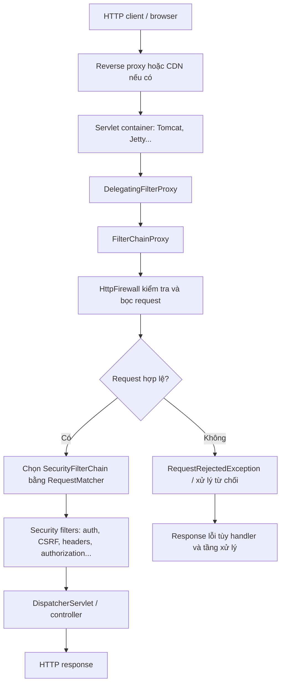
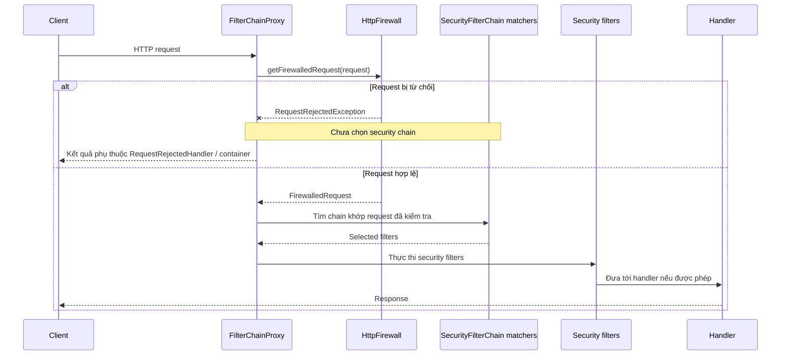
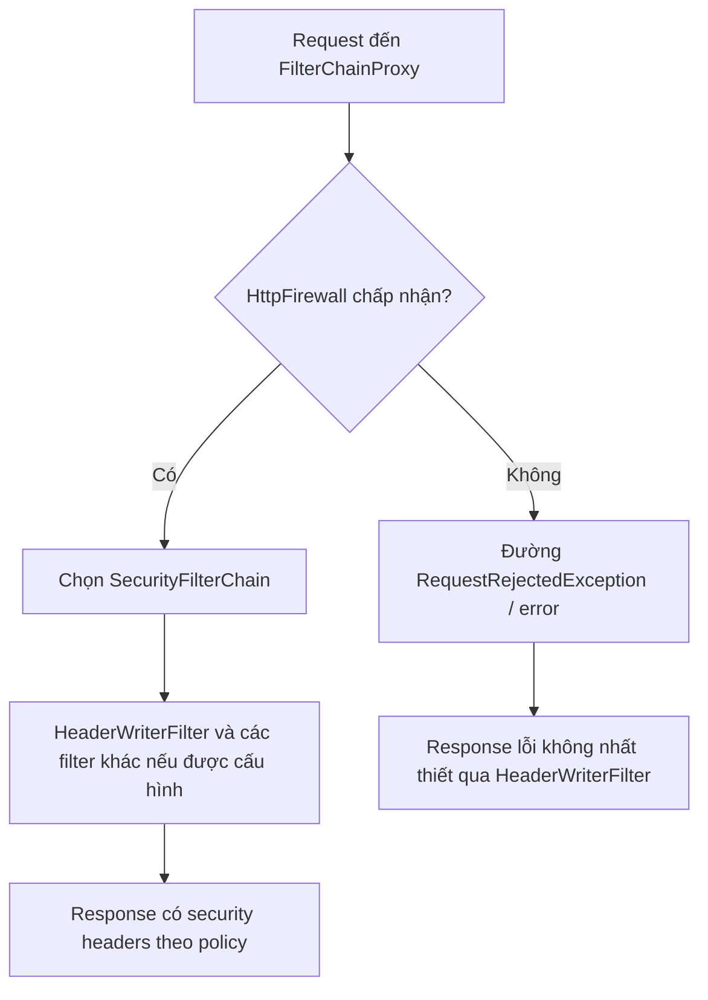

# HttpFirewall và vị trí trước khi chọn security chain

## 1. Vì sao Spring Security cần một firewall ngay trước bước chọn filter chain?

Trong chương **Firewall trên Servlet** của module **SPRING_SECURITY_HTTP_PROTECTION**, mục tiêu không chỉ là cấu hình một lớp kiểm tra URL. Spring Security phải bảo đảm rằng **cách ứng dụng quyết định bảo vệ request** phù hợp với **cách HTTP server và ứng dụng diễn giải request ấy**. Đây là nền tảng cho các lớp phòng vệ HTTP khác của module: CSRF, CORS, security headers, CSP, HSTS và bảo vệ session.

Hãy hình dung ứng dụng có hai luật:

- URL `/admin/**` phải được xác thực và chỉ nhân viên quản trị mới được truy cập.
- URL `/public/**` cho phép người dùng chưa đăng nhập.

Một request có đường dẫn bị biểu diễn mơ hồ có thể bị các tầng khác nhau **diễn giải khác nhau**. Nếu một security matcher xem request như đường dẫn công khai nhưng servlet container hoặc framework cuối cùng định tuyến nó tới tài nguyên quản trị, hệ thống có nguy cơ **áp nhầm chính sách bảo vệ**.

`HttpFirewall` tồn tại để thu hẹp loại sai khác này. Nó nằm trong quá trình xử lý của **`FilterChainProxy`**, ở vị trí **trước khi chọn `SecurityFilterChain`**. Với triển khai nghiêm ngặt mặc định trong nhiều phiên bản Spring Security hiện đại, nó từ chối những request không đạt quy tắc kiểm tra đường dẫn, phương thức và một số phần khác của HTTP request.

Đây là khác biệt quan trọng:

> **HTTP firewall không phải chỉ là một filter nữa chạy ở cuối security chain.** Nó là bước kiểm tra/bọc request mà `FilterChainProxy` dùng trước khi quyết định chain nào chịu trách nhiệm bảo vệ request đó.

### Mục tiêu học tập

Sau khi học, bạn có thể:

1. Vẽ đúng vị trí của `HttpFirewall` trong luồng Servlet: container → `DelegatingFilterProxy` → `FilterChainProxy` → firewall → chọn chain → security filters.
2. Giải thích vì sao URL phải được chuẩn hóa/kiểm tra tính hợp lệ **trước** khi `RequestMatcher` quyết định chain.
3. Phân biệt `StrictHttpFirewall`, `DefaultHttpFirewall`, `FirewalledRequest` và `RequestRejectedException`.
4. Phân tích các trường hợp đường dẫn có dấu chấm phẩy, dấu gạch chéo được mã hóa, dấu gạch chéo ngược, đoạn `..` và HTTP method không cho phép.
5. Cấu hình firewall có chủ đích mà không mở rộng bề mặt tấn công chỉ để một URL bất thường hoạt động.
6. Kiểm thử bằng mock ở đơn vị firewall, MockMvc ở tích hợp Servlet và HTTP client qua container/proxy.
7. Phân biệt vai trò firewall với authentication, authorization, CSRF, CORS, security headers, HSTS và phòng vệ trên Reactive/WebFlux.

## 2. Vị trí chính xác: `FilterChainProxy` gọi firewall trước khi xét matcher

Một ứng dụng Servlet có Spring Security thường nhận request theo đường:



**Thứ tự cốt lõi:** `HttpFirewall` kiểm tra và tạo request wrapper, sau đó `FilterChainProxy` sử dụng request đã được kiểm tra/bọc để tìm `SecurityFilterChain` phù hợp. **Một URL bị firewall từ chối có thể chưa bao giờ được xét bởi matcher của các chain**.

### 2.1. Phân biệt ba thành phần dễ nhầm lẫn

| Thành phần | Chức năng chính | Nó chạy khi nào? |
| --- | --- | --- |
| `DelegatingFilterProxy` | Cầu nối từ Servlet filter registration của container tới một bean Filter trong Spring context. | Khi request đi vào filter mapping tương ứng. |
| `FilterChainProxy` | Quản lý nhiều `SecurityFilterChain`, phối hợp HTTP firewall và chọn các security filters sẽ chạy. | Sau khi request đã đi qua cầu nối Servlet/Spring. |
| `HttpFirewall` | Kiểm tra/bọc request và response cho việc xử lý an toàn, có thể từ chối request bất thường. | **Trước khi chọn security chain** trong `FilterChainProxy`. |

Chú ý: `HttpFirewall` không giống **WAF** tại edge. Một Web Application Firewall thường hoạt động ở reverse proxy/gateway với rule theo lưu lượng, chữ ký hoặc chính sách mạng. `HttpFirewall` của Spring Security có mục tiêu hẹp và thiết thực hơn: giảm sự mơ hồ của Servlet request đối với cơ chế security matching và từ chối những đặc điểm HTTP request bị coi là nguy hiểm.

### 2.2. Lược đồ gọi ở mức khái niệm

```java
// PSEUDOCODE minh họa luồng của FilterChainProxy, không phải mã nguồn gốc.
void process(HttpServletRequest request, HttpServletResponse response) {
    FirewalledRequest safeRequest = firewall.getFirewalledRequest(request);
    HttpServletResponse safeResponse = firewall.getFirewalledResponse(response);

    List<Filter> filters = selectMatchingSecurityChain(safeRequest);

    runSelectedFilters(filters, safeRequest, safeResponse);
    // Sau khi rời chuỗi security, có bước khôi phục view đường dẫn phù hợp.
}
```

Các bước thực tế gồm xử lý exception, filter-chain decoration, request wrapper, reset và chuyển tiếp Servlet chain; chi tiết thay đổi theo phiên bản. Điều phải nhớ từ pseudocode là **firewall đứng trước `selectMatchingSecurityChain(...)`**.

## 3. Vì sao chọn security chain trước firewall là rủi ro?

Các Servlet container, proxy và framework không phải lúc nào cũng trả cùng cách biểu diễn đường dẫn. Một URL có thể chứa:

- `;` và nội dung path parameter/matrix parameter.
- Ký tự phân cách hoặc dấu chấm được URL-encode, chẳng hạn `%2F` hoặc `%2e`.
- Dấu gạch chéo kép `//`, slash và backslash đan xen.
- Đoạn `.`, `..` hoặc biến thể đường dẫn chưa chuẩn hóa.
- Ký tự điều khiển hoặc ký tự không hợp lệ trong URL.

Các chuỗi này có thể gây khác biệt giữa **path được security matcher nhìn thấy** và **path mà container, servlet mapping hoặc handler diễn giải**. Mục tiêu là không để request có nhiều cách hiểu vượt qua bước chọn rule bảo vệ.

### 3.1. Ví dụ mô hình: đường dẫn mơ hồ và rule `/admin/**`

Giả sử team định nghĩa:

```text
/admin/**  -> yêu cầu đăng nhập và role ADMIN
/public/** -> có thể truy cập công khai
```

Nếu security matcher nhìn một biểu diễn đường dẫn còn servlet container sau đó ánh xạ request thành biểu diễn khác, quyết định “route nào là /admin” có thể không thống nhất.

`HttpFirewall` giúp ngăn/giảm điều này bằng cách **kiểm tra request trước khi các matcher chạy**, sử dụng một wrapper có cách nhìn nhất quán hơn cho bước lựa chọn security chain.

**Không nên suy rằng mọi URL có mã hóa đều là tấn công.** URL encoding là thành phần bình thường của HTTP. Vấn đề là **những cách biểu diễn không an toàn hoặc không phù hợp với chính sách strict của framework**. Mục tiêu kiểm thử là phát hiện sự mơ hồ, không phải cấm mọi URL có ký tự `%`.

### 3.2. Mẫu đường dẫn cần nhận diện

| Ví dụ minh họa | Vấn đề kiến trúc có thể phát sinh | Hướng xử lý |
| --- | --- | --- |
| `/admin/report` | Đường dẫn bình thường, dễ xác định matcher. | Kỳ vọng firewall cho qua nếu các phần request khác hợp lệ. |
| `/admin;mode=edit/report` | Dấu chấm phẩy có thể đại diện path parameter; container/framework có thể phân tích khác nhau. | Kiểm tra chính sách semicolon của firewall; chỉ nới nếu có lý do thật. |
| `/admin//report` | Separator lặp có thể được chuẩn hóa khác nhau. | Không dựa vào hai cách hiểu path để phân quyền. |
| `/admin/%2Freport` | Encoded slash có thể bị giải mã ở proxy/container tại thời điểm khác. | Ưu tiên URL chuẩn; tránh cho phép slash mã hóa mà không có phân tích tương thích. |
| `/public/../admin/report` | Dot segment có thể dẫn đến diễn giải khác giữa các tầng. | Không giả định đây là route public; để các lớp kiểm tra xử lý theo chính sách. |
| `/admin\report` | Backslash có thể bị một số hạ tầng xem là separator. | Không mở cho phép backslash trừ khi có thiết kế và kiểm thử đặc biệt. |
| Method `TRACE` | Method này thường không cần thiết cho API web. | Chỉ cho phép methods ứng dụng thật sự sử dụng. |

Bảng là **tình huống để kiểm tra**, không phải khẳng định một URL luôn bị cùng một thành phần từ chối trên mọi container và phiên bản Spring Security. Một số request đã bị HTTP server/proxy từ chối trước khi tới firewall; một số có thể được container giải mã hoặc chuẩn hóa trước khi Java nhìn thấy chúng.

## 4. Giao diện `HttpFirewall` và vòng đời `FirewalledRequest`

API Servlet của Spring Security định nghĩa hợp đồng `HttpFirewall` có các thao tác chính:

```java
package org.springframework.security.web.firewall;

public interface HttpFirewall {
    FirewalledRequest getFirewalledRequest(
        jakarta.servlet.http.HttpServletRequest request);

    jakarta.servlet.http.HttpServletResponse getFirewalledResponse(
        jakarta.servlet.http.HttpServletResponse response);
}
```

Đây là **chữ ký để học** theo hệ Jakarta Servlet của Spring Security 6.x. Ở Spring Security 5.x, các package Servlet thường là `javax.servlet.*`. Khi gọi `getFirewalledRequest`, implementation có thể:

1. Kiểm tra những tính chất của request mà firewall quản lý.
2. Ném `RequestRejectedException` nếu request không được phép.
3. Trả về `FirewalledRequest` wrapper để bước chọn chain và xử lý tiếp theo dùng.

`FirewalledRequest` là wrapper cho Servlet request có khả năng phục hồi/`reset()` các phần cần thiết khi rời phạm vi security matching. Nó không phải bản sao độc lập của toàn bộ HTTP request.

### 4.1. Tại sao có bước reset?

Một số hành vi firewall phục vụ riêng cho việc **matching** chứ không nhằm âm thầm thay URL mà controller phải nhận. Trong các triển khai có điều chỉnh view path cho matching, quá trình rời security chain có thể **khôi phục cách nhìn đường dẫn gốc**.

Điều này nhấn mạnh ranh giới trách nhiệm:

- **Security matching:** phải sử dụng representation đủ an toàn và nhất quán cho việc chọn `SecurityFilterChain`.
- **Ứng dụng xử lý resource:** nên xử lý một request đã vượt qua kiểm tra đầu vào, theo semantics Servlet/container đã xác định.

Không dựa vào việc firewall “tự sửa sạch mọi URL không chuẩn” rồi bỏ qua chuẩn hóa đầu vào ở router, validation và storage. `StrictHttpFirewall` thường thiên về **từ chối** request không đạt quy tắc, không phải biến mọi URL bất thường thành một URL hợp lệ.

### 4.2. RequestRejectedException xảy ra ở vị trí nào?



Khi request bị từ chối tại firewall, đừng giả định `ExceptionTranslationFilter`, authentication entry point hoặc `HeaderWriterFilter` đã chạy. Do đó **không bảo đảm response từ chối sớm có đầy đủ security headers giống response 200**.

## 5. `StrictHttpFirewall`: lớp phòng vệ mặc định quan trọng

`StrictHttpFirewall` là implementation bảo thủ, được dùng theo mặc định trong nhiều phiên bản Spring Security hiện đại. Nó từ chối các request không đáp ứng các quy tắc cho phép về path, method và một số thành phần của request.

Một số nhóm kiểm tra cần hiểu:

| Nhóm | Rủi ro được giảm thiểu | Điều phải đánh giá |
| --- | --- | --- |
| Path không được chuẩn hóa | Security matcher và container bất đồng về URL. | Dot segments, slash lặp, encoded separators. |
| Dấu chấm phẩy trong URL | Path parameters/matrix variables có thể làm lệch security matching. | Có thật sự cần semicolon trong routing không? |
| Encoded slash/backslash và một số dạng encoding | Khác biệt giải mã giữa proxy, server và framework. | Không nới chỉ để một endpoint có URL bất thường hoạt động. |
| Ký tự điều khiển/không hợp lệ | HTTP parsing, log và matching bất nhất. | Kiểm thử theo đúng version/container. |
| HTTP method | Chặn method không nằm trong danh sách cho phép. | Ứng dụng có cần `PATCH`, `OPTIONS` hay method tùy biến không? |
| Header/parameter không hợp lệ | Một số giá trị/tên có thể gây hành vi không an toàn. | Không biến allowlist thành “chấp nhận mọi thứ”. |

Danh sách chính xác và các setter được hỗ trợ **phụ thuộc phiên bản**. Khi cần xác định liệu một chuỗi cụ thể bị chặn, xem `StrictHttpFirewall` Javadoc và release notes đúng `spring-security-web` đang dùng, rồi kiểm thử qua đúng Servlet container/ingress của ứng dụng.

### 5.1. Chính sách HTTP method

Trong nhiều bản Spring Security 6.x, `StrictHttpFirewall` mặc định cho phép những method HTTP thông dụng như `GET`, `HEAD`, `POST`, `PUT`, `PATCH`, `DELETE`, `OPTIONS`. Các method bất thường hoặc không được phê duyệt có thể bị từ chối trước khi vào chain.

HTTP method kiểm tra tại firewall **không thay thế authorization**. Ví dụ dù firewall cho phép `DELETE`, endpoint `DELETE /accounts/123` vẫn phải kiểm tra quyền, CSRF tùy kiểu xác thực và validate dữ liệu.

### 5.2. Semicolon: tại sao là một quyết định kiến trúc?

Dấu `;` trong đường dẫn có thể được dùng cho **matrix variables** hoặc path parameters, nhưng cũng là nguồn mơ hồ nếu proxy, servlet container và matcher xử lý khác nhau.

Spring Security có tùy chọn liên quan đến việc chấp nhận semicolon trên `StrictHttpFirewall`. **Không bật `setAllowSemicolon(true)` chỉ vì gặp lỗi 400 trên một URL có dấu chấm phẩy.** Trước tiên:

1. Xác định tính năng có thực sự cần matrix variables không.
2. Tìm hiểu container, framework và reverse proxy xử lý semicolon thế nào.
3. Kiểm tra security chain matcher và authorization sau khi xử lý path.
4. Đánh giá khả năng phân tách path parameter làm thay đổi route mong muốn.
5. Viết test cho cả URL bình thường lẫn những biểu diễn mơ hồ.
6. Chỉ nới trong phạm vi được phê duyệt, với phiên bản framework cụ thể.

Nếu không có nhu cầu thật, **giữ quy tắc nghiêm ngặt** thường an toàn và dễ vận hành hơn.

### 5.3. Encoded slash không phải giải pháp định tuyến mặc định

Một số API muốn truyền một chuỗi chứa dấu `/` bên trong path variable nên thử gửi `%2F`. Nhưng encoded slash qua proxy/container có thể bị **giữ nguyên, giải mã, từ chối hoặc chuẩn hóa** tùy cấu hình.

Thay vì vội cho phép encoded slash ở firewall, cân nhắc thiết kế API rõ hơn: đặt nội dung phức tạp ở request body/query parameter được validate, hoặc dùng một ID không chứa separator trong path. Một thay đổi tại firewall không thể bảo đảm mọi proxy/container trong đường truyền diễn giải `%2F` nhất quán.

## 6. `DefaultHttpFirewall` khác `StrictHttpFirewall` như thế nào?

Spring Security có cả `DefaultHttpFirewall` và `StrictHttpFirewall`. Hai tên không nên được hiểu là “default thì mới, strict thì tùy chọn”: **việc implementation nào được dùng mặc định phụ thuộc phiên bản và cấu hình**, và nhiều phiên bản hiện đại dùng `StrictHttpFirewall`.

| Tiêu chí | `StrictHttpFirewall` | `DefaultHttpFirewall` |
| --- | --- | --- |
| Triết lý | Từ chối nhiều biểu diễn request bị coi là không an toàn hoặc không chuẩn. | Có các hành vi lịch sử/chuẩn hóa path phục vụ security matching. |
| Xử lý URL mơ hồ | Thường ưu tiên reject hơn là chấp nhận và biến đổi. | Có thể xử lý theo cách khác, cần đọc Javadoc đúng phiên bản. |
| Khả năng tương thích | Một URL “từng hoạt động” có thể bị chặn khi nâng version. | Không mặc định an toàn hơn chỉ vì tên “Default”. |
| Khuyến nghị | Giữ strict trừ khi có yêu cầu kỹ thuật đã đánh giá. | Không chuyển sang implementation khác chỉ để né rejection. |

Đổi firewall có thể làm thay đổi **ranh giới trust và lựa chọn chain**. Phải đánh giá theo bảo mật ứng dụng, không chỉ theo việc một URL có trả `200` trở lại hay không.

### 6.1. HttpFirewall không thay các lớp bảo vệ khác

- **Authentication:** xác nhận ai đang gửi request.
- **Authorization:** xác nhận người đó được làm gì với resource.
- **CSRF:** bảo vệ các thao tác có thể thay đổi trạng thái khi dùng một số cơ chế xác thực tự động như cookie session.
- **CORS:** hướng dẫn browser cho phép JavaScript từ origin khác đọc response trong điều kiện nào.
- **Security headers/CSP/HSTS:** điều khiển những hành vi trình duyệt và HTTPS tương ứng.
- **HttpFirewall:** kiểm tra/bọc request trước security chain matching để giảm mơ hồ và loại bỏ request không đạt quy tắc.

Một request qua firewall thành công **không chứng minh** nó đã được xác thực hay được phép truy cập. Ngược lại, request bị firewall từ chối có thể chưa đến bước CSRF/authorization.

## 7. Cấu hình firewall trong Servlet một cách có kiểm soát

Trong nhiều ứng dụng, không cần tạo bean firewall thủ công: Spring Security đã cấu hình firewall mặc định. Khi có yêu cầu thật sự phải thay danh sách method hoặc tinh chỉnh behavior, hãy đăng ký tại **mức `WebSecurity`/`FilterChainProxy`**, không đặt một filter phía sau `AuthorizationFilter` rồi gọi đó là “HTTP firewall trước chain”.

Ví dụ minh họa một chính sách method được xác định rõ:

```java
import java.util.List;

import org.springframework.context.annotation.Bean;
import org.springframework.context.annotation.Configuration;
import org.springframework.security.config.annotation.web.configuration.WebSecurityCustomizer;
import org.springframework.security.web.firewall.StrictHttpFirewall;

@Configuration
class ServletFirewallPolicyConfig {

    @Bean
    WebSecurityCustomizer firewallCustomizer() {
        return web -> {
            StrictHttpFirewall firewall = new StrictHttpFirewall();

            // Chỉ minh họa: xác định methods ứng dụng đã phê duyệt.
            firewall.setAllowedHttpMethods(List.of(
                "GET", "HEAD", "POST", "PUT", "PATCH", "DELETE", "OPTIONS"
            ));

            // Giữ các quy tắc strict khác; không bật allowSemicolon/encodedSlash.
            web.httpFirewall(firewall);
        };
    }
}
```

Ví dụ trên khai báo lại nhóm method thông dụng trong nhiều phiên bản; **không cần thêm nó nếu mặc định của dự án đã phù hợp**. Khi áp vào production, phải tính đến health checks, CORS preflight `OPTIONS`, các client hợp lệ và cơ chế khác như reverse proxy.

Đừng cho phép một method mới chỉ để đáp ứng một client bất thường nếu backend chưa có thiết kế endpoint, authorization và logging tương ứng.

### 7.1. Vì sao không cấu hình bằng `HttpSecurity.addFilterBefore(...)`?

`HttpSecurity.addFilterBefore(...)` chèn một security filter vào **chain đã được chọn**. Nhưng `HttpFirewall` được dùng **trước bước chọn chain**. Vì vậy một filter tùy biến đặt trong chain không có cùng vị trí và không thể thay thế chức năng kiểm tra trước-matcher của `HttpFirewall`.

Nếu cần một lớp kiểm tra HTTP ở **Servlet container hoặc edge trước cả `DelegatingFilterProxy`**, đó là trách nhiệm của container/ingress/WAF và cần được triển khai riêng; nó không làm mất nhu cầu lựa chọn chain an toàn trong Spring Security.

### 7.2. Cảnh báo về nới lỏng firewall

Một ví dụ không nên đưa vào production nếu thiếu đánh giá:

```java
StrictHttpFirewall firewall = new StrictHttpFirewall();

// ANTI-PATTERN nếu chỉ dùng để né lỗi URL bị từ chối:
// firewall.setAllowSemicolon(true);
// firewall.setAllowUrlEncodedSlash(true);
// firewall.setUnsafeAllowAnyHttpMethod(true);
```

Các setter trên đại diện cho những thay đổi có thể mở rộng tập request được chấp nhận. Không sử dụng tùy chọn “unsafe” như giải pháp cấu hình mặc định. Nếu một tính năng không hoạt động, ưu tiên **thiết kế URL chuẩn, sửa proxy path rewriting, hoặc cấu hình matcher đúng**, sau đó mới cân nhắc ngoại lệ với security review.

### 7.3. Có cần cấu hình firewall khác nhau cho mỗi security chain?

`HttpFirewall` được `FilterChainProxy` sử dụng trước khi chọn chain, vì vậy nó mang tính **tiền xử lý chung cho quá trình lựa chọn chain**. Không giả định có thể thêm một `HttpFirewall` độc lập vào mỗi `SecurityFilterChain` rồi cho phép cùng URL mơ hồ được diễn giải theo hai cách. Nếu cần yêu cầu khác nhau theo nhóm endpoint, hãy thiết kế lại interface/routing, dùng matcher và authorization ở những bước thích hợp, hoặc phân tách ứng dụng/tầng HTTP với ranh giới rõ ràng.

## 8. Nhiều security chains: firewall đứng trước cả chain API và chain Web

Giả sử ứng dụng có hai chain với thứ tự rõ ràng:

```java
import org.springframework.context.annotation.Bean;
import org.springframework.context.annotation.Configuration;
import org.springframework.core.annotation.Order;
import org.springframework.security.config.Customizer;
import org.springframework.security.config.annotation.web.builders.HttpSecurity;
import org.springframework.security.web.SecurityFilterChain;
import org.springframework.security.web.header.writers.StaticHeadersWriter;

@Configuration
class TwoChainSecurityConfig {

    @Bean
    @Order(1)
    SecurityFilterChain apiChain(HttpSecurity http) throws Exception {
        http
            .securityMatcher("/api/**")
            .authorizeHttpRequests(auth -> auth
                .requestMatchers("/api/health").permitAll()
                .anyRequest().authenticated())
            .httpBasic(Customizer.withDefaults())
            .headers(headers -> headers.addHeaderWriter(
                new StaticHeadersWriter("X-Lab-Chain", "api")));

        return http.build();
    }

    @Bean
    @Order(2)
    SecurityFilterChain webChain(HttpSecurity http) throws Exception {
        http
            .authorizeHttpRequests(auth -> auth
                .requestMatchers("/public/**").permitAll()
                .anyRequest().authenticated())
            .headers(headers -> headers.addHeaderWriter(
                new StaticHeadersWriter("X-Lab-Chain", "web")));

        return http.build();
    }
}
```

`X-Lab-Chain` chỉ là **header quan sát cho bài học**, không phải security header chuẩn và nên bỏ sau khi debug. Các phần authentication, CSRF, CORS, session trong ứng dụng thực phải được giữ theo thiết kế.

Một request có thể đi theo các hướng:

| Request minh họa | Trước tiên | Sau đó nếu được chấp nhận |
| --- | --- | --- |
| `GET /api/health` hợp lệ | `HttpFirewall` kiểm tra | Matcher chọn chain API; có thể nhận `X-Lab-Chain: api`. |
| `GET /public/info` hợp lệ | `HttpFirewall` kiểm tra | Matcher API không khớp; chain Web có thể được chọn. |
| URL không được firewall chấp nhận | Firewall từ chối | **Không chọn** chain API hay Web. |
| `GET /api/admin` hợp lệ, chưa xác thực | Firewall chấp nhận | Chain API yêu cầu xác thực; có thể nhận `401`. |

**Thông điệp:** chain order quan trọng, nhưng firewall **không chờ đến khi một chain khớp** mới kiểm tra request. Nếu một request bị từ chối ở firewall, việc đổi `@Order` hoặc thêm `permitAll` trong chain sẽ không tự sửa được rejection.

### 8.1. `permitAll` và `web.ignoring` có khác biệt nào?

`permitAll` vẫn cho request đi qua security chain và các security filters phù hợp, rồi cho phép truy cập ở bước authorization.

Một cấu hình **bỏ qua security filters** như `web.ignoring()` (ở những phiên bản hỗ trợ) có thể khiến request không được bảo vệ bởi CSRF, authentication, security headers và authorization của chain đó. Tuy nhiên, **không được suy rằng `web.ignoring()` luôn bỏ qua cả bước `HttpFirewall`**: khi request vẫn đi qua `FilterChainProxy`, firewall được áp trước khi chọn filter list. Nếu Servlet filter mapping hoặc hạ tầng **bỏ qua hoàn toàn `DelegatingFilterProxy`**, thì lại là đường đi khác.

Vì vậy cần phân biệt:

1. Request đi qua `FilterChainProxy` nhưng chọn chain không có các security filters thông thường.
2. Request hoàn toàn không đi qua Spring Security Servlet filter registration.

Hai trường hợp này không có cùng hệ quả đối với firewall.

## 9. Request bị từ chối: trạng thái HTTP và handler phụ thuộc cấu hình

Khi `HttpFirewall` không chấp nhận request, nó có thể ném `RequestRejectedException`. **Exception này xảy ra trước khi các security filters trong selected chain chạy.**

Điều gì xảy ra tiếp?

- Tùy phiên bản và cấu hình, `FilterChainProxy` có thể chuyển exception tới cơ chế `RequestRejectedHandler`.
- Một handler có thể trả HTTP status như `400 Bad Request`.
- Một cấu hình khác có thể ném exception tiếp, để container hoặc lớp error handling xử lý.
- Reverse proxy hoặc Servlet container có thể từ chối request **sớm hơn** và phát response hoàn toàn khác.

**Không khẳng định mọi `RequestRejectedException` trên mọi Spring Security version đều trả đúng một status**. Kiểm tra hành vi ứng dụng thực; thông thường test có thể cần assert exception hoặc response lỗi tùy handler được cấu hình.

### 9.1. Vì sao response bị firewall từ chối có thể thiếu security headers?

Các writer như `HeaderWriterFilter` chạy bên trong security chain đã chọn. Nhưng `RequestRejectedException` có thể xuất hiện **trước khi chain được chọn**, nên response lỗi có thể không có `X-Frame-Options`, CSP hoặc caching headers do những writer đó tạo.

Đó không phải bằng chứng đơn giản rằng `HeaderWriterFilter` “bị hỏng”. Nó phản ánh vị trí của firewall. Nếu kiến trúc yêu cầu một bộ header an toàn cho **mọi response public**, kể cả lỗi do gateway/container tạo, hãy thiết kế baseline header ở các tầng có thể phát response lỗi và kiểm thử thực tế.

### 9.2. Phân biệt lỗi firewall với `401`, `403` và `404`

| Kết quả quan sát | Thành phần có thể chịu trách nhiệm | Ý nghĩa cần kiểm tra |
| --- | --- | --- |
| `RequestRejectedException` | Spring Security `HttpFirewall` | Request không qua kiểm tra đầu vào của firewall. |
| `400` do container | Servlet container/HTTP parser | Có thể request chưa vào Spring Security. |
| `401` | Authentication entry point | Request được xử lý bởi cơ chế xác thực; không đồng nghĩa firewall đã từ chối. |
| `403` do CSRF | `CsrfFilter` | CSRF token thiếu hoặc không hợp lệ; không phải URL normalization. |
| `403` do thiếu quyền | Authorization filter/handler | Người dùng không được truy cập resource. |
| `404` | MVC handler mapping / container / gateway | Không tìm thấy resource; có thể qua security chain hợp lệ. |
| `502/503` | Proxy/ingress/CDN | Upstream không sẵn sàng; backend firewall có thể chưa chạy. |

Một request bị firewall từ chối không thể được “sửa” bằng cách `permitAll` một route. Ngược lại, một `403` do CSRF không nên bị “sửa” bằng cách nới `StrictHttpFirewall`.

## 10. Unit test `StrictHttpFirewall` bằng Spring Mock Servlet

Unit test phù hợp nhất để chứng minh trực tiếp **firewall chấp nhận hay từ chối input đã dựng**. Nó không cần khởi động toàn bộ Spring Boot.

### 10.1. Request bình thường được chấp nhận

```java
import org.junit.jupiter.api.Test;
import org.springframework.mock.web.MockHttpServletRequest;
import org.springframework.security.web.firewall.FirewalledRequest;
import org.springframework.security.web.firewall.StrictHttpFirewall;

import static org.junit.jupiter.api.Assertions.assertEquals;

class StrictHttpFirewallUnitTest {

    private final StrictHttpFirewall firewall = new StrictHttpFirewall();

    @Test
    void permitsOrdinaryServletPath() {
        var request = new MockHttpServletRequest("GET", "/reports/list");
        request.setServletPath("/reports/list");

        FirewalledRequest protectedRequest =
            firewall.getFirewalledRequest(request);

        assertEquals("/reports/list", protectedRequest.getServletPath());

        // Khi dùng wrapper trực tiếp trong unit test, khôi phục theo hợp đồng.
        protectedRequest.reset();
    }
}
```

`MockHttpServletRequest` thuộc `spring-test`. Test trên kiểm tra một request object bình thường được chấp nhận; nó **không** chứng minh Servlet container/proxy gửi chính xác cùng một request object cho URL public.

### 10.2. Đường dẫn chứa semicolon bị từ chối theo strict policy

```java
import org.springframework.security.web.firewall.RequestRejectedException;

import static org.junit.jupiter.api.Assertions.assertThrows;

// Thêm vào class StrictHttpFirewallUnitTest ở trên:
@Test
void rejectsSemicolonInPathByDefault() {
    var request = new MockHttpServletRequest("GET", "/reports;v=1/list");
    request.setServletPath("/reports;v=1/list");

    assertThrows(RequestRejectedException.class,
        () -> firewall.getFirewalledRequest(request));
}
```

Kỳ vọng này phù hợp với các bản `StrictHttpFirewall` từ chối semicolon theo mặc định. Nếu dependency/project đã tùy biến cho phép semicolon, cần kiểm thử chính sách đã duyệt thay vì ép đổi code để test mặc định pass.

### 10.3. HTTP method ngoài allowlist

```java
@Test
void rejectsUnexpectedHttpMethod() {
    var request = new MockHttpServletRequest("TRACE", "/reports/list");
    request.setServletPath("/reports/list");

    assertThrows(RequestRejectedException.class,
        () -> firewall.getFirewalledRequest(request));
}
```

Test cho thấy method filtering tại firewall không phải authorization. Không cần tạo `@PostMapping` hay `@DeleteMapping` để test method bị từ chối, vì request đã bị chặn trước handler mapping.

### 10.4. Test từ chối và chấp nhận không chứng minh response status

`assertThrows(RequestRejectedException.class, ...)` chỉ kiểm tra **contract của firewall implementation**. Nó không kiểm tra HTTP `400` do `RequestRejectedHandler` hoặc container phát. Nếu ứng dụng đã tùy biến handler, cần integration test ở tầng `FilterChainProxy` hoặc Servlet container để xem kết quả status thực sự.

Tương tự, test trực tiếp firewall không kiểm tra chain API hay WEB nào sẽ được chọn sau khi request được chấp nhận.

## 11. Integration test Servlet: kết hợp firewall và security chain

Ví dụ ứng dụng có hai chain ở mục 8 và một controller thử nghiệm:

```java
import org.springframework.web.bind.annotation.GetMapping;
import org.springframework.web.bind.annotation.RestController;

@RestController
class FirewallDemoController {

    @GetMapping("/api/health")
    String apiHealth() {
        return "api-ok";
    }

    @GetMapping("/public/info")
    String publicInfo() {
        return "public-ok";
    }
}
```

Khi dùng `@SpringBootTest` và `@AutoConfigureMockMvc`:

```java
import org.junit.jupiter.api.Test;
import org.springframework.beans.factory.annotation.Autowired;
import org.springframework.boot.test.autoconfigure.web.servlet.AutoConfigureMockMvc;
import org.springframework.boot.test.context.SpringBootTest;
import org.springframework.test.web.servlet.MockMvc;

import static org.springframework.test.web.servlet.request.MockMvcRequestBuilders.get;
import static org.springframework.test.web.servlet.result.MockMvcResultMatchers.header;
import static org.springframework.test.web.servlet.result.MockMvcResultMatchers.status;

@SpringBootTest
@AutoConfigureMockMvc
class ServletFirewallChainIntegrationTest {

    @Autowired MockMvc mvc;

    @Test
    void validApiPathUsesApiSecurityChain() throws Exception {
        mvc.perform(get("/api/health"))
            .andExpect(status().isOk())
            .andExpect(header().string("X-Lab-Chain", "api"))
            .andExpect(header().string(
                "X-Content-Type-Options", "nosniff"));
    }

    @Test
    void validPublicPathUsesWebChain() throws Exception {
        mvc.perform(get("/public/info"))
            .andExpect(status().isOk())
            .andExpect(header().string("X-Lab-Chain", "web"))
            .andExpect(header().string(
                "X-Content-Type-Options", "nosniff"));
    }
}
```

Test này chứng minh **những request hợp lệ** được lựa chọn vào hai chain theo thiết kế trong test context. Một header marker là bằng chứng quan sát tiện lợi nhưng không thay yêu cầu kiểm thử authorization thật.

### 11.1. Vì sao không hardcode `400` cho mọi request bị firewall từ chối?

Phần xử lý `RequestRejectedException` trong MockMvc có thể khác với container thật và khác giữa các cấu hình `RequestRejectedHandler`. Một test như:

```java
// Minh họa ý tưởng; KHÔNG khẳng định luôn trả 400 trên mọi cấu hình.
// mvc.perform(get("/reports;v=1/list"))
//     .andExpect(status().isBadRequest());
```

có thể fail nếu exception được ném ra và chưa được chuyển thành response trong test context. Trước tiên kiểm tra **cơ chế handler thực sự được cài**, sau đó viết assertion cho status/error body theo hợp đồng API đã chọn.

Nếu cần kiểm tra **rule firewall**, unit test `assertThrows(RequestRejectedException>` ở mục 10 thường rõ nghĩa hơn. Nếu cần kiểm tra **client nhận gì**, chạy integration test với HTTP server thật rồi đo status/headers.

### 11.2. Request sau normalization có chọn đúng chain không?

Nếu ứng dụng chấp nhận các URL path parameter hoặc có reverse proxy rewrite, cần bổ sung test matcher trên những đường dẫn thực được chấp nhận. Một request path bị từ chối trước-matcher là kết quả khác hẳn một request chấp nhận nhưng bị matcher đưa sai chain.

Không tự ý bật `setAllowSemicolon(true)` rồi chỉ kiểm tra `200 OK`. Test cần xác nhận route được **đúng chain bảo vệ**, authorization đúng, CSRF/CORS không bị bypass và đường dẫn do controller nhận không tạo side effect trái dự kiến.

## 12. Trên đường truyền: reverse proxy và Servlet container có thể từ chối trước firewall

Một request từ browser thường đi qua:

```text
Browser -- HTTPS --> Gateway / CDN -- HTTP hoặc HTTPS nội bộ --> Servlet container
                                                      |
                                                      v
                                      Spring Security FilterChainProxy
                                                      |
                                                      v
                                                 HttpFirewall
```

Điều này có hệ quả:

- Proxy có thể **decode hoặc normalize path**, khiến URL mà `HttpFirewall` thấy khác public URL.
- Proxy có thể từ chối request trước khi forwarding; Java không hề nhận request.
- Container có thể chặn HTTP request không hợp lệ ở parser/connector.
- Container có thể giới hạn encoded slash, header size, request-line, URI syntax.
- Spring Security chỉ kiểm tra phần request **sau khi request thực sự đến `FilterChainProxy`**.

### 12.1. So sánh HTTP client với test mock

```bash
# Ví dụ trên môi trường kiểm thử; đổi domain thành host thuộc quyền kiểm thử.
curl -sS -D - -o /dev/null https://app.example.test/api/health

# Với backend trực tiếp, chỉ khi được phép.
curl -sS -D - -o /dev/null http://127.0.0.1:8080/api/health
```

Trên Windows PowerShell, dùng `curl.exe` và `-o NUL` thay `/dev/null`. Các lệnh này kiểm tra response **quan sát được**, không bảo đảm cùng một request raw URL được cả proxy và backend tiếp nhận. Muốn phân tích một URL bị từ chối, phải xác nhận path, method, host, redirect và request thực sự được forwarding.

**Không thử các request bất thường trên production khi chưa có quyền và kế hoạch kiểm thử.** Tình huống matrix parameter, encoded slash hoặc malformed URL nên kiểm tra ở môi trường staging cho phép, tránh tạo log/alert không cần thiết hoặc ảnh hưởng lưu lượng.

### 12.2. Phân biệt `400` đến từ đâu

| Quan sát | Điều nên kiểm chứng |
| --- | --- |
| Có log `RequestRejectedException` từ Spring Security | `HttpFirewall` có khả năng đã từ chối; xác định version/policy. |
| Container trả `400` nhưng không có request log ở application | HTTP parser/connector có thể từ chối trước filter registration. |
| Public HTTPS trả `400`, backend direct nhận URL hợp lệ | Gateway có thể áp validation/rewriting khác. |
| Public trả `404`, backend trả `200` | Proxy path rewrite/routing có thể khác, không mặc định là firewall. |
| Backend báo `401` sau khi firewall cho qua | Authentication entry point được gọi, không phải firewall rejection. |
| Browser báo CORS error | Có thể preflight/auth/CORS, không nhất thiết firewall. |

Nếu cần correlation, dùng request ID và logging an toàn ở những tầng được phép. Tránh log nguyên vẹn cookie, `Authorization`, CSRF token và dữ liệu request chứa thông tin cá nhân.

## 13. Firewall và response security headers: hai mốc khác nhau

`HttpFirewall` được gọi **trước khi chọn chain**; `HeaderWriterFilter` của Servlet là một **security filter trong chain đã chọn**. Đó là lý do một response bị từ chối sớm có thể thiếu một số security headers mà response 200 thường có.



Với Spring Security 6.x, header bảo mật thường bao gồm `X-Content-Type-Options: nosniff`, cache headers và `X-Frame-Options` theo config mặc định; HSTS có điều kiện HTTPS. CSP thường phải được ứng dụng cấu hình riêng vì policy nguồn script/style/API không thể đoán tự động.

**Đừng hiểu sai:** thiếu CSP/HSTS trên một request bị firewall từ chối không có nghĩa firewall cho request độc hại đi qua. Ngược lại, response có security headers đẹp không chứng minh firewall đã kiểm tra đúng URI, cũng không chứng minh authorization/CSRF hoạt động.

Nếu yêu cầu nghiệp vụ đòi baseline security headers trên **mọi response public**, gồm cả lỗi `400`/`502` do server/gateway tạo, phải thiết kế chính sách ở tầng có khả năng phát các response ấy — đồng thời tránh CSP/HSTS/XFO mâu thuẫn giữa backend và proxy.

## 14. So sánh với Reactive/WebFlux để không dùng nhầm API

Dịch vụ **SPRING_SECURITY_HTTP_PROTECTION** bao gồm cả Servlet lẫn Reactive, nhưng **`HttpFirewall` trong bài này là API của Spring Security Servlet**. Không nên mang `HttpFirewall` hoặc `FirewalledRequest` áp nguyên xi sang WebFlux.

| Chủ đề | Servlet | Reactive/WebFlux |
| --- | --- | --- |
| Request abstraction | `HttpServletRequest` | `ServerWebExchange` / `ServerHttpRequest` |
| Bộ phối hợp security chain | `FilterChainProxy` | `WebFilterChainProxy` |
| Firewall được bàn ở bài này | `HttpFirewall` / `StrictHttpFirewall` | Không phải cùng Servlet `HttpFirewall` API |
| Chain | `SecurityFilterChain` | `SecurityWebFilterChain` |
| Matcher | `RequestMatcher` | `ServerWebExchangeMatcher` |
| Header writer | `HeaderWriter` / `HeaderWriterFilter` | `ServerHttpHeadersWriter` / `HttpHeaderWriterWebFilter` |
| HTTP request handling | Servlet container, filters, MVC | Reactive HTTP server, WebFilters, WebFlux handlers |

WebFlux vẫn cần đánh giá **URI decoding, path matching, request validation, proxy rewriting và authorization**. Tuy nhiên không tự giả định có một `StrictHttpFirewall` reactive với cùng setter/default behavior. Các lớp bảo vệ URL và request phải được nghiên cứu theo API của Reactive server, Spring WebFlux và Spring Security phiên bản đang dùng.

### 14.1. Vì sao API khác nhau quan trọng?

Servlet filter chain xử lý `HttpServletRequest` đồng bộ theo mô hình Servlet (dù có async dispatch), trong khi WebFlux dùng pipeline reactive. Một wrapper `FirewalledRequest` có thể thay cách matcher thấy servlet path; `ServerWebExchange` có cơ chế path/attribute riêng. Sao chép unit test `MockHttpServletRequest` sang `WebTestClient` không kiểm tra cùng điều kiện.

Trong cả hai stack, cần bảo đảm:

1. Request được phân loại path nhất quán với router và security matcher.
2. Authorization không dựa vào dữ liệu request chưa được chuẩn hóa/kiểm chứng.
3. CSRF và CORS được xử lý theo cơ chế riêng.
4. Security headers được phát ở response phù hợp.
5. Proxy/HTTP server không tạo ra những diễn giải khác biệt ngoài dự tính.

## 15. Chẩn đoán xung đột khi triển khai

| Triệu chứng | Nguyên nhân có thể | Cách điều tra và giải quyết |
| --- | --- | --- |
| `GET /admin` bình thường hoạt động, URL có `;` bị từ chối | `StrictHttpFirewall` chặn semicolon; container cũng có thể áp rule. | Xác nhận tầng từ chối, giải thích nhu cầu matrix variables trước khi cân nhắc nới. |
| Một URL có `%2F` chạy local nhưng bị chặn ở staging | Proxy, container hoặc firewall khác chính sách encoded slash. | So HTTP request qua từng hop; ưu tiên thiết kế URL không phụ thuộc encoded separator. |
| `RequestRejectedException` xuất hiện trước log authentication | Firewall chạy trước bước chọn chain. | Không điều tra nhầm `AuthenticationEntryPoint` hoặc `AccessDeniedHandler`. |
| Thêm `permitAll` nhưng request vẫn bị từ chối | Rejection xảy ra trước authorization. | Kiểm tra input/path/method và firewall policy, không nới auth rule. |
| MockMvc trả exception nhưng production trả `400` | Khác error handler/Servlet container. | Test riêng contract firewall và HTTP response cuối. |
| Response `400` thiếu `nosniff` hoặc CSP | Error có thể được tạo trước `HeaderWriterFilter` hoặc tại proxy. | Tìm tầng tạo response; cấu hình baseline lỗi ở tầng phù hợp nếu cần. |
| `POST` bị `403` còn URL bình thường | CSRF token thiếu hoặc không đủ quyền. | Kiểm tra `CsrfFilter`/authorization; không nới firewall. |
| Browser báo CORS error với preflight `OPTIONS` | CORS config hoặc preflight auth sai; cũng có thể method bị firewall chặn nếu tùy biến. | Test `OPTIONS`, Origin, request headers, credentials và method allowlist. |
| API không nhận header marker của chain WEB | Request thuộc chain API. | Kiểm tra matcher/`@Order`, không giả định writers tự gộp giữa các chain. |
| Log Java không có request nhưng client nhận `502` | Gateway/upstream lỗi trước backend. | Kiểm tra ingress/CDN và health, không quy lỗi cho firewall Servlet. |
| HSTS thiếu trên backend HTTP | Backend không nhận diện secure request. | Kiểm tra HTTPS public và trusted forwarding; HSTS khác firewall. |
| URL được proxy rewrite trước khi vào backend | Matcher nhìn path backend khác public path. | Test route và rule bảo vệ theo URL thực backend nhận. |
| Đã nới encoded slash, vẫn nhận 400 | Servlet container/proxy từ chối sớm hơn. | Không tiếp tục nới mọi lớp bừa bãi; xem thiết kế URI và connector. |
| Test success pass nhưng endpoint nhạy cảm vẫn truy cập trái quyền | Firewall chỉ kiểm tra request shape. | Viết test authorization/IDOR, session và CSRF riêng. |
| Static asset bypass security chain | Asset được server/CDN phục vụ không qua backend. | Quản trị security headers và cache ở tầng phát asset. |

### Quy trình điều tra bảy bước

1. **Xác nhận request cụ thể:** URL, method, query, status, scheme, host, authentication context và thời điểm.
2. **Phân biệt tầng tạo response:** CDN/gateway, container hay Spring Security backend.
3. **Tìm dấu hiệu firewall:** có `RequestRejectedException` không, hoặc parser đã từ chối trước khi vào Java?
4. **Xác định firewall policy và version:** `StrictHttpFirewall` mặc định hay có custom `HttpFirewall`/`WebSecurityCustomizer`?
5. **Xác định chain và matcher:** nếu request đã được chấp nhận, chain nào được chọn, các rule authorization ra sao?
6. **Kiểm tra các bảo vệ tiếp theo:** CSRF, CORS, authentication, security headers, session/cookie và caching có đúng không?
7. **Sửa hẹp nhất và test regression:** giữ request URI chuẩn, không nới toàn bộ strict rules để né một lỗi chức năng.

## 16. Tình huống thực hành có đáp án định hướng

### Tình huống A — Cho phép URL bất thường bằng `permitAll`?

Nhóm phát triển nhận lỗi `RequestRejectedException` cho `/reports;v=1/list` và thêm `requestMatchers("/reports/**").permitAll()`.

**Định hướng:** `permitAll` chạy ở bước authorization sau khi chain đã được chọn. Nếu firewall từ chối trước đó, thay đổi này không giải quyết nguyên nhân. Cần đánh giá có thực sự cần matrix variables hay không và cách container/matcher xử lý `;`.

### Tình huống B — Matcher API bị chọn sai?

Một request `GET /api/health` nhận `X-Lab-Chain: api` còn `GET /public/info` nhận `X-Lab-Chain: web`. Một URL chứa encoded slash bị từ chối trước cả hai.

**Định hướng:** marker chứng minh chain nào được chọn cho request hợp lệ. URL bị firewall từ chối chưa chọn chain; không quy lỗi cho `@Order` nếu không có bằng chứng.

### Tình huống C — Encoded slash trong path variable

Một API truyền ID có ký tự `/` bằng `%2F`. Staging trả `400` nhưng dev localhost hoạt động.

**Định hướng:** kiểm tra path decoding ở reverse proxy, Servlet container và firewall. Ưu tiên định dạng ID không cần separator trong path hoặc chuyển nội dung có cấu trúc vào body/query được validate. Không nới cả proxy và firewall mà không có đánh giá bảo mật.

### Tình huống D — POST thiếu CSRF token

`POST /settings` dùng cookie session trả `403`. Request path hợp lệ, firewall không báo lỗi.

**Định hướng:** CSRF/authorization là cơ chế độc lập. Kiểm tra CSRF token và session, đừng thay `StrictHttpFirewall` để sửa `403`.

### Tình huống E — Method TRACE

Client gửi method `TRACE` tới API và bị từ chối. Team muốn bật tất cả HTTP methods bằng tùy chọn unsafe.

**Định hướng:** chỉ chấp nhận methods cần cho nghiệp vụ; một method lạ không tự có quyền truy cập endpoint. Không mở toàn bộ allowlist để làm công cụ kiểm thử cũ chạy.

### Tình huống F — `400` thiếu CSP

Một request malformed bị container trả `400` không có `Content-Security-Policy`. `GET /health` hợp lệ qua Spring Security có CSP.

**Định hướng:** container có thể từ chối trước `DelegatingFilterProxy`. Nếu baseline security headers cần trên lỗi public, cấu hình ở tầng tạo response và kiểm thử không gây xung đột CSP tại gateway.

### Tình huống G — Static assets và `web.ignoring`

Một asset được bỏ security filters nhưng vẫn đi qua servlet filter registration; một asset khác do CDN phát trực tiếp.

**Định hướng:** hai đường đi khác nhau. `web.ignoring` không nên được đồng nhất với việc bypass hoàn toàn `FilterChainProxy`; asset CDN không nhận headers từ Java backend nếu backend không được gọi.

### Tình huống H — WebFlux có StrictHttpFirewall không?

Người học viết `@Bean StrictHttpFirewall` trong ứng dụng WebFlux rồi mong `ServerWebExchangeMatcher` sử dụng nó.

**Định hướng:** đó là API Servlet; Reactive có pipeline và abstractions riêng. Kiểm tra URI/path policy ở WebFlux/Reactive server và viết test phù hợp với WebTestClient.

### Tình huống I — 403 authorization và 400 firewall

`GET /admin` khi chưa đủ quyền trả `403`; `GET /admin;test=1` bị `RequestRejectedException` trước authentication.

**Định hướng:** trường hợp thứ nhất đã qua request validation và bị chặn ở quyền; trường hợp thứ hai là request không đạt điều kiện đầu vào. Không xem cả hai là cùng một “lỗi bảo mật 403”.

### Tình huống J — Response khác qua gateway

Backend trực tiếp trả `200` cho `/api/health`, nhưng public gateway trả `404` vì rewrite path sai.

**Định hướng:** không tự suy HttpFirewall đã từ chối. So public URL, upstream target và path mà backend nhận; nếu request chưa tới backend, sửa routing gateway trước.

## 17. Checklist production và nguyên tắc an toàn

1. **Hiểu vị trí:** Servlet `HttpFirewall` được `FilterChainProxy` áp **trước khi chọn `SecurityFilterChain`**.
2. **Giữ strict theo mặc định:** chỉ nới rule khi có yêu cầu rõ ràng, đánh giá rủi ro và regression tests.
3. **Không chữa rejection bằng `permitAll`:** authorization nằm sau bước request validation.
4. **Không nhầm status:** `RequestRejectedException`, `400` container, `401` auth và `403` CSRF/authorization có nguồn khác nhau.
5. **Kiểm tra proxy/container:** decoded path và URL normalization có thể khác trước khi request tới Java.
6. **Dùng API đúng chỗ:** custom `HttpFirewall` ở cấu hình `WebSecurity`, không phải một security filter thêm sau bước chọn chain.
7. **Kiểm thử cả hợp lệ và bất thường:** unit test firewall; integration test chain; đo HTTP response qua staging/public.
8. **Giữ các lớp bảo vệ khác:** CSRF, CORS, security headers/CSP, HSTS, session/cookie, HTTP firewall và authorization đều có trách nhiệm riêng.
9. **Không giả định mọi lỗi có security headers giống `200`:** rejection trước chain hoặc lỗi ở gateway cần chính sách tầng tương ứng.
10. **Phân biệt Servlet với Reactive:** không áp `StrictHttpFirewall` Servlet trực tiếp lên WebFlux.
11. **Hạn chế thông tin log:** tránh ghi raw token, cookie, header Authorization hoặc URI chứa bí mật.
12. **Sau mọi thay đổi firewall, kiểm tra chain selection và authorization:** đích cuối không chỉ là request trả `200` mà là đúng request đi qua đúng bảo vệ.

### Tài liệu tham khảo

- [Spring Security Reference — Servlet Architecture / FilterChainProxy](https://docs.spring.io/spring-security/reference/servlet/architecture.html)
- [Spring Security Reference — Servlet HTTP Firewall](https://docs.spring.io/spring-security/reference/servlet/exploits/firewall.html)
- [Spring Security API — HttpFirewall](https://docs.spring.io/spring-security/site/docs/current/api/org/springframework/security/web/firewall/HttpFirewall.html)
- [Spring Security API — StrictHttpFirewall](https://docs.spring.io/spring-security/site/docs/current/api/org/springframework/security/web/firewall/StrictHttpFirewall.html)
- [Spring Security API — DefaultHttpFirewall](https://docs.spring.io/spring-security/site/docs/current/api/org/springframework/security/web/firewall/DefaultHttpFirewall.html)
- [Spring Security API — RequestRejectedException](https://docs.spring.io/spring-security/site/docs/current/api/org/springframework/security/web/firewall/RequestRejectedException.html)
- [Spring Security API — FilterChainProxy](https://docs.spring.io/spring-security/site/docs/current/api/org/springframework/security/web/FilterChainProxy.html)
- [Spring Security Reference — Servlet HTTP Response Headers](https://docs.spring.io/spring-security/reference/servlet/exploits/headers.html)
- [Spring Security Reference — Reactive Security Architecture](https://docs.spring.io/spring-security/reference/reactive/architecture.html)
- [Jakarta Servlet specification](https://jakarta.ee/specifications/servlet/)

