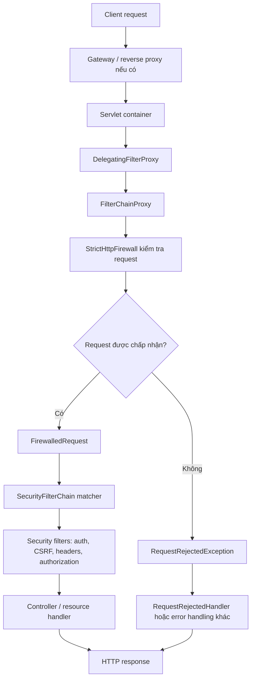
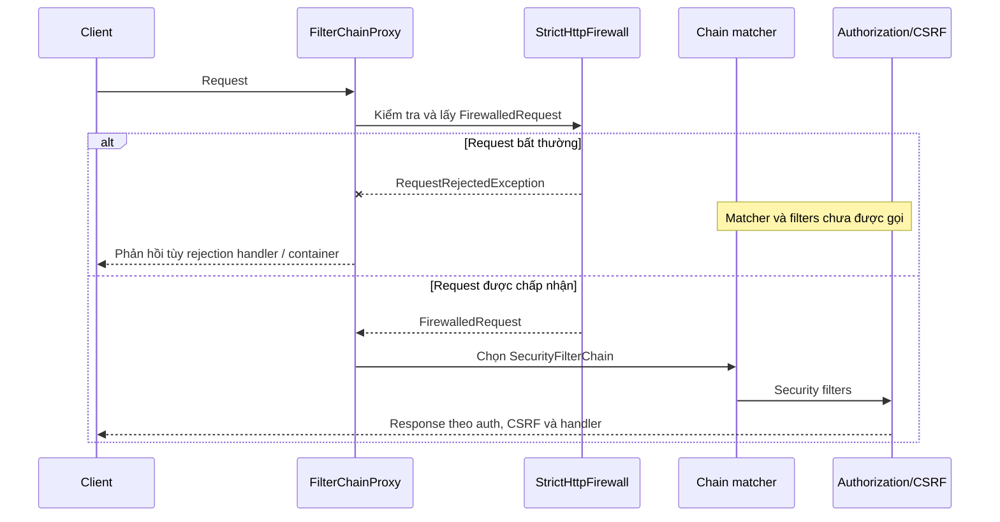
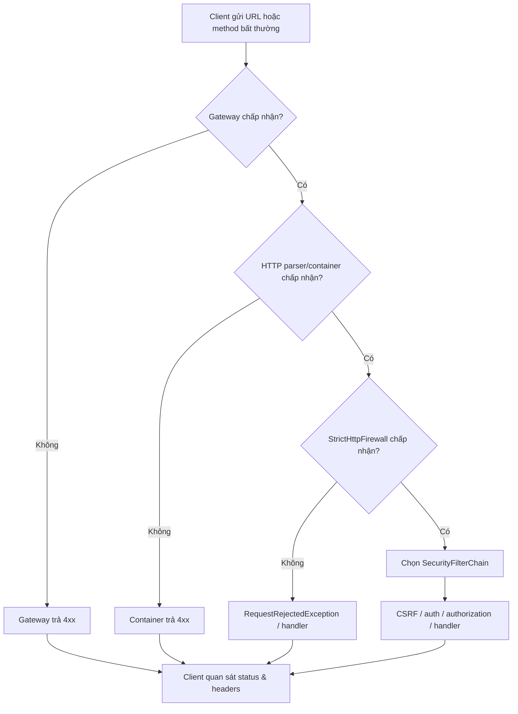

# StrictHttpFirewall cùng nguyên tắc từ chối yêu cầu bất thường

## 1. Mở đầu: vì sao một request “đọc được” vẫn có thể phải bị từ chối?

Trong chương **Firewall trên Servlet** của module **SPRING_SECURITY_HTTP_PROTECTION**, một nhiệm vụ cốt lõi là bảo vệ ranh giới giữa **cách HTTP request được biểu diễn** và **cách Spring Security chọn chính sách bảo vệ**. Module còn bao gồm CSRF, CORS, security headers, CSP, HSTS và bảo vệ session; các cơ chế đó chỉ có thể hoạt động đúng khi request được xử lý qua những đường đi đáng tin cậy.

Giả sử ứng dụng có hai nhóm URL:

```text
/public/**  -> nội dung công khai
/admin/**   -> yêu cầu quyền ADMIN
```

Request bình thường `GET /admin/report` có đường dẫn rõ ràng. Nhưng nếu client gửi một biến thể có dấu chấm phẩy, slash đã mã hóa, slash lặp, backslash hoặc một cách biểu diễn không chuẩn khác, các tầng **gateway**, **Servlet container**, **request matcher** và **controller** có thể không hiểu đường dẫn giống nhau. Khi đó, matcher có nguy cơ áp chính sách cho **một URL** trong khi ứng dụng thực thi hành động cho **một URL khác**.

`StrictHttpFirewall` là lớp `HttpFirewall` của Spring Security Servlet được thiết kế theo nguyên tắc **không chấp nhận các dạng HTTP request bị xem là không an toàn hoặc quá mơ hồ**, thay vì cố sửa chúng thành một URL “có vẻ đúng”. Nó giúp giảm nguy cơ các cách diễn giải path/HTTP request khác nhau dẫn đến chọn sai security chain.

Ví dụ minh họa:

```http
GET /admin;mode=edit/report HTTP/1.1
Host: app.example.test
```

Một ứng dụng có thể không chủ định hỗ trợ path parameter `;mode=edit`. Nếu các thành phần xử lý `;` không thống nhất, URL này không nên được cho qua mặc định chỉ vì có handler nào đó cuối cùng trả được `200`. `StrictHttpFirewall` mặc định từ chối semicolon trong URL ở nhiều bản Spring Security hiện đại, và yêu cầu nhà phát triển chủ động đánh giá trước khi cho phép.

**Luận điểm chính:** một request bị firewall từ chối **không phải lỗi cần “vá” bằng `permitAll`, tắt CSRF hoặc đổi authorization rule**. Trước tiên hãy tìm hiểu tính hợp lệ của request và sự nhất quán của các tầng diễn giải nó.

### Kết quả học tập

Sau bài này, bạn có thể:

1. Giải thích nguyên tắc **reject-by-default đối với các đặc điểm request bất thường** trong `StrictHttpFirewall`.
2. Phân biệt path không chuẩn, encoded separator, semicolon, HTTP method ngoài danh sách cho phép, header/parameter không hợp lệ và hostname không được chấp nhận.
3. Biết `StrictHttpFirewall` nằm ở đâu trong `FilterChainProxy` và khác gì với authentication, authorization, HTTP firewall tại gateway và Servlet container.
4. Phân tích hệ quả khi dùng các phương thức `setAllow...`, `setAllowedHttpMethods(...)` hoặc các predicate kiểm tra hostname/header.
5. Viết unit test với `MockHttpServletRequest`, kiểm thử chain bằng MockMvc và kiểm tra qua HTTP server/proxy trong môi trường được phép.
6. Chẩn đoán `RequestRejectedException`, HTTP `400` và những lỗi có bề ngoài tương tự như `401`, `403`, `404` hay CORS preflight.
7. Giữ các lớp bảo vệ CSRF, CORS, security headers/CSP/HSTS và session hoạt động đúng mà không nới rộng firewall một cách không cần thiết.

## 2. Vị trí của `StrictHttpFirewall` trong kiến trúc Servlet

`StrictHttpFirewall` triển khai giao diện `HttpFirewall`. Nó không chỉ là một `Filter` được chèn vào cuối một `SecurityFilterChain`. `FilterChainProxy` sử dụng firewall **trước khi chọn** security chain phù hợp với request.



Điểm cần nhớ:

- **Servlet container có thể từ chối trước:** nếu HTTP parser không chấp nhận cú pháp request, `StrictHttpFirewall` chưa bao giờ nhìn thấy request đó.
- **Firewall đứng trước chain matcher:** `SecurityFilterChain` chưa được chọn tại thời điểm firewall kiểm tra.
- **Firewall chấp nhận không đồng nghĩa được cấp quyền:** request vẫn phải vượt authentication, CSRF, authorization và những filter khác.
- **Firewall từ chối có thể bỏ qua header writers:** response lỗi không nhất thiết nhận CSP/HSTS/XFO giống một response do controller tạo sau security chain.
- **Proxy có thể viết lại request:** path ở client không nhất thiết bằng path mà servlet container chuyển cho Spring Security.

### 2.1. Vai trò của những lớp liên quan

| Thành phần | Câu hỏi nó giải quyết | Không nên dùng để thay thế |
| --- | --- | --- |
| `StrictHttpFirewall` | Request có hình dạng và cách biểu diễn được policy chấp nhận không? | Quyền người dùng, CSRF token, chính sách CORS. |
| `SecurityFilterChain` matcher | Chain nào được chọn cho request đã qua firewall? | Kiểm tra mọi biến thể HTTP request trước matching. |
| Authentication | Client đã chứng minh danh tính theo cơ chế nào? | Kiểm tra URI có normalization an toàn. |
| Authorization | Danh tính hiện tại được phép hành động nào? | Phân tích request path bất thường. |
| `CsrfFilter` | Request thay đổi trạng thái có CSRF token cần thiết không? | HTTP method allowlist và normalization. |
| CORS processing | Browser từ origin khác có thể gọi/đọc response trong điều kiện nào? | Xác thực quyền ứng dụng hoặc lọc URL mơ hồ. |
| Header writer/CSP/HSTS | Browser thực thi các chính sách phản hồi gì? | Kiểm soát request nguy hiểm đầu vào. |
| HTTP server/gateway/WAF | Request có hợp lệ theo parser, routing, traffic policy, kích thước và các luật edge không? | Toàn bộ security matching trong backend. |

Nguyên tắc **defense in depth** ở đây là từng lớp thực hiện đúng trách nhiệm, không lấy phản hồi `403` do CSRF làm bằng chứng firewall từ chối encoded slash.

## 3. `StrictHttpFirewall` từ chối những nhóm request nào?

Một cách thực tế để hiểu `StrictHttpFirewall` là phân nhóm rủi ro theo **nguồn mơ hồ**. Những điều kiện chi tiết và API cấu hình có thể thay đổi theo phiên bản Spring Security; bảng dưới mô tả hành vi thường gặp trong các bản Servlet 6.x, không phải danh sách bất biến cho mọi phiên bản.

| Nhóm | Ví dụ biểu diễn | Nguy cơ | Cách tiếp cận nghiêm ngặt |
| --- | --- | --- | --- |
| Path không được chuẩn hóa | `/admin/../public`, `/admin//report` | Matcher và container có thể nhìn khác nhau. | Từ chối hoặc để tầng trước từ chối theo chính sách. |
| Semicolon / path parameters | `/admin;v=1/report` | Một số lớp tách `;...`, lớp khác giữ nguyên. | Không cho phép mặc định nếu không có nhu cầu thiết kế. |
| Slash mã hóa | `/files/a%2Fb` | Proxy, container và framework giải mã tại những thời điểm khác nhau. | Không mặc định chấp nhận encoded slash nguy hiểm. |
| Double slash và encoded double slash | `/admin//report`, biến thể mã hóa | Có thể bị gộp separator không nhất quán. | Dùng canonical URL; kiểm tra bằng container thật. |
| Backslash | `/admin\report`, `%5C` | Một số thành phần xem `\` như separator. | Tránh cho phép khi không cần. |
| Encoded percent / double encoding | `%25`, chuỗi mã hóa hai lần | Một tầng giải mã một lần, tầng khác giải mã thêm. | Không nới chỉ để “cho qua chuỗi đã encode”. |
| Encoded dot / dot segments | `%2e`, `..` | Có thể tạo traversal hoặc khác biệt normalization. | Từ chối các biểu diễn bất thường theo policy/version. |
| Ký tự NUL/control/encoded CRLF | Các biểu diễn không hợp lệ | Lệch parser/log, phản ánh chuỗi không an toàn. | Từ chối, không cố sửa bằng replace tùy tiện. |
| HTTP method ngoài allowlist | `TRACE`, method tùy biến | Bề mặt HTTP không cần thiết hoặc không có rule phù hợp. | Chỉ chấp nhận methods được phê duyệt. |
| Header/parameter không hợp lệ | Tên hoặc giá trị có ký tự không được policy cho phép | Parser, matching và xử lý đầu vào không đáng tin. | Áp các kiểm tra tên/giá trị theo phiên bản. |
| Hostname không được phép | Host bên ngoài danh sách hệ thống chấp nhận | Host-header routing/injection, xây URL tuyệt đối sai. | Có thể dùng predicate hostname, kết hợp edge allowlist. |

**Không phải mọi chuỗi ví dụ đều đi tới `StrictHttpFirewall`:** NGINX, Tomcat hoặc HTTP server có thể từ chối/chuẩn hóa trước. Muốn khẳng định một URL cụ thể bị ai từ chối, cần đo ở **từng hop**.

### 3.1. Vì sao “reject thay vì silently normalize” là lựa chọn bảo thủ?

Một cách xử lý dễ sai là nhận `/public/../admin/report` rồi cho qua với hy vọng các tầng đều tự đổi thành `/admin/report` trước authorization. Nhưng nếu gateway và ứng dụng có normalization khác nhau, chính giả định này tạo ra lỗ hổng phân loại route.

Tư duy của firewall nghiêm ngặt là: **khi request có biểu diễn mơ hồ ngoài hợp đồng URL của hệ thống, hãy dừng xử lý thay vì tự đoán ý định client**. Mục tiêu không phải biến một URL bất thường thành đường dẫn đẹp, mà là tránh áp policy sai.

## 4. URL normalization và ba cách nhìn về path

Đối với Servlet, có nhiều giá trị đường dẫn mà code có thể đọc, chẳng hạn:

- `HttpServletRequest.getRequestURI()`: phần request URI path do container cung cấp, thường giữ một số biểu diễn encoded theo semantics Servlet.
- `getContextPath()`: phần đường dẫn ứng dụng/context.
- `getServletPath()` và `getPathInfo()`: các phần liên quan đến servlet mapping, có thể được container xử lý/giải mã theo quy tắc của nó.

Một request có thể trông giống nhau trong log ở một tầng nhưng khác trong những API trên. `StrictHttpFirewall` xem xét những thông tin HTTP/Servlet mà nó nhận được để loại các representation không đạt chính sách, giảm khả năng matcher và handler bất đồng.

### 4.1. Phân biệt URL trên public edge với URL mà ứng dụng nhận

Ví dụ:

```text
Public:  https://app.example.test/portal/reports/2026
Gateway rewrite:
Backend: http://127.0.0.1:8080/reports/2026
```

Matcher backend có thể kiểm tra `/reports/**`, không phải `/portal/reports/**`. Nếu gateway đồng thời decode encoded slash trước khi forward, request backend nhận có thể **khác chuỗi raw URL** mà client đã gửi.

Điều phải kiểm tra:

1. Gateway path rewrite và normalization rules.
2. Container handling cho encoded slash, backslash, semicolon và dấu chấm.
3. Spring Security firewall settings.
4. Cách `SecurityFilterChain` matcher đọc path.
5. Handler mapping và authorization sau đó.

Không nới `StrictHttpFirewall` trước khi xác định request đã bị thay đổi ở bước nào.

### 4.2. Một số chuỗi URL minh họa để phân tích

```text
/reports/list
/reports;v=1/list
/reports//list
/reports/%2Flist
/reports/%2e%2e/admin
/reports/a%252Fb
/reports\list
```

Các chuỗi trên dùng cho **bài học và kiểm thử trong hệ thống được phép**. Không suy toàn bộ chuỗi bị chặn như nhau trên mọi Servlet container, cũng không dùng chúng làm danh sách tấn công để gửi tùy tiện vào hệ thống của bên thứ ba.

### 4.3. Tại sao encoded slash là ca khó?

Giả sử API muốn truyền ID là `a/b` trong một path variable. Client gửi `a%2Fb`. Một proxy có thể giữ `%2F`, một container có thể giải mã thành `/`, còn matcher khác có thể đọc request URI và servlet path theo hai trạng thái khác nhau.

Kết quả không chỉ là `404` khó hiểu. Nếu authorization dựa vào prefix path, việc giải mã ở thời điểm khác nhau có thể làm request đi qua **rule không như dự kiến**.

Ưu tiên giải pháp thiết kế:

- Dùng **ID không chứa path separator**.
- Dùng body hoặc query parameter đã được validate nếu dữ liệu bản chất có dấu slash.
- Nếu protocol yêu cầu một dạng encoding đặc biệt, xác định rõ semantics end-to-end và kiểm thử xuyên gateway/container/framework, kèm security review.

**Bật `setAllowUrlEncodedSlash(true)` không buộc gateway/container tự xử lý `%2F` nhất quán.**

## 5. Semicolon và matrix variables: tại sao phải đánh giá trước khi nới?

Dấu `;` có thể xuất hiện trong cơ chế matrix variables/path parameters, ví dụ:

```text
/products;color=red/42
```

Tuy nhiên, sự hiện diện của `;` cũng có thể làm URL được container, framework, reverse proxy hoặc matcher diễn giải khác nhau. Bởi vậy trong những bản Spring Security hiện đại, `StrictHttpFirewall` thường **không cho phép semicolon mặc định**.

### 5.1. Một thay đổi cấu hình có vẻ nhỏ nhưng ảnh hưởng lớn

```java
StrictHttpFirewall firewall = new StrictHttpFirewall();

// NỚI CHÍNH SÁCH — chỉ cân nhắc sau security review:
// firewall.setAllowSemicolon(true);
```

Bật tùy chọn này có thể khiến request có semicolon được đưa sâu hơn vào security chain. Nó **không đảm bảo** framework/controller cuối cùng xử lý đúng matrix variables hay matcher nhận đúng route.

Trước khi xem xét thay đổi:

1. Tính năng có thật sự cần matrix variables không?
2. Tất cả service/ingress/container có hiểu nhất quán path parameter không?
3. Rule `/admin/**` và `/public/**` có bị ảnh hưởng bởi `;...` không?
4. URL với semicolon được ghi log, cache-key và path rewrite như thế nào?
5. Authorization có dựa trên canonical resource ID thay vì chỉ chuỗi path không?
6. Có test âm tính cho các biểu diễn không được phép và test dương tính cho request hợp lệ không?

Nếu chỉ để sửa một client đang gửi dấu `;` vô tình, **sửa URL phía client** thường an toàn hơn.

### 5.2. Khi nào nên giữ mặc định nghiêm ngặt?

Nếu ứng dụng không dùng matrix variables và không có hợp đồng URL với semicolon, hãy giữ chính sách từ chối. Khi cần thay đổi, làm ở cấp **service design và security architecture**, không chỉ ở một dòng setter.

## 6. HTTP method allowlist: bảo vệ trước khi xem controller mapping

Một HTTP request có **method** độc lập với URL. `StrictHttpFirewall` có cơ chế cho phép một tập method nhất định.

Trong nhiều bản Spring Security Servlet 6.x, tập method thường gồm:

```text
GET, HEAD, POST, PUT, PATCH, DELETE, OPTIONS
```

Không nên coi danh sách này là cam kết vĩnh viễn của mọi version; hãy kiểm tra Javadoc và dependency thực. Ví dụ `TRACE` có thể bị từ chối trước bước chọn security chain, dù controller không định nghĩa route TRACE.

### 6.1. Tùy chỉnh danh sách methods có chủ đích

```java
import java.util.List;
import org.springframework.security.web.firewall.StrictHttpFirewall;

StrictHttpFirewall firewall = new StrictHttpFirewall();
firewall.setAllowedHttpMethods(
    List.of("GET", "HEAD", "POST", "PUT", "PATCH", "DELETE", "OPTIONS"));
```

Đoạn trên chỉ khai báo allowlist thường gặp, **không nhất thiết cần** nếu default đã phù hợp. Nếu doanh nghiệp định loại `PUT` và `DELETE` vì ứng dụng chỉ dùng GET/POST, phải test tất cả client thật và các lớp phía trước.

**Lưu ý quan trọng về CORS:** preflight dùng `OPTIONS`. Nếu tự thu hẹp allowed methods mà quên `OPTIONS`, browser có thể bị chặn **trước khi CORS processor chạy**, tạo ra lỗi CORS khó phân biệt. Không sửa bằng cách thêm static `Access-Control-Allow-Origin: *` hoặc tắt CSRF.

### 6.2. Phân biệt ba câu hỏi khác nhau

| Câu hỏi | Thành phần liên quan |
| --- | --- |
| HTTP method này có được phép đi vào security matching không? | `StrictHttpFirewall` method allowlist. |
| Method/path này có mapping controller không? | Spring MVC/Servlet handler mapping; có thể trả `405`. |
| Người dùng có quyền thực hiện hành động này không? | Authorization, và CSRF nếu áp dụng. |

Ví dụ `DELETE /admin/users/123` có thể vượt firewall vì `DELETE` thuộc allowlist, nhưng vẫn phải bị từ chối nếu người dùng thiếu quyền. **“Firewall chấp nhận” không phải “đã cấp quyền DELETE”.**

### 6.3. Tránh tùy chọn mở mọi HTTP methods

```java
StrictHttpFirewall firewall = new StrictHttpFirewall();

// ANTI-PATTERN nếu dùng chỉ để làm test/client cũ hoạt động:
// firewall.setUnsafeAllowAnyHttpMethod(true);
```

Tùy chọn nới lỏng này chỉ nên được cân nhắc khi có kiến trúc và threat model đặc biệt đã được phê duyệt. Việc cho phép mọi method làm giảm giá trị của allowlist và có thể khiến những method không dự kiến đi sâu vào các thành phần không được thiết kế để xử lý chúng.

## 7. Hostnames, HTTP headers và parameters: ranh giới dữ liệu đáng tin

Ngoài path và method, các bản `StrictHttpFirewall` có thể cung cấp cơ chế predicate cho hostname, tên/giá trị header và tên/giá trị parameter. Các method cụ thể và mặc định cần được đối chiếu **theo version**. Chúng giúp giảm các đặc điểm request không mong muốn, nhưng không thay validation tầng nghiệp vụ.

### 7.1. Hostname allowlist

Ví dụ khi backend chỉ phục vụ host `app.example.test` và `localhost` trong môi trường học tập:

```java
import java.util.Set;
import org.springframework.security.web.firewall.StrictHttpFirewall;

StrictHttpFirewall firewall = new StrictHttpFirewall();

Set<String> allowedHosts = Set.of("app.example.test", "localhost");

firewall.setAllowedHostnames(host ->
    host != null && allowedHosts.contains(
        host.toLowerCase(java.util.Locale.ROOT)));
```

Đây là **predicate minh họa**, chưa tính mọi biến thể IDN/IPv6, hostname thực tại proxy, port, nhiều environment hoặc host do server tin cậy xác nhận. Trong production, phải chuẩn hóa tên miền và xác định **Host header trust boundary** tại gateway/Servlet container. Không dùng cách ghép mù quáng `X-Forwarded-Host` hoặc `Host` do client kiểm soát để xây authorization hoặc redirect.

Nếu có ingress dùng internal upstream hostname, một allowlist host quá hẹp có thể làm request hợp lệ bị từ chối. Hãy kiểm tra `getServerName()` mà backend thực thấy thay vì chỉ nhìn địa chỉ người dùng nhập trên browser.

### 7.2. Header và parameter validation

Một số yêu cầu có thể chứa tên header hoặc parameter không đáp ứng chính sách ký tự hợp lệ. `StrictHttpFirewall` có các API predicate tùy biến ở những phiên bản hỗ trợ, ví dụ `setAllowedHeaderNames(...)`, `setAllowedHeaderValues(...)`, `setAllowedParameterNames(...)` hoặc `setAllowedParameterValues(...)`.

**Đừng tạo một rule chung “chỉ chấp nhận ASCII chữ và số” cho mọi header value**: header `Authorization`, `Content-Type`, `Accept-Language` và các giá trị hợp lệ khác có ký tự phân cách theo cú pháp riêng. Rule quá chặt gây lỗi khó giải thích.

Nếu cần một hạn chế nghiệp vụ như chỉ chấp nhận một header tùy chỉnh `X-Client-Mode` thuộc tập `read`/`write`, nên thực hiện **validation riêng ở tầng ứng dụng**. Đừng dùng một predicate firewall toàn cục để ngầm định nghĩa lại ngữ pháp mọi HTTP header.

### 7.3. Ký tự điều khiển và URL-encoded CRLF

Những biểu diễn như ký tự NUL, carriage return hay line feed mã hóa có thể làm khó các bộ parser, logger và routing. Firewall nghiêm ngặt có thể từ chối các dạng bị liệt kê trong cấu hình hiện hành.

Không tùy tiện bật các tùy chọn `setAllow...` liên quan control characters chỉ vì client dùng chuỗi encoding “đặc biệt”. Nếu dữ liệu có thể chứa ký tự dòng mới, hãy truyền trong **body có định dạng và validation thích hợp** thay vì nhét vào path hoặc header và nới rules.

### 7.4. Firewall không giải quyết HTTP request smuggling một mình

`StrictHttpFirewall` không thay việc cấu hình đúng HTTP parser, reverse proxy và backend server cho các vấn đề như **HTTP request smuggling**, sự bất nhất `Content-Length`/`Transfer-Encoding`, giới hạn kích thước header/body hoặc routing giữa các proxy. Nhiều vấn đề xảy ra trước khi có `HttpServletRequest` hoàn chỉnh để Spring Security kiểm tra.

Cần xử lý những rủi ro đó ở **proxy/HTTP server infrastructure và framework version** phù hợp, kết hợp logging và kiểm thử được cấp phép.

## 8. Cấu hình Servlet: giữ mặc định nghiêm ngặt hoặc tùy chỉnh hẹp

Thông thường không cần tự tạo `StrictHttpFirewall`: Spring Security đã có một lựa chọn firewall mặc định. Chỉ cấu hình riêng khi bạn có yêu cầu phù hợp được phê duyệt, và phải kiểm tra Spring Security version đang dùng.

Một ví dụ minh họa nơi đăng ký policy rõ ràng:

```java
import java.util.List;

import org.springframework.context.annotation.Bean;
import org.springframework.context.annotation.Configuration;
import org.springframework.security.config.annotation.web.configuration.WebSecurityCustomizer;
import org.springframework.security.web.firewall.StrictHttpFirewall;

@Configuration
class FirewallPolicyConfiguration {

    @Bean
    WebSecurityCustomizer webSecurityCustomizer() {
        return web -> {
            StrictHttpFirewall firewall = new StrictHttpFirewall();

            // Chỉ methods mà service đã xác nhận hỗ trợ.
            firewall.setAllowedHttpMethods(List.of(
                "GET", "HEAD", "POST", "PUT",
                "PATCH", "DELETE", "OPTIONS"));

            // Không chủ động nới semicolon, encoded slash, backslash...
            web.httpFirewall(firewall);
        };
    }
}
```

**Vì sao dùng `WebSecurityCustomizer`?** `HttpFirewall` thuộc quá trình `FilterChainProxy` xử lý request **trước** bước chọn `SecurityFilterChain`. Nếu bạn chèn một Servlet filter vào `HttpSecurity.addFilterBefore(...)` trong một chain đã chọn, nó không thể thay vị trí của `HttpFirewall` trước-matcher.

Đừng tạo nhiều firewall bean/cấu hình cạnh tranh rồi đoán cái nào được dùng. Với dự án đã có `WebSecurityCustomizer` hoặc custom `FilterChainProxy`, cần hợp nhất vào đúng cấu hình hiện hữu.

### 8.1. Giữ authorization/CSRF/CORS như bình thường

Một `SecurityFilterChain` minh họa cho ứng dụng có API:

```java
import org.springframework.context.annotation.Bean;
import org.springframework.context.annotation.Configuration;
import org.springframework.security.config.Customizer;
import org.springframework.security.config.annotation.web.builders.HttpSecurity;
import org.springframework.security.web.SecurityFilterChain;

@Configuration
class ApplicationSecurityConfiguration {

    @Bean
    SecurityFilterChain appChain(HttpSecurity http) throws Exception {
        http
            .authorizeHttpRequests(auth -> auth
                .requestMatchers("/health").permitAll()
                .requestMatchers("/admin/**").hasRole("ADMIN")
                .anyRequest().authenticated())
            .httpBasic(Customizer.withDefaults());

        return http.build();
    }
}
```

Đây là config **độc lập minh họa**, không nên copy để thay production configuration có session/CORS/CSRF chuyên biệt. Nếu request `GET /admin;mode=edit/report` bị firewall từ chối, việc thêm `requestMatchers("/admin/**").permitAll()` không chữa rejection — vì matcher chưa được gọi.

Nếu request `POST /admin/report` đi qua firewall nhưng thiếu CSRF token, `CsrfFilter` có thể trả `403`. Đừng nới `StrictHttpFirewall` để xử lý lỗi CSRF.

## 9. Từ chối request: `RequestRejectedException` và response quan sát được

Khi `StrictHttpFirewall` nhận một request vi phạm quy tắc nó áp dụng, nó có thể ném `RequestRejectedException`. Request đó bị chặn **trước khi chọn security filter chain**.



### 9.1. Có luôn trả HTTP 400 không?

**Không nên hardcode kết luận cho mọi version và môi trường.** Một `RequestRejectedHandler` có thể biến rejection thành HTTP status như `400 Bad Request`; một cấu hình khác có thể ném exception tiếp. Ngoài ra, Servlet container hoặc proxy có thể trả `400` **trước** khi request tới Java.

Để chẩn đoán, phân biệt:

| Kết quả | Nguồn thường liên quan | Hướng xác minh |
| --- | --- | --- |
| `RequestRejectedException` trong log/test | `HttpFirewall` đã kiểm tra request. | Xem điều kiện nào bị từ chối và handler đã cấu hình. |
| `400` không có log backend | Proxy hoặc Servlet HTTP parser. | So request ở gateway và backend direct nếu được phép. |
| `401` | Authentication entry point. | Xem HTTP Basic/Bearer/form login. |
| `403` | CSRF hoặc authorization, đôi khi tầng khác. | Xem token/quyền, không mặc định là firewall. |
| `404` | Routing/handler mapping hoặc gateway. | Xác định path sau rewrite, controller mapping. |
| `405` | Method không được handler hỗ trợ nhưng có thể đã qua firewall. | Phân biệt allowlist firewall với @RequestMapping. |
| `502/503` | Gateway/CDN/upstream. | Backend có nhận request không? |

### 9.2. Vì sao response bị từ chối có thể thiếu security headers?

`HeaderWriterFilter` thường nằm **trong** `SecurityFilterChain`. Request bị từ chối trước khi chọn chain nên response lỗi **không nhất thiết** chứa `X-Frame-Options`, CSP hoặc HSTS từ Spring Security.

Khi yêu cầu baseline security headers cho **mọi public response**, gồm cả lỗi do proxy/container sinh, phải thiết kế ownership cho tầng phát response ấy. Cẩn thận tránh trường hợp backend và gateway đồng thời phát hai CSP/HSTS/XFO mâu thuẫn.

### 9.3. Nên log gì và không log gì?

Có thể ghi thống kê loại rejection, endpoint đã chuẩn hóa ở mức phù hợp, method, request ID, version/firewall policy và tầng phát phản hồi. Không ghi raw:

- `Authorization` bearer token hoặc mật khẩu.
- Session/CSRF cookie.
- Nội dung query chứa secret hoặc thông tin cá nhân.
- Header/trường người dùng có thể điều khiển với ký tự điều khiển không qua escaping.

Một lượng nhỏ rejected requests là điều có thể xảy ra từ client cấu hình sai hoặc scanner. Nhưng tăng đột ngột sau deploy có thể báo hiệu ứng dụng vừa đổi routing/encoding hoặc proxy đang rewrite không nhất quán.

## 10. Đừng nới firewall bằng phương pháp “bật tất cả rồi xem lỗi có hết không”

Một anti-pattern:

```java
StrictHttpFirewall firewall = new StrictHttpFirewall();

// KHÔNG áp dụng như giải pháp chung cho lỗi 400:
// firewall.setAllowSemicolon(true);
// firewall.setAllowUrlEncodedSlash(true);
// firewall.setAllowUrlEncodedDoubleSlash(true);
// firewall.setAllowBackSlash(true);
// firewall.setAllowUrlEncodedPercent(true);
// firewall.setAllowUrlEncodedPeriod(true);
// firewall.setUnsafeAllowAnyHttpMethod(true);
```

Danh sách setter chỉ để nhận diện những quyết định có thể **mở rộng các request được chấp nhận** ở phiên bản hỗ trợ; không phải checklist cần bật. Một số phương thức có thể khác/không tồn tại ở version của bạn, nên phải đối chiếu đúng Javadoc.

### 10.1. Quy trình trước khi cân nhắc ngoại lệ

1. **Tái hiện trên staging:** ghi nhận request hợp lệ mà client định gửi và response thực.
2. **Xác định tầng từ chối:** HTTP parser, proxy, Servlet container hay `StrictHttpFirewall`.
3. **Kiểm tra thiết kế URL:** có thể loại semicolon/encoded slash/dot segment không?
4. **Đánh giá diễn giải xuyên tầng:** URL đó được gateway, container, security matcher và handler nhìn nhận thế nào?
5. **Đánh giá tác động tới bảo vệ:** chain order, authorization, CSRF, CORS, session và caching có bị ảnh hưởng?
6. **Chọn thay đổi hẹp nhất:** sửa URL/client/proxy thường tốt hơn bật một số setter không cần thiết.
7. **Kiểm thử dương tính và âm tính:** URL đúng phải hoạt động; URL mơ hồ/không được phép phải tiếp tục bị chặn.
8. **Ghi nhận quyết định:** threat model, phiên bản framework và người chịu trách nhiệm phê duyệt.

### 10.2. Nới vì tương thích không có nghĩa request an toàn

Ví dụ bạn bật semicolon để dùng matrix variables. Một route mới hoạt động đúng chưa đủ chứng minh mọi rule `/admin/**` và `/public/**` còn bảo vệ chính xác. Cần kiểm tra **các biến thể semicolon trên mọi route nhạy cảm**, kể cả khi gateway cache/rewrite URI.

Tương tự, bật encoded slash để hỗ trợ path variable không chứng minh proxy không double-decode hoặc controller không lấy nhầm resource ID.

## 11. Unit test `StrictHttpFirewall`: kiểm tra trực tiếp contract

Vì firewall hoạt động trước khi vào controller, **unit test trực tiếp `getFirewalledRequest(...)`** thường rõ nghĩa hơn việc chỉ khẳng định HTTP status `400` từ một stack phức tạp.

Các ví dụ sau theo Spring Security Servlet 6.x và `spring-test`, sử dụng `MockHttpServletRequest`. Đặt code vào module test JUnit 5 có `spring-security-web` và `spring-test` phù hợp.

### 11.1. Request hợp lệ được chấp nhận

```java
import org.junit.jupiter.api.Test;
import org.springframework.mock.web.MockHttpServletRequest;
import org.springframework.security.web.firewall.FirewalledRequest;
import org.springframework.security.web.firewall.StrictHttpFirewall;

import static org.junit.jupiter.api.Assertions.assertEquals;

class StrictHttpFirewallPolicyTest {

    private final StrictHttpFirewall firewall = new StrictHttpFirewall();

    @Test
    void ordinaryGetIsAccepted() {
        var request = new MockHttpServletRequest("GET", "/reports/list");
        request.setServletPath("/reports/list");

        FirewalledRequest safe = firewall.getFirewalledRequest(request);

        assertEquals("/reports/list", safe.getServletPath());
        safe.reset();
    }
}
```

Test này chứng minh một request mock bình thường được chấp nhận. Nó **không chứng minh** mọi URI thực trên HTTP/2, Tomcat hoặc NGINX sẽ được container truyền vào Java dưới đúng biểu diễn mock đó.

### 11.2. Semicolon bị từ chối theo mặc định nghiêm ngặt

```java
import org.springframework.security.web.firewall.RequestRejectedException;
import static org.junit.jupiter.api.Assertions.assertThrows;

// Thêm vào class StrictHttpFirewallPolicyTest:
@Test
void semicolonIsRejectedByDefault() {
    var request = new MockHttpServletRequest(
        "GET", "/reports;v=1/list");
    request.setServletPath("/reports;v=1/list");

    assertThrows(RequestRejectedException.class,
        () -> firewall.getFirewalledRequest(request));
}
```

Kỳ vọng dùng firewall strict **chưa tùy biến**. Nếu dự án đã có `setAllowSemicolon(true)` vì nhu cầu được duyệt, test phải kiểm tra **chính policy mới**; không xem việc test mặc định fail là lý do tự động tắt kiểm tra.

### 11.3. Method ngoài allowlist bị từ chối

```java
@Test
void traceMethodIsRejected() {
    var request = new MockHttpServletRequest("TRACE", "/reports/list");
    request.setServletPath("/reports/list");

    assertThrows(RequestRejectedException.class,
        () -> firewall.getFirewalledRequest(request));
}
```

Một Servlet container có thể chặn TRACE ở tầng HTTP trước Java. Test unit giúp kiểm tra riêng chính sách firewall, trong khi end-to-end test cho biết client thật nhận gì.

### 11.4. Test hai nhánh của method allowlist tùy biến

```java
import java.util.List;

@Test
void onlyApprovedMethodsCanPass() {
    var restrictedFirewall = new StrictHttpFirewall();
    restrictedFirewall.setAllowedHttpMethods(
        List.of("GET", "HEAD", "OPTIONS"));

    var get = new MockHttpServletRequest("GET", "/health");
    get.setServletPath("/health");
    var safe = restrictedFirewall.getFirewalledRequest(get);
    safe.reset();

    var post = new MockHttpServletRequest("POST", "/health");
    post.setServletPath("/health");

    assertThrows(RequestRejectedException.class,
        () -> restrictedFirewall.getFirewalledRequest(post));
}
```

Ví dụ này kiểm tra một chính sách **chỉ-đọc** minh họa, **không** phải cấu hình được khuyến nghị chung cho ứng dụng có form POST, đăng nhập hoặc API thay đổi dữ liệu. Nếu service thực có POST, đừng triển khai allowlist này.

### 11.5. Test normalization không nên chỉ dựa vào mock

Có thể tạo mock chứa `%2F`, `//`, `%5C` hoặc dot segments, nhưng kết quả của Servlet container **thực** còn phụ thuộc việc URI được giải mã/chuyển đổi trước khi tới request object. Với những trường hợp đó, unit test cần bổ sung **integration test qua đúng Tomcat/Jetty/ingress** để chứng minh đường đi thực tế.

Đừng dùng unit test mock để kết luận lỗ hổng path confusion đã được khắc phục end-to-end.

## 12. Integration test: firewall trước chain, authorization sau chain

Một bài test có ý nghĩa nên xác nhận cả **request hợp lệ được định tuyến đến đúng chain** và **request bất thường bị từ chối trước chain**.

### 12.1. Cấu hình hai chain để quan sát

```java
import org.springframework.context.annotation.Bean;
import org.springframework.context.annotation.Configuration;
import org.springframework.core.annotation.Order;
import org.springframework.security.config.Customizer;
import org.springframework.security.config.annotation.web.builders.HttpSecurity;
import org.springframework.security.web.SecurityFilterChain;
import org.springframework.security.web.header.writers.StaticHeadersWriter;

@Configuration
class FirewallChainDemoConfig {

    @Bean
    @Order(1)
    SecurityFilterChain apiChain(HttpSecurity http) throws Exception {
        http
            .securityMatcher("/api/**")
            .authorizeHttpRequests(auth -> auth
                .requestMatchers("/api/health").permitAll()
                .anyRequest().authenticated())
            .httpBasic(Customizer.withDefaults())
            .headers(headers -> headers.addHeaderWriter(
                new StaticHeadersWriter("X-Test-Chain", "api")));

        return http.build();
    }

    @Bean
    @Order(2)
    SecurityFilterChain webChain(HttpSecurity http) throws Exception {
        http
            .authorizeHttpRequests(auth -> auth
                .requestMatchers("/public/**").permitAll()
                .anyRequest().authenticated())
            .headers(headers -> headers.addHeaderWriter(
                new StaticHeadersWriter("X-Test-Chain", "web")));

        return http.build();
    }
}
```

`X-Test-Chain` là marker debug phục vụ bài học, không phải header bảo mật chuẩn; nên bỏ sau khi chẩn đoán. Production phải giữ authentication/CSRF/CORS/session policy đúng yêu cầu; không tạo một chain mới chồng lấn chỉ để thêm marker.

### 12.2. Controller test

```java
import org.springframework.web.bind.annotation.GetMapping;
import org.springframework.web.bind.annotation.RestController;

@RestController
class FirewallDemoController {

    @GetMapping("/api/health")
    String apiHealth() {
        return "api-ok";
    }

    @GetMapping("/public/info")
    String publicInfo() {
        return "public-ok";
    }
}
```

### 12.3. MockMvc kiểm tra request hợp lệ

```java
import org.junit.jupiter.api.Test;
import org.springframework.beans.factory.annotation.Autowired;
import org.springframework.boot.test.autoconfigure.web.servlet.AutoConfigureMockMvc;
import org.springframework.boot.test.context.SpringBootTest;
import org.springframework.test.web.servlet.MockMvc;

import static org.springframework.test.web.servlet.request.MockMvcRequestBuilders.get;
import static org.springframework.test.web.servlet.result.MockMvcResultMatchers.header;
import static org.springframework.test.web.servlet.result.MockMvcResultMatchers.status;

@SpringBootTest
@AutoConfigureMockMvc
class FirewallChainIntegrationTest {

    @Autowired MockMvc mvc;

    @Test
    void apiHealthIsSelectedIntoApiChain() throws Exception {
        mvc.perform(get("/api/health"))
            .andExpect(status().isOk())
            .andExpect(header().string("X-Test-Chain", "api"))
            .andExpect(header().string(
                "X-Content-Type-Options", "nosniff"));
    }

    @Test
    void publicInfoIsSelectedIntoWebChain() throws Exception {
        mvc.perform(get("/public/info"))
            .andExpect(status().isOk())
            .andExpect(header().string("X-Test-Chain", "web"));
    }
}
```

Điều này chứng minh route hợp lệ nhận được filter chain mong muốn **trong test context**. Không dùng marker như bằng chứng người dùng có quyền truy cập tài nguyên admin hoặc CSRF đã được bảo vệ.

### 12.4. Cẩn thận khi assert HTTP 400 cho rejected request

Một test kiểu:

```java
// Chỉ là minh họa, KHÔNG có nghĩa mọi version/test context trả 400.
// mvc.perform(get("/api;v=1/health"))
//     .andExpect(status().isBadRequest());
```

có thể không đúng vì `RequestRejectedException` có thể được ném ra thay vì được chuyển thành HTTP status bởi test setup. `RequestRejectedHandler` và đường lỗi của container có thể khác trong production.

Hãy chọn **hai test độc lập**:

- Unit test firewall xác nhận `RequestRejectedException` với input được kiểm soát.
- End-to-end test trên server thật xác nhận status, headers và logging phù hợp với **rejection handler đang triển khai**.

Đừng sửa firewall để ép một assertion status hoạt động khi nguyên nhân thực là test không mô phỏng đúng error handler.

## 13. HTTP response 400 chưa chắc được tạo bởi firewall

Với một request bất thường, có thể có nhiều kết quả:



Một response `400` có thể đến từ gateway, Tomcat, Servlet filter ngoài Spring Security hoặc `RequestRejectedHandler`. Điều đó giải thích vì sao có thể không thấy Spring Security log, không có CSP, hoặc response khác nhau giữa local và staging.

### 13.1. So sánh tại nhiều điểm kiểm tra

| Bằng chứng | Có thể kết luận gì? | Chưa thể kết luận gì? |
| --- | --- | --- |
| `assertThrows(RequestRejectedException>` trong unit test | Firewall policy cụ thể từ chối request mock. | Gateway/container thực trả status nào. |
| MockMvc thấy đúng chain marker | Request hợp lệ vào đúng chain trong test context. | HTTP parser/public ingress cũng xử lý như vậy. |
| Backend HTTP trả 400 | Backend hoặc container từ chối ở một tầng. | Có chắc là `StrictHttpFirewall` hay không. |
| Public HTTPS trả 400, backend direct 200 | Có khác biệt trước hoặc tại backend theo request/context. | Gateway là nguồn duy nhất nếu request headers/path không giống nhau. |
| Log từ `RequestRejectedException` | Có bằng chứng firewall nhận request bất thường. | Client có nhận response 400 hoặc security headers gì. |
| Browser báo CORS error | Preflight không đạt policy browser. | Firewall là nguyên nhân nếu chưa xem `OPTIONS` status. |

**Lưu ý:** CORS failure có thể xuất hiện vì preflight bị firewall từ chối nếu bạn loại `OPTIONS` khỏi allowlist; nhưng CORS error cũng có thể đến từ credentials, origin, request headers hoặc auth filter. Luôn phân tích response thực.

## 14. Proxy, container và HTTP client: nơi tái hiện lỗi an toàn

### 14.1. Sơ đồ triển khai phổ biến

```text
Browser --HTTPS--> CDN/NGINX --HTTP hoặc HTTPS nội bộ--> Tomcat/Jetty
                                                        |
                                                        v
                                      DelegatingFilterProxy
                                                        |
                                                        v
                                       FilterChainProxy
                                                        |
                                                        v
                                       StrictHttpFirewall
```

Một encoded separator có thể đã bị gateway hoặc container xử lý trước khi tới Java. Do đó một thay đổi `setAllowUrlEncodedSlash(true)` có thể **không tác dụng** nếu tầng trước đã từ chối request.

### 14.2. Quan sát response thật trên staging

```bash
# Đường dẫn hợp lệ: kiểm tra request đi đúng chain và nhận baseline headers.
curl -sS -D - -o /dev/null https://staging.example.test/api/health

# Chỉ khi có quyền truy cập backend tương ứng.
curl -sS -D - -o /dev/null http://127.0.0.1:8080/api/health
```

Trên Windows PowerShell, có thể dùng `curl.exe` và `-o NUL`. Cần đảm bảo staging có quyền truy cập, TLS certificate hợp lệ và không chèn token/cookie production vào command được chia sẻ.

Khi kiểm tra URI bất thường, hãy dùng **request cases đã được phê duyệt**, hạn chế số lượng; một HTTP client có thể tự chuẩn hóa URL trước khi gửi. Ví dụ `curl` có tùy chọn `--path-as-is` để giữ một số dot segments; điều này chỉ nhằm quan sát hành vi ở **môi trường thử nghiệm được phép**, không đủ để chứng minh tất cả behavior của proxy hoặc Servlet container.

### 14.3. Những thuộc tính cần ghi lại

Ghi nhận ở mỗi hop:

- URL raw hoặc representation mà tầng đó **thực sự nhận** (được logging/escaping an toàn).
- HTTP method, host và scheme.
- Status và tên tầng tạo response.
- Có log `RequestRejectedException` không?
- Matcher/chain nào được chọn nếu request được chấp nhận?
- Headers cuối có CSP, `nosniff`, HSTS hoặc CORS response theo yêu cầu không?
- Có proxy rewrite, CDN cache hoặc redirect không?

Không log nguyên vẹn `Authorization`, `Cookie`, CSRF token hay query chứa bí mật. Nếu request bị từ chối vì ký tự control, hệ thống logging phải escape nó để tránh log injection.

### 14.4. Không phát request malformed bừa bãi trên production

Các phép kiểm tra encoded slash, semicolon, double decoding hay method lạ cần chạy trên môi trường staging có kế hoạch, hoặc unit/integration tests. Không cố gây request flooding, vượt giới hạn header/body hay kích hoạt chuỗi malformed lên hệ thống không có quyền kiểm thử. Mục tiêu là xác minh **chính sách phòng vệ của ứng dụng**, không phải tạo thêm rủi ro vận hành.

## 15. Chiến lược kiểm thử hồi quy sau thay đổi firewall

Một bộ test tối thiểu cần bao phủ cả **đầu vào được cho phép** lẫn **đầu vào cần từ chối**, cùng hành vi security chain sau khi qua firewall.

| Trường hợp | Kết quả kỳ vọng cấp firewall | Kiểm tra bổ sung |
| --- | --- | --- |
| `GET /public/info` hợp lệ | Chấp nhận | Chain WEB, status/public access, security headers. |
| `GET /api/health` hợp lệ | Chấp nhận | Chain API, marker/debug hoặc config thật. |
| `POST /settings` hợp lệ về URL/method | Có thể chấp nhận | CSRF token và authorization quyết định tiếp. |
| `OPTIONS /api/orders` preflight hợp lệ | Chấp nhận nếu OPTIONS được phép | CORS origin/method/headers/credentials. |
| `TRACE /api/health` | Từ chối theo allowlist strict thông thường | RequestRejectedException hoặc tầng trước từ chối. |
| `/reports;v=1/list` | Từ chối nếu semicolon không được cho phép | Không để route ngầm thay đổi authorization. |
| `/files/a%2Fb` | Kiểm tra policy encoded slash | So raw URL qua gateway/container. |
| `/admin//report` | Kiểm tra normalized-path policy | Không có chain/matcher bypass. |
| `/public/../admin` | Kiểm tra normalization và routing | Không coi là public nếu chuẩn hóa sang admin. |
| Host ngoài allowlist nếu có cấu hình | Từ chối tại tầng phù hợp | Không dùng Host chưa tin để xây redirect. |
| Request quá lớn/malformed bị container từ chối | Có thể chưa vào firewall | Error policy ở container/edge. |
| `401` hoặc `403` sau firewall | Firewall chấp nhận đầu vào | Auth/CSRF/authorization thực hiện đúng. |

### 15.1. Các phép thử có thêm giá trị bảo mật

- **Cross-layer consistency:** cùng một URL được gateway, container, chain matcher và handler hiểu theo cùng một resource không?
- **Negative security assertions:** URL mơ hồ không được vô tình rơi vào rule `permitAll`.
- **Regression CORS:** preflight `OPTIONS` vẫn hoạt động theo allowlist; không nới methods ngoài nhu cầu.
- **Regression CSRF:** POST có cookie session vẫn yêu cầu CSRF token theo policy.
- **Regression headers:** response thành công tiếp tục có `nosniff`/CSP/HSTS phù hợp; lỗi rất sớm có thể cần baseline từ edge.
- **Regression session:** cookie `Secure`, `HttpOnly`, `SameSite` và auth state không thay đổi bởi config firewall.
- **Deployment:** khi nâng Spring Security/Tomcat/NGINX, thử lại encoded separators, semicolon và routing bằng những ca đã phê duyệt.

## 16. Servlet khác Reactive/WebFlux như thế nào?

Dịch vụ **SPRING_SECURITY_HTTP_PROTECTION** dạy cả hai stack, nhưng bài này tập trung vào **`StrictHttpFirewall` của Spring Security Servlet**. Không tự suy rằng WebFlux có một `StrictHttpFirewall` tương đương với cùng các setter.

| Vấn đề | Servlet | Reactive/WebFlux |
| --- | --- | --- |
| Request object | `HttpServletRequest` | `ServerWebExchange` / `ServerHttpRequest` |
| Đầu mối Spring Security chain | `FilterChainProxy` | `WebFilterChainProxy` |
| Firewall đang xét | `StrictHttpFirewall` / `HttpFirewall` | Không phải cùng Servlet `StrictHttpFirewall` API |
| Chain và matcher | `SecurityFilterChain` / `RequestMatcher` | `SecurityWebFilterChain` / `ServerWebExchangeMatcher` |
| Servlet path, context path | Các API `getServletPath()`, `getPathInfo()` | WebFlux có path abstraction riêng |
| Ghi security response headers | `HeaderWriterFilter` / `HeaderWriter` | `HttpHeaderWriterWebFilter` / `ServerHttpHeadersWriter` |
| Test chính | `MockHttpServletRequest`, MockMvc, server Servlet thật | WebTestClient, Reactive server test |

WebFlux vẫn cần bảo vệ trước **path ambiguity, proxy rewriting, URI decoding và HTTP parser differences**, nhưng phải nghiên cứu cơ chế của Spring WebFlux và Reactive HTTP server đúng phiên bản. Không thêm bean `StrictHttpFirewall` Servlet vào ứng dụng WebFlux rồi kỳ vọng nó bảo vệ `ServerWebExchangeMatcher`.

## 17. Bài tập tình huống có đáp án định hướng

### Tình huống A — URL semicolon bị từ chối

Một frontend gọi `GET /products;color=red/42`, nhận lỗi trong log `RequestRejectedException`. Developer thêm `permitAll` cho `/products/**` nhưng request vẫn bị từ chối.

**Giải thích:** firewall chạy trước việc chọn chain và authorization. `permitAll` không thay quyết định của `StrictHttpFirewall`. Cần xác định liệu matrix variables là yêu cầu bắt buộc và đánh giá nhất quán proxy/container/matcher trước khi cân nhắc nới `setAllowSemicolon`.

### Tình huống B — Encoded slash cần cho ID

Một endpoint dùng ID chứa `/`, client mã hóa thành `%2F`. Local hoạt động, staging bị 400.

**Giải thích:** gateway, Servlet container và firewall có thể xử lý encoded slash khác nhau. Ưu tiên thiết kế ID không có slash hoặc chuyển dữ liệu phức tạp sang body/query validate; không bật toàn bộ `setAllow...` để né 400.

### Tình huống C — OPTIONS bị chặn

Sau khi đội backend rút gọn HTTP method allowlist chỉ còn GET/POST, browser khác origin bắt đầu báo lỗi CORS preflight.

**Giải thích:** request `OPTIONS` có thể bị firewall từ chối trước CORS processor. Cần cân nhắc lại allowlist theo nhu cầu CORS, kiểm tra preflight và giữ auth/CSRF riêng. Không chữa bằng wildcard CORS với credentials.

### Tình huống D — TRACE được phát hiện

Một client cũ gửi `TRACE /api/health` và gặp rejection. Nhóm muốn gọi `setUnsafeAllowAnyHttpMethod(true)`.

**Giải thích:** TRACE không phải nhu cầu thông thường của API; kiểm tra client/monitoring và phương thức thật được hỗ trợ. Không mở mọi methods chỉ để một client dùng sai protocol.

### Tình huống E — Unit test pass nhưng gateway trả 404

Unit test cho `StrictHttpFirewall` chấp nhận `/api/health`, MockMvc xác nhận chain API, nhưng public gateway trả 404.

**Giải thích:** request có thể bị rewrite sai hoặc route chưa đến backend. Phải kiểm tra gateway routing, không suy firewall từ chối nếu chưa có `RequestRejectedException` hay log backend tương ứng.

### Tình huống F — POST trả 403

`POST /settings` có path hợp lệ, firewall chấp nhận, nhưng response `403`.

**Giải thích:** CSRF token thiếu hoặc authorization không đủ quyền. Firewall không thay CSRF/session hoặc authentication; chẩn đoán cơ chế đã từ chối thay vì nới request validation.

### Tình huống G — 400 không có CSP

Một request malformed bị container trả `400` trước khi vào Spring Security, còn `GET /health` có `Content-Security-Policy`.

**Giải thích:** security header writers chạy sau khi chain được chọn; container hoặc gateway phát lỗi sớm có thể không nhận policy backend. Nếu cần CSP/HSTS cho error page public, cấu hình phù hợp tại tầng tạo lỗi.

### Tình huống H — Host header không đáng tin

Ứng dụng dùng `Host` từ request để xây redirect sang trang đăng nhập. Một môi trường có reverse proxy cho phép host bất kỳ.

**Giải thích:** phải định nghĩa trusted host/proxy boundary, allowlist host tại edge/app và tránh dùng host client chưa validate làm đích redirect. Predicate `setAllowedHostnames(...)` có thể là một lớp hỗ trợ, không thay thiết kế trust chain.

### Tình huống I — Thêm static file bypass chain

Ảnh được CDN trả trực tiếp không có `X-Content-Type-Options` do Spring Security backend phát. Team cho rằng `StrictHttpFirewall` có lỗi.

**Giải thích:** CDN không gọi Java backend; firewall kiểm tra request tại `FilterChainProxy` nếu request tới đó. Cần xử lý policy asset ở tầng phục vụ ảnh, không liên quan đến rejection URL.

### Tình huống J — Cấu hình trong ứng dụng WebFlux

Nhóm sao chép `@Bean StrictHttpFirewall` của Servlet vào WebFlux rồi tin rằng mọi path đều được kiểm tra như Spring MVC.

**Giải thích:** `StrictHttpFirewall` là Servlet API, không áp trực tiếp vào `ServerWebExchange`. WebFlux cần chiến lược request validation/path semantics riêng phù hợp reactive server.

## 18. Checklist quyết định production

1. **Giữ `StrictHttpFirewall` nghiêm ngặt khi không có lý do thay đổi.**
2. **Biết firewall đứng trước chain selection** của `FilterChainProxy` trên Servlet.
3. **Hiểu nguồn mơ hồ:** semicolon, encoded slash/backslash, dot segments, normalization và method không hợp lệ.
4. **Không chữa `RequestRejectedException` bằng `permitAll` hay tắt CSRF.**
5. **Không bật hàng loạt `setAllow...` hoặc `setUnsafeAllowAnyHttpMethod`.**
6. **Xác định path thật qua từng tầng:** gateway → container → firewall → matcher → handler.
7. **Nếu nới một rule, viết test cho route nhạy cảm** để bảo đảm request không vào sai chain hoặc bị authorization bypass.
8. **Kiểm thử CORS preflight khi tùy chỉnh methods**, nhất là `OPTIONS`.
9. **Kiểm thử CSRF/session/auth theo cơ chế riêng**, không suy an toàn từ request validation.
10. **Phân biệt `RequestRejectedException` với 400 parser, 401 authentication và 403 CSRF/authorization.**
11. **Lập policy lỗi và security headers ở tầng tạo response**, tránh trùng CSP/HSTS giữa app và proxy.
12. **Kiểm thử unit + MockMvc + HTTP server thật trong môi trường được phép**, ghi nhận version Spring Security/Servlet container.
13. **Không đưa bí mật vào log hoặc URL** và escape dữ liệu không đáng tin khi log rejection.
14. **Nếu dùng WebFlux, không áp Servlet `StrictHttpFirewall` trực tiếp lên Reactive stack.**
15. **Mỗi thay đổi phải có mục đích, owner, regression tests và kế hoạch rollback.**

### Tài liệu tham khảo

- [Spring Security Reference — Servlet HTTP Firewall](https://docs.spring.io/spring-security/reference/servlet/exploits/firewall.html)
- [Spring Security Reference — Servlet Security Architecture](https://docs.spring.io/spring-security/reference/servlet/architecture.html)
- [Spring Security API — StrictHttpFirewall](https://docs.spring.io/spring-security/site/docs/current/api/org/springframework/security/web/firewall/StrictHttpFirewall.html)
- [Spring Security API — HttpFirewall](https://docs.spring.io/spring-security/site/docs/current/api/org/springframework/security/web/firewall/HttpFirewall.html)
- [Spring Security API — RequestRejectedException](https://docs.spring.io/spring-security/site/docs/current/api/org/springframework/security/web/firewall/RequestRejectedException.html)
- [Spring Security API — FirewalledRequest](https://docs.spring.io/spring-security/site/docs/current/api/org/springframework/security/web/firewall/FirewalledRequest.html)
- [Spring Security API — FilterChainProxy](https://docs.spring.io/spring-security/site/docs/current/api/org/springframework/security/web/FilterChainProxy.html)
- [Spring Security Reference — Servlet CSRF Protection](https://docs.spring.io/spring-security/reference/servlet/exploits/csrf.html)
- [Spring Security Reference — Servlet CORS](https://docs.spring.io/spring-security/reference/servlet/integrations/cors.html)
- [Spring Security Reference — Reactive Security Architecture](https://docs.spring.io/spring-security/reference/reactive/architecture.html)
- [Jakarta Servlet Specification](https://jakarta.ee/specifications/servlet/)

