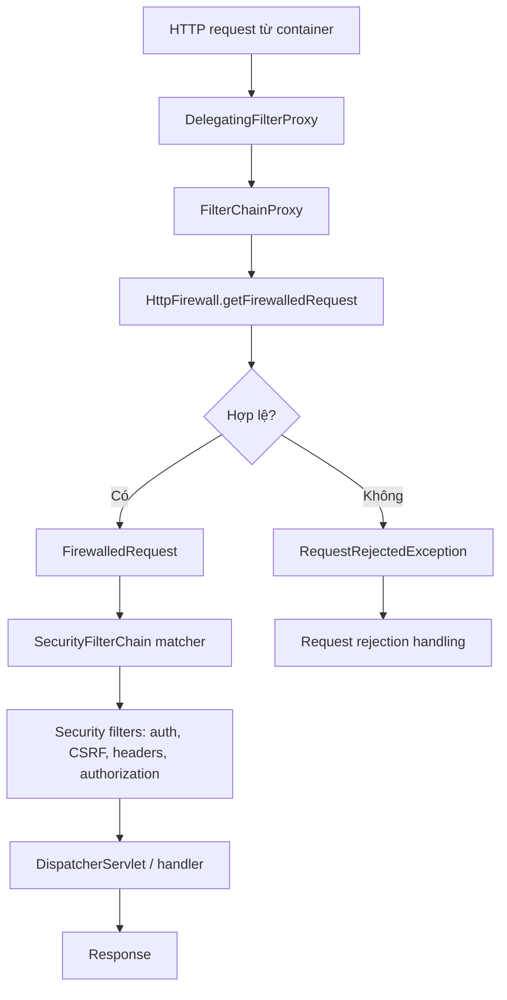
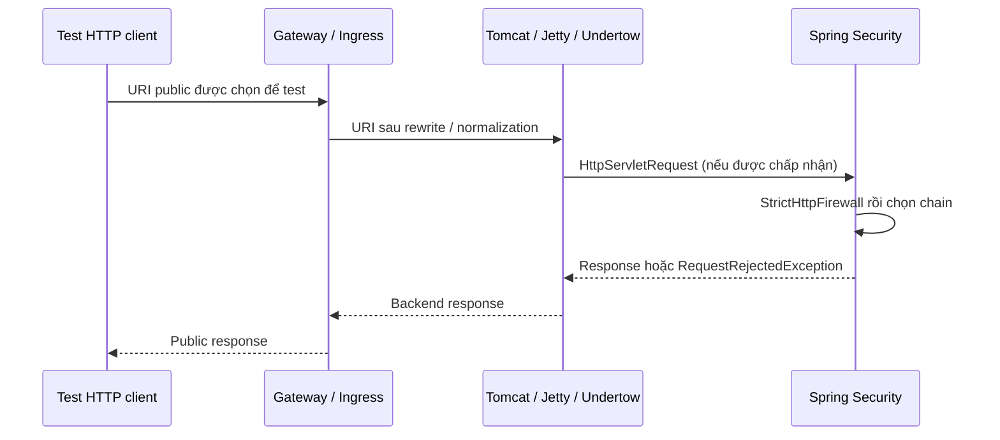

# Đường dẫn chưa chuẩn hóa và khác biệt giữa các container

## 1. Đặt vấn đề: một URL có thể có nhiều cách hiểu

Trong chương **Firewall trên Servlet** của module **SPRING_SECURITY_HTTP_PROTECTION**, chúng ta cần bảo vệ hệ thống từ lúc nhận HTTP request cho đến khi áp dụng đúng security chain. Dịch vụ này còn bao gồm CSRF, CORS, security headers, CSP, HSTS và phòng vệ session; tất cả đều phụ thuộc vào việc request được định tuyến và cấp quyền đúng.

Một ứng dụng có thể xác định:

```text
/public/**  -> cho phép xem công khai
/admin/**   -> chỉ ROLE_ADMIN
```

Với `GET /admin/reports`, việc chọn chính sách khá rõ ràng. Nhưng những cách biểu diễn như:

```text
/public/../admin/reports
/public/%2e%2e/admin/reports
/admin//reports
/admin;mode=view/reports
/admin%2Freports
/admin\reports
```

có thể đặt ra câu hỏi khó: **Servlet container, reverse proxy, Spring Security matcher và Spring MVC handler có nhìn thấy cùng một đường dẫn không?**

Nếu lớp bảo vệ xác định đây là request cho `/public/**` nhưng lớp định tuyến phía sau nhận nó như `/admin/**`, chính sách phân quyền có thể bị áp cho **sai tài nguyên**. Đây là một lớp rủi ro *path interpretation mismatch*, không đơn thuần là “có thể dùng ký tự đặc biệt trong URL”.

`HttpFirewall` của Spring Security Servlet, đặc biệt là `StrictHttpFirewall` được dùng mặc định ở nhiều phiên bản hiện đại, giảm rủi ro bằng cách **kiểm tra và từ chối những biểu diễn request không được chấp nhận trước khi chọn `SecurityFilterChain`**.

Bài này tập trung vào **đường dẫn chưa chuẩn hóa và sự khác biệt giữa các Servlet container**. Không nên suy rằng mọi biến thể URL trong ví dụ đều có kết quả giống nhau ở mọi phiên bản Tomcat, Jetty, Undertow hoặc NGINX. Phải phân biệt **đường dẫn thực sự đến được Java** với **đường dẫn mà client đã gõ**.

### Kết quả học tập

Sau bài, người học có thể:

1. Phân biệt request-target HTTP, `requestURI`, `contextPath`, `servletPath` và `pathInfo`.
2. Nhận ra các nguồn mơ hồ từ dot segments, dấu `//`, semicolon, encoded slash, encoded dot, backslash và nhiều lớp giải mã.
3. Giải thích tại sao hành vi có thể khác giữa Servlet containers, connector settings và proxy/CDN.
4. Mô tả cách `FilterChainProxy` dùng `HttpFirewall` trước khi chọn security chain, và giới hạn của normalization.
5. Thiết kế quy tắc URL rõ ràng hơn thay vì nới firewall một cách bừa bãi.
6. Viết unit test `StrictHttpFirewall`, integration test MockMvc và phép kiểm tra có kiểm soát qua HTTP server thật.
7. Chẩn đoán sai khác status `400`, `401`, `403`, `404` giữa các môi trường mà không nhầm với CSRF, CORS hay lỗi header writer.

## 2. Năm biểu diễn đường dẫn cần phân biệt

Trong HTTP/1.1, request-line chứa **request-target**, chẳng hạn:

```http
GET /portal/admin/reports?year=2026 HTTP/1.1
Host: app.example.test
```

Trong HTTP/2/HTTP/3, đường dẫn thường được biểu diễn bằng `:path` và các pseudo-header/protocol structure tương ứng thay vì request-line HTTP/1.1. Dù giao thức khác nhau, khi đến Servlet container, ứng dụng vẫn quan sát request qua API Servlet.

Các phương thức quan trọng:

| API hoặc khái niệm | Ví dụ trong ứng dụng dưới `/portal` | Ý nghĩa |
| --- | --- | --- |
| Request-target path | `/portal/admin/reports` | Đường dẫn ở cấp HTTP mà client dự định gửi; có thể đã bị proxy rewrite trước backend. |
| `request.getRequestURI()` | `/portal/admin/reports` | URI path theo representation do Servlet container cung cấp, **không gồm query string**. |
| `request.getContextPath()` | `/portal` | Prefix ứng dụng web được mount. |
| `request.getServletPath()` | `/admin/reports` | Phần path tương ứng servlet mapping; ví dụ giả định DispatcherServlet dùng mapping phù hợp. |
| `request.getPathInfo()` | Có thể `null` | Phần bổ sung sau servlet path nếu servlet mapping tạo ra nó. |
| `request.getQueryString()` | `year=2026` | Phần query, tách khỏi path. |

Giá trị trên là **ví dụ minh họa**, không phải một định luật rằng `servletPath` luôn bằng “`requestURI` trừ `contextPath`”. Kết quả còn phụ thuộc Servlet mapping, cách container xử lý path parameters và phép giải mã.

### 2.1. `getRequestURI()` không phải `getRequestURL()`

`getRequestURI()` cho phần URI path từ request, không bao gồm protocol, hostname hoặc query. `getRequestURL()` tạo URL dạng đầy đủ dựa trên scheme, hostname, port và request URI mà container nhìn thấy.

Khi có reverse proxy hoặc forwarded headers, URL đầy đủ do Java dựng lại có thể khác URL public. Không dùng `getRequestURL()` làm “bằng chứng duy nhất” về request-target nguyên bản trước proxy.

### 2.2. `getServletPath()` và `getPathInfo()` bị ảnh hưởng bởi mapping

Trong Servlet, cách tách path phụ thuộc mapping như exact mapping, path-prefix mapping hay mapping “/”. Một `DispatcherServlet` và một servlet khác có thể tạo các cặp `servletPath`/`pathInfo` khác nhau cho request cùng dạng.

Ví dụ minh họa:

```text
Request URI:       /portal/api/orders/17
Context path:      /portal
Servlet mapping:   /api/*
Servlet path:      /api
Path info:         /orders/17
```

Với mapping “/” trong một ứng dụng Spring MVC thông thường, cách tách có thể khác. Do đó không được tự xây rule authorization bằng cách **nối chuỗi thủ công** các thành phần path mà chưa hiểu mapping của container.

### 2.3. Query khác path

`/admin/report?file=a%2Fb` không đồng nghĩa `/admin/report/a%2Fb`.

- `%2F` trong **query value** có thể mang nghĩa dữ liệu văn bản.
- `%2F` trong **path segment** có thể thay đổi ranh giới segment nếu được giải mã thành `/`.

Đối với dữ liệu có slash, việc dùng body hoặc query parameter được validate thường dễ xây dựng hợp đồng ổn định hơn so với cố giữ encoded slash trong path variable.

## 3. Normalization, decoding và canonicalization không phải một việc

Ba thuật ngữ này thường bị dùng thay cho nhau, nhưng cần phân biệt:

- **Decoding**: chuyển biểu diễn percent-encoded thành ký tự hoặc byte tương ứng, ví dụ `%2F` thành slash theo một quy tắc nhất định.
- **Path normalization**: xử lý các cấu trúc như dấu `.`, `..` hoặc slash lặp để có representation nhất quán, hoặc **từ chối** vì không chuẩn.
- **Canonicalization**: chọn một biểu diễn chuẩn được ứng dụng và hệ thống đồng thuận cho một resource, xét cả cách encoding, Unicode, ký tự phân cách, case-sensitivity và routing.

Không phải mọi tầng đều tự động làm cả ba thao tác. Đặc biệt, **decode một lần** và **decode hai lần** không tương đương:

```text
Chuỗi ban đầu:    a%252Fb
Sau một lần decode: a%2Fb
Sau hai lần decode: a/b
```

Nếu gateway chỉ decode một lần nhưng thành phần phía sau decode thêm, một ký tự slash có thể xuất hiện **muộn hơn bước security matching**. Đây là lý do không nên xác định quyền chỉ bằng một chuỗi path được xử lý theo giả định.

### 3.1. Dot segments

Theo khái niệm URI path, `.` và `..` có thể biểu thị những segment cần xử lý theo quy tắc tham chiếu URI. Tuy nhiên, việc chúng bị loại bỏ, từ chối hoặc được giữ đến từng tầng phụ thuộc client, proxy, container và framework.

Ví dụ:

```text
/public/../admin/report
```

Một tầng có thể xem đường dẫn này là chưa chuẩn và trả `400`; tầng khác có thể chuẩn hóa thành `/admin/report`. **Không bao giờ dựa vào việc “nó bắt đầu bằng /public”** để cấp quyền nếu tồn tại khả năng lớp sau chuyển thành resource admin.

### 3.2. Slash lặp

```text
/admin//report
```

Dấu `//` có thể được giữ nguyên, gộp thành một slash hoặc bị từ chối. Với matcher theo pattern, điều này có thể ảnh hưởng cả **lựa chọn chain** lẫn route ở Spring MVC.

Một thay đổi proxy từ “giữ nguyên slash” thành “merge slash” cần được coi là thay đổi có thể ảnh hưởng tới bảo mật URL, không chỉ tối ưu routing.

### 3.3. Backslash

```text
/admin\report
/admin%5Creport
```

Backslash không phải dấu phân cách path segment thông thường của URL HTTP như slash, nhưng một số hệ thống hoặc thư viện có thể xử lý nó gần giống slash. Không được coi `\` là ký tự vô hại trong mọi container/proxy. Thông thường nên từ chối các representation này nếu service không có yêu cầu hợp pháp được phân tích kỹ.

## 4. Dấu chấm phẩy: case kinh điển của khác biệt Servlet container

Dấu `;` trong path có thể biểu thị **path parameter** hoặc **matrix variable**:

```text
/products;color=red/42
```

Trên thực tế, các Servlet container/framework có thể khác nhau ở cách path parameter xuất hiện trong `requestURI`, `servletPath` và `pathInfo`. **Servlet specification và behavior của từng container không bảo đảm mọi security matcher sẽ được cung cấp cùng một chuỗi sau khi xử lý semicolon**.

Giả sử có rule:

```text
/admin/** -> require ADMIN
```

và request:

```text
/admin;view=compact/reports
```

Một thành phần có thể bỏ `;view=compact` khi xác định segment, còn thành phần khác xem nó là phần của segment. Nếu bước chọn security chain và controller không thống nhất, có nguy cơ áp sai chính sách.

Đây là một lý do `StrictHttpFirewall` thường **từ chối semicolon theo mặc định**.

### 4.1. Vì sao matrix variables không tự động là lý do bật semicolon?

Nếu dự án thực sự cần matrix variables, giải pháp không chỉ là:

```java
StrictHttpFirewall firewall = new StrictHttpFirewall();

// Chỉ cân nhắc khi đã đánh giá toàn bộ đường đi request.
firewall.setAllowSemicolon(true);
```

Một setter chỉ thay policy firewall; nó **không buộc** gateway, Servlet container, Spring MVC router và security matcher đồng thuận về cách tách path parameter.

Cần kiểm tra:

1. Matrix variables có phải yêu cầu API được mô tả rõ không?
2. Các URL đó có đi qua reverse proxy rewrite hoặc CDN cache-key không?
3. `servletPath`/`pathInfo` thực tế ở mỗi container ra sao?
4. Security chain matcher nào sẽ áp với semicolon?
5. Controller/handler nào thực sự xử lý request và áp authorization trên resource nào?
6. Có ca âm tính để tránh bypass rule `/admin/**` hoặc access tài nguyên ngoài phạm vi không?

Nếu không có nhu cầu thật, **giữ cách từ chối mặc định** giúp dễ bảo đảm tính nhất quán hơn.

### 4.2. Không tự “làm sạch” bằng thao tác xóa semicolon

Anti-pattern:

```java
// KHÔNG dùng chuỗi thay thế đơn giản để chuẩn hóa request path.
String path = request.getRequestURI().replace(";", "");
```

Ví dụ này có thể biến `/admin;view=compact` thành `/adminview=compact`, một resource khác hoàn toàn. “Xóa ký tự lạ” không phải canonicalization an toàn. Hãy xác định URI grammar được phép, dùng parser/router tương thích và từ chối biểu diễn ngoài hợp đồng.

## 5. Encoded slash: case lệch nhau giữa gateway và Servlet container

Giả sử client gửi:

```http
GET /files/tenantA%2Freport.pdf HTTP/1.1
Host: app.example.test
```

Một tầng có thể giữ `%2F` như dữ liệu nằm trong segment, tầng khác có thể decode thành slash:

```text
Representation A: /files/tenantA%2Freport.pdf
Representation B: /files/tenantA/report.pdf
```

Hai representation này có thể dẫn đến **hai cách chọn resource**. Nếu app authorization phụ thuộc đường dẫn theo tenant, khác biệt có thể nghiêm trọng.

**Không có một bảng mặc định bền vững qua mọi version** kiểu “Tomcat luôn giải mã `%2F`, Jetty luôn giữ `%2F`, Undertow luôn từ chối”. Kết quả thay đổi theo phiên bản, connector, route, cách khởi tạo request và cấu hình security.

### 5.1. Những câu hỏi phải hỏi khi gặp encoded slash

| Câu hỏi | Cần xác định từ đâu |
| --- | --- |
| Client HTTP có giữ nguyên `%2F` trong path không? | HTTP trace hoặc phép thử kiểm soát client. |
| Gateway forward nguyên chuỗi hay decode/rewrite? | Cấu hình và log đã escape của gateway. |
| Servlet connector cho phép hoặc từ chối encoded slash? | Documentation/setting của phiên bản container đang chạy. |
| `getRequestURI()` là gì sau container? | Quan sát có kiểm soát trong backend/staging. |
| `getServletPath()`/`getPathInfo()` được tách thế nào? | Servlet mapping và container thật. |
| `StrictHttpFirewall` còn nhìn thấy biểu diễn nguy hiểm không? | Unit + integration tests theo version. |
| Security matcher và controller cùng chọn resource không? | Integration tests với authorization và routing. |

Nếu câu trả lời ở từng tầng khác nhau, **không dùng `setAllowUrlEncodedSlash(true)` như cách chữa đầu tiên**.

### 5.2. API ID có slash nên được thiết kế thế nào?

Một ID thực sự chứa slash thường phù hợp hơn khi:

- Dùng opaque identifier không chứa dấu phân cách URL.
- Dùng query parameter hoặc request body với validation/schema rõ ràng.
- Tách những thành phần của ID thành các path segment **có ngữ nghĩa riêng**, thay vì giả vờ toàn bộ chuỗi có slash là một segment.

Chỉ dùng encoded slash trong path khi hợp đồng protocol bắt buộc và đã được chứng minh **end-to-end** qua tất cả hạ tầng.

## 6. Double encoding và encoded dot: rủi ro khi giải mã nhiều lần

Giả sử request path chứa:

```text
/public/%252e%252e/admin
```

Một lần giải mã có thể cho:

```text
/public/%2e%2e/admin
```

Một tầng khác giải mã tiếp có thể thành:

```text
/public/../admin
```

Khi đó cơ chế chuẩn hóa dot segments có thể biến đường dẫn thành resource khác. **Điểm quan trọng không phải payload cụ thể**, mà là việc một tầng kiểm tra chuỗi trước khi tầng khác làm xuất hiện ký tự đặc biệt.

### 6.1. Không xác thực đường dẫn trước rồi decode lại không kiểm soát

Anti-pattern:

```java
// KHÔNG xem đây là quy trình authorization an toàn.
String raw = request.getRequestURI();

if (raw.startsWith("/public/")) {
    String decodedLater = java.net.URLDecoder.decode(
        raw, java.nio.charset.StandardCharsets.UTF_8);
    // Sử dụng decodedLater để định tuyến hoặc truy cập file
}
```

`URLDecoder` được thiết kế cho quy tắc application/x-www-form-urlencoded, không nên áp mù quáng cho toàn bộ URI path: dấu `+` cũng có semantics khác so với URI path thông thường. Ví dụ còn vi phạm thứ tự **kiểm tra quyền trước rồi giải mã sau**.

Cách làm an toàn hơn là sử dụng router/framework đã xác định cách xử lý URI và thực hiện authorization **trên resource hoặc ID đã được parse và validate một lần theo hợp đồng rõ ràng**. Không tự decode thêm sau khi security chain đã quyết định quyền theo một representation khác.

### 6.2. Unicode normalization cũng là một ranh giới

Với hệ thống dùng tên file, slug hoặc path chứa Unicode, nhiều chuỗi ký tự có thể biểu diễn giống nhau ở giao diện nhưng khác byte/code point. Bên cạnh URL encoding, tầng storage và service có thể áp normalization Unicode hoặc case-folding riêng.

`StrictHttpFirewall` **không thay thế** một chiến lược canonical resource identity. Với tài nguyên theo tenant/user, hãy định nghĩa rõ quy tắc ID, so sánh identity theo dữ liệu phía server và tránh cấp quyền chỉ theo những chuỗi path tự dựng.

## 7. Vì sao mỗi Servlet container có thể trả kết quả khác nhau?

Spring Security hoạt động trên **Servlet API**, không trực tiếp xử lý raw TCP/TLS bytes. Trước khi đến Java, HTTP request đã đi qua HTTP connector và bộ parser của container.

Khác biệt có thể xuất hiện tại:

1. **Request parsing:** URI có ký tự lạ hoặc percent-encoding không hợp lệ có được chấp nhận không?
2. **Encoded separator policy:** `%2F`, `%5C` có được giữ, giải mã hoặc từ chối?
3. **Normalization:** dot segments, slash lặp và path parameters được xử lý ở giai đoạn nào?
4. **Servlet mapping:** cách tính `contextPath`, `servletPath`, `pathInfo`.
5. **Character decoding:** encoding, ký tự không hợp lệ hoặc chuỗi nhiều byte được xử lý ra sao?
6. **Request rejection:** status và error body do container tạo có qua Spring Security filter registration không?
7. **Configuration/version:** connector options, runtime flags, framework integration, security patches.

### 7.1. Tomcat, Jetty, Undertow: so sánh đúng cách

| Container | Những nơi nên kiểm tra | Điều **không nên mặc định khẳng định** |
| --- | --- | --- |
| **Tomcat** | Connector settings liên quan URI, encoded solidus/backslash, version/Servlet mapping. | “Tomcat luôn decode encoded slash” hoặc “Tomcat luôn trả 400”. |
| **Jetty** | URI compliance mode, normalization, ambiguous path handling và version. | “Jetty nhận mọi encoded path” hoặc “Jetty giống Tomcat”. |
| **Undertow** | URL decoding, encoded slash handling, options tại HTTP listener/server và version. | “Undertow luôn giữ nguyên encoding” hoặc “Undertow tự thay firewall”. |
| **Gateway trước container** | URI rewrite, percent decode, slash merge, routing, WAF và cache. | “Backend nhất định nhìn thấy URI mà browser gửi”. |

Tên cài đặt cụ thể thay đổi giữa phiên bản sản phẩm và cách nhúng Spring Boot. Đừng sao chép một option từ bài viết của phiên bản cũ vào production hiện tại mà chưa xác minh tài liệu của **container đang chạy**.

### 7.2. Servlet specification bảo đảm gì và không bảo đảm gì?

Servlet API định nghĩa các phương thức truy cập request path, servlet mapping và context. Nhưng ứng dụng không nên suy rằng mọi HTTP server **đều giữ nguyên chuỗi request-target dạng raw** đến mọi API Servlet, đặc biệt với path parameters và những URL bất thường.

Một phần dữ liệu path có thể đã được xử lý trước khi một Servlet filter có cơ hội đọc. Bởi vậy **MockHttpServletRequest không mô phỏng đầy đủ connector semantics**. Unit test chỉ chứng minh behavior đối với request object mà ta tự dựng.

### 7.3. Khác biệt do cấu hình, không chỉ do tên container

Hai môi trường đều dùng Tomcat nhưng một môi trường bật reverse proxy rewrite hoặc nâng phiên bản connector có thể xử lý URI khác nhau. Hai ứng dụng Spring Boot có dependency/container khác nhau cũng có thể phản ứng khác dù security Java configuration giống hệt.

Khi so sánh local và staging, hãy thu thập:

- Container name **và version**.
- Spring Framework / Spring Security version.
- Servlet API version và servlet mappings.
- HTTP connector relevant settings.
- Gateway/CDN/ingress behavior.
- URL/method thực tế, status và log rejection.
- Cấu hình `StrictHttpFirewall` đã tùy chỉnh hay chưa.

## 8. Vị trí của `HttpFirewall` trong `FilterChainProxy`

Một request đi qua Spring Security Servlet thường theo sơ đồ:



**Bất biến kiến trúc:** firewall kiểm tra request **trước khi** các matcher của `SecurityFilterChain` quyết định chain.

### 8.1. Firewall thường từ chối thay vì âm thầm biến đổi URL

`StrictHttpFirewall` có chủ đích nghiêm ngặt với những URL không đạt policy; nó không phải một “URL repair service” biến mọi dạng mơ hồ thành path chuẩn.

Một implementation khác là `DefaultHttpFirewall` có hành vi/lịch sử khác. Đừng đổi sang implementation khác chỉ vì Strict từ chối một URL hợp lệ về mặt ý định nghiệp vụ; việc này thay đổi trust boundary và cần đánh giá kỹ.

### 8.2. `FirewalledRequest` và `reset()`

`HttpFirewall.getFirewalledRequest(request)` trả `FirewalledRequest` khi request được chấp nhận. Wrapper này được dùng trong quá trình security matching và có cơ chế `reset()` phục vụ việc khôi phục cách nhìn request ở phạm vi thích hợp.

Đừng suy wrapper “đã sửa sạch” URI để controller và storage có thể bỏ qua validation. Mục tiêu là **matching an toàn và nhất quán**, không thay thế kiểm tra resource ID ở ứng dụng.

### 8.3. `permitAll` không sửa được firewall rejection

Nếu URL không được firewall chấp nhận, việc thêm:

```java
http.authorizeHttpRequests(auth -> auth
    .requestMatchers("/public/**").permitAll());
```

không giúp request vượt firewall; authorization còn chưa được thực thi. Cần xác định **tại sao request không hợp lệ** hoặc vì sao container/proxy tạo ra URI khác dự kiến.

## 9. Bảng quyết định: URL nào nên được đưa vào hợp đồng API?

Một API nên công bố URI grammar rõ ràng. Ví dụ:

| Nhóm | Đề xuất | Lý do |
| --- | --- | --- |
| Path segment định danh | Opaque ID hoặc slug an toàn, không cần encoded separator. | Matcher, router và cache-key dễ nhất quán. |
| Dữ liệu có dấu slash | Dùng query/body được validate hoặc cấu trúc path segments có chủ ý. | Không phụ thuộc `%2F` có được giải mã hay không. |
| Matrix variables | Tránh nếu không cần; nếu cần phải đặc tả và test end-to-end. | Dấu `;` có thể gây khác biệt path parameters. |
| Unicode slug | Quy định encoding và normalization; lấy quyền từ ID canonical phía server. | Tránh hai chuỗi nhìn giống nhau trỏ resource khác. |
| Dot segments | Không đưa vào URL nghiệp vụ đã công bố. | Tránh chồng nhiều bước path normalization. |
| Slash lặp | Chuẩn hóa ở URL generator/client; kiểm thử request bất thường. | Tránh matcher hiểu sai số segment. |
| URL có nguồn từ user | Không đưa thẳng vào redirect `Location` hoặc file access. | Giảm open redirect và path traversal. |
| API dưới proxy prefix | Mô tả public path và backend mapping tách biệt. | Security matcher đúng path backend thực nhận. |

**Không giải quyết path confusion bằng cách “cho phép tất cả URL rồi kiểm tra ở controller”.** Một số request có thể đã đi vào security chain **không phù hợp** trước khi đến controller.

## 10. Cấu hình Spring Security Servlet: không nới firewall chỉ để tương thích

Spring Security hiện đại thường có firewall mặc định. Khi cần thay đổi có chủ đích, có thể cấu hình qua `WebSecurityCustomizer` ở cấp `WebSecurity`.

Ví dụ sau **không nới semicolon/encoded slash**, chỉ minh họa nơi đặt policy và allowlist method thông dụng:

```java
import java.util.List;

import org.springframework.context.annotation.Bean;
import org.springframework.context.annotation.Configuration;
import org.springframework.security.config.annotation.web.configuration.WebSecurityCustomizer;
import org.springframework.security.web.firewall.StrictHttpFirewall;

@Configuration
class FirewallConfiguration {

    @Bean
    WebSecurityCustomizer webSecurityCustomizer() {
        return web -> {
            StrictHttpFirewall firewall = new StrictHttpFirewall();

            firewall.setAllowedHttpMethods(List.of(
                "GET", "HEAD", "POST", "PUT",
                "PATCH", "DELETE", "OPTIONS"
            ));

            // Không bật allowSemicolon/allowUrlEncodedSlash
            // trừ khi có thiết kế và phê duyệt cụ thể.
            web.httpFirewall(firewall);
        };
    }
}
```

Nếu version đang dùng đã có allowlist này theo mặc định, **không cần định nghĩa lại**. Cấu hình trên là mẫu minh họa Spring Security 6.x. Luôn đối chiếu behavior/version runtime trước khi áp dụng.

### 10.1. Vì sao không dùng `HttpSecurity.addFilterBefore(...)`?

Một filter được thêm bằng `HttpSecurity.addFilterBefore(...)` nằm **bên trong một security chain đã được chọn**. Trong khi đó `HttpFirewall` tham gia **trước bước chọn chain** trong `FilterChainProxy`.

Thêm một custom filter sau chain selection không thể thay thế chức năng tránh path ambiguity ở ranh giới **trước-matcher**.

### 10.2. Rủi ro của các setter nới lỏng

```java
StrictHttpFirewall firewall = new StrictHttpFirewall();

// ANTI-PATTERN nếu mục đích chỉ là làm lỗi 400 biến mất:
// firewall.setAllowSemicolon(true);
// firewall.setAllowUrlEncodedSlash(true);
// firewall.setAllowBackSlash(true);
// firewall.setAllowUrlEncodedDoubleSlash(true);
// firewall.setAllowUrlEncodedPercent(true);
```

Những setter ở phiên bản hỗ trợ có thể mở rộng tập request được chấp nhận; **không phải danh sách cần bật cho mọi ứng dụng**. Cho phép encoded slash tại Spring Security vẫn không bảo đảm gateway/container chấp nhận hoặc xử lý nó giống nhau.

Nếu có yêu cầu matrix variables, encoded separator hoặc path syntax khác thường, phải thiết kế **một ngoại lệ hẹp** có security review và test chống chọn sai chain, không bật hàng loạt rồi chỉ kiểm tra status 200.

## 11. Một ví dụ hai security chains để thấy hậu quả của path mismatch

Giả sử ứng dụng có một chain chuyên cho admin và một chain còn lại:

```java
import org.springframework.context.annotation.Bean;
import org.springframework.context.annotation.Configuration;
import org.springframework.core.annotation.Order;
import org.springframework.security.config.Customizer;
import org.springframework.security.config.annotation.web.builders.HttpSecurity;
import org.springframework.security.web.SecurityFilterChain;
import org.springframework.security.web.header.writers.StaticHeadersWriter;

@Configuration
class SecurityChainDemoConfig {

    @Bean
    @Order(1)
    SecurityFilterChain adminChain(HttpSecurity http) throws Exception {
        http
            .securityMatcher("/admin/**")
            .authorizeHttpRequests(auth -> auth
                .anyRequest().hasRole("ADMIN"))
            .httpBasic(Customizer.withDefaults())
            .headers(headers -> headers.addHeaderWriter(
                new StaticHeadersWriter("X-Demo-Chain", "admin")));
        return http.build();
    }

    @Bean
    @Order(2)
    SecurityFilterChain siteChain(HttpSecurity http) throws Exception {
        http
            .authorizeHttpRequests(auth -> auth
                .requestMatchers("/public/**").permitAll()
                .anyRequest().authenticated())
            .httpBasic(Customizer.withDefaults())
            .headers(headers -> headers.addHeaderWriter(
                new StaticHeadersWriter("X-Demo-Chain", "site")));
        return http.build();
    }
}
```

`X-Demo-Chain` là **header chẩn đoán**, không phải security header tiêu chuẩn; chỉ dùng để quan sát chain trong môi trường học tập rồi gỡ bỏ. Cấu hình production cần giữ CSRF, CORS, session, authentication và policy header theo yêu cầu thật.

### 11.1. Điều gì phải đúng với request bình thường?

| Request | Firewall | Chain kỳ vọng | Authorization |
| --- | --- | --- | --- |
| `GET /public/info` | Chấp nhận | SITE | `permitAll`. |
| `GET /admin/reports` | Chấp nhận | ADMIN | Cần role ADMIN. |
| `GET /profile` | Chấp nhận | SITE | Cần xác thực. |
| `GET /public/../admin/reports` | Phải được xử lý theo strict policy; có thể bị từ chối tại firewall hoặc tầng trước. | Không được vô tình hưởng quyền public. | Không dùng status 200 làm phép kiểm đủ. |
| `GET /admin;v=1/reports` | Thường bị strict policy từ chối. | Không nên rơi vào SITE theo cách bỏ qua kiểm tra. | Không nới semicolon nếu chưa có review. |

Đối với URL bất thường, kết quả status chính xác phụ thuộc **container, firewall version và handler**; điều quan trọng là không để request được diễn giải thành resource nhạy cảm sau khi đã hưởng policy công khai.

### 11.2. Bảo vệ resource cần hơn một path prefix

Ngay cả khi `/admin/**` được bảo vệ chính xác, một API như `GET /files/{id}` vẫn cần kiểm tra người dùng có quyền xem file `id` đó không. Path normalization bảo vệ bước chọn chain; nó **không thay object-level authorization** hay kiểm tra tenant/user ownership.

## 12. Unit test `StrictHttpFirewall` với request objects được kiểm soát

Unit test giúp kiểm tra trực tiếp firewall **đối với biểu diễn Servlet request mà ta dựng**, không cần HTTP connector.

Ví dụ JUnit 5, `spring-test` và `spring-security-web`:

```java
import org.junit.jupiter.api.Test;
import org.springframework.mock.web.MockHttpServletRequest;
import org.springframework.security.web.firewall.FirewalledRequest;
import org.springframework.security.web.firewall.RequestRejectedException;
import org.springframework.security.web.firewall.StrictHttpFirewall;

import static org.junit.jupiter.api.Assertions.assertEquals;
import static org.junit.jupiter.api.Assertions.assertThrows;

class ServletPathFirewallTest {

    private final StrictHttpFirewall firewall = new StrictHttpFirewall();

    private MockHttpServletRequest request(String uri) {
        var request = new MockHttpServletRequest("GET", uri);
        request.setServletPath(uri);
        return request;
    }

    @Test
    void acceptsCanonicalPath() {
        FirewalledRequest safe =
            firewall.getFirewalledRequest(request("/admin/reports"));

        assertEquals("/admin/reports", safe.getServletPath());
        safe.reset();
    }

    @Test
    void rejectsSemicolonByDefault() {
        assertThrows(RequestRejectedException.class,
            () -> firewall.getFirewalledRequest(
                request("/admin;v=1/reports")));
    }

    @Test
    void rejectsUnnormalizedDotSegment() {
        assertThrows(RequestRejectedException.class,
            () -> firewall.getFirewalledRequest(
                request("/public/../admin/reports")));
    }

    @Test
    void rejectsEncodedSlashUnderStrictPolicy() {
        assertThrows(RequestRejectedException.class,
            () -> firewall.getFirewalledRequest(
                request("/files/a%2Fb")));
    }
}
```

**Giải thích giới hạn:** Mock request được tạo với `requestURI` và `servletPath` do chính test thiết lập. Container thật có thể từ chối request trước khi tạo `HttpServletRequest`, hoặc cung cấp `servletPath` đã được xử lý khác. Nếu test URL mơ hồ cho kết quả không như kỳ vọng sau khi nâng version, cần kiểm tra policy thực của `StrictHttpFirewall` và representation mà test đã tạo.

### 12.1. Kiểm tra độc lập đường dẫn chứa slash kép

Một test bổ sung:

```java
@Test
void rejectsDoubleSlashWhenPathIsNotNormalized() {
    assertThrows(RequestRejectedException.class,
        () -> firewall.getFirewalledRequest(
            request("/admin//reports")));
}
```

Đây là expectation đối với strict policy ở các phiên bản thường dùng. Không suy từ unit test rằng một HTTP client sẽ truyền nguyên `//` qua proxy hoặc container.

### 12.2. So sánh raw URI và servletPath trong mock

Một cặp request mock giúp người học thấy việc tách path là **một phần của đầu vào** mà firewall nhận:

```java
@Test
void canonicalContextPathCanBeAccepted() {
    var request = new MockHttpServletRequest(
        "GET", "/portal/admin/reports");

    request.setContextPath("/portal");
    request.setServletPath("/admin/reports");

    FirewalledRequest safe = firewall.getFirewalledRequest(request);

    assertEquals("/portal/admin/reports", safe.getRequestURI());
    assertEquals("/admin/reports", safe.getServletPath());
    safe.reset();
}
```

Test này không cố gắng mô phỏng servlet mapping phức tạp; nó minh họa rằng **context path và servlet path không cùng một chuỗi**. Muốn biết container thật trả các giá trị đó ra sao, phải kiểm thử qua Servlet container đúng phiên bản.

### 12.3. Không trộn unit test firewall với status HTTP

`assertThrows(RequestRejectedException.class, ...)` chứng minh firewall từ chối request object. Nó **không chứng minh client thật luôn nhận `400`**. Tầng `RequestRejectedHandler` có thể chuyển exception thành response, còn gateway/container có thể phát lỗi trước Spring Security.

Test nên tách **quy tắc firewall** khỏi **behavior của endpoint HTTP cuối cùng**.

## 13. Integration test với MockMvc: đúng chain và đúng quyền

Một controller test:

```java
import org.springframework.web.bind.annotation.GetMapping;
import org.springframework.web.bind.annotation.RestController;

@RestController
class SecurityRoutingDemoController {

    @GetMapping("/public/info")
    String publicInfo() {
        return "public-ok";
    }

    @GetMapping("/admin/reports")
    String adminReports() {
        return "admin-ok";
    }
}
```

Ví dụ MockMvc, giả định `SecurityChainDemoConfig` được nạp trong test context:

```java
import org.junit.jupiter.api.Test;
import org.springframework.beans.factory.annotation.Autowired;
import org.springframework.boot.test.autoconfigure.web.servlet.AutoConfigureMockMvc;
import org.springframework.boot.test.context.SpringBootTest;
import org.springframework.test.web.servlet.MockMvc;

import static org.springframework.security.test.web.servlet.request.SecurityMockMvcRequestPostProcessors.user;
import static org.springframework.test.web.servlet.request.MockMvcRequestBuilders.get;
import static org.springframework.test.web.servlet.result.MockMvcResultMatchers.header;
import static org.springframework.test.web.servlet.result.MockMvcResultMatchers.status;

@SpringBootTest
@AutoConfigureMockMvc
class SecurityPathRoutingIntegrationTest {

    @Autowired MockMvc mvc;

    @Test
    void publicRequestUsesSiteChain() throws Exception {
        mvc.perform(get("/public/info"))
            .andExpect(status().isOk())
            .andExpect(header().string("X-Demo-Chain", "site"));
    }

    @Test
    void adminRequestNeedsAdminRole() throws Exception {
        mvc.perform(get("/admin/reports")
                .with(user("editor").roles("USER")))
            .andExpect(status().isForbidden())
            .andExpect(header().string("X-Demo-Chain", "admin"));

        mvc.perform(get("/admin/reports")
                .with(user("owner").roles("ADMIN")))
            .andExpect(status().isOk())
            .andExpect(header().string("X-Demo-Chain", "admin"));
    }
}
```

`user(...)` thuộc `spring-security-test`. Test giả định MockMvc được cấu hình với Spring Security filters và controller mẫu trả đúng status. Nếu test context có nhiều security configurations khác, kết quả sẽ khác; không tạo thêm chain trùng matcher trong một ứng dụng production chỉ để làm ví dụ hoạt động.

Điểm quan trọng là test cả:

- **Chain selection**: header marker chứng minh chain nào được chọn trong test.
- **Authorization**: người dùng thiếu role không vào được resource admin.
- **Baseline security headers**: có thể bổ sung assertion `nosniff` và những policy phù hợp.
- **Route đúng**: controller thực sự nhận URL canonical đã được bảo vệ.

### 13.1. Đừng hardcode `400` cho mọi URL bị từ chối trong MockMvc

`MockMvc` có thể chuyển request qua filters mà không mô phỏng toàn bộ parser HTTP của container; `RequestRejectedException` cũng có thể được ném ra hoặc được một handler chuyển thành HTTP status tùy config.

Do đó một test như:

```java
// Chỉ minh họa ý tưởng; KHÔNG phải kỳ vọng chung cho mọi test context.
// mvc.perform(get("/public/../admin/reports"))
//    .andExpect(status().isBadRequest());
```

có thể thất bại vì test framework xử lý exception theo cách khác. **Unit test xác minh rejection** ở `StrictHttpFirewall`; còn **HTTP server integration test** xác minh status/headers on-wire của container thật.

### 13.2. Dữ liệu từ mock không thể chứng minh container behavior

Một test mock có thể đặt `servletPath` theo ý người viết. Nhưng container thật có thể từ chối URL bất thường trước filter registration hoặc điền `servletPath` khác. Những lỗi path interpretation do **cross-layer mismatch** cần được kiểm tra bằng một server HTTP thật và proxy cùng config production/staging.

## 14. Kiểm thử qua Servlet container thật và gateway

### 14.1. Ba điểm cần so sánh



Một phép thử đúng cần trả lời:

1. **HTTP client gửi request-target nào?**
2. **Gateway chuyển đến upstream path nào?**
3. **Container chấp nhận hay từ chối? Nếu chấp nhận, các Servlet path APIs trả gì?**
4. **Firewall chấp nhận hay ném `RequestRejectedException`?**
5. **Nếu được chấp nhận, chain và controller nào được chọn?**
6. **Client cuối cùng thấy status và headers gì?**

### 14.2. Dùng curl có kiểm soát

Với endpoint bình thường:

```bash
curl -sS -D - -o /dev/null \
  https://staging.example.test/admin/reports
```

Với một URL có dot segment, nhiều HTTP client có thể **tự normalize trước khi gửi**. `curl` có tùy chọn `--path-as-is` để giảm việc client tự loại dot segments; chỉ chạy trên staging **do bạn sở hữu hoặc được phép kiểm thử**, theo kịch bản đã phê duyệt:

```bash
curl --path-as-is -sS -D - -o /dev/null \
  'https://staging.example.test/public/../admin/reports'
```

Lệnh trên là phép thử **quan sát chính sách phòng vệ**, không phải bảo đảm request sẽ đến Java dưới dạng chính xác đó. Gateway hoặc Servlet container vẫn có thể thay đổi URI hoặc từ chối request. Không gửi hàng loạt request bất thường lên production hay hệ thống bên thứ ba.

Trên Windows PowerShell có thể dùng `curl.exe` và thay `/dev/null` bằng `NUL`. Đừng đưa session cookie/Authorization token thật vào ví dụ hoặc log công khai.

### 14.3. Đừng chỉ nhìn status code

| Status quan sát | Những khả năng cần phân biệt |
| --- | --- |
| `200` | Request có thể đi đúng route, **hoặc** bị rewrite tới resource khác. Cần kiểm tra handler/authorization. |
| `301/302/308` | Gateway hoặc app chuyển hướng; phải đọc `Location` và request tiếp theo. |
| `400` | Proxy, container parser, `RequestRejectedHandler` hoặc thành phần khác. |
| `401` | Authentication entry point; firewall có thể đã chấp nhận request. |
| `403` | Authorization hoặc CSRF, không mặc định là firewall rejection. |
| `404` | Không có route, hoặc path bị rewrite sai; không chứng minh firewall chặn. |
| `502/503` | Gateway/upstream lỗi; backend có thể chưa nhận request. |

**Có `RequestRejectedException` trong log backend** là bằng chứng mạnh hơn về việc firewall Spring Security từ chối so với chỉ nhìn HTTP `400` trên public URL. Tuy nhiên, logging cũng cần correlation ID và cách escape dữ liệu request không đáng tin.

### 14.4. Kiểm tra headers trên lỗi từ chối sớm

`HttpFirewall` chạy trước chain selection; `HeaderWriterFilter` thuộc chain đã chọn. Vì vậy response từ chối rất sớm có thể **không nhận đầy đủ CSP/XFO/HSTS** của backend.

Nếu tổ chức yêu cầu baseline security headers trên mọi error response public, hãy thiết kế policy ở nơi có thể phát lỗi ấy (container, gateway hoặc edge), tránh để hai tầng thêm CSP/HSTS mâu thuẫn.

## 15. Thay đổi khi chuyển container hoặc nâng Spring Boot

Khi một ứng dụng chuyển từ Tomcat sang Jetty, từ embedded server sang external container, hoặc nâng Spring Boot/Spring Security, nên coi **URI acceptance và path matching** là một nhóm hồi quy bảo mật.

### 15.1. Checklist trước và sau nâng phiên bản

| Tiêu chí | Trước nâng | Sau nâng |
| --- | --- | --- |
| Servlet container và connector settings | Ghi nhận version, URI handling config. | Kiểm tra version/behavior mới. |
| Spring Security firewall | `StrictHttpFirewall` hay custom implementation? | Xem defaults và các setter thay đổi. |
| Security chain selection | Matcher và thứ tự `@Order`. | Xác nhận API/WEB/admin vẫn vào đúng chain. |
| Servlet mapping | `contextPath`, `servletPath`, `pathInfo`. | Kiểm tra trên container thật. |
| Encoded slash, semicolon, dot segment | Ma trận test staging đã được duyệt. | So status, handler, rejection và resource identity. |
| Proxy path rewriting | Prefix stripping, normalize URI. | Xác minh path đến backend không đổi bất ngờ. |
| Error responses | `RequestRejectedException`/container `400`. | Theo dõi thay đổi error handler và headers. |
| CSRF/CORS/authorization | Test dương và âm tính theo policy. | Xác nhận không bị bypass bởi URL representation. |

### 15.2. Không dùng mỗi “HTTP 200” làm tiêu chí thành công

Nếu sau khi bật `setAllowSemicolon(true)` thì `/admin;v=1/reports` trả `200`, câu hỏi vẫn còn:

- User nào có thể truy cập?
- Chain ADMIN hay SITE thực sự chạy?
- Controller nhận resource nào?
- Có proxy/cache route sai không?
- Có đường dẫn tương tự nào vô tình hưởng `permitAll`?
- Một container khác có tiếp tục xử lý giống nhau khi deploy không?

Chỉ khi các câu hỏi đó được trả lời bằng test cụ thể, thay đổi mới có đủ căn cứ để đánh giá.

## 16. CORS, CSRF, security headers và session liên quan thế nào?

Chủ đề URL normalization tập trung vào **đầu vào request**; nó không được thay bằng các lớp bảo vệ khác của dịch vụ.

### 16.1. CSRF và authorization

Một `POST /admin/report` có path canonical có thể qua `StrictHttpFirewall` nhưng bị `CsrfFilter` từ chối vì thiếu CSRF token. Cũng có thể bị authorization từ chối vì thiếu role. Không nới firewall để chữa `403` của CSRF, và không tắt CSRF để URL chưa chuẩn hóa hoạt động.

### 16.2. CORS preflight

Browser có thể gửi `OPTIONS /api/orders` trước request POST cross-origin. Nếu service tự thu hẹp HTTP method allowlist mà loại `OPTIONS`, preflight có thể bị từ chối trước khi CORS processor xử lý.

Đó là **một kiểu lỗi khác** với encoded slash: cùng xảy ra trước authorization nhưng lý do là method policy, không phải path normalization. Hãy kiểm tra preflight, Origin, `Access-Control-Request-*` và CORS config thay vì thêm wildcard CORS tùy tiện.

### 16.3. Response security headers/CSP/HSTS

Một response `200` từ controller có thể nhận `X-Content-Type-Options`, CSP và HSTS nếu HTTPS phù hợp. Một request bị container/firewall từ chối trước chain có thể không có những headers ấy. Điều này không tự chứng minh firewall hoạt động sai.

HSTS liên quan **HTTPS public host**, không phải một cách ngăn request path traversal. CSP kiểm soát một số hành vi browser, không sửa path confusion ở server.

### 16.4. Session và tài nguyên đa tenant

Ngay cả với path canonical, endpoint `GET /files/{id}` phải kiểm tra file `id` thuộc tenant/user được phép. Cookie session phải có attributes phù hợp (`Secure`, `HttpOnly`, `SameSite`) và cơ chế session fixation/logout riêng.

**Không coi canonical path là bằng chứng ownership của resource.** Một user đã xác thực vẫn có thể truy cập sai resource nếu thiếu object-level authorization.

## 17. Phân biệt Servlet với Reactive/WebFlux

Bài này nói về **Servlet container** và `StrictHttpFirewall` của Spring Security Servlet. Dù module bao gồm cả Servlet lẫn Reactive, không được mang API Servlet áp nguyên xi sang WebFlux.

| Chủ đề | Servlet | Reactive/WebFlux |
| --- | --- | --- |
| Request abstraction | `HttpServletRequest` | `ServerWebExchange` / `ServerHttpRequest` |
| Path APIs | `requestURI`, `contextPath`, `servletPath`, `pathInfo` | Reactive path abstractions không có servlet mapping tương tự. |
| Security chain | `SecurityFilterChain` / `FilterChainProxy` | `SecurityWebFilterChain` / `WebFilterChainProxy` |
| Firewall đang bàn | `HttpFirewall` / `StrictHttpFirewall` | Không phải cùng Servlet `StrictHttpFirewall` API. |
| Matcher | `RequestMatcher` | `ServerWebExchangeMatcher` |
| HTTP server | Servlet container (Tomcat/Jetty/Undertow tùy runtime) | Reactive server (Reactor Netty/Jetty/etc. tùy runtime) |
| Security header writer | `HeaderWriter` / `HeaderWriterFilter` | `ServerHttpHeadersWriter` / `HttpHeaderWriterWebFilter` |
| Kiểm thử | MockMvc + embedded Servlet server | WebTestClient + Reactive server/edge tests |

WebFlux vẫn phải xử lý rủi ro **URI decoding, routing/path matching khác nhau giữa các tầng và quyền truy cập tài nguyên**. Nhưng không được tự giả định có một `StrictHttpFirewall` reactive với cùng setter/defaults. Hãy dùng mô hình và công cụ đúng stack, và kiểm tra URI handling của HTTP server thực.

## 18. Chẩn đoán theo dấu hiệu thực tế

| Triệu chứng | Nguyên nhân có thể | Cách điều tra |
| --- | --- | --- |
| URL có `;` trả `400` local nhưng `404` staging | Container/gateway khác treatment; firewall có thể thấy path khác. | Kiểm tra raw URI và Servlet path APIs ở từng môi trường. |
| `%2F` qua được một server, bị từ chối ở server khác | Connector URI settings/decoder/firewall khác. | So version và settings, cân nhắc thay thiết kế ID. |
| `RequestRejectedException` trước log authorization | Firewall từ chối trước khi chọn chain. | Không chữa bằng `permitAll`; tìm lý do rejection. |
| Một URL sau rewrite vào sai chain | Proxy stripped prefix hoặc decoded path khác. | Quan sát backend path, matcher và `@Order`. |
| Encoded slash vẫn trả `400` sau khi bật setter | Tầng trước Spring Security đã từ chối. | Kiểm tra gateway và Servlet parser trước khi nới tiếp. |
| Mock unit test pass, HTTP endpoint khác behavior | Mock tự điền `servletPath`; container có normalization riêng. | Test trên embedded server/ingress đúng version. |
| Client báo `404` dù backend có handler | Public path không map đúng after rewrite, hoặc path parameter. | So client URL, upstream URI và handler mapping. |
| `GET /admin` bị `401`, còn path có `..` trả `400` | Hai tầng từ chối khác nhau. | Phân biệt authentication và firewall/parser rejection. |
| `POST` trả `403` nhưng path hợp lệ | CSRF/authorization. | Kiểm tra token/quyền, không thay firewall. |
| CORS preflight lỗi sau khi đổi allowed methods | `OPTIONS` bị loại hoặc CORS config sai. | Test OPTIONS, origin/method/headers. |
| Security headers thiếu chỉ trên lỗi `400` | Response tạo trước `HeaderWriterFilter`. | Thiết kế error policy ở tầng tạo response nếu cần. |
| Nhiều URL tương đương dẫn tới nhiều cache entries | Gateway/CDN cache key không canonical nhất quán. | Xác định canonical URL/redirect hoặc policy reject. |
| Unicode slug chỉ lỗi trên một OS/container | Normalization/case folding/encoding không thống nhất. | Quy định canonical ID và test storage/router. |
| Team chuyển sang `DefaultHttpFirewall` để hết lỗi | Trust boundary thay đổi không được đánh giá. | Xem xét lại API URI, strict policy và tests. |
| Một URL trông hợp lệ trên browser nhưng curl khác | Client tự normalize hoặc encode path. | Kiểm tra request-target thực, `--path-as-is` trong staging. |
| Logs chứa URI lạ làm hỏng nhiều dòng | Log injection từ input không escape. | Escape/control log, không ghi token/query nhạy cảm. |

### Quy trình chẩn đoán bảy bước

1. **Mô tả request thật:** URL, method, host, query, scheme, auth context và client.
2. **Xác định status và tầng tạo response:** edge, container, firewall, auth/CSRF hay handler.
3. **Quan sát path tại từng hop:** client request-target, gateway upstream path, Servlet `requestURI`/`contextPath`/`servletPath`/`pathInfo`.
4. **Kiểm tra firewall policy:** implementation, version, setter nào được bật, có `RequestRejectedException` không?
5. **Kiểm tra chain và resource:** matcher nào khớp, authorization nào được áp, controller truy cập resource nào.
6. **Sửa nguyên nhân nhỏ nhất:** URL contract, proxy rewrite, connector config hoặc ngoại lệ firewall đã được review.
7. **Regression test:** cả canonical và bất thường, local/staging/container thật, auth/CSRF/CORS và public headers.

## 19. Bài tập tình huống

### Bài A — requestURI khác servletPath

`GET /portal/api/orders/17` có context path `/portal`, servlet mapping `/api/*`. Tại sao `requestURI` có thể là `/portal/api/orders/17` nhưng `servletPath` chỉ là `/api`?

**Gợi ý:** `requestURI` đại diện URI path, `servletPath` phụ thuộc servlet mapping; không thể xác định authorization bằng cách so chuỗi hai giá trị mà chưa xét `pathInfo` và context path.

### Bài B — route public bị mơ hồ

Client gửi `/public/../admin/reports`. Một tầng chuẩn hóa về `/admin/reports`; tầng khác nhìn prefix `/public`.

**Gợi ý:** không cho request hưởng chính sách public chỉ vì prefix raw URI. Giữ strict rejection hoặc bảo đảm một pipeline canonicalization được phê duyệt và áp dụng **trước khi chọn quyền**.

### Bài C — semicolon trong matrix variables

Ứng dụng muốn hỗ trợ `/products;color=red/42`. Sau khi bật `setAllowSemicolon(true)`, test `200` pass.

**Gợi ý:** chưa đủ. Test security chain, authorization, route identity, proxy path rewrite và những semicolon variants trên route admin.

### Bài D — encoded slash khi chuyển container

Tomcat staging từ chối `/files/a%2Fb` nhưng môi trường khác cho qua.

**Gợi ý:** kiểm tra connector/version và đường dẫn thực vào Java. Không khẳng định hành vi cố định theo tên container; ưu tiên thiết kế ID không chứa slash.

### Bài E — client tự normalize

Một QA gọi `https://app.example.test/public/../admin` bằng HTTP client và thấy `401` thay vì `400`.

**Gợi ý:** client có thể tự loại `..` trước khi gửi. Xác minh request-target thực; thử `curl --path-as-is` trên staging được phép và so logs từng hop.

### Bài F — double decoding

Gateway thấy `%252e%252e`, container/framework làm xuất hiện `..` ở bước sau.

**Gợi ý:** ngăn việc kiểm tra trước rồi decode lại không kiểm soát. Tài nguyên đích cần được định danh canonical và bảo vệ bằng authorization phía server.

### Bài G — unit test và server thật khác nhau

Mock test đặt `servletPath` bằng chuỗi raw nên firewall từ chối; embedded container thật trả `400` ngay từ parser.

**Gợi ý:** cả hai có thể đúng ở tầng của chúng. Unit test chứng minh firewall với input mock, không chứng minh request đã tới Java qua HTTP server.

### Bài H — reverse proxy đổi prefix

Client gọi `/portal/admin/reports`; proxy forward `/admin/reports`. Matcher backend nào cần xử lý?

**Gợi ý:** matcher phải đánh giá URI mà backend/framework thực nhận. Nhưng quyền và resource vẫn phải nhất quán với public routing, tránh lỗ hổng do prefix rewrite.

### Bài I — `400` không có CSP

URL malformed bị container trả `400` không có CSP; response 200 của ứng dụng có.

**Gợi ý:** response `400` có thể chưa qua Spring Security header writer. Nếu cần CSP/HSTS trên error page public, định nghĩa owner tại tầng phát response, không kết luận firewall hỏng.

### Bài J — có canonical path rồi có cần authorization không?

`GET /files/tenantA/secret.pdf` đi qua firewall và matcher.

**Gợi ý:** vẫn phải kiểm tra principal có quyền xem file và tenantA, kiểm soát session/CSRF khi phù hợp, không chỉ dựa trên định dạng path hợp lệ.

## 20. Checklist áp dụng trong production

1. **Xác định hợp đồng URI của service:** path segments, encoding, slash, semicolon, Unicode và canonical resource identity.
2. **Không xem URL client gõ là URL Java nhận:** kiểm tra gateway rewrite, Servlet parser và servlet mapping.
3. **Không tự giải mã/chuẩn hóa thêm sau authorization** rồi dùng representation mới để truy cập tài nguyên nhạy cảm.
4. **Giữ `StrictHttpFirewall` nghiêm ngặt theo mặc định** trừ khi có use case chính đáng và security review.
5. **Không bật hàng loạt `setAllow...`** để một request có đường dẫn bất thường trả `200`.
6. **Đừng nhầm `requestURI` với `servletPath`/`pathInfo`**; context path, servlet mapping và container version đều quan trọng.
7. **Chọn chain theo path đã được firewall kiểm tra**, test cả route admin/API/public và các biến thể path mơ hồ.
8. **Thực hiện authorization trên resource thật và identity canonical**, không chỉ theo string prefix.
9. **Giữ các bảo vệ khác:** CSRF, CORS, response headers/CSP/HSTS, session/cookie, authentication và authorization.
10. **Test trực tiếp firewall bằng mock và test xuyên HTTP server thật**; không dùng một loại test thay tất cả.
11. **Thử lại khi đổi Tomcat/Jetty/Undertow, Spring Security, Spring Boot hoặc NGINX/CDN**.
12. **Phân biệt HTTP `400` từ edge/parser/firewall với `401`/`403` và `404`**.
13. **Kiểm tra HTTPS public, error responses và cache key** nếu gateway có normalized path khác backend.
14. **Ghi log an toàn, có escaping**, không lộ token, cookie hay query chứa bí mật.
15. **Mỗi ngoại lệ normalization phải có owner, regression tests và rollback plan**.

### Tài liệu tham khảo

- [Spring Security Reference — Servlet Security Architecture](https://docs.spring.io/spring-security/reference/servlet/architecture.html)
- [Spring Security Reference — Servlet HTTP Firewall](https://docs.spring.io/spring-security/reference/servlet/exploits/firewall.html)
- [Spring Security API — HttpFirewall](https://docs.spring.io/spring-security/site/docs/current/api/org/springframework/security/web/firewall/HttpFirewall.html)
- [Spring Security API — StrictHttpFirewall](https://docs.spring.io/spring-security/site/docs/current/api/org/springframework/security/web/firewall/StrictHttpFirewall.html)
- [Spring Security API — FirewalledRequest](https://docs.spring.io/spring-security/site/docs/current/api/org/springframework/security/web/firewall/FirewalledRequest.html)
- [Spring Security API — RequestRejectedException](https://docs.spring.io/spring-security/site/docs/current/api/org/springframework/security/web/firewall/RequestRejectedException.html)
- [Spring Security API — FilterChainProxy](https://docs.spring.io/spring-security/site/docs/current/api/org/springframework/security/web/FilterChainProxy.html)
- [Spring Framework Reference — Web MVC Path Matching](https://docs.spring.io/spring-framework/reference/web/webmvc/mvc-controller/ann-requestmapping.html)
- [Jakarta Servlet Specification](https://jakarta.ee/specifications/servlet/)
- [RFC 3986 — Uniform Resource Identifier: Generic Syntax](https://www.rfc-editor.org/rfc/rfc3986)
- [Apache Tomcat Configuration — HTTP Connector](https://tomcat.apache.org/tomcat-10.1-doc/config/http.html)
- [Eclipse Jetty Documentation](https://jetty.org/docs/)
- [Undertow Documentation](https://undertow.io/undertow-docs/)

