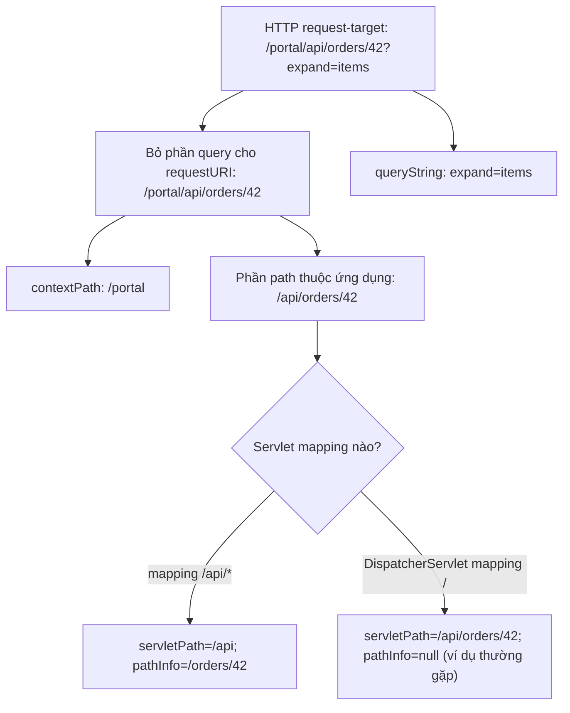
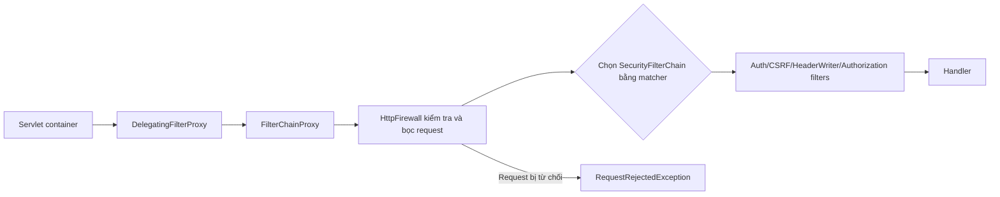

# contextPath, servletPath, pathInfo và dữ liệu dùng để khớp

## 1. Vì sao phải phân biệt các phần đường dẫn của Servlet request?

Trong chương **Firewall trên Servlet** thuộc module **SPRING_SECURITY_HTTP_PROTECTION**, ta học cách Spring Security xử lý HTTP request trước khi áp dụng những lớp phòng vệ như xác thực, phân quyền, CSRF, CORS, security headers, CSP, HSTS và bảo vệ session. Một quyết định bảo mật rất quan trọng là **chọn đúng `SecurityFilterChain` và `RequestMatcher` cho tài nguyên mà ứng dụng sẽ xử lý**.

Hãy xem một HTTP request đơn giản:

```http
GET /portal/admin/reports/2026?format=pdf HTTP/1.1
Host: app.example.test
```

Ở đây, `/portal` có thể là **context path** của ứng dụng, còn `/admin/reports/2026` có thể là phần path dùng để định tuyến và kiểm tra quyền. Nhưng đó chỉ là một **khả năng**: kết quả thực tế phụ thuộc servlet mapping và những biến đổi do gateway/Servlet container thực hiện.

Nếu team viết rule:

```java
.requestMatchers("/portal/admin/**").hasRole("ADMIN")
```

với suy nghĩ rằng phải khớp toàn bộ URL nhìn thấy trên browser, rule có thể **không khớp** trong một ứng dụng mà matcher xem đường dẫn **bên trong ứng dụng, không bao gồm context path**. Khi có fallback rule quá rộng như `permitAll`, sai lầm có thể ảnh hưởng đến phân quyền.

Ngược lại, nếu dùng một servlet riêng được mount ở `/api/*`, `servletPath` và `pathInfo` có thể là hai phần khác nhau. Một matcher chỉ kiểm tra `servletPath` mà bỏ `pathInfo` có thể không phân biệt được `/api/public` với `/api/admin` nếu mọi request đều mang `servletPath=/api`.

**Mục tiêu của bài:** hiểu chính xác những phần đường dẫn mà Servlet API cung cấp, dữ liệu mà matcher của Spring Security đọc, và vai trò của `HttpFirewall` trong việc tạo một góc nhìn đủ nhất quán trước khi chọn security chain.

### Kết quả học tập

Sau bài này, bạn có thể:

1. Phân biệt `getRequestURI()`, `getContextPath()`, `getServletPath()`, `getPathInfo()` và `getQueryString()`.
2. Giải thích vì sao context path không nên được thêm tùy tiện vào pattern security khi matcher dùng path trong ứng dụng.
3. Dự đoán cách servlet mappings như `/`, `/api/*` hoặc một servlet mapping cụ thể ảnh hưởng tới `servletPath` và `pathInfo`.
4. Phân biệt hành vi của các matcher như `AntPathRequestMatcher`, `MvcRequestMatcher` và các matcher dựa trên `PathPattern` tùy phiên bản.
5. Hiểu vai trò `StrictHttpFirewall`/`FirewalledRequest` trong việc từ chối đường dẫn mơ hồ trước khi matching.
6. Viết unit test và MockMvc test để xác nhận chain selection, authorization và những thuộc tính Servlet path.
7. Chẩn đoán khác biệt do reverse proxy, context root, servlet mapping, container, encoding và dispatcher type.
8. Nhận biết phần nào thuộc Servlet, phần nào cần tiếp cận khác khi hệ thống sử dụng Reactive/WebFlux.

## 2. Năm khái niệm phải tách biệt

HTTP client gửi một **request-target**. Servlet container parse request đó rồi cung cấp các giá trị thông qua `HttpServletRequest`.

Giả sử ứng dụng được triển khai ở context path `/portal`, một servlet có mapping `/api/*`, và client gửi:

```http
GET /portal/api/orders/42?expand=items HTTP/1.1
Host: app.example.test
```

Một bộ giá trị minh họa có thể là:

| Giá trị | Ví dụ | Vai trò |
| --- | --- | --- |
| HTTP request-target | `/portal/api/orders/42?expand=items` | Chuỗi đích request ở tầng HTTP/1.1; có cả query. |
| `getRequestURI()` | `/portal/api/orders/42` | Phần URI path do container cung cấp; **không** chứa query string. |
| `getContextPath()` | `/portal` | Prefix mà ứng dụng Servlet được mount. |
| `getServletPath()` | `/api` | Phần đường dẫn tương ứng servlet mapping `/api/*` trong ví dụ. |
| `getPathInfo()` | `/orders/42` | Phần path còn lại sau phần servlet mapping, theo Servlet API. |
| `getQueryString()` | `expand=items` | Query string, **không phải** một path segment. |

Đây là **một ví dụ ứng với mapping cụ thể**, không phải công thức cố định cho mọi servlet. Nếu `DispatcherServlet` dùng mapping `/`, giá trị `servletPath` thường phản ánh phần path ứng dụng dài hơn và `pathInfo` có thể là `null`.

### 2.1. Trường `contextPath`

`getContextPath()` biểu thị vị trí ứng dụng trong Servlet container:

- Ứng dụng ở root context thường có `contextPath` là chuỗi **rỗng** `""`, không phải `"/"`.
- Ứng dụng triển khai dưới `/portal` có `contextPath` là `"/portal"`.
- Container được gọi qua reverse proxy có thể không biết prefix URL public mà gateway thêm ở bên ngoài.

Context path **không tự động mang nghĩa “route bên trong ứng dụng”**. Nhiều matcher theo đường dẫn của Spring Security xét path **relative to context root**, vì vậy quy tắc `/admin/**` thường là điều cần viết ngay cả khi URL public là `/portal/admin/**`.

Tuy nhiên, **không suy mọi `RequestMatcher` đều có cùng hợp đồng**: một matcher tùy biến hoàn toàn có thể đọc `getRequestURI()` và xử lý context path theo cách riêng. Hãy xác định loại matcher đang sử dụng.

### 2.2. Trường `servletPath`

`getServletPath()` liên quan cách Servlet container ánh xạ request đến servlet. Nó không đơn giản luôn bằng `getRequestURI().substring(getContextPath().length())`.

Nếu ứng dụng dùng một Servlet mapping kiểu `/api/*`, trong nhiều tình huống:

```text
requestURI  = /portal/api/orders/42
contextPath = /portal
servletPath = /api
pathInfo    = /orders/42
```

Nhưng với Servlet mapping `/` của DispatcherServlet trong ứng dụng MVC thông thường, một request có thể xuất hiện dưới dạng:

```text
requestURI  = /portal/api/orders/42
contextPath = /portal
servletPath = /api/orders/42
pathInfo    = null
```

Hai bộ giá trị có cùng **URL từ client** nhưng khác **servlet mapping**. Đây là điều phải biết trước khi tự viết matcher.

### 2.3. Trường `pathInfo`

`getPathInfo()` là phần path mở rộng sau servlet path theo kiểu mapping tương ứng. Nó **có thể `null`**, không phải lúc nào cũng là chuỗi rỗng.

Một lỗi phổ biến:

```java
// Dễ sai: pathInfo có thể null.
boolean looksPublic = request.getPathInfo().startsWith("/public/");
```

Đây vừa là nguy cơ `NullPointerException`, vừa có thể bỏ qua `servletPath` của những servlet mà path info chỉ chứa phần đuôi. Đối với security matching, nên dùng matcher được framework hỗ trợ theo đúng servlet mapping thay vì tự ghép nhiều phần đường dẫn không rõ semantics.

### 2.4. Trường `requestURI`

`getRequestURI()` cung cấp URI path do container trình bày, bao gồm context path. Nó không bao gồm query string nhưng có thể mang những thông tin mã hóa hoặc path parameter khác với cách `servletPath`/`pathInfo` được container biểu diễn.

**Không dùng `requestURI.startsWith("/public")` rồi kết luận request thuộc policy public** nếu ứng dụng được mount dưới context path khác hoặc có đường dẫn chưa được chuẩn hóa.

### 2.5. Trường `queryString`

`GET /admin/reports?format=pdf` và `GET /admin/reports?format=csv` thường là **cùng một path route**, khác query parameters.

Nhiều matcher path tiêu chuẩn không đưa query string vào phép khớp path. Nhưng một `RequestMatcher` tùy chỉnh **có thể** kiểm tra cả method, query, header hoặc các thuộc tính request khác. Nếu một tham số thay đổi resource/tenant mà người dùng thực sự được phép truy cập, authorization ở tầng resource vẫn phải kiểm tra tham số đó.

## 3. Sơ đồ phân tách request path



Sơ đồ giúp ghi nhớ **một request-target có thể được biểu diễn bằng nhiều cặp servlet path/path info**. Những phép phân tách thực tế do Servlet container quản lý; không nên dùng sơ đồ thay cho test đối với mapping của dự án.

## 4. Servlet mappings làm thay đổi dữ liệu matcher có thể nhìn thấy

Servlet API hỗ trợ nhiều dạng URL mapping. Trong một ứng dụng Java web, servlet có thể được đăng ký qua `web.xml`, `@WebServlet`, hoặc Servlet registration của Spring Boot.

### 4.1. Mapping `/` của Spring MVC

Với `DispatcherServlet` được map `/`, request đến controller:

```java
import org.springframework.web.bind.annotation.GetMapping;
import org.springframework.web.bind.annotation.RestController;

@RestController
class ReportController {
    @GetMapping("/admin/reports")
    String reports() {
        return "private-report";
    }
}
```

Nếu context path là `/portal`, URL ngoài là:

```text
GET /portal/admin/reports
```

Thông thường controller mapping `/admin/reports` và security path matcher cần quan tâm phần path **bên trong ứng dụng**, không phải thêm `/portal` vào mọi pattern.

### 4.2. Mapping kiểu `/api/*`

Giả sử có một servlet khác:

```java
import jakarta.servlet.annotation.WebServlet;
import jakarta.servlet.http.HttpServlet;

@WebServlet("/api/*")
public class ApiServlet extends HttpServlet {
    // Có thể override doGet/doPost theo nhu cầu; đây chỉ là ví dụ mapping.
}
```

Với URL `/portal/api/orders/42`:

```text
getContextPath() = "/portal"
getServletPath() = "/api"
getPathInfo()    = "/orders/42"
```

Đây là kiểu ví dụ minh họa cho prefix mapping. Một matcher chỉ kiểm tra `getServletPath().equals("/api")` sẽ khớp **toàn bộ phần bên dưới `/api/*`** và không tự phân biệt `/orders/public` với `/orders/admin`.

### 4.3. Exact mapping và extension mapping

Một Servlet mapping đúng path như `/health` hoặc dạng extension như `*.do` có thể tạo các giá trị `servletPath`/`pathInfo` khác prefix mapping.

Do đó:

- Đừng đoán `pathInfo` dựa vào URL hiển thị trên browser.
- Đừng mặc định mọi servlet có cùng cách tách như DispatcherServlet.
- Khi có nhiều servlet registrations, hãy ghi rõ **mapping nào thuộc Spring MVC** và mapping nào thuộc một servlet khác.

### 4.4. Bảng quan sát minh họa

| Context | Servlet mapping | Request URI | `servletPath` thường gặp | `pathInfo` thường gặp |
| --- | --- | --- | --- | --- |
| Root `""` | `/` | `/admin/reports` | `/admin/reports` | `null` |
| `/portal` | `/` | `/portal/admin/reports` | `/admin/reports` | `null` |
| `/portal` | `/api/*` | `/portal/api/orders/42` | `/api` | `/orders/42` |
| Root `""` | `/api/*` | `/api/health` | `/api` | `/health` |
| `/portal` | Exact `/health` | `/portal/health` | `/health` | Thường `null` |

Bảng thể hiện **những kết quả phổ biến theo mapping**, không phải thay thế Servlet spec hoặc test trên container cụ thể. Request có path parameters, encoded separator hoặc forward có thể mang thêm đặc điểm cần kiểm tra.

## 5. Spring Security lấy dữ liệu nào để khớp?

Không có một câu trả lời duy nhất cho mọi loại `RequestMatcher`. Cần phân biệt:

1. **Matcher chọn `SecurityFilterChain`** — được cấu hình qua `http.securityMatcher(...)` hoặc cơ chế tương đương.
2. **Matcher trong authorization rules** — được cấu hình qua `authorizeHttpRequests(...requestMatchers(...))`.
3. **Matcher chuyên dụng khác** — chẳng hạn matcher cho CSRF exclusion hoặc một header writer có điều kiện.
4. **Matcher tự viết** — có thể đọc bất cứ thuộc tính request nào bạn lựa chọn.

### 5.1. `FilterChainProxy` chạy `HttpFirewall` trước matcher



Vì vậy, khi nói “matcher thấy `servletPath`”, cần nhớ matcher thường đang làm việc trên **`FirewalledRequest`**, không trực tiếp với request raw do một HTTP client gửi.

Một request bị `StrictHttpFirewall` từ chối do path chưa chuẩn hóa **không được chọn vào bất kỳ security chain nào**. `permitAll` không chữa được rejection này.

### 5.2. `AntPathRequestMatcher`: `servletPath` + `pathInfo`

Với matcher lịch sử `AntPathRequestMatcher` của Spring Security Servlet 6.x, phần path được khớp về cơ bản là **`servletPath + pathInfo`**, còn query string không quyết định phép khớp path. Khi `pathInfo` là `null`, matcher không coi chuỗi chữ `"null"` là một phần đường dẫn.

Ví dụ một request Servlet có:

```text
requestURI  = /portal/api/orders/42
contextPath = /portal
servletPath = /api
pathInfo    = /orders/42
```

thì matcher `/api/orders/**` có thể khớp. Pattern `/portal/api/orders/**` không tự nhiên khớp chỉ vì đó là URI đầy đủ ở client.

**Lưu ý phiên bản:** `AntPathRequestMatcher` là API cũ, đã bị deprecate/định hướng thay thế ở một số phiên bản Spring Security hiện đại. Dùng nó để **hiểu semantics và test dự án hiện có**, không xem đây là lựa chọn bắt buộc cho mọi dự án mới.

### 5.3. `MvcRequestMatcher`: đặt ngữ cảnh MVC đúng

`MvcRequestMatcher` dùng `HandlerMappingIntrospector` để khớp theo cách của Spring MVC. Nhờ đó, các quy tắc bảo mật MVC có thể bám sát cách MVC xử lý path, thay vì tự tái tạo logic của controller router.

Khi Spring MVC servlet **không được map tại `/`**, ví dụ DispatcherServlet ở `/mvc/*`, có thể cần chỉ rõ `servletPath` cho `MvcRequestMatcher`. Nếu không, matcher có thể diễn giải pattern theo ngữ cảnh khác dự kiến.

Ví dụ minh họa Spring Security 6.x:

```java
import org.springframework.context.annotation.Bean;
import org.springframework.security.config.annotation.web.builders.HttpSecurity;
import org.springframework.security.web.SecurityFilterChain;
import org.springframework.security.web.servlet.util.matcher.MvcRequestMatcher;
import org.springframework.web.servlet.handler.HandlerMappingIntrospector;

@Bean
SecurityFilterChain mvcChain(
        HttpSecurity http,
        HandlerMappingIntrospector introspector) throws Exception {

    MvcRequestMatcher.Builder mvc =
        new MvcRequestMatcher.Builder(introspector)
            .servletPath("/mvc");

    http.authorizeHttpRequests(auth -> auth
        .requestMatchers(mvc.pattern("/admin/**"))
            .hasRole("ADMIN")
        .requestMatchers(mvc.pattern("/public/**"))
            .permitAll()
        .anyRequest().authenticated());

    return http.build();
}
```

Ví dụ này giả định **DispatcherServlet thực sự được map ở `/mvc/*`**, Spring MVC có `HandlerMappingIntrospector` phù hợp và policy của dự án cần bảo vệ những route MVC bên dưới servlet đó. Nó không phải cấu hình dùng chung cho mọi servlet và không phải API bất biến qua mọi bản Spring Security.

**Điểm quan trọng:** `servletPath("/mvc")` trong builder phục vụ việc xác định **Servlet mapping**. Nó không phải nơi ghi `contextPath="/portal"`.

### 5.4. Matcher dựa trên `PathPattern`

Các phiên bản Spring Security/Spring Framework mới có matcher dựa trên `PathPattern`, chẳng hạn `PathPatternRequestMatcher` theo API được hỗ trợ trong phiên bản tương ứng. Pattern matching dựa trên parsed path có semantics khác các matcher dùng string Ant-style, nhất là với segments và encoding.

Không chuyển từ Ant/MVC matcher sang PathPattern matcher bằng cách **copy nguyên tất cả pattern mà không kiểm thử**. Hãy xác định:

- Pattern là relative với context root hay có base/servlet path riêng?
- Framework parse/decode path segments ở bước nào?
- Servlet mapping có nhiều servlet không?
- Có gateway rewrite hoặc context root khác nhau giữa môi trường không?
- Những route nhạy cảm đã được test với matcher mới chưa?

### 5.5. Matcher tùy chỉnh dễ tạo lỗ hổng nào?

Anti-pattern:

```java
// Không dùng như rule authorization cho tài nguyên nhạy cảm.
RequestMatcher unsafePublic = request ->
    request.getRequestURI().startsWith("/public/");
```

Rule này bỏ qua sự khác biệt context path và representation path, đồng thời dễ sai khi ứng dụng được deploy ở `/portal`. Nó cũng bỏ qua URL normalization, servlet mapping và khác biệt các tầng.

Nếu bắt buộc viết matcher tùy chỉnh, hãy định nghĩa rõ đường dẫn ở tầng nào được đọc, cách path đã được firewall kiểm tra, semantics của segments, case/encoding và kiểm thử cả request hợp lệ lẫn request mơ hồ.

## 6. `securityMatcher` và `requestMatchers` không cùng trách nhiệm

Giả sử ứng dụng có API và web UI:

```java
@Bean
@Order(1)
SecurityFilterChain apiChain(HttpSecurity http) throws Exception {
    http
        .securityMatcher("/api/**")
        .authorizeHttpRequests(auth -> auth
            .requestMatchers("/api/health").permitAll()
            .anyRequest().authenticated())
        .httpBasic(Customizer.withDefaults());

    return http.build();
}

@Bean
@Order(2)
SecurityFilterChain webChain(HttpSecurity http) throws Exception {
    http
        .authorizeHttpRequests(auth -> auth
            .requestMatchers("/public/**").permitAll()
            .anyRequest().authenticated())
        .formLogin(Customizer.withDefaults());

    return http.build();
}
```

Đây là hai method minh họa trong class `@Configuration`, với các imports `Bean`, `Order`, `HttpSecurity`, `SecurityFilterChain` và `Customizer` thích hợp. Ví dụ không nên được dùng nguyên xi để thay cấu hình production; các URL login, CSRF, CORS và session vẫn cần được thiết kế đầy đủ.

Phân biệt:

- `securityMatcher("/api/**")`: **chain API có nhận request này hay không**.
- `requestMatchers("/api/health").permitAll()`: **khi đã ở chain API**, endpoint này có được truy cập công khai không.
- `anyRequest().authenticated()`: fallback **bên trong chain được chọn**, không tự động áp cho request không vào chain đó.

Một lỗi nguy hiểm là dùng `securityMatcher("/admin/**")` để tạo chain ADMIN, sau đó chain fallback đặt `permitAll()` quá rộng. Nếu path matching của chain ADMIN sai vì nhầm context path/servletPath, tài nguyên admin có thể bị đưa vào fallback không phù hợp. **Luôn có fallback policy bảo thủ và test chain selection trên đúng Servlet mapping.**

## 7. Bảng ví dụ dữ liệu matcher dùng để quyết định

| URI client/backend | Servlet mapping | `contextPath` | `servletPath` | `pathInfo` | Với Ant-style path của Servlet, đường dẫn cần khớp thường là |
| --- | --- | --- | --- | --- | --- |
| `/admin/reports` | `/` | `""` | `/admin/reports` | `null` | `/admin/reports` |
| `/portal/admin/reports` | `/` | `/portal` | `/admin/reports` | `null` | `/admin/reports` |
| `/portal/api/orders/42` | `/api/*` | `/portal` | `/api` | `/orders/42` | `/api/orders/42` |
| `/portal/api/public/items` | `/api/*` | `/portal` | `/api` | `/public/items` | `/api/public/items` |
| `/portal/api/health?verbose=true` | `/api/*` | `/portal` | `/api` | `/health` | `/api/health` |
| `/portal/health` | Exact `/health` | `/portal` | `/health` | `null` | `/health` |

**Giả định của bảng:** HTTP request đã qua container và firewall, các giá trị path có dạng thông thường và mapping tạo kết quả như minh họa. Khi dùng `MvcRequestMatcher` hoặc `PathPatternRequestMatcher`, cần xác nhận chính API matcher, không suy nó ghép chuỗi giống Ant matcher trong mọi trường hợp.

## 8. Unit test: quan sát trực tiếp `contextPath`, `servletPath` và `pathInfo`

`MockHttpServletRequest` của Spring Test cho phép dựng từng trường và kiểm tra matcher trên input đã biết. Đây là cách tốt để học semantics mà không cần chạy HTTP server thật.

### 8.1. Một request thuộc root context

```java
import org.junit.jupiter.api.Test;
import org.springframework.mock.web.MockHttpServletRequest;

import static org.junit.jupiter.api.Assertions.assertEquals;
import static org.junit.jupiter.api.Assertions.assertNull;

class ServletPathComponentsTest {

    @Test
    void defaultServletMappingAtRootContext() {
        var request = new MockHttpServletRequest(
            "GET", "/admin/reports");

        request.setContextPath("");
        request.setServletPath("/admin/reports");

        assertEquals("/admin/reports", request.getRequestURI());
        assertEquals("", request.getContextPath());
        assertEquals("/admin/reports", request.getServletPath());
        assertNull(request.getPathInfo());
    }
}
```

Đây là **request object do test tự tạo**. `MockHttpServletRequest` không chạy thuật toán Servlet mapping của Tomcat/Jetty; ta đã khai báo `servletPath` bằng tay.

### 8.2. Một request trong context `/portal` với mapping `/api/*`

```java
@Test
void prefixMappedServletSeparatesServletPathAndPathInfo() {
    var request = new MockHttpServletRequest(
        "GET", "/portal/api/orders/42");

    request.setContextPath("/portal");
    request.setServletPath("/api");
    request.setPathInfo("/orders/42");
    request.setQueryString("expand=items");

    assertEquals("/portal/api/orders/42", request.getRequestURI());
    assertEquals("/portal", request.getContextPath());
    assertEquals("/api", request.getServletPath());
    assertEquals("/orders/42", request.getPathInfo());
    assertEquals("expand=items", request.getQueryString());
}
```

Test này cho thấy vì sao không nên chỉ lấy `servletPath` để đại diện toàn bộ route `/api/orders/42` trong một servlet prefix mapping.

### 8.3. Test Ant matcher theo semantics của phiên bản đang dùng

Trong ứng dụng còn dùng `AntPathRequestMatcher` ở Spring Security 6.x:

```java
import org.springframework.security.web.util.matcher.AntPathRequestMatcher;

import static org.junit.jupiter.api.Assertions.assertFalse;
import static org.junit.jupiter.api.Assertions.assertTrue;

@Test
void antMatcherSeesServletPathPlusPathInfoButNotContextPath() {
    var request = new MockHttpServletRequest(
        "GET", "/portal/api/orders/42");

    request.setContextPath("/portal");
    request.setServletPath("/api");
    request.setPathInfo("/orders/42");

    assertTrue(new AntPathRequestMatcher(
        "/api/orders/**").matches(request));

    assertFalse(new AntPathRequestMatcher(
        "/portal/api/orders/**").matches(request));
}
```

**Giới hạn:** bài test này chứng minh **`AntPathRequestMatcher` của version test** xử lý đối tượng mock như đã dựng. Nó không chứng minh mọi matcher được chọn tự động từ DSL string `requestMatchers(...)` đều có cùng implementation.

### 8.4. Test query không làm đổi path matching

```java
@Test
void queryStringIsNotPartOfAntPath() {
    var request = new MockHttpServletRequest(
        "GET", "/portal/api/orders/42");

    request.setContextPath("/portal");
    request.setServletPath("/api");
    request.setPathInfo("/orders/42");
    request.setQueryString("admin=true");

    assertTrue(new AntPathRequestMatcher(
        "/api/orders/**").matches(request));
}
```

Tuy vậy, `admin=true` có thể tác động tới **nghiệp vụ hoặc resource** nếu controller sử dụng nó; việc query không quyết định path matcher **không có nghĩa query luôn an toàn**.

## 9. Unit test `StrictHttpFirewall`: kiểm tra đầu vào trước khi khớp

Khi một request có đường dẫn bất thường, `HttpFirewall` xử lý trước chain matcher. Ví dụ:

```java
import org.junit.jupiter.api.Test;
import org.springframework.mock.web.MockHttpServletRequest;
import org.springframework.security.web.firewall.FirewalledRequest;
import org.springframework.security.web.firewall.RequestRejectedException;
import org.springframework.security.web.firewall.StrictHttpFirewall;

import static org.junit.jupiter.api.Assertions.assertEquals;
import static org.junit.jupiter.api.Assertions.assertThrows;

class ServletPathFirewallUnitTest {

    private final StrictHttpFirewall firewall = new StrictHttpFirewall();

    private MockHttpServletRequest request(String uri, String servletPath) {
        var request = new MockHttpServletRequest("GET", uri);
        request.setServletPath(servletPath);
        return request;
    }

    @Test
    void acceptsCanonicalPath() {
        FirewalledRequest safe =
            firewall.getFirewalledRequest(
                request("/admin/reports", "/admin/reports"));

        assertEquals("/admin/reports", safe.getServletPath());
        safe.reset();
    }

    @Test
    void rejectsSemicolonByDefault() {
        assertThrows(RequestRejectedException.class,
            () -> firewall.getFirewalledRequest(
                request("/admin;v=1/reports",
                        "/admin;v=1/reports")));
    }

    @Test
    void rejectsUnnormalizedPath() {
        assertThrows(RequestRejectedException.class,
            () -> firewall.getFirewalledRequest(
                request("/public/../admin/reports",
                        "/public/../admin/reports")));
    }
}
```

Kết quả kỳ vọng theo `StrictHttpFirewall` mặc định của nhiều bản Spring Security hiện đại. Nếu version khác hoặc đã bật tùy chọn nới lỏng, phải xác minh hành vi thực tế, không tự thay URL kiểm thử để làm “pass”.

### 9.1. Giới hạn quan trọng của mock

`MockHttpServletRequest` **không mô phỏng việc HTTP connector parse URL**. Tomcat/Jetty/Undertow hoặc reverse proxy có thể reject hoặc rewrite URL **trước khi** Spring Security nhìn thấy nó.

Vì vậy, test `RequestRejectedException` ở trên chỉ chứng minh firewall từ chối request object đã dựng. Muốn đánh giá ứng dụng production nhận status, chain và resource nào qua URI bất thường, cần test trên **Servlet HTTP server thật**.

### 9.2. Khi nào `RequestRejectedException` trở thành HTTP 400?

Điều này còn phụ thuộc `RequestRejectedHandler` và cách error handling được cấu hình trong Spring Security/container. Một unit test `assertThrows(...)` không tự chứng minh client HTTP luôn nhận `400`. Nếu request bị container từ chối trước filter, Spring Security có thể **không có log rejection**.

## 10. MockMvc: kiểm tra context path trong security rules

Giả sử controller `ReportController` có `@GetMapping("/admin/reports")`, thêm một public endpoint:

```java
import org.springframework.web.bind.annotation.GetMapping;
import org.springframework.web.bind.annotation.RestController;

@RestController
class DemoResourceController {

    @GetMapping("/public/info")
    String publicInfo() {
        return "public-ok";
    }

    @GetMapping("/admin/reports")
    String adminReports() {
        return "admin-ok";
    }
}
```

Security configuration minh họa:

```java
import org.springframework.context.annotation.Bean;
import org.springframework.context.annotation.Configuration;
import org.springframework.security.config.Customizer;
import org.springframework.security.config.annotation.web.builders.HttpSecurity;
import org.springframework.security.web.SecurityFilterChain;

@Configuration
class DemoWebSecurityConfig {

    @Bean
    SecurityFilterChain webChain(HttpSecurity http) throws Exception {
        http
            .authorizeHttpRequests(auth -> auth
                .requestMatchers("/public/**").permitAll()
                .requestMatchers("/admin/**").hasRole("ADMIN")
                .anyRequest().authenticated())
            .httpBasic(Customizer.withDefaults());

        return http.build();
    }
}
```

Các rule biểu thị **đường dẫn của ứng dụng**, không thêm context path `/portal` vào pattern khi matcher của dự án có semantics tương ứng. Đây là ví dụ Servlet Spring Security 6.x trong một ứng dụng dùng mapping MVC thông thường; kiểm chứng loại matcher được DSL sử dụng theo runtime.

### 10.1. Kiểm thử context path mà không cấp quyền nhầm

```java
import org.junit.jupiter.api.Test;
import org.springframework.beans.factory.annotation.Autowired;
import org.springframework.boot.test.autoconfigure.web.servlet.AutoConfigureMockMvc;
import org.springframework.boot.test.context.SpringBootTest;
import org.springframework.test.web.servlet.MockMvc;

import static org.springframework.security.test.web.servlet.request.SecurityMockMvcRequestPostProcessors.user;
import static org.springframework.test.web.servlet.request.MockMvcRequestBuilders.get;
import static org.springframework.test.web.servlet.result.MockMvcResultMatchers.status;

@SpringBootTest
@AutoConfigureMockMvc
class ServletContextPathSecurityTest {

    @Autowired MockMvc mvc;

    @Test
    void publicRouteWorksInsidePortalContext() throws Exception {
        mvc.perform(get("/portal/public/info")
                .contextPath("/portal")
                .servletPath("/public/info"))
            .andExpect(status().isOk());
    }

    @Test
    void adminRouteRequiresAdminInsidePortalContext() throws Exception {
        mvc.perform(get("/portal/admin/reports")
                .contextPath("/portal")
                .servletPath("/admin/reports")
                .with(user("reader").roles("USER")))
            .andExpect(status().isForbidden());

        mvc.perform(get("/portal/admin/reports")
                .contextPath("/portal")
                .servletPath("/admin/reports")
                .with(user("owner").roles("ADMIN")))
            .andExpect(status().isOk());
    }
}
```

`user(...)` yêu cầu `spring-security-test`. Cấu hình test phải nạp security chain và controller đúng; `MockMvc` không tự trở thành HTTP server có TLS/proxy. Phần `servletPath(...)` được đặt rõ để ví dụ khớp các API path; ở ứng dụng thực nó đến từ Servlet mapping do container cung cấp.

**Kết quả quan trọng nhất:** request admin dưới `/portal` vẫn bị yêu cầu role ADMIN. Nếu test chỉ kiểm tra `200` cho ADMIN mà không có ca `403` cho USER, có thể bỏ sót lỗi cấp quyền sai.

### 10.2. Những lỗi có thể che dấu bằng fallback quá rộng

Anti-pattern:

```java
http.authorizeHttpRequests(auth -> auth
    .requestMatchers("/portal/admin/**").hasRole("ADMIN")
    .anyRequest().permitAll());
```

Trong hệ thống mà matcher dùng path relative to context root, pattern có `/portal` có thể không khớp `/admin/reports`; `anyRequest().permitAll()` có thể khiến admin route công khai.

**Tránh dùng fallback `permitAll`** ở ứng dụng cần bảo vệ. Với hệ thống có nhiều security chains, còn phải bảo đảm có fallback chain phù hợp nếu các `securityMatcher` chuyên biệt không khớp.

## 11. Quan sát path qua controller để kiểm chứng mapping

Trong môi trường test/staging, có thể tạo endpoint **chỉ để chẩn đoán** các giá trị Servlet path:

```java
import java.util.LinkedHashMap;
import java.util.Map;

import jakarta.servlet.http.HttpServletRequest;
import org.springframework.web.bind.annotation.GetMapping;
import org.springframework.web.bind.annotation.RestController;

@RestController
class ServletPathDiagnosticController {

    @GetMapping("/demo/path")
    Map<String, Object> path(HttpServletRequest request) {
        var values = new LinkedHashMap<String, Object>();

        values.put("requestURI", request.getRequestURI());
        values.put("contextPath", request.getContextPath());
        values.put("servletPath", request.getServletPath());
        values.put("pathInfo", request.getPathInfo());
        values.put("queryString", request.getQueryString());

        return values;
    }
}
```

Đoạn này giúp hiểu container mapping nhưng **không nên mở công khai trong production**; đường dẫn có thể chứa thông tin nhạy cảm trong URI/query. Dùng endpoint trong profile test, hạn chế truy cập, không log token hoặc request headers không cần thiết.

Đối với request `GET /portal/demo/path?x=1` khi DispatcherServlet mapping `/`, response minh họa có thể chứa:

```json
{
  "requestURI": "/portal/demo/path",
  "contextPath": "/portal",
  "servletPath": "/demo/path",
  "pathInfo": null,
  "queryString": "x=1"
}
```

Nếu servlet mapping khác, hãy coi kết quả thực quan sát **là dữ liệu**, không cố sửa output để khớp giả định.

### 11.1. Tại sao không debug bằng cách ghi raw URI vào mọi log?

URL/query có thể chứa định danh cá nhân, token nhúng sai chỗ hoặc ký tự điều khiển nhằm làm hỏng log. Khi cần quan sát `requestURI`, hãy dùng endpoint được bảo vệ trong test, có escaping/correlation ID và giới hạn retention. Không ghi `Authorization`, cookie session hoặc CSRF token trong logs phục vụ bài học.

## 12. Multiple servlets: nguy cơ nhầm `servletPath` với một prefix route

Một Spring Boot app có thể vừa chạy MVC `DispatcherServlet` vừa đăng ký servlet khác, ví dụ một admin console, một servlet legacy hoặc một thư viện thứ ba.

Ví dụ:

```text
DispatcherServlet  -> mapping /
LegacyReportServlet -> mapping /legacy/*
```

Request `/legacy/reports/42` có thể có:

```text
servletPath = /legacy
pathInfo    = /reports/42
```

Nếu một custom matcher so `servletPath` với `/legacy/reports/42`, nó có thể không khớp, vì phần `/reports/42` nằm trong `pathInfo`.

Một matcher được thiết kế cho Spring MVC, ngược lại, không tự động bảo vệ một non-MVC servlet theo cùng cách MVC route mapping. Với nhiều servlet registrations, nên:

1. Ghi rõ servlet mapping của từng thành phần.
2. Chọn matcher phù hợp cho **MVC routes** và cho **non-MVC servlet**.
3. Đảm bảo `SecurityFilterChain` bảo vệ toàn bộ phần URI nhạy cảm, không chỉ servlet prefix.
4. Có fallback policy bảo thủ cho request không khớp chain chuyên biệt.
5. Kiểm tra authorization theo resource ở servlet/handler cuối.
6. Test request thật qua container, không chỉ dựng path object bằng mock.

### 12.1. Minh họa matcher xem cả `servletPath` và `pathInfo`

Trong ứng dụng legacy dùng `AntPathRequestMatcher`:

```java
RequestMatcher legacyOrders = new AntPathRequestMatcher(
    "/legacy/reports/**");

boolean matched = legacyOrders.matches(request);
```

Với `servletPath="/legacy"` và `pathInfo="/reports/42"`, matcher có thể khớp. Nhưng code sau **không tương đương**:

```java
// Anti-pattern: bỏ pathInfo nên coi mọi request vào một servlet là giống nhau.
boolean matched = request.getServletPath()
    .equals("/legacy/reports/42");
```

Phần đuôi `/reports/42` không nhất thiết nằm trong `servletPath`. Hãy test đúng API matcher và version.

## 13. Path parameters, encoded slash và dữ liệu trước/sau firewall

`StrictHttpFirewall` của Spring Security Servlet thường từ chối một số dạng đường dẫn chưa chuẩn hóa hoặc có ký tự phân cách dễ gây khác biệt diễn giải.

### 13.1. Semicolon và matrix parameters

Ví dụ:

```text
/admin;view=compact/reports
```

Một container có thể trình bày path parameter khác nhau trong `requestURI` so với `servletPath`/`pathInfo`. Nếu security matcher và handler không nhất quán, việc phân quyền theo string path dễ sai. Đó là một lý do `StrictHttpFirewall` thường từ chối semicolon theo mặc định.

Không bật `setAllowSemicolon(true)` chỉ để một URL có `;` trả `200`. Khi có nhu cầu matrix variables thật, cần threat model và test từng route nhạy cảm.

### 13.2. Encoded slash và double decoding

```text
/api/files/a%2Fb
/api/files/a%252Fb
```

Chuỗi `%2F` có thể được giữ nguyên, giải mã hoặc từ chối ở gateway/container tùy config. Với `%252F`, một tầng decode có thể tạo `%2F` rồi tầng sau decode thêm thành slash. Điều này thay **ranh giới segment**.

Nếu một bước authorization kiểm tra raw URI nhưng bước mở file/storage decode thêm, có thể xuất hiện khác biệt tài nguyên được cấp quyền và tài nguyên được truy cập.

**Giải pháp khuyến nghị:** dùng opaque ID không chứa slash hoặc đưa dữ liệu có slash sang body/query đã được validate. Nếu giao thức buộc encoded slash, kiểm tra toàn bộ pipeline từ proxy đến handler và viết regression tests theo container/version cụ thể.

### 13.3. Dot segments và double slash

```text
/public/../admin/reports
/admin//reports
```

Không được giả định một matcher trong Spring Security sẽ thấy cùng chuỗi raw mà client gửi. Client, proxy và Servlet container có thể normalize trước khi request đến `HttpFirewall`. `StrictHttpFirewall` có thể từ chối request chưa chuẩn hóa nếu còn nhìn thấy dạng đó.

`permitAll("/public/**")` không sửa được lỗi firewall rejection; cũng không nên cho phép request có dot segments chỉ vì người dùng biết URL.

### 13.4. Firewall request wrapper và matching

`HttpFirewall` có thể trả `FirewalledRequest`, cung cấp representation phù hợp cho quá trình security matching. Một số implementation xử lý path parameters hoặc các dạng URL nhất định khác nhau; `StrictHttpFirewall` thiên về reject request bất thường.

**Không coi `FirewalledRequest` là dịch vụ canonicalize an toàn cho mọi resource.** Khi handler dùng file path, tenant ID hoặc object ID, vẫn phải validate và authorize chính **resource được chọn**, không dựa duy nhất vào việc request đã qua firewall.

## 14. Tác động của Servlet container và reverse proxy

Cùng một browser URL có thể trải qua:

```text
Browser:  https://app.example.test/portal/admin/reports
Gateway:  /portal/admin/reports  -> upstream /admin/reports
Backend:  http://127.0.0.1:8080/admin/reports
```

Trong ví dụ, `/portal` là prefix do gateway quản lý, **chưa chắc** là `contextPath` của Java app. Backend có thể được mount ở root và thấy:

```text
contextPath = ""
servletPath = /admin/reports
```

Nếu nhóm phát triển dựa trên `X-Forwarded-Prefix` để suy rằng `contextPath` luôn là `/portal`, có thể sai: forwarded-prefix handling phụ thuộc cấu hình framework/proxy và không nhất thiết thay đổi tất cả Servlet path API như kỳ vọng.

### 14.1. Hai kiến trúc có cùng public URL nhưng matcher khác nhau

| Public URL | Gateway/Backend deployment | Path thường cần matcher quan tâm |
| --- | --- | --- |
| `/portal/admin/reports` | Ứng dụng thật được mount dưới context `/portal` | `/admin/reports` trong nhiều standard matchers. |
| `/portal/admin/reports` | Gateway strip `/portal`, backend root context `""` | `/admin/reports`. |
| `/portal/admin/reports` | Gateway giữ `/portal`, backend root context và MVC map path `/portal/admin/reports` | Có thể là `/portal/admin/reports`. |
| `/portal/api/orders` | Gateway rewrite vào một servlet map `/api/*` | Cần biết `servletPath` + `pathInfo` thực tế. |

Không suy từ public URL để tự viết matcher khi chưa biết **upstream URI, servlet mapping, context root và matcher implementation**.

### 14.2. Container không có một behavior chung bất biến

| Thành phần | Yếu tố thay đổi kết quả |
| --- | --- |
| Tomcat | Connector/version, URI encoded slash policy, Servlet mapping và Spring Boot integration. |
| Jetty | URI compliance/normalization settings, version, Servlet mapping. |
| Undertow | URL decoding, encoded slash options, listener/handler config và version. |
| NGINX/Ingress | Rewrite rules, URI normalization, encoded path handling và routing. |
| CDN | Cache key, redirect, normalization và origin-request policy. |

Không khẳng định kiểu “Tomcat luôn decode `%2F` nhưng Jetty luôn từ chối”. Phải đo trên **đúng phiên bản và cấu hình triển khai**.

### 14.3. Vì sao MockMvc không thay được on-wire test?

MockMvc dựng Servlet request object để chạy Spring MVC và security filters trong test context. Nó không chạy toàn bộ HTTP parser của Servlet container, không phải CDN, và không chứng minh proxy chuyển request-target nguyên vẹn.

Với lỗi encoded slash, semicolon hoặc dot segments, cần kết hợp:

- **Unit test matcher/firewall** đối với request object đã dựng.
- **MockMvc integration test** kiểm tra chain selection và quyền.
- **HTTP integration test** qua Servlet container thực.
- **Staging end-to-end test** qua proxy/gateway nếu hệ thống có một tầng như vậy.

## 15. RequestDispatcher, forward, include và error dispatch

Trong Servlet, một request có thể được forward/include đến thành phần khác hoặc đi qua error dispatch. Khi đó có thể xuất hiện sự khác biệt giữa **đường dẫn ban đầu** và **đường dẫn của dispatch hiện tại**, cùng các request attributes dành cho forward/include/error theo Servlet API.

### 15.1. Vì sao cần quan tâm?

Ví dụ một handler ở `/router` forward nội bộ đến `/admin/reports`. Tùy filter mapping/dispatcher types và cấu hình Spring Security, request có thể đi qua một hoặc nhiều pha xử lý. Không giả định các security filters tự động chạy lại trên mọi dispatch type.

Một lỗi cấu hình khác là viết authorization dựa trên đường dẫn ban đầu nhưng controller thực tế được điều hướng đến resource nhạy cảm. Để giải quyết, cần xem:

1. Dispatcher types mà Spring Security filter registration áp dụng.
2. Quy tắc forward/include/error trong Servlet container.
3. DispatcherServlet/handler mapping cuối cùng.
4. Authorization cho resource thực.
5. Test các đường forward nếu ứng dụng sử dụng chúng.

Không dùng forward nội bộ như cách “bỏ qua” bảo mật URL. Đối với ứng dụng REST hiện đại, thường nên hạn chế những chuyển tiếp không cần thiết tới tài nguyên nhạy cảm.

### 15.2. Error page không nhất thiết mang cùng path APIs

Khi request đi qua error dispatch, controller/error handler có thể nhận các thuộc tính request liên quan URI gốc và đường dẫn xử lý lỗi. Nếu debug một `404`/`500`, hãy xác định dispatcher type trước khi kết luận security matcher đã chọn sai.

## 16. Kiểm tra policy qua dữ liệu thực, không chỉ một regex

Một pattern `"/admin/**"` có thể bảo vệ namespace admin, nhưng **không đủ** để chứng minh mọi tài nguyên bên trong hợp lệ với người dùng hiện tại.

Ví dụ:

```text
GET /api/files/tenant-a/report-42
```

Dù path canonical, ứng dụng phải xác minh:

- Principal đã được xác thực chưa?
- Người đó có quyền xem `report-42`?
- Resource thuộc tenant nào?
- Các tham số query hoặc body có làm chọn resource khác không?
- Nếu POST/PUT/DELETE dùng cookie session, CSRF policy có áp đúng không?

Nên thực hiện authorization theo **resource identity đã được parser/router xác định** và thông tin người dùng, thay vì chỉ kiểm tra một tiền tố chuỗi.

### 16.1. CORS không sửa được sai path matching

Nếu preflight `OPTIONS` bị từ chối vì HTTP method allowlist hoặc path không hợp lệ, browser có thể báo CORS error. Nhưng CORS là cơ chế dành cho browser cross-origin; nó không quyết định servlet mapping hoặc quyền truy cập một resource.

Đừng thêm `Access-Control-Allow-Origin: *` hay tắt CSRF để sửa lỗi servletPath/pathInfo.

### 16.2. Security headers và HSTS cũng khác nhiệm vụ

`X-Frame-Options`, CSP hoặc `Strict-Transport-Security` là response headers. Chúng không bảo đảm một request path được chọn đúng chain. HSTS còn phụ thuộc HTTPS public, không thay path normalization.

Một request bị `HttpFirewall` từ chối sớm có thể chưa qua `HeaderWriterFilter`, vì vậy lỗi response có thể thiếu header mà response 200 từ controller có. Cần phân biệt tầng tạo response khi chẩn đoán.

## 17. Kiểm thử phản hồi theo cả chain selection và authorization

Chỉ thấy header `X-Demo-Chain: admin` trong response chưa chứng minh rule authorization bên trong chain đúng. Chỉ thấy HTTP `200` cũng chưa chứng minh controller trả đúng resource.

Một ma trận kiểm thử mẫu:

| Case | Path ở ứng dụng | Kỳ vọng |
| --- | --- | --- |
| Anonymous GET public | `/public/info` | `200`, route public đúng. |
| User role USER GET admin | `/admin/reports` | `403`, không lộ dữ liệu. |
| User role ADMIN GET admin | `/admin/reports` | `200`, resource đúng. |
| Same admin under context root `/portal` | Matcher xét route admin relative to context | Vẫn yêu cầu ADMIN. |
| Prefix servlet `/api/*` với `pathInfo=/orders/42` | Route API orders | Rule API đúng; không bỏ phần pathInfo. |
| URI semicolon | `/admin;v=1/reports` | Reject theo strict policy hoặc xử lý theo ngoại lệ đã review; không được bypass. |
| Encoded slash | `/files/a%2Fb` | Test theo policy/container; không đổi resource trái quyền. |
| Double slash/dot segment | `/admin//reports`, `/public/../admin` | Không rơi vào chain/public rule sai. |
| Gateway strip prefix | Public `/portal/admin/reports`, backend `/admin/reports` | Chain ADMIN và authorization đúng. |
| CORS preflight | `OPTIONS /api/orders` | CORS đúng, không bị nhầm thành resource path khác. |
| Request bị parser từ chối | URI malformed | Tầng tạo 4xx được xác định; không ép matcher chịu trách nhiệm khi chưa nhận request. |

### 17.1. Các phép thử âm tính quan trọng hơn test “có hoạt động không?”

Một cấu hình security cần chứng minh **người không đủ quyền không thể vào resource nhạy cảm**. Đừng dừng lại ở việc ADMIN vào được trang. Với nhiều context path/servlet mappings, hãy có test USER/anonymous cho admin namespace trên từng cấu hình.

### 17.2. Không bỏ qua security chain fallback

Khi có nhiều `SecurityFilterChain`, request chỉ đi qua chain khớp được chọn. Một chain chuyên `/api/**` và một chain chuyên `/admin/**` mà **không có chain fallback** có thể để những URL ngoài scope không được xử lý bởi Spring Security filters theo cách team dự định.

Thiết kế fallback rõ ràng, thận trọng; nếu dùng `anyRequest().authenticated()` trong chain fallback, vẫn kiểm tra nó thực sự nhận những request còn lại.

## 18. Chẩn đoán lỗi phổ biến

| Triệu chứng | Giả thuyết | Phép kiểm hữu ích |
| --- | --- | --- |
| Đổi context root từ `""` sang `/portal` làm admin route bị công khai | Pattern chứa sai `/portal` hoặc fallback `permitAll`. | Test anonymous/USER trên `/portal/admin/**` và kiểm tra matcher. |
| Controller map `/api/orders` nhưng custom matcher chỉ nhìn `servletPath="/api"` | Bỏ qua `pathInfo` của prefix servlet. | In path APIs trong staging/test và dùng matcher phù hợp. |
| `MvcRequestMatcher` không khớp khi MVC servlet map `/mvc/*` | Chưa chỉ rõ `servletPath` trong builder. | Kiểm tra `HandlerMappingIntrospector` và servlet mapping. |
| Ant matcher test pass, production dùng matcher khác | DSL chọn implementation khác theo version/config. | Kiểm tra matcher runtime và integration test. |
| URI public có `/portal` nhưng backend contextPath rỗng | Gateway strip prefix. | So public URL, upstream path và servlet APIs. |
| `X-Forwarded-Prefix` được gửi nhưng controller vẫn thấy contextPath rỗng | Forwarded header handling không tự đổi mọi Servlet API. | Xác minh trusted proxy config và behavior thực. |
| `pathInfo` luôn null trong MVC | DispatcherServlet mapping `/` thường dẫn tới kết quả này. | Không ép API phải có pathInfo; xem mapping. |
| encoded slash bị từ chối trước Java | HTTP connector/proxy policy. | So logs từng hop và container version. |
| semicolon gây `RequestRejectedException` | `StrictHttpFirewall` policy. | Không sửa bằng `permitAll`; đánh giá nhu cầu matrix variable. |
| request có `..` trả `404` thay vì `400` | Client/proxy đã normalize hoặc handler mapping khác. | Kiểm tra request-target thực và parser. |
| MockMvc thấy một servletPath khác Tomcat | Mock tự set fields, không thực hiện HTTP parsing. | Dùng embedded server test. |
| `401` cho admin dù có cookie | Authentication/session không hợp lệ, không hẳn matcher sai. | Xác định chain, auth entry point và session. |
| `403` POST nhưng GET cùng URL pass | CSRF hoặc authorization/method policy. | Kiểm tra token, method và rule quyền. |
| CSP thiếu trên lỗi 400 | Lỗi phát trước `HeaderWriterFilter`. | Tìm tầng tạo lỗi; kiểm tra edge policy. |
| Forward tới admin handler nhưng auth thiếu | Dispatcher types, path/resource authorization. | Test forward dispatch và resource-level security. |
| URL có query `?admin=true` vẫn vào public path | Query không làm đổi path matcher, nhưng có thể đổi nghiệp vụ. | Authorize resource sau parse query. |
| Nâng Spring Security đổi path matching behavior | Matcher API/deprecation, path parsing, defaults. | Chạy regression across URL/method/container. |

### Quy trình xử lý bảy bước

1. **Ghi rõ request:** public URL, upstream URL, method, query, context root, proxy và thời điểm.
2. **Đọc Servlet path APIs tại điểm được phép:** `requestURI`, `contextPath`, `servletPath`, `pathInfo` và dispatcher type.
3. **Xác định servlet mapping:** `/`, `/api/*`, exact hoặc extension mapping.
4. **Xác định matcher thực sự dùng:** Ant/MVC/PathPattern/custom, chain matcher và authorization matcher.
5. **Kiểm tra firewall và container:** request có bị từ chối/chuẩn hóa trước matching không?
6. **Test cả routing lẫn authorization:** role đúng/sai, anonymous, fallback, resource identity.
7. **Sửa hẹp và test lại qua HTTP server/proxy**, bảo toàn CSRF, CORS, security headers, HSTS và session.

## 19. Bài tập tình huống

### Bài A — Context path không phải route prefix

App chạy ở `/portal`, `DispatcherServlet` map `/`, URL `/portal/admin/reports`. Một rule đặt `/portal/admin/**`, fallback `permitAll`.

**Gợi ý:** nhiều standard matchers xem path trong ứng dụng là `/admin/reports`; rule có prefix context path có thể không khớp. Sửa pattern dựa trên matcher/version thực và đổi fallback thành chính sách thận trọng; test anonymous.

### Bài B — Prefix servlet mapping

Servlet map `/api/*`, request `/portal/api/orders/42` có `servletPath=/api` và `pathInfo=/orders/42`.

**Gợi ý:** chỉ kiểm tra `servletPath` không đủ để phân biệt order path. Matcher phù hợp phải xét path mà API định nghĩa, gồm phần `pathInfo` khi semantics yêu cầu.

### Bài C — Query string và resource-level authorization

`GET /public/data?tenant=other` có path public nhưng query chỉ định tenant.

**Gợi ý:** query thường không quyết định path matcher; controller/service vẫn phải kiểm tra quyền đối với tenant/resource đã chọn.

### Bài D — DispatcherServlet map `/mvc/*`

Các controller MVC ở `/mvc/admin/**` không khớp `MvcRequestMatcher` như kỳ vọng.

**Gợi ý:** kiểm tra mapping thực, `HandlerMappingIntrospector` và `MvcRequestMatcher.Builder.servletPath("/mvc")` khi phù hợp; không nhầm `/mvc` với context path.

### Bài E — Reverse proxy strip prefix

Public URL `/portal/admin/reports`, gateway chuyển upstream `/admin/reports`, backend chạy root context.

**Gợi ý:** backend `contextPath=""`, matcher theo path backend; không đặt `/portal` vào pattern chỉ vì public URL có prefix.

### Bài F — HTTP parser xử lý encoded slash

MockMvc chấp nhận một request object có `%2F` nhưng Tomcat staging trả `400` trước khi vào Spring Security.

**Gợi ý:** mock không có HTTP parser. Cần xem connector/gateway policy và thiết kế ID không dựa vào encoded separator.

### Bài G — Semicolon và firewall

Request `/admin;v=1/reports` phát `RequestRejectedException`. Developer thêm `permitAll("/admin/**")`.

**Gợi ý:** firewall từ chối trước chain selection; authorization không làm URL hợp lệ. Đánh giá semicolon có thật cần không.

### Bài H — Forward nội bộ

Servlet handler forward từ `/router` tới `/admin/reports`. Security policy chỉ xét request ban đầu.

**Gợi ý:** kiểm tra dispatcher types, error/forward attributes và authorization resource đích; không dựa hoàn toàn vào path ban đầu khi có forward.

### Bài I — Nâng version đổi matcher

Sau nâng Spring Security, nhóm thay Ant-based matcher bằng PathPattern-based matcher. Một số pattern cũ không khớp.

**Gợi ý:** semantics khác nhau theo implementation; kiểm tra matcher runtime và viết test cả ca được phép/không được phép cho các route quan trọng.

### Bài J — Header đẹp nhưng tài nguyên lộ

Response `200` có CSP/HSTS/`nosniff` đầy đủ nhưng một user thường vẫn đọc được report admin do rule `anyRequest().permitAll()`.

**Gợi ý:** HTTP response headers không thay authorization; phải sửa security matcher và fallback, kiểm tra quyền theo role và resource.

## 20. Checklist triển khai an toàn

1. **Biết rõ Servlet context root** của ứng dụng và không nhầm nó với prefix do gateway thêm.
2. **Biết rõ Servlet mapping**, nhất là khi có nhiều servlets hoặc DispatcherServlet không map ở `/`.
3. **Phân biệt `requestURI`, `contextPath`, `servletPath`, `pathInfo` và `queryString`** trước khi viết rule.
4. **Không tự ghép path string để cấp quyền** nếu có matcher framework đáp ứng đúng semantics.
5. **Xem loại matcher runtime đang dùng**, không giả định tất cả DSL string luôn là Ant matcher.
6. **Dùng `MvcRequestMatcher` với servletPath đúng** nếu MVC servlet mapping đòi hỏi.
7. **Để `HttpFirewall` kiểm tra request trước chain matching**; không nới URL bất thường chỉ để test status 200 pass.
8. **Không dùng fallback `permitAll` quá rộng** trên ứng dụng có tài nguyên nhạy cảm.
9. **Test cả user có quyền và không có quyền**, kết hợp route đúng và resource-level authorization.
10. **Không giải mã path nhiều lần sau authorization** rồi chọn resource khác.
11. **Kiểm tra rewrite/normalization tại proxy và container**, không chỉ MockMvc.
12. **Phân biệt xử lý forward/error dispatch** khi ứng dụng có nhiều pha xử lý Servlet.
13. **Giữ CSRF, CORS, session, security headers/CSP/HSTS theo trách nhiệm riêng**; các cơ chế này không thay path matching.
14. **Chạy regression khi thay context root, container, servlet mapping hoặc phiên bản Spring Security**.
15. **Gỡ endpoint/marker debug trước production** và không log raw token/cookie/query nhạy cảm.

## 21. Đối chiếu nhanh với Reactive/WebFlux

Dịch vụ **SPRING_SECURITY_HTTP_PROTECTION** bao gồm cả Servlet và Reactive. Tuy nhiên, `contextPath`, `servletPath`, `pathInfo` và `StrictHttpFirewall` trong bài này là những khái niệm/API đặc trưng cho **Servlet stack**.

| Vấn đề | Servlet | Reactive/WebFlux |
| --- | --- | --- |
| Request abstraction | `HttpServletRequest` | `ServerWebExchange` / `ServerHttpRequest` |
| Path decomposition | `contextPath`, `servletPath`, `pathInfo` | Reactive request path abstraction, context path theo API tương ứng |
| Security chain | `SecurityFilterChain` | `SecurityWebFilterChain` |
| Matcher | `RequestMatcher` | `ServerWebExchangeMatcher` |
| Firewall đang bàn | `HttpFirewall` / `StrictHttpFirewall` | Không phải cùng Servlet `HttpFirewall` API |
| HTTP server | Servlet container như Tomcat/Jetty/Undertow tùy deployment | Reactive HTTP server như Reactor Netty/Jetty tùy deployment |
| Kiểm thử chính | MockMvc và HTTP Servlet integration | WebTestClient và Reactive HTTP integration |

WebFlux vẫn gặp nguy cơ proxy path rewrite, encoded separators và phân quyền sai route, nhưng không nên sao chép nguyên `getServletPath()` hoặc `MvcRequestMatcher` sang WebFlux. Phải sử dụng các API và kiểm thử phù hợp với Reactive stack.

### Tài liệu tham khảo

- [Spring Security Reference — Servlet Security Architecture](https://docs.spring.io/spring-security/reference/servlet/architecture.html)
- [Spring Security Reference — Servlet HTTP Firewall](https://docs.spring.io/spring-security/reference/servlet/exploits/firewall.html)
- [Spring Security Reference — Authorize HTTP Requests](https://docs.spring.io/spring-security/reference/servlet/authorization/authorize-http-requests.html)
- [Spring Security API — RequestMatcher](https://docs.spring.io/spring-security/site/docs/current/api/org/springframework/security/web/util/matcher/RequestMatcher.html)
- [Spring Security API — FilterChainProxy](https://docs.spring.io/spring-security/site/docs/current/api/org/springframework/security/web/FilterChainProxy.html)
- [Spring Security API — StrictHttpFirewall](https://docs.spring.io/spring-security/site/docs/current/api/org/springframework/security/web/firewall/StrictHttpFirewall.html)
- [Spring Security API — MvcRequestMatcher](https://docs.spring.io/spring-security/site/docs/current/api/org/springframework/security/web/servlet/util/matcher/MvcRequestMatcher.html)
- [Spring Framework Reference — Spring MVC Mapping Requests](https://docs.spring.io/spring-framework/reference/web/webmvc/mvc-controller/ann-requestmapping.html)
- [Jakarta Servlet API — HttpServletRequest](https://jakarta.ee/specifications/servlet/)
- [RFC 3986 — URI Syntax](https://www.rfc-editor.org/rfc/rfc3986)
- [Spring Framework Reference — WebTestClient](https://docs.spring.io/spring-framework/reference/testing/webtestclient.html)

