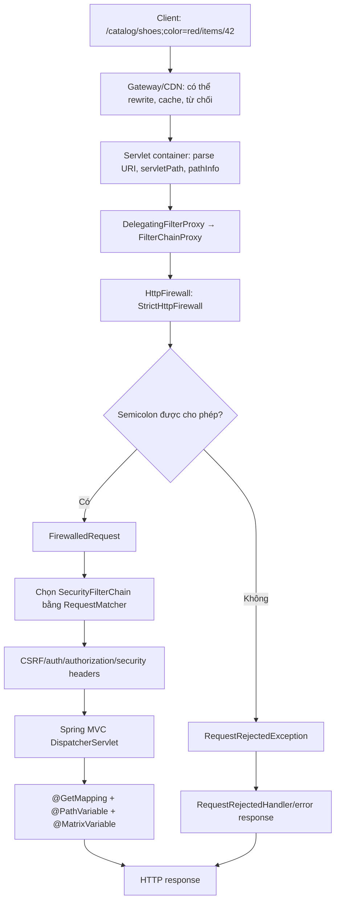
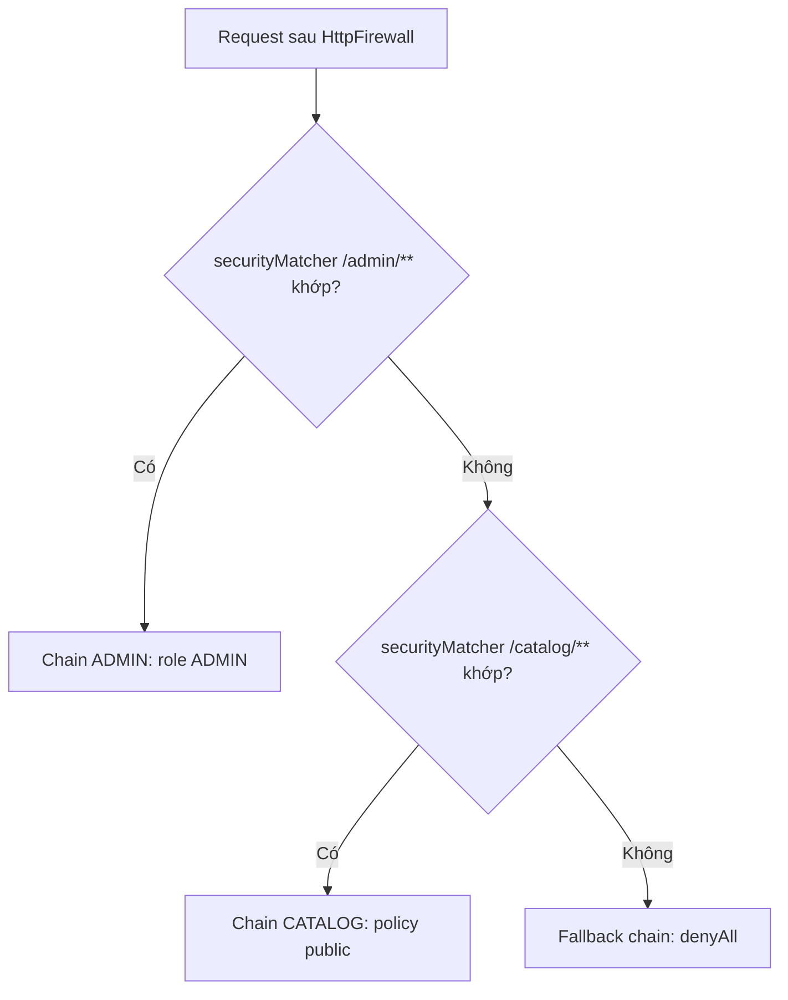

# Semicolon, path parameters và matrix variables

## 1. Vấn đề cần giải quyết: dấu chấm phẩy trong URL không chỉ là một ký tự

Trong chương **Firewall trên Servlet** của module **SPRING_SECURITY_HTTP_PROTECTION**, chúng ta tìm hiểu cách Spring Security bảo vệ HTTP request trước khi thực thi authentication, authorization, CSRF, CORS và các lớp phòng vệ khác. Các security headers, CSP, HSTS và bảo vệ session tiếp tục hoàn thiện cơ chế phòng vệ sau khi request đã được tiếp nhận đúng cách.

Một URL như sau thoạt nhìn có vẻ chỉ là một biến thể của URL sản phẩm:

```http
GET /catalog/shoes;color=red/items/42 HTTP/1.1
Host: app.example.test
```

Dấu `;` có thể biểu thị **path parameter** nằm trong một **path segment**; Spring MVC gọi những dữ liệu được dùng theo cách này là **matrix variables**. Đây là cú pháp có chủ đích trong một số thiết kế API, nhưng nó cũng tạo nguy cơ: Servlet container, reverse proxy, Spring Security matcher và controller có thể **không diễn giải giống nhau** phần `;color=red`.

Ví dụ, một thành phần có thể thấy `/admin;mode=edit/reports` như một chuỗi path khác `/admin/reports`, còn thành phần khác bỏ path parameter và định tuyến đến chính handler `/admin/reports`. Nếu Spring Security chọn policy dựa trên cách nhìn thứ nhất nhưng handler xử lý theo cách thứ hai, một request có thể nhận **rule bảo vệ sai**.

Để giảm rủi ro, `StrictHttpFirewall` trên Servlet **từ chối semicolon theo mặc định** trong nhiều phiên bản Spring Security hiện đại. Tuy nhiên, Spring MVC vẫn có API `@MatrixVariable` để hỗ trợ thiết kế URL có matrix parameters khi hệ thống **cố ý** cho phép. Hai điều sau không mâu thuẫn:

- **Framework có khả năng parse matrix variables** ở tầng MVC.
- **Security firewall có quyền từ chối request mang semicolon trước khi request tới MVC**.

### Mục tiêu học tập

Sau bài học, bạn có thể:

1. Phân biệt dấu semicolon trong path, path parameters, matrix variables, query parameters và `;jsessionid`.
2. Giải thích vì sao Spring Security mặc định từ chối semicolon và vì sao `permitAll` không giải quyết một `RequestRejectedException`.
3. Mô tả cách Servlet container, `HttpFirewall`, matcher và Spring MVC xử lý request có semicolon.
4. Dùng `@MatrixVariable`, `@PathVariable` và `pathVar` đúng cách khi tính năng có yêu cầu thật.
5. Cân nhắc `StrictHttpFirewall#setAllowSemicolon(true)` cùng các rủi ro URL-based authorization, cache và proxy.
6. Viết unit test, MockMvc test và kiểm chứng HTTP client qua Servlet container/gateway.
7. Biết khi nào nên dùng query parameters, request body hoặc opaque ID thay cho matrix variables.
8. Phân biệt API Servlet với cơ chế firewall tương ứng trên Reactive/WebFlux.

## 2. Cú pháp: semicolon nằm trong path segment

Hãy tách URL:

```text
https://app.example.test/cars;color=red;year=2026/42;view=full?lang=vi
                         ^^^^^^^^^^^^^^^^^^^    ^^^^^^^^^^  ^^^^^^^
                         parameters segment 1   segment 2   query string
```

Một path segment được phân cách bởi dấu `/`. Trong thiết kế matrix variables, mỗi segment có thể có những cặp tên/giá trị gắn sau dấu `;`.

Ví dụ:

```text
/cars;color=red;year=2026
/cars;color=red,blue
/cars;color=red;color=blue
/owners/42;q=11/pets/21;q=22
```

Spring MVC hỗ trợ một hoặc nhiều matrix variables trong path segment, bao gồm các cách biểu diễn nhiều giá trị đã được định nghĩa trong hợp đồng API.

### 2.1. Matrix variables khác query parameters

| Dạng URL | Vị trí dữ liệu | Cách đọc thường gặp |
| --- | --- | --- |
| `/cars;color=red` | Parameter gắn vào segment `cars` | `@MatrixVariable` nếu path mapping phù hợp. |
| `/cars/42;color=red` | Parameter gắn vào segment `42` | `@MatrixVariable`, có thể xác định `pathVar`. |
| `/cars/42?color=red` | Query string sau `?` | `@RequestParam`. |
| `/cars/42?color=red&color=blue` | Hai query parameters trùng tên | `@RequestParam List<String>` hoặc MultiValueMap tùy hợp đồng. |
| `/cars/42;view=full?color=red` | Matrix trong path và query riêng | Hai cơ chế parse khác nhau. |

**Không đồng nhất:** dấu `;` xuất hiện trong một query value **không tự biến query đó thành matrix variable**. `StrictHttpFirewall` tập trung vào những đặc điểm HTTP request mà nó kiểm tra, đặc biệt URL path; không nên suy mọi chuỗi semicolon trong mọi vị trí đều là cùng một trường hợp.

Đồng thời, một số query-string parsers trong hệ thống cũ có thể coi `;` là dấu phân cách tham số. Tránh dựa vào hành vi không được đặc tả rõ; dùng `&` cho query parameters thông thường.

### 2.2. Matrix variables gắn vào một segment cụ thể

Xét:

```text
/owners/42;q=11/pets/21;q=22
```

Có hai giá trị cùng tên `q`:

- `q=11` gắn với segment của `ownerId=42`.
- `q=22` gắn với segment của `petId=21`.

Nếu controller chỉ dùng `@MatrixVariable("q")` mà không nói rõ vị trí, framework có thể không biết muốn lấy giá trị nào hoặc lấy một cấu trúc đa giá trị. Khi cùng tên xuất hiện ở nhiều path variables, **dùng `pathVar` để định vị đúng segment**.

### 2.3. Matrix parameters và path parameters

Trong tài liệu URL/Servlet, các cặp tên-giá trị sau dấu semicolon có thể được gọi là **path parameters**; Spring MVC dùng tên **matrix variables** cho cơ chế binding tương ứng.

Không nhầm `@PathVariable` với `@MatrixVariable`:

- `@PathVariable` lấy giá trị của một **segment placeholder** trong pattern, ví dụ `{petId}`.
- `@MatrixVariable` lấy giá trị gắn với segment qua `;name=value`.
- `@RequestParam` lấy dữ liệu query hoặc request parameters theo semantics Spring MVC.

Một request `/pets/42;q=11` có thể dẫn tới `petId=42` và `q=11` khi MVC mapping và firewall cho phép nó.

## 3. Đường request thực tế: firewall nằm trước Spring MVC



**Vị trí có ý nghĩa bảo mật:** `FilterChainProxy` gọi `HttpFirewall` để kiểm tra/bọc request **trước khi** chọn `SecurityFilterChain`. Nếu `StrictHttpFirewall` từ chối semicolon, request có thể chưa qua authentication, authorization, CSRF hoặc `HeaderWriterFilter`.

Điều này giải thích vì sao:

- Bổ sung `requestMatchers("/catalog/**").permitAll()` không làm semicolon tự nhiên được chấp nhận.
- Một endpoint MVC hỗ trợ `@MatrixVariable` vẫn có thể nhận lỗi trước khi controller chạy.
- Một response từ chối sớm có thể thiếu CSP/HSTS/XFO mà response `200` bình thường có.
- `RequestRejectedException` không đồng nghĩa một `403` do thiếu CSRF token hay quyền truy cập.

### 3.1. Những lớp có thể hiểu semicolon khác nhau

| Lớp | Điều có thể tác động | Điều phải kiểm chứng |
| --- | --- | --- |
| Client HTTP | Encoding/normalization trước khi gửi | Request-target thực được gửi. |
| Reverse proxy/ingress | Path rewrite, percent decoding, routing/cache key | Upstream path có giữ `;...` không? |
| Servlet container | `requestURI`, `servletPath`, `pathInfo`, connector compliance | Request có đến Spring Security không? |
| `StrictHttpFirewall` | Chấp nhận/từ chối semicolon; validate path | `setAllowSemicolon` đang là gì? |
| `RequestMatcher` | Chain nào được chọn với path đã được kiểm tra? | Có bao gồm hay bỏ path parameters khi matching? |
| Spring MVC | `@GetMapping`, `PathPatternParser`/legacy matcher, `@MatrixVariable` | Path placeholder và matrix values được parse đúng không? |
| Service/authorization | Resource thực sự được chọn và quyền truy cập | Có kiểm tra resource ID/tenant phía server không? |

Một hành vi quan sát ở localhost **không thể mặc nhiên suy ra** cho môi trường có gateway hoặc Servlet container khác.

## 4. Vì sao `StrictHttpFirewall` từ chối semicolon theo mặc định?

Theo tài liệu Spring Security, semicolon là một nguồn **mơ hồ về path parameters** giữa các Servlet containers. Trong lịch sử, nhiều lỗi bảo mật liên quan tới việc URL security rules và server-side routing không diễn giải cùng một chuỗi. API `StrictHttpFirewall#setAllowSemicolon` còn cảnh báo rủi ro từ các tình huống **bypass ràng buộc bảo mật dựa trên URL** và **Reflected File Download**.

### 4.1. Sai khác trong URL-based security matching

Giả sử:

```text
/admin/**    -> ROLE_ADMIN
/public/**   -> permitAll
```

Nếu một tầng thấy `/admin;test=1/reports` không khớp `/admin/**`, nhưng tầng khác lại coi nó như `/admin/reports`, việc chọn chain/authorization có thể không bảo vệ tài nguyên dự kiến.

Cần phân biệt **mô hình rủi ro** với **khẳng định một exploit cụ thể đang tồn tại**. Việc cho phép semicolon không tự động tạo bypass trên mọi hệ thống. Rủi ro tăng khi nhiều tầng có cách hiểu khác nhau và ứng dụng phụ thuộc vào một matcher/prefix sai để phân quyền.

### 4.2. `Reflected File Download` và path parameter

Một số lỗi lịch sử liên quan việc dữ liệu không đáng tin được phản chiếu trong phản hồi tải xuống, kết hợp URL/filename và cách browser hoặc hệ thống xử lý. Dấu semicolon từng có vai trò trong một số kỹ thuật tấn công. Nhưng không nên gộp mọi vấn đề thành một kết luận kiểu “semicolon luôn là RFD”.

Bảo vệ đầy đủ còn cần:

- Định nghĩa filename và `Content-Disposition` an toàn.
- Không phản chiếu giá trị người dùng chưa được validate vào tên file/response.
- Trả `Content-Type` đúng; giữ `X-Content-Type-Options: nosniff` khi phù hợp.
- Không cho query/matrix parameter tự ý quyết định đường dẫn file hoặc tài nguyên nhạy cảm.
- Kiểm tra quyền đối với resource được chọn ở tầng service.

### 4.3. Nguyên tắc reject-by-default

Trong nhiều phiên bản Spring Security 6.x/7.x:

```java
StrictHttpFirewall firewall = new StrictHttpFirewall();

// Mặc định: không cho phép semicolon trong URL path.
// Không cần gọi setter nếu đang dùng cấu hình strict chuẩn.
```

Một test dùng request path có dấu `;` thường nhận `RequestRejectedException` ở tầng firewall, hoặc HTTP `400` nếu rejection handler chuyển exception thành status đó. Nhưng proxy/container có thể từ chối **trước** firewall, nên không được khẳng định mọi phép thử public đều tạo cùng exception/status.

## 5. Dữ liệu path nào được dùng để chọn security chain?

Servlet API cung cấp các thành phần như:

- `getRequestURI()` — URI path do container nhìn thấy, không gồm query.
- `getContextPath()` — context root mà ứng dụng được mount.
- `getServletPath()` — phần liên quan servlet mapping.
- `getPathInfo()` — phần path còn lại theo servlet mapping, có thể `null`.
- `getQueryString()` — phần query riêng.

Một request `/portal/catalog/shoes;color=red/items/42` có thể được container biểu diễn theo nhiều cách tùy servlet mapping và normalization.

### 5.1. Ví dụ với DispatcherServlet mapping `/`

Giả sử:

```text
requestURI  = /portal/catalog/shoes;color=red/items/42
contextPath = /portal
servletPath = /catalog/shoes;color=red/items/42
pathInfo    = null
```

Đây là **ví dụ minh họa**, không phải dữ liệu bắt buộc ở mọi Servlet container. Nếu container tách hoặc loại path parameters khi tạo `servletPath`, trường đó có thể khác. Spring Security quan tâm tới đường dẫn bên trong ứng dụng khi matching, nên nhiều path matchers **không thêm context path** vào pattern.

### 5.2. Ví dụ prefix mapping `/api/*`

Giả sử servlet mapping `/api/*`:

```text
requestURI  = /portal/api/products/42;color=red
contextPath = /portal
servletPath = /api
pathInfo    = /products/42;color=red
```

Trong tình huống này, một matcher chỉ so `servletPath` có thể bỏ sót phần `/products/42`. Với những matcher lịch sử, `AntPathRequestMatcher` thường dùng `servletPath + pathInfo` để xây path cần khớp.

**Chú ý:** không phải mọi matcher phiên bản mới có hợp đồng giống Ant. `PathPatternRequestMatcher`/`MvcRequestMatcher` có cách xử lý riêng. Hãy test theo matcher runtime thực sự thay vì tự giả định quy tắc nối chuỗi.

### 5.3. Path parameters và matching bảo mật

Trong các cơ chế firewall được tài liệu Spring Security mô tả, path parameters có thể bị loại khỏi góc nhìn dùng cho matching để hạn chế mơ hồ. Nhưng `StrictHttpFirewall` mặc định thường **từ chối semicolon trước khi tới bước đó**.

Khi chủ động bật `setAllowSemicolon(true)`, không nên suy:

- Mọi `RequestMatcher` tự động thấy chính xác chuỗi mà `@MatrixVariable` thấy.
- Việc bỏ semicolon content cho matching đồng nghĩa dữ liệu matrix đã được validate.
- Một policy `/admin/**` chắc chắn bảo vệ đúng resource nếu controller decode/route theo cách khác.
- Cấu hình firewall có thể giới hạn theo từng `SecurityFilterChain` chỉ bằng một setter.

Cần chứng minh **chuỗi request path → firewall → chain matcher → MVC handler → authorization** ở môi trường mục tiêu.

## 6. Spring MVC xử lý `@MatrixVariable` thế nào?

Spring MVC hỗ trợ `@MatrixVariable` trên Servlet stack. Khi thiết kế controller có matrix variables, route pattern nên dùng **URI template placeholder** cho segment chứa matrix data, thay vì hardcode một phần semicolon ngay trong pattern.

### 6.1. Một matrix variable trên segment ID

Ví dụ:

```java
import org.springframework.web.bind.annotation.GetMapping;
import org.springframework.web.bind.annotation.MatrixVariable;
import org.springframework.web.bind.annotation.PathVariable;
import org.springframework.web.bind.annotation.RestController;

@RestController
class PetController {

    @GetMapping("/pets/{petId}")
    String findPet(
            @PathVariable("petId") long petId,
            @MatrixVariable(name = "q", required = false,
                            defaultValue = "1") int q) {
        return "petId=" + petId + ", q=" + q;
    }
}
```

Yêu cầu:

```http
GET /pets/42;q=11;r=22 HTTP/1.1
Host: app.example.test
```

Kỳ vọng **khi firewall cho phép và MVC path parser được cấu hình hỗ trợ**: `petId=42`, `q=11`. Trường `r` không được controller đọc trong ví dụ, nhưng không có nghĩa nó đã được kiểm tra theo policy nghiệp vụ.

Nếu GET `/pets/42` không có `q`, method sử dụng `defaultValue="1"`.

### 6.2. Matrix variables cùng tên ở nhiều segments

Ví dụ:

```http
GET /owners/42;q=11/pets/21;q=22 HTTP/1.1
Host: app.example.test
```

Controller:

```java
import org.springframework.web.bind.annotation.GetMapping;
import org.springframework.web.bind.annotation.MatrixVariable;
import org.springframework.web.bind.annotation.PathVariable;
import org.springframework.web.bind.annotation.RestController;

@RestController
class OwnerPetController {

    @GetMapping("/owners/{ownerId}/pets/{petId}")
    String find(
            @PathVariable("ownerId") long ownerId,
            @PathVariable("petId") long petId,
            @MatrixVariable(name = "q", pathVar = "ownerId") int ownerQ,
            @MatrixVariable(name = "q", pathVar = "petId") int petQ) {

        return ownerId + ":" + ownerQ + " / " + petId + ":" + petQ;
    }
}
```

Ở đây `pathVar="ownerId"` và `pathVar="petId"` là cách tránh lấy nhầm hai giá trị `q`. Kết quả mong muốn: `42:11 / 21:22`.

### 6.3. Nhiều giá trị và giá trị lặp

Một số URL hợp lệ theo contract matrix có thể có:

```text
/cars;color=red,green;year=2026
/cars;color=red;color=green
```

Spring MVC hỗ trợ những dạng đa giá trị này, nhưng cần định nghĩa cách ứng dụng dùng nó. Nếu bộ lọc sản phẩm cần nhiều màu, `List<String>` hoặc `MultiValueMap<String,String>` có thể phù hợp. Không tự lấy `getFirst("color")` rồi nghĩ đã giải quyết trường hợp có nhiều giá trị.

Đặc biệt, **không dùng matrix value để nâng cấp role hoặc tenant** chỉ vì người dùng đã đặt `;role=ADMIN` hoặc `;tenant=other` trong URL. Các giá trị đó chỉ là **input do client kiểm soát**, phải validate và được đối chiếu với principal/resource.

### 6.4. Cấu trúc route nên bảo vệ ý nghĩa segment

Pattern:

```java
@GetMapping("/catalog/{category}/items/{itemId}")
```

thường phù hợp hơn việc cố hardcode:

```java
// Không dùng pattern cứng này như một API matrix tổng quát.
@GetMapping("/catalog/shoes;color=red/items/42")
```

URI variables giúp Spring MVC xác định phần segment có thể chứa matrix data và tách chúng ra theo cơ chế mapping. Nhưng cho dù route mapping đã đúng, request vẫn có thể bị `StrictHttpFirewall` từ chối trước đó.

## 7. `PathPatternParser`, legacy Ant matching và bật matrix parsing

**Đây là hai quyết định cấu hình độc lập:**

1. Spring Security có cho phép semicolon **đi qua firewall** không?
2. Spring MVC có parse/giữ matrix parameters cho controller theo **path matching strategy** thực tế không?

Một ứng dụng có thể mở firewall nhưng `@MatrixVariable` vẫn không nhận được dữ liệu do MVC path parser/config không phù hợp.

### 7.1. Spring MVC hiện đại dùng parsed path patterns

Với Spring Framework 6.x, Spring MVC thường dùng `PathPatternParser` theo mặc định. Cơ chế parsed patterns **bỏ semicolon content khi so khớp path segment**, nhưng vẫn có thể giữ path parameters để `@MatrixVariable` truy cập.

Ví dụ, route `/pets/{petId}` có thể match `/pets/42;q=11`, trong khi controller nhận `petId=42` và matrix variable `q=11`.

**Không được coi đây là quy tắc mọi thư viện đều hỗ trợ**, vì Servlet container và Spring Security firewall vẫn phải cho request đến MVC.

### 7.2. Ứng dụng legacy dùng string-based `AntPathMatcher`

Trong một số dự án cũ dùng path matching dạng chuỗi, `UrlPathHelper` có cấu hình `removeSemicolonContent`. Nếu cấu hình đang loại semicolon content **trước khi MVC xử lý matrix data**, controller có thể không lấy được matrix variables như mong muốn.

Ví dụ minh họa cấu hình Java **chỉ cho legacy string matching**:

```java
import org.springframework.context.annotation.Configuration;
import org.springframework.web.servlet.config.annotation.PathMatchConfigurer;
import org.springframework.web.servlet.config.annotation.WebMvcConfigurer;
import org.springframework.web.util.UrlPathHelper;

@Configuration
class LegacyMvcMatrixPathConfig implements WebMvcConfigurer {

    @Override
    public void configurePathMatch(PathMatchConfigurer configurer) {
        // Chỉ cân nhắc nếu dự án đang thực sự dùng legacy string path matching.
        UrlPathHelper helper = new UrlPathHelper();
        helper.setRemoveSemicolonContent(false);
        configurer.setUrlPathHelper(helper);
    }
}
```

Đoạn này **không tự chuyển PathPatternParser sang AntPathMatcher** và không phải cấu hình cần thêm cho ứng dụng MVC 6.x đang dùng parsed patterns. Một số cấu hình `UrlPathHelper` không có tác dụng khi parsed patterns đã bật. Hãy kiểm tra chiến lược đang chạy và Spring Framework version.

### 7.3. Không copy cấu hình cũ vào MVC mới không kiểm tra

| Môi trường | Cần xác minh | Tránh |
| --- | --- | --- |
| Spring MVC dùng parsed patterns | `@MatrixVariable` nhận giá trị khi request đi qua firewall; mapper phù hợp. | Thêm legacy `UrlPathHelper` rồi tin nó đổi behavior parsed path. |
| Spring MVC dùng string/Ant matching | Có loại semicolon content trước controller không? | Tự tắt remove semicolon mà không kiểm tra security matcher. |
| Servlet map `/api/*` thay vì `/` | `servletPath`/`pathInfo`, MVC registration và chain matcher. | Tưởng mọi route nằm trong `servletPath` đầy đủ. |
| Proxy rewrite public prefix | Request-target thực tới backend và cache-key. | Test mỗi URL localhost rồi kết luận public giống nhau. |

## 8. Khi thực sự phải cho phép matrix variables: cấu hình `StrictHttpFirewall`

Spring Security hỗ trợ cấu hình một firewall cho phép semicolon. **Đây là một ngoại lệ bảo mật có tác động rộng**, không phải mẹo sửa 400 mặc định nên áp ở mọi dự án.

Ví dụ phù hợp các bản Spring Security Servlet 6.x/7.x dùng cấu hình Java:

```java
import org.springframework.context.annotation.Bean;
import org.springframework.context.annotation.Configuration;
import org.springframework.security.web.firewall.StrictHttpFirewall;

@Configuration
class MatrixFirewallConfig {

    @Bean
    StrictHttpFirewall httpFirewall() {
        StrictHttpFirewall firewall = new StrictHttpFirewall();

        // Quyết định có chủ đích: cho phép URL có dấu semicolon.
        firewall.setAllowSemicolon(true);

        // Giữ nguyên các quy tắc strict khác.
        return firewall;
    }
}
```

Spring Security Reference mô tả cách export `StrictHttpFirewall` như bean để cấu hình này có hiệu lực. Tùy kiến trúc ứng dụng, một `WebSecurityCustomizer` cũng có thể thiết lập firewall cho `WebSecurity`; đừng tạo hai định nghĩa cạnh tranh. Hãy xác nhận bean được nạp trong runtime và `FilterChainProxy` thực sự đang dùng policy đó.

### 8.1. Vì sao phải cân nhắc thật kỹ?

`setAllowSemicolon(true)` không phải thuộc tính riêng một controller. Vì firewall tham gia **trước bước chọn security chain**, ngoại lệ có thể ảnh hưởng các URL khác trong cùng phạm vi quản lý bởi `FilterChainProxy`.

Chẳng hạn, bạn chỉ muốn dùng matrix variables trên `/catalog/**` nhưng mở semicolon ở firewall sẽ khiến nhiều route khác cũng có thể được xem xét với semicolon. Khi đó, đường đi của `/admin/**`, `/api/**` và các servlet legacy cũng cần test.

Nếu chỉ một API cần matrix data, giải pháp ưu tiên là **chuyển dữ liệu sang query hoặc body** thay vì nới quy tắc toàn ứng dụng. Nếu bắt buộc, có thể cân nhắc tách deployment/ứng dụng hoặc thiết kế hạ tầng để giới hạn bề mặt ảnh hưởng, nhưng không tự tạo một firewall rule quá phức tạp khi chưa có threat model.

### 8.2. Không mở đồng thời nhiều quy tắc nguy hiểm

```java
StrictHttpFirewall firewall = new StrictHttpFirewall();

// KHÔNG bật đồng loạt chỉ để URL bất thường trả 200.
// firewall.setAllowSemicolon(true);
// firewall.setAllowUrlEncodedSlash(true);
// firewall.setAllowBackSlash(true);
// firewall.setAllowUrlEncodedPercent(true);
// firewall.setUnsafeAllowAnyHttpMethod(true);
```

Một tính năng matrix variables không tự yêu cầu cho phép encoded slash, backslash, double encoding hoặc mọi HTTP methods. Mỗi setter thêm một ranh giới trust khác và phải được đánh giá độc lập.

### 8.3. Đừng lạm dụng `permitAll` để chữa lỗi firewall

```java
// Không sửa được RequestRejectedException do semicolon:
http.authorizeHttpRequests(auth ->
    auth.requestMatchers("/catalog/**").permitAll());
```

`permitAll` chạy ở bước **authorization sau khi request đã được firewall chấp nhận và chain được chọn**. Nếu firewall chưa cho semicolon đi qua, rule trên không thể làm thay đổi quyết định đó.

## 9. Ví dụ Servlet hoàn chỉnh cho một API catalog dùng matrix variables

Ví dụ này dành cho **môi trường học tập/staging** có yêu cầu matrix variables thật. Không lấy nó làm khuyến nghị cho mọi ứng dụng.

### 9.1. Controller

```java
import java.util.Map;

import org.springframework.web.bind.annotation.GetMapping;
import org.springframework.web.bind.annotation.MatrixVariable;
import org.springframework.web.bind.annotation.PathVariable;
import org.springframework.web.bind.annotation.RestController;

@RestController
class CatalogMatrixController {

    @GetMapping("/catalog/{category}/items/{itemId}")
    Map<String, Object> item(
            @PathVariable("category") String category,
            @PathVariable("itemId") long itemId,
            @MatrixVariable(name = "color", pathVar = "category",
                            defaultValue = "all") String color,
            @MatrixVariable(name = "rev", pathVar = "itemId",
                            defaultValue = "latest") String rev) {

        return Map.of(
            "category", category,
            "itemId", itemId,
            "color", color,
            "rev", rev
        );
    }
}
```

Ví dụ request:

```http
GET /catalog/shoes;color=red/items/42;rev=v2 HTTP/1.1
Host: app.example.test
```

Response JSON mong muốn khi MVC parser, firewall và security chain đều phù hợp:

```json
{
  "category": "shoes",
  "itemId": 42,
  "color": "red",
  "rev": "v2"
}
```

Nếu gọi `GET /catalog/shoes/items/42`, controller sử dụng các giá trị mặc định `color="all"` và `rev="latest"`. Đây là ví dụ trả dữ liệu để học cách binding, **không mô phỏng toàn bộ kiểm tra quyền với sản phẩm thật**.

### 9.2. Security chain giữ nguyên lớp bảo vệ khác

```java
import org.springframework.context.annotation.Bean;
import org.springframework.context.annotation.Configuration;
import org.springframework.http.HttpMethod;
import org.springframework.security.config.Customizer;
import org.springframework.security.config.annotation.web.builders.HttpSecurity;
import org.springframework.security.web.SecurityFilterChain;

@Configuration
class CatalogSecurityConfig {

    @Bean
    SecurityFilterChain securityChain(HttpSecurity http) throws Exception {
        http
            .authorizeHttpRequests(auth -> auth
                .requestMatchers(HttpMethod.GET, "/catalog/**").permitAll()
                .requestMatchers("/admin/**").hasRole("ADMIN")
                .anyRequest().denyAll())
            .httpBasic(Customizer.withDefaults());

        // CSRF, security headers và các cấu hình khác vẫn giữ theo policy.
        return http.build();
    }
}
```

Mục tiêu là minh họa **fallback bảo thủ**. Trong ứng dụng có login, POST, API token, CORS, CSRF hoặc session, cần tích hợp rule trên vào chain hiện hữu và không thay thế toàn bộ cấu hình production.

### 9.3. Vì sao không cho `;role=ADMIN` tự quyết định quyền?

Giả sử client yêu cầu:

```text
/catalog/shoes;role=ADMIN/items/42
```

`role=ADMIN` chỉ là chuỗi do client kiểm soát. Không được dùng nó để chuyển quyền truy cập hoặc thay thế principal được xác thực. Tương tự `;tenant=acme`, `;owner=other` hay `;internal=true` không phải bằng chứng tài khoản được phép truy cập tài nguyên tương ứng.

Nếu matrix variables ảnh hưởng tới resource ID, service phải xác định resource thật, kiểm tra tenant/owner và quyết định quyền trên dữ liệu server-side.

## 10. Lựa chọn khác: query parameters hoặc request body

Spring Security Javadoc khuyên cân nhắc **HTTP parameters** thay vì matrix variables trong nhiều trường hợp, do semicolon là nguồn rủi ro security matching.

### 10.1. Filter sản phẩm bằng query parameters

Thay vì:

```http
GET /catalog/shoes;color=red/items/42;rev=v2 HTTP/1.1
```

có thể dùng:

```http
GET /catalog/shoes/items/42?color=red&rev=v2 HTTP/1.1
```

Controller thay thế — **không đăng ký đồng thời với cùng route của ví dụ trước**:

```java
import java.util.Map;

import org.springframework.web.bind.annotation.GetMapping;
import org.springframework.web.bind.annotation.PathVariable;
import org.springframework.web.bind.annotation.RequestParam;
import org.springframework.web.bind.annotation.RestController;

@RestController
class CatalogQueryController {

    @GetMapping("/catalog/{category}/items/{itemId}")
    Map<String, Object> item(
            @PathVariable String category,
            @PathVariable long itemId,
            @RequestParam(defaultValue = "all") String color,
            @RequestParam(defaultValue = "latest") String rev) {
        return Map.of(
            "category", category, "itemId", itemId,
            "color", color, "rev", rev);
    }
}
```

**Ưu điểm:** không cần mở `setAllowSemicolon(true)` chỉ để truyền một bộ lọc. Query parameters được framework xử lý bằng API quen thuộc, và client/CDN thường có cách quản lý query cache key rõ ràng hơn.

**Nhưng query không tự động an toàn.** Nó vẫn là dữ liệu client, có thể ảnh hưởng định danh resource/caching và phải validate/authorize. Nếu là thông tin nhạy cảm, query URL cũng không phải nơi thích hợp vì có thể xuất hiện trong logs, browser history và `Referer`.

### 10.2. Request body cho thao tác phức tạp

Một thao tác tìm kiếm có cấu trúc phức tạp, nhiều điều kiện filter, hoặc cập nhật dữ liệu có thể dùng body JSON với schema validation rõ ràng trên HTTP method thích hợp.

```json
{
  "category": "shoes",
  "filters": {
    "colors": ["red", "blue"],
    "minPrice": 100
  }
}
```

Đừng chuyển một request GET thành POST chỉ để né URL syntax mà không cân nhắc caching, idempotence, CSRF và ngữ nghĩa HTTP. Chọn protocol phù hợp với nghiệp vụ; ưu tiên một hợp đồng dễ validate và không phụ thuộc URL decoding mơ hồ.

### 10.3. Bảng lựa chọn

| Nhu cầu | Matrix variables | Query parameters | Body |
| --- | --- | --- | --- |
| Gắn thuộc tính cho một path segment cụ thể | Có thể diễn đạt trực tiếp | Cần truyền thêm định danh segment nếu cần | Có thể mô hình hóa tường minh |
| Hỗ trợ mặc định không nới Servlet firewall | Thường không với `StrictHttpFirewall` mặc định | Có | Có |
| Dễ kiểm soát CDN cache-key | Phải kiểm tra URI normalization theo edge | Thường có cấu hình query-key rõ ràng | Caching dựa body cần thiết kế riêng |
| Dữ liệu phức tạp/nhiều field | Dễ trở nên khó đọc | Phù hợp mức vừa phải | Phù hợp hơn |
| Dữ liệu nhạy cảm | Không nên đặt trong URL | Không nên đặt trong URL | Body giảm lộ qua URL, vẫn cần HTTPS/logging an toàn |
| Rủi ro lệch servletPath/pathInfo | Cần đánh giá rất kỹ | Ít liên quan đến path segment | Không dùng path matrix syntax |

## 11. `;jsessionid=...` và URL rewriting của Servlet session

Một trường hợp semicolon lịch sử rất quan trọng:

```text
/cart;jsessionid=EXAMPLE_SESSION_ID
```

Servlet URL rewriting có thể đưa session identifier vào URL khi cookie session không hoạt động và ứng dụng sử dụng `response.encodeURL(...)` hoặc các cơ chế tương đương.

Đây **không phải matrix variable nghiệp vụ**. `jsessionid` liên quan session tracking. Cho phép nó cũng mở ra rủi ro lộ session ID qua:

- Browser history, bookmark hoặc URL được copy.
- Access logs của proxy/HTTP server.
- Analytics hoặc monitoring ghi raw URL.
- Một số tình huống referrer và chia sẻ liên kết.
- Link được người dùng gửi cho người khác.

### 11.1. Ưu tiên session ID trong cookie

Một ứng dụng hiện đại thường nên dùng session cookie với `Secure`, `HttpOnly` và `SameSite` theo nhu cầu, kết hợp HTTPS, session fixation protection, logout và giới hạn thời gian phiên.

Nếu không có nhu cầu URL rewriting, có thể yêu cầu chỉ dùng cookie session trong Servlet application. Ví dụ Spring Boot Servlet 3.x+:

```java
import java.util.EnumSet;

import jakarta.servlet.SessionTrackingMode;
import org.springframework.boot.web.servlet.ServletContextInitializer;
import org.springframework.context.annotation.Bean;
import org.springframework.context.annotation.Configuration;

@Configuration
class CookieOnlySessionConfig {

    @Bean
    ServletContextInitializer cookieOnlySessionTracking() {
        return context -> context.setSessionTrackingModes(
            EnumSet.of(SessionTrackingMode.COOKIE));
    }
}
```

Ví dụ này dành cho Servlet stack; kiểm tra SessionTrackingMode với container/framework và các yêu cầu tương thích của hệ thống. Cookie-only session tracking **không thay** chính sách `Secure`, `HttpOnly`, `SameSite`, CSRF hoặc quản lý session fixation.

### 11.2. Không bật semicolon chỉ để `;jsessionid` sống lại

Nếu một ứng dụng cũ không đăng nhập được khi browser tắt cookie và team định mở `setAllowSemicolon(true)` để chấp nhận `;jsessionid`, hãy xem xét lại yêu cầu. **Cho phép session ID xuất hiện trong URL thường là một sự đánh đổi bảo mật không đáng có** với ứng dụng web hiện đại.

Spring Security Javadoc cũng khuyên tránh đưa session ID hoặc dữ liệu nhạy cảm vào URL; thay vào đó, dùng cookie phù hợp và làm rõ browser support policy.

## 12. Phân quyền: semicolon không được làm thay tài nguyên được bảo vệ

Xét các rule:

```text
/admin/**     → ROLE_ADMIN
/catalog/**   → permitAll
/other/**     → authenticated
fallback      → denyAll
```

Một URL có matrix parameters đặt ra hai câu hỏi độc lập:

1. **Rule nào áp dụng cho đường dẫn được firewall/matcher hiểu?**
2. **Handler cuối cùng chọn resource nào, và principal có quyền thao tác trên resource ấy không?**

Thất bại ở câu 1 có thể dẫn tới sai security chain. Thất bại ở câu 2 có thể tạo lỗi object-level authorization ngay cả khi chain đúng.

### 12.1. Một trường hợp dễ nhầm

```text
/admin;view=summary/reports
```

Không giả định `/admin;view=summary/reports` chắc chắn được một matcher cụ thể hiểu là `/admin/reports`. Cách xử lý phụ thuộc firewall, servlet mapping và implementation/version của matcher.

Khi bật semicolon, **viết integration tests** cho các route bảo mật như `/admin/**`, kể cả:

- Người chưa đăng nhập.
- Người đã đăng nhập nhưng không có role ADMIN.
- Người có role ADMIN.
- Những semicolon parameters ở segment đầu, cuối hoặc nhiều segment.
- URL có prefix từ gateway hoặc context path.
- Những dạng encoded semicolon nếu chính sách/system có thể gặp.

Không coi kết quả `200` với user ADMIN là đủ; phải có **negative tests** để chứng minh USER/anonymous không lọt qua.

### 12.2. Có nhiều security chains càng cần cẩn thận



Nếu một application có nhiều chains, phải kiểm tra thứ tự, matcher của từng chain và fallback policy. Đừng để request sai đường dẫn được đưa vào một chain fallback `permitAll` chỉ vì pattern admin bỏ qua dấu semicolon.

### 12.3. Method-level và resource-level authorization

Các rule URL là một lớp bảo vệ, không phải tất cả. Ví dụ một service đọc report theo ID vẫn nên kiểm tra ownership và role thực:

```java
// Pseudocode nghiệp vụ, không phải API Spring Security hoàn chỉnh.
Report report = repository.findById(reportId)
    .orElseThrow(NotFoundException::new);

if (!reportAccessPolicy.canRead(authentication, report)) {
    throw new AccessDeniedException("Not allowed");
}

return report;
```

Dù matrix parameter `;tenant=acme` được parse chính xác, quyền vẫn phải dựa vào principal và tài nguyên thật của server. Với Spring Security có thể kết hợp method security, policy service hoặc authorization manager phù hợp.

## 13. Proxy/CDN và cache-key: matrix parameters ảnh hưởng tính nhất quán

Không phải request nào cũng đi trực tiếp từ browser đến Spring Security. Thực tế thường là:

```text
Browser -- HTTPS --> CDN / WAF / Ingress -- HTTP(S) --> Servlet container
                                                |
                                                v
                                     Spring Security + MVC
```

Các tầng có thể:

- Strip/giữ `;name=value` theo chính sách URL.
- Normalize path, decode percent encoding hoặc thay public prefix.
- Xây cache key với hoặc không có matrix parameter.
- Thực hiện redirect canonical URL.
- Trả `404`/`400` hoặc cache-hit **không gọi backend**.

### 13.1. Cache-key collision

Nếu:

```text
/catalog/shoes;color=red/items
/catalog/shoes;color=blue/items
```

thực sự trả nội dung khác nhau, nhưng CDN loại `;color=...` khi tạo cache key, hai URL có thể **bị coi là cùng một cache entry**. Điều này có thể làm người dùng nhận sai dữ liệu; nếu matrix parameter ảnh hưởng tenant hoặc thông tin cá nhân, hậu quả nghiêm trọng hơn.

Đừng chỉ sửa Spring MVC parser rồi bỏ qua CDN cache key. Đặc tả rõ URL variants, caching policy, `Cache-Control` và phạm vi tài nguyên. `Vary` liên quan request header dimensions, **không tự bảo đảm CDN phân biệt hai URI path bị nó normalize về cùng cache key**.

### 13.2. Gateway rewrite và path parameters

Ví dụ:

```text
Public URL:  /portal/catalog/shoes;color=red/items/42
Upstream:    /catalog/shoes;color=red/items/42
```

Hoặc gateway có thể chuyển sai thành:

```text
Upstream:    /catalog/shoes/items/42
```

Trong trường hợp thứ hai, backend không thể parse `color=red` dù `StrictHttpFirewall` đã cho phép semicolon. Khi gặp lỗi, cần phân biệt **URL không tới backend nguyên vẹn** với **MVC không parse được matrix variable**.

### 13.3. Không khẳng định mọi proxy giống nhau

Tomcat, Jetty, Undertow, NGINX, các ingress controller và CDN có version/setting khác nhau. Ngay cùng một loại container, các deployment khác nhau có thể xử lý semicolon khác do config hoặc connector.

Đừng dựa vào câu “Tomcat luôn strip matrix” hoặc “CDN luôn giữ semicolon”. Bằng chứng phải đến từ **đúng request và đường truyền** trong môi trường được phép kiểm thử.

## 14. Unit test: chứng minh mặc định từ chối và ngoại lệ semicolon

Unit test Spring Security `StrictHttpFirewall` giúp trả lời: **policy firewall có chấp nhận request object chứa semicolon này không?**. Nó không chứng minh Servlet container public cũng xử lý URL đó giống hệt.

### 14.1. Test mặc định và cấu hình cho phép

```java
import org.junit.jupiter.api.Test;
import org.springframework.mock.web.MockHttpServletRequest;
import org.springframework.security.web.firewall.FirewalledRequest;
import org.springframework.security.web.firewall.RequestRejectedException;
import org.springframework.security.web.firewall.StrictHttpFirewall;

import static org.junit.jupiter.api.Assertions.assertDoesNotThrow;
import static org.junit.jupiter.api.Assertions.assertThrows;

class SemicolonFirewallUnitTest {

    private static MockHttpServletRequest request(String uri) {
        var mock = new MockHttpServletRequest("GET", uri);
        mock.setServletPath(uri);
        return mock;
    }

    @Test
    void strictFirewallRejectsSemicolonByDefault() {
        var firewall = new StrictHttpFirewall();

        assertThrows(RequestRejectedException.class,
            () -> firewall.getFirewalledRequest(
                request("/catalog/shoes;color=red/items/42")));
    }

    @Test
    void explicitAllowSemicolonChangesOnlyThatPolicy() {
        var firewall = new StrictHttpFirewall();
        firewall.setAllowSemicolon(true);

        FirewalledRequest safe = assertDoesNotThrow(
            () -> firewall.getFirewalledRequest(
                request("/catalog/shoes;color=red/items/42")));

        safe.reset();
    }
}
```

Các test kỳ vọng behavior `StrictHttpFirewall` trong những version có `setAllowSemicolon`. Dùng `MockHttpServletRequest("GET", uri)` để tránh HTTP method trống bị từ chối trước khi test path. `reset()` được gọi theo hợp đồng `FirewalledRequest` khi dùng wrapper trực tiếp.

### 14.2. Cho phép semicolon không cho phép mọi URI khác

```java
@Test
void allowingSemicolonDoesNotPermitEncodedSlash() {
    var firewall = new StrictHttpFirewall();
    firewall.setAllowSemicolon(true);

    assertThrows(RequestRejectedException.class,
        () -> firewall.getFirewalledRequest(
            request("/catalog/shoes%2Fmen/items/42")));
}
```

Test này kiểm tra việc nới **một điều kiện** không mở toàn bộ encoded separators trong policy mặc định thông dụng. Với một container thật, request encoded slash có thể bị HTTP parser từ chối trước khi tới firewall; unit test chỉ đánh giá object mock đã dựng.

### 14.3. Test path parameter gắn ở nhiều segment

```java
@Test
void semicolonInMoreThanOneSegmentCanBeAcceptedWhenEnabled() {
    var firewall = new StrictHttpFirewall();
    firewall.setAllowSemicolon(true);

    FirewalledRequest safe = firewall.getFirewalledRequest(
        request("/catalog/shoes;color=red/items/42;rev=v2"));

    safe.reset();
}
```

Test trên **không khẳng định MVC binding đúng**. Nó chỉ cho thấy tầng firewall đang không từ chối semicolon với input minh họa. Bước kế tiếp là MockMvc và HTTP server integration tests.

### 14.4. Không hardcode mọi rejection thành HTTP 400 trong unit test

`RequestRejectedException` là một Java exception. Khi request đi qua `FilterChainProxy`, một `RequestRejectedHandler` có thể chuyển nó thành status lỗi như `400`; một cấu hình khác có thể xử lý khác. Servlet container hoặc reverse proxy còn có thể tự từ chối trước Spring Security.

Vì thế:

- `assertThrows(RequestRejectedException.class, ...)` kiểm tra **contract firewall**.
- MockMvc kiểm tra **security chain + MVC trong test context**.
- HTTP client kiểm tra **response thực mà client nhận**.

## 15. MockMvc: kiểm tra matrix binding sau khi firewall đã được cấu hình

Giả sử `MatrixFirewallConfig`, `CatalogSecurityConfig` và `CatalogMatrixController` ở các mục trước được nạp vào **một ứng dụng mẫu Servlet** dùng MVC parsed patterns phù hợp.

```java
import org.junit.jupiter.api.Test;
import org.springframework.beans.factory.annotation.Autowired;
import org.springframework.boot.test.autoconfigure.web.servlet.AutoConfigureMockMvc;
import org.springframework.boot.test.context.SpringBootTest;
import org.springframework.test.web.servlet.MockMvc;

import static org.springframework.test.web.servlet.request.MockMvcRequestBuilders.get;
import static org.springframework.test.web.servlet.result.MockMvcResultMatchers.header;
import static org.springframework.test.web.servlet.result.MockMvcResultMatchers.jsonPath;
import static org.springframework.test.web.servlet.result.MockMvcResultMatchers.status;

@SpringBootTest
@AutoConfigureMockMvc
class MatrixVariablesMvcIntegrationTest {

    @Autowired
    MockMvc mvc;

    @Test
    void matrixValuesAreBoundToCorrectSegments() throws Exception {
        mvc.perform(get("/catalog/shoes;color=red/items/42;rev=v2"))
            .andExpect(status().isOk())
            .andExpect(jsonPath("$.category").value("shoes"))
            .andExpect(jsonPath("$.itemId").value(42))
            .andExpect(jsonPath("$.color").value("red"))
            .andExpect(jsonPath("$.rev").value("v2"))
            .andExpect(header().string(
                "X-Content-Type-Options", "nosniff"));
    }

    @Test
    void omittedMatrixValuesUseDefaults() throws Exception {
        mvc.perform(get("/catalog/shoes/items/42"))
            .andExpect(status().isOk())
            .andExpect(jsonPath("$.color").value("all"))
            .andExpect(jsonPath("$.rev").value("latest"));
    }
}
```

Test này kiểm tra nhiều điều hơn unit test firewall:

1. Cấu hình semicolon đã được nạp và request qua security chain.
2. Controller mapping cho `/catalog/{category}/items/{itemId}` khớp.
3. `@PathVariable` và `@MatrixVariable` phân tách đúng.
4. Security header mặc định `nosniff` vẫn có trong response theo chain hiện hành.

**Giới hạn:** MockMvc không mô phỏng HTTP parser của Tomcat/Jetty, gateway path rewrite hoặc CDN cache. Test chỉ pass với configuration/dependency tương ứng trong test context. Nếu dùng Spring Boot 4.x hoặc version test khác, package auto-config test có thể đã thay đổi; điều chỉnh imports theo dependency.

### 15.1. Test với firewall mặc định nên để riêng

Không đặt hai bean `StrictHttpFirewall` đối lập trong cùng Spring context rồi dự đoán bean nào được dùng. Tạo test context riêng cho cấu hình strict mặc định, hoặc unit test trực tiếp firewall như mục 14 để kiểm tra nhánh bị từ chối.

Nếu test default security chain nhận `RequestRejectedException` thay vì một HTTP status, đừng thay firewall để làm `status().isBadRequest()` pass. Trước hết xác định handler xử lý rejection của version đang dùng.

### 15.2. Một test 200 chưa chứng minh an toàn

Sau khi `/catalog/shoes;color=red/items/42` trả `200`, vẫn cần test:

- Path mang semicolon ở route `/admin/**` **không bỏ qua role ADMIN**.
- Các matrix variables không tự cấp role/tenant hoặc thay tài nguyên không được phép.
- Query parameters và matrix parameters trùng tên có thứ tự ưu tiên rõ ràng theo nghiệp vụ.
- POST/PUT/DELETE giữ CSRF và authorization đúng theo kiểu xác thực.
- Cache/redirect behavior nhất quán sau gateway.
- Không có CSP/CORS hoặc header security khác bị tắt để làm endpoint hoạt động.

## 16. Kiểm thử phân quyền và nhiều security chains

Một hệ thống có thể dùng chain API và chain WEB với các matcher khác nhau. Khi semicolon được cho phép tại firewall, cần chứng minh **không có route nào rơi vào chain lỏng hơn** do khác biệt cách parse path.

### 16.1. Ma trận kiểm thử bắt buộc nếu mở semicolon

| Request | Principal | Kỳ vọng bảo vệ |
| --- | --- | --- |
| `GET /catalog/shoes;color=red/items/42` | Anonymous nếu catalog public | `200` và matrix binding đúng. |
| `GET /catalog/shoes/items/42` | Anonymous | `200` với default values. |
| `GET /admin/reports` | USER không có ADMIN | `403` hoặc response từ auth policy tương ứng. |
| `GET /admin;mode=summary/reports` | USER không có ADMIN | Không được lộ report; status tùy matching/firewall nhưng không `200` trái quyền. |
| `GET /admin/reports;format=pdf` | ADMIN | Có thể hoạt động nếu route được hỗ trợ; vẫn cần resource authorization. |
| `GET /api/orders;tenant=other` | USER tenant hiện tại | Không được truy cập resource tenant khác chỉ vì matrix data. |
| `OPTIONS /api/orders` | Browser CORS preflight | Không bị nhầm với vấn đề semicolon; kiểm tra CORS policy. |
| `POST /cart;channel=web` | Session-cookie user | CSRF token vẫn phải hợp lệ. |
| `GET /catalog/shoes%2Fmen/items/42` | Bất kỳ | Theo encoded slash policy; không nới thêm vì semicolon. |
| `GET /catalog/shoes;color=red;role=ADMIN/items/42` | Anonymous | Không có đặc quyền nào từ `role=ADMIN`. |

Đây là **ma trận mục tiêu**, không phải khẳng định mọi URL với semicolon đều được controller hỗ trợ. Nếu route không được thiết kế, trả `404` hoặc từ chối an toàn là bình thường.

### 16.2. Khi matcher dùng path khác MVC router

Trong một số phiên bản, security matcher dựa trên `PathPattern`; một ứng dụng cũ có thể còn dùng `AntPathRequestMatcher` hoặc `MvcRequestMatcher`. Các implementation không có hợp đồng chung cho mọi dạng URL kỳ lạ.

Một phương pháp an toàn:

1. Xác định matcher thực ở runtime.
2. Dùng chính HTTP request qua container để thử.
3. Kiểm tra chain/matcher nào khớp, không chỉ status.
4. Kiểm tra controller nào nhận request.
5. Kiểm tra principal có quyền với **resource thực sự**.
6. Đặt fallback authorization bảo thủ, tránh `anyRequest().permitAll()`.
7. Duy trì tests khi nâng Spring Security hoặc đổi MVC matching strategy.

### 16.3. Tránh pattern check tự viết theo string prefix

```java
// Không dùng để cấp quyền cho tài nguyên nhạy cảm.
boolean apparentlyPublic =
    request.getRequestURI().startsWith("/public/");
```

Code này không tính contextPath, semicolon, pathInfo, proxy prefix, encoded segments hoặc khác biệt normalization. Hãy dùng framework matcher theo semantics chính xác, và thêm method/resource-level authorization.

## 17. Trường hợp bị nhầm với CORS, CSRF và response security headers

### 17.1. CORS preflight

Browser có thể gửi `OPTIONS` cho API cross-origin. Một lỗi CORS có thể xuất phát từ `Origin` không nằm trong allowlist, credentials, method, request headers, hoặc preflight bị authentication xử lý sai.

Một request có semicolon bị `StrictHttpFirewall` từ chối **trước** CORS processor là vấn đề khác. Đừng thêm `Access-Control-Allow-Origin: *` để vượt firewall, nhất là khi request dùng credentials.

### 17.2. CSRF trên request dùng cookie session

Nếu POST `/cart;channel=web` được firewall cho qua nhưng thiếu CSRF token, Spring Security có thể trả `403`. Đây có thể là hành vi **đúng** của `CsrfFilter`.

Không tắt CSRF chỉ để chứng minh matrix variable được binding. Hãy thử với token hợp lệ, ví dụ trong MockMvc dùng `csrf()` từ `spring-security-test`, và kiểm tra cả ca thiếu token.

### 17.3. CSP/HSTS/XFO không thay URL authorization

CSP, `X-Frame-Options`, HSTS và `X-Content-Type-Options` là **response-side defenses**. Chúng không ngăn việc một URL mơ hồ chọn nhầm chain hay đọc nhầm resource. Một response có đầy đủ security headers vẫn có thể bị lộ dữ liệu nếu authorization sai.

Ngược lại, request bị firewall từ chối rất sớm có thể không đi qua `HeaderWriterFilter` nên response `400` có thể thiếu một số header mặc định. Để đánh giá bảo vệ trình duyệt trên error pages public, xác định **tầng tạo response** và policy của proxy/container.

## 18. Quan sát request thật qua Servlet container và proxy

### 18.1. Một phép thử HTTP đơn giản

Với staging thuộc quyền thử nghiệm:

```bash
# URL canonical, không có matrix data:
curl -sS -D - -o /dev/null \
  'https://staging.example.test/catalog/shoes/items/42'

# URL có matrix variables, chỉ khi đã phê duyệt thử:
curl -sS -D - -o /dev/null \
  'https://staging.example.test/catalog/shoes;color=red/items/42;rev=v2'
```

Trên PowerShell, dùng `curl.exe` và `-o NUL` thay cho `/dev/null`. Không gửi tài khoản/cookie/token production vào command dùng để chia sẻ kết quả.

Các phép thử phải được thực hiện **có kiểm soát**, không gửi tập lớn URL bất thường tới hệ thống bên thứ ba hoặc production nếu chưa được phép.

### 18.2. So public và backend direct

```bash
# Public HTTPS qua gateway/CDN:
curl -sS -D - -o /dev/null \
  'https://staging.example.test/catalog/shoes;color=red/items/42'

# Backend direct nếu được phép và route tương ứng:
curl -sS -D - -o /dev/null \
  'http://127.0.0.1:8080/catalog/shoes;color=red/items/42'
```

Khi so, cần giữ cùng method/path, hostname/context path, thời điểm deploy và authentication. Nếu gateway strip prefix, backend path khác public path có thể **đúng theo thiết kế**; phải so theo mapping thực.

Nếu backend direct trả JSON có `color=red` nhưng public trả mặc định `all`, tập trung vào gateway rewrite hoặc cache behavior trước khi thay `@MatrixVariable`.

### 18.3. Khác biệt giữa 400, 403 và 404

| Status/triệu chứng | Nguyên nhân cần phân biệt |
| --- | --- |
| `RequestRejectedException` trong backend log | Spring Security firewall từ chối; semicolon có thể bị cấm. |
| Public `400` nhưng không có backend log | Gateway/Servlet connector có thể từ chối trước firewall. |
| `404` | Handler mapping không khớp, path parameter bị strip hoặc route rewrite sai. |
| `401` | Authentication entry point; không mặc định là firewall. |
| `403` | Authorization hoặc CSRF, có thể là policy đúng. |
| `200` nhưng matrix value mất | MVC path parser, proxy rewrite hoặc controller mapping không như dự kiến. |
| `200` với dữ liệu sai tài khoản | Resource authorization hoặc cache key; cần xử lý ngay như lỗi bảo mật. |
| `502/503` | Edge/upstream lỗi, không liên quan trực tiếp tới matrix parsing. |

### 18.4. Logging và dấu vết

Nếu cần debug, ghi nhận request ID, path được escape ở các hop, servlet container version, selected security chain, parser strategy và HTTP status. Tránh log raw session ID, `Authorization`, Cookie hoặc query nhạy cảm.

Một endpoint test hiển thị `getRequestURI()`, `getServletPath()`, `getPathInfo()` có thể hữu ích trên staging, nhưng không mở công khai nếu URI có thể chứa thông tin nhạy cảm.

## 19. Reactive/WebFlux: có firewall tương ứng nhưng không phải Servlet `HttpFirewall`

Module **SPRING_SECURITY_HTTP_PROTECTION** dạy cả Servlet lẫn Reactive. Tuy bài tập trung vào Servlet, cần biết WebFlux **có cơ chế firewall riêng** trong Spring Security hiện đại.

| Thành phần | Servlet | Reactive/WebFlux |
| --- | --- | --- |
| Request | `HttpServletRequest` | `ServerWebExchange` / `ServerHttpRequest` |
| Chain manager | `FilterChainProxy` | `WebFilterChainProxy` |
| Firewall API | `HttpFirewall` | `ServerWebExchangeFirewall` |
| Strict implementation | `StrictHttpFirewall` | `StrictServerWebExchangeFirewall` |
| Rejection exception | `RequestRejectedException` | `ServerExchangeRejectedException` |
| Chain | `SecurityFilterChain` | `SecurityWebFilterChain` |
| Header writer | `HeaderWriter` | `ServerHttpHeadersWriter` |
| Test | MockMvc, Servlet container | WebTestClient, Reactive HTTP server |

Không đăng ký `StrictHttpFirewall` Servlet rồi kỳ vọng nó bảo vệ Reactive `ServerWebExchangeMatcher`. Đối với WebFlux, Spring Security Reference mô tả `StrictServerWebExchangeFirewall#setAllowSemicolon(true)` như ngoại lệ tương ứng **nếu thật sự cần matrix variables**. Tuy vậy, cấu hình Reactive và kiểm thử WebFlux phải được thực hiện riêng, với cùng nguyên tắc threat model và không nới rules bừa bãi.

Ví dụ khái niệm Reactive:

```java
import org.springframework.context.annotation.Bean;
import org.springframework.context.annotation.Configuration;
import org.springframework.security.web.server.firewall.StrictServerWebExchangeFirewall;

@Configuration
class ReactiveMatrixFirewallConfig {

    @Bean
    StrictServerWebExchangeFirewall reactiveFirewall() {
        var firewall = new StrictServerWebExchangeFirewall();
        // Chỉ cân nhắc sau đánh giá bảo mật của Reactive service.
        firewall.setAllowSemicolon(true);
        return firewall;
    }
}
```

Không dùng đồng thời config Servlet và Reactive trong một application context để “phòng vệ gấp đôi”. Với WebFlux, cần kiểm thử route matching trên WebTestClient và Reactive server thật.

## 20. Bảng chẩn đoán nhanh

| Triệu chứng | Nguyên nhân khả dĩ | Bước xử lý |
| --- | --- | --- |
| `@MatrixVariable` có trong controller nhưng request `;` lỗi | `StrictHttpFirewall` mặc định từ chối | Cân nhắc thay API sang query/body; chỉ mở semicolon khi có review. |
| Thêm `permitAll` vẫn lỗi `RequestRejectedException` | Firewall trước security chain | Không sửa authorization để chữa rejection. |
| MockMvc pass, staging `400` | Container/gateway từ chối path | So HTTP parser, proxy URI và firewall logs. |
| Firewall đã allow, controller trả `404` | MVC parser/mapping không hỗ trợ URL đó | Kiểm tra `PathPatternParser` và route URI template. |
| Controller trả `200` nhưng `@MatrixVariable` null/default | Semicolon bị strip hoặc mapping không bind đúng | So raw URI, servlet path, MVC strategy và pathVar. |
| Hai segment cùng `q` cho giá trị lẫn nhau | Thiếu `pathVar` disambiguation | Chỉ rõ segment chứa matrix variable. |
| Sau bật semicolon, route admin bị truy cập sai | Path interpretation mismatch hoặc fallback auth quá rộng | Kiểm tra chain/matcher, authorization và resource-level security. |
| `;jsessionid` xuất hiện trong URL | URL-based session tracking | Chuyển sang cookie-only nếu không có yêu cầu hợp lệ. |
| CDN trả dữ liệu theo màu sai | CDN cache key bỏ/normalize matrix param | Thiết kế cache key, invalidation và public/private caching. |
| URL có `%3B` vẫn bị từ chối | Encoded semicolon được xử lý khác hoặc strict policy khác | Xem connector/proxy và version; không mở thêm encoding vô tội vạ. |
| JSON có `color=red` nhưng app mở sai sản phẩm | Resource selection/authorization không dựa canonical ID | Validate resource ID, tenant và quyền tại service. |
| POST có matrix parameter trả `403` | CSRF token hoặc authorization | Test csrf/auth; không tắt CSRF. |
| Browser báo CORS error với URL semicolon | Preflight hoặc rejected request | Đọc OPTIONS và actual response; xác định đúng lớp chặn. |
| HSTS/CSP thiếu chỉ ở `400` gateway | Error do edge tạo trước backend | Bảo đảm policy response lỗi ở tầng có thể tạo lỗi. |
| Legacy MVC dùng `UrlPathHelper` không thấy effect | Parsed patterns đã bật | Xác định MVC matching strategy và phiên bản. |
| WebFlux bean `StrictHttpFirewall` không có tác dụng | Sai stack | Dùng `StrictServerWebExchangeFirewall`/Reactive config phù hợp. |

### Quy trình xử lý bảy bước

1. **Mô tả URL và nghiệp vụ:** semicolon có thực sự cần để biểu diễn dữ liệu không?
2. **Xác định layer từ chối:** gateway, Servlet connector, `StrictHttpFirewall` hay MVC handler.
3. **Xác định URI thực:** public URL, upstream path, `requestURI`, `servletPath` và `pathInfo` trong môi trường test.
4. **Xác định MVC parser và binding:** `PathPatternParser`, legacy matcher, URI template, `@MatrixVariable(pathVar=...)`.
5. **Xác định security matcher/chain:** selected chain, fallback, CSRF/auth/authorization và resource identity.
6. **Chọn giải pháp ít rủi ro nhất:** query/body/opaque ID trước, ngoại lệ firewall sau khi review.
7. **Chạy regression từ unit → MockMvc/WebTestClient → HTTP server → public edge**, gồm test âm tính và caching.

## 21. Bài tập tình huống

### Bài A — Matrix variables bị từ chối ở firewall

Ứng dụng có `@GetMapping("/pets/{petId}")` và `@MatrixVariable("q")`, client gửi `/pets/42;q=11`, log xuất hiện `RequestRejectedException`.

**Đáp án định hướng:** controller có khả năng đọc matrix variable không có nghĩa firewall cho phép request tới controller. Giữ strict nếu có thể chuyển `q` sang query; nếu bắt buộc matrix, cần review và cấu hình `setAllowSemicolon(true)`, test end-to-end.

### Bài B — Hai giá trị cùng tên

`GET /owners/42;q=11/pets/21;q=22`, controller chỉ khai báo `@MatrixVariable int q`.

**Đáp án:** khi tên xuất hiện ở nhiều segments, dùng `@MatrixVariable(name="q", pathVar="ownerId")` và `pathVar="petId"` để chọn đúng nguồn.

### Bài C — Semicolon nằm trong query

Client gửi `GET /cars/42?sort=name;desc`. Team muốn bật firewall `setAllowSemicolon(true)`.

**Đáp án:** xác định vị trí `;` và query parser; đây không phải matrix parameter trong path segment. Ưu tiên query syntax rõ ràng thay vì nới policy path không liên quan.

### Bài D — Session ID trong URL

Một ứng dụng cũ dùng `/cart;jsessionid=...` và không hỗ trợ cookie session.

**Đáp án:** tránh để session ID trong URL vì có thể lộ qua log/history/chia sẻ. Cân nhắc cookie-only session tracking với thuộc tính bảo mật phù hợp; không mặc định nới semicolon chỉ để duy trì URL rewriting.

### Bài E — Cache-key không phân biệt màu

Hai request `/catalog/shoes;color=red` và `/catalog/shoes;color=blue` trả kết quả khác nhưng CDN tạo cùng cache key.

**Đáp án:** lỗi ở tầng cache normalization; phải thiết kế cache key/headers, không chỉ sửa controller. Nếu dữ liệu phụ thuộc user/tenant, ngăn shared caching sai.

### Bài F — Bật semicolon làm chain admin thay đổi

Sau khi nới firewall, request `/admin;v=1/reports` không còn bị reject nhưng vào chain fallback cho phép rộng.

**Đáp án:** đây là rủi ro nghiêm trọng. Cần xác định matcher runtime và các giá trị path thực, thiết kế deny-by-default và test USER/anonymous trên mọi biến thể; không coi `200` là thành công.

### Bài G — MVC dùng legacy string matching

Firewall đã cho phép semicolon, nhưng `@MatrixVariable` không có giá trị trên một ứng dụng cũ dùng Ant-based path mapping.

**Đáp án:** xác định MVC parser; với legacy matching có thể cần điều chỉnh `UrlPathHelper.removeSemicolonContent` theo tài liệu đúng version. Không áp cấu hình đó mù quáng lên PathPattern parsed matching.

### Bài H — `%2F` và `;` xuất hiện chung

Một URL `/files/a%2Fb;color=red` vẫn bị từ chối khi `setAllowSemicolon(true)` đã bật.

**Đáp án:** encoded slash là rule khác; một ngoại lệ semicolon không làm encoded slash tự hợp lệ. Ưu tiên thiết kế lại resource ID, không mở nhiều setter theo kiểu thử-sai.

### Bài I — CSRF và matrix variable

`POST /cart;channel=web` được firewall chấp nhận nhưng trả `403` khi dùng cookie session.

**Đáp án:** request đã qua firewall nhưng còn cần CSRF token/authorization. Dùng test với token đúng, không tắt CSRF để “chữa” lỗi matrix.

### Bài J — WebFlux cần matrix variable

Một ứng dụng WebFlux đăng ký bean `StrictHttpFirewall` Servlet nhưng request vẫn bị Reactive firewall từ chối.

**Đáp án:** WebFlux có `ServerWebExchangeFirewall`/`StrictServerWebExchangeFirewall`, cấu hình đúng stack và chỉ bật semicolon sau security review.

## 22. Checklist production

1. **Biết semicolon nằm ở path segment hay query.** Không nhầm `@MatrixVariable` với `@RequestParam`.
2. **Giữ `StrictHttpFirewall` mặc định khi không thật sự cần matrix variables.**
3. **Ưu tiên query/body hoặc ID không chứa path syntax đặc biệt** thay vì nới toàn bộ firewall.
4. **Nếu cần matrix, thiết kế URL grammar rõ ràng** và chọn `@GetMapping` với URI placeholders.
5. **Dùng `pathVar` khi tên matrix variable xuất hiện ở nhiều segments.**
6. **Kiểm tra MVC parsing strategy**: `PathPatternParser` khác legacy string/`UrlPathHelper`.
7. **Hiểu `setAllowSemicolon(true)` có thể ảnh hưởng nhiều routes/chains**, không chỉ một controller.
8. **Không bật thêm encoded slash/backslash/percent hoặc unsafe methods** chỉ để làm URL hoạt động.
9. **Viết test âm tính cho admin/API/tenant boundaries** với semicolon ở nhiều segment.
10. **Giữ fallback authorization bảo thủ**, không dùng `anyRequest().permitAll()` để che matcher sai.
11. **Thực hiện resource-level authorization**: matrix values không phải bằng chứng role, tenant hoặc ownership.
12. **Kiểm thử session tracking** và tránh `;jsessionid` trong URL; dùng cookie session phù hợp khi có thể.
13. **Kiểm thử qua gateway/container/CDN**, đặc biệt path rewrite và cache key.
14. **Không nhầm rejection trước chain với CSRF/CORS/authorization**; xem nguồn tạo `400`/`403`.
15. **Bảo toàn security headers/CSP/HSTS/session**, không tắt chúng khi tinh chỉnh path parsing.
16. **Dùng API đúng stack**: Servlet `StrictHttpFirewall`, Reactive `StrictServerWebExchangeFirewall`.
17. **Ghi nhận version, owner, threat model, rollback plan và regression tests** cho mọi ngoại lệ semicolon.

### Tài liệu tham khảo

- [Spring Security Reference — Servlet HttpFirewall](https://docs.spring.io/spring-security/reference/servlet/exploits/firewall.html)
- [Spring Security Javadoc — StrictHttpFirewall](https://docs.spring.io/spring-security/reference/api/java/org/springframework/security/web/firewall/StrictHttpFirewall.html)
- [Spring Security Javadoc — HttpFirewall](https://docs.spring.io/spring-security/reference/api/java/org/springframework/security/web/firewall/HttpFirewall.html)
- [Spring Security Javadoc — RequestRejectedException](https://docs.spring.io/spring-security/reference/api/java/org/springframework/security/web/firewall/RequestRejectedException.html)
- [Spring Security Reference — Authorize HTTP Requests](https://docs.spring.io/spring-security/reference/servlet/authorization/authorize-http-requests.html)
- [Spring Framework Reference — MVC Matrix Variables](https://docs.spring.io/spring-framework/reference/web/webmvc/mvc-controller/ann-methods/matrix-variables.html)
- [Spring Framework Javadoc — MatrixVariable](https://docs.spring.io/spring-framework/docs/current/javadoc-api/org/springframework/web/bind/annotation/MatrixVariable.html)
- [Spring Framework Javadoc — RequestMappingHandlerMapping](https://docs.spring.io/spring-framework/docs/current/javadoc-api/org/springframework/web/servlet/mvc/method/annotation/RequestMappingHandlerMapping.html)
- [Spring Security Reference — Reactive ServerWebExchangeFirewall](https://docs.spring.io/spring-security/reference/reactive/exploits/firewall.html)
- [Jakarta Servlet Specification](https://jakarta.ee/specifications/servlet/)
- [RFC 3986 — Uniform Resource Identifier Syntax](https://www.rfc-editor.org/rfc/rfc3986)
- [Spring Framework Reference — MockMvc](https://docs.spring.io/spring-framework/reference/testing/spring-mvc-test-framework.html)

