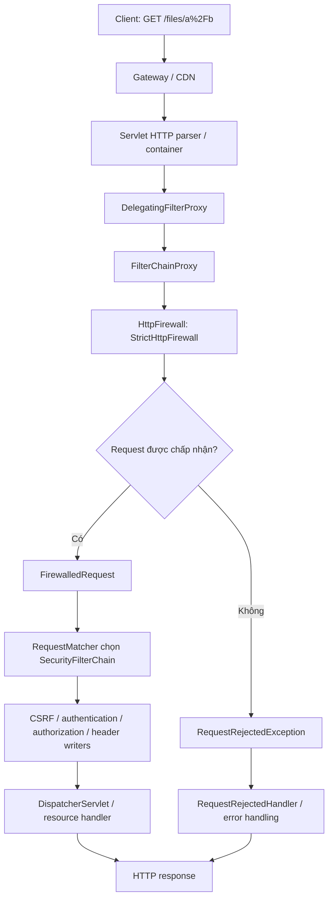
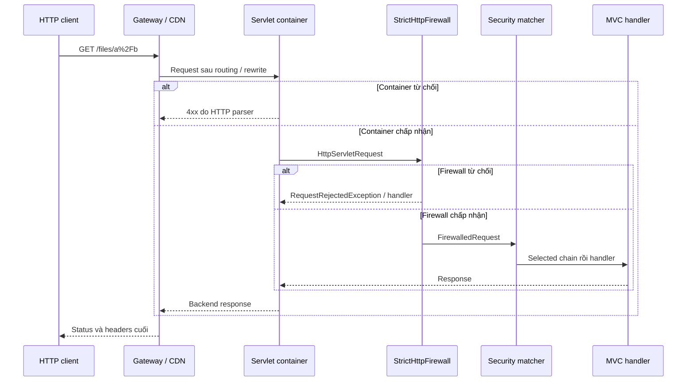

# Dấu phân cách được mã hóa, backslash và ký tự không hợp lệ

## 1. Bối cảnh: tại sao một ký tự trong URL có thể thay đổi chính sách bảo mật?

Trong chương **Firewall trên Servlet** thuộc module **SPRING_SECURITY_HTTP_PROTECTION**, Spring Security bảo vệ request ở nhiều lớp: kiểm tra request HTTP qua firewall, chọn security chain, xác thực, phân quyền, CSRF, CORS và bảo vệ session. Ở phía response, ứng dụng còn quản lý security headers, CSP và HSTS để bảo vệ trình duyệt. Muốn các lớp này phối hợp đúng, hệ thống phải xác định chính xác **request đang nhắm tới tài nguyên nào**.

Giả sử một ứng dụng có quy tắc:

```text
/public/**        -> có thể truy cập công khai
/internal/**      -> cần nhân viên nội bộ
/files/{fileId}   -> phải kiểm tra quyền đọc fileId
```

Một client gửi:

```http
GET /files/a%2Fb HTTP/1.1
Host: app.example.test
```

Chuỗi `%2F` là cách percent-encode dấu slash `/`. Nếu một thành phần giữ `a%2Fb` như một path segment, nhưng thành phần khác giải mã thành `a/b` rồi coi đó là **hai segments**, hai tầng có thể định tuyến đến hai tài nguyên khác nhau. Tình huống tương tự xảy ra với backslash `\`, slash kép `//`, encoded period `%2E` hoặc percent được mã hóa `%25` rồi giải mã tiếp.

Khi **security matcher** và **handler/resource resolver** không cùng cách hiểu path, ứng dụng có nguy cơ chọn sai chính sách bảo vệ. `StrictHttpFirewall` của Spring Security Servlet được thiết kế theo hướng thận trọng: từ chối những biểu diễn request đáng ngờ hoặc chưa chuẩn hóa trong phạm vi nó nhìn thấy, thay vì cố đoán phải chuyển chúng thành URL nào.

Bài này làm rõ những nhóm rủi ro:

- **Dấu phân cách được mã hóa:** `%2F`, encoded double slash, encoded backslash và những biến thể.
- **Backslash:** ký tự `\` thô hoặc `%5C`, vốn có thể bị các tầng giải thích khác nhau.
- **Encoding nhiều lớp:** `%25` có thể tạo ra một chuỗi percent-encoded khác sau lần decode đầu tiên.
- **Encoded period và dot segments:** những dạng có thể biến thành `.` hoặc `..` khi được giải mã/chuẩn hóa.
- **Ký tự không hợp lệ hoặc ký tự điều khiển:** NUL, CR, LF, control chars và cách xử lý tùy HTTP parser.
- **Khác biệt triển khai:** proxy/CDN, Tomcat, Jetty, Undertow, Spring Security matcher và controller.

**Lưu ý:** dấu `%` và percent-encoding **không mặc nhiên độc hại**. HTTP cho phép những ký tự được mã hóa hợp lệ trong URI. Rủi ro xuất hiện khi một encoding làm **thay đổi cấu trúc path hoặc cách diễn giải request**, nhất là ở ranh giới các tầng bảo vệ.

### Mục tiêu học tập

Hoàn thành bài, người học có thể:

1. Giải thích ý nghĩa của encoded separator, backslash và ký tự không hợp lệ trong URI path.
2. Mô tả vị trí `StrictHttpFirewall` trong `FilterChainProxy`, trước khi `SecurityFilterChain` được chọn.
3. Phân biệt URL client gửi, URL gateway forward, `requestURI`, `servletPath`, `pathInfo` và đường dẫn controller dùng.
4. Hiểu vì sao các tùy chọn `setAllowUrlEncodedSlash`, `setAllowBackSlash`, `setAllowUrlEncodedPercent` hay `setAllowUrlEncodedDoubleSlash` là **quyết định bảo mật**, không phải mẹo sửa lỗi.
5. Viết unit test cho firewall và integration test Servlet để xác minh security matching và authorization.
6. Kiểm tra response thật qua HTTP server/proxy, nhận diện request bị chặn ở tầng nào.
7. Thiết kế API ít phụ thuộc vào encoded separator, giữ các cơ chế CSRF/CORS/CSP/HSTS/session đúng trách nhiệm.
8. Không áp dụng nhầm API Servlet trực tiếp cho Reactive/WebFlux.

## 2. Phân biệt percent-encoding với dấu phân cách thực

Định dạng percent-encoding biểu diễn một octet bằng dấu `%` và hai chữ số hexadecimal. Chữ cái trong hex có thể viết hoa hoặc thường: `%2f` và `%2F` cùng biểu diễn byte của ký tự slash trong ASCII.

```text
Ký tự /        -> %2F  hoặc %2f
Ký tự \        -> %5C  hoặc %5c
Ký tự .        -> %2E  hoặc %2e
Ký tự %        -> %25
Ký tự ;        -> %3B  hoặc %3b
NUL            -> %00
Line Feed      -> %0A
Carriage Return-> %0D
```

Với URL `/files/a%2Fb`, câu hỏi bảo mật không chỉ là “có giải mã `%2F` không?”. Phải xác định **khi nào** giải mã, **ai** giải mã, và **security matching** diễn ra trước hay sau thao tác đó.

### 2.1. Path segments được phân chia bởi slash

```text
/files/a/b        -> ba segments: files, a, b
/files/a%2Fb      -> trên chuỗi đã encode có hai segments: files, a%2Fb
```

Nếu encoded slash được giải mã thành separator `/`, số lượng segments thay đổi. Đây là vấn đề quan trọng với:

- Pattern `/files/{fileId}`: một ID có dấu slash còn được xem là một segment không?
- Pattern `/tenants/{tenantId}/files/**`: phần nào xác định tenant?
- API gateway có rule dựa trên prefix path.
- Cache key, rate limit key hoặc authorization rule dùng đường dẫn.
- Resource resolver dùng path làm đường dẫn file trên hệ điều hành.

Không dựa vào việc một tầng “đương nhiên” giữ encoded separator vì các tầng có phiên bản và chính sách URI khác nhau.

### 2.2. Không phải mọi percent-encoding đều phải bị từ chối

Ví dụ một sản phẩm có tên gồm khoảng trắng, ký tự Unicode hoặc phần văn bản được percent-encode. Đây có thể là dữ liệu hợp lệ, nếu API thiết kế đúng cách.

Một chính sách kiểu “từ chối mọi URL có `%`” có thể gây lỗi chức năng không cần thiết. `StrictHttpFirewall` có những nhóm kiểm tra cụ thể, chứ không phải kết luận mọi percent-encoded character là cuộc tấn công.

Phải phân biệt:

| Dạng | Điểm cần xem |
| --- | --- |
| `/products/blue%20shirt` | Encoded space có thể là nội dung slug; kiểm tra URI parser và hợp đồng API. |
| `/files/a%2Fb` | Encoded slash có thể làm thay đổi ranh giới path segment. |
| `/files/a%5Cb` | Encoded backslash có thể bị một số tầng coi như separator. |
| `/public/%2E%2E/internal` | Encoded dot segments có thể thay đổi path sau decode/normalize. |
| `/files/a%252Fb` | Có khả năng tạo encoded slash sau lần decode đầu tiên. |
| `/images/%00name` | Encoded NUL là trường hợp cần từ chối theo chính sách/parser. |
| `/images/%0Aname` | Encoded LF là ký tự điều khiển, có rủi ro parser/logging. |

Bảng mô tả **câu hỏi cần kiểm tra**, không cam kết tất cả ví dụ đến được `StrictHttpFirewall` trong mọi container.

## 3. Luồng xử lý: firewall hoạt động trước bước chọn security chain

Trong Spring Security Servlet, `HttpFirewall` được `FilterChainProxy` sử dụng trước khi các `RequestMatcher` của `SecurityFilterChain` quyết định chain nào nhận request.



Hệ quả quan trọng:

- Một encoded separator bị firewall từ chối **chưa hề đến authorization**.
- Thêm `permitAll()` vào một route không “mở khóa” request đã bị firewall từ chối.
- Nếu HTTP parser của Tomcat, Jetty hoặc proxy từ chối trước Spring Security, sẽ **không có `RequestRejectedException`** trong ứng dụng.
- Một response lỗi xuất hiện trước security chain có thể không nhận `X-Content-Type-Options`, CSP hoặc HSTS từ các header writers của chain.
- `HttpFirewall` chỉ là một lớp kiểm tra đầu vào; vượt firewall **không đồng nghĩa** request được xác thực hay được truy cập tài nguyên.

### 3.1. `HttpFirewall` và `FirewalledRequest`

`HttpFirewall` định nghĩa việc kiểm tra/bọc Servlet request. Khi hợp lệ, implementation trả `FirewalledRequest` để Spring Security sử dụng khi matching; nếu không hợp lệ, nó có thể ném `RequestRejectedException`.

```java
// PSEUDOCODE diễn giải thứ tự, không phải source của FilterChainProxy.
FirewalledRequest checked =
    firewall.getFirewalledRequest(originalRequest);

HttpServletResponse checkedResponse =
    firewall.getFirewalledResponse(originalResponse);

SecurityFilterChain selected =
    findMatchingChain(checked);

// Sau đó mới chạy các security filters phù hợp.
```

`FirewalledRequest` hỗ trợ cơ chế `reset()` ở phạm vi thích hợp cho bước xử lý request. Đừng hiểu nó như một dịch vụ tự sửa tất cả URL hoặc tự làm validation nghiệp vụ.

### 3.2. Matching an toàn cần tính nhất quán

Nếu security matcher thấy `/public/a%2Fb` nhưng handler phía sau nhận `/public/a/b`, chưa thể kết luận có lỗ hổng nếu không biết các rule và resource thực. Tuy nhiên, **sự khác biệt ở thời điểm giải mã** là dấu hiệu cần điều tra.

Đúng kiến trúc là:

1. Gateway, container và framework có một hợp đồng xử lý URL rõ ràng.
2. Firewall từ chối biểu diễn không đạt chính sách trước khi chọn chain.
3. Authorization áp với **resource thực** được handler/service chọn.
4. Các URL bất thường không thể né một chain có quyền chặt hơn bằng cách đổi encoding.

## 4. Encoded forward slash `%2F`

Dấu slash `/` là dấu phân cách segment trong URL path. Còn `%2F` là cách mã hóa byte của slash, nhưng không có gì bảo đảm mọi thành phần HTTP đều giữ nguyên biểu diễn encoded này cho tới cùng một điểm.

### 4.1. Một ví dụ về ID chứa slash

Ứng dụng có API:

```text
GET /files/{fileId}
```

Client muốn truy xuất ID `customerA/report-42` và gửi:

```http
GET /files/customerA%2Freport-42 HTTP/1.1
Host: app.example.test
```

Các cách diễn giải có thể khác nhau:

| Tầng | Biểu diễn có thể xuất hiện | Tác động |
| --- | --- | --- |
| Client | `/files/customerA%2Freport-42` | Một path segment sau `/files` trên chuỗi encoded. |
| Gateway | Giữ nguyên hoặc xử lý `%2F` theo config | Có thể ảnh hưởng upstream routing. |
| Servlet container | Giữ, giải mã, hoặc từ chối | `getRequestURI()`/`getServletPath()` có thể khác. |
| `StrictHttpFirewall` | Có thể từ chối encoded slash theo chính sách strict | Không vào security chain nếu reject. |
| Controller | Có thể nhìn ID khác nếu các tầng đã decode | Resource ID phải được validate và authorize. |

Không khẳng định “Tomcat luôn từ chối, Jetty luôn chấp nhận” — mỗi sản phẩm có version và connector settings liên quan.

### 4.2. Chính sách `StrictHttpFirewall`

Trong nhiều bản Spring Security Servlet hiện đại, **encoded forward slash bị từ chối mặc định**. API có setter `setAllowUrlEncodedSlash(boolean)` để thay đổi quyết định này.

```java
import org.springframework.security.web.firewall.StrictHttpFirewall;

StrictHttpFirewall firewall = new StrictHttpFirewall();

// Không bật chỉ vì client dùng ID chứa slash.
// firewall.setAllowUrlEncodedSlash(true);
```

Tại sao không tự động bật? Vì một thay đổi ở firewall **không bảo đảm** gateway, container, matcher và handler cùng nhìn ra một resource. Việc cho phép cũng có thể thay đổi không gian URL mà các rule bảo vệ cần xét.

### 4.3. Thiết kế API thay thế

Có những lựa chọn giảm phụ thuộc vào encoded separator:

- Dùng **opaque identifier không chứa slash**: `/files/f_7d28c9`.
- Tách các phần có ngữ nghĩa thành **những path segments thật**: `/customers/{customerId}/reports/{reportId}`.
- Dùng query parameter nếu phần dữ liệu là bộ lọc/chuỗi tìm kiếm: `/files?key=customerA%2Freport-42`.
- Truyền dữ liệu có cấu trúc trong request body khi method/semantics phù hợp.

Các giải pháp này vẫn cần validation, CSRF/authorization và cache policy. Nhưng chúng tránh phải phụ thuộc vào sự nhất quán của encoded separator trong path.

## 5. Backslash thô và encoded backslash `%5C`

Dấu `\` là backslash; nó không phải separator chuẩn giống forward slash `/` trong URI path theo cách thông thường. Tuy nhiên, một số hệ thống, API filesystem hoặc tầng trung gian có thể diễn giải backslash như separator.

```text
/files/team\report.pdf
/files/team%5Creport.pdf
```

Một tầng có thể nhìn `team\report.pdf` là tên file chứa backslash; tầng khác có thể chuyển thành `team/report.pdf`. Nếu authorization kiểm tra path theo một biểu diễn còn storage dùng biểu diễn khác, resource cuối có thể không đúng resource đã kiểm tra.

### 5.1. Vì sao `StrictHttpFirewall` thận trọng với backslash?

Các phiên bản hiện đại thường từ chối **backslash trong URL** theo strict policy. Setter `setAllowBackSlash(true)` là một cách nới quy tắc và phải được đánh giá cẩn thận.

```java
StrictHttpFirewall firewall = new StrictHttpFirewall();

// Tránh mở toàn cục nếu không có yêu cầu nghiệp vụ đã đánh giá.
// firewall.setAllowBackSlash(true);
```

Tránh cách sửa “thay mọi backslash thành slash” ở một filter tùy biến **sau** khi matcher đã chọn chain. Khi đó authorization có thể được quyết định trên path cũ, còn controller truy xuất resource theo path đã đổi.

### 5.2. Tác động của hệ điều hành

File path trên Windows thường sử dụng backslash trong nhiều API. Nhưng **HTTP URL path không phải local filesystem path**. Một application nhận URL rồi ghép trực tiếp thành file path trên Windows có thể tạo khác biệt normalization/authorization với máy chạy Linux.

Anti-pattern:

```java
// KHÔNG ghép trực tiếp URI path do client kiểm soát vào filesystem.
Path target = Path.of(storageRoot, request.getRequestURI());
```

Ngoài vấn đề backslash, mã này còn có thể sai context path, path traversal, encoded segments và directory boundaries. Nên resolve resource bằng ID đã validate, tra mapping server-side, kiểm tra canonical path nằm trong root được phép và xác minh quyền đọc/ghi đối với resource đó.

### 5.3. Đừng dùng một ký tự “thay thế dễ nhìn” để né policy

Các ký tự Unicode trông giống slash/backslash không tự là separator theo HTTP grammar, nhưng downstream code hoặc phép normalization có thể xử lý khác nhau. Không cấp quyền dựa trên “ký tự nhìn giống” hoặc so chuỗi đã qua thao tác case-folding/normalization không kiểm soát. Với file ID và tenant ID, nên dùng một bộ ký tự/định dạng được định nghĩa rõ và duy nhất.

## 6. Slash kép `//` và encoded double slash

Có những URL chứa hai slash liên tiếp:

```text
/admin//reports
/admin/%2Freports
/admin/%2F%2Freports
```

Tùy cấu trúc và encoding, các tầng có thể gộp separator, giữ nguyên hoặc reject. `StrictHttpFirewall` có các quy tắc riêng liên quan **double slash** và **encoded double slash**; trong những version hỗ trợ, có setter `setAllowUrlEncodedDoubleSlash(boolean)`.

Điểm cần nhớ: **mở một quy tắc không đồng nghĩa mở tất cả**. Ví dụ cho phép một số dạng encoded slash không mặc nhiên cho phép raw double slash hoặc những biểu diễn gây normalization khác.

### 6.1. Nguy cơ khi prefix matching

Giả sử:

```text
/admin/**  -> ROLE_ADMIN
/**        -> authenticated
```

Nếu proxy hoặc container gộp `//` không giống matcher, có thể xảy ra tình huống một request trông không khớp `/admin/**` nhưng handler sau normalize lại xử lý tài nguyên admin.

Một phép thử phòng vệ phải xác nhận **chain nào được chọn và resource nào được xử lý**, không chỉ status `200` hoặc `404`. Nếu có fallback, hãy giữ chính sách không kém chặt hơn các tuyến nhạy cảm.

### 6.2. Không tự gọi `replace("//", "/")` sau matching

```java
// ANTI-PATTERN: normalization tự chế sau authorization.
String routedPath = request.getRequestURI().replace("//", "/");
```

Việc thay chuỗi không đủ xử lý percent encoding, dot segments, context path, servlet mapping, backslash hoặc các trường hợp nhiều separator liên tiếp. Tệ hơn, nếu các rule security đã chạy trước đó, request có thể được phân loại trên một path khác với path cuối.

Sửa URL generator/client và kiểm soát parsing **tại cùng ranh giới trước matching**, hoặc từ chối representation không nằm trong hợp đồng API.

## 7. Encoded period `%2E`, dot segments và đường dẫn chưa chuẩn hóa

Dấu chấm `.` có thể bình thường trong tên file: `report.pdf`. Nhưng các path segments `.` và `..` có semantics riêng trong quy tắc chuẩn hóa URI/path.

Ví dụ:

```text
/public/../admin/reports
/public/%2E%2E/admin/reports
/public/%2e%2e/admin/reports
```

Nếu một tầng nhìn encoded dot segments như văn bản, còn tầng khác decode rồi loại `..`, đường dẫn cuối có thể trỏ sang một namespace khác.

### 7.1. `setAllowUrlEncodedPeriod` không phải lời giải chung

`StrictHttpFirewall` ở những phiên bản hỗ trợ có setter liên quan đến **URL-encoded period**. Thay đổi này có thể cần cho một số legacy URLs, nhưng phải đánh giá tác động tới path traversal và normalization.

```java
StrictHttpFirewall firewall = new StrictHttpFirewall();

// Không mở encoded period chỉ để một URL lạ vượt firewall.
// firewall.setAllowUrlEncodedPeriod(true);
```

Không phải mọi dấu chấm trong URL đều bị cấm; điều cần chú ý là **cách biểu diễn được mã hóa** và khả năng thay đổi path qua decoding/normalization.

### 7.2. Kiểm tra đường dẫn trước khi dùng làm file path

Đừng viết:

```java
// ANTI-PATTERN, chỉ để minh họa lỗi thứ tự.
String userPath = request.getRequestURI();

if (userPath.startsWith("/public/")) {
    String decodedAgain =
        java.net.URLDecoder.decode(
            userPath, java.nio.charset.StandardCharsets.UTF_8);
    // Dùng decodedAgain để mở file sau khi đã quyết định quyền.
}
```

`URLDecoder` được thiết kế cho ngữ nghĩa form encoding; trong đó `+` có thể trở thành space, khác với cách parse path URI thông thường. **Giải mã thêm lần nữa sau authorization** có thể làm thay đổi ý nghĩa path và tạo mismatch. Dùng parser/router phù hợp; authorization nên áp lên resource canonical do server xác định.

## 8. Encoded percent `%25` và nguy cơ double decoding

`%25` là biểu diễn của ký tự percent `%`. Vì vậy:

```text
Đầu vào URL:          /files/a%252Fb
Sau một lần decode:   /files/a%2Fb
Sau lần decode nữa:   /files/a/b
```

Một giá trị dữ liệu được đưa qua nhiều tầng giải mã có thể **biến một encoded separator thành separator thật** sau khi security matching đã diễn ra.

`StrictHttpFirewall` có quy tắc liên quan `%25` ở những phiên bản strict thông dụng và setter `setAllowUrlEncodedPercent(boolean)` để điều chỉnh. Đây là một trong các cấu hình cần cân nhắc kỹ vì nó liên quan trực tiếp đến tình huống **double encoding**.

### 8.1. Vì sao không chỉ kiểm tra percent encoding hợp lệ?

Một chuỗi `%25` có thể hợp lệ về mặt cú pháp URI, nhưng hợp lệ cú pháp không bảo đảm **các tầng decode thống nhất một lần**. Nếu server một lần decode và storage một lần decode nữa, resource thực có thể khác representation security đã kiểm tra.

Đừng viết vòng lặp kiểu:

```java
// ANTI-PATTERN: không liên tục URL-decode tới khi chuỗi không đổi.
while (value.contains("%")) {
    value = java.net.URLDecoder.decode(
        value, java.nio.charset.StandardCharsets.UTF_8);
}
```

Vòng lặp này không phản ánh một hợp đồng URL an toàn; có thể làm thay đổi dữ liệu, tạo exception với encoding không hợp lệ hoặc vô tình mở ra những ký tự phân cách mới.

### 8.2. Thiết kế ID rõ ràng

Nếu resource ID có thể chứa ký tự đặc biệt, hãy cân nhắc mapping sang opaque ID hoặc cơ chế truyền dữ liệu tách biệt khỏi cấu trúc path. Sau khi parse, **ủy quyền cho resource thực**, ví dụ quyền xem file được tra bằng `fileId` đã validate thay vì prefix URI chưa chắc được chuẩn hóa đúng.

## 9. Ký tự điều khiển và những biểu diễn không hợp lệ

Nhóm này gồm NUL, carriage return, line feed và các control characters khác. Trong URL, những dạng percent-encoded thường được dùng để minh họa là:

```text
%00   NUL
%0D   Carriage Return (CR)
%0A   Line Feed (LF)
```

Chúng có thể gây các vấn đề như:

- Request parser từ chối vì cú pháp không hợp lệ.
- Log trở nên khó đọc hoặc bị thêm dòng do dữ liệu không được escape.
- Các thư viện downstream xử lý chuỗi theo cách khác nhau.
- Một số trường hợp encoding/control char làm thay đổi cách dữ liệu được biểu diễn ở boundary khác.

`StrictHttpFirewall` có cơ chế từ chối các biểu diễn control characters cụ thể; **HTTP server có thể từ chối request trước khi Java nhận được**.

### 9.1. Đừng nhầm với HTTP request smuggling

CR/LF có ý nghĩa đặc biệt trong các định dạng HTTP/1.x truyền thống, nhưng một URI có `%0D` hoặc `%0A` **không tự động trở thành request smuggling**. Request smuggling thường liên quan tới sự không nhất quán khi nhiều HTTP parsers xác định ranh giới request hoặc framing (chẳng hạn `Content-Length` và `Transfer-Encoding`), có thể xảy ra trước khi có `HttpServletRequest`.

`StrictHttpFirewall` **không thay thế** việc vá và cấu hình đúng reverse proxy, HTTP server/connector và hạn chế malformed protocol. Không tuyên bố Spring Security một mình có thể xử lý mọi lỗi parser ở các tầng trước.

### 9.2. Ký tự NUL

NUL có lịch sử đặc biệt trong các API xử lý chuỗi ở một số ngôn ngữ hoặc native libraries. Một Servlet application Java hiện đại vẫn cần từ chối hoặc validate NUL trong input có thể đi tới filesystem, native library hay component legacy.

Ví dụ `%00` trong URL path thường không có lý do nghiệp vụ hợp lệ để được dùng làm segment identifier. Nhưng kết quả HTTP cụ thể — `400` từ container, `RequestRejectedException` trong firewall hoặc lỗi khác — phải đo đúng tầng.

### 9.3. Log injection và cách ghi log an toàn

Một request chứa control characters có thể làm log line bị phá cấu trúc nếu logging pipeline không escape dữ liệu. Khi chẩn đoán:

- Không in raw URI hoặc header values trực tiếp vào log không có escaping.
- Ghi nhận request ID, method, status, layer rejection và loại vi phạm ở mức đủ dùng.
- Không ghi `Authorization`, session cookie, CSRF token hoặc query chứa secret.
- Giới hạn retention và quyền truy cập log đối với dữ liệu request bị từ chối.

Có thể ghi nhận một chuỗi đã **escape ký tự điều khiển**, nhưng không biến log trở thành nơi hiển thị payload raw của client.

### 9.4. HTTP header và parameter validation là chủ đề liên quan

`StrictHttpFirewall` ở những phiên bản hiện đại còn kiểm tra một số tên/giá trị HTTP headers và parameters. Nhưng không nên gộp một rule “cấm ký tự trong URL path” thành rule “cấm mọi ký tự như vậy trong mọi HTTP value”.

Ví dụ `Content-Type`, `Accept` và `Authorization` có cú pháp riêng. Một rule global tùy biến quá chặt có thể phá request hợp lệ; một rule quá lỏng lại không thay validation nghiệp vụ. Hãy dùng các predicate/config phù hợp với version và mục tiêu, cùng parser/validation đặc thù cho từng giá trị.

## 10. Tổng hợp hành vi StrictHttpFirewall: chính sách riêng cho từng nhóm

Bảng dưới dùng để thiết kế **một policy review**, không phải danh sách chính xác bất biến giữa mọi bản Spring Security.

| Nhóm request path | Ví dụ | Hành vi strict thường gặp | Khi nào được cân nhắc nới? |
| --- | --- | --- | --- |
| Forward slash mã hóa | `%2F`, `%2f` | Từ chối | Chỉ khi contract URL yêu cầu, mọi hop xử lý thống nhất và có test authorization. |
| Backslash thô/encoded | `\`, `%5C` | Từ chối | Hiếm khi cần; ưu tiên thay thiết kế resource ID. |
| Double slash/encoded double slash | `//`, `%2F%2F` | Từ chối những dạng không được policy chấp nhận | Chỉ sau phân tích path normalization và routing. |
| Encoded percent | `%25` | Thường từ chối do nguy cơ decoding nhiều lớp | Không nới nếu downstream có decode thêm. |
| Encoded period | `%2E` | Có kiểm tra riêng ở strict implementation | Chỉ khi chắc chắn không tạo dot segment/path traversal mismatch. |
| Semicolon/encoded semicolon | `;`, `%3B` | Thường từ chối | Chỉ khi thực sự cần matrix variables/path parameters. |
| NUL, CR, LF | `%00`, `%0D`, `%0A` | Từ chối hoặc bị container chặn sớm | Gần như không có lý do đưa vào URL path nghiệp vụ. |
| Dot segments hoặc path chưa chuẩn hóa | `/a/../b` | Có thể bị firewall hoặc tầng trước từ chối | Thiết kế canonical URLs và kiểm tra ở ranh giới trước matching. |

**Chú ý kỹ thuật:** các setter có tên tương tự có thể áp với **một dạng encoded cụ thể**, không tự thay đổi mọi quy tắc còn lại. Ví dụ cho phép encoded slash không hàm ý cho phép backslash, encoded percent, semicolon hoặc toàn bộ URL chưa chuẩn hóa.

### 10.1. Một số API cần nhận biết

Những phương thức cấu hình xuất hiện trong nhiều bản Spring Security Servlet:

```java
StrictHttpFirewall firewall = new StrictHttpFirewall();

// Các lựa chọn nhạy cảm về bảo mật, KHÔNG nên bật đồng loạt:
// firewall.setAllowUrlEncodedSlash(true);
// firewall.setAllowUrlEncodedDoubleSlash(true);
// firewall.setAllowBackSlash(true);
// firewall.setAllowUrlEncodedPercent(true);
// firewall.setAllowUrlEncodedPeriod(true);
// firewall.setAllowSemicolon(true);
```

Bất cứ thay đổi nào cũng cần xác nhận **API/chữ ký và behavior đúng với version** của `spring-security-web` trong ứng dụng. Một số phiên bản có những tùy chọn bổ sung liên quan control characters hoặc URL encoding khác. Không sao chép một danh sách setters từ bài hướng dẫn cũ mà không kiểm tra dependency.

### 10.2. Không chuyển sang `DefaultHttpFirewall` chỉ để né rejection

`DefaultHttpFirewall` là implementation khác có lịch sử/triết lý xử lý request khác `StrictHttpFirewall`. Việc đổi implementation có thể làm tập request được chấp nhận thay đổi, bao gồm những biểu diễn path mà policy strict cố tình từ chối.

Nếu một URL “hoạt động trước khi nâng framework” nhưng bị từ chối sau nâng, quy trình đúng là xem **URL contract, container/proxy changes, policy và regressions**, không lập tức chuyển firewall về implementation lỏng hơn.

## 11. Sự khác nhau giữa Tomcat, Jetty, Undertow và gateway

Spring Security Servlet nhìn request **sau khi HTTP parser/container đã xử lý**. Do đó, một URL raw có encoded slash hoặc control characters có thể chưa đến `FilterChainProxy`.



### 11.1. Cần kiểm tra những điểm nào ở mỗi tầng?

| Tầng | Quyết định liên quan |
| --- | --- |
| Browser/curl | URL có bị client tự normalize hay mã hóa không? |
| Gateway/NGINX/Ingress | Giữ raw request target, rewrite `$uri`/`$request_uri`, merge slash, decode encoded separators, cache-key. |
| Tomcat | Connector URI rules, encoded solidus/backslash handling, version và Servlet mapping. |
| Jetty | URI compliance/ambiguous path settings, version và Servlet mapping. |
| Undertow | URL decoding, encoded slash handling, listener/handler options, version. |
| Spring Security | `StrictHttpFirewall` config, `RequestMatcher` type, selected chain. |
| Spring MVC | `PathPatternParser`/handler mapping, path variables và resource mapping. |
| Service/storage | Canonical resource ID, tenant/owner checks, file resolution và permission. |

Không cần đưa mọi cấu hình container vào một bài Java: **cùng một sản phẩm nhưng version khác có thể đổi behavior hoặc tên setting**. Đối chiếu tài liệu của chính phiên bản đang chạy và thực hiện phép thử staging.

### 11.2. `requestURI`, `servletPath` và `pathInfo` có thể khác

Ví dụ public request:

```text
GET /portal/files/a%2Fb
```

Nếu backend được deploy dưới context root `/portal` với DispatcherServlet mapping `/`, những giá trị có thể liên quan:

```text
requestURI  = /portal/files/a%2Fb
contextPath = /portal
servletPath = /files/...
pathInfo    = null
```

Phần dấu ba chấm nhắc rằng `servletPath` thực **phụ thuộc container/URI handling**. Nếu servlet prefix mapping `/files/*`, `servletPath` có thể là `/files` và `pathInfo` mang phần còn lại. Không suy mọi API path chứa encoding đều phản ánh cùng chuỗi raw.

Với legacy `AntPathRequestMatcher`, path thường dựa trên `servletPath + pathInfo` (không gồm context path). Matcher MVC hoặc PathPattern có semantics khác; vì vậy phải kiểm tra đúng matcher runtime và path mà controller nhận.

### 11.3. NGINX: khác nhau giữa request URI và URI đã chuẩn hóa

NGINX thường phân biệt các khái niệm như `$request_uri` — request URI dạng ban đầu kèm arguments — và `$uri` — normalized/current URI có thể thay đổi qua rewrite. Chi tiết còn phụ thuộc config/rewrite flow.

Một gateway dùng biến hoặc directive sai có thể làm encoded slash/duplicate slash được diễn giải khác so với backend. Không khẳng định một URL đã tới Java giống với raw browser URL chỉ vì server có access log. Khi debug, hãy ghi lại:

- Public request-target.
- Upstream URI sau rewrite.
- HTTP method/host/scheme.
- Servlet path APIs trên backend nếu request được chấp nhận.
- Selected security chain và handler/resource thật.

### 11.4. HSTS và HTTPS không thay bài toán URI

Browser truy cập HTTPS public, gateway terminate TLS rồi gọi HTTP backend nội bộ. HSTS có thể được gateway phát, trong khi Spring Security backend chỉ thấy HTTP và không tự phát HSTS. Đây là **vấn đề response header và secure scheme**, không tự giải quyết encoded separator. Ngược lại, việc request có HSTS đúng không chứng minh URI path đã được match an toàn.

## 12. Threat model: encoded separator có thể ảnh hưởng những lớp nào?

### 12.1. Chọn nhầm security chain

Giả sử Spring Security cấu hình:

```text
/admin/**    -> ROLE_ADMIN
/**          -> authenticated
```

Nếu request có encoded separator bị hiểu khác giữa matcher và handler, một URL thực tế dẫn tới admin resource có thể không vào admin chain.

Điều cần kiểm chứng khi có ngoại lệ firewall:

1. `securityMatcher` nào chọn chain?
2. `requestMatchers` nào quyết định quyền trong chain?
3. Controller/resource mapping thật là gì?
4. Principal có đúng role/permission không?
5. Có fallback chain bảo thủ cho URL không khớp không?

Không thử “bật allow encoding rồi chạy một GET có ADMIN” và kết luận an toàn. Test bắt buộc có **người không đủ quyền**.

### 12.2. Chọn sai resource/tenant

`GET /tenants/{tenantId}/files/{fileId}` có thể đi qua chain authenticated nhưng vẫn lộ file tenant khác nếu service xây file path hoặc tenant ID từ chuỗi URI chưa được canonicalize.

Authorization nên dựa trên một resource ID do server parse và xác minh:

```java
// PSEUDOCODE nghiệp vụ, không phải API hoàn chỉnh.
FileRecord file = repository.requireById(fileId);

if (!accessPolicy.canRead(authentication, file)) {
    throw new AccessDeniedException("Not allowed");
}

return storage.open(file.storageKey());
```

Một path canonical không thay kiểm tra object-level authorization; một encoded separator bị firewall cho qua cũng không cấp quyền đọc file.

### 12.3. Cache-key hoặc route-key không nhất quán

Nếu CDN cache `/files/a%2Fb` và `/files/a/b` như một URL nhưng backend xem là hai resource khác nhau, dữ liệu có thể bị cache sai. Nếu resource tùy user/tenant, cần bảo đảm cache isolation hoặc `no-store`/private policy đúng. `Vary` xử lý biến thể theo request headers, **không tự khắc phục** việc gateway hợp nhất hai path thành cùng cache-key.

### 12.4. File handling và traversal

Path traversal có thể xuất hiện khi một handler giải mã/chuẩn hóa chuỗi từ URL rồi ghép vào filesystem, đặc biệt khi có `..`, slash/backslash hoặc encoded separators.

Biện pháp bổ sung:

- Tách resource identifier khỏi filesystem path; dùng mapping phía server.
- Validate identifier theo schema/allowlist hợp lý.
- Resolve path theo storage root đã chỉ định, và bảo đảm kết quả thực nằm trong phạm vi được phép, với cân nhắc symlink.
- Kiểm tra quyền trên resource ID/file record.
- Không làm decode lặp sau authorization.

Firewall là một lớp phòng vệ, **không thay** những bước này.

## 13. Cấu hình Servlet an toàn: ưu tiên giữ StrictHttpFirewall mặc định

Trong nhiều ứng dụng Spring Security, không cần tạo bean `HttpFirewall` mới: cấu hình strict mặc định đã đủ.

Nếu dự án cần công khai một chính sách rõ ràng trong Java config, ví dụ Spring Security Servlet:

```java
import org.springframework.context.annotation.Bean;
import org.springframework.context.annotation.Configuration;
import org.springframework.security.config.annotation.web.configuration.WebSecurityCustomizer;
import org.springframework.security.web.firewall.StrictHttpFirewall;

@Configuration
class ServletFirewallPolicyConfig {

    @Bean
    WebSecurityCustomizer firewallCustomizer() {
        return web -> {
            var firewall = new StrictHttpFirewall();

            // Giữ default strict rules cho encoded slash,
            // backslash, double slash và encoded percent.
            web.httpFirewall(firewall);
        };
    }
}
```

Đây là **mẫu giải thích vị trí cấu hình**, không phải bước bắt buộc nếu defaults đã phù hợp. Trong Spring Security Reference, việc đăng ký `HttpFirewall` còn có thể theo bean/customizer tùy version. Nếu ứng dụng đã có custom `WebSecurityCustomizer` hoặc firewall bean, hãy hợp nhất chính sách thay vì tạo cấu hình cạnh tranh.

### 13.1. Không cấu hình firewall bằng `addFilterBefore`

`HttpSecurity.addFilterBefore(...)` thêm một filter **bên trong `SecurityFilterChain` được chọn**. `HttpFirewall` cần kiểm tra trước khi chọn chain, vì vậy không thể thay bằng một filter tùy biến đặt sau matching.

Một filter tự viết kiểm tra `request.getRequestURI()` có thể bỏ qua phần `servletPath`/`pathInfo` hoặc xử lý encoding không đúng container semantics. Ưu tiên framework firewall và test thay vì tạo một parser URI bảo mật riêng mà không có lý do.

### 13.2. Trường hợp buộc phải nới một quy tắc

Nếu một client legacy thật sự cần encoded slash trong path và team đã chứng minh mọi hop xử lý thống nhất, có thể có ngoại lệ như:

```java
StrictHttpFirewall firewall = new StrictHttpFirewall();

// VÍ DỤ NGHIÊN CỨU, không khuyến nghị production mặc định:
firewall.setAllowUrlEncodedSlash(true);
```

Sau thay đổi:

- Phải test encoded slash ở route công khai, route cần role và route đa tenant.
- Giữ backslash, encoded percent, dot segments và các rule khác strict.
- Test cả lower/upper hex (`%2f` và `%2F`).
- Xem container có chấp nhận request trước khi firewall xử lý không.
- Xem MVC router và storage có chọn cùng resource không.
- Có phương án rollback và lý do nghiệp vụ được ghi nhận.

Nếu giải pháp thay bằng opaque ID hoặc query/body phù hợp hơn, **ưu tiên thiết kế lại API**.

## 14. Unit test `StrictHttpFirewall`: kiểm tra chính sách theo request mock

Unit test trực tiếp `getFirewalledRequest(...)` rất hữu ích để phân biệt **firewall policy** với **status do container/proxy tạo**.

Ví dụ Spring Security Servlet 6.x với JUnit 5, `spring-security-web` và `spring-test`:

```java
import org.junit.jupiter.api.Test;
import org.springframework.mock.web.MockHttpServletRequest;
import org.springframework.security.web.firewall.FirewalledRequest;
import org.springframework.security.web.firewall.RequestRejectedException;
import org.springframework.security.web.firewall.StrictHttpFirewall;

import static org.junit.jupiter.api.Assertions.assertEquals;
import static org.junit.jupiter.api.Assertions.assertThrows;

class EncodedSeparatorFirewallUnitTest {

    private final StrictHttpFirewall firewall = new StrictHttpFirewall();

    private MockHttpServletRequest get(String path) {
        var request = new MockHttpServletRequest("GET", path);
        request.setServletPath(path);
        return request;
    }

    @Test
    void acceptsNormalCanonicalPath() {
        FirewalledRequest safe =
            firewall.getFirewalledRequest(get("/files/report-42"));

        assertEquals("/files/report-42", safe.getServletPath());
        safe.reset();
    }

    @Test
    void rejectsEncodedForwardSlash() {
        assertThrows(RequestRejectedException.class,
            () -> firewall.getFirewalledRequest(
                get("/files/tenantA%2Freport-42")));
    }

    @Test
    void rejectsEncodedBackslash() {
        assertThrows(RequestRejectedException.class,
            () -> firewall.getFirewalledRequest(
                get("/files/tenantA%5Creport-42")));
    }

    @Test
    void rejectsRawBackslash() {
        assertThrows(RequestRejectedException.class,
            () -> firewall.getFirewalledRequest(
                get("/files/tenantA\\report-42")));
    }

    @Test
    void rejectsEncodedPercentByDefault() {
        assertThrows(RequestRejectedException.class,
            () -> firewall.getFirewalledRequest(
                get("/files/a%252Fb")));
    }
}
```

Những kỳ vọng này dùng defaults phổ biến của `StrictHttpFirewall`. Nếu dependency/version có behavior khác, hoặc firewall đã được chủ động nới, test phải kiểm tra **policy thực sự được phê duyệt**.

**Giới hạn cực kỳ quan trọng:** `MockHttpServletRequest` cho phép ta tự đặt `requestURI` và `servletPath`. Nó không chạy parser của Tomcat/Jetty/Undertow. Unit test chỉ trả lời “khi firewall nhận object có representation này thì xử lý thế nào?”.

### 14.1. Thêm test về double slash và control character

Có thể thêm các method vào cùng class:

```java
@Test
void rejectsDoubleSlash() {
    assertThrows(RequestRejectedException.class,
        () -> firewall.getFirewalledRequest(
            get("/admin//reports")));
}

@Test
void rejectsEncodedNull() {
    assertThrows(RequestRejectedException.class,
        () -> firewall.getFirewalledRequest(
            get("/files/a%00b")));
}

@Test
void rejectsEncodedLineFeed() {
    assertThrows(RequestRejectedException.class,
        () -> firewall.getFirewalledRequest(
            get("/files/a%0Ab")));
}
```

Một số HTTP parsers sẽ reject các URL kiểu này **trước khi Java nhận request**, vì vậy không được coi unit tests này là bằng chứng browser/client production sẽ nhận `RequestRejectedException` hoặc đúng status `400`.

### 14.2. Test một ngoại lệ được giới hạn

Một test hữu ích khi thực sự có ngoại lệ encoded slash:

```java
import static org.junit.jupiter.api.Assertions.assertDoesNotThrow;

@Test
void allowingEncodedSlashDoesNotOpenEncodedPercent() {
    var customized = new StrictHttpFirewall();
    customized.setAllowUrlEncodedSlash(true);

    FirewalledRequest accepted = assertDoesNotThrow(
        () -> customized.getFirewalledRequest(
            get("/files/a%2Fb")));
    accepted.reset();

    assertThrows(RequestRejectedException.class,
        () -> customized.getFirewalledRequest(
            get("/files/a%252Fb")));
}
```

Mục tiêu không phải đề xuất bật encoded slash, mà là **xác nhận mỗi ngoại lệ chỉ tác động nhóm quy tắc đã chọn**. Trường hợp container thật có thể xử lý path trước đó, test trên còn cần bổ sung integration test.

### 14.3. Không test toàn bộ bằng một chuỗi status

Một test `assertThrows(RequestRejectedException.class, ...)` kiểm tra contract firewall. HTTP response cuối còn phụ thuộc `RequestRejectedHandler`, Spring Security version và container. Nếu MockMvc test bỗng ném exception thay vì trả `400`, chưa thể nói firewall lỗi; phải xác định handler trong test context.

## 15. MockMvc: sau firewall là chọn chain và phân quyền

Để chứng minh những request **hợp lệ** được chọn vào security chain đúng, hãy dùng một ứng dụng Servlet mẫu:

```java
import org.springframework.context.annotation.Bean;
import org.springframework.context.annotation.Configuration;
import org.springframework.core.annotation.Order;
import org.springframework.security.config.Customizer;
import org.springframework.security.config.annotation.web.builders.HttpSecurity;
import org.springframework.security.web.SecurityFilterChain;
import org.springframework.security.web.header.writers.StaticHeadersWriter;

@Configuration
class ChainPolicyForFirewallDemo {

    @Bean
    @Order(1)
    SecurityFilterChain adminChain(HttpSecurity http) throws Exception {
        http
            .securityMatcher("/admin/**")
            .authorizeHttpRequests(auth -> auth
                .anyRequest().hasRole("ADMIN"))
            .httpBasic(Customizer.withDefaults())
            .headers(headers -> headers.addHeaderWriter(
                new StaticHeadersWriter("X-Lab-Chain", "admin")));

        return http.build();
    }

    @Bean
    @Order(2)
    SecurityFilterChain fallback(HttpSecurity http) throws Exception {
        http
            .authorizeHttpRequests(auth -> auth
                .requestMatchers("/public/**").permitAll()
                .anyRequest().authenticated())
            .httpBasic(Customizer.withDefaults())
            .headers(headers -> headers.addHeaderWriter(
                new StaticHeadersWriter("X-Lab-Chain", "fallback")));

        return http.build();
    }
}
```

`X-Lab-Chain` là **marker cho môi trường test**, không phải security header chuẩn; gỡ khi không còn nhu cầu chẩn đoán. Trong hệ thống thật, cấu hình authorization, CSRF, CORS, session và security headers còn phải dựa theo nghiệp vụ và các chain hiện hữu.

Controller mẫu:

```java
import org.springframework.web.bind.annotation.GetMapping;
import org.springframework.web.bind.annotation.RestController;

@RestController
class FirewallDemoController {

    @GetMapping("/public/ping")
    String publicPing() {
        return "public-ok";
    }

    @GetMapping("/admin/ping")
    String adminPing() {
        return "admin-ok";
    }
}
```

### 15.1. Test user không có quyền và user ADMIN

```java
import org.junit.jupiter.api.Test;
import org.springframework.beans.factory.annotation.Autowired;
import org.springframework.boot.test.autoconfigure.web.servlet.AutoConfigureMockMvc;
import org.springframework.boot.test.context.SpringBootTest;
import org.springframework.test.web.servlet.MockMvc;

import static org.springframework.security.test.web.servlet.request.SecurityMockMvcRequestPostProcessors.user;
import static org.springframework.test.web.servlet.request.MockMvcRequestBuilders.get;
import static org.springframework.test.web.servlet.result.MockMvcResultMatchers.header;
import static org.springframework.test.web.servlet.result.MockMvcResultMatchers.status;

@SpringBootTest
@AutoConfigureMockMvc
class FirewallChainIntegrationTest {

    @Autowired MockMvc mvc;

    @Test
    void publicPathGetsFallbackChain() throws Exception {
        mvc.perform(get("/public/ping"))
            .andExpect(status().isOk())
            .andExpect(header().string("X-Lab-Chain", "fallback"));
    }

    @Test
    void adminPathRequiresAdminRole() throws Exception {
        mvc.perform(get("/admin/ping")
                .with(user("reader").roles("USER")))
            .andExpect(status().isForbidden())
            .andExpect(header().string("X-Lab-Chain", "admin"));

        mvc.perform(get("/admin/ping")
                .with(user("owner").roles("ADMIN")))
            .andExpect(status().isOk())
            .andExpect(header().string("X-Lab-Chain", "admin"));
    }
}
```

`user(...)` thuộc `spring-security-test`. Test này cho thấy route bình thường đi đúng chain và phân quyền theo role; **không kiểm tra URI bị HTTP parser normalize**.

### 15.2. Khi test URI bất thường trong MockMvc

Ví dụ:

```java
// Không mặc định dùng assertion dưới đây cho mọi test context:
// mvc.perform(get("/admin%2Fping"))
//     .andExpect(status().isBadRequest());
```

Trong một cấu hình, `RequestRejectedException` có thể được chuyển thành status lỗi; cấu hình khác có thể ném exception trực tiếp. Hơn nữa, các path API mà MockMvc mock tạo ra có thể khác servlet container thật. Để kiểm tra firewall rule, dùng unit test. Để kiểm tra HTTP response trên đường truyền, dùng server thật.

### 15.3. Negative tests quan trọng hơn một `200`

Nếu một hệ thống cho phép encoded slash có chủ đích, các phép thử phải đảm bảo:

- Người dùng USER không đọc được `/admin/**` dưới bất kỳ biểu diễn URL được hỗ trợ nào.
- Fallback chain không có `permitAll` quá rộng cho namespace nhạy cảm.
- Resource của tenant khác không được mở từ một path có encoded separator.
- Các URL bất thường không vô tình chuyển thành route công khai sau normalization.
- Security headers/CSRF/CORS/session policy vẫn hoạt động bình thường.

Một user ADMIN nhận `200` không chứng minh user khác bị chặn.

## 16. HTTP integration test qua server thật và proxy

Chỉ khi một HTTP request đi qua đúng **client → gateway → Servlet HTTP server → Spring Security**, ta mới biết request-target được biến đổi như thế nào trên đường truyền.

### 16.1. Đo request bình thường

```bash
# Chỉ dùng URL thuộc môi trường staging hoặc có quyền kiểm thử.
curl -sS -D - -o /dev/null \
  https://staging.example.test/public/ping

curl -sS -D - -o /dev/null \
  https://staging.example.test/admin/ping
```

Đối với một URL chứa encoded slash, dùng một phép thử giới hạn đã được phê duyệt:

```bash
curl -sS -D - -o /dev/null \
  'https://staging.example.test/files/a%2Fb'
```

Lệnh không được coi là bằng chứng nguyên văn request-target đã tới backend. Gateway/container có thể reject/normalize. Tránh gửi hàng loạt URI bất thường hoặc malformed requests lên production/hệ thống bên thứ ba.

### 16.2. `--path-as-is` dùng khi nào?

Nhiều HTTP clients có thể tự xử lý dot segments trước khi gửi. `curl --path-as-is` giúp kiểm tra đường dẫn dạng dot segments **trong môi trường được phép**, nhưng vẫn không vô hiệu hóa normalization ở proxy và container:

```bash
curl --path-as-is -sS -D - -o /dev/null \
  'https://staging.example.test/public/../admin/ping'
```

Điều quan trọng là ghi lại **request client thực gửi**, upstream path, container URI view và response cuối. Đừng suy rằng Java đã nhìn thấy đúng chuỗi trong shell command chỉ vì `curl` đã được gọi.

### 16.3. So sánh backend trực tiếp và public URL

```bash
# Public HTTPS:
curl -sS -D - -o /dev/null \
  'https://staging.example.test/files/a%2Fb'

# Backend HTTP nội bộ chỉ khi bạn có quyền và đúng upstream path:
curl -sS -D - -o /dev/null \
  'http://127.0.0.1:8080/files/a%2Fb'
```

Khi so sánh, cần xét host, method, context path, proxy rewrite, headers/cookies, authentication, version deploy và tình trạng CDN cache. Nếu hai request không thật sự tương đương, status khác nhau **không tự chứng minh** proxy bỏ một security rule.

Trên PowerShell, dùng `curl.exe` và `-o NUL` thay cho `/dev/null`. Không đưa token/session cookie thật vào ví dụ hoặc log công khai.

### 16.4. Phân biệt các lỗi quan sát được

| Quan sát | Có thể là tầng nào? | Bước xác minh tiếp theo |
| --- | --- | --- |
| `RequestRejectedException` trong backend log | `StrictHttpFirewall` | Xem policy và input Servlet thực nhận. |
| `400` public, backend không có log | Gateway hoặc HTTP parser/container | Xem edge/connector logs và request routing. |
| `404` trên URI encoded | Path mapping hoặc rewrite khác | Xem handler và upstream URI. |
| `401` | Authentication entry point | Xem principal, HTTP Basic/Bearer/form login. |
| `403` | Authorization hoặc CSRF | Xem role/token, không tự nới firewall. |
| `405` | Handler mapping không hỗ trợ method | Phân biệt với method allowlist firewall. |
| `500` | Application exception, có thể do parsing bug | Kiểm tra logs/exception handler, không thay status để che nguyên nhân. |
| `502`/`503` | Gateway không gọi được backend | Kiểm tra upstream/edge; firewall backend có thể chưa chạy. |

Đừng kết luận “HTTP 400 = firewall chặn” nếu chưa biết request có tới Spring Security không.

## 17. Bộ ma trận regression cần chạy khi thay đổi policy

| Trường hợp | Kỳ vọng ở policy strict thông dụng | Kiểm tra bổ sung |
| --- | --- | --- |
| `GET /public/ping` | Chấp nhận | Route public đúng, có baseline security headers. |
| `GET /admin/ping` | Chấp nhận hình dạng request | USER bị từ chối, ADMIN được phép. |
| `GET /files/a%2Fb` | Thường từ chối encoded slash | Xác định layer tạo lỗi, không cho sai resource. |
| `GET /files/a%2fb` | Tương đương encoding lower-case | Policy không phụ thuộc khác biệt chữ hoa hex. |
| `GET /files/a%5Cb` | Thường từ chối encoded backslash | Xem container behavior và resource resolver. |
| `GET /files/a\b` | Thường từ chối raw backslash hoặc parser xử lý sớm | Không quy lỗi cho Java nếu request chưa tới. |
| `GET /admin//ping` | Không được chuẩn hóa theo cách làm sai quyền | Unit firewall và HTTP integration. |
| `GET /public/../admin/ping` | Không được lợi dụng namespace public | Client/proxy có thể normalize trước firewall. |
| `GET /files/a%252Fb` | Thường từ chối encoded percent/double decode | Test downstream không decode lần hai. |
| `GET /public/%2E%2E/admin` | Phải bảo đảm không chọn sai resource | Encoded dot policy và router. |
| `GET /files/a%00b` | Thường từ chối hoặc parser chặn | Log được escape an toàn. |
| `GET /files/a%0Ab` | Thường từ chối hoặc parser chặn | Không log injection. |
| `OPTIONS /api/items` | Theo method allowlist, không liên quan encoded slash | CORS preflight phù hợp. |
| `POST /profile` với cookie session | Hình dạng request hợp lệ | CSRF/auth/authorization theo policy. |
| HTTP public `301` sang HTTPS | Do gateway/app | Không suy HSTS có mặt trên HTTP. |
| Error `400` do container | Có thể không qua security chain | Kiểm tra error headers ở edge nếu yêu cầu. |

**Không phải tất cả các ca cần gửi qua public Internet**. Unit/MockMvc tests bao phủ nhiều điều kiện; các URI bất thường qua HTTP chỉ nên thử có kiểm soát trên staging với quyền rõ ràng. Mục tiêu là xác minh policy, không tạo traffic tấn công không cần thiết.

### 17.1. Trước và sau nâng Spring Security/container

Ghi lại:

- Spring Security `spring-security-web` version.
- Servlet container và connector version/settings.
- Reverse proxy / ingress rules, URI normalization, cache key.
- Loại `RequestMatcher` trong security chain.
- Những setter đã tùy biến trên `StrictHttpFirewall`.
- Status, layer rejection và selected resource/handler.
- Authorization của USER/ADMIN hoặc các tenant.
- CORS/CSRF/security headers trên đường đi bình thường và lỗi.

Lặp lại các tests khi nâng version, vì cả firewall defaults và connector URL handling có thể thay đổi.

## 18. Những sai lầm phổ biến và cách sửa

### Sai lầm 1 — Xem mọi percent-encoding là request tấn công

**Sự thật:** percent-encoding là một phần bình thường của URI; chỉ một số biểu diễn nguy hiểm vì làm thay đổi cấu trúc path hoặc vi phạm policy. Sửa bằng cách xác định URI grammar được chấp nhận, không cấm bừa mọi ký tự `%`.

### Sai lầm 2 — Mở tất cả setter để hết HTTP 400

**Sự thật:** mỗi setter nới tập request được chấp nhận. Nếu gateway/container còn xử lý khác, API vẫn có thể lỗi, trong khi security surface đã tăng. Sửa bằng thiết kế URI chuẩn và chỉ ngoại lệ đã review.

### Sai lầm 3 — Thêm `permitAll` để vượt firewall

**Sự thật:** firewall kiểm tra **trước** chain selection; authorization không sửa được `RequestRejectedException`. Sửa nguyên nhân input/path/parser thay vì làm rộng rule quyền.

### Sai lầm 4 — Decode URI thêm trong controller

**Sự thật:** giải mã lần hai có thể đưa slash hoặc dot segments mới vào resource path. Sửa bằng parser/router được kiểm soát, canonical resource ID và authorization tại service.

### Sai lầm 5 — Dùng `MockHttpServletRequest` làm bằng chứng container behavior

**Sự thật:** mock được test tự gán `requestURI`/`servletPath`, không qua HTTP parser. Sửa bằng HTTP integration test với Servlet container thật khi rủi ro nằm ở cross-layer decoding.

### Sai lầm 6 — Nghĩ HSTS/CSP bảo vệ URL path matching

**Sự thật:** HSTS và CSP là response/browser policies. Chúng không làm một encoded slash được phân tích an toàn, cũng không thay authorization. Cần giữ đúng từng cơ chế của module.

### Sai lầm 7 — Tin vào status HTTP mà không xác định layer rejection

**Sự thật:** `400` có thể do proxy, container hoặc firewall handler tạo. Dùng correlation ID, logs an toàn và phép thử backend/public để xác định tầng.

### Sai lầm 8 — Chọn quyền dựa trên raw URI prefix

```java
// ANTI-PATTERN.
boolean publicRoute = request.getRequestURI().startsWith("/public");
```

Code này còn có vấn đề với contextPath, `/publicity`, encoded separators, dot segments và proxy prefixes. Dùng framework matcher với patterns đúng scope, fallback bảo thủ và resource-level authorization.

## 19. Chẩn đoán nhanh theo triệu chứng

| Triệu chứng | Giả thuyết có căn cứ | Cách xử lý |
| --- | --- | --- |
| Encoded slash bị từ chối dù controller có path variable | Strict firewall hoặc connector từ chối trước MVC | Thay path ID nếu có thể; kiểm tra layer, chỉ nới có review. |
| Lowercase `%2f` cho kết quả khác uppercase `%2F` | Parser/caching/filter có xử lý không nhất quán | So raw/upstream URI, test cả hai dạng, tránh custom parsing sơ sài. |
| Backslash hoạt động ở dev nhưng không hoạt động ở staging | OS/container/gateway path handling khác | Không dùng filesystem separator như URL separator; test resource identity. |
| `%25` bị từ chối | Strict encoded percent policy | Tìm khả năng double decoding, không mở vô tội vạ. |
| URI có `..` ra `401` thay vì `400` | Client/proxy normalize trước khi firewall nhìn thấy | Quan sát request-target thật và chain xử lý. |
| MockMvc pass với `%2F` nhưng Tomcat trả `400` | Container HTTP parser chặn sớm | Test HTTP server thật, không chỉ mock. |
| Servlet log không thấy request mà gateway trả 400 | Edge/connector chặn trước Java | Kiểm tra gateway routing/rejection. |
| Header CSP vắng trên `400` | Lỗi tạo trước `HeaderWriterFilter` | Thiết kế header policy ở tầng tạo error nếu cần. |
| User không có ADMIN vào được URL encoded | Chọn sai chain hoặc resource-level auth thiếu | Khôi phục deny-by-default; test negative cases. |
| CORS preflight báo lỗi sau đổi firewall | Method `OPTIONS` hoặc path bị chặn | Test preflight và actual request; không thêm wildcard tùy tiện. |
| POST trả `403` dù firewall cho qua | CSRF/authorization | Xem token/session/role, không nới firewall. |
| Dữ liệu tenant A xuất hiện với URL tenant B | ID canonicalization hoặc cache-key sai | Kiểm tra resource authorization và cache isolation. |
| Log có dòng request bất thường phá format | Control characters không được escape | Escape log, giới hạn data capture và review parser. |
| Proxy đã bật accept encoded slash nhưng Java vẫn reject | Strict firewall độc lập với proxy | Xác minh từng lớp, không coi setting một tầng là setting toàn hệ thống. |
| Java đã allow encoded slash nhưng public vẫn 400 | Gateway hoặc container reject sớm | Không mở thêm nhiều rules, xem upstream behavior. |
| Đổi `DefaultHttpFirewall` hết lỗi nhưng test quyền fail | Trust boundary/path matching thay đổi | Khôi phục policy bảo thủ, phân tích nguyên nhân gốc. |
| `HEAD`/`GET` có response khác nhau | Handler/proxy method semantics | Test đúng method; không dùng HEAD làm thay thế GET tuyệt đối. |

### Quy trình giải quyết tám bước

1. **Ghi nhận request thật:** URL, HTTP method, scheme, host, status và môi trường.
2. **Xác định client đã encode/normalize gì** trước khi gửi.
3. **Xác định gateway có rewrite/đọc lại URI** hoặc trả cached/error response không.
4. **Xác định Servlet container** có chấp nhận request và path APIs nó cung cấp.
5. **Xác định StrictHttpFirewall policy**: implementation, version, các setter đã bật và `RequestRejectedException`.
6. **Xác định security matcher, chain và handler** được chọn khi request được chấp nhận.
7. **Xác định resource cuối cùng và quyền**: user/role/tenant, CSRF/session, caching.
8. **Sửa hẹp, test hồi quy và đo lại public**, không mở hàng loạt encoding rules.

## 20. Reactive/WebFlux: cùng vấn đề URI, khác API

Module **SPRING_SECURITY_HTTP_PROTECTION** bao gồm cả Servlet và Reactive, nhưng `StrictHttpFirewall` trong bài là **Servlet API**. WebFlux có abstractions request và firewall **khác**, cần kiểm tra đúng phiên bản.

| Mục đích | Servlet | Reactive/WebFlux |
| --- | --- | --- |
| Request | `HttpServletRequest` | `ServerWebExchange`/`ServerHttpRequest` |
| Security chain | `SecurityFilterChain` | `SecurityWebFilterChain` |
| Chain manager | `FilterChainProxy` | `WebFilterChainProxy` |
| Firewall API | `HttpFirewall` | `ServerWebExchangeFirewall` |
| Strict firewall | `StrictHttpFirewall` | `StrictServerWebExchangeFirewall` |
| Matcher | `RequestMatcher` | `ServerWebExchangeMatcher` |
| Header writer | `HeaderWriter`/`HeaderWriterFilter` | `ServerHttpHeadersWriter`/`HttpHeaderWriterWebFilter` |
| Kiểm thử | MockMvc/Servlet HTTP integration | WebTestClient/Reactive HTTP integration |

Không dùng `@Bean StrictHttpFirewall` Servlet rồi kỳ vọng nó kiểm tra request trong WebFlux. Nhu cầu từ chối encoded separators, backslash và URI không hợp lệ vẫn tồn tại ở Reactive HTTP server/router; nhưng cách cấu hình và response rejection phải dùng API Reactive đúng version. Không giả định tất cả setter hoặc defaults giữa hai stack đều giống nhau.

### 20.1. Cơ chế Reactive cũng không thay HTTP server validation

Một `ServerWebExchange` chỉ được tạo sau khi Reactor Netty hoặc Reactive HTTP server xử lý request theo khả năng và config của nó. Một request malformed có thể bị từ chối trước `WebFilterChainProxy`. Do đó phép thử WebTestClient mock không thay HTTP integration test qua Reactive server và public gateway.

## 21. Bài tập tình huống

### Bài A — Encoded slash trong file ID

API `/files/{id}` nhận `GET /files/teamA%2Freport.pdf`. Local client được xử lý nhưng production báo `400`.

**Gợi ý:** xác định proxy/Servlet connector/firewall nào từ chối. Ưu tiên ID không chứa slash hoặc dùng cấu trúc path/query rõ ràng. Không bật đồng thời `allowUrlEncodedSlash` và `allowUrlEncodedPercent` chỉ vì một request.

### Bài B — Backslash qua Windows storage

Một handler nhận `/files/teamA%5Creport.pdf` rồi xây filesystem path bằng chuỗi URL.

**Gợi ý:** backslash có thể là separator trong Windows filesystem. Dùng resource ID canonical do server quản lý, kiểm tra root/ownership, không ghép raw URI vào path.

### Bài C — Giải mã hai lần

Client gửi `/files/a%252Fb`; gateway decode một lần, handler decode tiếp.

**Gợi ý:** sau hai lần decode có thể thành `/files/a/b`. Giữ một hợp đồng parsing nhất quán, không decode sau authorization, test cả tầng gateway và backend.

### Bài D — Double slash trong prefix path

`/admin//reports` bị firewall từ chối; team thêm `anyRequest().permitAll()`.

**Gợi ý:** authorization không chạy trước firewall. Không nới quyền để chữa URI; kiểm tra lý do normalization/rejection.

### Bài E — Encoded period và traversal

Một resource resolver dùng path sau decode từ `/public/%2E%2E/internal`.

**Gợi ý:** cần bảo đảm resource identity/authorization không thay đổi khi dot segments xuất hiện. Tránh xây filesystem path trực tiếp từ URL và giữ strict policy.

### Bài F — NUL và ký tự điều khiển

Một request chứa `%00` hoặc `%0A` làm log hiển thị bất thường.

**Gợi ý:** request có thể bị parser/firewall từ chối; log input không đáng tin bằng escaping, không ghi raw control chars hoặc token.

### Bài G — MockMvc khác response public

Unit test firewall ném `RequestRejectedException`; HTTP client production nhận `404` và không có log Spring Security.

**Gợi ý:** khác parser/proxy/path rewrite. Kiểm tra URL thật đã tới Java chưa, không ép mọi tầng trả cùng status.

### Bài H — HSTS đúng nhưng path authorization sai

Public HTTPS có HSTS và CSP đầy đủ, nhưng user thường đọc được một tài nguyên admin qua path encoding.

**Gợi ý:** response headers không thay URL-based và resource-level authorization. Cần sửa chain/matcher/handler nhất quán và negative tests.

### Bài I — Mở một setter không chữa được proxy 400

Developer bật `setAllowUrlEncodedSlash(true)` ở Spring Security, nhưng NGINX vẫn trả `400`.

**Gợi ý:** firewall backend không thể xử lý request bị edge từ chối trước. Kiểm tra gateway/container và cân nhắc thiết kế URI khác thay vì nới nhiều tầng.

### Bài J — Chuyển ứng dụng sang WebFlux

Team copy nguyên bean `StrictHttpFirewall` Servlet vào ứng dụng Reactive.

**Gợi ý:** Reactive dùng API khác như `ServerWebExchangeFirewall`. Đánh giá URI handling và security matching theo đúng Reactive HTTP server; không giả định tương đương từng option.

## 22. Checklist production

1. **Định nghĩa URI grammar rõ ràng** cho path segments, ID, encoding và Unicode.
2. **Giữ `StrictHttpFirewall` strict theo mặc định** khi không có use case được phê duyệt.
3. **Không đưa slash/backslash vào opaque path IDs** nếu có thể dùng identifier khác.
4. **Không giải mã URI nhiều lần hoặc giải mã thêm sau authorization**.
5. **Không dùng `URLDecoder` mù quáng cho toàn bộ URI path**.
6. **Không xem every encoded URL là tấn công**, nhưng đánh giá encoded separators/control characters theo chính sách cụ thể.
7. **Không bật đồng loạt `setAllow...`** chỉ để tránh HTTP 400.
8. **Giữ fallback security chain bảo thủ** và test unauthorized user trên các URL nhạy cảm.
9. **Kiểm tra quyền trên resource/tenant identity ở service**, không chỉ theo raw path prefix.
10. **Kiểm tra Servlet path APIs, container version và proxy rewrite** khi khác môi trường.
11. **Dùng unit tests cho firewall rule**, MockMvc cho chain/authorization và HTTP integration cho parser/on-wire.
12. **Giám sát `RequestRejectedException` đúng cách**, phân biệt lỗi container/gateway phát trước Java.
13. **Escape URI/control characters khi log** và không ghi token/cookie/query nhạy cảm.
14. **Test CORS preflight, CSRF, session và security headers** riêng; chúng không thay firewall.
15. **Kiểm tra caching/redirect/HSTS/CSP trên response public** theo owner của từng tầng.
16. **Đối chiếu Servlet và Reactive APIs**, không dùng `StrictHttpFirewall` Servlet trên WebFlux.
17. **Chạy regression khi đổi Spring Security, container, gateway hoặc URI parser**, đặc biệt encoded slash/backslash/percent.
18. **Ghi lại lý do, người sở hữu, giới hạn ngoại lệ và rollback plan** cho mọi chính sách nới lỏng.

### Tài liệu tham khảo

- [Spring Security Reference — Servlet HTTP Firewall](https://docs.spring.io/spring-security/reference/servlet/exploits/firewall.html)
- [Spring Security Reference — Servlet Security Architecture](https://docs.spring.io/spring-security/reference/servlet/architecture.html)
- [Spring Security Javadoc — StrictHttpFirewall](https://docs.spring.io/spring-security/reference/api/java/org/springframework/security/web/firewall/StrictHttpFirewall.html)
- [Spring Security Javadoc — HttpFirewall](https://docs.spring.io/spring-security/reference/api/java/org/springframework/security/web/firewall/HttpFirewall.html)
- [Spring Security Javadoc — RequestRejectedException](https://docs.spring.io/spring-security/reference/api/java/org/springframework/security/web/firewall/RequestRejectedException.html)
- [Spring Security Reference — Authorize HTTP Requests](https://docs.spring.io/spring-security/reference/servlet/authorization/authorize-http-requests.html)
- [Spring Security Reference — Reactive HTTP Firewall](https://docs.spring.io/spring-security/reference/reactive/exploits/firewall.html)
- [Jakarta Servlet Specification](https://jakarta.ee/specifications/servlet/)
- [RFC 3986 — URI: Generic Syntax](https://www.rfc-editor.org/rfc/rfc3986)
- [OWASP — Path Traversal](https://owasp.org/www-community/attacks/Path_Traversal)
- [Apache Tomcat — HTTP Connector](https://tomcat.apache.org/tomcat-10.1-doc/config/http.html)
- [Eclipse Jetty Documentation](https://jetty.org/docs/)
- [Undertow Documentation](https://undertow.io/undertow-docs/)
- [NGINX — ngx_http_core_module](https://nginx.org/en/docs/http/ngx_http_core_module.html)
- [Spring Framework Reference — MockMvc](https://docs.spring.io/spring-framework/reference/testing/spring-mvc-test-framework.html)

