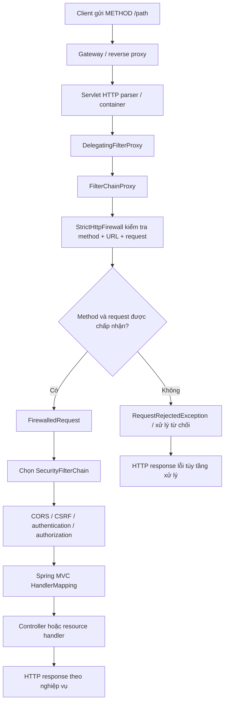
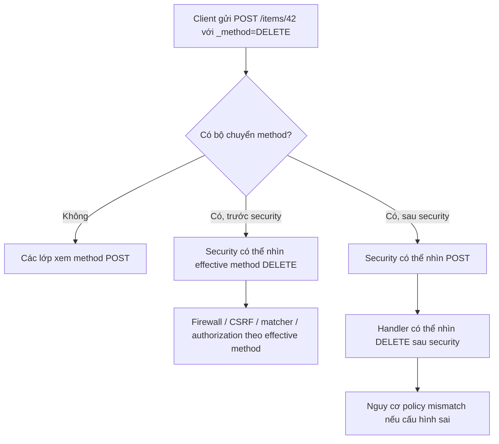

# Danh sách phương thức HTTP được phép

## 1. Vì sao firewall phải kiểm tra cả HTTP method?

Trong chương **Firewall trên Servlet** của module **SPRING_SECURITY_HTTP_PROTECTION**, người học đã biết rằng `HttpFirewall` tham gia bảo vệ request **trước khi Spring Security chọn security chain**. Ngoài kiểm tra URL chưa chuẩn hóa, encoded separators và những ký tự bất thường, `StrictHttpFirewall` còn quản lý **danh sách các phương thức HTTP được chấp nhận**.

Một HTTP request gồm **method**, **request-target**, headers và body. Ví dụ:

```http
DELETE /api/orders/42 HTTP/1.1
Host: app.example.test
Authorization: Bearer example-token
```

Việc một method là chuỗi hợp lệ về mặt HTTP **không đồng nghĩa** ứng dụng có nhu cầu cho phép method đó. Phần lớn web app không cần `TRACE`, `CONNECT` hoặc các phương thức mở rộng không được thiết kế trong API. Những method không mong đợi có thể gây ra:

- Lựa chọn nhầm route hoặc security rule khi các tầng hiểu method khác nhau.
- HTTP verb tampering: dùng method khác dự kiến để tìm cách đi qua ràng buộc bảo mật.
- Cross-Site Tracing (XST) liên quan đến `TRACE` trên một số hệ thống có cấu hình bất cẩn.
- Rối loạn trong CORS preflight, CSRF, reverse proxy, cache hoặc request logging.
- Bề mặt tấn công không cần thiết nếu method có khả năng ảnh hưởng state nhưng application chưa có policy phù hợp.

`StrictHttpFirewall` sử dụng **allowlist HTTP methods** để từ chối những method nằm ngoài chính sách, thay vì cho mọi method đi sâu vào security chain rồi hy vọng controller tự trả lỗi.

**Nhưng phải tách ba câu hỏi khác nhau:**

1. **Firewall:** method này có được phép đi tiếp vào security matching không?
2. **Routing/handler:** ứng dụng có endpoint hỗ trợ method này trên URL cụ thể không?
3. **Authorization/CSRF:** principal có quyền thực hiện hành động và đã thỏa các lớp bảo vệ thay đổi trạng thái chưa?

Một method có thể vượt firewall nhưng vẫn bị `405 Method Not Allowed`, `401`, `403` hoặc lỗi nghiệp vụ. Đó không phải mâu thuẫn; mỗi lớp có trách nhiệm khác nhau.

### Mục tiêu học tập

Kết thúc bài, bạn có thể:

1. Liệt kê và giải thích **bảy method mặc định** của `StrictHttpFirewall` ở các phiên bản Spring Security Servlet hiện hành.
2. Phân biệt HTTP method allowlist với `@GetMapping`/`@PostMapping`, `requestMatchers(HttpMethod...)` và CSRF matcher.
3. Hiểu lý do `TRACE` và method không mong đợi thường bị từ chối trước security chain.
4. Dùng `setAllowedHttpMethods(Collection<String>)` an toàn, nhận diện rủi ro của `setUnsafeAllowAnyHttpMethod(true)`.
5. Giải thích vì sao `HEAD` và `OPTIONS` thường cần được xem xét ngay cả khi API chủ yếu dùng `GET`/`POST`.
6. Kiểm thử firewall bằng JUnit/`MockHttpServletRequest`, chain bằng MockMvc và HTTP server thật.
7. Chẩn đoán lỗi CORS, CSRF, authentication và method override mà không nới firewall hoặc tắt bảo vệ không liên quan.
8. So sánh với Reactive/WebFlux để không đưa API Servlet vào sai stack.

## 2. Vị trí của HTTP method allowlist trong kiến trúc Servlet

Với Spring Security Servlet, luồng cơ bản là:



Điểm cốt lõi: `HttpFirewall` nằm **bên trong quá trình xử lý của `FilterChainProxy` nhưng trước bước chọn `SecurityFilterChain`**. Một method bị firewall từ chối chưa đến `SecurityFilterChain` matcher, `AuthorizationFilter` hay handler MVC.

### 2.1. Các lớp kiểm tra và ví dụ status

| Lớp | Ví dụ | Kết quả có thể |
| --- | --- | --- |
| Gateway/HTTP parser | Cú pháp method không hợp lệ hoặc request line không được hỗ trợ | `400`, `405`, `501` hoặc response do hạ tầng định nghĩa; Java có thể chưa nhận request. |
| `StrictHttpFirewall` | Method `TRACE` bị loại bởi default allowlist | `RequestRejectedException`; status thực phụ thuộc handler. |
| Security chain selection | API path vào chain API hoặc WEB | Một tập filters được chọn, không tự cấp quyền. |
| CORS processing | `OPTIONS` preflight từ origin khác | Có thể chấp nhận hoặc trả lỗi CORS. |
| CSRF | `POST` dùng cookie session không có token | Thường `403` nếu CSRF protection áp dụng. |
| Authentication | Endpoint yêu cầu principal | Thường `401` hoặc redirect đăng nhập tùy cơ chế. |
| Authorization | `DELETE` có trong allowlist nhưng user thiếu quyền | `403` hoặc response được cấu hình. |
| MVC handler mapping | Không có `@PatchMapping` tương ứng | Thường `405 Method Not Allowed` nếu path tồn tại và method không hỗ trợ. |
| Business service | User có role nhưng không sở hữu resource | `403` hoặc lỗi nghiệp vụ theo policy. |

**Không nên suy “HTTP 400 = firewall từ chối”.** Servlet container hoặc reverse proxy có thể từ chối method trước Spring Security; `RequestRejectedHandler` còn khác nhau theo version/config.

### 2.2. Method là một phần của request identity, không chỉ là tên Java method

HTTP method nằm trong request line/pseudo-headers, chẳng hạn:

```http
PATCH /api/profile HTTP/1.1
Host: app.example.test
Content-Type: application/json
```

Nó không phải tên hàm của controller. Controller có thể dùng `@PatchMapping`, nhưng Spring Security kiểm tra **HTTP method của request** ngay cả khi không có controller cho URL đó.

Với HTTP/2, client dùng `:method` pseudo-header thay cho request-line HTTP/1.1. Khi request tới Servlet, container cung cấp method qua `HttpServletRequest.getMethod()`. HTTP parser vẫn có thể từ chối method hoặc request-target trước Spring Security.

## 3. Bảy phương thức HTTP được phép theo mặc định

Tài liệu Spring Security và `StrictHttpFirewall` Javadoc hiện hành xác định danh sách mặc định:

```text
DELETE
GET
HEAD
OPTIONS
PATCH
POST
PUT
```

Đây là một **allowlist có phân biệt chữ hoa/thường**. Các method ngoài danh sách, chẳng hạn `TRACE`, thường bị `StrictHttpFirewall` từ chối. Danh sách này là chính sách cụ thể của implementation hiện hành, không phải danh sách toàn bộ HTTP methods có thể tồn tại theo chuẩn giao thức.

### 3.1. Bảng ngữ nghĩa và những vấn đề bảo mật liên quan

| Method | Ngữ nghĩa HTTP thường gặp | Rủi ro hoặc kiểm tra tiếp theo |
| --- | --- | --- |
| `GET` | Truy xuất representation tài nguyên; nên safe và idempotent về mặt HTTP semantics. | Không dùng GET để thay đổi trạng thái; authorization đọc và cache policy. |
| `HEAD` | Tương tự GET về headers/metadata nhưng không gửi response body. | Không mặc định public chỉ vì không có body; có thể làm lộ metadata. |
| `OPTIONS` | Hỏi capabilities, được browser dùng cho CORS preflight. | CORS policy, auth ordering, handler/server-specific OPTIONS. |
| `POST` | Gửi dữ liệu/thực hiện thao tác theo semantics endpoint. | CSRF cho cookie session, authentication, authorization, validation. |
| `PUT` | Tạo hoặc thay thế trạng thái tài nguyên theo interface; idempotent về semantics. | CSRF khi áp dụng, quyền ghi, điều kiện đồng thời `If-Match` nếu cần. |
| `PATCH` | Thay đổi một phần tài nguyên theo patch document. | CSRF, validation dữ liệu, kiểm tra fields được phép cập nhật. |
| `DELETE` | Yêu cầu xóa tài nguyên, idempotent về semantics của HTTP. | Quyền xóa, CSRF, side effects và audit. |

**Allowlist không cấp phép hành động.** `DELETE` thuộc danh sách mặc định **không có nghĩa** người dùng được xóa account, còn `GET` thuộc danh sách mặc định **không có nghĩa** mọi tài liệu đều public.

### 3.2. HTTP safe và idempotent không phải security authorization

Trong HTTP semantics:

- **Safe methods** được định nghĩa để client không yêu cầu thay đổi trạng thái (điển hình `GET`, `HEAD` và `OPTIONS`).
- **Idempotent methods** có semantics cho phép lặp lại request mà hiệu ứng dự kiến tương đương, chẳng hạn `PUT` và `DELETE`, ngoài các safe methods.
- `POST` thường không idempotent theo mặc định; `PATCH` cũng không luôn idempotent.

Đây là **ngữ nghĩa giao thức**, không phải kết luận “có thể gọi mà không cần xác thực”. Một `GET /admin/export` vẫn có thể chứa dữ liệu rất nhạy cảm, và một `HEAD /private/report` có thể tiết lộ sự tồn tại hoặc metadata tài nguyên.

### 3.3. Danh sách không thay đổi trong một request vì người dùng có quyền

`StrictHttpFirewall` không so role người dùng tại lúc chọn allowed HTTP method. Nó làm việc **trước authentication và authorization**. Do đó một admin không có đặc quyền vượt method allowlist: nếu app không cho `TRACE`, cả admin lẫn anonymous đều bị từ chối ở firewall khi request thực sự đến tầng này.

Ngược lại, nếu app cho phép `DELETE` ở firewall, mọi request DELETE vẫn phải qua các rule bảo mật tiếp theo.

## 4. Method ngoài allowlist: TRACE, TRACK, CONNECT và mở rộng tùy biến

### 4.1. TRACE và Cross-Site Tracing

HTTP `TRACE` dùng để kiểm tra đường đi request thông qua cơ chế loop-back theo HTTP semantics. Một server bật TRACE một cách bất cẩn có thể phản chiếu một số request details, trở thành yếu tố của Cross-Site Tracing (XST) trong những bối cảnh và browser behavior lịch sử.

`StrictHttpFirewall` mặc định không đưa `TRACE` vào danh sách được phép. Điều này giúp giảm bề mặt tấn công của HTTP method mà phần lớn ứng dụng web không cần.

**Nhưng Spring Security không thể bảo đảm chặn TRACE ở mọi tầng:** server/proxy có thể trả response cho TRACE **trước khi request đến Servlet filter**. Khi kiểm thử production, xác minh cấu hình gateway/HTTP connector, không chỉ unit test `StrictHttpFirewall`.

### 4.2. TRACK và method không tiêu chuẩn

`TRACK` từng được một số HTTP server hỗ trợ như một dạng liên quan tracing nhưng không phải method thông dụng của REST API. Nó không nằm trong default allowlist.

Ví dụ:

```http
TRACK / HTTP/1.1
Host: app.example.test
```

Nếu được chuyển tới `StrictHttpFirewall` không có cấu hình nới, request có thể bị từ chối. Không bật `TRACK` chỉ vì một công cụ test cũ cố gọi nó.

### 4.3. CONNECT

`CONNECT` thường liên quan yêu cầu tạo tunnel qua proxy. Đây không phải một method mà controller Spring MVC bình thường cần để phục vụ REST resource.

Nếu ứng dụng thực sự là HTTP proxy hoặc một gateway chuyên dụng, đó là một kiến trúc khác có trust boundary, authentication và logging riêng. Không dùng `setUnsafeAllowAnyHttpMethod(true)` để biến web app thành nơi chấp nhận mọi CONNECT request.

### 4.4. WebDAV và những method mở rộng

Các hệ thống WebDAV có thể dùng `PROPFIND`, `PROPPATCH`, `MKCOL`, `COPY`, `MOVE`, `LOCK` và `UNLOCK`. Những method này **không thuộc default allowlist** ở Spring Security Servlet.

Nếu một ứng dụng có WebDAV endpoint hợp pháp, trước khi thay firewall phải xác định:

1. HTTP server/proxy có hỗ trợ và forward những method này không?
2. Servlet/handler thực sự có triển khai semantics không?
3. Authentication, authorization và resource-level permission cho từng operation là gì?
4. CSRF có liên quan với kiểu xác thực client dùng không?
5. Conditional requests, locks và concurrency được xử lý ra sao?
6. Endpoint được cô lập, logging/rate limits và edge policy thế nào?
7. Có cần chính sách khác giữa app web thông thường và WebDAV service không?

Một allowlist riêng được duyệt có thể phù hợp cho ứng dụng chuyên dụng, nhưng **không khuyến khích mở WebDAV methods toàn cục chỉ vì có một endpoint phụ**. Cần cân nhắc phân tách service và security boundary.

## 5. Phân biệt method allowlist, method authorization và handler mapping

Hãy xét ba lớp code:

```java
// Tầng 1: firewall ở FilterChainProxy, trước khi chọn chain.
firewall.setAllowedHttpMethods(
    List.of("GET", "HEAD", "OPTIONS", "POST"));

// Tầng 2: rule phân quyền trong một SecurityFilterChain.
http.authorizeHttpRequests(auth -> auth
    .requestMatchers(HttpMethod.GET, "/admin/reports").hasRole("READER")
    .requestMatchers(HttpMethod.POST, "/admin/reports").hasRole("EDITOR")
    .anyRequest().denyAll());

// Tầng 3: controller method mapping.
@GetMapping("/admin/reports")
public String listReports() { return "reports"; }
```

Đây là các đoạn minh họa thuộc **những lớp cấu hình khác nhau**, không phải class Java độc lập hoàn chỉnh. Với policy trên:

- `GET /admin/reports` được firewall cho qua; phải có role READER; controller GET tồn tại.
- `POST /admin/reports` được firewall cho qua; phải có role EDITOR và thỏa CSRF nếu áp dụng; nhưng nếu controller chỉ có `@GetMapping`, handler có thể trả `405`.
- `DELETE /admin/reports` bị firewall từ chối trước khi matcher/authorization được gọi.
- `TRACE /admin/reports` bị firewall từ chối, không phụ thuộc role.
- `GET /unknown` vẫn được firewall chấp nhận nhưng bị `denyAll` hoặc không có route.

### 5.1. Ma trận quyết định minh họa

| Request | Firewall chỉ cho GET/HEAD/OPTIONS/POST | Authorization | Handler |
| --- | --- | --- | --- |
| `GET /admin/reports`, READER | Chấp nhận | Cho phép | Có GET handler, có thể `200`. |
| `GET /admin/reports`, USER | Chấp nhận | Từ chối | Handler không cần chạy. |
| `POST /admin/reports`, EDITOR, CSRF hợp lệ | Chấp nhận | Cho phép | Có thể `405` nếu chưa có POST handler. |
| `DELETE /admin/reports`, ADMIN | Từ chối | Chưa chạy | Chưa chạy. |
| `TRACE /admin/reports` | Từ chối | Chưa chạy | Chưa chạy. |
| `GET /unknown` | Chấp nhận | Fallback `denyAll` | Thường chưa đến handler. |

Đừng nhầm status cuối với lớp xử lý. Cần log/tracing hợp lệ và các test riêng để biết request đã vượt qua bước nào.

### 5.2. Vì sao một API có `@DeleteMapping` vẫn bị firewall chặn?

`@DeleteMapping` chỉ nói Spring MVC có thể xử lý DELETE trên route. Nếu `StrictHttpFirewall` được tùy chỉnh chỉ chấp nhận GET/HEAD/OPTIONS/POST, request DELETE sẽ bị từ chối **trước khi MVC có cơ hội khớp handler**.

Ngược lại, nếu firewall vẫn mặc định cho DELETE nhưng SecurityFilterChain có `anyRequest().denyAll()`, DELETE có thể bị chặn ở authorization, không phải firewall.

### 5.3. Vì sao `405` không có nghĩa “firewall bảo vệ rồi”?

`405 Method Not Allowed` thường xuất hiện khi MVC thấy một path tồn tại nhưng không hỗ trợ method được gửi. Để MVC quyết định điều này, request phải vượt qua các lớp trước. Nếu URL bị HTTP parser hoặc firewall từ chối, status sẽ phụ thuộc tầng đó.

Đừng dùng mỗi status `405` làm bằng chứng rằng method allowlist của Spring Security đã cấu hình đúng.

## 6. CORS preflight: vì sao `OPTIONS` rất quan trọng?

Một frontend ở origin khác gọi API bằng `POST` với JSON hoặc header tùy biến có thể khiến browser gửi **CORS preflight**:

```http
OPTIONS /api/orders HTTP/1.1
Origin: https://ui.example.test
Access-Control-Request-Method: POST
Access-Control-Request-Headers: content-type
```

Browser hỏi server liệu POST cross-origin với các headers đó có được phép không. Trình tự xử lý là:

1. Request `OPTIONS` phải được HTTP parser, proxy và firewall chấp nhận.
2. Spring Security/CORS processor xử lý origin, requested method/headers và credentials.
3. Nếu preflight hợp lệ, browser có thể gửi **request thực** `POST`.
4. Request POST vẫn phải qua authentication, authorization, validation và CSRF theo cơ chế đang áp dụng.

**Cho phép OPTIONS trong firewall không có nghĩa CORS luôn cho phép mọi origin.** Đây là hai lớp khác nhau.

### 6.1. Một lỗi phổ biến khi thu hẹp allowlist

Một team muốn “chỉ GET/POST”:

```java
firewall.setAllowedHttpMethods(List.of("GET", "POST"));
```

Sau deploy, frontend báo CORS error. Nguyên nhân có thể là **preflight OPTIONS bị firewall từ chối trước khi CORS processor chạy**, dù API POST endpoint và CORS config không thay đổi.

Đừng chữa bằng cách thêm wildcard `Access-Control-Allow-Origin: *` vào response. Đặc biệt, wildcard với credentials/cookies không tương thích với nhiều trường hợp browser CORS. Cần phân biệt request OPTIONS bị chặn ở firewall với response CORS bị từ chối bởi policy origin.

### 6.2. Ví dụ kết hợp allowlist và cấu hình CORS

Ví dụ độc lập với Spring Security Servlet 6.x / Spring MVC:

```java
import java.util.List;

import org.springframework.context.annotation.Bean;
import org.springframework.context.annotation.Configuration;
import org.springframework.security.web.firewall.StrictHttpFirewall;
import org.springframework.web.cors.CorsConfiguration;
import org.springframework.web.cors.UrlBasedCorsConfigurationSource;

@Configuration
class CorsAndMethodFirewallConfig {

    @Bean
    StrictHttpFirewall httpFirewall() {
        var firewall = new StrictHttpFirewall();

        // Có GET và POST, nhưng vẫn giữ HEAD và OPTIONS khi hệ thống cần.
        firewall.setAllowedHttpMethods(
            List.of("GET", "HEAD", "OPTIONS", "POST"));
        return firewall;
    }

    @Bean
    UrlBasedCorsConfigurationSource corsConfigurationSource() {
        var config = new CorsConfiguration();
        config.setAllowedOrigins(List.of("https://ui.example.test"));
        config.setAllowedMethods(List.of("GET", "POST"));
        config.setAllowedHeaders(
            List.of("Content-Type", "Authorization", "X-CSRF-TOKEN"));
        config.setAllowCredentials(true);

        var source = new UrlBasedCorsConfigurationSource();
        source.registerCorsConfiguration("/api/**", config);
        return source;
    }
}
```

Ở đây **HTTP method allowlist** của firewall có `OPTIONS` để preflight đi vào pipeline, trong khi **CORS allowed methods** chỉ nêu những method mà frontend được phép dùng sau preflight (`GET` và `POST`). Hai danh sách **không bắt buộc giống hệt nhau**.

Spring Security chain muốn tích hợp CORS cần cấu hình `http.cors(Customizer.withDefaults())` hoặc cơ chế phù hợp với môi trường/version và `CorsConfigurationSource` đang có. Không tạo nhiều nguồn CORS mâu thuẫn giữa MVC, Spring Security và gateway.

### 6.3. Thử CORS preflight không phải chỉ gửi `OPTIONS` đơn lẻ

Một request `OPTIONS /api/orders` **không có `Origin` và `Access-Control-Request-Method`** không phải preflight browser đầy đủ. Nó có thể đi tới Spring MVC hoặc container OPTIONS handling và trả kết quả khác.

Kiểm thử preflight cần gửi đủ những headers thực tế mà browser sử dụng, rồi xem `Access-Control-Allow-Origin`, `Access-Control-Allow-Methods`, `Access-Control-Allow-Headers` và status. Không dùng một lệnh HEAD hoặc OPTIONS trống để kết luận CORS đã đúng.

## 7. `HEAD`: không có response body không có nghĩa không cần bảo vệ

`HEAD` được dùng để lấy metadata tương tự GET mà không nhận representation body. Trong nhiều framework, HEAD có thể được phục vụ qua GET handler phù hợp hoặc cơ chế xử lý riêng.

### 7.1. Vì sao HEAD thường thuộc default allowlist?

Clients, monitoring, caches và HTTP tools có thể dùng HEAD để kiểm tra resource hoặc các response headers như `Content-Type`, `ETag`, `Last-Modified`.

Nếu firewall bị thu hẹp thành:

```java
firewall.setAllowedHttpMethods(List.of("GET", "POST"));
```

HEAD sẽ bị từ chối ở firewall dù ứng dụng có khả năng tạo HEAD response thông qua GET mapping. Điều đó có thể gây lỗi cho monitoring hoặc client chỉ cần metadata.

### 7.2. HEAD vẫn có thể làm lộ metadata nhạy cảm

`HEAD /admin/reports/42` không có body nhưng có thể lộ status, kích thước, ETag hoặc sự tồn tại của resource. Nó vẫn cần authentication/authorization phù hợp.

Đừng tạo rule:

```java
// ANTI-PATTERN: không cho HEAD bypass admin chỉ vì không có body.
.requestMatchers(HttpMethod.HEAD, "/admin/**").permitAll()
```

khi cùng resource GET yêu cầu quyền ADMIN. Test HEAD với principal thiếu quyền, giống GET, nếu backend hỗ trợ HEAD.

### 7.3. `curl -I` không thay việc kiểm tra GET

`curl -I` gửi HEAD, trong khi `curl -D - -o /dev/null` với GET kiểm tra GET headers. Hai method có thể được gateway, CDN hoặc servlet xử lý khác nhau. Khi chẩn đoán security headers hoặc method policies, phải ghi rõ bạn đang kiểm thử **HEAD hay GET**, không sử dụng kết quả của một method để kết luận method kia.

## 8. CSRF: method được firewall cho qua chưa chắc được phép thay đổi trạng thái

Spring Security CSRF protection có các rule về **safe HTTP methods**. Trong cấu hình mặc định phổ biến, CSRF matcher **không yêu cầu token** cho `GET`, `HEAD`, `TRACE` và `OPTIONS`; các method khác có thể yêu cầu token.

Điều này dễ gây hiểu nhầm:

- `TRACE` có thể được CSRF matcher coi thuộc nhóm không yêu cầu token, **nhưng mặc định firewall vẫn từ chối TRACE**.
- `POST` có thể được firewall cho qua, **nhưng CsrfFilter vẫn từ chối** request không có token phù hợp khi CSRF bật.
- `OPTIONS` có thể đi qua firewall, nhưng CORS processor vẫn từ chối origin/method/headers không được phép.
- `DELETE` mặc định được firewall chấp nhận, nhưng không đồng nghĩa token CSRF hay quyền xóa được bỏ qua.

### 8.1. Ví dụ form/cookie session

Một người dùng đã đăng nhập qua session cookie gửi:

```http
POST /settings/email HTTP/1.1
Content-Type: application/x-www-form-urlencoded
Cookie: JSESSIONID=example
```

Nếu thiếu CSRF token, Spring Security có thể trả `403`. Đây là **hành vi bảo vệ đúng**, không phải lỗi method allowlist.

Không khắc phục bằng:

```java
// ANTI-PATTERN: tắt CSRF để "sửa" một request POST lỗi.
// http.csrf(csrf -> csrf.disable());
```

Hãy kiểm tra CSRF token, session context và request type theo thiết kế bảo mật. Với API sử dụng bearer tokens không phụ thuộc credentials tự động của browser, CSRF threat model có thể khác; việc bật/tắt vẫn cần quyết định theo cách xác thực thực tế.

### 8.2. Method spoofing và CSRF

Một form HTML thông thường chỉ hỗ trợ GET/POST, nhưng framework có thể có cơ chế chuyển `POST` với parameter `_method=DELETE` thành method DELETE cho controller. Nếu lớp firewall, CSRF matcher, authorization matcher và handler **không cùng thấy effective method**, có nguy cơ áp policy sai.

Vì vậy, khi dùng method override cần hiểu **thứ tự các filters** và request wrapper method thực tại từng bước. Không tự đánh giá quyền theo chuỗi `_method` trước khi framework xử lý nó hoặc ngược lại.

## 9. HTTP method override và verb tampering

HTTP method có thể bị “ghi đè” ở những ứng dụng hoặc gateway có hỗ trợ cơ chế như:

- Form parameter `_method=PUT` hoặc `_method=DELETE`.
- Header không chuẩn `X-HTTP-Method-Override`.
- Rewrite rule trong proxy chuyển method.
- Một filter hoặc framework adapter bọc `HttpServletRequest` và thay `getMethod()`.

**Không phải Spring Security tự động tin mọi method override header**. Hành vi xuất hiện khi một thành phần ứng dụng/hạ tầng được cấu hình cụ thể để thực hiện.

### 9.1. Vì sao phải quan tâm tới thứ tự?



Đây là **mô hình rủi ro**, không phải mô tả cố định về thứ tự filters của mọi ứng dụng Spring Boot. Một số setup đưa `HiddenHttpMethodFilter` trước Spring Security, setup khác không bật filter này. Cần kiểm tra thứ tự thực, version và filter registration của hệ thống.

### 9.2. Cách thiết kế đúng khi thật sự cần method override

1. Xác định method override có **thực sự cần** không.
2. Chỉ chấp nhận giá trị trong tập được duyệt, không cho client tùy ý định nghĩa method mới.
3. Bảo đảm firewall, CSRF, authorization và handler có một góc nhìn nhất quán về **effective method**.
4. Không cho một header do client gửi đổi method sau khi security đã cấp quyền theo method khác.
5. Viết tests cho POST thường, POST có override, thiếu token và user không đủ quyền.
6. Với gateway rewrite method, kiểm tra cả **upstream request method** và request mà Java nhận.
7. Không dùng method override làm cách né cấu hình firewall cho một method không hợp lệ.

### 9.3. Vì sao cho mọi method không giải quyết verb tampering?

Nếu một ứng dụng có logic cấp quyền sai dựa trên method hoặc filter order, bật `setUnsafeAllowAnyHttpMethod(true)` chỉ mở rộng số đường đi có thể gây vấn đề. Thay vào đó, sửa logic nhất quán method/route và thu hẹp attack surface.

## 10. Cấu hình mặc định: ít thay đổi thường là tốt nhất

Trong nhiều ứng dụng Spring Security Servlet, `StrictHttpFirewall` mặc định đã cho phép bảy method thông dụng. **Bạn không cần định nghĩa lại danh sách chỉ để sử dụng GET/POST/PUT/DELETE bình thường**.

Khi cần tuyên bố rõ cấu hình, có thể đăng ký một bean firewall như sau:

```java
import java.util.List;

import org.springframework.context.annotation.Bean;
import org.springframework.context.annotation.Configuration;
import org.springframework.security.web.firewall.StrictHttpFirewall;

@Configuration
class ExplicitMethodFirewallConfig {

    @Bean
    StrictHttpFirewall httpFirewall() {
        var firewall = new StrictHttpFirewall();

        firewall.setAllowedHttpMethods(List.of(
            "DELETE", "GET", "HEAD", "OPTIONS",
            "PATCH", "POST", "PUT"));

        return firewall;
    }
}
```

**Ý nghĩa:** đoạn này nêu lại allowlist mặc định của `StrictHttpFirewall` theo Javadoc Spring Security hiện hành. Trong application thực, chỉ thêm nếu cần tùy chỉnh và có chủ đích; tránh bean firewall trùng với config khác.

### 10.1. Cấu hình qua `WebSecurityCustomizer`

Một cách khác trong Spring Security Servlet:

```java
import java.util.List;

import org.springframework.context.annotation.Bean;
import org.springframework.context.annotation.Configuration;
import org.springframework.security.config.annotation.web.configuration.WebSecurityCustomizer;
import org.springframework.security.web.firewall.StrictHttpFirewall;

@Configuration
class RestrictedFirewallCustomizerConfig {

    @Bean
    WebSecurityCustomizer firewallCustomizer() {
        return web -> {
            StrictHttpFirewall firewall = new StrictHttpFirewall();

            // Ví dụ service chỉ đọc có CORS preflight.
            firewall.setAllowedHttpMethods(
                List.of("GET", "HEAD", "OPTIONS"));

            web.httpFirewall(firewall);
        };
    }
}
```

**Không đăng ký đồng thời** cấu hình bean và customizer cho các firewall cạnh tranh rồi tự đoán đối tượng nào được `FilterChainProxy` dùng. Hãy gắn chính sách vào cấu hình đang tồn tại của ứng dụng và xác minh trong integration tests.

Cấu hình GET/HEAD/OPTIONS ở đây là **ví dụ service thực sự chỉ đọc**, không áp dụng cho ứng dụng có đăng nhập bằng POST, form submit, API ghi dữ liệu hoặc health tooling dùng method khác.

### 10.2. Không cấu hình firewall bằng `HttpSecurity.addFilterBefore(...)`

`HttpSecurity.addFilterBefore(...)` chèn filter **sau khi `SecurityFilterChain` đã được lựa chọn**. `HttpFirewall` trong `FilterChainProxy` đứng **trước bước chọn chain**, nên hai việc này không tương đương.

Nếu custom filter tự kiểm tra `request.getMethod()` nhưng chạy bên trong chain fallback, một request ở chain khác có thể không đi qua filter ấy. `StrictHttpFirewall` giúp giữ quy tắc kiểm tra method ở ranh giới trước chain selection của Spring Security.

### 10.3. Chọn allowlist theo trách nhiệm service

| Loại ứng dụng | Những method có thể cần | Điều cần xem trước khi thu hẹp |
| --- | --- | --- |
| Public read-only catalog | GET/HEAD, có thể OPTIONS cho CORS | Monitoring HEAD, browser preflight, static assets. |
| Web form có session | GET/HEAD/POST, có thể OPTIONS | Login/logout form, CSRF, redirects. |
| REST API CRUD | GET/HEAD/OPTIONS/POST/PUT/PATCH/DELETE | CORS, method authorization, CSRF nếu dùng cookie. |
| Internal admin console | Thường GET/HEAD/POST và các method có thao tác thật | Quyền admin, CSRF, session, monitoring. |
| WebDAV service | Một số method mở rộng có chủ đích | Cô lập endpoint, proxy support, auth/resource permissions. |
| HTTP proxy/tunnel server | Semantics riêng, có thể CONNECT | Đó là thiết kế khác với web app Servlet thường, cần threat model riêng. |

Đây **không phải danh sách bắt buộc**. Chỉ thay allowlist khi biết các HTTP clients thực tế và có regression tests.

## 11. `setUnsafeAllowAnyHttpMethod(true)` là lựa chọn không nên dùng đại trà

Javadoc Spring Security mô tả:

```java
StrictHttpFirewall firewall = new StrictHttpFirewall();

// ANTI-PATTERN trong ứng dụng web thông thường:
firewall.setUnsafeAllowAnyHttpMethod(true);
```

Khi bật, firewall **không thực hiện kiểm tra allowlist HTTP method**. Tên API có chữ `Unsafe` là lời cảnh báo rõ ràng.

### 11.1. Những gì thay đổi khi bật

- Method không nằm trong default allowlist không còn bị chặn **bởi rule method của firewall**.
- Các ràng buộc khác của firewall như URL normalization **không biến mất** chỉ vì method đã được nới.
- Container/proxy vẫn có thể reject method sớm.
- Security chain matcher và MVC handler vẫn có thể không hỗ trợ method ấy.
- Authorization/CSRF vẫn phải được cấu hình chính xác cho method thực.

**Không kết luận** bật unsafe method khiến `TRACE` chắc chắn được ứng dụng xử lý thành công; có thể bị Tomcat/nginx từ chối hoặc không có controller. Nhưng bật nó làm suy yếu một lớp bảo vệ hữu ích mà không có nhu cầu nghiệp vụ rõ ràng.

### 11.2. Tại sao dùng `setAllowedHttpMethods(...)` tốt hơn?

Nếu một server có yêu cầu hợp pháp về method mở rộng, **allowlist cụ thể** thường là lựa chọn có thể review và test được. Ví dụ một service chuyên dụng có thể đánh giá `PROPFIND` nhưng không mở `TRACK` hoặc `CONNECT`.

```java
import java.util.List;

StrictHttpFirewall firewall = new StrictHttpFirewall();

firewall.setAllowedHttpMethods(List.of(
    "GET", "HEAD", "OPTIONS", "PROPFIND"));
```

Đây là **minh họa thiết kế cho một endpoint chuyên biệt**, không phải cấu hình khuyến nghị cho ứng dụng bất kỳ. Nếu `PROPFIND` được thêm, kiểm tra toàn bộ security chain/handler và edge. Đừng mở nó cho production nếu chưa triển khai và phê duyệt semantics của WebDAV.

### 11.3. Method names phân biệt chữ hoa/thường

Javadoc ghi `setAllowedHttpMethods` nhận **collection có phân biệt hoa/thường**. Ví dụ:

```text
GET   -> có trong allowlist mặc định
get   -> không cùng chuỗi với GET
Get   -> không cùng chuỗi với GET
```

Khi kết nối một client gửi method chữ thường, đừng tự thêm mọi biến thể để “khả năng tương thích tốt hơn” mà chưa kiểm tra HTTP standard và upstream behavior. Method tokens có case-sensitive semantics; client nên gửi đúng method được API hỗ trợ.

## 12. Lỗi phổ biến trong test: `MockHttpServletRequest` thiếu method hợp lệ

Spring Security Reference cảnh báo: ở một số phiên bản Spring Test, tạo request mock bằng **constructor không tham số** có thể tạo method rỗng `""`. `StrictHttpFirewall` sẽ từ chối vì method không thuộc allowlist.

Ví dụ dễ khiến test thất bại sai nguyên nhân:

```java
// Không nên phụ thuộc vào default method của constructor.
MockHttpServletRequest request = new MockHttpServletRequest();
```

Thay bằng request có method hợp lệ rõ ràng:

```java
MockHttpServletRequest request =
    new MockHttpServletRequest("GET", "/health");

request.setServletPath("/health");
```

**Vì sao quan trọng?** Một test firewall semicolon/encoded slash có thể bị `RequestRejectedException` vì **method rỗng trước**, chứ chưa hề kiểm tra đúng URL mà tác giả muốn thử. Luôn tạo request method rõ ràng để kết quả test phản ánh nguyên nhân bạn đang kiểm tra.

### 12.1. Method rỗng trong mock khác malformed request thật

Một request-line HTTP/1.1 không có method hợp lệ có thể bị HTTP parser từ chối **trước khi Java thấy `HttpServletRequest`**. Do đó test method rỗng ở `MockHttpServletRequest` chỉ minh họa rule của firewall đối với object mock; không chứng minh một client có thể gửi cùng object vào production.

## 13. Unit test `StrictHttpFirewall` với JUnit 5

Để kiểm tra contract method allowlist, có thể gọi `getFirewalledRequest(...)` trực tiếp. Từ Spring Security Servlet 6.x, các ví dụ sau dùng `jakarta.servlet` bên trong framework; lớp test chỉ thao tác qua Spring Mock Servlet.

### 13.1. Test phương thức được chấp nhận và bị từ chối mặc định

```java
import org.junit.jupiter.api.Test;
import org.springframework.mock.web.MockHttpServletRequest;
import org.springframework.security.web.firewall.FirewalledRequest;
import org.springframework.security.web.firewall.RequestRejectedException;
import org.springframework.security.web.firewall.StrictHttpFirewall;

import static org.junit.jupiter.api.Assertions.assertEquals;
import static org.junit.jupiter.api.Assertions.assertThrows;

class DefaultHttpMethodFirewallTest {

    private final StrictHttpFirewall firewall = new StrictHttpFirewall();

    private MockHttpServletRequest request(String method) {
        var request = new MockHttpServletRequest(method, "/health");
        request.setServletPath("/health");
        return request;
    }

    @Test
    void getIsAllowedByDefault() {
        FirewalledRequest safe =
            firewall.getFirewalledRequest(request("GET"));

        assertEquals("GET", safe.getMethod());
        safe.reset();
    }

    @Test
    void deleteIsAllowedByMethodRule() {
        FirewalledRequest safe =
            firewall.getFirewalledRequest(request("DELETE"));

        assertEquals("DELETE", safe.getMethod());
        safe.reset();
    }

    @Test
    void traceIsRejectedByDefault() {
        assertThrows(RequestRejectedException.class,
            () -> firewall.getFirewalledRequest(request("TRACE")));
    }

    @Test
    void arbitraryMethodIsRejectedByDefault() {
        assertThrows(RequestRejectedException.class,
            () -> firewall.getFirewalledRequest(request("PROPFIND")));
    }

    @Test
    void lowercaseGetDoesNotMatchUppercaseAllowlist() {
        assertThrows(RequestRejectedException.class,
            () -> firewall.getFirewalledRequest(request("get")));
    }
}
```

Test `deleteIsAllowedByMethodRule` **không chứng minh** user có quyền DELETE hoặc controller có DELETE mapping. Nó chỉ cho thấy request mock có method nằm trong default firewall allowlist.

### 13.2. Test một allowlist tùy chỉnh

```java
import java.util.List;

import static org.junit.jupiter.api.Assertions.assertThrows;

class RestrictedHttpMethodFirewallTest {

    private MockHttpServletRequest request(String method) {
        var request = new MockHttpServletRequest(method, "/health");
        request.setServletPath("/health");
        return request;
    }

    @Test
    void restrictedFirewallAcceptsHeadAndOptionsButRejectsPost() {
        var firewall = new StrictHttpFirewall();
        firewall.setAllowedHttpMethods(
            List.of("GET", "HEAD", "OPTIONS"));

        var safeHead = firewall.getFirewalledRequest(request("HEAD"));
        safeHead.reset();

        var safeOptions = firewall.getFirewalledRequest(request("OPTIONS"));
        safeOptions.reset();

        assertThrows(RequestRejectedException.class,
            () -> firewall.getFirewalledRequest(request("POST")));
    }
}
```

Đặt imports `Test`, `MockHttpServletRequest`, `StrictHttpFirewall`, `RequestRejectedException` ở class test tương ứng nếu tách file. Ví dụ này là **bài kiểm tra chính sách read-only**; nếu app có POST hợp lệ, cấu hình đó không phù hợp.

### 13.3. Test method override theo effective method

Khi ứng dụng có filter đổi method, phải test **vị trí filter ấy so với `FilterChainProxy`**. Một unit test gọi firewall trực tiếp không mô phỏng filter ordering. Tạo integration test với filter chain thực và xác nhận:

- `getMethod()` tại điểm trước Spring Security;
- method mà authorization matcher đánh giá;
- method mà MVC handler xử lý;
- CSRF token/role được áp đúng theo hành động thực.

Không coi một test `getMethod().equals("DELETE")` đơn lẻ là đủ bằng chứng toàn hệ thống không có method spoofing.

## 14. Integration test Servlet: method, authorization, CSRF và controller

Một ứng dụng minh họa có API tạo và đọc sản phẩm. Mục đích là **tách chứng minh firewall** khỏi **controller mapping** và **authorization**.

### 14.1. Controller mẫu

```java
import org.springframework.http.ResponseEntity;
import org.springframework.web.bind.annotation.GetMapping;
import org.springframework.web.bind.annotation.PostMapping;
import org.springframework.web.bind.annotation.RestController;

@RestController
class ItemController {

    @GetMapping("/api/items")
    String list() {
        return "items";
    }

    @PostMapping("/api/items")
    ResponseEntity<Void> create() {
        return ResponseEntity.status(201).build();
    }
}
```

### 14.2. Security chain mẫu

```java
import org.springframework.context.annotation.Bean;
import org.springframework.context.annotation.Configuration;
import org.springframework.http.HttpMethod;
import org.springframework.security.config.Customizer;
import org.springframework.security.config.annotation.web.builders.HttpSecurity;
import org.springframework.security.web.SecurityFilterChain;

@Configuration
class ItemSecurityConfig {

    @Bean
    SecurityFilterChain itemChain(HttpSecurity http) throws Exception {
        http
            .authorizeHttpRequests(auth -> auth
                .requestMatchers(HttpMethod.GET, "/api/items")
                    .hasRole("READER")
                .requestMatchers(HttpMethod.POST, "/api/items")
                    .hasRole("WRITER")
                .anyRequest().denyAll())
            .httpBasic(Customizer.withDefaults());

        // Không tắt CSRF để test POST; giữ behavior mặc định theo thiết kế.
        return http.build();
    }
}
```

Khi kết hợp với default `StrictHttpFirewall`:

- `GET` và `POST` đều **được firewall chấp nhận**.
- GET cần role READER.
- POST cần role WRITER **và** CSRF token nếu cấu hình CSRF mặc định áp dụng.
- `TRACE` thường bị firewall từ chối trước security chain.
- `DELETE` được firewall cho qua, nhưng `anyRequest().denyAll()` chặn nếu không có rule khác.
- Controller không có DELETE mapping, nhưng authorization có thể từ chối trước khi MVC trả `405`.

### 14.3. MockMvc integration test

```java
import org.junit.jupiter.api.Test;
import org.springframework.beans.factory.annotation.Autowired;
import org.springframework.boot.test.autoconfigure.web.servlet.AutoConfigureMockMvc;
import org.springframework.boot.test.context.SpringBootTest;
import org.springframework.test.web.servlet.MockMvc;

import static org.springframework.security.test.web.servlet.request.SecurityMockMvcRequestPostProcessors.csrf;
import static org.springframework.security.test.web.servlet.request.SecurityMockMvcRequestPostProcessors.user;
import static org.springframework.test.web.servlet.request.MockMvcRequestBuilders.get;
import static org.springframework.test.web.servlet.request.MockMvcRequestBuilders.post;
import static org.springframework.test.web.servlet.result.MockMvcResultMatchers.status;

@SpringBootTest
@AutoConfigureMockMvc
class ItemMethodSecurityTest {

    @Autowired
    MockMvc mvc;

    @Test
    void readerCanGetItems() throws Exception {
        mvc.perform(get("/api/items")
                .with(user("reader").roles("READER")))
            .andExpect(status().isOk());
    }

    @Test
    void writerWithoutCsrfCannotPost() throws Exception {
        mvc.perform(post("/api/items")
                .with(user("writer").roles("WRITER")))
            .andExpect(status().isForbidden());
    }

    @Test
    void writerWithCsrfCanPost() throws Exception {
        mvc.perform(post("/api/items")
                .with(user("writer").roles("WRITER"))
                .with(csrf()))
            .andExpect(status().isCreated());
    }

    @Test
    void readerCannotPostEvenWithCsrf() throws Exception {
        mvc.perform(post("/api/items")
                .with(user("reader").roles("READER"))
                .with(csrf()))
            .andExpect(status().isForbidden());
    }
}
```

`user(...)` và `csrf()` đến từ `spring-security-test`. Các ví dụ dùng Spring Boot 3.x/Servlet Security 6.x conventions; khi dùng Boot 4.x hay framework version khác, một số package auto-configuration test có thể thay đổi. Giữ nguyên **ý tưởng kiểm thử**, đối chiếu imports theo dependencies thực tế.

### 14.4. Kiểm thử rejection bằng MockMvc cần chú ý handler

Ví dụ kiểm tra method TRACE:

```java
// Chỉ là hình thức gọi method, không cố định HTTP status.
// mvc.perform(request(HttpMethod.TRACE, "/api/items"))
//     .andExpect(status().isBadRequest());
```

Không hardcode rằng mọi setup phải trả `400`: `RequestRejectedException` có thể được handler chuyển thành response, bị ném ra test layer, hoặc container chặn method trước khi Java nhận. **Unit test** ở mục 13 khẳng định rule firewall; **HTTP integration test** khẳng định status/headers phía client.

## 15. Integration test CORS preflight khi có `OPTIONS`

Nếu ứng dụng muốn hỗ trợ frontend `https://ui.example.test`, hãy thiết kế CORS config và Spring Security method allowlist độc lập nhưng tương thích.

### 15.1. Cấu hình ví dụ

Giả định `corsConfigurationSource()` được khai báo giống mục 6, thêm vào `HttpSecurity` của chain:

```java
http.cors(Customizer.withDefaults());
```

Đây là **dòng tích hợp vào chain hiện có**, không phải một security configuration thay thế. Với ứng dụng dùng cookie session, CORS allow credentials, CSRF token exposure và authentication cần được thiết kế theo threat model.

### 15.2. MockMvc gửi request giống preflight browser

```java
import static org.springframework.test.web.servlet.request.MockMvcRequestBuilders.options;
import static org.springframework.test.web.servlet.result.MockMvcResultMatchers.header;
import static org.springframework.test.web.servlet.result.MockMvcResultMatchers.status;

@Test
void acceptedPreflightHasCorsResponseHeaders() throws Exception {
    mvc.perform(options("/api/orders")
            .header("Origin", "https://ui.example.test")
            .header("Access-Control-Request-Method", "POST")
            .header("Access-Control-Request-Headers", "content-type"))
        .andExpect(status().isOk())
        .andExpect(header().string(
            "Access-Control-Allow-Origin", "https://ui.example.test"));
}
```

Đây là **test method bổ sung** vào class có `MockMvc mvc` được inject và chain đã bật CORS. Nếu path chỉ được cấu hình ở `/api/items` hoặc CORS source chưa nạp, cần chỉnh test path/nguồn CORS nhất quán.

**Hai assertion có ý nghĩa khác nhau:**

- Không bị firewall từ chối `OPTIONS`.
- CORS policy chấp nhận origin/method/headers cụ thể.

Nếu `OPTIONS` đã được firewall cho qua nhưng browser vẫn báo CORS error, kiểm tra origin/credentials/allowed headers và phản hồi OPTIONS thay vì chỉ nới method allowlist.

## 16. Kiểm thử HTTP thực và reverse proxy

`MockHttpServletRequest`/MockMvc không thực hiện toàn bộ HTTP parsing của Tomcat/Jetty/Undertow, và không chứng minh gateway/CDN production xử lý mọi method giống test context.

### 16.1. Một số lệnh curl có kiểm soát

```bash
# GET thông thường:
curl -sS -D - -o /dev/null \
  'https://staging.example.test/api/items'

# HEAD, nếu endpoint/monitoring cần:
curl -sS -I \
  'https://staging.example.test/api/items'

# CORS preflight: có Origin và Access-Control-Request-Method.
curl -sS -D - -o /dev/null -X OPTIONS \
  'https://staging.example.test/api/items' \
  -H 'Origin: https://ui.example.test' \
  -H 'Access-Control-Request-Method: POST' \
  -H 'Access-Control-Request-Headers: content-type'
```

Lưu ý `-I` gửi HEAD, không giống GET; không dùng nó làm phép thử GET duy nhất.

Để kiểm tra một method ngoài allowlist như TRACE trên staging **do bạn sở hữu hoặc được phép kiểm thử**, có thể thực hiện một số lượng nhỏ request được phê duyệt. Không gửi request methods bất thường hàng loạt lên production hoặc hệ thống bên thứ ba.

### 16.2. So backend và public

```text
Client --HTTPS--> CDN / NGINX --HTTP(S)--> Tomcat / Jetty / Undertow
                                                 |
                                                 v
                                      Spring Security HttpFirewall
```

Một method có thể bị từ chối ở:

- CDN hoặc WAF trước gateway.
- Reverse proxy dựa trên method allowlist.
- Servlet connector hoặc HTTP parser.
- Spring Security `StrictHttpFirewall`.
- CORS, authentication, CSRF hoặc authorization.
- MVC HandlerMapping.

Để xác định nguồn lỗi, so request được phép gửi vào **backend trực tiếp** với request public tương ứng, giữ host, scheme, path, headers và thời điểm deploy nhất quán. Nếu backend không thấy request, không tự quy lỗi cho Java firewall.

### 16.3. Header response trên method bị từ chối

Một method bị `StrictHttpFirewall` từ chối **trước khi chain được chọn** có thể không đi qua `HeaderWriterFilter`. Vì thế response lỗi có thể thiếu CSP, HSTS hoặc `X-Frame-Options` mà response do controller tạo có.

Nếu yêu cầu baseline security headers trên cả lỗi `400`/`405`/`502` ở public edge, phải xác định **tầng tạo response** và chủ sở hữu header tại đó. Đừng thêm hai bản CSP hoặc HSTS mâu thuẫn giữa gateway và Spring app.

### 16.4. Method không đổi URL nhưng có thể đổi cache behavior

CDN và proxy có thể đối xử GET/HEAD/POST khác nhau về cache, body và routing. Một request `POST` có thể không được cache theo chính sách thông thường, trong khi GET/HEAD được phục vụ từ edge mà không gọi Java.

Do đó không nên kết luận `StrictHttpFirewall` đã hoặc chưa chạy chỉ vì hai method trên cùng URL có header khác. Hãy kiểm tra có cache hit, static asset hoặc synthetic error ở edge hay không.

## 17. Bộ regression tests khi thay đổi method allowlist

| Case | Mục tiêu | Kỳ vọng theo policy thông dụng |
| --- | --- | --- |
| `GET /health` | Basic availability | Firewall chấp nhận, handler/authorization quyết định. |
| `HEAD /health` | Client/monitoring metadata | Chấp nhận nếu HEAD trong allowlist. |
| `OPTIONS /api/items` preflight | CORS | Chấp nhận nếu OPTIONS trong allowlist; CORS xử lý tiếp. |
| `POST /api/items` | Tạo resource | Firewall chấp nhận; CSRF/role/handler được kiểm tra. |
| `PUT /api/items/42` | Replace semantics | Chấp nhận default; có thể bị deny/405 nếu app chưa hỗ trợ. |
| `PATCH /api/items/42` | Partial update | Chấp nhận default; validation/authorization riêng. |
| `DELETE /api/items/42` | Xóa resource | Chấp nhận default; quyền xóa là test độc lập. |
| `TRACE /api/items` | Không mong đợi | Default firewall từ chối nếu request tới nó. |
| `TRACK /api/items` | Nonstandard tracing | Default firewall từ chối. |
| `CONNECT ...` | Proxy tunneling | Không thuộc default allowlist; parser/proxy có thể từ chối sớm. |
| `PROPFIND /dav/...` | WebDAV | Từ chối mặc định nếu chưa có ngoại lệ. |
| `get /health` | Lowercase method token | Không khớp uppercase allowlist. |
| Method rỗng trong mock | Unit test setup | Bị từ chối; sửa test constructor. |
| `POST` thiếu CSRF token | CSRF protection | Có thể `403` dù method được firewall chấp nhận. |
| `POST` với role sai | Authorization | `403` theo policy, không thuộc firewall. |
| `GET` protected resource | Read authorization | Không public nếu thiếu role. |
| `HEAD` protected resource | Metadata authorization | Không bypass role chỉ vì không có body. |
| POST `_method=DELETE` | Method override | Cùng effective method ở security và handler theo thiết kế. |
| HTTP `405` từ MVC | Handler mapping | Không tự quy cho firewall. |
| HTTP `400` từ gateway | Edge policy | Java có thể không được gọi. |

### 17.1. Kết hợp test mức thấp và end-to-end

Một quy trình hợp lý:

1. **Unit test firewall:** `getFirewalledRequest(...)` với method rõ ràng, kỳ vọng chấp nhận/từ chối.
2. **Integration test security chain:** matcher GET/POST/DELETE và fallback deny-by-default.
3. **CSRF/CORS tests:** form POST thiếu/đúng token, browser-style OPTIONS.
4. **Authorization tests:** user thiếu quyền không được thao tác kể cả method nằm trong allowlist.
5. **Controller tests:** 200/201/405 theo route và handler.
6. **Server HTTP tests:** kiểm tra Tomcat/Jetty/Undertow có forward method đến Java không.
7. **Public edge tests:** kiểm tra ingress/CDN/WAF, status, headers và cache behavior.

### 17.2. Khi nâng framework hoặc thay container

Ghi nhận `spring-security-web` version, Servlet container version và cách method override/CORS filter được đăng ký. Một thay đổi filter ordering hoặc HTTP connector policy có thể khiến behavior production khác MockMvc. Chạy regression đặc biệt cho OPTIONS, HEAD, TRACE và mọi method mở rộng có chủ đích.

## 18. Những sai lầm thiết kế cần tránh

### Sai lầm A — “Controller không có TRACE nên firewall không cần chặn”

Controller không hỗ trợ một method không đảm bảo gateway/container không tự xử lý method đó. Giữ `StrictHttpFirewall` default allowlist và cấu hình HTTP server/edge để hạn chế TRACE nếu cần.

### Sai lầm B — “Cho phép DELETE trong firewall nghĩa là mọi người được xóa”

Allowlist chỉ kiểm tra method trước chain. Cần authorization theo role/resource, CSRF theo kiểu xác thực và audit side effects.

### Sai lầm C — “Chỉ dùng GET/POST nên bỏ HEAD/OPTIONS cho gọn”

Monitoring clients có thể dùng HEAD; browser CORS dùng OPTIONS. Thu hẹp phải dựa trên client thực, không đoán theo controller annotations.

### Sai lầm D — “OPTIONS được phép thì CORS đã đúng”

CORS còn phụ thuộc origin, method được frontend xin phép, allowed headers và credentials. Kiểm tra preflight đầy đủ.

### Sai lầm E — “POST trả 403 thì method bị firewall từ chối”

`403` có thể do CSRF hoặc authorization, trong khi method đã qua firewall. Xác định layer bằng test và logs.

### Sai lầm F — “Bật unsafe để WebDAV chạy”

`setUnsafeAllowAnyHttpMethod(true)` bỏ kiểm tra method, mở rộng attack surface. Ưu tiên allowlist cụ thể, isolation và security review.

### Sai lầm G — “Mock không có method mà lỗi là do URI path”

Một mock có method rỗng có thể bị firewall từ chối trước khi rule URL được đánh giá. Luôn tạo method cụ thể.

### Sai lầm H — “Method override là vấn đề controller, không liên quan security”

Nếu filter đổi POST thành DELETE **sau security**, rule quyền/CSRF có thể không thấy cùng effective method. Kiểm tra filter ordering và thống nhất semantics.

### Sai lầm I — “HTTP 405 chắc chắn do firewall”

`405` thường đến từ handler mapping hoặc HTTP server, không phải một tín hiệu duy nhất của `StrictHttpFirewall`. Tách bằng logging an toàn, unit tests và HTTP integration.

## 19. Chẩn đoán nhanh theo triệu chứng

| Triệu chứng | Nguyên nhân khả dĩ | Hướng xử lý |
| --- | --- | --- |
| `TRACE` bị từ chối | Default method allowlist | Đúng kỳ vọng; không mở nếu không có nhu cầu chính đáng. |
| Unit test nào cũng ném `RequestRejectedException` | Mock method rỗng | Tạo `MockHttpServletRequest("GET", "/path")` rõ ràng. |
| OPTIONS preflight bị `400` sau deploy | Method bị loại khỏi allowlist hoặc proxy chặn | Kiểm tra OPTIONS ở firewall và edge trước khi sửa CORS. |
| OPTIONS preflight trả `403` | CORS policy/origin hoặc auth ordering | Đọc CORS headers, không chỉ status. |
| HEAD bị chặn nhưng GET hoạt động | Custom allowlist bỏ HEAD | Xác định client need, thêm HEAD nếu phù hợp và test quyền. |
| DELETE trả `403` | Authorization hoặc CSRF | Check principal/token, không mặc định là firewall. |
| DELETE trả `405` | MVC không có handler | Kiểm tra route mapping và security rule. |
| POST không có CSRF bị từ chối | CSRF protection | Giữ token và threat model đúng. |
| PATCH bị firewall từ chối | Custom allowlist thiếu PATCH | Nếu API có PATCH, đánh giá và thêm explicit. |
| WebDAV PROPFIND bị chặn | Method không nằm trong default allowlist | Chỉ mở method thật cần, review endpoint/handler. |
| `get` hoạt động ở proxy nhưng bị Spring từ chối | Method casing bị xử lý khác | Client gửi GET chuẩn; xác minh upstream method. |
| `X-HTTP-Method-Override` khiến handler chạy DELETE | Filter/gateway hỗ trợ override | Kiểm tra method security nhìn thấy và CSRF behavior. |
| Public `400` nhưng app không có log | Gateway/container từ chối sớm | Kiểm tra edge/connector; không quy lỗi cho Spring. |
| Security headers vắng trên lỗi method | Response tạo trước `HeaderWriterFilter` | Cấu hình baseline ở tầng phát lỗi nếu cần. |
| HEAD không có body | Đúng HTTP semantics | Kiểm tra status/headers và quyền metadata. |
| OPTIONS có `Access-Control-Allow-Origin` nhưng POST thực `403` | CORS pass, CSRF/auth fail | Kiểm tra request thực độc lập. |
| URL admin qua method khác bị cấp sai quyền | Method-specific authorization thiếu/fallback quá rộng | Deny-by-default, test mọi method trên route nhạy cảm. |
| Bật `setUnsafeAllowAnyHttpMethod` rồi scanner báo TRACE | Rule method bị vô hiệu hóa | Trở về explicit allowlist; rà soát edge và handler. |
| Legacy method override sau khi nâng Boot không hoạt động | Filter registration/order thay đổi | Xem effective method tại từng tầng, test end-to-end. |

### Quy trình chẩn đoán tám bước

1. **Ghi nhận request:** method chính xác (case-sensitive), URL, scheme/host, headers và status.
2. **Xác định edge:** CDN/proxy có nhận và forward method ấy không?
3. **Xác định container:** HTTP parser có cho request đến Servlet filter registration không?
4. **Xác định firewall:** `StrictHttpFirewall` config, default hay custom, có `RequestRejectedException` không?
5. **Xác định effective method:** có filter/header/body method override nào đang hoạt động không?
6. **Xác định chain/authorization:** method matcher nào khớp, principal có quyền không?
7. **Xác định CORS/CSRF/handler:** preflight, token, `405` hoặc resource validation.
8. **Sửa hẹp, kiểm thử cả âm và dương, đo lại trên staging**, tránh nới toàn bộ method surface.

## 20. Đối chiếu với Reactive/WebFlux

Module **SPRING_SECURITY_HTTP_PROTECTION** bao gồm cả Servlet lẫn Reactive, nhưng `StrictHttpFirewall` và `HttpServletRequest` của bài là API **Servlet**. Spring Security Reactive có firewall và method policy tương ứng với loại request khác.

| Thành phần | Servlet | Reactive/WebFlux |
| --- | --- | --- |
| Request | `HttpServletRequest` | `ServerWebExchange` / `ServerHttpRequest` |
| Security chain | `SecurityFilterChain` | `SecurityWebFilterChain` |
| Chain manager | `FilterChainProxy` | `WebFilterChainProxy` |
| Firewall API | `HttpFirewall` | `ServerWebExchangeFirewall` |
| Strict implementation | `StrictHttpFirewall` | `StrictServerWebExchangeFirewall` |
| Allowed method API | `setAllowedHttpMethods(Collection<String>)` | `setAllowedHttpMethods(Collection<HttpMethod>)` |
| Authorization matcher | Servlet `RequestMatcher` | `ServerWebExchangeMatcher` |
| Test | MockMvc, Servlet server | WebTestClient, Reactive server |

**Khác biệt kiểu dữ liệu là quan trọng:** Servlet firewall nhận collection chuỗi case-sensitive; Reactive strict firewall API nhận collection `org.springframework.http.HttpMethod` theo Javadoc tương ứng. Không sao chép nguyên mã `List<String>` sang API WebFlux.

Ví dụ tạo chính sách Reactive **minh họa**, chỉ khi WebFlux app cần tùy chỉnh:

```java
import java.util.List;
import org.springframework.http.HttpMethod;
import org.springframework.security.web.server.firewall.StrictServerWebExchangeFirewall;

StrictServerWebExchangeFirewall firewall =
    new StrictServerWebExchangeFirewall();

firewall.setAllowedHttpMethods(
    List.of(HttpMethod.GET, HttpMethod.HEAD, HttpMethod.OPTIONS));
```

Đây là một đoạn khởi tạo/chỉnh policy, **không phải đầy đủ cấu hình bean** của ứng dụng WebFlux. Phải tích hợp qua API được hỗ trợ trong phiên bản Reactive của dự án; không đăng ký Servlet `StrictHttpFirewall` rồi kỳ vọng nó kiểm tra WebFlux exchange.

### 20.1. WebTestClient không thay HTTP parser

WebTestClient mock có thể gửi method và URI thông qua Reactive exchange nhưng không mô phỏng toàn bộ HTTP parsing/gateway. Với method ngoài allowlist hoặc URI malformed, cần thử thêm trên Reactive HTTP server thật và edge khi thích hợp.

## 21. Bài tập tình huống có đáp án định hướng

### Bài 1 — TRACE có được phép nếu user là ADMIN?

Client đã xác thực role ADMIN gọi `TRACE /admin/reports` và bị `RequestRejectedException`.

**Đáp án định hướng:** `StrictHttpFirewall` kiểm tra method trước security chain, không dựa trên role. TRACE không nằm trong default allowlist. Không mở chỉ vì principal là ADMIN.

### Bài 2 — Preflight OPTIONS bị lỗi sau thay đổi

Nhóm backend đổi allowlist thành `List.of("GET", "POST")`. Frontend bắt đầu báo CORS error khi POST JSON.

**Đáp án:** browser gửi OPTIONS preflight; firewall có thể chặn trước CORS processor. Bổ sung OPTIONS nếu thật sự cần, kiểm tra CORS origin/method/headers/credentials riêng.

### Bài 3 — GET chạy nhưng HEAD lỗi

Monitoring service dùng HEAD trên `/health`; sau cấu hình only-GET, các health checks fail.

**Đáp án:** HEAD là method riêng dù semantics liên quan GET. Xem nhu cầu client và thêm HEAD có chủ đích; không bypass authorization metadata.

### Bài 4 — DELETE qua firewall nhưng bị từ chối

`DELETE /items/42` thuộc default method list nhưng user không có quyền, response `403`.

**Đáp án:** firewall chỉ kiểm tra request method; authorization hoặc CSRF xử lý tiếp. Không nới quyền hoặc tắt CSRF để “sửa firewall”.

### Bài 5 — DELETE trả 405

Controller chỉ có `@GetMapping` và `@PostMapping` cho `/items`; DELETE trả `405`.

**Đáp án:** handler mapping không hỗ trợ DELETE. `405` không chứng minh firewall từ chối; nếu policy cho DELETE, nó có thể đã qua firewall.

### Bài 6 — Mock test bị từ chối mọi URL

Một unit test tạo `new MockHttpServletRequest()` rồi chỉ set servletPath. Test semicolon bị từ chối, nhưng sau khi bỏ semicolon vẫn bị từ chối.

**Đáp án:** mock có thể có method rỗng theo Spring Test version. Tạo `new MockHttpServletRequest("GET", "/path")` để tách rule method và rule path.

### Bài 7 — WebDAV service có PROPFIND

Một endpoint thật sự triển khai WebDAV, nhưng `PROPFIND` bị firewall chặn. Team định bật unsafe any method.

**Đáp án:** review tập WebDAV methods cần thiết, thêm chính xác những method đó vào allowlist khi đã xử lý edge, authorization và handler. Không bật mọi method.

### Bài 8 — Method override sau authorization

Client gửi POST với `_method=DELETE`; security cho POST nhưng handler xử lý DELETE ở downstream filter.

**Đáp án:** đây là dấu hiệu potential method confusion. Phải làm thống nhất effective method trước security decision hoặc thay thiết kế, test CSRF/authorization theo hành động thực.

### Bài 9 — HSTS/CSP có nhưng user sai quyền

Response DELETE qua HTTPS chứa HSTS, CSP và `nosniff`, nhưng user thường vẫn xóa được report admin.

**Đáp án:** response headers không thay authorization. Kiểm tra `requestMatchers(HttpMethod.DELETE, "/admin/**")` và resource-level permission, fallback rule.

### Bài 10 — Proxy trả 501 cho method lạ

Public gateway trả `501` đối với method mở rộng; backend không có `RequestRejectedException`.

**Đáp án:** request có thể chưa tới Java. Kiểm tra proxy/container support và chỉ thêm method khi API thực sự cần, không khẳng định firewall đã xử lý.

### Bài 11 — OPTIONS thành công nhưng POST thất bại

Browser nhận preflight response có CORS headers đúng, sau đó POST trả `403`.

**Đáp án:** preflight success không bảo đảm request thực qua CSRF, auth và authorization. Phân tích POST riêng.

### Bài 12 — Method viết thường

Client gửi `get /health` và thấy lỗi khác giữa hai môi trường.

**Đáp án:** method names được kiểm tra case-sensitive; gửi `GET` đúng chuẩn API và kiểm tra proxy/HTTP parser đã xử lý gì.

## 22. Checklist trước production

1. **Biết bảy method default**: DELETE, GET, HEAD, OPTIONS, PATCH, POST, PUT.
2. **Giữ `StrictHttpFirewall` mặc định** nếu không có nhu cầu đã phê duyệt.
3. **Đừng dùng `setUnsafeAllowAnyHttpMethod(true)` như cách chữa lỗi thường xuyên.**
4. **Chỉ mở method thực sự cần cho nghiệp vụ**, đặc biệt nếu dùng WebDAV hoặc service đặc thù.
5. **Nhớ HTTP method names phân biệt hoa/thường** trong `setAllowedHttpMethods`.
6. **Không nhầm allowlist với authorization hoặc controller mapping**.
7. **Kiểm tra HEAD** cho metadata/monitoring và quyền truy cập tương đương resource.
8. **Kiểm tra OPTIONS** cho browser CORS preflight, không chỉ GET/POST.
9. **Giữ CSRF protection** phù hợp với cookie session và các method thay đổi trạng thái.
10. **Test negative authorization** cho POST/PUT/PATCH/DELETE trên tài nguyên nhạy cảm.
11. **Đánh giá method override** nếu có `_method`/`X-HTTP-Method-Override` hoặc gateway rewrite.
12. **Sửa mock method rỗng** bằng request constructor có method rõ ràng.
13. **Phân biệt firewall rejection với `405` MVC, `403` CSRF/auth và lỗi edge**.
14. **Đo HTTP server thật và gateway/CDN** nếu method không đi vào Spring Security.
15. **Bảo toàn CSP, HSTS, CORS và session policies** khi thay đổi firewall; mỗi lớp có trách nhiệm riêng.
16. **Không log raw Authorization/Cookie hay dữ liệu không đáng tin** trong debug method rejection.
17. **Phân biệt Servlet và WebFlux allowed-method APIs**, không dùng nhầm `List<String>` cho Reactive firewall.
18. **Chạy regression sau nâng framework, proxy hoặc filter registration**, ghi lại owner và rollback plan.
19. **Với method được phép, vẫn phải kiểm soát resource identity và side effects**.
20. **Xóa marker/debug config của bài học trước production** nếu chúng không thuộc thiết kế vận hành.

### Tài liệu tham khảo

- [Spring Security Reference — Servlet HTTP Firewall](https://docs.spring.io/spring-security/reference/servlet/exploits/firewall.html)
- [Spring Security Javadoc — StrictHttpFirewall](https://docs.spring.io/spring-security/reference/api/java/org/springframework/security/web/firewall/StrictHttpFirewall.html)
- [Spring Security Javadoc — HttpFirewall](https://docs.spring.io/spring-security/reference/api/java/org/springframework/security/web/firewall/HttpFirewall.html)
- [Spring Security Reference — Servlet Security Architecture](https://docs.spring.io/spring-security/reference/servlet/architecture.html)
- [Spring Security Reference — Authorize HTTP Requests](https://docs.spring.io/spring-security/reference/servlet/authorization/authorize-http-requests.html)
- [Spring Security Reference — Servlet CSRF](https://docs.spring.io/spring-security/reference/servlet/exploits/csrf.html)
- [Spring Security Reference — Servlet CORS](https://docs.spring.io/spring-security/reference/servlet/integrations/cors.html)
- [Spring Security Reference — Reactive HTTP Firewall](https://docs.spring.io/spring-security/reference/reactive/exploits/firewall.html)
- [Spring Security Javadoc — StrictServerWebExchangeFirewall](https://docs.spring.io/spring-security/reference/api/java/org/springframework/security/web/server/firewall/StrictServerWebExchangeFirewall.html)
- [Spring Framework Reference — Spring MVC Mapping Requests](https://docs.spring.io/spring-framework/reference/web/webmvc/mvc-controller/ann-requestmapping.html)
- [Spring Framework Reference — MockMvc](https://docs.spring.io/spring-framework/reference/testing/spring-mvc-test-framework.html)
- [RFC 9110 — HTTP Semantics](https://www.rfc-editor.org/rfc/rfc9110)
- [RFC 9112 — HTTP/1.1](https://www.rfc-editor.org/rfc/rfc9112)
- [MDN — HTTP Request Methods](https://developer.mozilla.org/en-US/docs/Web/HTTP/Reference/Methods)
- [Jakarta Servlet Specification](https://jakarta.ee/specifications/servlet/)

