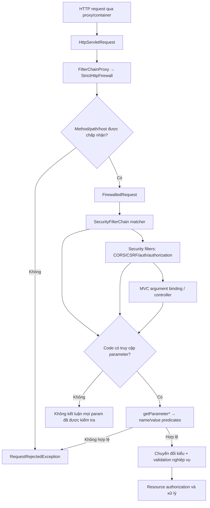

# Parameter name, parameter value và điều kiện hợp lệ

## 1. Vì sao Spring Security firewall kiểm tra cả request parameters?

Trong chương **Firewall trên Servlet** của module **SPRING_SECURITY_HTTP_PROTECTION**, chúng ta đang nghiên cứu những lớp phòng vệ cho request HTTP trước khi đi đến controller: `HttpFirewall`, CSRF, CORS, authentication, authorization và bảo vệ session. Những lớp như security headers, CSP và HSTS bảo vệ phía response/browser, nhưng không thể thay thế việc xử lý đúng đầu vào từ client.

Một request có thể mang parameters thông qua query string hoặc nội dung form:

```http
GET /api/search?q=spring&tag=security&tag=servlet HTTP/1.1
Host: app.example.test
Accept: application/json
```

Hoặc:

```http
POST /account/preferences HTTP/1.1
Host: app.example.test
Content-Type: application/x-www-form-urlencoded
Cookie: JSESSIONID=example

theme=dark&language=vi
```

`q`, `tag`, `theme` và `language` là **parameter names**. `spring`, `security`, `servlet`, `dark` và `vi` là **parameter values**. Hai loại dữ liệu này do client kiểm soát nên cần có cơ chế kiểm tra phù hợp.

Trên Servlet stack, `StrictHttpFirewall` có các API:

- `setAllowedParameterNames(Predicate<String>)`.
- `setAllowedParameterValues(Predicate<String>)`.

**Điểm quan trọng nhất của bài:** mặc định `StrictHttpFirewall` **từ chối tên parameter chứa ký tự điều khiển ISO hoặc ký tự Unicode chưa được định nghĩa**, nhưng **cho phép mọi giá trị parameter ở cấp predicate mặc định**. Điều này không phải lỗi cấu hình; firewall không được thiết kế để thay thế validation nghiệp vụ của mỗi parameter. Một giá trị chuỗi đi qua firewall vẫn có thể chứa dữ liệu không hợp lệ với domain, một chuỗi quá dài hoặc một ID mà người dùng không được phép truy cập.

Bài học tập trung vào việc phân biệt **điều kiện hợp lệ ở tầng firewall**, **cách Servlet parse parameters**, **data validation tại controller/service** và **authorization đối với tài nguyên được chọn**.

### Kết quả học tập

Sau bài này, người học có thể:

1. Phân biệt parameter name/value với path variable, request header, JSON body và multipart file.
2. Giải thích default `ALLOWED_PARAMETER_NAMES` và `ALLOWED_PARAMETER_VALUES` của `StrictHttpFirewall`.
3. Phân tích thời điểm kiểm tra khi gọi `getParameter`, `getParameterValues`, `getParameterNames` và `getParameterMap`.
4. Hiểu các yếu tố form encoding, percent decoding, ký tự `+`, duplicate keys và tham số nhiều giá trị.
5. Cấu hình `setAllowedParameterNames` và `setAllowedParameterValues` mà không phá các form/login/CSRF hợp lệ.
6. Phân biệt ký tự được firewall chấp nhận với dữ liệu đúng schema hoặc dữ liệu đã được phân quyền.
7. Viết unit test, MockMvc test và kiểm tra end-to-end theo đúng ranh giới Servlet container/proxy.
8. Chẩn đoán lỗi do parser, firewall, data binding, CSRF, authentication hoặc authorization.
9. Đối chiếu với cơ chế Reactive/WebFlux mà không dùng nhầm Servlet API.

## 2. HTTP request parameter không phải mọi thứ có trong request

Từ “parameter” trong ứng dụng web đôi khi được dùng rất rộng, nhưng `HttpServletRequest.getParameter...` có phạm vi cụ thể.

| Nguồn dữ liệu | Ví dụ | API thường dùng | Có mặc nhiên đi qua Servlet parameter API không? |
| --- | --- | --- | --- |
| Query string | `?q=java&page=2` | `getParameter("q")`, `@RequestParam` | Có trong những trường hợp Servlet bình thường. |
| Form body | `theme=dark&lang=vi`, content type `application/x-www-form-urlencoded` | `getParameter("theme")`, `@ModelAttribute` | Có theo các quy tắc Servlet/form parsing. |
| Multipart form fields | Một field text `description` trong `multipart/form-data` | Multipart resolver, `@RequestParam` | Phụ thuộc Servlet multipart configuration và framework integration. |
| Multipart file | Binary file trong form | `Part`, `MultipartFile` | File bytes không phải một String value của parameter predicate. |
| JSON request body | `{"name":"Alice"}` | `@RequestBody` / JSON deserializer | **Không**, chỉ vì JSON có field `name` không làm nó thành Servlet parameter. |
| Path variable | `/users/42` | `@PathVariable("id")` | **Không**, do URI/path matching xử lý. |
| Matrix variable | `/cars;color=red` | `@MatrixVariable` | Không đồng nhất với form/query parameters. |
| Request header | `X-Request-Id: abc` | `getHeader`, `@RequestHeader` | Không; có header-name/value predicates riêng. |
| Cookie | `Cookie: sid=abc` | `getCookies()`, session API | Không đồng nhất với Servlet form/query parameter. |
| Server attribute | `request.setAttribute("role", ...)` | `getAttribute` | Không; attribute không phải client parameter. |

Vì vậy, `setAllowedParameterValues` **không phải một bộ quét toàn bộ request body**. Đặc biệt, nó không thể làm nhiệm vụ xác thực schema JSON, virus scanning cho file upload hoặc kiểm tra JWT.

### 2.1. Query string và form body có thể được hợp nhất

Ví dụ client gửi:

```http
POST /api/search?q=java HTTP/1.1
Content-Type: application/x-www-form-urlencoded

q=spring&tag=security
```

Servlet parameter APIs có thể cung cấp **nhiều giá trị** cùng tên `q`. Cách container trình bày thứ tự và những giới hạn parsing phụ thuộc Servlet rules và request configuration; không xây logic bảo mật dựa trên giả định “query luôn thắng body” hoặc ngược lại nếu chưa đặc tả rõ.

**Khi một field nhạy cảm chỉ nên xuất hiện một lần**, hãy định nghĩa rõ nguồn, kiểu dữ liệu và chính sách xử lý duplicates. Đừng chỉ gọi `getParameter("q")` rồi cho rằng request có đúng một giá trị.

### 2.2. Query string chưa giải mã khác parameter value đã parse

`getQueryString()` biểu thị query portion do Servlet container cung cấp; `getParameter("q")` trả giá trị được xử lý theo quy tắc parameter decoding.

Ví dụ:

```text
Raw query:  q=hello%20world&tag=red%2Bblue
Parameter:  q = "hello world"
Parameter:  tag = "red+blue"
```

Đừng dùng cùng một giá trị raw query string và decoded parameter value để so chữ ký hoặc cấp quyền nếu protocol của bạn chưa xác định canonical representation.

### 2.3. Form encoding và dấu `+`

Với `application/x-www-form-urlencoded`, dấu `+` thường biểu thị khoảng trắng:

```text
q=hello+world     -> "hello world"
q=hello%2Bworld   -> "hello+world"
```

Trong URI path nói chung, `+` không mặc nhiên có đúng semantics đó. Do vậy dùng `java.net.URLDecoder` cho **toàn bộ URI path** không phải cách đúng để xác định route hay quyền.

**Quy tắc:** để Servlet/MVC parser xử lý request parameters theo một hợp đồng rõ ràng; không decode thêm nhiều lần sau khi đã validate hoặc authorize resource.

## 3. Mặc định của StrictHttpFirewall: name bị giới hạn, value không bị giới hạn bằng predicate

Source/Javadoc hiện hành của Spring Security mô tả những default predicates chính:

```java
public static final Predicate<String> ALLOWED_PARAMETER_NAMES = ...;

public static final Predicate<String> ALLOWED_PARAMETER_VALUES =
    value -> true;
```

Đây là **minh họa logic**, không phải sao chép đầy đủ mã nguồn. Cụ thể:

| Thành phần | Chính sách mặc định của `StrictHttpFirewall` | Điều không được suy ra |
| --- | --- | --- |
| `ALLOWED_PARAMETER_NAMES` | Cho những ký tự Unicode đã được định nghĩa và không phải ISO control theo predicate thông dụng. | Không phải toàn bộ quy tắc “chỉ tên alphanumeric”, cũng không xác nhận tên có ý nghĩa nghiệp vụ. |
| `ALLOWED_PARAMETER_VALUES` | `value -> true` — **cho phép mọi value ở cấp predicate**. | Không có nghĩa value an toàn cho SQL, HTML, filesystem, redirect hay authorization. |
| `ALLOWED_HEADER_NAMES` | Kiểm tra ký tự tên header theo default predicate riêng. | Không thay RFC HTTP token parser ở container. |
| `ALLOWED_HEADER_VALUES` | Thường loại control/undefined code points (với chi tiết HTAB theo version). | Không được nhầm với **parameter values** mặc định cho tất cả. |

**Khác biệt cần nhớ:** header values và parameter values **không có cùng rule mặc định**. Parameter value có thể chứa dòng mới, ký tự điều khiển hoặc nội dung Unicode hợp lệ/không hợp lệ đối với một field tùy từng tình huống; ứng dụng phải tự validate dữ liệu sau khi parse.

### 3.1. Vì sao default values để `true`?

Một giá trị form/query có thể là:

- Một đoạn văn bản nhiều dòng trong textarea.
- Unicode, dấu câu, dấu cách, ký tự đặc biệt.
- Một filter/search query do người dùng nhập.
- Một CSRF token có encoding riêng.
- Một field `state` hoặc `redirect_uri` theo giao thức OAuth.
- Dữ liệu được ký/encode khác nhau qua các hệ thống.

Một rule toàn cục cấm mọi ký tự điều khiển trong **tất cả** parameter values có thể phá input hợp lệ như textarea có line break. Spring Security cho phép bạn tùy chỉnh khi có policy toàn cục thực sự, nhưng mặc định để business validation đảm nhận các điều kiện đặc thù.

### 3.2. Default name không phải allowlist tên field của dự án

`ALLOWED_PARAMETER_NAMES` không liệt kê `q`, `page`, `username` hay `_csrf`. Nó là **character predicate**, không phải registry tên field hợp lệ của mọi endpoint.

Điều này quan trọng với login, OAuth/OIDC, form CSRF, các thư viện và những endpoints có fields phát sinh theo cấu hình. Không thay default bằng một allowlist chỉ gồm ba tên tùy ý nếu ứng dụng đang phục vụ nhiều controllers hoặc protocols.

### 3.3. Predicate không thay Servlet parser

Ngay cả khi một Java String `name` hoặc `value` vượt predicate:

- Query/form có thể đã bị parser từ chối vì encoding/cú pháp.
- Container có thể giới hạn tổng số request parameters.
- Reverse proxy có thể giới hạn URI length/body size.
- MVC conversion có thể thất bại khi đổi `page=abc` sang `int`.
- Bean Validation có thể từ chối chuỗi không đúng giới hạn.
- Authorization có thể chặn resource được tham chiếu bởi `id`.

Vì thế, một request đi qua firewall **không đồng nghĩa đã qua data validation**.

## 4. Kiểm tra parameter xảy ra lúc nào?

`StrictHttpFirewall` được `FilterChainProxy` áp trước khi chọn `SecurityFilterChain`. Tuy nhiên, với parameters, implementation dùng một `FirewalledRequest` wrapper và **kiểm tra khi code truy cập Servlet parameter APIs**.



Sơ đồ nhấn mạnh **kiểm tra lazy**; không khẳng định thứ tự thực thi mọi filter/controller luôn theo đúng một nhánh đơn giản, vì CSRF và authentication filters cũng có thể gọi `getParameter` trước controller.

### 4.1. Hành vi của bốn nhóm getter

Trong source hiện đại của `StrictHttpFirewall`, wrapper triển khai tương ứng:

| API trên `FirewalledRequest` | Kiểm tra |
| --- | --- |
| `getParameter(name)` | Kiểm tra **tên được yêu cầu** (nếu không null), lấy một value rồi kiểm tra value ấy nếu có. |
| `getParameterValues(name)` | Kiểm tra tên được yêu cầu; kiểm tra **tất cả values** trong mảng trả về nếu có. |
| `getParameterNames()` | Trả Enumeration; **mỗi tên được kiểm tra khi gọi `nextElement()`**. |
| `getParameterMap()` | Lấy map rồi **duyệt toàn bộ entries và tất cả values** để kiểm tra trước khi trả map. |
| `getQueryString()` | Trả query string qua Servlet API; **không thay thế `getParameter*` predicates**. |
| `getInputStream()` / `getReader()` | Đọc body raw theo Servlet semantics; **không tự kích hoạt value predicate cho JSON body**. |

Bất biến thiết kế: **việc tạo `FirewalledRequest` thành công không chứng minh mọi parameter name/value đã được kiểm tra**. Có thể chưa có lời gọi getter nào trong request path đó.

### 4.2. Vì sao `getParameterMap()` khác `getParameter("q")`?

`getParameter("q")` thường lấy **một value**, trong khi `getParameterMap()` duyệt toàn bộ tên/values mà Servlet parser cung cấp.

Nếu một request chứa:

```text
q=java
q=spring
```

và ứng dụng định nghĩa custom value predicate để từ chối một giá trị nào đó, gọi `getParameter("q")` chưa chứng minh mọi giá trị trùng tên đều đã vượt predicate. `getParameterValues("q")` hoặc `getParameterMap()` kiểm tra cả tập tương ứng.

Điều này đặc biệt quan trọng khi nhiều tầng chọn **giá trị đầu**, **giá trị cuối** hoặc **gộp nhiều giá trị** theo các cách khác nhau.

### 4.3. Kiểm tra có thể phát sinh ở security filter

`CsrfFilter` có thể lấy CSRF token từ request parameter; authentication mechanism dựa trên form có thể đọc `username`/`password`; request matcher tùy chỉnh cũng có thể đọc `getParameter`.

Khi đó, `RequestRejectedException` có thể phát sinh **trước khi MVC controller chạy**, nhưng vẫn **sau khi wrapper đã được tạo**. Đừng vội quy mọi `RequestRejectedException` cho URL normalization; hãy xem lý do và getter nào được gọi.

### 4.4. Chưa đọc parameter thì chưa chắc có exception

Giả sử controller trả response cố định mà không hề đọc `getParameter*`, và các security filters cũng không truy cập parameter ấy. Một tên không hợp lệ có thể không bị wrapper kiểm tra theo code path này, dù HTTP parser có thể đã từ chối từ trước.

Do đó, **không dùng `StrictHttpFirewall` làm cơ chế thay thế toàn bộ input validation**. Nếu một endpoint có parameter quan trọng, controller/service phải parse, validate và authorize chính dữ liệu sẽ sử dụng.

## 5. Parameter name: ký tự nào có thể qua mặc định?

Trong nhiều bản Spring Security Servlet hiện đại, default `ALLOWED_PARAMETER_NAMES` tương ứng một pattern trên Java Unicode character classes, loại **ISO control** và **unassigned characters**.

Những ví dụ khái niệm:

| Parameter name | Nhận định về default predicate | Điều cần chú ý |
| --- | --- | --- |
| `q`, `page`, `orderId` | Những ký tự thông thường được chấp nhận. | Ứng dụng vẫn phải biết tên này có nghĩa hay không. |
| `_csrf`, `redirect_uri` | Các ký tự thường được chấp nhận. | Không được global-allowlist quá hẹp làm hỏng protocol. |
| `tags[]` | Các ký tự có thể vượt character predicate. | MVC/data binding xử lý cú pháp mảng/list theo riêng framework. |
| `user.name` | Dấu chấm không phải ISO control. | Data binder có thể hiểu nested property; cần mass-assignment protection. |
| `user[0]` | Dấu ngoặc có thể qua predicate. | Binder cần giới hạn indices/allowed fields. |
| `tên` | Unicode đã được định nghĩa có thể vượt predicate. | Không đồng nghĩa mọi API chấp nhận tên Unicode. |
| Tên có `\n` hoặc `\u0000` | Default predicate thường từ chối **khi đọc tên**. | HTTP parser và parameter decoding cũng có thể chặn sớm. |
| Tên có code point Unicode chưa được gán | Default predicate thường từ chối. | Kết quả phụ thuộc Unicode tables của Java/version. |
| Tên rỗng | Character predicate không tự bảo đảm tên có nghĩa. | Kiểm tra schema của endpoint; không suy mọi tên rỗng đều bị firewall loại. |

**Không nên diễn giải bảng thành kết quả status của HTTP client trên mọi container.** Servlet parameter parsing và encoding xảy ra trước khi `FirewalledRequest` kiểm tra name.

### 5.1. Tên hợp lệ về ký tự vẫn có thể không hợp lệ với API

Ví dụ endpoint tìm kiếm chỉ nhận `q`, `page` và `size`, nhưng request gửi thêm `admin=true`. Tên `admin` có các ký tự bình thường nên firewall có thể chấp nhận. Đây không phải lý do để nâng quyền admin.

Ứng dụng có thể từ chối unknown fields, bỏ qua theo contract hoặc ghi nhận validation error. Dù chọn cách nào, nó cần được đặc tả **ở cấp endpoint**, không dùng một allowlist toàn hệ thống nếu các endpoints khác có nhiều field riêng.

### 5.2. Không tự lower-case mọi parameter name

Khác HTTP header field names, **form/query parameter names thường có semantics do ứng dụng quy định** và có thể **phân biệt hoa/thường**.

`userId` và `userid` không nhất thiết cùng tên. Nếu gateway tự đổi case còn backend không đổi, một query key có thể được ứng dụng hiểu khác. Không tự canonicalize parameter names sau khi validation rồi dùng tên mới để cấp quyền.

### 5.3. Unicode và normalization của parameter names

Hai chuỗi Unicode có thể trông giống nhau nhưng có mã code point khác. Default predicate chủ yếu kiểm tra **assigned/control**, không tạo một canonical identity cho mọi field name.

Đối với field names quan trọng, nên công bố tập tên ASCII rõ ràng trong API schema, sử dụng parser/binder chuẩn và tránh tự xử lý Unicode normalization giữa security check và business logic.

## 6. Parameter value: mặc định cho phép mọi giá trị nghĩa là gì?

`ALLOWED_PARAMETER_VALUES` mặc định là predicate **luôn trả true**. Vì vậy một String value đã được Servlet parser tạo ra **không bị `StrictHttpFirewall` loại chỉ vì có line break, dấu cách hoặc punctuation**, trừ khi bạn cấu hình custom predicate.

Ví dụ giá trị hợp lệ cho textarea:

```text
message=Hello%0AWorld
```

Sau form/query decoding, `getParameter("message")` có thể trả một chuỗi chứa LF. `StrictHttpFirewall` mặc định không xem đó là reason riêng để reject parameter value.

**Nhưng “được firewall cho phép” không có nghĩa:**

- Giá trị đủ ngắn để lưu trong database.
- Giá trị phù hợp kiểu dữ liệu hoặc business rules.
- Giá trị an toàn khi đưa thẳng vào HTML/SQL/command/filepath.
- Người dùng có quyền truy cập ID, tenant hoặc file được nhắc tới.
- URL redirect do client đề xuất là trusted.
- Nội dung đã được chống XSS, SSRF, path traversal hoặc injection.

### 6.1. Đúng validation theo từng field

| Parameter | Kiểm tra nghiệp vụ cần cân nhắc |
| --- | --- |
| `page` | Integer dương hoặc không âm, bound tối đa. |
| `size` | Số nguyên trong giới hạn pagination, bảo vệ tài nguyên server. |
| `q` | Độ dài, Unicode policy, cách tìm kiếm và output encoding. |
| `email` | Format có thể chấp nhận, validation domain/verification thực tế. |
| `returnUrl` | Redirect target allowlist hoặc relative URL an toàn. |
| `tenantId` | Schema ID và user/tenant authorization. |
| `fileId` | Opaque ID, ownership, storage mapping và safe resolution. |
| `sort` | Enum/allowlist field được phép sắp xếp, không chèn SQL raw. |
| `role` | Không chấp nhận nâng quyền chỉ dựa trên client input. |
| `_csrf` | CSRF token repository/handler kiểm tra, không chỉ character predicate. |

### 6.2. XSS và output encoding

Nếu value là `<script>...`, mặc định parameter-value predicate **không được thiết kế để làm HTML sanitizer**. Khi hiển thị dữ liệu, dùng template engine tự escape theo context, tránh nối raw input vào HTML/JavaScript/attribute không đúng encoding.

Không dùng một quy tắc “cấm mọi dấu `<`” toàn cục như giải pháp chống XSS: textarea, tài liệu kỹ thuật hoặc các form nhập code có thể cần ký tự đó, và XSS phụ thuộc **output context**.

### 6.3. SQL injection và command injection

`StrictHttpFirewall` không thay prepared statements/parameterized queries, query builder, command-execution policy hoặc validation của data access layer.

Ví dụ sai về tư duy:

```java
// ANTI-PATTERN: không dùng parameter string nối trực tiếp vào SQL.
String sql = "SELECT * FROM products WHERE name = '" + q + "'";
```

Thay bằng parameter binding trong JDBC/JPA. Nếu `sort` chọn tên cột, dùng allowlist field name server-side thay vì nối trực tiếp một giá trị `ORDER BY` do client kiểm soát.

### 6.4. Một value có newline không giống CRLF trong HTTP header

HTTP header value chứa CR/LF có thể vi phạm protocol grammar. Trong khi đó **body text của một form textarea** được phép chứa newline theo hợp đồng của field. Đây là một lý do `ALLOWED_HEADER_VALUES` và `ALLOWED_PARAMETER_VALUES` **không có default giống nhau**.

## 7. Percent-encoding, query parser và khác biệt giữa các tầng

Một HTTP request:

```http
GET /api/search?q=a%26b&tag=red%2Bblue HTTP/1.1
Host: app.example.test
```

có thể được giải mã thành:

```text
q   = "a&b"
tag = "red+blue"
```

Nếu ứng dụng tự parse raw query bằng cách tách dấu `&` **sau khi giải mã cả chuỗi**, nó có thể làm thay đổi số parameter keys và values. Ví dụ `a%26b` được decode thành `a&b` trước khi tách có thể bị nhầm thành một delimiter mới.

### 7.1. Không tự viết query parser dựa trên `split("&")`

Anti-pattern:

```java
// Không dùng làm bộ parser query an toàn.
String decoded = java.net.URLDecoder.decode(
    request.getQueryString(), java.nio.charset.StandardCharsets.UTF_8);

String[] pieces = decoded.split("&");
```

Thứ tự này có thể biến `%26` thành `&` trước khi tách components, khiến dữ liệu client mang một nghĩa khác. Sử dụng Servlet parameter APIs hoặc framework URI parser đúng ngữ cảnh; nếu cần ký/canonicalize query cho protocol đặc thù, dùng chuẩn của protocol đó.

### 7.2. Mã hóa nhiều lớp

`%2526` sau một lần decode có thể thành `%26`, và sau lần decode tiếp theo có thể thành `&`. Một tầng security xác thực request dựa trên một representation nhưng handler lại decode thêm có thể tạo parser mismatch.

Không viết vòng lặp “decode tới khi không còn `%`”. Đặt quy tắc decoding rõ ràng và **authorize trên resource identity sau parse nhất quán**.

### 7.3. Charset ảnh hưởng decoded names/values

Với non-ASCII parameters, UTF-8 encoding, request character encoding và khả năng parser hỗ trợ đều quan trọng. Một môi trường có request encoding khác có thể tạo String khác dù HTTP request bytes giống nhau.

Khi điều tra:

- Kiểm tra client percent-encoding và `Content-Type` charset nếu phù hợp.
- Kiểm tra Servlet container/form request decoding settings.
- Kiểm tra framework character encoding filter và thứ tự xử lý.
- Test Unicode names/values trên HTTP server thật.
- Không suy một String được decode đúng chỉ vì nó vượt `ALLOWED_PARAMETER_NAMES`.

## 8. Duplicate parameters và HTTP Parameter Pollution

**HTTP Parameter Pollution (HPP)** là nhóm tình huống request có **nhiều values hoặc nhiều nguồn cho cùng một parameter name**, trong khi các tầng chọn/ghép chúng khác nhau.

Ví dụ:

```http
GET /api/orders?orderId=42&orderId=99 HTTP/1.1
Host: app.example.test
```

Một code path dùng `getParameter("orderId")`, code khác dùng `getParameterValues("orderId")`, một gateway dùng giá trị cuối hoặc một validation layer chỉ xét giá trị đầu. Nếu authorization dùng ID 42 nhưng handler sau chọn 99, rủi ro trở nên nghiêm trọng.

**Không phải mọi duplicate parameter là cuộc tấn công.** `tag=red&tag=blue` là multi-value filter hợp pháp nếu API đã đặc tả. Nguy cơ là **sự không nhất quán về ngữ nghĩa**.

### 8.1. Định nghĩa field đơn trị và đa trị

| Field | Hợp đồng đề xuất | Hành vi khi trùng tên |
| --- | --- | --- |
| `orderId` | Chính xác một ID | Từ chối request có nhiều giá trị. |
| `tenantId` | Chính xác một tenant/nguồn tin cậy rõ ràng | Từ chối duplicates và authorize tenant được chọn. |
| `page` | Một integer | Từ chối duplicates/malformed values. |
| `tag` | Danh sách 0..N tags | Cho nhiều values, validate từng tag và tổng số. |
| `sort` | Một enum hoặc một danh sách có grammar riêng | Theo schema, không tự chọn value đầu/cuối. |
| `_csrf` | Token theo `CsrfTokenRequestHandler`/repository | Không tự lấy một token tùy ý để bỏ qua kiểm tra. |

### 8.2. Các Servlet API trả gì?

```java
String first = request.getParameter("tag");
String[] all = request.getParameterValues("tag");
Map<String, String[]> parameters = request.getParameterMap();
```

- `getParameter` thường phù hợp với field đơn trị **sau khi đã xác nhận không có duplicates**, hoặc khi endpoint chủ động định nghĩa chọn một value theo contract.
- `getParameterValues` phù hợp với field đa trị, cho phép xét mọi phần tử.
- `getParameterMap` giúp xử lý tổng thể nhưng cần giới hạn số key, số value và field-specific validation.
- `getParameterNames` cung cấp Enumeration tên; để liệt kê names thì phải duyệt.

### 8.3. Không dùng `getParameter("id")` làm cả validation và authorization

Đoạn code:

```java
// Dễ sai nếu route cho phép nhiều values cùng tên.
String checkedId = request.getParameter("orderId");

if (accessPolicy.canRead(authentication, checkedId)) {
    // Một component khác có thể chọn giá trị từ nguồn khác.
}
```

cần được thay bằng quy trình **parse một lần → reject duplicates ngoài contract → xác định canonical resource → kiểm tra quyền → sử dụng chính resource đó**. Đừng để DAO/storage tự chọn một ID khác từ cùng request.

## 9. Ràng buộc số lượng và kích thước parameter

Mặc định parameter-value predicate không áp độ dài. Nhưng một request có hàng nghìn keys hoặc values rất lớn vẫn có thể tiêu thụ tài nguyên server.

Các giới hạn quan trọng:

- Độ dài URI và query string ở gateway/container.
- Tổng bytes của `application/x-www-form-urlencoded` body.
- Số lượng form/query parameters tối đa.
- Kích thước mỗi value hoặc tổng độ dài values sau decoding.
- Số items trong một list parameter.
- Độ sâu/mức index khi dùng data binding/nested properties.
- Timeout, memory và request-body limits.
- Giới hạn upload file riêng với multipart.

### 9.1. Vì sao predicate String length không thay byte limits?

`setAllowedParameterValues` nhận Java `String`. `value.length()` đếm UTF-16 code units, **không** đếm bytes của HTTP request trên wire. Một giá trị Unicode có thể có length và byte length rất khác.

Nên đặt giới hạn request size/count ở HTTP server, proxy và Servlet form parser, rồi đặt **per-field semantic limits** ở controller/service. Đừng dựa vào một predicate làm giải pháp duy nhất chống resource exhaustion.

### 9.2. Framework data binding và indexed property names

Một form chứa các tên như:

```text
items[0].name
items[1].name
profile.address.city
```

có thể hợp lệ về ký tự nhưng dẫn tới **nested/indexed data binding**. Cần dùng DTO có các fields rõ ràng, giới hạn số phần tử và cấu hình allowed fields khi ứng dụng có nguy cơ mass assignment.

Một character predicate không quyết định được user có quyền đổi `isAdmin`, `ownerId` hoặc `price` trong DTO. Những fields đó phải được kiểm soát bằng contract, DTO/server-owned fields và authorization.

## 10. Cấu hình `setAllowedParameterNames` an toàn

Trong nhiều ứng dụng, giữ default là hợp lý nhất. Nếu có yêu cầu **mức toàn hệ thống** thật sự, có thể ghép thêm predicate vào default.

### 10.1. Ví dụ giới hạn độ dài tên parameter

```java
import org.springframework.context.annotation.Bean;
import org.springframework.context.annotation.Configuration;
import org.springframework.security.web.firewall.StrictHttpFirewall;

@Configuration
class ParameterNameFirewallConfig {

    @Bean
    StrictHttpFirewall httpFirewall() {
        StrictHttpFirewall firewall = new StrictHttpFirewall();

        firewall.setAllowedParameterNames(
            StrictHttpFirewall.ALLOWED_PARAMETER_NAMES.and(
                name -> name.length() <= 128));

        return firewall;
    }
}
```

Đoạn trên là **ví dụ tăng ràng buộc**, không phải default bắt buộc:

- Predicate mặc định vẫn từ chối control/undefined Unicode.
- Bổ sung giới hạn **128 UTF-16 code units** cho tên đã được parse.
- Một số frameworks có thể tạo field name dài hoặc indexed/nested; cần test khả năng tương thích.
- Giá trị parameter **không đổi policy**.
- HTTP server/proxy vẫn cần request size/count limits.

Javadoc của version hiện hành cung cấp `ALLOWED_PARAMETER_NAMES`. Nếu dự án dùng version cũ không có public constant tương ứng, hãy đối chiếu API đang chạy và ưu tiên giữ default thay vì viết lại một Unicode parser sơ sài.

### 10.2. Tại sao không cho phép đúng vài tên ở firewall?

Anti-pattern:

```java
// DỄ PHÁ ỨNG DỤNG nếu có nhiều endpoints/form/protocol.
firewall.setAllowedParameterNames(name ->
    name.equals("q") || name.equals("page"));
```

Rule này có thể từ chối `username`, `password`, `_csrf`, `state`, `code`, `redirect_uri`, `tag` và những field hợp lệ khác khi chúng được Servlet parameter APIs đọc.

Nếu một endpoint chỉ hỗ trợ `q` và `page`, nên validate allowed fields **tại endpoint đó**, không dùng global firewall name allowlist cho toàn bộ ứng dụng.

### 10.3. Predicate nhận *name*, không nhận cả request

`setAllowedParameterNames(Predicate<String>)` không nhận HTTP method, URL, principal hoặc tên controller. Nó không đủ thông tin để áp rule “chỉ endpoint /api/search được dùng key `q`” một cách trực tiếp.

Đừng cố nhét endpoint authorization vào một predicate thiếu context rồi dùng biến static/thread-local hoặc state dùng chung. Các chính sách theo route nên ở `SecurityFilterChain`/controller/service, có test rõ ràng.

## 11. Cấu hình `setAllowedParameterValues`: cần hiểu rủi ro global

Default là:

```java
StrictHttpFirewall firewall = new StrictHttpFirewall();

// Mặc định giá trị parameter được allowed ở cấp predicate.
// Không cần set giá trị nào nếu không có chính sách global.
```

Nếu tổ chức có yêu cầu giới hạn **độ dài mọi value** và đã xác minh rằng mọi endpoint có thể chấp nhận giới hạn đó:

```java
firewall.setAllowedParameterValues(
    StrictHttpFirewall.ALLOWED_PARAMETER_VALUES.and(
        value -> value != null && value.length() <= 8_192));
```

Đây là **mẫu minh họa**. `ALLOWED_PARAMETER_VALUES` mặc định chỉ trả true, nên điều kiện thêm mới thực sự giới hạn length. Không khuyến nghị giá trị 8.192 cho mọi ứng dụng; long text, SAML/OAuth parameters, tokens hoặc các form lớn có thể vượt ngưỡng.

### 11.1. Global value predicate không biết field name

`Predicate<String>` chỉ nhìn **một value**, không biết đây là:

- `page` đáng lẽ là số.
- `q` cho phép dấu câu.
- `message` cho phép nhiều dòng.
- `tenantId` cần quyền truy cập.
- `_csrf` được CSRF token handler kiểm tra.
- `redirect_uri` cần URL validation.

Vì thế những ví dụ sau là anti-pattern:

```java
// Không làm mọi form field thành "chỉ chữ số".
firewall.setAllowedParameterValues(v -> v.matches("[0-9]+"));

// Không cấm tất cả dấu cách/newline trên mọi parameter value.
firewall.setAllowedParameterValues(
    v -> !v.contains(" ") && !v.contains("\n"));
```

Một app cho user nhập địa chỉ hoặc ghi chú không thể đáp ứng policy như vậy. Hãy để mỗi field có validation đúng schema, không biến firewall thành một business validator toàn cục.

### 11.2. Không lấy default value `true` làm bằng chứng an toàn

Do default value predicate cho phép mọi value, test cần chứng minh rằng controller/service vẫn:

- Chuyển đổi `page`/`size` đúng kiểu.
- Chặn unknown sort fields.
- Giới hạn list size.
- Reject invalid redirect targets.
- Kiểm tra resource ownership.
- Escape output để tránh XSS.
- Dùng parameterized queries để tránh SQL injection.
- Áp CSRF/authentication/authorization đúng với request.

Mô hình phòng vệ đúng là **defense in depth**, không phải “mọi dữ liệu qua firewall là đã sạch”.

## 12. Một API tìm kiếm minh họa: parse và validate theo contract

Dưới đây là ví dụ Spring MVC Servlet dùng `@RequestParam` và `MultiValueMap`. Nó **không** tùy chỉnh firewall values vì validation được đặt ở đúng endpoint.

```java
import java.util.List;
import java.util.Map;

import org.springframework.http.HttpStatus;
import org.springframework.util.MultiValueMap;
import org.springframework.web.bind.annotation.GetMapping;
import org.springframework.web.bind.annotation.RequestParam;
import org.springframework.web.bind.annotation.RestController;
import org.springframework.web.server.ResponseStatusException;

@RestController
class SearchController {

    @GetMapping("/api/search")
    Map<String, Object> search(
            @RequestParam MultiValueMap<String, String> params) {

        // Chỉ chấp nhận những keys đã công bố cho endpoint này.
        for (String key : params.keySet()) {
            if (!List.of("q", "tag").contains(key)) {
                throw new ResponseStatusException(
                    HttpStatus.BAD_REQUEST, "Unknown parameter");
            }
        }

        List<String> qValues = params.getOrDefault("q", List.of());
        if (qValues.size() > 1) {
            throw new ResponseStatusException(
                HttpStatus.BAD_REQUEST, "q must be single-valued");
        }

        String q = qValues.isEmpty() ? "" : qValues.get(0);
        if (q == null || q.codePointCount(0, q.length()) > 100) {
            throw new ResponseStatusException(
                HttpStatus.BAD_REQUEST, "q is too long");
        }

        List<String> tags = params.getOrDefault("tag", List.of());
        if (tags.size() > 10 ||
                tags.stream().anyMatch(tag ->
                    tag == null || tag.isBlank() || tag.length() > 30)) {
            throw new ResponseStatusException(
                HttpStatus.BAD_REQUEST, "Invalid tags");
        }

        // Demo chỉ trả metadata; business service phải
        // validate và authorize resource nếu có truy cập dữ liệu thật.
        return Map.of(
            "query", q,
            "tagCount", tags.size());
    }
}
```

Ví dụ cố ý minh họa cách kiểm tra **tên được phép cho một endpoint** và **multi-value semantics**. `MultiValueMap` chứa values đã được framework bind từ request; không phải một query-string parser tự viết.

**Giới hạn minh họa:** method chưa triển khai tìm kiếm thật, normalization Unicode, rate limits, pagination hay kiểm soát quyền với dữ liệu riêng tư. Nếu endpoint có form POST hoặc JSON body, phải thiết kế DTO/schema tương ứng.

### 12.1. Vì sao không dùng `@RequestParam String q` cho mọi tình huống?

Một endpoint đơn giản hoàn toàn có thể khai báo:

```java
@GetMapping("/api/search-simple")
String simple(@RequestParam("q") String q) {
    return q;
}
```

Nhưng nếu policy yêu cầu `q` chỉ xuất hiện **một lần**, chữ ký này không tự chứng minh request không chứa duplicates. Trên code thực, còn phải kiểm soát response encoding và không phản chiếu dữ liệu nhạy cảm. Với field nhạy cảm, kiểm tra explicit số values trước khi chọn một value.

### 12.2. Object-level authorization cần kiểm tra riêng

Ví dụ:

```text
GET /api/reports?reportId=42&tenantId=other
```

Ngay cả khi cả hai tên đều hợp lệ về ký tự và values thuộc format dự kiến, user vẫn có thể **không có quyền** xem report `42`. Service phải lấy record theo ID đã validate và kiểm tra principal/tenant ownership trước khi trả dữ liệu.

Không bao giờ coi `tenantId=admin`, `role=OWNER` hoặc `isAdmin=true` trong request parameter là bằng chứng về quyền của client.

## 13. Form login, CSRF, OAuth và các field “đặc biệt”

Một web app có thể dùng parameters từ nhiều framework components ngoài controller của bạn.

### 13.1. Form login

Spring Security form login thường dùng tên parameter `username` và `password` (có thể custom). Nếu global firewall chỉ cho `q`/`page`, login có thể bị `RequestRejectedException` khi authentication filter đọc form.

Tên có ký tự hợp lệ **không xác thực** account. Password phải đi qua authentication provider/encoder và TLS; không log credentials khi debug parameter rejection.

### 13.2. CSRF token parameter `_csrf`

Ví dụ form submit có:

```http
POST /account/preferences HTTP/1.1
Content-Type: application/x-www-form-urlencoded

theme=dark&_csrf=example-token
```

CSRF protection có thể đọc token từ form parameter hoặc header theo cách cấu hình. `StrictHttpFirewall` mặc định có thể chấp nhận tên `_csrf` và mọi value ở cấp predicate, **nhưng `CsrfFilter` vẫn phải kiểm tra token có hợp lệ và gắn đúng request/session hay không**.

Do đó một POST bị `403` có thể do thiếu/sai CSRF token, không phải vì firewall parameter name/value.

### 13.3. OAuth/OIDC protocol parameters

Các flow liên quan `state`, `code`, `client_id`, `redirect_uri`, `scope` hoặc field khác có semantics riêng. Một global parameter whitelist quá hẹp có thể làm protocol không hoạt động.

`redirect_uri` không thể được xem là URL đáng tin chỉ vì String value vượt predicate. Protocol client registration, exact redirect URI matching, state/nonce verification và PKCE nếu áp dụng là những cơ chế khác.

### 13.4. Method override parameter `_method`

Một số ứng dụng hỗ trợ form POST với `_method=PUT` hoặc `_method=DELETE` thông qua filter riêng. Thứ tự method-override filter so với Spring Security ảnh hưởng effective method mà CSRF/authorization/handler nhìn thấy.

Nếu dùng cơ chế đó, cần test method trước/sau wrapper và bảo đảm không cho client chuyển sang method có quyền mạnh hơn sau khi security đã ra quyết định. `StrictHttpFirewall` parameter-name predicate không giải quyết method spoofing một mình.

## 14. Multipart, JSON và giới hạn phạm vi parameter firewall

### 14.1. Multipart form text fields

`multipart/form-data` có thể chứa cả file và text fields. Tùy Servlet multipart configuration và Spring MVC `MultipartResolver`, text fields có thể đi vào parameter binding; file content không được kiểm tra bằng một `Predicate<String>` của parameter values.

Ví dụ controller:

```java
import org.springframework.web.bind.annotation.PostMapping;
import org.springframework.web.bind.annotation.RequestParam;
import org.springframework.web.bind.annotation.RestController;
import org.springframework.web.multipart.MultipartFile;

@RestController
class UploadController {

    @PostMapping("/api/upload")
    String upload(
            @RequestParam("category") String category,
            @RequestParam("file") MultipartFile file) {

        // Chỉ minh họa binding; production cần:
        // auth, CSRF (nếu session), file limits, type checks,
        // safe storage name, content scanning nếu phù hợp.
        return "received";
    }
}
```

Không nghĩ rằng `setAllowedParameterValues` đã quét virus, validate filename, file bytes hoặc MIME type. Đó là các bước nghiệp vụ/hạ tầng riêng.

### 14.2. JSON request body

`@RequestBody` dùng JSON deserialization:

```java
import org.springframework.web.bind.annotation.PostMapping;
import org.springframework.web.bind.annotation.RequestBody;
import org.springframework.web.bind.annotation.RestController;

record CreateOrderRequest(String itemId, int quantity) {}

@RestController
class OrderController {

    @PostMapping("/api/orders")
    String create(@RequestBody CreateOrderRequest body) {
        return "accepted";
    }
}
```

Các keys `itemId`/`quantity` trong JSON **không tự đi qua `getParameterNames()`**. Cần DTO/Bean Validation, kiểm tra quantity, authorization item/resource và CSRF nếu mô hình xác thực yêu cầu.

Mẫu trên chỉ minh họa ranh giới parsing; không phải endpoint tạo đơn hàng an toàn hoàn chỉnh.

### 14.3. Form parameter parsing có thể tiêu thụ request body

Trong Servlet, việc gọi `getParameterMap()` có thể kích hoạt parsing form body. Nếu một filter trước đó đọc raw `getInputStream()` hoặc code khác consume stream không phù hợp, parameter parsing có thể thay đổi hoặc thất bại.

Đừng thêm một filter “quét toàn bộ parameter” mà không cân nhắc thứ tự, HTTP method, content type, request size và khả năng tương thích multipart. Chỉ test getter trong code path thực sự cần.

## 15. Cấu hình Spring Security Servlet: giữ default khi có thể

Trong hầu hết trường hợp, không cần tự tạo bean firewall chỉ để ứng dụng đọc `q` hoặc `page`. Spring Security sử dụng một `HttpFirewall` phù hợp khi xử lý Servlet requests.

Nếu có chính sách toàn cục đã được duyệt, có thể đặt qua `WebSecurityCustomizer`:

```java
import org.springframework.context.annotation.Bean;
import org.springframework.context.annotation.Configuration;
import org.springframework.security.config.annotation.web.configuration.WebSecurityCustomizer;
import org.springframework.security.web.firewall.StrictHttpFirewall;

@Configuration
class CustomParameterFirewallConfiguration {

    @Bean
    WebSecurityCustomizer firewallCustomizer() {
        return web -> {
            StrictHttpFirewall firewall = new StrictHttpFirewall();

            // Chỉ minh họa một giới hạn tên ở mức toàn hệ thống.
            firewall.setAllowedParameterNames(
                StrictHttpFirewall.ALLOWED_PARAMETER_NAMES.and(
                    name -> name.length() <= 128));

            // Không thay đổi default parameter-value predicate
            // nếu không có yêu cầu hệ thống đã được xác minh.
            web.httpFirewall(firewall);
        };
    }
}
```

Không đăng ký nhiều firewall beans/customizers cạnh tranh rồi giả định biết cái nào được sử dụng. Cần xác minh `FilterChainProxy` thực tế nhận policy, và giữ nguyên default restrictions cho URL, HTTP methods, headers và host trừ khi có thay đổi được phê duyệt.

### 15.1. `addFilterBefore` không thay vai trò `HttpFirewall`

Một custom filter được thêm trong `SecurityFilterChain` bằng `HttpSecurity.addFilterBefore(...)` chạy **sau bước chọn chain**. `HttpFirewall` được `FilterChainProxy` áp **trước lựa chọn chain**.

Một validation filter cho field nghiệp vụ có thể hữu ích, nhưng nó không phải một implementation `HttpFirewall` và không thay sự kiểm tra URL/method ở ranh giới trước chain matching.

### 15.2. Không dùng exception handling để che policy sai

Nếu một custom predicate làm login hoặc OAuth callback thất bại, không nên bắt `RequestRejectedException` rồi trả `200` hoặc tự bỏ qua request validation. Hãy sửa predicate cho đúng mục tiêu, hoặc chuyển điều kiện **field-specific** về controller/service.

### 15.3. Thay đổi predicate là thay đổi rộng

Các setters nhận predicate toàn cục cho tất cả request parameters được đọc qua wrapper, không có tham số route hoặc principal.

Một thay đổi tưởng nhỏ như “chỉ cho tên parameter bắt đầu bằng `x_`” có thể ảnh hưởng login, CSRF, form submit, pagination và giao thức bên thứ ba. Cần regression tests toàn service.

## 16. Unit test với `MockHttpServletRequest`: kiểm tra default names

Các ví dụ dùng JUnit 5, Spring Test và Spring Security Servlet 6.x/7.x tương ứng. Để tránh lỗi không liên quan, hãy tạo mock có HTTP method và path hợp lệ.

```java
import org.junit.jupiter.api.Test;
import org.springframework.mock.web.MockHttpServletRequest;
import org.springframework.security.web.firewall.FirewalledRequest;
import org.springframework.security.web.firewall.RequestRejectedException;
import org.springframework.security.web.firewall.StrictHttpFirewall;

import static org.junit.jupiter.api.Assertions.assertEquals;
import static org.junit.jupiter.api.Assertions.assertThrows;

class ParameterFirewallDefaultsTest {

    private final StrictHttpFirewall firewall = new StrictHttpFirewall();

    private MockHttpServletRequest request() {
        var request = new MockHttpServletRequest("GET", "/api/search");
        request.setServletPath("/api/search");
        return request;
    }

    @Test
    void ordinaryParameterNameAndValueAreAccepted() {
        var request = request();
        request.setParameter("q", "spring");

        FirewalledRequest safe =
            firewall.getFirewalledRequest(request);

        assertEquals("spring", safe.getParameter("q"));
        safe.reset();
    }

    @Test
    void rejectsControlCharacterInParameterNameWhenRead() {
        var request = request();
        request.setParameter("bad\nname", "value");

        FirewalledRequest safe =
            firewall.getFirewalledRequest(request);

        assertThrows(RequestRejectedException.class,
            () -> safe.getParameter("bad\nname"));

        safe.reset();
    }

    @Test
    void defaultValuePredicateIsNotCharacterSanitization() {
        var request = request();
        request.setParameter("message", "line1\nline2");

        FirewalledRequest safe =
            firewall.getFirewalledRequest(request);

        assertEquals("line1\nline2", safe.getParameter("message"));
        safe.reset();
    }
}
```

**Kết luận của test thứ ba:** newline trong **parameter value** có thể vượt default `ALLOWED_PARAMETER_VALUES`. Không copy value đó vào response header/log/HTML mà không qua encoding/validation thích hợp.

**Giới hạn:** `MockHttpServletRequest` trực tiếp thiết lập parameter String, không chạy HTTP connector parser hay percent decoding. Nó chứng minh contract firewall với request object đã dựng, không chứng minh mọi bytes malformed được chấp nhận trên wire.

### 16.1. Test check-on-access, không chỉ wrapper creation

Đoạn sau không đủ:

```java
// Không đủ để khẳng định parameter name đã được kiểm tra.
var safe = firewall.getFirewalledRequest(request);
```

Với parameter validation, hãy gọi getter thực sự:

```java
assertThrows(RequestRejectedException.class,
    () -> safe.getParameter("bad\nname"));
```

Nếu kiểm tra toàn bộ names, dùng Enumeration/parameter map tương ứng, không cho rằng một getter đã chạm đến mọi parameter.

### 16.2. Test `getParameterNames()` duyệt lazy

```java
@Test
void enumerationChecksEachParameterName() {
    var request = request();
    request.setParameter("normal", "x");
    request.setParameter("bad\nname", "y");

    var safe = firewall.getFirewalledRequest(request);
    var names = safe.getParameterNames();

    assertThrows(RequestRejectedException.class, () -> {
        while (names.hasMoreElements()) {
            names.nextElement();
        }
    });

    safe.reset();
}
```

Tên bị từ chối khi Enumeration trả phần tử; `hasMoreElements()` không nên được coi là lời gọi đã validate mọi tên. Nếu test cần deterministic về thứ tự names, **không dựa vào thứ tự enumeration**; chỉ assert rằng duyệt hết sẽ chạm đến tên xấu và ném exception.

## 17. Unit test custom parameter-value predicate và multi-value semantics

Một custom global value predicate minh họa giới hạn chuỗi tối đa 8 ký tự. **Không đưa nguyên giới hạn này lên production**; đây chỉ là policy test để quan sát các getter.

```java
import org.junit.jupiter.api.Test;
import org.springframework.mock.web.MockHttpServletRequest;
import org.springframework.security.web.firewall.RequestRejectedException;
import org.springframework.security.web.firewall.StrictHttpFirewall;

import static org.junit.jupiter.api.Assertions.assertEquals;
import static org.junit.jupiter.api.Assertions.assertThrows;

class ParameterValuePolicyTest {

    private StrictHttpFirewall shortValuesOnly() {
        var firewall = new StrictHttpFirewall();

        firewall.setAllowedParameterValues(
            StrictHttpFirewall.ALLOWED_PARAMETER_VALUES.and(
                value -> value != null && value.length() <= 8));

        return firewall;
    }

    private MockHttpServletRequest request() {
        var request = new MockHttpServletRequest("GET", "/api/search");
        request.setServletPath("/api/search");
        return request;
    }

    @Test
    void getParameterChecksTheReturnedValue() {
        var request = request();
        request.setParameter("q", "very-long-value");

        var safe = shortValuesOnly().getFirewalledRequest(request);

        assertThrows(RequestRejectedException.class,
            () -> safe.getParameter("q"));

        safe.reset();
    }

    @Test
    void getParameterValuesChecksEveryValue() {
        var request = request();
        request.setParameter("tag", "ok", "too-long-value");

        var safe = shortValuesOnly().getFirewalledRequest(request);

        assertThrows(RequestRejectedException.class,
            () -> safe.getParameterValues("tag"));

        safe.reset();
    }

    @Test
    void getParameterMapChecksEveryEntry() {
        var request = request();
        request.setParameter("q", "ok");
        request.setParameter("tag", "too-long-value");

        var safe = shortValuesOnly().getFirewalledRequest(request);

        assertThrows(RequestRejectedException.class,
            safe::getParameterMap);

        safe.reset();
    }

    @Test
    void anAllowedValueIsReturned() {
        var request = request();
        request.setParameter("q", "spring");

        var safe = shortValuesOnly().getFirewalledRequest(request);

        assertEquals("spring", safe.getParameter("q"));
        safe.reset();
    }
}
```

Code minh họa lý do **dùng `getParameterMap()` hoặc `getParameterValues()` có coverage khác `getParameter()`**. Tuy nhiên, validation nghiệp vụ không nên dựa độc nhất vào việc getter nào đã được gọi; hãy parse một DTO/schema rõ ràng.

### 17.1. Tại sao không dùng `value -> value.matches("[a-z]+")`?

Một predicate global chỉ cho chữ thường có thể làm hỏng:

- Password có ký tự đặc biệt.
- CSRF token có dấu `-` hoặc `_`.
- Email có `@`.
- Search query có khoảng trắng.
- Multiline textarea.
- Signed parameters/OAuth state.
- Monetary values, dates hoặc JSON-in-form.

Nên đặt các regex/`@Pattern` trên **đúng field**, không trên tất cả parameter values của mọi endpoint.

### 17.2. `getParameterMap()` không biến request thành dữ liệu bất biến

Firewall duyệt và kiểm tra map tại thời điểm gọi. Không suy rằng Java Map hoặc mảng `String[]` được deep-copy/khóa immutable bởi firewall. Đối với nghiệp vụ bảo mật, nên đưa dữ liệu đã validate vào DTO/record do ứng dụng quản lý, tránh component khác sửa source container map rồi sử dụng khác với dữ liệu đã kiểm tra.

## 18. MockMvc: kiểm tra parameter binding và input validation

Sử dụng `SearchController` ở mục 12 cùng cấu hình Spring Security Servlet phù hợp.

Security chain minh họa:

```java
import org.springframework.context.annotation.Bean;
import org.springframework.context.annotation.Configuration;
import org.springframework.security.config.Customizer;
import org.springframework.security.config.annotation.web.builders.HttpSecurity;
import org.springframework.security.web.SecurityFilterChain;

@Configuration
class SearchSecurityConfig {

    @Bean
    SecurityFilterChain securityChain(HttpSecurity http)
            throws Exception {

        http.authorizeHttpRequests(auth -> auth
                .requestMatchers("/api/search").permitAll()
                .anyRequest().authenticated())
            .httpBasic(Customizer.withDefaults());

        // Không tắt CSRF hoặc response security headers.
        return http.build();
    }
}
```

### 18.1. Test các field hợp lệ và duplicates

```java
import org.junit.jupiter.api.Test;
import org.springframework.beans.factory.annotation.Autowired;
import org.springframework.boot.test.autoconfigure.web.servlet.AutoConfigureMockMvc;
import org.springframework.boot.test.context.SpringBootTest;
import org.springframework.test.web.servlet.MockMvc;

import static org.springframework.test.web.servlet.request.MockMvcRequestBuilders.get;
import static org.springframework.test.web.servlet.result.MockMvcResultMatchers.jsonPath;
import static org.springframework.test.web.servlet.result.MockMvcResultMatchers.status;

@SpringBootTest
@AutoConfigureMockMvc
class SearchParametersMvcTest {

    @Autowired
    MockMvc mvc;

    @Test
    void acceptsTwoTagsAsAnExplicitMultiValueField() throws Exception {
        mvc.perform(get("/api/search")
                .param("q", "spring")
                .param("tag", "security", "servlet"))
            .andExpect(status().isOk())
            .andExpect(jsonPath("$.query").value("spring"))
            .andExpect(jsonPath("$.tagCount").value(2));
    }

    @Test
    void rejectsDuplicateSingleValuedQuery() throws Exception {
        mvc.perform(get("/api/search")
                .param("q", "spring", "java"))
            .andExpect(status().isBadRequest());
    }

    @Test
    void rejectsUnknownParameter() throws Exception {
        mvc.perform(get("/api/search")
                .param("admin", "true"))
            .andExpect(status().isBadRequest());
    }

    @Test
    void rejectsOversizedTag() throws Exception {
        mvc.perform(get("/api/search")
                .param("tag",
                    "a-value-longer-than-thirty-characters-for-demo"))
            .andExpect(status().isBadRequest());
    }
}
```

Tests trên kiểm tra **contract của controller**, không chứng minh default firewall value predicate đã hạn chế nội dung. `@AutoConfigureMockMvc`/`@SpringBootTest` thuộc cấu trúc Spring Boot 3.x phổ biến; đối chiếu imports/package khi dùng Boot 4.x hoặc test setup khác.

### 18.2. Test CSRF cho form POST độc lập với value predicate

Ví dụ pattern test trong một form endpoint thực sự có CSRF protection:

```java
// Khi ứng dụng có POST handler thật và session-based CSRF:
mvc.perform(post("/account/preferences")
        .param("theme", "dark")
        .with(user("alice").roles("USER")))
    .andExpect(status().isForbidden());

mvc.perform(post("/account/preferences")
        .param("theme", "dark")
        .with(user("alice").roles("USER"))
        .with(csrf()))
    .andExpect(status().isOk());
```

Đây là **sườn kiểm thử**, không phải class test độc lập: cần `post`, `user`, `csrf` imports từ MockMvc/`spring-security-test` và một POST controller trong test context trả `200` khi hợp lệ. Nếu endpoint dùng bearer token/stateless authentication hoặc policy CSRF khác, assertions phải theo threat model thực.

### 18.3. Không hardcode HTTP 400 cho mọi firewall rejection

Trong unit test trực tiếp, `RequestRejectedException` là Java exception. Trong MockMvc/HTTP server, nó có thể được `RequestRejectedHandler` chuyển thành response theo cấu hình, hoặc exception đi ra test harness. Servlet parser còn có thể trả `400` trước firewall.

Tách **unit tests cho predicate** và **integration tests cho HTTP status thực**; đừng thay framework config chỉ để một assertion `isBadRequest()` được pass.

## 19. Kiểm thử HTTP thực qua Servlet container và gateway

MockMvc không mô phỏng toàn bộ query/form parsing, byte limits hoặc URI normalization của reverse proxy/Servlet connector. Với URL đã percent-encode hoặc POST form chứa Unicode, cần có phép thử trên **server thực**.

### 19.1. Query parameters an toàn trên staging

```bash
# Chỉ dùng môi trường bạn sở hữu hoặc được phép kiểm thử.
curl -sS --get -D - -o /dev/null \
  'https://staging.example.test/api/search' \
  --data-urlencode 'q=Spring Security' \
  --data-urlencode 'tag=servlet' \
  --data-urlencode 'tag=firewall'
```

Tùy shell, có thể dùng `curl.exe` trên PowerShell và `-o NUL` thay cho `/dev/null`. `--data-urlencode` giúp client encode query value theo form semantics, giảm việc tự ghép ký tự đặc biệt vào raw URL.

### 19.2. Form body

```bash
curl -sS -D - -o /dev/null \
  'https://staging.example.test/account/preferences' \
  -H 'Content-Type: application/x-www-form-urlencoded' \
  --data-urlencode 'theme=dark' \
  --data-urlencode 'language=vi'
```

Chỉ dùng lệnh POST trên staging có endpoint phù hợp và quyền thực hiện. Một ứng dụng có CSRF/session sẽ cần request được xác thực và token hợp lệ; không dùng lệnh này như bằng chứng rằng form security đã cấu hình sai khi thiếu CSRF.

### 19.3. Kiểm tra các biến dạng không mong đợi

Với các trường hợp như tên parameter có encoded control character, duplicate keys hoặc form body rất lớn, hãy kiểm thử trong môi trường có quyền và có hạn mức. Các tầng có thể từ chối trước `StrictHttpFirewall`.

Mục tiêu không phải tạo payload tấn công, mà là xác định:

1. HTTP client gửi gì?
2. Gateway rewrite/cache/rate limit thế nào?
3. Servlet container parse query/form bằng charset gì?
4. `FirewalledRequest` có được tạo không?
5. Getter nào đọc parameter?
6. Controller/data binder có validate đúng không?
7. Resource authorization cuối cùng dựa trên identity nào?
8. Client thấy status/headers gì?

### 19.4. Status code và nơi phát lỗi

| Quan sát | Nguồn có thể | Không nên kết luận |
| --- | --- | --- |
| `400` từ gateway | Bad query/form parse/size/encoding | Không mặc định là firewall. |
| `RequestRejectedException` khi gọi `getParameterNames` | Default/custom name predicate | Không tự suy mọi value đã được kiểm tra. |
| `RequestRejectedException` khi gọi `getParameterValues` | Name hoặc custom value predicate | Cần xem lý do và value nào. |
| `400` từ MVC | Type conversion/Bean Validation/contract | Không nhất thiết do firewall. |
| `401` | Authentication thiếu/sai | Parameter syntax có thể hợp lệ. |
| `403` | CSRF hoặc authorization | Không phải bằng chứng value predicate đã từ chối. |
| `404` | Không có route phù hợp | Có thể query không liên quan routing. |
| `413` | Body/payload vượt giới hạn | Thường ở HTTP server/parser hoặc app config. |
| `431` | Request headers quá lớn | Không tự liên quan parameter values trong form body. |
| `502`/`503` | Gateway/upstream issue | Backend có thể không xử lý request. |

### 19.5. Error response và security headers

Nếu request bị parser/firewall từ chối trước `HeaderWriterFilter`, HTTP error response có thể thiếu CSP, HSTS, `X-Frame-Options` hoặc `X-Content-Type-Options` do backend thêm. Nếu yêu cầu baseline headers trên mọi public error response, hãy xác định **tầng tạo response** và thiết kế policy tương ứng tại gateway/container/app, tránh duplicate/mâu thuẫn.

## 20. Các nhầm lẫn phổ biến và cách chẩn đoán

| Triệu chứng | Giả thuyết | Phép kiểm cụ thể |
| --- | --- | --- |
| Parameter name có `\n` bị từ chối | `ALLOWED_PARAMETER_NAMES` loại ISO control | Unit test `getParameter`/`getParameterNames` qua wrapper. |
| Value có newline vẫn được chấp nhận | Default `ALLOWED_PARAMETER_VALUES = true` | Validate field-specific; không coi firewall làm sanitizer. |
| Dùng `getParameterMap` bị exception, `getParameter("q")` không bị | Map duyệt tất cả names/values, getter đơn chỉ một trường | Xem field nào không hợp lệ và config predicate. |
| Form login thất bại sau global allowlist | `username`/`password` bị cấm | Giữ default, chuyển allowed fields về endpoint. |
| POST bị `403` sau khi đổi parameter policy | CSRF token hoặc authorization | Test token, principal, xem layer rejection. |
| `_csrf` hợp lệ tên nhưng token vẫn sai | Character predicate khác CSRF validation | Đối chiếu CsrfTokenRepository/handler. |
| `page=abc` qua firewall nhưng MVC `400` | Type conversion sang integer lỗi | Chỉnh field validation và error response. |
| JSON body chứa invalid field vẫn qua firewall | JSON không phải Servlet parameter map | Dùng DTO/Bean Validation cho `@RequestBody`. |
| File upload không bị value predicate kiểm tra | Multipart file bytes khác text field | Size/type/content validation riêng. |
| Query có duplicate ID và business chọn sai ID | HTTP Parameter Pollution hoặc contract thiếu | Reject duplicates với field đơn trị. |
| `+` thành khoảng trắng sau parse | Form encoding semantics | Dùng `%2B` khi muốn dấu cộng. |
| Unicode value hiển thị sai | Charset/decoding mismatch | Kiểm tra request encoding và container. |
| Value quá lớn gây lỗi parser | Body/query/request limits | Cấu hình gateway/container budgets. |
| Nested field `user.role` được bind dù firewall cho qua | Mass assignment/data binder | Dùng DTO/allowed fields, role server-owned. |
| `returnUrl` trỏ ra ngoài | Open redirect risk | Dùng allowlist/relative redirects. |
| CORS preflight lỗi | OPTIONS/Origin/CORS policy | Không sửa bằng value predicate, xem preflight. |
| URL có `;` bị firewall từ chối | Semicolon trong **path**, khác field value | Xác định vị trí semicolon. |
| Logs có secrets sau rejection | Error logging ghi parameter values | Ghi event type/request ID, không log raw values. |
| Test default name predicate pass nhưng public `400` | Proxy/HTTP parser từ chối trước Java | HTTP integration để tìm layer. |
| Một custom predicate làm OAuth callback lỗi | Các field protocol bị global chặn | Test state/code/redirect_uri và auth flow. |

### Quy trình xử lý bảy bước

1. **Xác định loại input:** query, form, multipart text/file, JSON, path variable, header hay cookie.
2. **Xác định raw và decoded representation:** request-target/body bytes, charset, values theo Servlet API.
3. **Xác định đúng getter:** `getParameter`, `getParameterValues`, `getParameterNames`, `getParameterMap`.
4. **Xác định firewall policy:** default/custom predicates và `RequestRejectedException` nếu có.
5. **Xác định controller/data binder:** schema, conversion, duplicates, unknown fields và giới hạn.
6. **Xác định lớp bảo mật tiếp theo:** CSRF, CORS, authentication, authorization trên resource thật.
7. **Sửa nguyên nhân nhỏ nhất, bổ sung regression tests và đo lại trên HTTP server/proxy**.

## 21. Servlet và Reactive/WebFlux: cùng nhu cầu nhưng khác API

Dịch vụ **SPRING_SECURITY_HTTP_PROTECTION** dạy cả Servlet lẫn Reactive. Tuy nhiên, `StrictHttpFirewall` trong bài này xử lý **`HttpServletRequest`**, không phải WebFlux `ServerWebExchange`.

| Chủ đề | Servlet | Reactive/WebFlux |
| --- | --- | --- |
| Request model | `HttpServletRequest` | `ServerWebExchange` / `ServerHttpRequest` |
| Parameter APIs | `getParameter`, `getParameterValues`, `getParameterMap` | `exchange.getRequest().getQueryParams()`, form/multipart access theo Reactive API |
| Security chain | `SecurityFilterChain` / `FilterChainProxy` | `SecurityWebFilterChain` / `WebFilterChainProxy` |
| Firewall | `HttpFirewall` / `StrictHttpFirewall` | `ServerWebExchangeFirewall` / `StrictServerWebExchangeFirewall` |
| Name predicate | `setAllowedParameterNames(Predicate<String>)` | API Reactive tương ứng theo version |
| Value predicate | `setAllowedParameterValues(Predicate<String>)` | API Reactive tương ứng theo version |
| Body/form parsing | Servlet parameter parser và MVC binder | Reactive `getFormData()`/`getMultipartData()` và codecs |
| Tests | JUnit/MockMvc/Servlet HTTP server | WebTestClient/Reactive HTTP server |

**Đừng copy code dùng `MockHttpServletRequest` hoặc `getParameterMap` sang WebFlux.** Reactive form/query handling có phương thức truy cập và vòng đời publisher khác; cần dùng API đúng stack, kiểm tra semantics/behavior của firewall phiên bản đang chạy và test cùng Reactive HTTP server.

### 21.1. Reactive query values

Một code fragment thuần WebFlux:

```java
import org.springframework.http.server.reactive.ServerHttpRequest;
import org.springframework.util.MultiValueMap;

ServerHttpRequest request = exchange.getRequest();
MultiValueMap<String, String> query = request.getQueryParams();

String first = query.getFirst("q");
```

Đoạn này giả định đang ở một method có biến `ServerWebExchange exchange`. Nó minh họa **query params** Reactive; không phải mã cấu hình firewall và không cho biết body JSON/form data đã được kiểm tra hay chưa.

### 21.2. Không suy mọi chi tiết lazy validation giống Servlet

Reactive firewall có interfaces/implementation riêng. Dù cùng tên `setAllowedParameterNames`/`setAllowedParameterValues`, cần xem cách WebFlux xử lý query/form data, thứ tự WebFilters và phiên bản cụ thể. Không mặc nhiên suy tất cả getters hoặc default handling tương đương Servlet wrapper code.

## 22. Bài tập tình huống

### Bài A — Parameter name chứa LF

Trong JUnit mock, request có `"bad\nname" = "x"`. `getFirewalledRequest` trả wrapper nhưng `getParameter("bad\nname")` ném `RequestRejectedException`.

**Gợi ý:** name predicate được kiểm tra khi getter truy cập. Test không nên chỉ dừng ở bước tạo wrapper.

### Bài B — Textarea có newline

`message=line1%0Aline2` được Servlet parse ra String nhiều dòng và vượt default value predicate.

**Gợi ý:** đây là behavior hợp với default `ALLOWED_PARAMETER_VALUES = true`. Nếu field không cho newline, validate tại endpoint; đừng cấm global khi có textarea khác cần nó.

### Bài C — Duplicate `orderId`

Request gửi `?orderId=42&orderId=99`. Authorization kiểm tra 42 nhưng handler dùng 99.

**Gợi ý:** HPP/mismatch. Định nghĩa ID đơn trị, reject duplicates, canonicalize và authorize đúng resource cuối.

### Bài D — Dấu cộng

Client muốn tìm `C++` nhưng gửi `q=C++`, server nhận khoảng trắng.

**Gợi ý:** với query/form-urlencoded semantics, encode `+` thành `%2B`. Dùng client/form encoding đúng thay vì tự decode lại.

### Bài E — JSON body không bị parameter predicate chặn

Client POST `{"role":"ADMIN"}`, controller nhận `@RequestBody`.

**Gợi ý:** JSON keys không tự đi qua Servlet parameter-name predicate. Dùng DTO, allowed fields và authorization role server-side.

### Bài F — OAuth callback bị chặn

Team chỉ cho parameter names `q`, `page`; OAuth callback có `code`, `state`.

**Gợi ý:** global firewall name allowlist không phù hợp. Giữ default và validate tên fields theo từng endpoint/protocol.

### Bài G — Lỗi `page=abc`

Firewall chấp nhận parameter value nhưng MVC trả `400`.

**Gợi ý:** conversion/type validation, không phải value predicate. Test domain validation độc lập.

### Bài H — Multipart upload

File upload không bị `setAllowedParameterValues` kiểm tra.

**Gợi ý:** file bytes không phải String parameter value; dùng multipart file validation, size limits, content checks, safe storage và quyền ghi.

### Bài I — `getParameterMap` bị từ chối

Một test thêm parameter name xấu không được controller đọc. `getParameter("q")` vẫn pass, `getParameterMap()` ném exception.

**Gợi ý:** getter đơn và getter map có coverage khác. Kết quả phụ thuộc tên/values thực được truy cập qua wrapper.

### Bài J — XSS trong search query

`q` chứa một HTML fragment; firewall vẫn chấp nhận value.

**Gợi ý:** default value predicate không phải HTML sanitizer. Dùng contextual output encoding và validation phù hợp.

### Bài K — Method override

Một form gửi `_method=DELETE` và security chỉ xem POST.

**Gợi ý:** kiểm tra filter order/effective method; không cho phép một wrapper biến method sau authorization theo cách tạo quyền khác.

### Bài L — CSRF token sai

Form có `_csrf` với giá trị ký tự hợp lệ nhưng POST trả `403`.

**Gợi ý:** `CsrfFilter` xác minh token/repository/handler, không chỉ ký tự value.

### Bài M — Unicode query giữa hai môi trường

`tên` và `q` có giá trị Unicode hiển thị khác giữa dev/staging.

**Gợi ý:** so charset, percent encoding và Servlet form parser, không suy firewalls quyết định Unicode normalization.

### Bài N — Tham số `role=ADMIN`

Một controller bind `role` vào user entity rồi cập nhật trực tiếp.

**Gợi ý:** mass assignment; dùng DTO chuyên biệt, server-owned roles, authorization và explicit field mapping.

## 23. Checklist production

1. **Phân biệt query/form parameters với JSON, path variables, headers, cookies và files.**
2. **Ghi nhớ default khác biệt:** `ALLOWED_PARAMETER_NAMES` từ chối control/undefined Unicode, `ALLOWED_PARAMETER_VALUES` mặc định cho phép mọi value.
3. **Không coi predicate chấp nhận value là validation hoặc authorization**.
4. **Hiểu parameter checks có thể lazy**; tạo `FirewalledRequest` chưa chắc đã duyệt mọi parameter.
5. **Test đúng getter cần dùng**: `getParameter`, `getParameterValues`, `getParameterNames`, `getParameterMap`.
6. **Định nghĩa rõ field đơn trị hay đa trị**, từ chối duplicates ngoài contract.
7. **Không giải mã query/body nhiều lần**, nhất là sau security/resource validation.
8. **Cấu hình charset/encoding thống nhất** giữa client, gateway, container và framework.
9. **Không viết parser query bằng cách decode toàn chuỗi rồi split**.
10. **Giữ default name predicate nếu không có yêu cầu toàn cục**, tránh làm hỏng login/CSRF/OAuth.
11. **Không đặt regex nghiệp vụ lên mọi parameter value của firewall**.
12. **Dùng DTO/Bean Validation/field-specific parser** cho type, length, enum, count và unknown fields.
13. **Dùng prepared statements, output encoding và URL allowlists** đúng với sink dữ liệu.
14. **Kiểm tra principal/tenant ownership trên resource thực**, không tin input `role`/`tenantId`.
15. **Giới hạn parameter counts/size ở HTTP server/gateway** và giới hạn domain tại ứng dụng.
16. **Giữ CSRF cho request thay đổi trạng thái khi threat model yêu cầu**, không sửa `403` bằng cách tắt protection.
17. **Không suy CORS preflight quyết định sự hợp lệ của form/query value**.
18. **Không dùng value predicate để quét multipart file hoặc JSON body**.
19. **Không ghi password, token, Cookie, `_csrf` hoặc giá trị nhạy cảm vào logs**.
20. **Phân biệt `RequestRejectedException` với errors từ HTTP parser/MVC binding/auth/CSRF**.
21. **Test cả unit, MockMvc, HTTP server thật và public gateway** ở ranh giới có nguy cơ khác biệt.
22. **Giữ response security headers/CSP/HSTS theo tầng tạo response**, kể cả error handling nếu có yêu cầu.
23. **Đối chiếu API Servlet và Reactive**, không dùng nhầm `StrictHttpFirewall` cho WebFlux.
24. **Chạy regression khi đổi container, Spring Security, filters hoặc global predicates**.
25. **Mỗi ngoại lệ policy phải có owner, lý do, bộ test và phương án rollback**.

### Tài liệu tham khảo

- [Spring Security Reference — Servlet HTTP Firewall](https://docs.spring.io/spring-security/reference/servlet/exploits/firewall.html)
- [Spring Security API — StrictHttpFirewall](https://docs.spring.io/spring-security/reference/api/java/org/springframework/security/web/firewall/StrictHttpFirewall.html)
- [Spring Security API — HttpFirewall](https://docs.spring.io/spring-security/reference/api/java/org/springframework/security/web/firewall/HttpFirewall.html)
- [Spring Security API — RequestRejectedException](https://docs.spring.io/spring-security/reference/api/java/org/springframework/security/web/firewall/RequestRejectedException.html)
- [Spring Security Source — StrictHttpFirewall.java](https://github.com/spring-projects/spring-security/blob/main/web/src/main/java/org/springframework/security/web/firewall/StrictHttpFirewall.java)
- [Spring Security Reference — Servlet Security Architecture](https://docs.spring.io/spring-security/reference/servlet/architecture.html)
- [Spring Security Reference — Servlet CSRF](https://docs.spring.io/spring-security/reference/servlet/exploits/csrf.html)
- [Spring Security Reference — Servlet Authorization](https://docs.spring.io/spring-security/reference/servlet/authorization/authorize-http-requests.html)
- [Spring Security API — StrictServerWebExchangeFirewall](https://docs.spring.io/spring-security/reference/api/java/org/springframework/security/web/server/firewall/StrictServerWebExchangeFirewall.html)
- [Spring Framework Reference — Request Parameters and Headers](https://docs.spring.io/spring-framework/reference/web/webmvc/mvc-controller/ann-methods/requestparam.html)
- [Spring Framework Reference — Validation](https://docs.spring.io/spring-framework/reference/core/validation/beanvalidation.html)
- [Spring Framework Reference — MockMvc](https://docs.spring.io/spring-framework/reference/testing/spring-mvc-test-framework.html)
- [Jakarta Servlet Specification](https://jakarta.ee/specifications/servlet/)
- [RFC 3986 — URI Generic Syntax](https://www.rfc-editor.org/rfc/rfc3986)
- [OWASP — HTTP Parameter Pollution](https://owasp.org/www-community/attacks/HTTP_Parameter_Pollution)
- [OWASP — Input Validation Cheat Sheet](https://cheatsheetseries.owasp.org/cheatsheets/Input_Validation_Cheat_Sheet.html)

