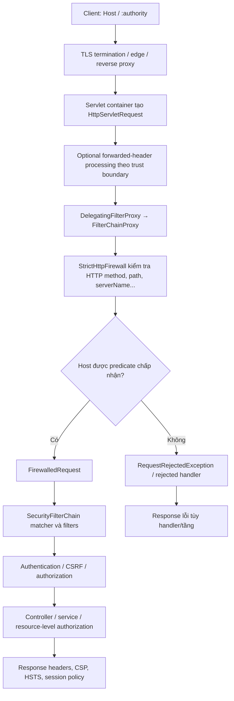

# Host được phép theo nhu cầu triển khai

## 1. Vì sao phải kiểm soát hostname ở Servlet firewall?

Trong chương **Firewall trên Servlet** của module **SPRING_SECURITY_HTTP_PROTECTION**, người học làm việc với các lớp phòng vệ HTTP và trình duyệt của Spring Security: kiểm tra request qua `HttpFirewall`, định tuyến `SecurityFilterChain`, authentication, authorization, CSRF, CORS, response security headers, CSP, HSTS và quản lý session. Mỗi lớp bảo vệ một ranh giới khác nhau. Kiểm soát hostname là một phần quan trọng của **ranh giới giữa địa chỉ mà client yêu cầu và địa chỉ mà ứng dụng được phép phục vụ**.

Ví dụ hệ thống công bố một ứng dụng tại:

```text
https://app.example.test
```

Client hợp lệ gửi:

```http
GET /account HTTP/1.1
Host: app.example.test
```

Nhưng có thể có request với Host khác:

```http
GET /account HTTP/1.1
Host: attacker.example
```

Nếu backend chấp nhận Host do client tùy ý đưa vào và sử dụng Host đó để tạo **đường dẫn tuyệt đối** trong email khôi phục mật khẩu, redirect đăng nhập, OAuth callback hoặc cache key, kết quả có thể vượt ngoài ý định triển khai. Tên host chứa các ký tự thông thường vẫn có thể là **host không đáng tin**.

`StrictHttpFirewall` trên Servlet cung cấp:

```java
void setAllowedHostnames(Predicate<String> allowedHostnames)
```

Đây là một cách bổ sung chính sách chấp nhận hostname tại cửa vào `FilterChainProxy`. Theo Javadoc Spring Security, **mặc định cho phép mọi hostname**. Điều này không có nghĩa framework coi mọi host là an toàn cho mọi mục đích; ứng dụng hoặc hạ tầng phải đặt chính sách khi deployment có yêu cầu giới hạn host.

**Điểm mấu chốt:** predicate này đánh giá giá trị `HttpServletRequest.getServerName()` do Servlet request cung cấp, **không phải tự đọc và phân tích mọi biến thể thô của header `Host`, HTTP/2 `:authority` hoặc `X-Forwarded-Host`**. Hostname mà Spring Security nhìn thấy đã chịu ảnh hưởng từ HTTP parser, reverse proxy và các wrappers/filter liên quan.

### Mục tiêu học tập

Sau bài học, bạn có thể:

1. Giải thích vì sao host allowlist giảm rủi ro Host header poisoning, redirect poisoning, cache poisoning và nhầm tenant.
2. Phân biệt `Host`, HTTP/2 `:authority`, `request.getServerName()`, `getServerPort()`, `getScheme()` và forwarded headers.
3. Hiểu default `setAllowedHostnames` và vị trí kiểm tra host trong `StrictHttpFirewall`.
4. Chọn chính sách hostname phù hợp với root domain, subdomain, development, staging, production và internal services.
5. Viết predicate exact-match, suffix có ranh giới nhãn rõ ràng, case-insensitive khi phù hợp và kiểm soát IDN/IPv6 mà không tạo bypass.
6. Biết vì sao không thể chỉ dựa vào firewall để xác minh host, TLS SNI, port hoặc nguồn gốc forwarded headers.
7. Viết unit test và MockMvc test, kiểm tra request qua HTTP server/gateway, phân biệt HTTP parser rejection với `RequestRejectedException`.
8. Gắn kiểm soát host với CORS, CSRF, HSTS, CSP, session và phân quyền đa tenant mà không trộn trách nhiệm.
9. Đối chiếu với Reactive/WebFlux để sử dụng đúng firewall API và request abstraction.

## 2. Hostname thuộc ranh giới nào trong HTTP?

Một URL công khai có thể bao gồm:

```text
https://app.example.test:8443/portal/admin/reports?format=pdf
│     │                │    │                     │
│     │                │    │                     └─ query
│     │                │    └─ path (có thể gồm context path)
│     │                └─ port
│     └─ hostname
└─ scheme
```

Đường dẫn và hostname phục vụ hai câu hỏi khác nhau:

- **Hostname**: request hướng đến authority/site nào? Ứng dụng này có được phục vụ host ấy không?
- **Path**: request hướng đến route/resource nào **trong** ứng dụng được chọn?

Một rule `/admin/**` của Spring Security thường kiểm tra đường dẫn bên trong ứng dụng, không mặc nhiên kiểm tra host. Một hostname allowlist cũng không biết người dùng có được xem `/admin/reports` hay không.

### 2.1. `Host` trong HTTP/1.1

Client gửi field `Host` để báo host/authority của request:

```http
GET /api/orders HTTP/1.1
Host: api.example.test:443
```

Host field có thể kèm port. Tuy nhiên `request.getServerName()` trả phần **server name** theo Servlet API; `request.getServerPort()` là giá trị riêng. **Đừng viết allowlist `app.example.test:443` rồi mặc định nó khớp `getServerName()`.**

HTTP/1.1 có các yêu cầu về sự hiện diện và tính hợp lệ của Host. Một HTTP server chuẩn có thể reject Host thiếu, không hợp lệ hoặc trùng mâu thuẫn **trước khi** request tới Java. Tầng HTTP parser vẫn cần cấu hình đúng; `StrictHttpFirewall` không phải bộ phân tích HTTP/1.1 thay thế.

### 2.2. `:authority` trong HTTP/2 và HTTP/3

HTTP/2 và HTTP/3 dùng các pseudo-headers/metadata phù hợp với giao thức, trong đó `:authority` tham gia biểu diễn authority. Tầng HTTP server hoặc gateway chuyển thông tin đó thành các thuộc tính request mà Servlet API cung cấp.

Không viết:

```java
request.getHeader(":authority")
```

rồi xem đây là cách chuẩn để xác định host khi làm việc với Servlet. Pseudo-headers là cấu trúc của HTTP protocol layer, **không phải header nghiệp vụ thông thường**. `request.getServerName()` mới là giá trị `StrictHttpFirewall` xét khi kiểm tra allowed hostname ở implementation tương ứng.

### 2.3. Hostname, port, scheme và TLS SNI khác nhau

| Thuộc tính | Nguồn/ý nghĩa thường gặp | Đối chiếu với `setAllowedHostnames` |
| --- | --- | --- |
| `Host` / authority | Host/port client yêu cầu ở tầng HTTP. | Có thể ảnh hưởng server name sau parsing. |
| `getServerName()` | Server name được Servlet request trình bày. | **Input trực tiếp cho predicate** trong `StrictHttpFirewall`. |
| `getServerPort()` | Port của request theo Servlet view. | **Không phải** input của `Predicate<String>` này. |
| `getScheme()` | `http`/`https` theo Servlet view hoặc wrapper. | Không nằm trong predicate hostname. |
| TLS SNI | Hostname client nêu trong bước bắt tay TLS. | Tầng TLS/ingress quyết định; firewall không trực tiếp xác minh SNI. |
| `X-Forwarded-Host` | Header do proxy có thể dùng để mô tả host bên ngoài. | Chỉ ảnh hưởng nếu hạ tầng/framework xử lý thành server name trước điểm kiểm tra. |
| `Forwarded: host=...` | Field chuẩn hóa mô tả thông tin forwarded. | Phụ thuộc trusted proxy và cách áp wrapper/filter. |

Không khẳng định rằng `setAllowedHostnames` tự xác minh **Host == SNI**, scheme HTTPS, port công khai hoặc Host/Forwarded consistency. Những điều ấy thuộc nhiều tầng khác nhau.

## 3. Vì sao Host header injection/poisoning có thể nguy hiểm?

### 3.1. Password-reset link poisoning

Một web app tạo email khôi phục mật khẩu bằng cách xây URL tuyệt đối từ `request.getServerName()`:

```java
// ANTI-PATTERN: dùng host không xác thực từ request để dựng security link.
String resetLink = request.getScheme() + "://"
    + request.getServerName()
    + "/reset?token=" + token;
```

Nếu endpoint nhận một host giả mạo và chấp nhận nó làm domain public, liên kết có thể trỏ tới domain do bên khác kiểm soát. Tùy flow và cách chuyển phát, đây là rủi ro rò rỉ token hoặc đánh lừa người dùng.

**Giải pháp đáng tin cậy hơn:** sử dụng một **canonical public base URL** do server configuration quản lý để tạo link nhạy cảm. Host allowlist giúp giảm bề mặt rủi ro nhưng không nên được dùng làm nguồn duy nhất cho địa chỉ trong email bảo mật.

### 3.2. Open redirect và callback URL

Nếu một app xây redirect dựa trên Host hoặc `X-Forwarded-Host` không đáng tin:

```text
Location: https://attacker.example/login/complete
```

một luồng đăng nhập, logout hoặc callback có thể điều hướng sai domain. Đối với OAuth/OIDC, `redirect_uri` phải được xác minh theo client registration/protocol; Host allowlist **không tự thay exact redirect URI checking**.

### 3.3. Cache poisoning

Một proxy/cache có thể dùng Host, scheme và path để tạo cache key. Nếu edge cache key và origin routing không thống nhất về host, phản hồi của một host có thể bị trả lại dưới host khác hoặc lưu với khóa không mong đợi.

Rủi ro cao hơn nếu response chứa URL tuyệt đối, session-specific content hoặc thông tin phụ thuộc tenant. Cần thiết kế cache isolation theo authority, tránh shared caching cho response riêng tư, và test đúng public edge.

### 3.4. Multi-tenant domain confusion

Trong nền tảng đa tenant, các tên sau có thể trỏ về cùng backend:

```text
tenant-a.example.test
tenant-b.example.test
```

Host hợp lệ về cú pháp và cùng thuộc `example.test` **không tự chứng minh** principal có quyền đối với cả hai tenant. Host allowlist chỉ quyết định host **được phép phục vụ**, còn ứng dụng vẫn phải:

- Ánh xạ hostname tới tenant record được quản lý phía server.
- Xác minh tenant đang active và domain ownership đã được duyệt.
- Ràng buộc authenticated principal với tenant/resource thực.
- Ngăn cross-tenant cache/session/cookie leakage.
- Kiểm tra chuyển tenant qua header, path, token hoặc custom domain.

### 3.5. DNS rebinding và internal host exposure

Một internal web app chỉ nghe trên mạng nội bộ nhưng bị client từ vùng mạng khác gửi `Host` bất ngờ có thể gặp rủi ro tùy network/browser/proxy architecture. Host allowlist có thể là **một lớp giảm thiểu**, nhưng không thay network ACL, authentication, CSRF/Origin protections hoặc bảo vệ DNS rebinding ở hạ tầng.

Không đưa `localhost` hay toàn bộ IP private ranges vào production allowlist chỉ vì test local cần chúng. Các host/IP nội bộ có thể mở bề mặt truy cập khác với public domain.

## 4. Cơ chế `StrictHttpFirewall#setAllowedHostnames` thực tế

Theo Spring Security Javadoc và source hiện hành:

```java
public void setAllowedHostnames(
    Predicate<String> allowedHostnames)
```

Mặc định:

```java
// Minh họa ý nghĩa default:
Predicate<String> allowedHostnames = hostname -> true;
```

Ở implementation `StrictHttpFirewall` hiện hành, logic kiểm tra host tương ứng:

```java
// Pseudocode gần với source, không phải mã đầy đủ của class.
String serverName = request.getServerName();

if (serverName != null && !allowedHostnames.test(serverName)) {
    throw new RequestRejectedException(
        "The request was rejected because the domain is untrusted");
}
```

Những điểm cần ghi nhớ:

1. **Input là `request.getServerName()`**, không trực tiếp là `getHeader("Host")`.
2. **`null` được bỏ qua bởi riêng nhánh kiểm tra hostname** ở source tương ứng; đừng dùng setter này làm bằng chứng Host field bắt buộc hiện diện.
3. Một hostname không nằm trong allowlist có thể gây **`RequestRejectedException` ngay khi `getFirewalledRequest(...)` chạy**, trước chain selection.
4. Default predicate cho phép mọi host — nếu cần allowlist phải chủ động cấu hình.
5. Predicate nhận **hostname String**, không có port, scheme, principal, route hoặc tenant context.
6. Các phiên bản Spring Security có thể thay đổi implementation details; đối chiếu Javadoc/source đúng dependency đang chạy.

### 4.1. Thứ tự xử lý ở Servlet security



**Chú ý:** forwarded-header processing không mặc định phải có trước firewall. Thứ tự và cách nó thay `getServerName()` phụ thuộc Spring Boot config, Servlet filter registration hoặc native container/proxy support. Điều cần kiểm chứng là **server name thật sự được Spring Security kiểm tra trong runtime**.

### 4.2. Host check khác với header-name/value check

Bài trước của chương đã xem `setAllowedHeaderNames` và `setAllowedHeaderValues`. Đây là hai predicates về **ký tự** trong headers được truy cập qua wrapper. Host allowlist kiểm tra **hostname mà Servlet request cung cấp**.

Một host `attacker.example` toàn chữ ASCII có thể qua default header character validation nhưng không thuộc host allowlist; đó là hai trách nhiệm khác nhau.

### 4.3. Host check không thay các HTTP parser checks

HTTP/1.1 thiếu Host, nhiều Host fields không hợp lệ, cú pháp port sai hoặc HTTP/2 authority mâu thuẫn có thể bị proxy/container từ chối trước Spring Security. Đặc biệt nhánh `serverName != null` trong source chứng minh **chỉ riêng allowed-host predicate không phải bộ xác minh bắt buộc Host header**.

## 5. Chọn allowlist theo deployment thay vì sao chép cấu hình máy khác

Hostname policy phải xuất phát từ **topology thực tế**.

| Deployment | Host public hợp lệ (minh họa) | Cần cân nhắc |
| --- | --- | --- |
| Dev local | `localhost`, `127.0.0.1` | Chỉ dùng trong dev/test, khác production. |
| Staging | `staging.example.test` | Test hostname và HTTPS/SNI staging. |
| Production single domain | `app.example.test` | Exact-match, alias và redirect canonical domain. |
| Production nhiều service | `app.example.test`, `api.example.test` | Service nào thực sự nhận host nào? |
| Admin riêng | `admin.example.test` | Không phải chỉ cho domain admin là đủ; còn auth/MFA/authorization/network control. |
| Multi-tenant subdomain | `tenant-a.example.test`, `tenant-b.example.test` | Registry active tenants, domain verification, tenant isolation. |
| Custom domains | `customer-owned.example` | Xác minh quyền sở hữu và lifecycle khi domain đổi chủ. |
| Backend behind ingress | Có thể thấy `backend.local` thay vì host public | Phải xác định host được Servlet nhìn thấy theo routing/proxy. |
| Blue/green/canary | Host canary có thể khác | Review alias và cutover; tránh whitelist rộng lâu dài. |
| Internal health check | `localhost`, pod/service DNS, hostname health riêng | Giới hạn môi trường, authentication/network và health endpoint. |

**Không lấy danh sách trên làm cấu hình production.** Tên miền trong ví dụ chỉ mang tính minh họa. Cần lập danh sách host mà backend thật sự phải phục vụ tại điểm `StrictHttpFirewall` xét `getServerName()`.

### 5.1. Root domain và subdomain khác nhau

`example.test` không đồng nhất với `app.example.test`. Nếu app chỉ phục vụ `app.example.test`, không nên tự cho phép mọi subdomain hoặc root domain chỉ để "phòng trường hợp cần".

Đối với các tên liên quan web login, `www.example.test` và `example.test` có thể cần xử lý alias/redirect. Chọn **một canonical public URL** và thiết kế redirect từ alias ở ingress nếu có thể, thay vì để ứng dụng phát link tùy biến theo Host nhận được.

### 5.2. Đừng đưa host thuộc môi trường khác vào cùng allowlist vô điều kiện

Ví dụ một production service nhận mọi host:

```text
localhost
127.0.0.1
staging.example.test
app.example.test
*.example.test
```

sẽ khó audit và có thể làm lộ các route nội bộ, thử nghiệm hoặc tenant chưa được xác thực. Tách allowlist theo **environment configuration**, với test và review khi deploy.

### 5.3. Blue/green deployments

Trong lúc chuyển traffic, có thể cần alias tạm thời. Đặt thời hạn loại bỏ alias, bảo đảm TLS certificate và ingress routing tương thích. Không giữ một wildcard vô hạn chỉ vì từng có một buổi canary deployment.

## 6. Cấu hình exact-match theo host rõ ràng

Cách dễ review nhất thường là **tập tên host chính xác**, so sánh không phân biệt hoa/thường đối với DNS names.

Ví dụ Spring Security Servlet 6.x/7.x:

```java
import java.util.Locale;
import java.util.Set;

import org.springframework.context.annotation.Bean;
import org.springframework.context.annotation.Configuration;
import org.springframework.security.web.firewall.StrictHttpFirewall;

@Configuration
class AllowedHostsFirewallConfig {

    private static final Set<String> ALLOWED_HOSTS = Set.of(
        "app.example.test",
        "api.example.test"
    );

    @Bean
    StrictHttpFirewall httpFirewall() {
        StrictHttpFirewall firewall = new StrictHttpFirewall();

        firewall.setAllowedHostnames(host -> {
            if (host == null || host.isBlank()) {
                return false;
            }

            String normalized = host.toLowerCase(Locale.ROOT);
            return ALLOWED_HOSTS.contains(normalized);
        });

        return firewall;
    }
}
```

Điều quan trọng trong ví dụ:

- Host được đối chiếu với tập **cố định do server quản lý**.
- DNS hostname không phân biệt hoa/thường, nên dùng `Locale.ROOT` thay vì locale người dùng.
- Không dùng `contains`/`startsWith`/suffix chưa có ranh giới nhãn.
- Không mở host `localhost` hoặc staging trong production nếu không có nhu cầu.
- Chỉ thay host policy, **không nới** kiểm tra URL encoded slash, semicolon, HTTP method hoặc header characters.

**Giới hạn:** đoạn minh họa thực hiện lower-case đơn giản, không tự xác minh toàn bộ DNS grammar, IDNA, trailing-dot, IPv6 hoặc proxy trust. Nếu hệ thống hỗ trợ các dạng đó, cần định nghĩa và test chính sách canonical host riêng.

### 6.1. Đặt firewall vào `WebSecurityCustomizer`

Một cách cấu hình khác:

```java
import java.util.Locale;
import java.util.Set;

import org.springframework.context.annotation.Bean;
import org.springframework.context.annotation.Configuration;
import org.springframework.security.config.annotation.web.configuration.WebSecurityCustomizer;
import org.springframework.security.web.firewall.StrictHttpFirewall;

@Configuration
class AllowedHostsWebCustomizerConfig {

    @Bean
    WebSecurityCustomizer firewallCustomizer() {
        Set<String> allowed = Set.of("app.example.test");

        return web -> {
            StrictHttpFirewall firewall = new StrictHttpFirewall();

            firewall.setAllowedHostnames(host ->
                host != null
                    && allowed.contains(
                        host.toLowerCase(Locale.ROOT)));

            web.httpFirewall(firewall);
        };
    }
}
```

**Không kích hoạt đồng thời hai class cấu hình firewall của mục 6 và 6.1** rồi đoán bean/customizer nào thắng. Chọn **một** điểm cấu hình thống nhất theo version/project và xác nhận `FilterChainProxy` thực sự dùng predicate đó.

### 6.2. Mặc định không cần thay tất cả các rule khác

Đừng viết:

```java
// ANTI-PATTERN: host allowlist không đòi hỏi nới các rule khác.
firewall.setAllowSemicolon(true);
firewall.setAllowUrlEncodedSlash(true);
firewall.setUnsafeAllowAnyHttpMethod(true);
```

Không có quan hệ bắt buộc giữa host allowlist và việc mở URL normalization/HTTP methods. Nới đồng thời nhiều quy tắc sẽ làm khó xác định chính sách nào thực sự gây lỗi.

### 6.3. Vì sao host predicate không có request context?

Chữ ký là `Predicate<String>`, không phải `BiPredicate<HttpServletRequest, String>`. Nó không tự có principal, route hoặc request scheme/port. Không dùng biến toàn cục hoặc `ThreadLocal` để “nhét” tenant ID vào predicate rồi tạo behavior khó dự đoán.

Nếu chính sách cần tenant, user, path hay client certificate, hãy xử lý ở tầng phù hợp sau bước xác định host hợp lệ, với một contract và tests riêng.

## 7. So sánh hostname: tránh những cách kiểm tra dễ bypass

### 7.1. Sai lầm `endsWith("example.test")`

```java
// ANTI-PATTERN.
return host.endsWith("example.test");
```

Predicate này có thể cho phép:

```text
notexample.test
attackerexample.test
other-example.test
```

vì chúng kết thúc bằng cùng chuỗi ký tự mà không có **ranh giới DNS label**.

Nếu business muốn chấp nhận root domain và các subdomains thật, cần phân biệt root và dấu chấm trước suffix.

### 7.2. Suffix check có ranh giới nhãn

Ví dụ **chỉ phù hợp khi toàn bộ subdomains đã thuộc phạm vi tin cậy**:

```java
import java.util.Locale;

boolean isUnderApprovedZone(String hostname) {
    if (hostname == null) {
        return false;
    }

    String host = hostname.toLowerCase(Locale.ROOT);

    return host.equals("example.test")
        || host.endsWith(".example.test");
}
```

Đoạn này **khắc phục lỗi `notexample.test`** nhưng **không tự bảo vệ** khỏi subdomain takeover, tenant không active hoặc user tự tạo `evil.example.test` bên dưới zone bạn cho phép. Suffix check chỉ xác minh **phạm vi tên** chứ không chứng minh host được triển khai hợp lệ.

Nếu bạn chỉ muốn các host đã đăng ký, **ưu tiên exact-match registry**. Một wildcard là lựa chọn chính sách rộng, cần chứng minh rằng mọi hostname dưới domain đều do tổ chức kiểm soát và được app phục vụ an toàn.

### 7.3. Sai lầm `startsWith("app.")`

`app.attacker.example` cũng bắt đầu bằng `app.`. Phải biết **đầy đủ DNS suffix**, không chỉ prefix thân thiện. Tương tự, `host.contains("example.test")` có thể khớp những chuỗi không thuộc domain bạn quản lý.

### 7.4. Trailing dot

Trong DNS, hostname có thể được biểu diễn dạng fully qualified với dấu chấm cuối:

```text
app.example.test
app.example.test.
```

Một số hệ thống coi hai dạng trỏ cùng tên DNS, nhưng browser, cookie scope, origin comparison, TLS validation và proxy routing có thể khác biệt theo thực tế. Bạn cần **quyết định chính sách rõ ràng**:

- **Fail closed** và chỉ chấp nhận dạng canonical không có trailing dot.
- Hoặc canonicalize theo hợp đồng đã review, rồi test redirects, cookies, origin và TLS trên toàn pipeline.

Đừng mặc định bỏ trailing dot trong tất cả môi trường vì có thể tạo alias bất ngờ.

### 7.5. Port không nằm trong tên host của predicate

`Host: app.example.test:8443` không đồng nghĩa `request.getServerName() == "app.example.test:8443"`. Port được Servlet trình bày riêng qua `getServerPort()` theo parser/wrapper.

Nếu policy yêu cầu chỉ HTTPS port 443 công khai, hãy đặt **listener/ingress/route policy** tương ứng, kiểm tra scheme/port và forwarded trust ở tầng phù hợp. Predicate `Predicate<String>` này không thể tự xác minh port hoặc TLS.

## 8. Internationalized Domain Names (IDN), Unicode và Punycode

Tên miền quốc tế hóa có thể được biểu diễn bằng Unicode ở mức giao diện hoặc **ASCII Compatible Encoding** (A-label, thường có tiền tố `xn--`) khi đi qua DNS/protocol.

Ví dụ khái niệm:

```text
Tên hiển thị Unicode  → IDNA conversion → A-label xn--...
```

### 8.1. Không so Unicode host tùy tiện

Một Java `String` chứa ký tự Unicode được định nghĩa **không tự là tên DNS hợp lệ hoặc đáng tin**. Mã hóa IDNA có quy tắc riêng; những ký tự confusable có thể làm người xem nhầm tên.

Nếu ứng dụng cần IDN, cần một **canonicalization policy được chỉ định rõ** và áp dụng nhất quán từ DNS/certificate registration tới ingress, Servlet và tenant registry.

### 8.2. Ví dụ chuẩn hóa IDN có kiểm soát

Một helper minh họa cho **DNS hostname**, không dành cho IPv6 literal:

```java
import java.net.IDN;
import java.util.Locale;

String canonicalDnsName(String host) {
    if (host == null || host.isBlank()) {
        throw new IllegalArgumentException("Missing host");
    }

    String ascii = IDN.toASCII(host, IDN.USE_STD3_ASCII_RULES);
    return ascii.toLowerCase(Locale.ROOT);
}
```

**Không áp dụng helper này mù quáng cho mọi giá trị `getServerName()`.** Cần tách IPv4/IPv6, kiểm tra label lengths, empty labels, trailing dot, tên đã được parse/validated bởi server và IDNA profile được hạ tầng sử dụng. `java.net.IDN` cũng có giới hạn/phân kỳ với những phiên bản Unicode/IDNA khác; nếu doanh nghiệp cần hỗ trợ domain quốc tế hóa, phải có test case từ registry thực và kiểm chứng trên edge.

### 8.3. Không dùng Unicode normalization để bỏ qua domain ownership

Không chấp nhận một tên chỉ vì nó *trông giống* host hợp lệ. Một hostname muốn được đưa vào production allowlist phải qua DNS/domain ownership và TLS/ingress provisioning hợp lệ; tên hiển thị người dùng không phải bằng chứng.

## 9. IPv4, IPv6, localhost và internal hostnames

Một backend có thể được truy cập qua:

```text
localhost
127.0.0.1
[::1]
service.namespace.svc.cluster.local
app.example.test
```

Điểm cần cẩn thận là **`getServerName()` có thể trình bày IP literal theo cách tùy Servlet parser/connector**; riêng IPv6 có dấu ngoặc trong URI authority nhưng server name API có thể có representation khác.

### 9.1. Localhost chỉ nên cho đúng môi trường

Nếu app production phục vụ web public tại `app.example.test`, việc cho phép `localhost` thường không cần thiết. Nếu health checks chạy nội bộ theo `localhost`, hãy cân nhắc:

- Cấu hình health listener/management port riêng.
- Internal network authentication/ACL.
- Dùng hostname health được chỉ định rõ nếu phù hợp.
- Tách production external policy khỏi test/dev policy.

Không “chữa” một health check đang lỗi bằng wildcard tất cả hosts nếu có thể sửa chính Host mà health checker dùng.

### 9.2. IPv6 và dấu ngoặc

Đừng so raw `Host: [::1]:8080` với `getServerName()` rồi kết luận framework sai khi chuỗi khác nhau; HTTP authority có bracket/port, còn Servlet request cung cấp các trường đã được parser xử lý.

Nếu IP literal là yêu cầu thật, tạo testcase cho chính connector/version, và dùng exact entries theo representation thực. Không viết một regex quá rộng có thể vô tình cho phép những dạng authority malformed.

### 9.3. DNS/IP allowlist không thay IP source ACL

Hostname là **địa chỉ đích** mà request hướng tới; client IP hoặc mạng nguồn là điều khác. Một host allowlist **không chứng minh** request đến từ internal network. Sử dụng network ACL/firewall, mTLS, VPN, authentication hoặc proxy trust policy phù hợp nếu chỉ những callers nhất định được phép truy cập.

## 10. Reverse proxy, Ingress và forwarded headers

Deployment thực thường có topology:

```text
Browser HTTPS
    |
    v
CDN / WAF / Load Balancer
    |
    v
Ingress / NGINX / Envoy
    |
    v
Spring Boot Servlet application (Tomcat / Jetty / Undertow)
```

Mỗi tầng có thể dùng một hostname khác nhau:

```text
Public Host:        app.example.test
Gateway upstream:   protection-service.internal
Backend serverName: app.example.test   hoặc protection-service.internal
```

Kết quả thực phụ thuộc gateway có **preserve/overwrite Host**, dùng Forwarded/`X-Forwarded-Host`, và Servlet request có được wrapped bởi một cơ chế forwarded-header processing hay không.

### 10.1. Host header và `X-Forwarded-Host` khác nguồn tin cậy

Client có thể tự gửi:

```http
X-Forwarded-Host: attacker.example
X-Forwarded-Proto: https
```

Nếu backend tin bất kỳ forwarded header nào do Internet gửi, host allowlist có thể kiểm tra hoặc tạo URL dựa trên **dữ liệu không đáng tin**. Các headers này chỉ nên được chấp nhận từ **trusted proxy**.

Thông thường ingress cần **loại bỏ hoặc ghi đè** các forwarded headers do client tự khai báo trước khi chuyển vào internal network. Sau đó backend mới có thể tin những headers được proxy đáng tin bổ sung theo một hợp đồng cấu hình.

### 10.2. `ForwardedHeaderFilter` và native server support

Trong Spring Framework Servlet, `ForwardedHeaderFilter` có thể làm các API request như `getServerName()`, `getServerPort()`, `getScheme()` phản ánh thông tin forwarded theo cấu hình và vị trí của filter.

Spring Boot có các chiến lược xử lý forwarded headers, tùy version/deployment; một số setup dùng filter của Spring, một số dùng native server support như Tomcat `RemoteIpValve`. Cấu hình và filter order **quyết định Spring Security thấy hostname nào**.

Đừng kết luận “`setAllowedHostnames` sẽ kiểm tra public host” khi chưa kiểm tra:

1. Proxy có giữ Host public khi gọi backend không?
2. Trusted headers do ai tạo, và client có thể spoof không?
3. Forwarded handling xảy ra **trước hay sau** `FilterChainProxy`?
4. `getServerName()` ở điểm firewall trả gì?
5. `getServerPort()` và scheme có phù hợp public HTTPS không?
6. Ingress có direct-to-backend bypass route nào không?

### 10.3. Ví dụ cấu hình Spring Boot chỉ để định hướng

Trong một ứng dụng được triển khai sau trusted proxy, có thể cần:

```properties
# Ví dụ một chiến lược framework-level.
# Chỉ bật khi hạ tầng có hợp đồng forwarded headers được bảo vệ.
server.forward-headers-strategy=framework
```

Đây không phải chỉ thị bật cho tất cả dự án. Một số môi trường dùng `native` hoặc không xử lý forwarded headers, và các option có thể khác theo Boot version. Nếu forwarded headers không được sanitize ở edge, bật processing có thể **làm tăng nguy cơ host/scheme spoofing**.

### 10.4. Ghi log public host và backend host an toàn

Để chẩn đoán, nên dùng correlation ID và ghi lại **giá trị đã escape/giới hạn độ dài** của:

- Host field sau parser, nếu có quyền và nhu cầu.
- `request.getServerName()` trước/sau wrapper theo điểm kiểm tra.
- `getServerPort()`/`getScheme()` khi cần.
- Ingress route hoặc virtual host được chọn.
- Origin service identity và HTTP status.
- Nguồn forwarded headers: trusted proxy hay client request.

Không ghi `Authorization`, session Cookie hoặc reset tokens chỉ để tìm lỗi host. Raw Host có thể chứa dữ liệu không đáng tin; log phải escape control chars.

### 10.5. Direct-to-backend access phải được kiểm soát

Nếu backend public được gọi trực tiếp, request có thể bypass host/SNI/canonical URL checks ở ingress. **Host allowlist ở Spring Security là defense in depth**, nhưng không thay firewall/network policy chặn đường trực tiếp không mong đợi.

Một lỗi phổ biến: public gateway chỉ forward host tốt, nhưng backend vẫn nghe trên một network address mà bất kỳ client nào cũng gọi được. Cần giới hạn network exposure và xác minh đường đi của health/management endpoints.

## 11. Ví dụ NGINX/Ingress: xác định owner của host validation

Đây là một ví dụ định hướng để hiểu **sự khác nhau giữa edge và backend**, không phải file NGINX production hoàn chỉnh:

```nginx
# Ví dụ cấu trúc minh họa, xem thêm TLS/certificate,
# upstream, forwarded-header sanitation và route policies.
server {
    listen 443 ssl;
    server_name app.example.test;

    # ssl_certificate ...;
    # ssl_certificate_key ...;

    location / {
        proxy_set_header Host app.example.test;
        proxy_set_header X-Forwarded-Host app.example.test;
        proxy_set_header X-Forwarded-Proto https;
        proxy_pass http://127.0.0.1:8080;
    }
}
```

**Không sao chép block này nguyên xi để deploy**: nó thiếu certificate paths, upstream health/retries, request limits và fallback/default-server handling. Trong một ứng dụng multi-domain, việc hardcode `app.example.test` cũng không phù hợp; phải dùng routing map/trusted values theo những host đã được virtual host match.

Mục tiêu của ví dụ là **ngăn client tự quyết định forwarded host** sau khi đã đi qua edge. Nhưng NGINX vẫn cần virtual host/default server reject policy cho những Host không được phục vụ. Một `server_name` match không tự chứng minh mọi server block khác trên cùng listener đều từ chối host lạ.

### 11.1. Cấu hình edge và app cần nhất quán

Giả sử edge chấp nhận `app.example.test` nhưng backend allowlist chỉ có `backend.internal`. Nếu gateway giữ Host public, Spring Security sẽ từ chối. Nếu gateway rewrite Host thành backend.internal, Spring Security có thể chấp nhận nhưng **không tự kiểm tra public Host**.

Cần quyết định rõ:

- Edge là nơi **kiểm tra public host** và backend tin một upstream identity đã được bảo vệ?
- Hay backend nhận **host public đã được proxy xác nhận** và kiểm tra exact allowlist lần nữa?
- Nếu phải hỗ trợ custom domain, registry nào tạo cả ingress routes và backend allowed hosts?
- Ai là owner khi thêm/xóa hostname?

Không trộn hai mô hình rồi hy vọng defaults tự hoạt động.

### 11.2. Host allowlist và TLS certificate

Một domain có certificate TLS hợp lệ không chứng minh backend nên phục vụ nó, và một domain có trong allowlist Spring Security không chứng minh TLS certificate đã được cấp/đúng hostname.

Kiểm tra đồng thời: DNS ownership → TLS certificate/SNI → ingress virtual host → upstream routing → Servlet `getServerName()` → firewall predicate → app authorization.

## 12. Single-domain, multi-domain và multi-tenant: chọn chiến lược đúng

### 12.1. Single-domain

Nếu chỉ có:

```text
app.example.test
```

thì exact-match allowlist thường dễ audit và test nhất. Public base URL cho email/redirect cũng có thể được cấu hình cứng.

### 12.2. Nhiều domain cố định

Nếu service phục vụ:

```text
app.example.test
api.example.test
partner.example.test
```

dùng một tập whitelist từ cấu hình và kiểm thử cả three domains. Với mỗi host, quyết định:

- Có cùng authentication/session scope không?
- Cookie domain/path có cần tách không?
- CORS origins nào được cấp quyền?
- Rate limits/cache keys có phải phân biệt host không?
- HSTS policy có áp includeSubDomains không?

Cho phép cả ba host ở firewall **không đồng nghĩa cho phép share session** hoặc cross-origin access giữa chúng.

### 12.3. Subdomain theo tenant

Với `{tenant}.example.test`, có thể cân nhắc suffix check, nhưng tốt hơn khi có **tenant/domain registry**:

```text
tenant-a.example.test -> tenant A, ACTIVE
tenant-b.example.test -> tenant B, ACTIVE
tenant-x.example.test -> tenant X, DISABLED
```

Một host đúng suffix nhưng chưa đăng ký hoặc bị disabled **không nên được ứng dụng phục vụ như tenant hợp lệ**. Registry cần có lifecycle quản lý, xác minh ownership, và cache an toàn.

### 12.4. Custom domains do khách hàng sở hữu

Ví dụ:

```text
shop.customer-a.example
portal.customer-b.example
```

Allowlist chỉ là một bước. Trước khi thêm:

1. Khách hàng chứng minh quyền sở hữu domain.
2. DNS trỏ tới ingress theo thiết kế.
3. TLS certificate được cấp/duy trì hợp lệ.
4. Domain được ánh xạ tới tenant record đúng.
5. Cookie, CORS, CSP và redirect policies được review cho custom domain.
6. Xác định cách thu hồi khi khách hàng xóa domain hoặc đổi ownership.
7. Tránh domain takeover/claim nhầm lại domain cũ.

Nếu dùng dynamic predicate đọc registry, cần xác định **hiệu năng, cache invalidation, failure mode và transaction consistency**. Không gọi database chậm hoặc phụ thuộc network trực tiếp trên mọi request nếu điều đó gây mất ổn định; cân nhắc precomputed in-memory allowlist có cập nhật an toàn và deny-by-default khi không có dữ liệu đáng tin.

## 13. Hostname không phải bằng chứng tenant authorization

Giả sử user đã đăng nhập vào tenant A nhưng gửi request tới host tenant B:

```http
GET /reports/42 HTTP/1.1
Host: tenant-b.example.test
Cookie: JSESSIONID=...
```

Dù `tenant-b.example.test` nằm trong host allowlist, business service vẫn phải kiểm tra:

- Session/principal thuộc tenant nào.
- Resource `report 42` thuộc tenant nào.
- Principal có quyền truy cập resource ấy không.
- Cookie scope có bị share qua subdomains hay không.
- Cache của proxy/backend có tách theo tenant/host không.

Anti-pattern:

```java
// Không coi chuỗi Host là bằng chứng có quyền với tenant đó.
String tenant = request.getServerName().split("\\.")[0];
return repository.findAllForTenant(tenant);
```

Tách prefix để quyết định tenant có thể là một phần **routing** nhưng không phải authorization. Hostname nên được ánh xạ qua registry đáng tin, và quyền phải dựa trên principal/resource. Nếu có custom domain, parse tenant từ prefix càng không phù hợp.

### 13.1. Session cookies và subdomain isolation

Cookie với `Domain=.example.test` có thể được gửi đến nhiều subdomains thuộc phạm vi cookie, còn host-only cookie chỉ áp cho host phù hợp. Chọn cookie scope cần dựa trên architecture/threat model, không tự mở `Domain` toàn zone chỉ vì firewall cho phép nhiều subdomains.

`SameSite` và `Secure`, `HttpOnly` bảo vệ các khía cạnh khác nhau. Chúng **không thay** kiểm tra tenant/resource khi request đến backend.

## 14. CORS, CSRF, HSTS, CSP và security headers có vai trò gì?

### 14.1. Host allowlist và CORS Origin allowlist không tương đương

Ví dụ frontend:

```http
Origin: https://ui.example.test
Host: api.example.test
```

`Host` nói **request gửi tới server nào**; `Origin` nói **nguồn của browser context** trong những request có Origin. Host allowlist và CORS allowed origins là hai chính sách khác nhau:

- Host allowlist: backend có được phục vụ `api.example.test` không?
- CORS: `https://ui.example.test` có được browser cho phép đọc response từ API này theo cấu hình không?
- Authorization: principal có quyền gọi API/resource không?

Một `Origin` hợp lệ vẫn có thể bị CORS từ chối; một Host hợp lệ **không tự mở cross-origin credentials**.

### 14.2. CSRF không được thay bằng host allowlist

CSRF khai thác việc browser có thể tự đính kèm cookies/session credentials trong request. Nếu request đến đúng host hợp lệ, nó **vẫn có thể là một request CSRF**. Với session-cookie authentication, giữ CSRF protection cho các state-changing methods theo policy.

Đừng cấu hình:

```java
// ANTI-PATTERN: host allowlist không làm CSRF trở nên vô nghĩa.
// http.csrf(csrf -> csrf.disable());
```

Cũng không nên lấy `Origin` hoặc `Referer` làm biện pháp CSRF duy nhất trong mọi tình huống nếu framework có CSRF token mechanism phù hợp.

### 14.3. HSTS bảo vệ scheme trên hostname, không xác thực host request

`Strict-Transport-Security` hướng browser dùng HTTPS cho hostname đã ghi nhận. Nó không tự biết backend có được phục vụ host đó không. Nếu bật `includeSubDomains`, cần xem **mọi subdomain** đã sẵn sàng HTTPS hay chưa; đừng đồng nhất HSTS scope với firewall host allowlist.

Một gateway có thể phát HSTS, trong khi Spring Security backend chỉ phát header khi request được xem là HTTPS. Host/scheme forwarding không tin cậy có thể khiến HSTS behavior sai. Vì vậy trusted forwarded-header configuration và TLS termination cần được review cùng nhau.

### 14.4. CSP và response headers khác Host validation

CSP, `X-Frame-Options`, `X-Content-Type-Options` và `Referrer-Policy` là response-side browser protections. Chúng không làm Host từ client trở nên đáng tin và không xác thực tenant.

Khi `StrictHttpFirewall` từ chối host trước chain selection, response lỗi có thể **không đi qua `HeaderWriterFilter`**. Nếu cần CSP/HSTS trên mọi public error response, edge/container cũng cần policy phù hợp. Tránh phát nhiều CSP/HSTS mâu thuẫn giữa gateway và backend.

### 14.5. Password reset, OAuth redirect và canonical URL

Cấu hình một biến deployment-controlled:

```properties
# Minh họa: địa chỉ public do vận hành kiểm soát.
application.public-base-url=https://app.example.test
```

Dùng nó để xây security-sensitive URLs thay vì ghép `getScheme()+getServerName()` từ request không được xác minh. Nếu có nhiều host/tenant, tra từ **domain registry đã được xác thực** rồi chọn base URL tương ứng, không tự tin bất kỳ `Host` nào chỉ vì có trong wildcard.

## 15. Unit test `StrictHttpFirewall` với `MockHttpServletRequest`

Để chứng minh predicate host của firewall, hãy tạo request mock có method, path và **server name rõ ràng**. `MockHttpServletRequest` không chạy HTTP parser hay proxy; vì vậy test trực tiếp có giá trị xác minh **contract của `StrictHttpFirewall` với request object**.

### 15.1. Test mặc định, exact allowlist và host không tin cậy

Ví dụ JUnit 5 / Spring Security Servlet 6.x:

```java
import java.util.Locale;
import java.util.Set;

import org.junit.jupiter.api.Test;
import org.springframework.mock.web.MockHttpServletRequest;
import org.springframework.security.web.firewall.FirewalledRequest;
import org.springframework.security.web.firewall.RequestRejectedException;
import org.springframework.security.web.firewall.StrictHttpFirewall;

import static org.junit.jupiter.api.Assertions.assertEquals;
import static org.junit.jupiter.api.Assertions.assertThrows;

class AllowedHostFirewallUnitTest {

    private MockHttpServletRequest request(String hostname) {
        var request = new MockHttpServletRequest("GET", "/health");
        request.setServletPath("/health");
        request.setServerName(hostname);
        return request;
    }

    private StrictHttpFirewall allowAppAndApi() {
        var firewall = new StrictHttpFirewall();
        Set<String> allowed = Set.of(
            "app.example.test",
            "api.example.test");

        firewall.setAllowedHostnames(host ->
            host != null
                && allowed.contains(
                    host.toLowerCase(Locale.ROOT)));

        return firewall;
    }

    @Test
    void defaultFirewallDoesNotRestrictHostname() {
        var firewall = new StrictHttpFirewall();
        FirewalledRequest safe = firewall.getFirewalledRequest(
            request("untrusted.example"));

        assertEquals("untrusted.example", safe.getServerName());
        safe.reset();
    }

    @Test
    void acceptsExactApprovedHostname() {
        var firewall = allowAppAndApi();
        FirewalledRequest safe = firewall.getFirewalledRequest(
            request("app.example.test"));

        assertEquals("app.example.test", safe.getServerName());
        safe.reset();
    }

    @Test
    void rejectsUntrustedHostname() {
        var firewall = allowAppAndApi();

        assertThrows(RequestRejectedException.class, () ->
            firewall.getFirewalledRequest(
                request("attacker.example")));
    }

    @Test
    void acceptsCaseVariantOfApprovedDnsName() {
        var firewall = allowAppAndApi();
        FirewalledRequest safe = firewall.getFirewalledRequest(
            request("APP.EXAMPLE.TEST"));

        safe.reset();
    }
}
```

**Giải thích test:**

- Default `StrictHttpFirewall` chấp nhận hostname bất kỳ **theo riêng rule allowed hostnames**, nếu request không vi phạm rule khác.
- Custom predicate cho đúng hai host được duyệt.
- Request không thuộc allowlist ném `RequestRejectedException` ngay khi `getFirewalledRequest(...)` chạy.
- Host DNS có case variant được chấp nhận vì predicate tự lower-case bằng `Locale.ROOT`.

Không coi ví dụ này là bằng chứng raw `Host` HTTP header đã được parser xử lý ra `getServerName()` giống hệt trong production. Test tự gọi `setServerName`.

### 15.2. Test subdomain suffix tránh `notexample.test`

```java
import static org.junit.jupiter.api.Assertions.assertFalse;
import static org.junit.jupiter.api.Assertions.assertTrue;

boolean allowedZone(String hostname) {
    if (hostname == null) {
        return false;
    }
    String h = hostname.toLowerCase(Locale.ROOT);

    return h.equals("example.test")
        || h.endsWith(".example.test");
}

@Test
void suffixRequiresDnsLabelBoundary() {
    assertTrue(allowedZone("example.test"));
    assertTrue(allowedZone("tenant-a.example.test"));

    assertFalse(allowedZone("notexample.test"));
    assertFalse(allowedZone("attackerexample.test"));
    assertFalse(allowedZone("example.test.attacker.example"));
}
```

Đây là một **bài test helper logic**, không phải kết luận wildcard luôn an toàn. Nếu `unknown.example.test` không có tenant đăng ký, suffix check vẫn trả true. Có thể cần registry allowlist chính xác thay vì suffix wildcard.

### 15.3. Test Host và port phải tách biệt

```java
@Test
void hostnamePredicateDoesNotReceivePort() {
    var request = request("app.example.test");
    request.setServerPort(8443);

    var firewall = allowAppAndApi();
    var safe = firewall.getFirewalledRequest(request);

    assertEquals("app.example.test", safe.getServerName());
    assertEquals(8443, safe.getServerPort());
    safe.reset();
}
```

Test này chứng minh predicate đánh giá **server name**, không phải chuỗi Host có `:8443`. Nếu port khác nhau có ý nghĩa bảo mật, kiểm soát listener/ingress hoặc thêm một rule có request context ở tầng phù hợp.

### 15.4. Không dùng method rỗng trong mock

```java
// Dễ làm test fail vì HTTP method không nằm trong default allowlist.
MockHttpServletRequest badSetup = new MockHttpServletRequest();
```

Trong những version Spring Test, constructor không tham số có thể tạo method không hợp lệ với `StrictHttpFirewall`. Khi kiểm thử host, **luôn đặt method và servlet path hợp lệ** để không nhầm lỗi HTTP method với lỗi hostname.

## 16. MockMvc: kiểm tra host qua Spring Security filters

Một ứng dụng Spring MVC mẫu:

```java
import org.springframework.web.bind.annotation.GetMapping;
import org.springframework.web.bind.annotation.RestController;

@RestController
class HealthController {

    @GetMapping("/health")
    String health() {
        return "ok";
    }

    @GetMapping("/admin/reports")
    String reports() {
        return "private";
    }
}
```

Security chain:

```java
import org.springframework.context.annotation.Bean;
import org.springframework.context.annotation.Configuration;
import org.springframework.security.config.Customizer;
import org.springframework.security.config.annotation.web.builders.HttpSecurity;
import org.springframework.security.web.SecurityFilterChain;

@Configuration
class AllowedHostDemoSecurityConfig {

    @Bean
    SecurityFilterChain webChain(HttpSecurity http) throws Exception {
        http.authorizeHttpRequests(auth -> auth
                .requestMatchers("/health").permitAll()
                .requestMatchers("/admin/**").hasRole("ADMIN")
                .anyRequest().authenticated())
            .httpBasic(Customizer.withDefaults());

        return http.build();
    }
}
```

### 16.1. MockMvc test host được phép

```java
import org.junit.jupiter.api.Test;
import org.springframework.beans.factory.annotation.Autowired;
import org.springframework.boot.test.autoconfigure.web.servlet.AutoConfigureMockMvc;
import org.springframework.boot.test.context.SpringBootTest;
import org.springframework.test.web.servlet.MockMvc;

import static org.springframework.test.web.servlet.request.MockMvcRequestBuilders.get;
import static org.springframework.test.web.servlet.result.MockMvcResultMatchers.status;

@SpringBootTest
@AutoConfigureMockMvc
class AllowedHostMockMvcTest {

    @Autowired
    MockMvc mvc;

    @Test
    void approvedServerNameCanReachHealthRoute() throws Exception {
        mvc.perform(get("/health")
                .with(request -> {
                    request.setServerName("app.example.test");
                    return request;
                }))
            .andExpect(status().isOk());
    }
}
```

Test giả định **chỉ một host firewall policy tương ứng được nạp** và không có test configuration khác cạnh tranh. Spring Boot 3.x thường cung cấp các imports trên; với version mới hơn, đối chiếu package auto-config test.

### 16.2. Vì sao không chỉ set `Host` header trong MockMvc?

`MockHttpServletRequest` là object do test framework dựng, không phải kết quả của HTTP parser. Việc gọi:

```java
mvc.perform(get("/health")
    .header("Host", "attacker.example"));
```

**không được mặc định coi là thay đổi `getServerName()` đúng như connector thật**. Phụ thuộc MockMvc request builder và code path, serverName có thể còn là mặc định của mock.

Khi test chính `setAllowedHostnames`, phải kiểm tra hoặc đặt **`serverName`** rõ ràng. Khi test raw Host/parsing, cần HTTP server thật.

### 16.3. Test host bị từ chối ở integration layer

Một request với `setServerName("attacker.example")` có thể bị `RequestRejectedException` từ `FilterChainProxy`. Tùy `RequestRejectedHandler`/MockMvc setup, exception có thể bị ném ra harness hoặc chuyển thành status lỗi.

Đừng hardcode:

```java
// Chưa chắc đúng trong mọi test context:
// .andExpect(status().isBadRequest())
```

để làm bằng chứng host rule hoạt động. Unit test `assertThrows` ở mục 15 phù hợp cho **rule firewall**; integration test phù hợp cho **handler, selected security chain và response status** của version/deployment thực.

### 16.4. Host được phép vẫn phải qua authorization

Trong ví dụ, một user thường không được đọc `/admin/reports` chỉ vì request có Host `app.example.test`.

```java
import static org.springframework.security.test.web.servlet.request.SecurityMockMvcRequestPostProcessors.user;

@Test
void approvedHostDoesNotGrantAdminRole() throws Exception {
    mvc.perform(get("/admin/reports")
            .with(request -> {
                request.setServerName("app.example.test");
                return request;
            })
            .with(user("reader").roles("USER")))
        .andExpect(status().isForbidden());
}
```

Đây là method bổ sung vào class có `MockMvc mvc` được inject và `spring-security-test`. Nó nhấn mạnh **host allowlist không thay authentication/authorization**.

## 17. HTTP integration test qua public hostname, proxy và backend

Vì `getServerName()` đến từ HTTP parser/wrappers, cần test trên **Servlet HTTP server thật** và edge nếu rủi ro liên quan Host forwarding.

### 17.1. Test host chuẩn trên staging

```bash
# Chỉ dùng môi trường bạn sở hữu hoặc được phép kiểm thử.
curl -sS -D - -o /dev/null \
  'https://app.staging.example.test/health'
```

Một lần gọi thành công không chứng minh host allowlist đúng; còn phải xác minh **host không được phép** bị từ chối ở tầng dự kiến, đồng thời các route nhạy cảm vẫn yêu cầu quyền.

### 17.2. `--resolve` giúp kiểm tra host/certificate routing

Nếu staging có một IP được cấp cho bạn, có thể dùng:

```bash
# 203.0.113.10 là địa chỉ ví dụ trong TEST-NET-3.
curl --resolve 'app.staging.example.test:443:203.0.113.10' \
  -sS -D - -o /dev/null \
  'https://app.staging.example.test/health'
```

Lệnh giữ URL hostname cho Host/SNI/TLS verification trong khi chỉ định IP đích. Nó phù hợp kiểm tra một virtual host cụ thể tại endpoint được phép test. Không dùng `-k` để bỏ qua TLS verification rồi kết luận certificate/hostname validation đã đúng.

### 17.3. Kiểm tra request với Host khác

Trong **môi trường được cho phép** và có kiểm soát, thử một request có Host khác để xác minh hạ tầng từ chối đúng cách:

```bash
curl --http1.1 -sS -D - -o /dev/null \
  'https://app.staging.example.test/health' \
  -H 'Host: unexpected.staging.example.test'
```

**Quan trọng:** TLS SNI vẫn có thể phản ánh hostname URL, không trùng Host header bạn ghi đè. Gateway có thể reject mismatch **trước backend**, và điều đó có thể là đúng thiết kế. Không diễn giải status đơn lẻ là bằng chứng `StrictHttpFirewall` đã chạy.

Không gửi các Host spoofing probes vào hệ thống bên thứ ba hoặc production chưa được phép. Dùng staging, một số ít ca có chủ đích và bảo đảm không tạo request nhạy cảm.

### 17.4. So public và backend direct khi có quyền

Nếu backend có một listener nội bộ được phép kiểm thử, so:

```bash
# Backend direct chỉ khi được phép truy cập và đúng upstream routing.
curl --http1.1 -sS -D - -o /dev/null \
  'http://127.0.0.1:8080/health' \
  -H 'Host: app.staging.example.test'
```

Kết quả cần được giải thích cùng context: backend local nhận Host public, trong khi request public qua ingress có thể thêm forwarded headers hoặc wrap request khác. Đừng suy hai đường luôn tương đương, đặc biệt khi gateway quản lý TLS, mTLS, authentication hoặc context prefix.

### 17.5. Xác định layer từ chối

| Quan sát | Khả năng | Hướng kiểm tra |
| --- | --- | --- |
| Public `400` nhưng không có backend request log | HTTP parser/gateway từ chối Host hoặc SNI mismatch. | Kiểm tra ingress logs và routing. |
| Backend ném `RequestRejectedException` “domain untrusted” | Predicate `setAllowedHostnames` loại `getServerName()`. | Kiểm tra serverName thực, trusted forwarding, cấu hình allowlist. |
| HTTP `404` cho Host phụ | Virtual host/default server route không nhận domain. | Kiểm tra ingress routing và backend path. |
| HTTP `421 Misdirected Request` | HTTP authority/SNI/connection routing không phù hợp ở một tầng. | Xem HTTP/2/3 server và TLS configuration. |
| HTTP `401`/`403` | Authentication, authorization hoặc CSRF. | Xem principal/CSRF token và security chain. |
| HTTP `301`/`302` sang host không mong đợi | Canonical URL hoặc forwarded host bị xử lý sai. | Xác minh nguồn tạo Location. |
| CORS error dù Host được phép | Origin/method/credentials policy riêng. | Kiểm tra preflight và CORS response. |
| CSP/HSTS thiếu trên lỗi `400` từ edge | Response được tạo trước header writers của app. | Xác định tầng phát response. |
| Backend trả URL với domain attacker | Link-building lấy host không đáng tin. | Chuyển sang canonical base URL/tenant registry. |

Không kết luận HTTP status cụ thể là **bằng chứng duy nhất**. Cần correlation ID, public/inner host và layer handling.

## 18. Các bẫy khi kiểm thử và nâng phiên bản

### 18.1. `MockHttpServletRequest.setServerName` khác raw Host

Mock lập trực tiếp serverName. HTTP server thật phân tích `Host` và có thể trích port, từ chối duplicate Host hoặc chuẩn hóa authority. Vì vậy phải có **unit tests** cho predicate và **HTTP integration tests** cho parser.

### 18.2. Tên host có chữ hoa hoặc dấu chấm cuối

DNS names thường không phân biệt hoa/thường, nhưng trailing-dot và IDN có corner cases. Test đúng policy canonicalization được duyệt, không tự normalize thêm sau khi đã quyết định host hợp lệ.

### 18.3. `X-Forwarded-Host` bị client giả mạo

Nếu public ingress chưa sanitize forwarded headers mà Spring Boot đã bật forwarded processing, backend có thể thấy `getServerName()` từ nguồn không đáng tin. Test với trusted/non-trusted requests trong staging để xác minh pipeline. Không thêm toàn bộ host bên ngoài vào allowlist chỉ để che một trust-boundary bug.

### 18.4. Host hợp lệ nhưng port/scheme sai

Predicate host chỉ thấy name. `getServerPort()` hoặc `getScheme()` có thể khác kỳ vọng khi TLS terminate ở edge. Đặt scheme/port policy ở listener/ingress hoặc một rule phù hợp, đừng cố viết `"app.example.test:443"` vào allowedHostnames.

### 18.5. Host hợp lệ nhưng tenant sai

Registry domain → tenant có thể được cập nhật trong lúc deploy. Cần cache invalidation, TTL và tests với tenant disabled/reassigned. Không chỉ kiểm tra `endsWith(".example.test")`.

### 18.6. Host alias tạo redirect loop

Một gateway redirect `www.example.test` sang `example.test` nhưng backend lại redirect ngược có thể tạo loop. Host allowlist có thể cho cả hai để tương thích nhưng **canonical URL** phải thống nhất ở một tầng và được test end-to-end.

### 18.7. Sự khác biệt version và filter ordering

Spring Security, Spring Framework, Spring Boot, Tomcat/Jetty/Undertow và reverse proxy có thể thay đổi handling sau upgrade. Ghi lại framework versions, host predicate, forwarded-header strategy, ingress rules và selected chain để chạy regression khi thay môi trường.

## 19. Ma trận regression theo deployment

| Tình huống | Kiểm tra ở firewall | Kiểm tra ngoài firewall |
| --- | --- | --- |
| `app.example.test` | Chấp nhận exact host. | TLS/certificate, routing, authentication. |
| `APP.EXAMPLE.TEST` | Case-normalization theo policy. | SNI/ingress/canonical redirects. |
| `api.example.test` | Chấp nhận chỉ khi thực sự deploy. | API authorization/CORS/session. |
| `attacker.example` | Từ chối. | Edge cũng nên reject unknown virtual host. |
| `notexample.test` | Không được suffix-match sai. | DNS ownership. |
| `tenant-a.example.test` | Tùy registry hoặc suffix policy. | Tenant A active, user có quyền. |
| `unknown.example.test` | Từ chối nếu không đăng ký. | Ingress không route wildcard vô kiểm soát. |
| `app.example.test.` | Theo trailing-dot policy rõ ràng. | Cookies, TLS, redirects. |
| `localhost` trong production | Thường không nằm trong public allowlist. | Internal health/management access. |
| IPv4/IPv6 literal | Theo explicit policy. | HTTP parser representation và network ACL. |
| Host chứa port | Name được kiểm tra tách port. | Listener/port/scheme policy. |
| SNI khác Host | Servlet predicate có thể chỉ thấy serverName. | TLS termination/edge authority consistency. |
| `X-Forwarded-Host` từ client | Không tự tin/áp trực tiếp. | Edge strip/overwrite. |
| Forwarded host từ trusted proxy | Phụ thuộc strategy/order. | Verify actual serverName tại firewall. |
| Public HTTPS → HTTP backend | Host policy độc lập scheme. | Secure cookies, HSTS, trusted forwarding. |
| `OPTIONS` preflight | Host hợp lệ chưa đủ. | CORS Origin/credentials policy. |
| `POST` với cookie session | Host hợp lệ chưa đủ. | CSRF token và authorization. |
| `GET /admin` từ USER | Host hợp lệ chưa đủ. | Role ADMIN hoặc resource-level policy. |
| Reset-password URL generation | Host hợp lệ không là base URL duy nhất. | Canonical public URL/domain registry. |
| CDN cache theo host | Host allowlist không sửa cache key. | Cache isolation và private/no-store. |
| HTTP parser từ chối malformed Host | App firewall chưa chạy. | Edge/container logs. |

### 19.1. Negative tests quan trọng hơn chỉ thấy `200`

Một cấu hình an toàn cần chứng minh:

- Host không được phép không đến handler nhạy cảm.
- Người dùng không đủ quyền không thể vào admin route **dù Host được phép**.
- Tenant A không đọc dữ liệu tenant B dù cả hai host đều thuộc domain allowlist.
- Forwarded host giả mạo không làm backend tạo reset link/redirect sang domain lạ.
- Request qua gateway và direct backend không tạo đường bypass đáng ngạc nhiên.
- Các alias/temporary hosts được dọn dẹp sau deployment.

### 19.2. Khi nào nên deny ở edge thay vì ở Spring Security?

**Ưu tiên chặn host không được phục vụ càng sớm càng tốt** ở HTTP server/ingress để giảm request đi đến backend. Spring Security allowlist là defense in depth, có ích khi backend có nhiều virtual hosts hoặc ingress rules có thể thay đổi. Nhưng nếu backend không thấy public Host (do proxy rewrite), **edge vẫn là chủ sở hữu kiểm tra public Host**, còn app chỉ xác minh upstream hostname theo trust model đã thiết kế.

## 20. Những lỗi thiết kế thường gặp

### Lỗi A — Cho phép mọi host vì “backend có authentication”

Authentication không làm Host trong reset links, redirects hoặc cache keys trở nên đáng tin. Nếu chỉ có một hostname public, exact-match thường rõ ràng hơn default allow-all.

### Lỗi B — Dùng `endsWith("example.test")`

Nó có thể cho phép `notexample.test`. Dùng exact-match hoặc suffix có dấu chấm trước boundary, và vẫn cần registry với dynamic tenants.

### Lỗi C — Dùng Host của request để tạo email reset-password

Dùng canonical base URL do server quản lý hoặc tenant domain record đã verify. Không xây security-sensitive link từ arbitrary Host.

### Lỗi D — Tin `X-Forwarded-Host` của mọi client

Forwarded headers cần được sanitize và chỉ tin trusted proxies. Một hostname hợp lệ trong forwarded header không chứng minh nguồn của nó đáng tin.

### Lỗi E — Chỉ test raw `Host` header trong MockMvc

Firewall kiểm tra `getServerName()`. Nếu mock header không cập nhật serverName, test có thể không kiểm tra chính điều cần chứng minh. Dùng `setServerName` cho unit/MockMvc và server thật cho on-wire behavior.

### Lỗi F — Tưởng predicate kiểm tra `https://host:443`

Predicate nhận hostname String. Scheme/port/TLS SNI phải xử lý riêng.

### Lỗi G — Cho toàn bộ subdomain mà không quản lý tenant

Suffix check có thể cho phép host chưa đăng ký hoặc bị takeover. Dùng tenant/domain registry với lifecycle/ownership.

### Lỗi H — Cho phép `localhost` trong production để health check chạy

Sửa health probe Host ở ingress, hoặc tách management listener/network; đừng nới toàn bộ public hostname policy.

### Lỗi I — Tắt CSRF vì Host đã được allow

Request CSRF vẫn có thể gửi tới host hợp lệ. Giữ CSRF đúng với cookie-session model.

### Lỗi J — Xem CSP/HSTS là host validation

CSP/HSTS là browser/response policies, không kiểm tra HTTP Host ở `FilterChainProxy`. Cần từng lớp đúng trách nhiệm.

### Lỗi K — Xem status `400` là bằng chứng Spring Security chặn

Proxy/container có thể từ chối trước Java. Phân biệt từ logs và test từng hop.

### Lỗi L — Gắn nhiều firewall beans hoặc customizers mâu thuẫn

Chọn một chính sách có owner, xác nhận runtime và test sau upgrade. Tránh config được copy rải rác khiến nơi này allow, nơi kia deny.

## 21. Quy trình chẩn đoán hostname bị từ chối

Một quy trình thực dụng:

1. **Xác định public URL:** scheme, hostname, port, path và HTTP version.
2. **Xác định TLS/ingress:** certificate/SNI, virtual host và default server behavior.
3. **Xác định upstream request:** proxy có giữ Host hay thay bằng internal host?
4. **Xác định trusted forwarding:** `Forwarded`/`X-Forwarded-Host` do ai tạo, đã strip từ client chưa?
5. **Ghi nhận `request.getServerName()` tại điểm Spring Security thực nhận** trong môi trường kiểm thử.
6. **Đọc cấu hình `setAllowedHostnames` thực tế:** exact-match, lower-case, aliases, IDN/trailing-dot/IP policy.
7. **Kiểm tra `RequestRejectedException`:** host bị từ chối ở firewall hay error đến từ parser/edge?
8. **Kiểm tra selected security chain** khi host được phép.
9. **Kiểm tra CORS/CSRF/auth/resource authorization**, vì host allowed không đồng nghĩa request allowed.
10. **Kiểm tra response links, redirects, cookies, CSP/HSTS và cache-key** để bảo đảm host không bị dùng sai mục đích.
11. **Sửa nhỏ nhất tại đúng tầng**, thêm negative tests và chạy lại qua public gateway.
12. **Ghi owner/rollback plan** cho mọi host được thêm hoặc wildcard được nới.

Không bật wildcard `host -> true` để “sửa nhanh” mọi lỗi Host mà chưa biết hostname thực từ Servlet request là gì.

## 22. Servlet so với Reactive/WebFlux

Dịch vụ **SPRING_SECURITY_HTTP_PROTECTION** gồm cả Servlet lẫn Reactive. Tuy vậy, `StrictHttpFirewall` hoạt động với **`HttpServletRequest`**, không phải `ServerWebExchange`.

| Thành phần | Servlet | Reactive/WebFlux |
| --- | --- | --- |
| Request | `HttpServletRequest` | `ServerWebExchange` / `ServerHttpRequest` |
| Firewall API | `HttpFirewall` | `ServerWebExchangeFirewall` |
| Strict implementation | `StrictHttpFirewall` | `StrictServerWebExchangeFirewall` |
| Host allowlist | `setAllowedHostnames(Predicate<String>)` | API tương ứng theo Reactive implementation/version |
| Host representation | `request.getServerName()` | Reactive URI/headers/connection information theo API tương ứng |
| Chain | `SecurityFilterChain` / `FilterChainProxy` | `SecurityWebFilterChain` / `WebFilterChainProxy` |
| Matcher | `RequestMatcher` | `ServerWebExchangeMatcher` |
| Test | MockMvc, `MockHttpServletRequest`, Servlet server | WebTestClient, Reactive HTTP server |
| Public edge | TLS/ingress/proxy trust vẫn quan trọng | Tương tự, không được bỏ qua Reactor Netty/Reactive parser |

Spring Security có `StrictServerWebExchangeFirewall#setAllowedHostnames(...)` trong những bản Reactive hiện đại, nhưng không copy mã Servlet `getServerName()`/`MockHttpServletRequest` sang WebFlux. Reactive server request có cách biểu diễn authority/URI khác; kiểm tra Javadoc đúng version, thực hiện test qua WebTestClient và HTTP server thật.

### 22.1. Ví dụ minh họa Reactive

```java
import org.springframework.security.web.server.firewall.StrictServerWebExchangeFirewall;

StrictServerWebExchangeFirewall firewall =
    new StrictServerWebExchangeFirewall();

// Mặc định cho phép mọi hostname theo API tương ứng.
// Chỉ thêm policy nếu phù hợp deployment và version.
firewall.setAllowedHostnames(host ->
    host != null && host.equalsIgnoreCase("app.example.test"));
```

Đoạn code **chỉ tạo/cấu hình object**, không phải một Spring Security WebFlux application configuration hoàn chỉnh. Hãy tích hợp firewall bằng API Reactive được version dự án hỗ trợ và xác nhận behavior ở runtime.

## 23. Bài tập tình huống

### Bài A — Host header poisoning trong email

Application lấy `request.getServerName()` để tạo reset-password link. Một request tới public IP với Host lạ vẫn được xử lý.

**Định hướng:** dùng canonical public base URL từ config; exact-match host ở ingress/app khi phù hợp; kiểm tra link generation và không log reset token.

### Bài B — Suffix check sai

Predicate `host.endsWith("example.test")` chấp nhận `notexample.test`.

**Định hướng:** dùng exact-match hoặc check `host.equals("example.test") || host.endsWith(".example.test")`, sau đó vẫn xét domain ownership/tenant registry.

### Bài C — Gateway rewrite Host

Public URL là `app.example.test`, nhưng backend luôn thấy `service.internal` và bị firewall từ chối.

**Định hướng:** xác định contract edge/backend: giữ public Host đã được edge xác nhận, hay kiểm tra internal upstream host tại backend và để edge kiểm tra public domain. Không thêm wildcard cho qua mọi host.

### Bài D — Header forwarded giả mạo

Client gửi `X-Forwarded-Host: attacker.example`, backend dùng forwarded host để tạo redirect.

**Định hướng:** strip/overwrite forwarded headers ở trusted edge; cấu hình forwarded handling an toàn và tạo redirect từ trusted canonical source.

### Bài E — Port 8443

Firewall allowlist có `app.example.test:8443` nhưng request.getServerName() là `app.example.test`.

**Định hướng:** hostname và port tách biệt; sửa allowed hostname, kiểm soát port/HTTPS tại ingress hoặc một rule request-context phù hợp.

### Bài F — Uppercase DNS name

Client dùng `APP.EXAMPLE.TEST`, predicate exact case-sensitive chặn dù đây là cùng DNS name.

**Định hướng:** so DNS hostname không phân biệt hoa/thường bằng `Locale.ROOT` hoặc `equalsIgnoreCase` theo allowlist. Không thay đổi semantics case của path/resource.

### Bài G — Localhost trong production

Health checker dùng Host `localhost`; team mở mọi host để probe pass.

**Định hướng:** cấu hình probe Host chính xác hoặc management listener riêng; không mở toàn cục trừ khi có policy thật sự.

### Bài H — Tenant B đọc được file tenant A

Cả `tenant-a.example.test` và `tenant-b.example.test` có trong allowlist; principal thuộc B truy cập resource A.

**Định hướng:** host allowlist không thay object-level authorization. Ràng buộc user/tenant/resource và kiểm tra cache/session isolation.

### Bài I — MockMvc giả mạo Host không tạo rejection

Test dùng `.header("Host", "attacker.example")` nhưng `getServerName()` trong mock vẫn mặc định.

**Định hướng:** đặt `setServerName` rõ ràng cho unit/MockMvc firewall tests; dùng HTTP server thật cho parsing Host.

### Bài J — TLS SNI khác Host

Request HTTPS gửi SNI `app.example.test` nhưng Host `other.example.test`.

**Định hướng:** firewall chỉ nhìn Servlet serverName; TLS/edge phải xử lý sự không nhất quán authority/SNI phù hợp. Không suy host predicate tự xác minh TLS.

### Bài K — Trailing-dot alias

`app.example.test.` bị từ chối trong khi `app.example.test` được cho phép.

**Định hướng:** quyết định canonicalization policy rõ ràng, test TLS/cookies/redirect; không tự bỏ dấu chấm cuối mọi nơi.

### Bài L — Custom domain bị thu hồi

Khách hàng từng đăng ký `shop.customer.example`, sau đó xóa domain nhưng registry/backend vẫn allow.

**Định hướng:** thu hồi route/certificate/cache entry/allowlist, xác minh domain ownership lifecycle để ngăn stale custom-domain mappings.

### Bài M — CORS từ host hợp lệ

Backend cho phép `api.example.test`, browser origin `https://evil.example` bị CORS chặn.

**Định hướng:** đây là hai quyết định độc lập: Host accepted và Origin allowed. Không nới CORS wildcard chỉ vì Host hợp lệ.

### Bài N — POST session được host allow nhưng CSRF 403

`POST /settings` dùng Host `app.example.test` và session cookie, nhưng thiếu CSRF token.

**Định hướng:** host allowlist không miễn CSRF. Kiểm tra token repository/handler và auth, không tắt protection.

### Bài O — Reset URL dùng Host alias cũ

Sau migration, app vẫn gửi email chứa `old.example.test` dù user truy cập `app.example.test`.

**Định hướng:** public base URL config hoặc tenant domain registry phải là nguồn chính, không tự chọn host từ arbitrary request hoặc stale alias.

## 24. Checklist triển khai production

1. **Ghi rõ hostname(s) mà ứng dụng được phép phục vụ** ở mỗi môi trường.
2. **Nhớ default `StrictHttpFirewall` cho phép mọi hostname**, không tự coi đó là host hardening.
3. **Hiểu input của `setAllowedHostnames` là `request.getServerName()`**, không phải raw Host string có port.
4. **Đặt exact-match allowlist khi có thể**, tránh wildcard và suffix không có ranh giới nhãn.
5. **Không dùng `contains`/`startsWith`/`endsWith("example.test")`** để kiểm tra thuộc domain.
6. **So sánh DNS hostname không phân biệt hoa/thường** theo canonicalization policy rõ ràng.
7. **Xác định trailing-dot, IDN/Punycode, IPv4/IPv6 policy** nếu hệ thống có hỗ trợ.
8. **Không nhầm port, scheme và TLS SNI với hostname predicate**.
9. **Sanitize forwarded headers ở trusted proxy**, không tin `X-Forwarded-Host` từ client Internet.
10. **Kiểm tra thứ tự forwarded-header processing với `FilterChainProxy`**, đo `getServerName()` thực tế.
11. **Chặn unknown virtual hosts ở ingress/HTTP server**, dùng Spring Security host allowlist làm defense in depth.
12. **Không mở localhost/internal DNS trong production** chỉ vì health checks gặp lỗi Host.
13. **Không tạo reset links, OAuth redirects hay callbacks từ Host chưa được xác minh**.
14. **Quản lý custom-domain/tenant registry và lifecycle**; host đúng suffix chưa chắc active/owned.
15. **Giữ authentication và resource-level authorization** kể cả với approved hostname.
16. **Kiểm soát cookie domain, session, CSRF, CORS Origin** độc lập với host policy.
17. **Kiểm tra HSTS/CSP/security headers** ở tầng tạo response, bao gồm lỗi edge nếu tổ chức yêu cầu.
18. **Tách unit test predicate với HTTP parser/ingress tests**; MockMvc Host header chưa chắc đổi serverName.
19. **Test rejected host, uppercase, alias, subdomain giả và SNI mismatch** ở môi trường được cấp quyền.
20. **Đảm bảo cache key tách biệt theo authority/tenant**, không cache nội dung riêng tư như public.
21. **Không nới URL/HTTP method firewall rules** chỉ để sửa host rejection.
22. **Không log credentials, Cookie/session hoặc reset tokens** khi debug Host/forwarding.
23. **Đối chiếu Servlet và Reactive APIs**, không chuyển nguyên `StrictHttpFirewall` sang WebFlux.
24. **Ghi rõ owner, thay đổi allowlist, ngày hết hạn alias, tests và rollback plan**.
25. **Chạy regression sau mỗi thay đổi proxy, TLS, container, Spring Boot hoặc Spring Security**.

### Tài liệu tham khảo

- [Spring Security Reference — Servlet HTTP Firewall](https://docs.spring.io/spring-security/reference/servlet/exploits/firewall.html)
- [Spring Security API — StrictHttpFirewall](https://docs.spring.io/spring-security/reference/api/java/org/springframework/security/web/firewall/StrictHttpFirewall.html)
- [Spring Security Source — StrictHttpFirewall.java](https://github.com/spring-projects/spring-security/blob/main/web/src/main/java/org/springframework/security/web/firewall/StrictHttpFirewall.java)
- [Spring Security API — HttpFirewall](https://docs.spring.io/spring-security/reference/api/java/org/springframework/security/web/firewall/HttpFirewall.html)
- [Spring Security API — RequestRejectedException](https://docs.spring.io/spring-security/reference/api/java/org/springframework/security/web/firewall/RequestRejectedException.html)
- [Spring Security Reference — Servlet Security Architecture](https://docs.spring.io/spring-security/reference/servlet/architecture.html)
- [Spring Security Reference — Authorize HTTP Requests](https://docs.spring.io/spring-security/reference/servlet/authorization/authorize-http-requests.html)
- [Spring Framework Reference — Forwarded Headers](https://docs.spring.io/spring-framework/reference/web/webmvc/filters.html)
- [Spring Framework API — ForwardedHeaderFilter](https://docs.spring.io/spring-framework/docs/current/javadoc-api/org/springframework/web/filter/ForwardedHeaderFilter.html)
- [Spring Security API — StrictServerWebExchangeFirewall](https://docs.spring.io/spring-security/reference/api/java/org/springframework/security/web/server/firewall/StrictServerWebExchangeFirewall.html)
- [Spring Security Reference — Reactive HTTP Firewall](https://docs.spring.io/spring-security/reference/reactive/exploits/firewall.html)
- [Jakarta Servlet Specification](https://jakarta.ee/specifications/servlet/)
- [RFC 9110 — HTTP Semantics](https://www.rfc-editor.org/rfc/rfc9110)
- [RFC 9112 — HTTP/1.1](https://www.rfc-editor.org/rfc/rfc9112)
- [RFC 9113 — HTTP/2](https://www.rfc-editor.org/rfc/rfc9113)
- [RFC 9114 — HTTP/3](https://www.rfc-editor.org/rfc/rfc9114)
- [RFC 7239 — Forwarded HTTP Extension](https://www.rfc-editor.org/rfc/rfc7239)
- [OWASP — HTTP Host header attacks](https://portswigger.net/web-security/host-header)
- [OWASP — Unvalidated Redirects and Forwards Cheat Sheet](https://cheatsheetseries.owasp.org/cheatsheets/Unvalidated_Redirects_and_Forwards_Cheat_Sheet.html)
- [NGINX — How nginx processes a request](https://nginx.org/en/docs/http/request_processing.html)

