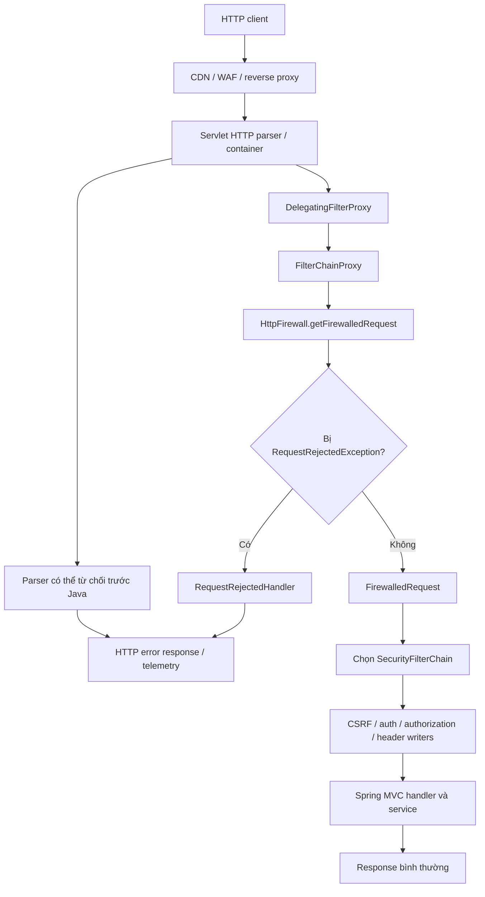

# RequestRejectedException và RequestRejectedHandler

## 1. Bối cảnh: request bị từ chối trước khi ứng dụng xử lý

Trong chương **Firewall trên Servlet** của module **SPRING_SECURITY_HTTP_PROTECTION**, chúng ta đã gặp những lớp phòng vệ HTTP và trình duyệt của Spring Security: HTTP firewall, CSRF, CORS, security headers, CSP, HSTS và bảo vệ session. Trên Servlet stack, `StrictHttpFirewall` giúp từ chối một số request không đạt chính sách về URL, HTTP method, hostname hoặc các thành phần request khác trước khi ứng dụng tiếp tục xử lý.

Giả sử có HTTP request:

```http
GET /admin;debug=1/reports HTTP/1.1
Host: app.example.test
Accept: application/json
```

Dấu chấm phẩy trong path có thể tạo khác biệt về cách Servlet container, reverse proxy, Spring Security matcher và Spring MVC hiểu đường dẫn. Với cấu hình `StrictHttpFirewall` thông dụng, request này có thể bị từ chối **trước khi chọn `SecurityFilterChain`**.

Điều người học cần biết không chỉ là “request bị chặn”, mà là:

1. Spring Security biểu diễn nguyên nhân bằng exception gì?
2. Thành phần nào bắt exception và quyết định response?
3. Mặc định client nhận status gì, và status ấy được tạo ở tầng nào?
4. Làm sao trả thông báo an toàn, ghi nhận sự kiện và kiểm thử mà **không làm lỏng firewall**?
5. Làm thế nào phân biệt rejection của firewall với lỗi authentication, authorization, CSRF, CORS hoặc HTTP parser ở trước Java?

Hai API trung tâm là:

- `org.springframework.security.web.firewall.RequestRejectedException`: exception biểu thị request đã bị firewall từ chối.
- `org.springframework.security.web.firewall.RequestRejectedHandler`: hợp đồng để `FilterChainProxy` xử lý tình huống rejection.

**Thông điệp chính:** xử lý lỗi đẹp hơn không đồng nghĩa **cho request đi qua**. Một `RequestRejectedHandler` phải kết thúc request bị từ chối một cách an toàn; không được tự coi request đã được làm sạch rồi chạy lại business handler.

### Mục tiêu học tập

Hoàn thành bài, bạn có thể:

1. Giải thích vị trí `HttpFirewall` và vòng đời `RequestRejectedException` trong `FilterChainProxy`.
2. Phân biệt `RequestRejectedHandler`, `AuthenticationEntryPoint`, `AccessDeniedHandler`, `ExceptionTranslationFilter` và `@ControllerAdvice`.
3. Hiểu hành vi của `HttpStatusRequestRejectedHandler`, `DefaultRequestRejectedHandler` và `CompositeRequestRejectedHandler`.
4. Cấu hình handler qua `WebSecurityCustomizer`/`WebSecurity.requestRejectedHandler(...)`, không thay sai vị trí bằng filter trong chain.
5. Xây response `400` hoặc JSON lỗi tối giản, tránh lộ raw URI, parameters, tokens và exception message.
6. Ghi metrics/logs an toàn, cân nhắc observation và tránh tăng cardinality do dữ liệu client kiểm soát.
7. Viết unit tests, `FilterChainProxy` tests, MockMvc tests và HTTP integration tests qua container/proxy.
8. Chẩn đoán response `400`/`401`/`403`/`404`/`405` và trường hợp response đã commit.
9. Đối chiếu với Reactive/WebFlux và API `ServerExchangeRejectedHandler`.

## 2. Hai khái niệm: exception và handler

### 2.1. `RequestRejectedException` là gì?

`RequestRejectedException` là một **RuntimeException** của Spring Security Web, được dùng khi `HttpFirewall` từ chối request. Nó không phải `AuthenticationException` và cũng không phải `AccessDeniedException`.

Ví dụ ý nghĩa:

```java
throw new RequestRejectedException(
    "The request was rejected by a firewall rule");
```

Đây là đoạn mô tả cơ chế, **không phải lời khuyên tự ném exception này từ mọi controller khi business validation thất bại**. Với dữ liệu nghiệp vụ không hợp lệ, thường dùng validation/type conversion và HTTP `400` ở tầng MVC; với truy cập trái quyền, để authorization xử lý.

Một `RequestRejectedException` có thể mang thông điệp chứa chi tiết về request bị từ chối. **Không hiển thị nguyên văn `exception.getMessage()` cho client** nếu thông điệp có thể chứa raw URL, parameter, ký tự điều khiển hoặc chuỗi do client gửi.

### 2.2. `RequestRejectedHandler` là gì?

Đây là interface mà `FilterChainProxy` dùng để xử lý exception nêu trên:

```java
public interface RequestRejectedHandler {

    void handle(
        HttpServletRequest request,
        HttpServletResponse response,
        RequestRejectedException exception
    ) throws IOException, ServletException;
}
```

Ví dụ chữ ký dùng `jakarta.servlet.http.*` và `jakarta.servlet.ServletException` trên Spring Security 6.x/7.x. Spring Security 5.x cũ thường dùng `javax.servlet.*`; không sao chép imports giữa hai hệ sinh thái.

Handler nhận:

- **request** gốc liên quan đến rejection;
- **response** mà nó có thể dùng để thông báo lỗi;
- **exception** có thông tin nguyên nhân.

Handler có thể gọi `response.sendError(...)`, tạo một response an toàn, ghi metrics hoặc ném lại exception. Nó **không phải** API để tắt các luật từ chối URL, method hoặc hostname.

### 2.3. Vì sao dùng handler riêng?

Một request bị từ chối trước authentication/authorization không nhất thiết nên được xử lý như “user chưa đăng nhập” (`401`) hay “user thiếu quyền” (`403`). Sự kiện đó mô tả **request không đạt hợp đồng đầu vào của HTTP firewall**.

Một điểm xử lý riêng giúp:

- Client nhận response xác định.
- Không đưa request bất thường tới controller.
- Phân biệt nguyên nhân trong telemetry mà không leak details.
- Có thể thống nhất status với gateway và error page policy.
- Giữ các cơ chế bảo vệ khác đúng trách nhiệm.

## 3. Luồng thực thi của `FilterChainProxy`



Trong source `FilterChainProxy` hiện hành, logic quan trọng là:

1. Nhận `ServletRequest` và `ServletResponse`.
2. Gọi `HttpFirewall.getFirewalledRequest(...)` và `getFirewalledResponse(...)`.
3. Dùng wrapped request để tìm `SecurityFilterChain` khớp.
4. Chạy các security filters rồi chuyển tiếp tới Servlet chain.
5. Khi có exception, phân tích chuỗi nguyên nhân để tìm `RequestRejectedException`.
6. Nếu tìm thấy, gọi `requestRejectedHandler.handle(originalRequest, originalResponse, exception)`.
7. Dọn dẹp security context và filter-applied state theo vòng đời filter.

Chi tiết này lý giải tại sao **lỗi được phát hiện ở bước truy cập header/parameter có thể xảy ra sau khi wrapper được tạo** nhưng vẫn được `FilterChainProxy` xử lý nếu nó truyền exception ngược qua phạm vi mà proxy bắt được.

### 3.1. Vị trí từ chối không phải lúc nào cũng giống nhau

Có ít nhất ba thời điểm:

- **Trước wrapper:** `StrictHttpFirewall` kiểm tra method/path/host và từ chối ngay.
- **Trong lựa chọn chain:** một `RequestMatcher` đọc request qua wrapper và chạm tới dữ liệu không được phép.
- **Khi các filters/handler đọc dữ liệu:** một getter của `FirewalledRequest` phát hiện header/parameter không đạt predicate trong lúc request vẫn đi qua `FilterChainProxy`.

Không được suy rằng mọi `RequestRejectedException` đều ném ở dòng `getFirewalledRequest(...)`. Một số quy tắc header và parameter được kiểm tra **khi dữ liệu được truy cập**, tùy implementation/version.

### 3.2. Nếu HTTP parser từ chối trước `FilterChainProxy` thì sao?

Một request có HTTP request line malformed, Host header không hợp lệ hoặc framing mơ hồ có thể bị NGINX, Tomcat, Jetty hay Undertow từ chối **trước khi có `HttpServletRequest` phù hợp**.

Khi đó:

- `RequestRejectedHandler` của ứng dụng **không được gọi**.
- Backend có thể không có access log cho request đó.
- Status/body/headers do **proxy hoặc container** tạo.
- Response có thể không có CSP/HSTS do Spring Security thêm.

**Không kết luận** cứ thấy public HTTP `400` thì chắc chắn `StrictHttpFirewall` đã chạy.

## 4. Những tình huống nào có thể tạo `RequestRejectedException`?

`StrictHttpFirewall` có nhiều kiểm tra. Tập quy tắc và options cụ thể phải đối chiếu đúng phiên bản Spring Security đang dùng.

| Nhóm kiểm tra | Input minh họa | Điều cần hiểu |
| --- | --- | --- |
| Semicolon trong path | `/admin;v=1/reports` | Mặc định thường bị từ chối để giảm path-parameter ambiguity. |
| Encoded slash | `/files/a%2Fb` | Có thể thay ranh giới path segment sau decoding. |
| Encoded backslash | `/files/a%5Cb` | Có thể gây sai khác giữa HTTP path và filesystem path. |
| Backslash thô | `/files/a\b` | Một số parser/stack xử lý không thống nhất. |
| Double slash/dot segments | `/a//b`, `/a/../b` | Path normalization có thể khác giữa các tầng. |
| Encoded percent | `/files/a%252Fb` | Có thể dẫn tới double decoding. |
| HTTP method không nằm trong allowlist | `TRACE`, method chữ thường không được cấu hình | `StrictHttpFirewall` có method allowlist case-sensitive. |
| Hostname không được cho phép | `attacker.example` với host allowlist | Predicate `setAllowedHostnames` xét `getServerName()`. |
| Header name/value sai predicate | Control characters/Unicode chưa được định nghĩa | Có thể từ chối lúc code đọc header. |
| Parameter name sai predicate | Tên có ký tự điều khiển | Có thể từ chối lúc gọi `getParameter*`. |
| Parameter value sai custom predicate | Chuỗi dài/không thỏa rule do app đặt | Default value predicate thường cho phép mọi value; custom mới siết. |
| Request không đạt rule URL khác | Invalid normalization/encoding theo policy | Container có thể reject trước khi firewall nhìn thấy. |

**Quan trọng:** ví dụ trên là **nhóm nguyên nhân cần điều tra**, không phải cam kết tất cả URL sẽ đi tới cùng exception trên mọi gateway/container. Ngoài ra, một `RequestRejectedException` được ứng dụng tự ném ở nơi khác có thể được `FilterChainProxy` nhận nếu đi ngược qua phạm vi bắt exception; tránh làm điều đó để thay business validation.

### 4.1. Quy tắc firewall khác với lỗi nghiệp vụ

`GET /api/orders?page=abc` có thể vượt firewall nhưng MVC không đổi được `abc` thành `int`. Lỗi ấy thuộc **binding/validation**, không phải nhất thiết `RequestRejectedException`.

`GET /api/orders/42` có thể có URL hoàn toàn hợp lệ nhưng user không có quyền xem order. Lỗi ấy thuộc **authorization**, không phải firewall.

`POST /account` có thể vượt firewall nhưng bị `CsrfFilter` chặn vì thiếu token. Đây là **CSRF**, không phải URL normalization.

## 5. Các handler có sẵn trong Spring Security

Spring Security cung cấp một số implementation của `RequestRejectedHandler`.

| Handler | Hành vi chính | Khi nên dùng |
| --- | --- | --- |
| `HttpStatusRequestRejectedHandler` | Gửi HTTP error status được cấu hình, mặc định `400`. | Phần lớn ứng dụng muốn từ chối bằng status xác định. |
| `DefaultRequestRejectedHandler` | **Ném lại exception** thay vì tự tạo response bình thường. | Khi một lớp xử lý lỗi ở ngoài đã được thiết kế và kiểm chứng có thể xử lý nó. |
| `CompositeRequestRejectedHandler` | Gọi nhiều handlers theo thứ tự. | Ghép ghi metrics/logs với handler cuối tạo response. |
| `ObservationMarkingRequestRejectedHandler` | Phục vụ observation/tracing theo Micrometer Observation. | Khi hệ thống có registry và muốn đánh dấu rejection trong telemetry. |
| Custom `RequestRejectedHandler` | Chủ động tạo JSON/status/telemetry với contract riêng. | API cần error response ổn định và đã có security review. |

### 5.1. `HttpStatusRequestRejectedHandler`

Đây là lựa chọn đơn giản:

```java
import org.springframework.security.web.firewall.HttpStatusRequestRejectedHandler;

var handler = new HttpStatusRequestRejectedHandler();
```

Constructor không tham số dùng **HTTP 400** theo Javadoc. Có thể truyền status:

```java
var handler = new HttpStatusRequestRejectedHandler(400);
```

Nó sử dụng cơ chế gửi lỗi HTTP, không chuyển request bị từ chối thành request hợp lệ. Servlet container có thể sử dụng error page/ERROR dispatch cho `sendError`; vì vậy nội dung body cuối cùng có thể khác giữa môi trường test và production.

### 5.2. `DefaultRequestRejectedHandler`

Tên `DefaultRequestRejectedHandler` dễ gây nhầm. Javadoc mô tả implementation này **ném lại `RequestRejectedException`**.

```java
import org.springframework.security.web.firewall.DefaultRequestRejectedHandler;

var handler = new DefaultRequestRejectedHandler();
```

**Không nhầm:** class tên "Default" **không đồng nghĩa** `FilterChainProxy` hiện đại mặc định chọn class này. Source của `FilterChainProxy` hiện hành khởi tạo `new HttpStatusRequestRejectedHandler()` để đưa response `400`.

Nếu cố dùng `DefaultRequestRejectedHandler` để “giảm log”, exception có thể bị chuyển cho container/error pipeline và thành response khác, thậm chí `500` tùy setup. Không dùng nó nếu chưa có lớp xử lý phía ngoài đáng tin và test đầy đủ.

### 5.3. `CompositeRequestRejectedHandler`

Một handler có thể chỉ đánh dấu telemetry, handler khác tạo response:

```java
import org.springframework.security.web.firewall.CompositeRequestRejectedHandler;
import org.springframework.security.web.firewall.HttpStatusRequestRejectedHandler;
import org.springframework.security.web.firewall.RequestRejectedHandler;

RequestRejectedHandler recordEvent = (request, response, rejection) -> {
    // Không ghi raw URI, headers, cookies hoặc exception message.
    // Ví dụ: increment counter có nhãn cố định.
};

RequestRejectedHandler composite = new CompositeRequestRejectedHandler(
    recordEvent,
    new HttpStatusRequestRejectedHandler(400)
);
```

**Nguyên tắc:** đặt thành phần chỉ ghi nhận trước, thành phần tạo response cuối cùng. Nếu một handler ném exception, chuỗi xử lý có thể dừng trước handler tiếp theo; kiểm tra behavior implementation và test trong dự án.

### 5.4. `ObservationMarkingRequestRejectedHandler`

Một số phiên bản hiện đại có class này nhận `ObservationRegistry` để đánh dấu rejection trong observation hiện tại. Có thể ghép với status handler:

```java
import io.micrometer.observation.ObservationRegistry;
import org.springframework.security.web.firewall.CompositeRequestRejectedHandler;
import org.springframework.security.web.firewall.HttpStatusRequestRejectedHandler;
import org.springframework.security.web.firewall.ObservationMarkingRequestRejectedHandler;
import org.springframework.security.web.firewall.RequestRejectedHandler;

RequestRejectedHandler observedHandler(ObservationRegistry registry) {
    return new CompositeRequestRejectedHandler(
        new ObservationMarkingRequestRejectedHandler(registry),
        new HttpStatusRequestRejectedHandler(400)
    );
}
```

Đây là một **factory method** minh họa; phải tích hợp handler vào `WebSecurity` như phần cấu hình dưới đây. Không coi observation-only handler là một giải pháp hoàn chỉnh để gửi status; muốn client nhận response `400` cần có terminal handler phù hợp. Kiểm tra dependency Micrometer Observation và API đúng Spring Security version.

## 6. Mặc định `FilterChainProxy` tạo HTTP 400

Trong source `FilterChainProxy` hiện hành có ý tưởng:

```java
private HttpFirewall firewall = new StrictHttpFirewall();

private RequestRejectedHandler requestRejectedHandler =
    new HttpStatusRequestRejectedHandler();
```

Do vậy, khi chính `FilterChainProxy` đang sử dụng defaults và request đến được firewall, trường hợp `RequestRejectedException` thông thường tạo **HTTP 400 Bad Request**.

### 6.1. Vì sao không nói "mọi rejection luôn trả 400"?

Có ít nhất các ngoại lệ vận hành:

1. Reverse proxy hoặc HTTP server có thể từ chối **trước Java** với status riêng.
2. Ứng dụng có thể đã cấu hình `RequestRejectedHandler` khác.
3. Error dispatch hoặc container error page có thể quyết định **body/headers** cuối cùng.
4. Client có thể nhận response do CDN/cache/gateway tạo mà backend chưa được gọi.
5. Nếu response đã commit trước khi một exception phát sinh, có thể **không thể thay status**.
6. Một phiên bản Spring Security khác hoặc `FilterChainProxy` được tự cấu hình có thể thay defaults.

Khi tài liệu nói “mặc định `400`”, điều đó phải được hiểu trong phạm vi **`FilterChainProxy` và `HttpStatusRequestRejectedHandler`**, không phải hợp đồng của mọi thành phần trong Internet path.

### 6.2. `sendError(400)` khác `setStatus(400)`

`HttpStatusRequestRejectedHandler` dùng cơ chế gửi lỗi. Một custom handler có thể chỉ đặt status và tự viết body.

- `response.sendError(400)`: kích hoạt xử lý lỗi theo Servlet container; có thể dẫn đến error page hoặc ERROR dispatch.
- `response.setStatus(400)`: đặt status nhưng **không tự yêu cầu Servlet error dispatch**.
- Viết JSON sau `sendError` có thể không hoạt động hoặc bị container thay body.

Không trộn cả hai cách trong một handler một cách ngẫu nhiên. Chọn contract HTTP rõ ràng và test cả response status, content type, body và headers qua Servlet container thật.

### 6.3. Không cố dùng `403` để che `400`

`403 Forbidden` thường có ý nghĩa authorization/CSRF. Với request malformed hoặc bị firewall từ chối, `400 Bad Request` là một lựa chọn hợp lý và có sẵn. Một tổ chức có thể đặt status khác theo chính sách, nhưng phải tránh làm monitoring/client nhầm rằng request thiếu quyền thay vì bị chặn vì định dạng.

**Đừng đổi thành `200`** hoặc redirect tới login cho mọi firewall rejection. Điều đó che tín hiệu bảo mật và tạo behavior khó dự đoán.

## 7. Phân biệt `RequestRejectedHandler` với các handler khác

Bảng dưới đặc biệt quan trọng khi debug lỗi bảo mật:

| Cơ chế | Exception/điều kiện | Vị trí xử lý | Kết quả thường gặp |
| --- | --- | --- | --- |
| `RequestRejectedHandler` | `RequestRejectedException` từ firewall | `FilterChainProxy` | Thường `400`. |
| `AuthenticationEntryPoint` | Chưa xác thực/`AuthenticationException` | `ExceptionTranslationFilter` hoặc authentication mechanism | `401` hoặc redirect login. |
| `AccessDeniedHandler` | `AccessDeniedException` khi có principal nhưng thiếu quyền | `ExceptionTranslationFilter` | Thường `403`. |
| `CsrfFilter` | Token CSRF thiếu/sai trong request cần CSRF | Security filter chain | Thường `403`. |
| CORS processor | Origin/method/headers không phù hợp | CORS filter/integration | Preflight/actual response bị từ chối theo policy. |
| MVC `@ControllerAdvice` | Exceptions được MVC exception resolvers xử lý | Bên trong `DispatcherServlet` | `400`/`404`/`422`/v.v. |
| Servlet HTTP parser | Request line/header/size/framing không hợp lệ | Trước Servlet filters | Status do container chọn. |
| Reverse proxy/WAF | Request bị policy mạng/HTTP từ chối | Trước backend | Status/body do edge tạo. |

### 7.1. `ExceptionTranslationFilter` không phải nơi bắt firewall rejection

`ExceptionTranslationFilter` chuyên xử lý `AuthenticationException` và `AccessDeniedException`. Nó nằm **trong security filter chain** được chọn. Khi `StrictHttpFirewall` từ chối trước chain selection, `ExceptionTranslationFilter` chưa chạy.

Do đó cấu hình:

```java
http.exceptionHandling(ex -> ex
    // authenticationEntryPoint(...)
    // accessDeniedHandler(...)
);
```

không phải cách chuẩn để thay đổi response của `RequestRejectedException`. Cần đặt `RequestRejectedHandler` ở `WebSecurity`/`FilterChainProxy`.

### 7.2. `@RestControllerAdvice` không đáng tin cho rejection trước MVC

Ví dụ:

```java
@RestControllerAdvice
class ApiExceptionAdvice {

    @ExceptionHandler(Exception.class)
    // ...
}
```

Chỉ có thể xử lý exceptions đã đến phạm vi MVC exception resolving. Request bị firewall từ chối **trước `DispatcherServlet`** sẽ không được `@ControllerAdvice` xử lý như một controller exception thông thường.

Nếu API muốn có JSON error response nhất quán cho firewall rejection, cấu hình `RequestRejectedHandler` trực tiếp là rõ ràng hơn. Đừng tạo một `@ExceptionHandler(RequestRejectedException.class)` rồi kỳ vọng nó bắt mọi lỗi từ `StrictHttpFirewall`.

### 7.3. `OncePerRequestFilter` không tự thay thế rejection handler

Một filter thêm bằng `HttpSecurity.addFilterBefore(...)` nằm **bên trong chain đã được lựa chọn**, còn `HttpFirewall` kiểm tra trước khi chọn chain.

Nếu custom filter muốn catch exception từ firewall, nó có thể không bao quanh đúng phạm vi xử lý. Đừng “chữa lỗi” bằng cách quấn toàn bộ pipeline trong một filter tự chế nếu mục tiêu chỉ là custom response từ `RequestRejectedException`.

## 8. Cấu hình `RequestRejectedHandler` qua `WebSecurityCustomizer`

Spring Security Servlet cho phép tùy chỉnh `WebSecurity`, ví dụ:

```java
import org.springframework.context.annotation.Bean;
import org.springframework.context.annotation.Configuration;
import org.springframework.security.config.annotation.web.configuration.WebSecurityCustomizer;
import org.springframework.security.web.firewall.HttpStatusRequestRejectedHandler;

@Configuration
class RejectionResponseConfiguration {

    @Bean
    WebSecurityCustomizer rejectedRequestCustomizer() {
        return web -> web.requestRejectedHandler(
            new HttpStatusRequestRejectedHandler(400));
    }
}
```

`WebSecurity.requestRejectedHandler(...)` có trong các bản Spring Security hiện đại (từ 5.7 theo Javadoc). Cách này cấu hình handler cho `FilterChainProxy` được Spring Security xây dựng, thay vì tạo một filter độc lập sau chain selection.

**Cần lưu ý:**

- Cấu hình chỉ status 400 ở đây thường **không cần thiết** nếu defaults đã đúng.
- Đặt vào project khi cần khai báo policy rõ ràng hoặc chuẩn bị ghép telemetry/custom response.
- Không đăng ký nhiều `WebSecurityCustomizer` tùy chỉnh cùng handler theo những quyết định mâu thuẫn.
- Xác nhận đúng `FilterChainProxy` runtime đang nhận handler, nhất là dự án có nhiều application contexts.
- Nếu Spring Security version không có API này, đối chiếu Javadoc đúng version thay vì sao chép tùy tiện.

### 8.1. Tránh dùng `@Bean RequestRejectedHandler` rồi cho rằng auto-wire

Không được mặc định suy rằng việc khai báo:

```java
@Bean
RequestRejectedHandler requestRejectedHandler() { ... }
```

tự làm `FilterChainProxy` thay handler. Một object bean có thể tồn tại nhưng chưa được đưa vào `WebSecurity`/`FilterChainProxy` nếu cấu hình không kết nối nó.

Đặt cấu hình một cách tường minh qua `WebSecurityCustomizer` hoặc API integration được dự án hỗ trợ, sau đó **test response end-to-end**.

### 8.2. Can thiệp trực tiếp `FilterChainProxy#setRequestRejectedHandler`

API này tồn tại:

```java
filterChainProxy.setRequestRejectedHandler(handler);
```

Nhưng ở ứng dụng Spring Boot/Spring Security điển hình, **không nên tự tạo thêm một `FilterChainProxy` mới** chỉ để gọi setter, vì bạn có thể phá security chain, filter order và integration hiện hành.

Dùng `WebSecurityCustomizer` là đường đi thường dễ quản lý hơn. Chỉ cấu hình trực tiếp proxy khi framework/integration architecture **thật sự kiểm soát vòng đời FilterChainProxy** và có test nghiêm ngặt.

## 9. Custom handler trả JSON tối giản

Một API có thể muốn response lỗi JSON nhất quán:

```json
{
  "type": "about:blank",
  "title": "Bad Request",
  "status": 400,
  "detail": "The request was rejected."
}
```

Nội dung không bao gồm raw URL, method, header, token hay lời nhắn exception. Nó giúp client biết request không được chấp nhận mà **không phơi bày chính sách firewall nội bộ**.

### 9.1. Implementation Servlet

```java
import java.io.IOException;
import java.nio.charset.StandardCharsets;

import jakarta.servlet.http.HttpServletRequest;
import jakarta.servlet.http.HttpServletResponse;

import org.springframework.security.web.firewall.RequestRejectedException;
import org.springframework.security.web.firewall.RequestRejectedHandler;

public final class SafeJsonRequestRejectedHandler
        implements RequestRejectedHandler {

    private static final String BODY = """
        {
          "type": "about:blank",
          "title": "Bad Request",
          "status": 400,
          "detail": "The request was rejected."
        }
        """;

    @Override
    public void handle(
            HttpServletRequest request,
            HttpServletResponse response,
            RequestRejectedException exception) throws IOException {

        if (response.isCommitted()) {
            // Không thể bảo đảm thay đổi status/body sau commit.
            // Ghi nhận telemetry đã làm sạch tại tầng vận hành nếu cần.
            return;
        }

        response.setStatus(HttpServletResponse.SC_BAD_REQUEST);
        response.setCharacterEncoding(StandardCharsets.UTF_8.name());
        response.setContentType("application/problem+json");
        response.setHeader("Cache-Control", "no-store");
        response.getWriter().write(BODY);
    }
}
```

Giả định Java 17+ (text blocks), Jakarta Servlet/Spring Security 6.x+. `application/problem+json` là media type cho Problem Details; mẫu sử dụng các fields cơ bản để minh họa, không phụ thuộc vào một Spring MVC controller.

### 9.2. Đăng ký custom handler

```java
import org.springframework.context.annotation.Bean;
import org.springframework.context.annotation.Configuration;
import org.springframework.security.config.annotation.web.configuration.WebSecurityCustomizer;

@Configuration
class SafeRejectionHandlerConfiguration {

    @Bean
    WebSecurityCustomizer customRejectedRequestHandler() {
        return web -> web.requestRejectedHandler(
            new SafeJsonRequestRejectedHandler());
    }
}
```

Ví dụ này là **một lựa chọn thay cho config ở mục 8**, không đăng ký cả hai để xử lý cạnh tranh.

### 9.3. Vì sao kiểm tra `response.isCommitted()`?

Thông thường firewall từ chối trước khi response được ghi. Nhưng nếu một header/parameter getter phát sinh rejection trong lúc downstream code đã ghi response, có thể tồn tại tình huống status/body **đã commit**.

Một handler cố `sendError` hoặc `setStatus` sau commit có thể gây exception thứ cấp hoặc không sửa được response. Quy trình tốt:

- Tránh ghi response trước khi xác thực input quan trọng.
- Làm validation/authorization trước khi streaming data.
- Trong handler kiểm tra commit state trước khi thay response.
- Ghi nhận sự kiện đã vệ sinh, nhưng không tuyên bố client đã nhận `400` nếu response đã commit.
- Thiết kế streaming/SSE/WebSocket upgrade với ranh giới riêng.

### 9.4. Vì sao không trả stack trace và exception message?

Anti-pattern:

```java
// KHÔNG gửi raw details cho client.
response.getWriter().write(exception.getMessage());
```

Một số exception messages có thể chứa đường dẫn hoặc giá trị đầu vào do client kiểm soát. Việc phản chiếu chúng có thể tạo log injection, thông tin hệ thống bị lộ hoặc làm client phụ thuộc vào chi tiết implementation.

Sử dụng message cố định trong response; giữ thông tin có ích để debug trong logs nội bộ **sau khi đã giảm thiểu dữ liệu và escaping**.

## 10. Xử lý status-only: thường đơn giản hơn JSON

Với API nội bộ hoặc ứng dụng không yêu cầu body, một response `400` tối giản có lợi:

- Không có logic serialization phức tạp.
- Không phản chiếu dữ liệu không đáng tin.
- Dễ test/monitor.
- Ít khả năng đưa thông tin nhạy cảm vào response.
- Giữ hành vi gần defaults của Spring Security.

```java
RequestRejectedHandler handler =
    new HttpStatusRequestRejectedHandler(400);
```

Với `sendError`, body có thể do Servlet container tạo. Nếu production yêu cầu body/error page thống nhất, cần test qua container và gateway; không tự gán body của JUnit mock giống body thực.

### 10.1. JSON có làm response an toàn hơn không?

Không mặc nhiên. Một custom JSON handler sai có thể:

- In exception details.
- Tạo CORS headers sai và phản chiếu `Origin`.
- Ghi log raw URI/query.
- Trả nhầm `200`.
- Bỏ `Cache-Control: no-store` cho error chứa dữ liệu.
- Thêm CSP/HSTS trùng/mâu thuẫn với gateway.
- Gây lỗi thứ cấp khi response đã commit.

**Ưu tiên default** nếu không có contract error response chính đáng.

## 11. Kết hợp telemetry và status bằng composite handler

Trong production, bạn có thể cần đếm request bị từ chối để biết khi nào rule mới gây false positives hoặc có lưu lượng bất thường.

Ví dụ ghi metrics ở mức khái niệm:

```java
import org.springframework.security.web.firewall.CompositeRequestRejectedHandler;
import org.springframework.security.web.firewall.HttpStatusRequestRejectedHandler;
import org.springframework.security.web.firewall.RequestRejectedHandler;

RequestRejectedHandler telemetry = (request, response, exception) -> {
    // Increment counter với nhãn cố định:
    // event="firewall_rejected", service="http-protection"
    // KHÔNG gắn raw URI/query/header/token thành metric tags.
};

RequestRejectedHandler handler =
    new CompositeRequestRejectedHandler(
        telemetry,
        new HttpStatusRequestRejectedHandler(400));
```

### 11.1. Thứ tự handlers có ý nghĩa

Thành phần ghi nhận trước, thành phần gửi response sau. Nếu telemetry handler ném exception, status handler có thể không được chạy. Vì vậy telemetry code phải:

- Ngắn, nhanh và đáng tin cậy.
- Không thực hiện external network call đồng bộ trên mỗi request.
- Không throw vì một missing request attribute.
- Dùng bounded labels, tránh high-cardinality.
- Không log body/header/parameter secrets.

Nếu metric exporter bị lỗi, request vẫn cần được xử lý theo **security response policy**. Có thể cân nhắc catch lỗi telemetry cụ thể trong đoạn code này để không làm ngắt xử lý; nhưng không catch và nuốt `RequestRejectedException` ở nơi khiến request đi tiếp vào business logic.

### 11.2. Dùng observation khi ứng dụng có Micrometer

`ObservationMarkingRequestRejectedHandler` là một lựa chọn có sẵn. Nó không thay thế logging/auditing và **không nên được mặc định xem là handler đã tạo HTTP error response**.

Khi ghép:

```java
new CompositeRequestRejectedHandler(
    new ObservationMarkingRequestRejectedHandler(registry),
    new HttpStatusRequestRejectedHandler(400));
```

hãy kiểm tra có ObservationRegistry phù hợp, observation hiện tại có được tạo hay không, và metric/tracing pipeline đã phát tín hiệu theo kỳ vọng trong integration tests.

## 12. Logging request bị firewall từ chối mà không tự tạo lỗ hổng

### 12.1. Vì sao không log toàn bộ URI?

Request-target, query và headers **do client kiểm soát**. Một chuỗi có CRLF, Unicode control chars, percent encoding bất thường hoặc secret có thể gây:

- Log injection/giả mạo dòng log.
- Rò rỉ credentials/session tokens.
- Tăng kích thước log rất nhanh do scanning/bots.
- Lộ thông tin cá nhân trong truy vấn.
- Dễ tăng cardinality nếu dùng raw URL như nhãn metrics.

Ví dụ anti-pattern:

```java
// KHÔNG dùng ở handler production.
logger.warn("Rejected " + request.getRequestURI()
    + ": " + exception.getMessage());
```

**Không bao giờ ghi raw `Authorization`, `Cookie`, CSRF tokens, OAuth codes hoặc toàn bộ parameter map** khi debug firewall rejection.

### 12.2. Log tối thiểu

Một cách đơn giản có thể chỉ ghi:

```java
// Ví dụ ở mức khái niệm:
logger.debug("HTTP request rejected by servlet firewall");
```

Nếu cần correlation ID, lấy từ nguồn **do edge/server tạo** hoặc tạo server-side UUID; không phản chiếu một giá trị client kiểm soát chưa validate. Nếu log method, giới hạn và escape ký tự bất thường.

### 12.3. Không dùng severity WARN cho mỗi bot request

Trên ứng dụng public, scanners và clients lỗi có thể tạo lượng lớn `RequestRejectedException`. Ghi stack trace cho mỗi request tại WARN/ERROR có thể làm log overload và che các sự cố thật.

Khuyến nghị thực dụng:

- Counter tổng với low-cardinality labels.
- Sampling cho request debug logs.
- Alert theo biến động/rejection ratio hoặc sustained spikes có ngữ cảnh.
- Tách 4xx do client input khỏi 5xx server failures.
- Không log sensitive payload chỉ để tăng khả năng truy vết.
- Kết hợp ingress/WAF telemetry khi request không tới Java.

Không áp một threshold tùy ý cho mọi dịch vụ; baseline phụ thuộc traffic, clients và release cycle.

### 12.4. Classification phải bảo thủ

Một số teams muốn gắn label `reason=encoded_slash`, `reason=semicolon`. Nếu classify bằng cách so chuỗi `exception.getMessage()`, code có thể dễ gãy khi framework thay message và có nguy cơ chứa raw input.

Ưu tiên:

- Nhãn cố định `reason=firewall_rejected` nếu không có structured reason API đáng tin.
- Hoặc phân loại ở tầng kiểm tra do bạn thực sự sở hữu và có test riêng.
- Giới hạn tập label values từ **enum server-side**.
- Không lấy raw URL/header làm tag.

## 13. Rejection có liên quan response security headers thế nào?

Các response headers như `Content-Security-Policy`, `Strict-Transport-Security`, `X-Frame-Options` và `X-Content-Type-Options` thường được cấu hình trong Spring Security hoặc reverse proxy. Nhưng request có thể bị firewall từ chối **trước khi `HeaderWriterFilter` chạy**.

Hệ quả:

- Response `400` do `HttpStatusRequestRejectedHandler` tạo có thể không có security headers do chain thêm.
- Response `400` do NGINX/Servlet parser tạo càng không đi qua backend header writers.
- Một custom handler có thể đặt một số headers tối thiểu, nhưng phải tránh duplication/conflict.
- HSTS chỉ có ý nghĩa qua HTTPS và cần owner rõ ràng ở TLS termination layer.
- CSP trong error page HTML nên tương thích với error body; không gắn CSP tùy tiện để che lỗi request handling.

### 13.1. Chọn owner cho error response headers

| Tầng tạo error | Ai nên sở hữu headers? |
| --- | --- |
| CDN/WAF/ingress `400` | Edge/ingress policy. |
| Servlet HTTP parser `400` trước Spring Security | Container hoặc edge bên ngoài. |
| `RequestRejectedHandler` tạo `400` | Handler hoặc một response policy nằm ngoài security chain. |
| Controller/MVC tạo `400` | Spring Security header writer và app response policy. |
| Auth/authorization tạo `401`/`403` bên trong chain | Security chain và relevant handler. |

Nếu có proxy thêm baseline headers cho mọi response, **không mặc định thêm cùng header ở nhiều nơi**; kiểm tra response cuối qua public endpoint.

### 13.2. CORS trên request bị từ chối

Một browser cross-origin có thể hiển thị “CORS error” thay vì cho JavaScript đọc body `400` nếu response không có `Access-Control-Allow-Origin` phù hợp.

Điều này **không** có nghĩa firewall nên phản chiếu bất kỳ `Origin` nào vào response. `RequestRejectedHandler` không thay CORS policy. Với một request malformed, việc trả generic `400` mà JavaScript không đọc được error details có thể phù hợp security design.

## 14. Lazy header/parameter checks và exception muộn

Trong nhiều phiên bản `StrictHttpFirewall`, checks cho một số HTTP headers và request parameters nằm trong methods của `FirewalledRequest`.

Ví dụ:

```java
FirewalledRequest safe =
    firewall.getFirewalledRequest(request);

// Header chưa chắc đã được duyệt toàn bộ ở dòng trên.
String value = safe.getHeader("X-Request-Id");

// Getter này có thể ném RequestRejectedException
// nếu tên/giá trị chạm tới predicate từ chối.
```

### 14.1. Nếu exception xảy ra lúc security matcher đọc header?

`FilterChainProxy` vẫn đang trong phạm vi chain-selection; handler có thể nhận rejection qua đường xử lý exception của proxy.

### 14.2. Nếu exception xảy ra trong Servlet filter?

Nếu filter đang được gọi **thông qua `FilterChainProxy`**, exception đi ngược ra proxy có thể được nhận diện và chuyển cho `RequestRejectedHandler`. Source hiện hành dò `RequestRejectedException` trong cause chain của exception phát sinh.

Không tuyên bố mọi exception ở mọi filter đều được xử lý như firewall rejection. `ExceptionTranslationFilter` chỉ xử lý các loại exception đặc thù; `FilterChainProxy` không biến toàn bộ runtime exceptions thành `400`.

### 14.3. Nếu exception xảy ra sau response commit?

Response có thể đã gửi một phần bytes tới client. `RequestRejectedHandler` không thể bảo đảm đổi toàn bộ response thành `400`. Đây là lý do validation trước streaming là một yêu cầu quan trọng với endpoints xuất dữ liệu lớn.

### 14.4. Nếu code tự tạo response rồi tiếp tục chain?

Không gọi lại `chain.doFilter` từ rejection handler chỉ vì muốn “fallback”. Request đã bị từ chối vì một lý do bảo mật; chạy tiếp chain có thể bỏ qua quyết định firewall và làm lệch security context.

## 15. Unit test: direct `StrictHttpFirewall` và `RequestRejectedException`

Unit test đầu tiên kiểm tra hợp đồng **firewall**. Nó không cần MVC hay HTTP server thật.

```java
import org.junit.jupiter.api.Test;
import org.springframework.mock.web.MockHttpServletRequest;
import org.springframework.security.web.firewall.RequestRejectedException;
import org.springframework.security.web.firewall.StrictHttpFirewall;

import static org.junit.jupiter.api.Assertions.assertDoesNotThrow;
import static org.junit.jupiter.api.Assertions.assertThrows;

class RequestRejectedExceptionUnitTest {

    private MockHttpServletRequest request(String method, String path) {
        var request = new MockHttpServletRequest(method, path);
        request.setServletPath(path);
        return request;
    }

    @Test
    void strictFirewallRejectsTraceMethod() {
        var firewall = new StrictHttpFirewall();

        assertThrows(RequestRejectedException.class, () ->
            firewall.getFirewalledRequest(
                request("TRACE", "/health")));
    }

    @Test
    void strictFirewallAcceptsNormalGetRequest() {
        var firewall = new StrictHttpFirewall();

        var safe = assertDoesNotThrow(() ->
            firewall.getFirewalledRequest(
                request("GET", "/health")));

        safe.reset();
    }
}
```

Dùng `TRACE` là một cách test **method allowlist** trong mock, không cần gửi một HTTP TRACE request thực qua proxy. `StrictHttpFirewall` mặc định không cho phép TRACE; các container có thể chặn nó sớm hơn trong on-wire tests.

### 15.1. Phân biệt direct exception với HTTP response

`getFirewalledRequest(...)` là một API kiểm tra request/wrapper. Nó không có `HttpServletResponse` để tự gửi status. Vì vậy:

- Unit test direct firewall: `assertThrows(RequestRejectedException.class, ...)`.
- Unit test handler: kiểm tra nó làm gì với `MockHttpServletResponse`.
- FilterChainProxy/MockMvc: kiểm tra handler có được nối đúng không.
- HTTP integration: kiểm tra status/body/headers qua parser + proxy.

Đừng đổi unit test direct firewall thành `andExpect(status().isBadRequest())` khi chưa có HTTP pipeline/handler.

## 16. Unit test `HttpStatusRequestRejectedHandler` và `DefaultRequestRejectedHandler`

### 16.1. Status handler trả `400`

```java
import org.junit.jupiter.api.Test;
import org.springframework.mock.web.MockHttpServletRequest;
import org.springframework.mock.web.MockHttpServletResponse;
import org.springframework.security.web.firewall.HttpStatusRequestRejectedHandler;
import org.springframework.security.web.firewall.RequestRejectedException;

import static org.junit.jupiter.api.Assertions.assertEquals;

class HttpStatusRejectedHandlerTest {

    @Test
    void usesBadRequestByDefault() throws Exception {
        var handler = new HttpStatusRequestRejectedHandler();
        var request = new MockHttpServletRequest("GET", "/health");
        var response = new MockHttpServletResponse();

        handler.handle(
            request,
            response,
            new RequestRejectedException("synthetic rejection"));

        assertEquals(400, response.getStatus());
    }
}
```

Test trên dùng exception tổng hợp, không cần tạo URI bất thường. Nó chứng minh **handler được gọi trực tiếp với request/response mock** và tạo status `400` theo Javadoc. Body/error page có thể khác trên Servlet container thật.

### 16.2. Handler ném lại exception

```java
import org.junit.jupiter.api.Test;
import org.springframework.mock.web.MockHttpServletRequest;
import org.springframework.mock.web.MockHttpServletResponse;
import org.springframework.security.web.firewall.DefaultRequestRejectedHandler;
import org.springframework.security.web.firewall.RequestRejectedException;

import static org.junit.jupiter.api.Assertions.assertThrows;

class RethrowingRejectedHandlerTest {

    @Test
    void rethrowsInsteadOfSendingStatus() {
        var handler = new DefaultRequestRejectedHandler();
        var request = new MockHttpServletRequest("GET", "/health");
        var response = new MockHttpServletResponse();
        var rejection =
            new RequestRejectedException("synthetic rejection");

        assertThrows(RequestRejectedException.class, () ->
            handler.handle(request, response, rejection));
    }
}
```

Đây là lý do không nên chọn `DefaultRequestRejectedHandler` chỉ vì tên “Default”: response cuối tùy lớp bên ngoài bắt exception.

## 17. Test `FilterChainProxy`: firewall và handler thực sự phối hợp

Đoạn test sau dùng `FilterChainProxy` trực tiếp để chứng minh:

1. TRACE bị `StrictHttpFirewall` từ chối.
2. `HttpStatusRequestRejectedHandler` tạo status `400`.
3. Servlet chain phía sau không được gọi.

```java
import java.util.concurrent.atomic.AtomicBoolean;

import org.junit.jupiter.api.Test;
import org.springframework.mock.web.MockHttpServletRequest;
import org.springframework.mock.web.MockHttpServletResponse;
import org.springframework.security.web.DefaultSecurityFilterChain;
import org.springframework.security.web.FilterChainProxy;
import org.springframework.security.web.firewall.HttpStatusRequestRejectedHandler;
import org.springframework.security.web.util.matcher.AnyRequestMatcher;

import static org.junit.jupiter.api.Assertions.assertEquals;
import static org.junit.jupiter.api.Assertions.assertFalse;

class FilterChainProxyRejectionTest {

    @Test
    void rejectedTraceDoesNotReachServletChain() throws Exception {
        // Một security chain trống chỉ dùng để cô lập behavior
        // FilterChainProxy/firewall trong test này.
        var securityChain =
            new DefaultSecurityFilterChain(AnyRequestMatcher.INSTANCE);

        var proxy = new FilterChainProxy(securityChain);
        proxy.setRequestRejectedHandler(
            new HttpStatusRequestRejectedHandler(400));

        var request =
            new MockHttpServletRequest("TRACE", "/health");
        request.setServletPath("/health");

        var response = new MockHttpServletResponse();
        var downstreamReached = new AtomicBoolean(false);

        proxy.doFilter(request, response, (req, res) ->
            downstreamReached.set(true));

        assertEquals(400, response.getStatus());
        assertFalse(downstreamReached.get());
    }
}
```

**Giới hạn:** đây là unit-style test với `MockHttpServletRequest`, không chạy MVC controller, CORS, CSRF hoặc HTTP parser. Constructor của `DefaultSecurityFilterChain` nhận matcher và filters varargs; ở đây danh sách filters rỗng **có chủ đích để kiểm tra riêng đường rejection**. Không lấy một security chain rỗng như cấu hình production.

### 17.1. Test request hợp lệ vẫn đi tiếp

Trong cùng test class, có thể kiểm tra `GET /health`:

```java
@Test
void normalGetCanReachServletChain() throws Exception {
    var proxy = new FilterChainProxy(
        new DefaultSecurityFilterChain(AnyRequestMatcher.INSTANCE));

    var request = new MockHttpServletRequest("GET", "/health");
    request.setServletPath("/health");

    var response = new MockHttpServletResponse();
    var downstreamReached = new AtomicBoolean(false);

    proxy.doFilter(request, response, (req, res) ->
        downstreamReached.set(true));

    assertEquals(200, response.getStatus());
    assertTrue(downstreamReached.get());
}
```

Thêm import `assertTrue` khi đặt trong class. Test dương tính giúp phát hiện một custom handler/filter vô tình chặn mọi request.

## 18. MockMvc: kiểm tra response trong Spring Boot Servlet app

Một ứng dụng demo có controller:

```java
import org.springframework.web.bind.annotation.GetMapping;
import org.springframework.web.bind.annotation.RestController;

@RestController
class HealthController {

    @GetMapping("/health")
    String health() {
        return "ok";
    }
}
```

Và security chain:

```java
import org.springframework.context.annotation.Bean;
import org.springframework.context.annotation.Configuration;
import org.springframework.security.config.annotation.web.builders.HttpSecurity;
import org.springframework.security.web.SecurityFilterChain;

@Configuration
class RejectionDemoSecurityConfig {

    @Bean
    SecurityFilterChain securityChain(HttpSecurity http)
            throws Exception {

        http.authorizeHttpRequests(auth -> auth
            .requestMatchers("/health").permitAll()
            .anyRequest().authenticated());

        return http.build();
    }
}
```

### 18.1. Test HTTP 400 từ `RequestRejectedHandler`

```java
import org.junit.jupiter.api.Test;
import org.springframework.beans.factory.annotation.Autowired;
import org.springframework.boot.test.autoconfigure.web.servlet.AutoConfigureMockMvc;
import org.springframework.boot.test.context.SpringBootTest;
import org.springframework.http.HttpMethod;
import org.springframework.test.web.servlet.MockMvc;

import static org.springframework.test.web.servlet.request.MockMvcRequestBuilders.get;
import static org.springframework.test.web.servlet.request.MockMvcRequestBuilders.request;
import static org.springframework.test.web.servlet.result.MockMvcResultMatchers.content;
import static org.springframework.test.web.servlet.result.MockMvcResultMatchers.status;

@SpringBootTest
@AutoConfigureMockMvc
class RequestRejectedMockMvcTest {

    @Autowired MockMvc mvc;

    @Test
    void traceRejectedByDefaultFirewall() throws Exception {
        mvc.perform(request(HttpMethod.TRACE, "/health"))
            .andExpect(status().isBadRequest());
    }

    @Test
    void normalGetStillWorks() throws Exception {
        mvc.perform(get("/health"))
            .andExpect(status().isOk())
            .andExpect(content().string("ok"));
    }
}
```

Test giả định `FilterChainProxy` đang dùng **default `StrictHttpFirewall` và handler `400`**, hoặc tương đương được cấu hình. Nếu dự án có custom handler trả status khác hoặc bắt/throw exception ở tầng khác, assertion phải theo contract thực sự.

Với Spring Boot 4.x hoặc version test mới hơn, vị trí package của `@AutoConfigureMockMvc` có thể khác. Kiểm tra dependencies hiện hành; không sao chép imports của Boot 3.x rồi cho rằng mọi version đều giống.

### 18.2. Test JSON error response của custom handler

Nếu cấu hình `SafeJsonRequestRejectedHandler` ở mục 9, có thể kiểm tra:

```java
mvc.perform(request(HttpMethod.TRACE, "/health"))
    .andExpect(status().isBadRequest())
    .andExpect(content().contentTypeCompatibleWith(
        "application/problem+json"))
    .andExpect(jsonPath("$.status").value(400))
    .andExpect(jsonPath("$.title").value("Bad Request"));
```

Đây là đoạn **thêm vào class test có `MockMvc mvc`**, cần static imports `jsonPath` và `content`, và chỉ hợp lệ nếu custom handler đã được cài đúng. Không bật cả status-only handler và JSON handler cạnh tranh trong cùng context.

### 18.3. Test auth không nên bị nhầm với firewall

`GET /admin` từ anonymous có thể trả `401`/redirect login theo authentication mechanism. Đó là request hợp lệ về mặt HTTP nhưng **chưa được xác thực**.

Không cố bắt mọi `401` hoặc `403` bằng `RequestRejectedHandler`, và cũng không sử dụng handler này để “bỏ qua” CSRF failures. Tạo tests riêng cho authentication entry point, access denied và CSRF.

## 19. Kiểm thử thông qua Servlet container và reverse proxy

Một HTTP request có thể được từ chối ở nhiều tầng:

```text
Browser / curl
   |
   v
CDN / WAF / Reverse proxy
   |
   v
Tomcat / Jetty / Undertow parser
   |
   v
FilterChainProxy -> StrictHttpFirewall -> RequestRejectedHandler
   |
   v
SecurityFilterChain -> DispatcherServlet -> Controller
```

### 19.1. Baseline request hợp lệ

```bash
# Chỉ dùng staging hoặc hệ thống được phép kiểm thử.
curl -sS -D - -o /dev/null \
  'https://staging.example.test/health'
```

Xác minh service health, response headers và routing đúng **trước khi** thử các request bất thường.

### 19.2. Một request có semicolon trên staging

```bash
curl -sS -D - -o /dev/null \
  'https://staging.example.test/health;debug=1'
```

Trong cấu hình strict phổ biến, request có semicolon trong path có thể bị từ chối. Tuy nhiên response `400` có thể do ingress/HTTP parser hoặc Spring Security tạo; cần kiểm tra logs/correlation IDs để xác định.

### 19.3. Kiểm thử HTTP TRACE nên có phạm vi cho phép

Nếu muốn xác minh method allowlist, một request TRACE **duy nhất** trên staging thuộc quyền kiểm thử có thể dùng:

```bash
curl --http1.1 -sS -D - -o /dev/null \
  -X TRACE 'https://staging.example.test/health'
```

Đừng gửi một tập lớn malformed requests hoặc payloads đến production/hệ thống bên thứ ba chưa cho phép. Nhiều HTTP servers đã chặn TRACE trước ứng dụng; không coi đó là lỗi test nếu backend không thấy request.

### 19.4. So gateway và backend

Nếu backend nội bộ được phép truy cập, so status và logs giữa public URL với backend direct **sau khi điều chỉnh host/context path/forwarded scheme cho tương đương**.

Ví dụ public trả `400` nhưng backend không có request log: ưu tiên kiểm tra ingress/parser. Nếu backend có `RequestRejectedException`: xem firewall rule và handler đã cấu hình. Nếu client nhận body JSON khác ở public: CDN/gateway có thể thay response hoặc cache error.

### 19.5. Dùng `--path-as-is` khi cần quan sát dot-segments

Một số clients normalize dot-segments trước khi gửi. Trên staging có quyền, `curl --path-as-is` giúp kiểm tra request-target gần hơn với chuỗi đã nhập; nó không bảo đảm gateway/container giữ nguyên.

```bash
curl --path-as-is -sS -D - -o /dev/null \
  'https://staging.example.test/public/../admin'
```

Nếu HTTP parser hoặc ingress tự normalize/từ chối, `RequestRejectedHandler` chưa chắc chạy. **Không suy từ command line rằng Java chắc chắn nhìn thấy chuỗi nguyên văn**.

## 20. Chẩn đoán `400`, `401`, `403`, `404`, `405` và `500`

| Triệu chứng | Nguyên nhân cần phân biệt | Bước kiểm tra |
| --- | --- | --- |
| `400`, log ghi `RequestRejectedException` | `HttpFirewall`/`FirewalledRequest` | Xem rule, handler và request path/method được sanitize. |
| `400`, backend không có log | Edge/HTTP parser | Kiểm tra ingress, request line và connector. |
| `400`, MVC validation exception | Invalid data binding/parameters | Kiểm tra controller/DTO/Bean Validation. |
| `401`, `WWW-Authenticate` hoặc login redirect | Authentication | Kiểm tra auth entry point, không sửa firewall. |
| `403`, authenticated nhưng thiếu role | Authorization | Kiểm tra `AccessDeniedHandler` và resource-level permission. |
| `403` với POST cookie session | CSRF token thiếu/sai | Xem `CsrfFilter`/token repository. |
| `403` với CORS preflight | CORS policy hoặc auth ordering | Kiểm tra OPTIONS/Origin/method/headers. |
| `404` | Không có handler hoặc proxy rewrite sai | Kiểm tra routing, chưa kết luận firewall. |
| `405` | Handler không hỗ trợ HTTP method | Kiểm tra MVC method mapping/`Allow` header. |
| `500` sau khi đặt rethrow handler | Exception nổi lên outer error handling | Kiểm tra `DefaultRequestRejectedHandler` và container error pipeline. |
| `502`/`503` | Gateway/upstream | Xem backend có nhận request không. |
| `400` không có CSP/HSTS | Response sinh trước header writers | Kiểm tra edge/container/error handler owner. |
| JSON error bị lộ raw URI/token | Custom handler/logging sai | Trả body cố định, loại dữ liệu nhạy cảm. |
| Lỗi khác nhau giữa MockMvc và HTTP thật | Mock bỏ qua HTTP parser/proxy | Test bằng container thực trong staging. |
| Response đã commit, handler không đổi status | Rejection phát sinh muộn | Kiểm tra streaming/validation order. |

### 20.1. Quy trình xác minh bảy bước

1. Xác nhận HTTP request-target, method, headers và môi trường **được phép kiểm thử**.
2. Xác định request có được gateway forward và Servlet container parse thành `HttpServletRequest` hay không.
3. Xác định `FilterChainProxy` runtime đang dùng `StrictHttpFirewall`/handler nào.
4. Phân biệt exception phát sinh **trước chain selection** hay trong một getter/filter downstream.
5. Xác định request đã qua authentication/CSRF/authorization/MVC hay chưa.
6. Kiểm tra status, body, response headers và logging do tầng nào sinh.
7. Chọn thay đổi nhỏ nhất: sửa client/proxy URL, sửa policy đã có review hoặc sửa error handler — **không nới firewall chỉ để làm HTTP 400 biến mất**.

## 21. Một vài tình huống cần cân nhắc khi vận hành

### 21.1. Scanner tạo nhiều rejection

Một web-facing service có thể bị bots thử `TRACE`, encoded slash, semicolon và URL không chuẩn. Đây là lý do metrics có giá trị, nhưng không nên biến mỗi request từ chối thành một ERROR stack trace.

Tạo alert theo biến động có ý nghĩa và phối hợp WAF/rate limits. Một lượng rejection nhất định có thể là tín hiệu **firewall hoạt động đúng**, không phải service outage.

### 21.2. False positive sau khi nâng Spring Security

Một client cũ có URL chứa path parameter hoặc HTTP method ngoài allowlist, deployment mới trả `400`. Quy trình đúng:

- Xác nhận hành vi cũ và client contract.
- Tìm URL thay thế an toàn nếu có thể.
- Đánh giá từng `StrictHttpFirewall#setAllow...` theo threat model.
- Không bật hàng loạt encoded slash/backslash/semicolon/unsafe methods.
- Tạo regression tests cho cả route công khai và routes nhạy cảm.
- Chỉ thay response handler nếu **mục tiêu là response format**, không phải thay quyết định accept/reject.

### 21.3. Nhiều `SecurityFilterChain`

Firewall được áp ở `FilterChainProxy` **trước bước chọn chain**. Nếu route `/api/**` và `/admin/**` có security chains khác nhau, một request bị strict firewall từ chối không được “đưa sang chain khác ít bảo vệ hơn”.

Một `RequestRejectedHandler` cũng không phải chain matcher. Nó không nên phân tuyến request bị từ chối sang controller dựa trên raw URI mà security matching đã coi là đáng ngờ.

### 21.4. Security ignored paths

Những đường được cấu hình ignored qua `WebSecurity.ignoring()` có thể không chạy các security filters như authorization/header writers. Tùy cách `FilterChainProxy` xây chains, firewall có thể vẫn tham gia kiểm tra request đi qua proxy. Tuy nhiên, **nếu một đường hoàn toàn không đi qua DelegatingFilterProxy/FilterChainProxy** do filter registration hoặc hạ tầng, Spring Security firewall không bảo vệ nó.

Khi thiết kế static assets/health endpoints, ưu tiên hiểu rõ filter mappings, không suy “ignored” có nghĩa mọi tầng firewall đều biến mất.

### 21.5. ERROR dispatch và request recursion

`response.sendError(400)` có thể dẫn tới Servlet ERROR dispatch hoặc `/error` tùy container/framework. Error dispatch có thể đi qua một số filters lại theo dispatcher types đã cấu hình.

Không tạo custom error controller đọc lại raw malformed path rồi vô tình ném exception vòng lặp. Kiểm tra:

- Servlet filter dispatcher types.
- Spring Boot error page/`BasicErrorController` nếu có.
- `OncePerRequestFilter` behavior trên ERROR dispatch.
- Response commit và forwarded/error attributes.
- Baseline response headers ở tầng có thể tạo lỗi.

## 22. Reactive/WebFlux: exception và handler tương ứng nhưng API khác

Module **SPRING_SECURITY_HTTP_PROTECTION** gồm cả Servlet và Reactive. Bài này tập trung Servlet, song WebFlux có cơ chế firewall/rejection riêng.

| Khái niệm | Servlet | Reactive/WebFlux |
| --- | --- | --- |
| Request | `HttpServletRequest` | `ServerWebExchange`/`ServerHttpRequest` |
| Security dispatcher | `FilterChainProxy` | `WebFilterChainProxy` |
| Firewall API | `HttpFirewall` | `ServerWebExchangeFirewall` |
| Strict firewall | `StrictHttpFirewall` | `StrictServerWebExchangeFirewall` |
| Rejection exception | `RequestRejectedException` | `ServerExchangeRejectedException` |
| Rejection handler | `RequestRejectedHandler` | `ServerExchangeRejectedHandler` |
| HTTP status handler | `HttpStatusRequestRejectedHandler` | `HttpStatusExchangeRejectedHandler` |
| Handler integration | `WebSecurity.requestRejectedHandler(...)` | `WebFilterChainProxy.setExchangeRejectedHandler(...)` theo API/version |
| Test | MockMvc, `MockHttpServletRequest` | WebTestClient, Reactor Netty/Reactive server |

### 22.1. Không copy Servlet handler sang WebFlux

Một Servlet handler có chữ ký:

```java
void handle(
    HttpServletRequest request,
    HttpServletResponse response,
    RequestRejectedException exception);
```

WebFlux không xử lý request bằng Servlet `HttpServletRequest`; handler nhận một `ServerWebExchange` và exception tương ứng, trả reactive publisher theo API.

Không đăng ký `@Bean RequestRejectedHandler` Servlet trong Reactive app rồi kỳ vọng nó bắt `ServerExchangeRejectedException`. Cần dùng đúng API và integration mà Spring Security Reactive version hỗ trợ.

### 22.2. Reactive cũng có parser trước Spring Security

Reactor Netty hoặc Reactive HTTP server có thể từ chối malformed request trước `WebFilterChainProxy`. WebTestClient mock không mô phỏng mọi HTTP framing/parser rules. Do đó vẫn cần phân biệt tests firewall, reactive chain và real HTTP connection.

## 23. Bài tập tình huống có đáp án định hướng

### Bài A — TRACE từ chối nhưng controller không có log

Client gửi `TRACE /health`, Spring Security từ chối và `HealthController` không được gọi.

**Định hướng:** `StrictHttpFirewall` chặn method ngoài default allowlist trước controller; `RequestRejectedHandler` có thể trả `400`. Không thêm controller TRACE để chữa.

### Bài B — Một `400` nhưng không có `RequestRejectedException`

Public gateway trả `400`, backend application log không có request tương ứng.

**Định hướng:** kiểm tra proxy/Servlet HTTP parser. Request có thể chưa tới `FilterChainProxy`.

### Bài C — `@RestControllerAdvice` không bắt firewall rejection

Developer tạo `@ExceptionHandler(RequestRejectedException.class)` nhưng handler không chạy.

**Định hướng:** request bị từ chối trước MVC. Cấu hình `WebSecurity.requestRejectedHandler(...)` hoặc error pipeline ở đúng tầng.

### Bài D — `DefaultRequestRejectedHandler` tạo `500`

Sau khi thay status handler bằng default rethrow handler, response công khai có `500`.

**Định hướng:** class `DefaultRequestRejectedHandler` ném lại exception, khác với default `HttpStatusRequestRejectedHandler(400)` của `FilterChainProxy` hiện hành. Xem error dispatch và cấu hình.

### Bài E — Body JSON lộ raw URL

Một custom rejection handler trả `exception.getMessage()` vào JSON.

**Định hướng:** dùng error message cố định, không phản chiếu raw URL/headers/parameters. Logs cũng phải vệ sinh dữ liệu.

### Bài F — OPTIONS preflight bị `400`

Browser gửi preflight tới API và bị firewall chặn vì URL/path không hợp lệ.

**Định hướng:** phân biệt OPTIONS method allowlist với URI rule và CORS policy. Đừng mở CORS wildcard để vượt firewall; sửa request hoặc rule theo security review.

### Bài G — POST trả `403` không phải firewall

Người dùng đã đăng nhập bằng cookie session gửi POST không có CSRF token.

**Định hướng:** `CsrfFilter`, không phải `RequestRejectedHandler`. Kiểm tra token và session.

### Bài H — `401` và login redirect

Request GET tới protected route hợp lệ bị redirect login.

**Định hướng:** `AuthenticationEntryPoint`/`ExceptionTranslationFilter` xử lý; không thay bằng rejection handler.

### Bài I — Response đã commit

Ứng dụng bắt đầu streaming file, rồi một getter muộn phát hiện parameter bị custom firewall predicate từ chối.

**Định hướng:** handler không thể bảo đảm đổi response thành `400`; validate sớm và kiểm tra `response.isCommitted()`. Đừng tuyên bố status đã được gửi.

### Bài J — Metric cardinality tăng vọt

Custom handler gắn raw URI path thành label `path` cho mỗi rejection.

**Định hướng:** client có thể tạo URI mới vô hạn. Dùng low-cardinality labels cố định và sampling logs.

### Bài K — CSP/HSTS thiếu trên `400`

`GET /health;v=1` nhận 400 nhưng không có headers do Spring Security thêm.

**Định hướng:** error có thể xảy ra trước `HeaderWriterFilter` hoặc tại edge. Chọn owner response headers cho từng tầng.

### Bài L — MockMvc GET bình thường pass, TRACE `400`

Test report `TRACE` `400`, nhưng browser vẫn vào `/health`.

**Định hướng:** đó là behavior đúng. Firewall chặn request không hợp lệ và không ảnh hưởng request hợp lệ.

### Bài M — Handler mới trả `200` để tránh báo lỗi

Developer muốn response “thân thiện” nên trả `200` trên mọi rejection.

**Định hướng:** không làm vậy. Client cần thấy request bị từ chối bằng status lỗi; `400` và body generic an toàn là hợp lý.

### Bài N — Custom handler không được gọi

Dự án chỉ tạo `@Bean RequestRejectedHandler`, không kết nối với `WebSecurity`.

**Định hướng:** khai báo `WebSecurityCustomizer` và gọi `web.requestRejectedHandler(...)`, test `FilterChainProxy` runtime.

### Bài O — Servlet code được copy sang WebFlux

Team đăng ký `RequestRejectedHandler` Servlet cho một service Reactive.

**Định hướng:** dùng `ServerExchangeRejectedHandler`/`ServerExchangeRejectedException` theo Reactive API. Test với WebTestClient và HTTP server thật.

## 24. Checklist production

1. **Phân biệt request bị firewall từ chối với lỗi auth/authorization/CSRF/MVC**.
2. **Hiểu `RequestRejectedException` là RuntimeException**, không phải `AccessDeniedException`.
3. **Hiểu `RequestRejectedHandler` được `FilterChainProxy` sử dụng** cho rejection phù hợp.
4. **Biết default handler của `FilterChainProxy` hiện hành tạo HTTP `400`** qua `HttpStatusRequestRejectedHandler`.
5. **Không nhầm `DefaultRequestRejectedHandler`** — class này ném lại exception.
6. **Không dùng `@ControllerAdvice` làm giải pháp duy nhất** cho rejection trước MVC.
7. **Không chỉnh `AuthenticationEntryPoint`/`AccessDeniedHandler` để sửa firewall rejection**.
8. **Giữ `StrictHttpFirewall` strict** trừ khi đã có security review và regression tests.
9. **Tùy chỉnh handler qua `WebSecurityCustomizer`/API tương ứng**, tránh tạo proxy mới.
10. **Không mặc định nghĩ `@Bean RequestRejectedHandler` tự được nối vào runtime**.
11. **Không cho request tiếp tục vào chain sau rejection**.
12. **Trả lỗi với status phù hợp**; tránh `200` hoặc login redirect vô điều kiện.
13. **Không phản chiếu raw request URI/query/header/exception message** trong response.
14. **Đặt cache policy cho error body** khi cần; không rò rỉ dữ liệu nhạy cảm.
15. **Không ghi raw credentials/Cookie/CSRF token** trong exception logging.
16. **Dùng metrics labels giới hạn và sampling**, không gắn raw URI vào tags.
17. **Kiểm tra `response.isCommitted()`** trước khi custom handler ghi status/body.
18. **Test direct firewall và direct handler tách biệt**.
19. **Test `FilterChainProxy`/MockMvc** để chứng minh handler thực sự được kết nối.
20. **Test HTTP parser/proxy trên staging được phép**, không chỉ mock requests.
21. **Phân biệt `400` từ edge/container với `400` do Spring Security tạo**.
22. **Kiểm tra ERROR dispatch và baseline response security headers** theo tầng tạo lỗi.
23. **Giữ CORS, CSRF, CSP, HSTS, session và authorization** đúng trách nhiệm.
24. **Không coi exception message là stable classification API** nếu cần telemetry.
25. **Dùng API đúng stack Servlet/Reactive**; không copy handler qua lại.
26. **Ghi nhận version Spring Security, Servlet container, proxy và filter registration** cho regressions.
27. **Có owner, runbook, ngưỡng cảnh báo và rollback plan** nếu thay rejection handler.

### Tài liệu tham khảo

- [Spring Security Reference — Servlet HTTP Firewall](https://docs.spring.io/spring-security/reference/servlet/exploits/firewall.html)
- [Spring Security API — RequestRejectedException](https://docs.spring.io/spring-security/reference/api/java/org/springframework/security/web/firewall/RequestRejectedException.html)
- [Spring Security API — RequestRejectedHandler](https://docs.spring.io/spring-security/reference/api/java/org/springframework/security/web/firewall/RequestRejectedHandler.html)
- [Spring Security API — HttpStatusRequestRejectedHandler](https://docs.spring.io/spring-security/reference/api/java/org/springframework/security/web/firewall/HttpStatusRequestRejectedHandler.html)
- [Spring Security API — DefaultRequestRejectedHandler](https://docs.spring.io/spring-security/reference/api/java/org/springframework/security/web/firewall/DefaultRequestRejectedHandler.html)
- [Spring Security API — CompositeRequestRejectedHandler](https://docs.spring.io/spring-security/reference/api/java/org/springframework/security/web/firewall/CompositeRequestRejectedHandler.html)
- [Spring Security API — ObservationMarkingRequestRejectedHandler](https://docs.spring.io/spring-security/reference/api/java/org/springframework/security/web/firewall/ObservationMarkingRequestRejectedHandler.html)
- [Spring Security API — FilterChainProxy](https://docs.spring.io/spring-security/reference/api/java/org/springframework/security/web/FilterChainProxy.html)
- [Spring Security API — WebSecurity](https://docs.spring.io/spring-security/reference/api/java/org/springframework/security/config/annotation/web/builders/WebSecurity.html)
- [Spring Security Source — FilterChainProxy.java](https://github.com/spring-projects/spring-security/blob/main/web/src/main/java/org/springframework/security/web/FilterChainProxy.java)
- [Spring Security Reference — Servlet Security Architecture](https://docs.spring.io/spring-security/reference/servlet/architecture.html)
- [Spring Security Reference — Servlet CSRF](https://docs.spring.io/spring-security/reference/servlet/exploits/csrf.html)
- [Spring Security Reference — Servlet CORS](https://docs.spring.io/spring-security/reference/servlet/integrations/cors.html)
- [Spring Security Reference — Reactive HTTP Firewall](https://docs.spring.io/spring-security/reference/reactive/exploits/firewall.html)
- [Spring Security API — WebFilterChainProxy](https://docs.spring.io/spring-security/reference/api/java/org/springframework/security/web/server/WebFilterChainProxy.html)
- [Spring Security API — ServerExchangeRejectedHandler](https://docs.spring.io/spring-security/reference/api/java/org/springframework/security/web/server/firewall/ServerExchangeRejectedHandler.html)
- [Jakarta Servlet Specification](https://jakarta.ee/specifications/servlet/)
- [Spring Framework Reference — MockMvc](https://docs.spring.io/spring-framework/reference/testing/spring-mvc-test-framework.html)
- [RFC 9110 — HTTP Semantics](https://www.rfc-editor.org/rfc/rfc9110)
- [OWASP — Logging Cheat Sheet](https://cheatsheetseries.owasp.org/cheatsheets/Logging_Cheat_Sheet.html)

