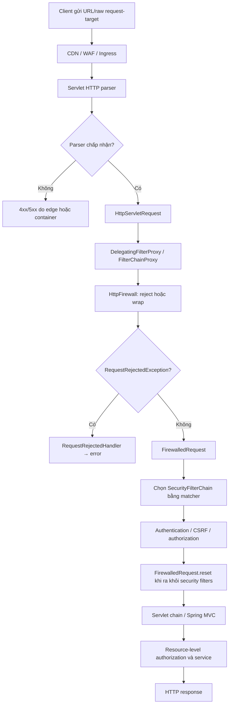

# Phân biệt từ chối yêu cầu với sửa hoặc chuẩn hóa yêu cầu

## 1. Vấn đề cốt lõi: một request có thể có nhiều cách diễn giải

Trong chương **Firewall trên Servlet** của module **SPRING_SECURITY_HTTP_PROTECTION**, Spring Security được dùng để áp dụng các lớp phòng vệ HTTP và trình duyệt: HTTP firewall, CSRF, CORS, security headers, CSP, HSTS và bảo vệ session. Để các cơ chế này hiệu quả, security matcher và component xử lý nghiệp vụ phải hiểu request một cách nhất quán.

Giả sử ứng dụng có hai vùng:

```text
/public/**     cho phép đọc công khai
/admin/**      chỉ ROLE_ADMIN
```

Một client gửi request:

```http
GET /public/../admin/reports HTTP/1.1
Host: app.example.test
```

Có hai cách phản ứng rất khác nhau:

1. **Từ chối request (reject):** không chọn security chain và controller cho representation bất thường đó; trả lỗi.
2. **Sửa/chuẩn hóa request (normalize/rewrite):** biến `/public/../admin/reports` thành `/admin/reports` rồi xử lý request mới.

Cách thứ hai chỉ an toàn nếu **mọi tầng từ gateway tới Spring MVC, matcher, authorization và resource resolver** sử dụng cùng một ý nghĩa của URL. Nếu security kiểm tra một path còn business handler xử lý path khác, một quyết định cấp quyền có thể được đưa ra cho **tài nguyên sai**.

`StrictHttpFirewall` của Spring Security Servlet chủ yếu chọn hướng **từ chối request đáng ngờ thay vì sửa chúng thành dạng khác**. Đây là quyết định phòng vệ có chủ đích, không phải lỗi của router. Javadoc chính thức cảnh báo rằng chuẩn hóa request không đáng tin là cách dễ phát sinh sai khác; việc tắt kiểm tra path chưa chuẩn hóa cũng không được hỗ trợ qua một setter đơn giản.

Cần hiểu đúng đồng thời một điểm khác: interface `HttpFirewall` cũng có khả năng **bọc request (wrap)** để trình bày một cách nhìn path ổn định cho security matching. Implementation `DefaultHttpFirewall` lịch sử có cơ chế lược bỏ path parameters khỏi `servletPath` và `pathInfo` khi matching, rồi phục hồi cách nhìn ban đầu sau security chain. **Bọc request cho matcher không đồng nghĩa thay đổi request-target mà client đã gửi.**

### Mục tiêu học tập

Sau bài học, người học có thể:

1. Phân biệt *reject*, *normalize*, *rewrite*, *redirect canonical URL*, *wrap request cho matching* và *validate input*.
2. Giải thích vì sao `StrictHttpFirewall` từ chối URL chưa chuẩn hóa và các dấu phân cách mã hóa không được chấp nhận.
3. Mô tả `DefaultHttpFirewall`, `FirewalledRequest.reset()` và vai trò của `FilterChainProxy`.
4. Hiểu khác biệt giữa `requestURI`, `contextPath`, `servletPath`, `pathInfo`, path do Spring MVC nhận và path ở gateway.
5. Phân tích lỗi phân quyền do path parameters, encoded slash, backslash, double slash, dot segments và double decoding.
6. Chọn đúng nơi canonicalize URLs hợp lệ mà không âm thầm “sửa” một request đáng ngờ sau authorization.
7. Viết unit tests với `MockHttpServletRequest`, integration tests với `FilterChainProxy` và MockMvc, sau đó xác minh qua container/proxy thật.
8. Không nhầm `400` do firewall với `404`, `403`, CORS/CSRF hoặc lỗi parser từ hạ tầng.
9. Đối chiếu cách bảo vệ trên Servlet và Reactive/WebFlux.

## 2. Sáu thao tác thường bị gọi chung là “chuẩn hóa”

Không nên dùng từ “normalize” mà không nêu **đối tượng**, **thời điểm** và **ai chịu trách nhiệm**.

| Thao tác | Ý nghĩa | Ví dụ | Nguy cơ khi hiểu sai |
| --- | --- | --- | --- |
| **Reject** | Không cho representation đi tiếp; response lỗi. | `StrictHttpFirewall` từ chối `/a/../b`. | Nhầm HTTP 400 với route không tồn tại hoặc thiếu quyền. |
| **Normalize/canonicalize** | Ánh xạ nhiều cách viết thành một dạng chuẩn. | Loại dot segment theo quy tắc đã duyệt. | Hai tầng chuẩn hóa khác nhau dẫn tới bypass. |
| **Rewrite** | Một proxy/router đổi URI trước khi upstream nhận. | `/v1/items` → `/api/items`. | Matcher nhìn path khác handler hoặc cache. |
| **Redirect** | Trả HTTP 3xx để client gửi **request mới** tới URL chuẩn. | `/old-catalog` → `/catalog`. | Open redirect, vòng lặp, thay method/body ngoài ý muốn. |
| **Request wrapper** | Đưa một cách nhìn path hoặc metadata cho code downstream. | Lược `;param` khi security matching trong `DefaultHttpFirewall`. | Coi cách nhìn tạm thời là URL gốc đã được sửa. |
| **Business validation** | Kiểm tra kiểu, ID, ownership và ý nghĩa domain. | `fileId` phải hợp lệ, user có quyền đọc file. | Tin rằng URL qua firewall đã được cấp quyền. |

Một request có thể đi qua **nhiều** thao tác. Ví dụ gateway route `/v1/**` sang backend, container parse URI, firewall reject URL không hợp lệ, Spring MVC bind ID và service authorize resource. Quy tắc cần giữ là **không biến một request mơ hồ thành request được cấp quyền theo một cách hiểu khác**.

### 2.1. Từ chối không phải “chuẩn hóa về một trang lỗi”

Khi firewall ném `RequestRejectedException` và `RequestRejectedHandler` gửi HTTP `400`, request **không được chuyển thành route sạch**. Response lỗi chỉ thông báo request không được chấp nhận.

Không tạo handler kiểu “bắt exception, xóa dấu `..` rồi gọi lại controller”. Điều đó thay đổi quyết định phòng vệ thành cơ chế tự sửa nguy hiểm.

### 2.2. Chuẩn hóa không mặc nhiên xấu

Chuẩn hóa có thể là việc bình thường khi thiết kế URLs: chọn chữ thường cho hostname, chuyển một alias cũ sang URL mới, hoặc tạo slug ổn định từ dữ liệu phía server.

Tuy nhiên, phải phân biệt:

- **Canonicalization ở lúc tạo URL** từ dữ liệu đáng tin.
- **Redirect alias đã biết** theo mapping tĩnh.
- **Thay đổi request-target bất kỳ do client kiểm soát** ngay trước/sau authorization.

Hai loại đầu thường dễ kiểm soát; loại cuối có rủi ro cao hơn vì có thể thay identity của tài nguyên.

## 3. Kiến trúc Servlet: ranh giới nào quyết định điều gì?



Đường đi là mô hình học tập. Thời điểm wrapper được reset và hành vi cụ thể phụ thuộc implementation/version của `FilterChainProxy`. Điều đã được Javadoc xác nhận là:

- `HttpFirewall` được sử dụng bởi `FilterChainProxy`.
- Firewall có thể từ chối hoặc trả request wrapper để security chain dùng.
- `FilterChainProxy` gọi `FirewalledRequest.reset()` khi request rời phần security filtering để chuyển sang ứng dụng.
- Với wrapper có thay đổi path view, reset cho phép cách nhìn path ban đầu trở lại.
- `StrictHttpFirewall` hiện đại có `StrictFirewalledRequest.reset()` không thực hiện việc phục hồi path vì nó không chọn chiến lược lược path parameters như `DefaultHttpFirewall`.

### 3.1. Vì sao phải đi qua `FilterChainProxy`?

Một custom Servlet filter tự thêm bằng container registration và các Spring Security filters đứng độc lập **không đương nhiên** có cơ chế HTTP firewall và reset của `FilterChainProxy`.

Hệ thống dùng Spring Security Servlet nên đảm bảo cấu hình filter proxy theo framework. Không tự tạo thêm nhiều `FilterChainProxy` trong cùng một chuỗi để “kiểm tra hai lần”; việc bọc lồng nhau có thể làm behavior khó dự đoán.

### 3.2. `getFirewalledRequest` và `getFirewalledResponse`

Interface `HttpFirewall`:

```java
public interface HttpFirewall {

    FirewalledRequest getFirewalledRequest(
        HttpServletRequest request) throws RequestRejectedException;

    HttpServletResponse getFirewalledResponse(
        HttpServletResponse response);
}
```

Code minh họa chữ ký Jakarta Servlet dành cho Spring Security 6.x/7.x. Spring Security 5.x cũ dùng `javax.servlet.*`.

`getFirewalledRequest` có thể ném exception; `getFirewalledResponse` có thể trả wrapper giúp áp quy tắc response. Việc response wrapper từ chối CR/LF trong thao tác ghi header là **một loại validation response khác**, không phải tự sửa URI từ client.

## 4. `StrictHttpFirewall`: từ chối thay vì tự sửa

Theo Spring Security Javadoc, `StrictHttpFirewall` là implementation strict của `HttpFirewall`. Nó từ chối những request đáng ngờ bằng `RequestRejectedException`, thay vì đoán cách sanitize URL rồi cho đi tiếp.

Những ví dụ cần nhận biết:

| Biểu diễn request-target | Ý nghĩa rủi ro | Cách xử lý strict thông dụng |
| --- | --- | --- |
| `/public/../admin` | Dot segment có thể đổi namespace sau normalization. | Reject nếu tới firewall ở dạng chưa chuẩn hóa. |
| `/reports/./daily` | Dot segment có representation dư. | Reject. |
| `/admin//reports` | Duplicate slash, có thể được gateway/router gộp khác nhau. | Thường reject theo blocklist strict. |
| `/files/a%2Fb` | Encoded slash có thể trở thành path separator sau decode. | Reject theo default encoded slash policy. |
| `/files/a%5Cb` | Backslash có thể được vài tầng xem như separator. | Reject theo default backslash policy. |
| `/public/%2E%2E/admin` | Encoded dot có thể tạo traversal sau decode. | Reject theo default encoded period policy. |
| `/files/a%252Fb` | Có thể thành `a%2Fb` rồi `a/b` sau hai lần decode. | Reject theo default encoded percent policy. |
| `/secure;mode=test/reports` | Path parameters gây khác biệt matching. | Reject semicolon theo default. |
| `TRACE /health` | HTTP method ngoài allowlist mặc định. | Reject method. |
| Tên host không được duyệt | Request tới hostname ngoài deployment policy. | Reject nếu đã cấu hình host allowlist. |

Không phải mọi request trên sẽ đến được firewall: HTTP client, reverse proxy hoặc Servlet HTTP parser có thể **từ chối hoặc biến đổi trước**. Trường hợp đó, bạn cần kiểm tra đúng tầng thay vì suy kết quả của một mock test thành behavior Internet.

### 4.1. Không có setter cho phép mọi URL chưa chuẩn hóa

Một khác biệt quan trọng giữa “tùy chỉnh” và “vô hiệu hóa”:

```java
import org.springframework.security.web.firewall.StrictHttpFirewall;

StrictHttpFirewall firewall = new StrictHttpFirewall();

// Các setter sau chỉ điều chỉnh nhóm representation cụ thể:
// firewall.setAllowSemicolon(true);
// firewall.setAllowUrlEncodedSlash(true);
// firewall.setAllowBackSlash(true);
// firewall.setAllowUrlEncodedPercent(true);

// Không có một setter được hỗ trợ để tắt hoàn toàn
// rule từ chối mọi path chưa chuẩn hóa.
```

`StrictHttpFirewall` có những lựa chọn cho semicolon/encoded separators, nhưng Javadoc nêu rõ **kiểm tra URL chưa chuẩn hóa** là quy tắc không được vô hiệu hóa qua một option đơn giản, vì rủi ro quá lớn.

Đừng bật hàng loạt setters để tìm cách biến firewall thành một URL normalizer. Một request hợp lệ theo một setter vẫn có thể bị rule khác hoặc container từ chối.

### 4.2. “Reject” không đồng nghĩa mọi input đều bị quét ngay từ đầu

Các rule như URL/method/host có thể được kiểm tra lúc `getFirewalledRequest(...)`. Một số header/parameter predicates trong `FirewalledRequest` chỉ được thực thi **khi getter tương ứng được gọi**.

Vì vậy nên hiểu policy “reject khi phát hiện vi phạm”, chứ không tuyên bố một lần gọi tạo wrapper luôn kiểm tra từng header/parameter byte.

### 4.3. URL hợp lệ không có nghĩa được cấp quyền

`GET /admin/reports` có path chuẩn, nên vượt được URL firewall. Nhưng nếu user là USER không có ROLE_ADMIN, `AuthorizationFilter`/method security hoặc business service vẫn phải từ chối.

Firewall không thay:

- Role/permission/tenant checks.
- CSRF token verification.
- CORS origin/method policy.
- Security headers/CSP/HSTS.
- Cookie/session protection.
- Validation của object IDs và dữ liệu nghiệp vụ.

## 5. `DefaultHttpFirewall`: làm nhất quán path view cho matcher

`DefaultHttpFirewall` là implementation khác, có hướng xử lý nhẹ hơn `StrictHttpFirewall` ở một số điểm lịch sử.

Javadoc mô tả việc bọc request để cung cấp các giá trị **`servletPath` và `pathInfo` không chứa path parameters** trong thời gian request đi qua security chain. Điều này có ích khi servlet containers trình bày semicolon parameters khác nhau, khiến `RequestMatcher` khớp không nhất quán.

Ví dụ minh họa:

```text
Servlet nhìn path ban đầu:
  /secure;mode=full/reports;version=1

Path view phục vụ security matching (DefaultHttpFirewall):
  /secure/reports

Sau khi rời security chain:
  /secure;mode=full/reports;version=1
```

**Đây là ba cách nhìn theo vòng đời wrapper**, không phải có một HTTP request mới được gửi lại lên Internet.

### 5.1. Có phải `DefaultHttpFirewall` “sửa mọi URL xấu”?

Không. Javadoc chính thức nói `DefaultHttpFirewall` **cũng từ chối các path chưa chuẩn hóa chứa directory traversal sequences**; nó không phải bộ repair mọi URL, và vẫn có mặc định không chấp nhận encoded slash.

Không thể suy:

```text
StrictHttpFirewall = reject mọi thứ
DefaultHttpFirewall = normalize mọi thứ
```

Mô hình đúng:

```text
StrictHttpFirewall:
  ưu tiên từ chối representation đáng ngờ;
  không dựa vào việc sửa URL để biến nó thành an toàn.

DefaultHttpFirewall:
  áp một số biến đổi path view để matching nhất quán;
  vẫn có các điều kiện reject, không phải sanitizer toàn năng.
```

Spring Security Javadoc khuyến nghị người dùng cân nhắc `StrictHttpFirewall` vì reject có bảo đảm an toàn tốt hơn việc cố sanitize URL đáng ngờ.

### 5.2. Vì sao thay từ Strict sang Default có thể nguy hiểm?

Một URI trước đây bị từ chối ở cửa vào có thể được `DefaultHttpFirewall` chấp nhận và lược path parameters **chỉ khi security matching**, trong khi ứng dụng sau đó còn nhìn thấy path ban đầu.

Điều này làm tăng yêu cầu chứng minh:

- Security matcher xác định đúng chain.
- MVC handler chọn tài nguyên có cùng ý nghĩa.
- Path parameters có contract rõ ràng.
- Không có decode thêm/sửa path sau authorization.
- Resource-level authorization chặn truy cập sai tenant/file.
- CDN/cache/proxy hiểu URL nhất quán.

**Không đổi implementation chỉ để làm mất HTTP `400`** mà chưa có ma trận kiểm thử.

## 6. `FirewalledRequest.reset()`: khôi phục cách nhìn, không đảo ngược Internet

`FirewalledRequest` là một `HttpServletRequestWrapper` trừu tượng, có `reset()` để `FilterChainProxy` gọi khi request chuyển từ security filters sang application.

Javadoc nêu ý nghĩa: cho phép implementation thay đổi một phần state **để phục vụ security infrastructure** rồi trả các giá trị ban đầu khi request rời chain.

### 6.1. Cách đọc đúng ba thời điểm

| Thời điểm | `DefaultHttpFirewall` có thể cung cấp | Ý nghĩa |
| --- | --- | --- |
| Trước `FilterChainProxy` | Request Servlet do container tạo. | Đã chịu parser/ingress transformations. |
| Trong bước security matching | `servletPath`/`pathInfo` đã lược path parameters. | Mục đích là matching ổn định. |
| Sau `FirewalledRequest.reset()` | Giá trị path ban đầu của wrapper được phục hồi. | Controller có thể nhận representation khác security matcher. |

Bản thân request HTTP client gửi không được “phục hồi” sau reset. Request đã đi qua hạ tầng; reset chỉ ảnh hưởng **view của wrapper**.

### 6.2. `StrictHttpFirewall` có dùng `reset()` để trả về một path khác?

Trong source hiện đại, `StrictFirewalledRequest.reset()` là một method rỗng. Điều đó nhất quán với chiến lược strict: **không âm thầm strip semicolon và rồi bật lại cho controller như `DefaultHttpFirewall`**.

Vẫn cần ghi nhớ: Servlet container hoặc proxy **đã có thể** normalize trước khi strict firewall nhìn thấy request. “Strict không tự sửa” không có nghĩa trên mọi đường đi request còn nguyên bytes ban đầu của client.

### 6.3. Đừng tự gọi reset quá sớm

Không xây một custom filter gọi `reset()` trước khi toàn bộ security matching/authorization cần path view nhất quán hoàn tất. Để `FilterChainProxy` sở hữu vòng đời wrapper. Nếu app muốn lưu một canonical resource ID, nó phải **parse và validate** theo contract nghiệp vụ, không gọi reset như thao tác normalize dữ liệu.

## 7. `requestURI`, `servletPath` và `pathInfo` không nhất thiết trùng nhau

Các API:

```java
request.getRequestURI();
request.getContextPath();
request.getServletPath();
request.getPathInfo();
request.getQueryString();
```

đều được Servlet cung cấp nhưng không có cùng ý nghĩa:

- `requestURI` là phần URI request theo Servlet API, không bao gồm query.
- `contextPath` thể hiện context root của deployment.
- `servletPath` là phần path liên quan servlet mapping.
- `pathInfo` là phần path bổ sung tùy servlet mapping.
- `queryString` là query, không thuộc path được dùng trong nhiều URL matchers.

Ví dụ public request:

```http
GET /portal/admin/reports?page=2 HTTP/1.1
Host: app.example.test
```

Nếu ứng dụng deploy ở context root `/portal` và DispatcherServlet mapping `/`, các giá trị có thể tương ứng:

```text
requestURI  = /portal/admin/reports
contextPath = /portal
servletPath = /admin/reports
pathInfo    = null
queryString = page=2
```

Đây là **một ví dụ**, không phải quy luật cho mọi servlet mapping. Nếu có mapping `/api/*`, `servletPath`/`pathInfo` sẽ được chia khác. Các fields cũng có thể chịu decoding/normalization theo container.

### 7.1. Vì sao regex tự kiểm tra `requestURI` dễ sai?

Anti-pattern:

```java
// Rủi ro: context path, pathInfo, semicolon, encoding và prefix có thể khác.
boolean protectedRoute =
    request.getRequestURI().startsWith("/admin");
```

Nếu context root là `/portal`, URL `/portal/admin/reports` không bắt đầu bằng `/admin`. Nếu path là `/administer`, `startsWith("/admin")` có thể khớp sai. Một encoded separator có thể được tầng khác decode thành route mới.

Dùng matcher Spring Security phù hợp với version và servlet mapping, kèm **deny-by-default** và kiểm tra quyền tại service. Không tạo một hàm canonicalization custom riêng cho authorization nếu framework đã có parser/matcher được kiểm thử.

### 7.2. Matching theo đường dẫn được firewall cho thấy

Một số matcher dựa trên `servletPath + pathInfo`, trong khi các matcher tích hợp MVC/`PathPattern` có cách xử lý parsing riêng. Không nên giả định mọi loại `RequestMatcher` nhìn cùng một raw string.

Khi có URL mơ hồ, cần đo:

1. Dạng URL client gửi.
2. Upstream URI sau proxy rewrite.
3. Servlet API path trước firewall.
4. Path view trong `FirewalledRequest` khi matcher chạy.
5. Controller/resource được chọn.
6. Identity thực được authorize.

## 8. Tại sao “sửa rồi xử lý” gây ra chênh lệch quyền?

Hãy xét policy:

```text
/public/**   -> permitAll
/admin/**    -> hasRole("ADMIN")
/**          -> denyAll
```

Một request bất thường có thể trải qua hai cách hiểu:

```text
Security matcher nhìn: /public/../admin/reports
Handler sau normalize: /admin/reports
```

Nếu một matcher sai coi path như `/public/**`, còn handler truy xuất resource admin, quyền có thể bị cấp dựa trên **đường dẫn khác với tài nguyên thực**. Một hệ thống chỉ dùng path-based rules mà không có resource-level authorization càng dễ chịu hậu quả.

### 8.1. Quy tắc cần giữ

**Mọi quyết định authorization phải áp lên cùng resource identity mà handler sử dụng để thực hiện hành động.**

Không chỉ hỏi “có `@GetMapping` không?” hoặc “request đã qua firewall chưa?”; phải xác nhận:

- User/role/tenant là ai?
- Resource ID cuối cùng là gì?
- Parser có giải mã lại không?
- Repository/storage dùng đúng ID đã được authorize không?
- Proxy/cache có hợp nhất hai representation của URL không?

### 8.2. “Security check” và “use” không được lệch

```java
// ANTI-PATTERN: kiểm tra quyền trên biểu diễn A,
// nhưng dùng biểu diễn B sau khi decode thêm.
String visiblePath = request.getRequestURI();

if (visiblePath.startsWith("/public/")) {
    String decodedAgain = java.net.URLDecoder.decode(
        visiblePath, java.nio.charset.StandardCharsets.UTF_8);
    // dùng decodedAgain truy cập tài nguyên ...
}
```

Ngoài sự sai lệch giữa check/use, `URLDecoder` theo `application/x-www-form-urlencoded` semantics có thể biến `+` thành space; không phải parser thích hợp cho mọi URI path. Không giải mã tùy tiện sau authorization.

### 8.3. Một ví dụ resource-level authorization

```java
// PSEUDOCODE ứng dụng: cấp quyền trên entity đã xác định phía server.
Report report = reportRepository.requireById(reportId);

if (!reportAccessPolicy.canRead(authentication, report)) {
    throw new AccessDeniedException("Not allowed");
}

return reportService.render(report);
```

Nếu user kiểm soát `reportId`, phải parse nó theo schema rõ ràng, xác định **một record duy nhất** và kiểm tra quyền trên record đó. Không coi URL path prefix là bằng chứng ownership.

## 9. Semicolon, path parameters và matrix variables

Dấu `;` trong path có thể mang path parameters/matrix variables tùy chuẩn/router:

```text
/products;category=book/42
/secure;mode=debug/reports
```

### 9.1. Hành vi hai firewall

- `StrictHttpFirewall`: mặc định **từ chối semicolon**; có thể nới bằng `setAllowSemicolon(true)` khi yêu cầu nghiệp vụ thật sự tồn tại.
- `DefaultHttpFirewall`: có thể **lược path parameters khỏi `servletPath`/`pathInfo` trong security matching**, rồi reset view cho downstream.

Đừng đọc Spring Security reference nói “path parameters bị loại cho matching” rồi kết luận `StrictHttpFirewall` mặc định **chấp nhận semicolon và âm thầm strip**. Đây là hai nhánh hành vi cần tách.

### 9.2. Khi muốn dùng `@MatrixVariable`

Nếu Spring MVC controller dùng:

```java
@GetMapping("/cars/{carId}")
String showCar(
        @PathVariable String carId,
        @MatrixVariable(name = "color", required = false)
        String color) {
    return carId + ":" + color;
}
```

và client gửi `/cars/42;color=red`, cần xem toàn bộ:

- Cấu hình `StrictHttpFirewall` có chủ đích cho semicolon không?
- Spring MVC có parse matrix variables đúng version/`PathPatternParser` không?
- Security matcher thấy URL nào?
- Authorization dựa trên `carId` và owner thực hay chỉ path prefix?
- Gateway/CDN có strip/rewrite `;...` hay hợp nhất cache keys?
- Có session URL rewriting `;jsessionid=...` legacy không?

Một setter không đồng nghĩa đã giải quyết toàn bộ vấn đề consistency. Hạn chế dùng URL rewriting để mang session ID nếu có thể dùng cookie-only session tracking phù hợp.

### 9.3. Đừng “sửa” semicolon bằng filter sau authorization

Nếu security matcher đã cho phép request dựa trên path A, nhưng một filter khác xóa `;mode=...` rồi chuyển thành path B, có thể tạo policy mismatch. Chỉ dùng cơ chế đã được thiết kế của framework, và test **phân quyền với user không đủ quyền**.

## 10. Encoded slash, backslash, percent và double decoding

Dấu phân cách có thể được biểu diễn bằng percent encoding:

```text
/  -> %2F
\  -> %5C
.  -> %2E
%  -> %25
```

Ví dụ:

```text
/files/a%2Fb
/files/a%5Cb
/files/a%252Fb
```

### 10.1. Vấn đề không chỉ nằm ở “đã decode hay chưa”

Một tầng có thể nhận `a%2Fb` như **một segment chứa encoded slash**, tầng khác decode thành `a/b` rồi hiểu là **hai segments**. Nếu matcher/security và handler/storage chọn tài nguyên khác nhau, authorization có thể sai.

### 10.2. Double decoding

```text
Dữ liệu URL:      /files/a%252Fb
Decode lần một:   /files/a%2Fb
Decode lần hai:   /files/a/b
```

Đừng xây vòng lặp decode cho tới khi không còn `%`:

```java
// ANTI-PATTERN: không biến nhiều lần decode thành normalization policy.
while (value.contains("%")) {
    value = java.net.URLDecoder.decode(
        value, java.nio.charset.StandardCharsets.UTF_8);
}
```

Hãy định nghĩa một hợp đồng parsing và resource ID rõ ràng. Nếu cần lưu ID chứa slash, dùng opaque ID hoặc query/body field phù hợp thay vì bắt toàn bộ gateway/container/security framework nhất trí về encoded separator trong path.

### 10.3. Một setter nới rule không đồng nghĩa normalize

```java
StrictHttpFirewall firewall = new StrictHttpFirewall();

// Ví dụ ngoại lệ cần security review:
// firewall.setAllowUrlEncodedSlash(true);
```

Bật option này có thể **chấp nhận thêm một representation**, chứ không đưa ra hợp đồng rằng mọi tầng sẽ luôn chuyển nó sang `/` hoặc luôn giữ `%2F`. Hậu quả phụ thuộc servlet connector, proxy rewrite, MVC matcher và business code.

### 10.4. Backslash trên Windows không phải URL separator chuẩn

Dù Windows filesystem dùng backslash trong nhiều API, HTTP URL path không phải local filesystem path. Không ghép `getRequestURI()` trực tiếp vào `Path.of(...)` để mở file.

Giải quyết file bằng ID đã validate, server-side mapping, canonical path dưới storage root và authorization đối với resource thực; chú ý symlinks nếu liên quan.

## 11. Dot segments và duplicate slashes

Hai ví dụ kinh điển:

```text
/public/../admin
/admin//reports
```

### 11.1. Tại sao `/a/../b` đáng ngờ?

Nó có thể được chuẩn hóa thành `/b` bởi một tầng; nếu một tầng khác giữ `/a/../b` như chuỗi literal khi so quyền, hai bên hiểu khác namespace.

`StrictHttpFirewall` từ chối URL chưa chuẩn hóa. `DefaultHttpFirewall` cũng có giới hạn path traversal theo Javadoc. Đừng coi Default là bypass chính thức cho `/../`.

### 11.2. Duplicate slashes không giống dot segments

`/admin//reports` có thể được một số gateway gộp thành `/admin/reports`, trong khi một router khác giữ hai slash. Các rule cụ thể của Strict cho duplicate slash không đồng nghĩa mọi server có cùng semantics.

Nếu client không có lý do tạo URL với duplicate slashes, **sửa URL generator/client** thường an toàn hơn nới firewall.

### 11.3. “Normalize tại gateway” có thể hợp lệ nhưng không miễn kiểm tra

Một ingress có thể định nghĩa chính sách canonical URI trước backend. Nếu vậy phải:

- Có quy tắc duy nhất, được version-control.
- Không decode separators qua nhiều hop theo các cách khác nhau.
- Đảm bảo auth/rate limit/cache ở edge cũng dùng canonical identity phù hợp.
- Bảo đảm Spring Security và MVC cùng xử lý resource thật.
- Test bypass routes bằng method/user/tenant bất lợi.
- Không cho đường direct-to-backend né chính sách edge.

Quan trọng: khi gateway đã biến đổi request, `StrictHttpFirewall` chỉ nhìn **representation còn lại**. Nó không thể chứng minh client ban đầu gửi một URL “sạch”.

## 12. Có nên normalize trước firewall?

Javadoc `StrictHttpFirewall` có nêu chuẩn hóa trước firewall hoặc dùng `DefaultHttpFirewall` như những **cách kỹ thuật có thể thực hiện**, nhưng đồng thời cảnh báo normalization mong manh và đó là lý do chọn reject.

Điều này cần được hiểu như một **tradeoff**, không phải một lời khuyên mặc định.

### 12.1. Nếu client đang gửi URL không hợp lệ

Các bước ưu tiên:

1. Xác định URL contract và resource ID.
2. Sửa URL generator/client/library.
3. Nếu có alias URL cũ hợp lệ, dùng redirect mapping chính xác.
4. Tách các phần dữ liệu chứa separator khỏi cấu trúc path.
5. Chỉ nới một rule khi có use case chính đáng và test cross-layer đầy đủ.

### 12.2. Nếu có nhu cầu canonicalize ở ingress

Chỉ chọn chính sách được thiết kế chặt:

- Xác định **chính xác input set** được phép chuyển đổi.
- Giới hạn method/scheme/host/path áp dụng.
- Không dùng generic `replace("//", "/")` cho mọi đường dẫn rồi cho qua.
- Không parse một URL thành string, rewrite, sau đó parse lại bằng thư viện khác.
- Kiểm tra percent encoding đúng một hợp đồng và tránh double decoding.
- Cẩn thận với cache key/redirect/public URL.
- Giữ backend firewall strict và authorization bảo thủ.
- Thử từ public edge tới backend với request identity tương đương.
- Có rollout/rollback plan, logs an toàn và owner rõ ràng.

### 12.3. Phân biệt “rewrite nội bộ” với “redirect client”

**Rewrite nội bộ:** client gửi A, gateway chuyển upstream thành B. Browser không nhất thiết biết B; cookie/cache/links vẫn có thể theo A.

**Redirect:** server trả `Location: B` và status 3xx; client chọn gửi **request mới** tới B. Đây là một thao tác có thể quan sát công khai, nên thường dễ quản lý hơn với alias **hợp lệ**.

Nhưng redirect **không phải** giải pháp cho mọi malformed request. Nếu URL bị HTTP parser hoặc firewall từ chối trước MVC, controller không thể tự tạo redirect từ URL đó.

## 13. Thiết kế canonical URL không sửa request đáng ngờ

### 13.1. Dùng mapping alias cố định

Một ứng dụng thay `/v1/catalog` bằng `/catalog` có thể tạo redirect rõ ràng cho route legacy hợp lệ.

```java
import java.net.URI;

import org.springframework.http.HttpStatus;
import org.springframework.http.ResponseEntity;
import org.springframework.web.bind.annotation.GetMapping;
import org.springframework.web.bind.annotation.RestController;

@RestController
class CatalogAliasController {

    @GetMapping("/v1/catalog")
    ResponseEntity<Void> redirectAlias() {
        return ResponseEntity
            .status(HttpStatus.PERMANENT_REDIRECT) // HTTP 308
            .location(URI.create("/catalog"))
            .build();
    }
}
```

**Phân biệt:** controller này xử lý một **URL hợp lệ đã được đăng ký**. Nó không xóa `..`, `%2F` hoặc `;` từ một URL client tùy ý.

### 13.2. Vì sao redirect tương đối tốt hơn ghép Host chưa tin?

`Location: /catalog` giữ cùng origin trong trường hợp thông thường, không ghép `request.getServerName()` từ Host client kiểm soát thành absolute URL. Với authentication/reset-password/OAuth redirect, tốt hơn nữa là dùng **canonical public base URL** do deployment hoặc tenant/domain registry đã xác minh quản lý.

### 13.3. Chọn mã redirect và HTTP method có chủ đích

`301`, `302`, `307`, `308` có semantics khác nhau về caching và việc giữ method/body. Ví dụ `308` thường bảo toàn method và body khi client gửi request mới, nhưng không nên áp vô điều kiện cho mọi POST/DELETE hay endpoint state-changing.

Khi di chuyển API:

- Xác định clients có hỗ trợ 308 không.
- Không tạo redirect loop.
- Không làm rò credentials sang host khác.
- Kiểm thử method, body, cookie và CORS.
- Kiểm soát caching các redirects.
- Giữ authorization và CSRF cho request tới endpoint đích.

Một redirect từ route cũ sang route mới vẫn phải qua policy của **request thứ hai**. Client không được miễn security checks chỉ vì request thứ nhất được canonicalize.

## 14. “Normalize” ở mức business data khác với normalize URL

Không phải mọi phép canonicalization đều liên quan firewall.

Ví dụ người dùng nhập email, mã sản phẩm hoặc slug:

```text
Raw input:       "  spring security  "
Normalized slug: "spring-security"
```

Một service có thể chủ động sinh slug từ dữ liệu, nhưng phải xác định:

- Canonicalization dùng cho **search key** hay **identity**?
- Có mất thông tin mà domain cần phân biệt không?
- Authorization diễn ra trên record đã lookup hay trên raw string?
- Có collision giữa hai input khác nhau không?
- Có lưu cả original và canonical value theo đúng nghiệp vụ không?

**Không áp quy tắc slug vào URI parser của firewall.** Domain normalization và HTTP path normalization là hai trách nhiệm khác nhau.

### 14.1. Khi nào normalize resource ID?

Nếu API nhận một opaque ID duy nhất, nên validate định dạng rồi tra record. Nếu ID có các dạng alias đã công bố, mapping alias phải dẫn tới **một server-owned canonical record**, sau đó authorization trên record đó.

Không check quyền trên ID trước, rồi thay ID bằng bản normalized và dùng để truy xuất record khác.

### 14.2. Chữ hoa/thường cũng có nhiều semantics

DNS hostnames thường không phân biệt chữ hoa/thường; path segments, resource IDs và parameters **không mặc nhiên** như vậy. Đừng lower-case toàn bộ request path chỉ vì host lookup case-insensitive.

## 15. Cấu hình Servlet an toàn: giữ `StrictHttpFirewall` theo mặc định

Trong nhiều Spring Security Servlet applications, không cần khai báo firewall riêng: `StrictHttpFirewall` là lựa chọn mặc định.

Nếu cần thể hiện rõ trong Java config, ví dụ Spring Security 6.x/7.x:

```java
import org.springframework.context.annotation.Bean;
import org.springframework.context.annotation.Configuration;
import org.springframework.security.config.annotation.web.configuration.WebSecurityCustomizer;
import org.springframework.security.web.firewall.StrictHttpFirewall;

@Configuration
class ServletFirewallConfiguration {

    @Bean
    WebSecurityCustomizer firewallCustomizer() {
        return web -> web.httpFirewall(
            new StrictHttpFirewall());
    }
}
```

Đây là **ví dụ vị trí cấu hình**, không phải bước bắt buộc với mọi dự án. Không tạo nhiều firewall beans/customizers cạnh tranh. Khi Spring Security đã có cấu hình, nên hợp nhất tại một điểm và test instance runtime.

### 15.1. Nếu thật sự cần matrix variables

```java
StrictHttpFirewall firewall = new StrictHttpFirewall();

// Chỉ sau security review và test matrix variables:
firewall.setAllowSemicolon(true);
```

Thao tác này **cho phép thêm một representation**, không biến `StrictHttpFirewall` thành `DefaultHttpFirewall` và không tuyên bố controller/matcher tự khớp nhất quán.

### 15.2. Tại sao không chọn `DefaultHttpFirewall` như “fix nhanh”?

```java
import org.springframework.security.web.firewall.DefaultHttpFirewall;

// KHÔNG khuyến nghị chỉ để một URL bị strict chặn hoạt động:
DefaultHttpFirewall permissive = new DefaultHttpFirewall();
```

Implementation này có behavior matching khác strict; Javadoc khuyến nghị cân nhắc strict. Chỉ dùng Default khi đã đánh giá rõ requirement legacy và có tests chứng minh matching, CSRF, CORS, authorization, path handling và resource identity.

### 15.3. `HttpSecurity.addFilterBefore` không thay `HttpFirewall`

`HttpFirewall` được `FilterChainProxy` áp **trước khi chọn chain**. Một filter thêm bằng `HttpSecurity.addFilterBefore(...)` nằm trong `SecurityFilterChain` đã chọn.

Nếu filter tự chuẩn hóa path ở bên trong chain, security matcher có thể đã chọn chain dựa trên cách nhìn **trước normalization**, dẫn đến sai khác. Đừng dùng filter đó làm biện pháp thay StrictHttpFirewall.

## 16. Unit test: `StrictHttpFirewall` từ chối, không sửa URL

Ví dụ Java 17+, Spring Security Servlet 6.x/7.x, Spring Test và JUnit 5.

```java
import org.junit.jupiter.api.Test;
import org.springframework.mock.web.MockHttpServletRequest;
import org.springframework.security.web.firewall.FirewalledRequest;
import org.springframework.security.web.firewall.RequestRejectedException;
import org.springframework.security.web.firewall.StrictHttpFirewall;

import static org.junit.jupiter.api.Assertions.assertEquals;
import static org.junit.jupiter.api.Assertions.assertThrows;

class StrictRejectInsteadOfNormalizeTest {

    private final StrictHttpFirewall firewall =
        new StrictHttpFirewall();

    private MockHttpServletRequest request(String uri) {
        var r = new MockHttpServletRequest("GET", uri);
        r.setServletPath(uri);
        return r;
    }

    @Test
    void rejectsDotSegmentsInsteadOfRewritingThem() {
        var raw = request("/public/../admin/reports");

        assertThrows(RequestRejectedException.class,
            () -> firewall.getFirewalledRequest(raw));

        // Mock request gốc không bị firewall đổi thành "/admin/reports".
        assertEquals("/public/../admin/reports",
            raw.getRequestURI());
    }

    @Test
    void rejectsSemicolonByDefault() {
        var raw = request("/secure;mode=full/reports");

        assertThrows(RequestRejectedException.class,
            () -> firewall.getFirewalledRequest(raw));
    }

    @Test
    void rejectsEncodedSlashByDefault() {
        var raw = request("/files/a%2Fb");

        assertThrows(RequestRejectedException.class,
            () -> firewall.getFirewalledRequest(raw));
    }

    @Test
    void acceptsAnAlreadyCanonicalPath() {
        var raw = request("/admin/reports");

        FirewalledRequest safe = firewall.getFirewalledRequest(raw);
        assertEquals("/admin/reports", safe.getServletPath());
        safe.reset();
    }
}
```

### 16.1. Test đang chứng minh điều gì?

- `getFirewalledRequest(...)` ném exception đối với những representation bị cấm ở chính **request mock** đã tạo.
- Không có bước “trả về path đã sửa”.
- `MockHttpServletRequest` không qua proxy hoặc Tomcat parser; vì vậy unit test **không chứng minh raw request-target đó chắc chắn tới được Java** trên production.

Với một số URL được client tự normalize trước khi gửi, HTTP integration test có thể không tái hiện y nguyên chuỗi trong unit test; đừng xem khác biệt đó là lỗi của `StrictHttpFirewall`.

### 16.2. Không tạo mock method rỗng

```java
// Dễ gây RequestRejectedException do method không thuộc allowlist:
var mock = new MockHttpServletRequest();
```

Trong những version Spring Test, constructor không tham số có thể tạo method rỗng. Khi mục tiêu là test path, hãy dùng `new MockHttpServletRequest("GET", path)`, như ví dụ trên.

## 17. Unit test: `DefaultHttpFirewall` và cách nhìn `servletPath` tạm thời

Bài test sau **cố ý dùng implementation khác strict** để quan sát request wrapper.

```java
import org.junit.jupiter.api.Test;
import org.springframework.mock.web.MockHttpServletRequest;
import org.springframework.security.web.firewall.DefaultHttpFirewall;
import org.springframework.security.web.firewall.FirewalledRequest;

import static org.junit.jupiter.api.Assertions.assertEquals;

class DefaultFirewallPathViewTest {

    @Test
    void stripsPathParametersForMatchingAndRestoresOnReset() {
        String original = "/secure;mode=full/reports;v=1";

        var raw = new MockHttpServletRequest("GET", original);
        raw.setServletPath(original);

        var firewall = new DefaultHttpFirewall();
        FirewalledRequest safe =
            firewall.getFirewalledRequest(raw);

        // Security view, không phải HTTP client request-target mới.
        assertEquals("/secure/reports", safe.getServletPath());

        safe.reset();

        // Wrapper cho thấy path gốc sau security filtering.
        assertEquals(original, safe.getServletPath());
        assertEquals(original, raw.getServletPath());
    }
}
```

Đây là **test có mục đích so sánh**, không phải lời khuyên đổi production sang `DefaultHttpFirewall`. Javadoc của implementation này nêu cơ chế path-parameter stripping và reset.

### 17.1. Tại sao test phải gọi `reset()`?

Nếu bỏ reset, test mới chỉ thấy cách nhìn tạm thời trong security matching. Người học có thể hiểu nhầm rằng controller cũng luôn nhận `/secure/reports`. `FilterChainProxy` gọi reset khi rời security filtering; đây là phần của contract wrapper.

### 17.2. Không suy `requestURI` luôn giống `servletPath`

Trong test, ta chủ động gán hai giá trị giống nhau để cô lập hành vi. Servlet container thật có context root, servlet mappings và decoding rules khiến `requestURI`, `servletPath`, `pathInfo` khác nhau.

Nếu Javadoc/version cụ thể thay đổi implementation, update test dựa trên path APIs thực thay vì cố giữ assertion từ bản khác.

## 18. Test `FilterChainProxy`: matcher nhìn path nào, downstream nhìn path nào?

Đây là phép thử đặc biệt hữu ích vì nó chứng minh **cách nhìn path thay đổi theo thời điểm**, không chỉ là một lời gọi `reset()` thủ công.

Một request semicolon được `DefaultHttpFirewall` chấp nhận. Security matcher và filter nhìn path đã lược parameters, rồi Servlet chain phía sau nhìn path ban đầu sau reset.

```java
import java.util.concurrent.atomic.AtomicReference;

import jakarta.servlet.Filter;

import org.junit.jupiter.api.Test;
import org.springframework.mock.web.MockHttpServletRequest;
import org.springframework.mock.web.MockHttpServletResponse;
import org.springframework.security.web.DefaultSecurityFilterChain;
import org.springframework.security.web.FilterChainProxy;
import org.springframework.security.web.firewall.DefaultHttpFirewall;
import org.springframework.security.web.util.matcher.RequestMatcher;

import static org.junit.jupiter.api.Assertions.assertEquals;

class FilterChainProxyPathViewTest {

    @Test
    void matchingViewIsNotTheSameAsDownstreamView()
            throws Exception {

        String original = "/secure;mode=full/reports";

        AtomicReference<String> matchedPath =
            new AtomicReference<>();
        AtomicReference<String> insideSecurity =
            new AtomicReference<>();
        AtomicReference<String> afterSecurity =
            new AtomicReference<>();

        RequestMatcher matcher = request -> {
            matchedPath.set(request.getServletPath());
            return "/secure/reports".equals(request.getServletPath());
        };

        Filter probe = (request, response, chain) -> {
            insideSecurity.set(
                ((jakarta.servlet.http.HttpServletRequest) request)
                    .getServletPath());
            chain.doFilter(request, response);
        };

        var securityChain =
            new DefaultSecurityFilterChain(matcher, probe);
        var proxy = new FilterChainProxy(securityChain);

        // Chỉ dùng trong test để minh họa lịch sử path stripping.
        proxy.setFirewall(new DefaultHttpFirewall());

        var request = new MockHttpServletRequest("GET", original);
        request.setServletPath(original);
        var response = new MockHttpServletResponse();

        proxy.doFilter(request, response, (req, res) ->
            afterSecurity.set(
                ((jakarta.servlet.http.HttpServletRequest) req)
                    .getServletPath()));

        assertEquals("/secure/reports", matchedPath.get());
        assertEquals("/secure/reports", insideSecurity.get());
        assertEquals(original, afterSecurity.get());
    }
}
```

**Những điều test không chứng minh:** NGINX hoặc Tomcat có forward semicolon, MVC có route tương ứng, hay authorization tài nguyên cuối cùng đã an toàn. Nó chỉ kiểm tra **cơ chế path view trong `FilterChainProxy`** khi dùng một implementation firewall cụ thể.

### 18.1. Vì sao reset xảy ra trước Servlet chain?

Với `FilterChainProxy` hiện hành, khi các security filters hoàn tất, proxy gọi `firewallRequest.reset()` trước khi chuyển tiếp sang Servlet chain gốc. Nếu không có security filters/chain phù hợp, nó vẫn xử lý request wrapper theo vòng đời tương ứng.

Đây là lý do không nên tưởng controller luôn thấy cùng `servletPath` mà `RequestMatcher` đã dùng ở bước chọn chain.

### 18.2. Nếu thay bằng strict trong bài test này?

`StrictHttpFirewall` mặc định sẽ từ chối request có semicolon trước khi matcher/filter được gọi. Đó là chiến lược khác, không phải bug do Mockito/MockMvc.

## 19. MockMvc: kiểm tra route và phân quyền trên path hợp lệ

Bên cạnh test firewall trực tiếp, cần chứng minh **request hợp lệ** đi vào đúng security chain và người thiếu quyền không vào resource nhạy cảm.

### 19.1. Security chain mẫu

```java
import org.springframework.context.annotation.Bean;
import org.springframework.context.annotation.Configuration;
import org.springframework.core.annotation.Order;
import org.springframework.security.config.Customizer;
import org.springframework.security.config.annotation.web.builders.HttpSecurity;
import org.springframework.security.web.SecurityFilterChain;

@Configuration
class FirewallRoutingDemoSecurityConfig {

    @Bean
    @Order(1)
    SecurityFilterChain adminChain(HttpSecurity http)
            throws Exception {

        http
            .securityMatcher("/admin/**")
            .authorizeHttpRequests(auth -> auth
                .anyRequest().hasRole("ADMIN"))
            .httpBasic(Customizer.withDefaults());

        return http.build();
    }

    @Bean
    @Order(2)
    SecurityFilterChain fallbackChain(HttpSecurity http)
            throws Exception {

        http
            .authorizeHttpRequests(auth -> auth
                .requestMatchers("/public/**").permitAll()
                .anyRequest().denyAll())
            .httpBasic(Customizer.withDefaults());

        return http.build();
    }
}
```

Cấu hình có fallback `denyAll` cho những route không khớp; đây là nguyên tắc bảo thủ hơn một fallback `permitAll` quá rộng.

### 19.2. Controller mẫu

```java
import org.springframework.web.bind.annotation.GetMapping;
import org.springframework.web.bind.annotation.RestController;

@RestController
class FirewallRoutingDemoController {

    @GetMapping("/public/ping")
    String publicPing() {
        return "public";
    }

    @GetMapping("/admin/reports")
    String adminReports() {
        return "private";
    }
}
```

### 19.3. Test bình thường và thiếu quyền

```java
import org.junit.jupiter.api.Test;
import org.springframework.beans.factory.annotation.Autowired;
import org.springframework.boot.test.autoconfigure.web.servlet.AutoConfigureMockMvc;
import org.springframework.boot.test.context.SpringBootTest;
import org.springframework.test.web.servlet.MockMvc;

import static org.springframework.security.test.web.servlet.request.SecurityMockMvcRequestPostProcessors.user;
import static org.springframework.test.web.servlet.request.MockMvcRequestBuilders.get;
import static org.springframework.test.web.servlet.result.MockMvcResultMatchers.content;
import static org.springframework.test.web.servlet.result.MockMvcResultMatchers.status;

@SpringBootTest
@AutoConfigureMockMvc
class FirewallRoutingDemoMvcTest {

    @Autowired MockMvc mvc;

    @Test
    void publicEndpointWorks() throws Exception {
        mvc.perform(get("/public/ping"))
            .andExpect(status().isOk())
            .andExpect(content().string("public"));
    }

    @Test
    void ordinaryUserCannotReachAdminResource() throws Exception {
        mvc.perform(get("/admin/reports")
                .with(user("reader").roles("USER")))
            .andExpect(status().isForbidden());
    }

    @Test
    void adminCanReachAdminResource() throws Exception {
        mvc.perform(get("/admin/reports")
                .with(user("owner").roles("ADMIN")))
            .andExpect(status().isOk());
    }
}
```

`user(...)` thuộc `spring-security-test`. Các package test Spring Boot thay đổi giữa một số major versions; đối chiếu phiên bản dự án trước khi sao chép imports.

### 19.4. Test request bất thường nên dùng hai tầng kiểm thử

```java
// Không hardcode một assertion status cho mọi setup:
// mvc.perform(get("/public/../admin/reports"))
//     .andExpect(status().isBadRequest());
```

Trong MockMvc, `RequestRejectedException` có thể bị handler chuyển thành `400`, đi ra test harness hoặc request builder/container mô phỏng path khác. Dùng direct unit tests để chứng minh **firewall rule**; dùng HTTP integration tests với Servlet server thật để chứng minh **response cuối cùng**.

### 19.5. Vì sao không chỉ test user ADMIN?

Một URL bất thường có thể bị router/authorization hiểu sai nhưng vẫn trả `200` cho ADMIN. Test quan trọng phải bao gồm user **không có quyền**, tenant khác và fallback chain.

## 20. Kiểm thử HTTP thực: client, gateway, container và firewall

`MockHttpServletRequest` không thực hiện đầy đủ HTTP parsing, percent decoding, path rewriting hoặc proxy normalization. Khi vấn đề có nhiều tầng, phải kiểm thử trên môi trường **được sở hữu/cho phép**, tốt nhất staging.

### 20.1. Baseline hợp lệ

```bash
curl -sS -D - -o /dev/null \
  'https://staging.example.test/public/ping'

curl -sS -D - -o /dev/null \
  'https://staging.example.test/admin/reports'
```

Hai request có status khác nhau vì authentication/authorization là chuyện bình thường. Ghi rõ method, principal/cookies và expected status của từng ca.

### 20.2. Encoded slash

```bash
curl -sS -D - -o /dev/null \
  'https://staging.example.test/files/a%2Fb'
```

Đọc status **không đủ** để biết tầng nào đã từ chối. Xác định raw request-target ở client, URI mà gateway forward, parser behavior và rejection logs trên backend.

### 20.3. Dot segments và `--path-as-is`

Một số HTTP clients chuẩn hóa dot segments trước khi gửi. Dùng `--path-as-is` trong staging nếu cần kiểm tra biến thể:

```bash
curl --path-as-is -sS -D - -o /dev/null \
  'https://staging.example.test/public/../admin/reports'
```

Lệnh này không đảm bảo mọi hop giữ nguyên URL. NGINX, CDN hoặc Servlet container có thể vẫn normalize/reject. Đừng kết luận firewall nhận nguyên chuỗi chỉ vì shell command có `/../`.

### 20.4. Semicolon và matrix variables

```bash
curl -sS -D - -o /dev/null \
  'https://staging.example.test/cars/42;color=red'
```

Nếu ứng dụng không hỗ trợ matrix variables, rejection có thể là chính sách mong đợi. Nếu ứng dụng yêu cầu matrix variables, cần test đúng interceptor/router, authorization và cache key; chỉ gọi URL trong môi trường cho phép.

### 20.5. So public edge và backend direct

```bash
# Public HTTPS:
curl -sS -D - -o /dev/null \
  'https://staging.example.test/public/ping'

# Backend direct chỉ khi bạn có quyền và topology phù hợp:
curl -sS -D - -o /dev/null \
  'http://127.0.0.1:8080/public/ping'
```

Khi so sánh, giữ các điều kiện gần tương đương: method, Host, context path, headers, authentication, forwarded scheme và phiên bản ứng dụng. Nếu backend ở context root khác hoặc edge rewrite path, hai request **không còn là phép đối chiếu công bằng**.

### 20.6. Response headers trên request bị reject

Một request bị parser/firewall từ chối trước `HeaderWriterFilter` có thể không có CSP, HSTS, `X-Frame-Options` hoặc `X-Content-Type-Options` do Spring Security chain phát. Nếu cần baseline headers trên mọi public error response, hãy xác định **tầng tạo response** (edge, container hoặc handler) và owner chính sách ở tầng đó.

## 21. Khi nào HTTP status giúp và khi nào gây hiểu nhầm?

| Status/triệu chứng | Lớp có thể tạo | Phép kiểm tiếp |
| --- | --- | --- |
| `400` + `RequestRejectedException` ở backend | Spring Security firewall | Xem rule và `RequestRejectedHandler`. |
| `400` nhưng backend không có log request | CDN/NGINX/Servlet parser | Kiểm tra ingress/connector và request-target. |
| `400` do MVC binding | Parameter/DTO validation | Xem controller/exception resolver, không nới firewall. |
| `301`/`308` | Alias redirect/canonical URL logic | Xem Location, method và target security. |
| `401`/login redirect | Authentication entry point | Kiểm tra principal/credentials. |
| `403` | Authorization hoặc CSRF | Xem token, role, resource ID. |
| `404` | Handler không tồn tại hoặc gateway rewrite | Kiểm tra route và context path. |
| `405` | Method không được MVC hỗ trợ | Xem method handler, không tự quy cho firewall. |
| `502`/`503` | Gateway/upstream | Backend có nhận request chưa? |
| `200` nhưng chọn sai resource | Có thể authorization/normalization mismatch | Xem resource identity và negative tests. |
| CSP/HSTS thiếu trên `400` | Error tạo trước security header writers | Kiểm tra owner response ở edge/container. |

**Kết luận:** request rejection và redirect/canonicalization có thể cùng tạo HTTP response, nhưng **status không mô tả toàn bộ chuỗi biến đổi request**. Cần quan sát các tầng.

## 22. CSRF, CORS, HSTS, CSP và session có tác động gì?

### 22.1. CSRF và method

`POST /account` có URL hoàn toàn chuẩn vẫn có thể bị CSRF protection từ chối nếu dùng cookie session nhưng thiếu token hợp lệ. Đó **không phải** một URL cần normalize.

Không tắt CSRF chỉ vì request bị `403`. Kiểm tra CSRF token repository/handler và authentication model.

### 22.2. CORS preflight

Một browser có thể gửi `OPTIONS` preflight với `Origin` và `Access-Control-Request-Method`. `OPTIONS` thuộc default method allowlist của `StrictHttpFirewall`, nhưng preflight có thể bị CORS policy từ chối nếu origin/method/headers không được phép.

Một request có path mơ hồ có thể bị firewall reject trước CORS processing; mở wildcard `Access-Control-Allow-Origin` không biến path đó thành an toàn.

### 22.3. HSTS không sửa request URI

HSTS bảo browser dùng HTTPS cho hostname đã có policy; nó không xác định URL path nên được normalize hay reject. HSTS cũng không thay TLS/ingress request validation.

### 22.4. CSP không thay authorization

CSP bảo vệ một số hành vi trình duyệt liên quan tải và thực thi tài nguyên. Nó không đảm bảo `/public/../admin` sẽ match đúng role; firewall và authorization vẫn cần hoạt động.

### 22.5. URL rewriting và session `;jsessionid`

Một số legacy Servlet stacks có thể thêm `;jsessionid=...` vào URL khi không dùng cookie. Đây là một dạng semicolon path parameter và có thể xung đột default `StrictHttpFirewall`.

Ưu tiên cookie-based session tracking và áp các thuộc tính cookie thích hợp (`Secure`, `HttpOnly`, `SameSite` theo threat model). Nếu bắt buộc dùng URL session rewriting, phải đánh giá leakage qua logs/referrers/cache và toàn bộ chuỗi proxy/firewall/router, không đơn giản bật `setAllowSemicolon(true)`.

### 22.6. Authorization là lớp không thể bỏ qua

Một request đã được firewall chấp nhận và có URL canonical vẫn phải được kiểm tra auth và resource-level permission. Đây là nguyên tắc cốt lõi của dịch vụ `SPRING_SECURITY_HTTP_PROTECTION` khi phối hợp nhiều lớp bảo vệ.

## 23. Reactive/WebFlux: cùng vấn đề, khác cơ chế

Module **SPRING_SECURITY_HTTP_PROTECTION** bao gồm cả Servlet và Reactive. `StrictHttpFirewall` và `DefaultHttpFirewall` trong bài là **Servlet** implementations, làm việc với `HttpServletRequest`/`FirewalledRequest`.

| Mục đích | Servlet | Reactive/WebFlux |
| --- | --- | --- |
| Request model | `HttpServletRequest` | `ServerWebExchange`/`ServerHttpRequest` |
| Firewall interface | `HttpFirewall` | `ServerWebExchangeFirewall` |
| Strict implementation | `StrictHttpFirewall` | `StrictServerWebExchangeFirewall` |
| Security chain manager | `FilterChainProxy` | `WebFilterChainProxy` |
| Security chain | `SecurityFilterChain` | `SecurityWebFilterChain` |
| Matcher | `RequestMatcher` | `ServerWebExchangeMatcher` |
| Rejection | `RequestRejectedException`/`RequestRejectedHandler` | Reactive rejection exception/handler theo version |
| Unit/integration test | `MockHttpServletRequest`, MockMvc, Servlet server | `MockServerWebExchange`, WebTestClient, Reactive server |

### 23.1. Không copy `FirewalledRequest.reset()` sang Reactive

Reactive request được biểu diễn qua `ServerWebExchange` và các publishers. Đừng kỳ vọng có Servlet-style `getServletPath`/`getPathInfo` hoặc một `reset()` tương đương với ý nghĩa y hệt.

Tham khảo `StrictServerWebExchangeFirewall` theo đúng Spring Security version đang chạy; cấu hình/testing dùng API Reactive, không đăng ký Servlet firewall bean rồi kỳ vọng nó bảo vệ WebFlux.

### 23.2. Reactor Netty cũng có parser trước Spring Security

Một URL malformed có thể bị Reactor Netty hoặc ingress reject trước `WebFilterChainProxy`, tương tự Servlet container. WebTestClient mock không chứng minh real HTTP parser giữ nguyên path representation; cần test Reactive HTTP server và public gateway khi vấn đề nằm ở cross-layer normalization.

### 23.3. Quy tắc security vẫn giữ nguyên

Dù stack khác, quyết định quan trọng vẫn là:

- Reject request không đúng hợp đồng thay vì âm thầm đoán ý.
- Parser, matcher và handler dùng canonical resource identity nhất quán.
- Authorization áp trên resource thực.
- Không tin một URL đã “sạch” chỉ vì một filter hoặc proxy đã rewrite.
- Test cả input bất thường và user không có quyền.

## 24. Ma trận troubleshooting: reject hay normalize?

| Triệu chứng | Giả thuyết | Cách xử lý |
| --- | --- | --- |
| `/a/../b` bị `RequestRejectedException` | Strict từ chối path chưa chuẩn hóa | Sửa client URL; không thêm filter xóa `..` sau matching. |
| `/cars/42;color=red` bị `400` | Semicolon bị strict từ chối | Chỉ đánh giá `setAllowSemicolon` nếu matrix variables thật sự cần. |
| `%2F` bị từ chối ở dev nhưng proxy staging trả `404` | Tầng khác xử lý encoded slash | Kiểm tra edge/container parser, not just MVC. |
| Dùng `DefaultHttpFirewall` thì route semicolon bắt đầu khớp | Matcher view bị lược parameters | Kiểm tra app view sau reset và authorization tài nguyên. |
| Controller nhìn path khác security matcher | `FirewalledRequest.reset()` hoặc proxy rewrite | Xác định path ở mỗi thời điểm và không tạo policy mismatch. |
| Bật `setAllowUrlEncodedSlash` mà public vẫn `400` | Proxy/container reject trước firewall | Không mở thêm các rule khác để đoán. |
| Redirect 308 loop | Alias mapping/canonical URL mâu thuẫn ở edge/app | Chọn một owner cho canonical URL và test Location. |
| `getRequestURI` có context root còn matcher không | Servlet path fields khác nhau | Dùng matcher phù hợp với servlet mapping. |
| `URLDecoder` làm dấu `+` đổi thành space | Dùng form decoder cho URI path | Dùng URI parser/context đúng và tránh decode thêm. |
| MockMvc báo request hợp lệ nhưng Tomcat reject | HTTP parser khác mock | Thêm HTTP integration test. |
| USER đọc được file tenant khác sau normalize | Resource identity/authorization mismatch | Canonical record lookup và object-level authorization. |
| CDN cache hai URL chung một entry | Proxy cache-key normalization không nhất quán | Sửa cache isolation, giữ private/no-store. |
| POST `403` | CSRF/authorization chứ không phải URL reject | Kiểm tra token và principal. |
| OPTIONS preflight lỗi | Firewall path/allowed method hoặc CORS | Tách test preflight và actual request. |
| HSTS/CSP vắng trên `400` | Error tạo trước Spring header writer | Kiểm tra owner response headers ở edge/container. |
| Thay `StrictHttpFirewall` bằng Default hết `400` nhưng test quyền fail | Accept surface tăng, matching khác | Khôi phục strict; phân tích nguyên nhân gốc. |

### Quy trình kiểm tra mười bước

1. Ghi lại URL, method, scheme, Host, status và môi trường.
2. Xác nhận client có tự normalize dot segments hoặc encoding trước khi gửi không.
3. Xác nhận gateway có rewrite path, merge slashes, decode URI hoặc thay Host không.
4. Kiểm tra Servlet HTTP parser có reject trước Java không.
5. Ghi nhận `requestURI`, `contextPath`, `servletPath` và `pathInfo` ở test environment phù hợp.
6. Xác nhận `FilterChainProxy` đang dùng `StrictHttpFirewall` hay implementation khác.
7. Xác nhận `FirewalledRequest` có sửa path view cho matcher và reset lúc nào.
8. Xác nhận selected security chain, authenticated principal và quyền với resource thực.
9. Đo status, Location, security headers, cache key và error owner trên public HTTPS.
10. Sửa hẹp, chạy negative tests và lưu kết quả regression trước khi release.

Không cần log raw bearer tokens, session cookies hay toàn bộ parameter maps để tìm vấn đề path matching.

## 25. Bài tập tình huống có đáp án định hướng

### Bài A — URL traversal bị chặn

Request `GET /public/../admin/reports` bị strict firewall từ chối. Developer muốn tự chuyển nó thành `/admin/reports` rồi cho đi tiếp.

**Đáp án:** không sửa tùy tiện request bị từ chối. Sửa client/URL generator; nếu cần alias hợp lệ, dùng mapping rõ ràng. Giữ authorization tại route/resource thực.

### Bài B — `DefaultHttpFirewall` và path parameters

Một unit test cho `DefaultHttpFirewall` thấy `getServletPath()` là `/secure/reports` trong matching nhưng sau `reset()` lại có `;mode=...`.

**Đáp án:** wrapper chỉ thay **path view cho security matching**, không sửa HTTP request gốc. Kiểm tra MVC route và resource-level authorization sau reset.

### Bài C — Strict có strip semicolon không?

Tester nghĩ strict firewall mặc định chấp nhận `/secure;hack=1/reports` rồi loại `;hack=1`.

**Đáp án:** Strict mặc định **từ chối semicolon**, khác với cơ chế path-parameter stripping của Default. Không gộp hai implementations.

### Bài D — Encoded slash trong file ID

Client muốn dùng `/files/teamA%2Freport` và server trả `400`.

**Đáp án:** ưu tiên opaque ID hoặc query/body; chỉ đánh giá ngoại lệ encoded slash khi parser/matcher/handler/storage đều có contract nhất quán và negative authorization tests.

### Bài E — Dấu cộng bị mất

Application decode `/products/C++` bằng `URLDecoder` rồi nhận một path khác.

**Đáp án:** form decoding không phải quy tắc parse URI path chung. Dùng router/URI APIs đúng context, không decode lại sau matching.

### Bài F — GET alias chuyển bằng 308

Một URL cũ `/v1/catalog` được chuyển qua `/catalog` bằng redirect 308.

**Đáp án:** hợp lệ nếu đây là alias đã công bố, có test Location/method/caching và security checks trên URL mới. Không đồng nghĩa có thể redirect mọi malformed URI.

### Bài G — Chọn sai security chain

`/admin/**` cần ADMIN, fallback `/**` chỉ yêu cầu authenticated. Một chuỗi encoded/normalized đi vào fallback nhưng controller sau đó phục vụ admin resource.

**Đáp án:** sửa chain selection và parsing consistency; dùng deny-by-default fallback và kiểm tra quyền trên resource/service, không chỉ URL matcher.

### Bài H — Proxy gộp duplicate slash

Public request `/admin//reports` được NGINX normalize còn backend test direct không normalize.

**Đáp án:** ghi lại policy edge/server, so URI upstream, đảm bảo cache, authorization và controller nhất quán. Không suy firewall đã thấy URL thô.

### Bài I — CORS preflight bị chặn

OPTIONS tới path có encoded slash bị firewall từ chối.

**Đáp án:** phương thức OPTIONS và CORS là một vấn đề; URL không được firewall chấp nhận là vấn đề khác. Không mở Origin wildcard để sửa URL.

### Bài J — CSRF 403

Form POST có path chuẩn nhưng thiếu CSRF token và trả 403.

**Đáp án:** đó là CSRF protection, không phải normalize/reject URI. Giữ token/session policy.

### Bài K — Cookie session trong URL

Legacy client dùng `/home;jsessionid=...`, strict từ chối.

**Đáp án:** ưu tiên cookie-only session tracking và đánh giá bảo mật của URL rewriting. Nếu nới semicolon phải test cả matrix variables, session leakage và proxy/cache.

### Bài L — MockMvc pass, server thật 400

Unit test dựng `MockHttpServletRequest` với encoded URL thì Strict kiểm tra được, nhưng public request không xuất hiện ở backend log.

**Đáp án:** HTTP parser/gateway có thể reject sớm. Kiểm tra hạ tầng, không vội thay Spring firewall.

### Bài M — Default đã sửa path mà sao controller còn thấy path cũ?

Developer gọi `getServletPath()` từ controller và thấy semicolon đã quay lại.

**Đáp án:** `FilterChainProxy` gọi `FirewalledRequest.reset()` khi rời security filters; behavior này được thiết kế có chủ đích.

### Bài N — HSTS đầy đủ nhưng policy sai

Response public có CSP/HSTS, nhưng URL normalize không nhất quán làm USER truy cập nhầm resource.

**Đáp án:** browser security headers không thay URL parsing/authorization. Cần đúng chain, canonical resource ID và negative tests.

### Bài O — Dùng redirect từ Host client gửi

Ứng dụng normalize alias bằng cách ghép `request.getServerName()` vào `Location` mà không kiểm tra Host.

**Đáp án:** dùng relative redirect hoặc canonical public base URL/domain registry đáng tin; tránh Host-header poisoning/open redirect.

### Bài P — Dùng filter replace trước controller

Một filter chạy sau Spring Security dùng `replace("//", "/")` để sửa path.

**Đáp án:** đây là nguy cơ security check/use khác representation. Xử lý ở ranh giới parser/ingress có contract rõ, hoặc reject; không sửa path sau authorization.

## 26. Checklist production

1. **Phân biệt rõ reject, normalize, rewrite, redirect, wrapper view và business validation**.
2. **Giữ `StrictHttpFirewall` mặc định** nếu ứng dụng không có requirement chính đáng phải nới.
3. **Biết Strict ưu tiên reject URL chưa chuẩn hóa**, không âm thầm repair.
4. **Không nhầm `DefaultHttpFirewall` với bộ normalizer an toàn toàn diện**; nó vẫn reject một số path.
5. **Hiểu `DefaultHttpFirewall` lược path parameters cho matching** và `FirewalledRequest.reset()` khôi phục view ban đầu.
6. **Không mặc định Strict cũng strip semicolon** khi thực tế mặc định nó reject.
7. **Không tạo filter decode/replace path sau authorization**.
8. **Không dùng `URLDecoder` cho URI path một cách mù quáng**, đặc biệt khi có `+` và encoding nhiều lớp.
9. **Không gọi decode lặp lại cho tới khi chuỗi “sạch”**.
10. **Giữ path/resource identity nhất quán** giữa gateway, Servlet parser, security matcher và MVC handler.
11. **Giữ fallback authorization bảo thủ**; không cho unknown paths vào `permitAll`.
12. **Kiểm tra resource-level authorization** ngay cả khi URL đã canonical.
13. **Ưu tiên sửa client URL generator** thay vì nới firewall khi không cần.
14. **Dùng redirects chỉ cho aliases hợp lệ được công bố**, không để redirect arbitrary malformed URI.
15. **Không tin Host/Forwarded headers chưa xác thực** để xây Location/canonical URL.
16. **Test semicolon, encoded slash/backslash/period, percent/double decoding, double slash và dot segments** trong staging phù hợp.
17. **Test cả user không đủ quyền và tenant khác**; ADMIN `200` không đủ.
18. **Phân biệt unit firewall tests, FilterChainProxy path-view tests, MockMvc tests và HTTP server/gateway tests**.
19. **Không quy mọi `400` cho Spring Security**, vì parser/edge có thể reject sớm.
20. **Giữ CSRF/CORS/session và security response headers** như các chính sách độc lập.
21. **Kiểm tra error responses có CSP/HSTS phù hợp ở tầng tạo response** nếu tổ chức yêu cầu.
22. **Giữ request logs an toàn**, không ghi raw tokens/cookies/malformed query.
23. **Không tạo nhiều FilterChainProxy hoặc firewall beans mâu thuẫn**.
24. **Kiểm thử container/ingress URI parsing sau mỗi upgrade hoặc thay route**.
25. **Đối chiếu Servlet và Reactive APIs**, không áp `FirewalledRequest.reset()` vào WebFlux.
26. **Ghi rõ contract URL, policy owner, ngoại lệ, tests, rollout và rollback plan**.

### Tài liệu tham khảo

- [Spring Security Reference — Servlet HTTP Firewall](https://docs.spring.io/spring-security/reference/servlet/exploits/firewall.html)
- [Spring Security API — StrictHttpFirewall](https://docs.spring.io/spring-security/reference/api/java/org/springframework/security/web/firewall/StrictHttpFirewall.html)
- [Spring Security API — DefaultHttpFirewall](https://docs.spring.io/spring-security/reference/api/java/org/springframework/security/web/firewall/DefaultHttpFirewall.html)
- [Spring Security API — HttpFirewall](https://docs.spring.io/spring-security/reference/api/java/org/springframework/security/web/firewall/HttpFirewall.html)
- [Spring Security API — FirewalledRequest](https://docs.spring.io/spring-security/reference/api/java/org/springframework/security/web/firewall/FirewalledRequest.html)
- [Spring Security API — FilterChainProxy](https://docs.spring.io/spring-security/reference/api/java/org/springframework/security/web/FilterChainProxy.html)
- [Spring Security Source — StrictHttpFirewall.java](https://github.com/spring-projects/spring-security/blob/main/web/src/main/java/org/springframework/security/web/firewall/StrictHttpFirewall.java)
- [Spring Security Source — FilterChainProxy.java](https://github.com/spring-projects/spring-security/blob/main/web/src/main/java/org/springframework/security/web/FilterChainProxy.java)
- [Spring Security Reference — Servlet Security Architecture](https://docs.spring.io/spring-security/reference/servlet/architecture.html)
- [Spring Security Reference — Authorize HTTP Requests](https://docs.spring.io/spring-security/reference/servlet/authorization/authorize-http-requests.html)
- [Spring Security Reference — Servlet CSRF](https://docs.spring.io/spring-security/reference/servlet/exploits/csrf.html)
- [Spring Security Reference — Servlet CORS](https://docs.spring.io/spring-security/reference/servlet/integrations/cors.html)
- [Spring Security Reference — Reactive HTTP Firewall](https://docs.spring.io/spring-security/reference/reactive/exploits/firewall.html)
- [Spring Security API — StrictServerWebExchangeFirewall](https://docs.spring.io/spring-security/reference/api/java/org/springframework/security/web/server/firewall/StrictServerWebExchangeFirewall.html)
- [Spring Framework Reference — Path Matching](https://docs.spring.io/spring-framework/reference/web/webmvc/mvc-controller/ann-requestmapping.html)
- [Spring Framework Reference — MockMvc](https://docs.spring.io/spring-framework/reference/testing/spring-mvc-test-framework.html)
- [Jakarta Servlet Specification](https://jakarta.ee/specifications/servlet/)
- [RFC 3986 — URI Generic Syntax](https://www.rfc-editor.org/rfc/rfc3986)
- [RFC 9110 — HTTP Semantics](https://www.rfc-editor.org/rfc/rfc9110)
- [OWASP — Path Traversal](https://owasp.org/www-community/attacks/Path_Traversal)
- [OWASP — Input Validation Cheat Sheet](https://cheatsheetseries.owasp.org/cheatsheets/Input_Validation_Cheat_Sheet.html)
- [NGINX — Request Processing](https://nginx.org/en/docs/http/request_processing.html)

