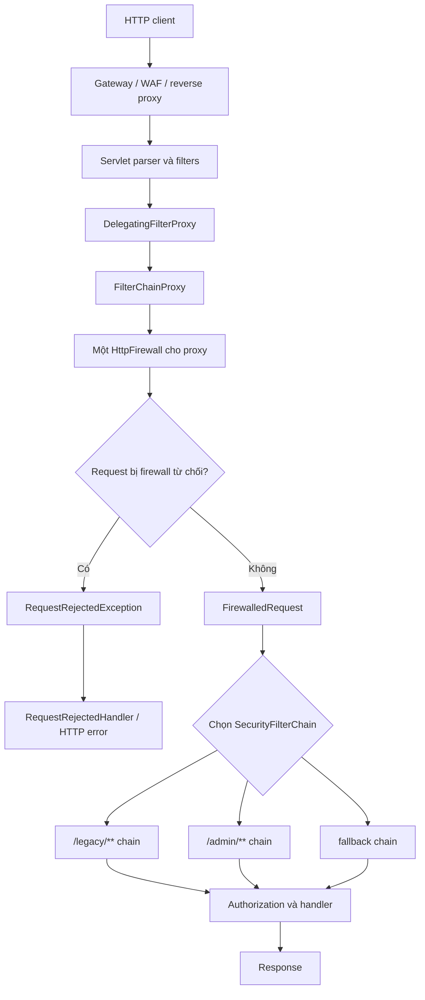

# Ngoại lệ firewall có phạm vi cùng kiểm thử hồi quy

## 1. Tại sao ngoại lệ firewall phải có phạm vi?

Trong chương **Firewall trên Servlet** của module **SPRING_SECURITY_HTTP_PROTECTION**, người học đã gặp `StrictHttpFirewall`, các lớp bảo vệ CSRF/CORS, security headers, CSP, HSTS và quản lý session. Trong sản phẩm thực tế, một số ứng dụng legacy có thể yêu cầu một biểu diễn URL, HTTP method hoặc host mà `StrictHttpFirewall` mặc định từ chối.

Ví dụ một trang catalog cũ dùng Spring MVC matrix variables:

```http
GET /legacy/catalog/42;color=red HTTP/1.1
Host: legacy.example.test
Accept: text/html
```

Dấu chấm phẩy `;` trong path có thể bị `StrictHttpFirewall` từ chối theo mặc định. Team muốn giữ tương thích cho đúng tính năng catalog cũ, nhưng **không muốn** tất cả đường dẫn trên `/admin/**`, `/accounts/**` hay mọi API khác bắt đầu chấp nhận semicolon.

Bản năng thường gặp:

```java
StrictHttpFirewall firewall = new StrictHttpFirewall();
firewall.setAllowSemicolon(true);
```

Đoạn code này thay đổi chính sách của **instance firewall**; nó không tự giới hạn ngoại lệ chỉ với `/legacy/catalog/**`. Trong cấu hình Servlet thông thường, `FilterChainProxy` sử dụng một `HttpFirewall` trước khi chọn `SecurityFilterChain`, vì vậy một setter trên firewall chung có thể mở phạm vi chấp nhận request **trước tất cả chains** do proxy đó quản lý.

Bài học có hai mục tiêu song song:

1. **Thiết kế ngoại lệ tối thiểu:** chỉ mở representation thật sự cần, trong vùng tin cậy được xác minh, với owner và thời hạn rõ ràng.
2. **Kiểm thử hồi quy:** chứng minh request hợp lệ mới hoạt động **và** request đáng ngờ ngoài phạm vi vẫn bị từ chối; phân quyền, CSRF, CORS, session và response headers không bị suy yếu.

**Nguyên tắc trung tâm:** một ngoại lệ được đánh giá thành công không phải vì “request `400` biến mất”, mà vì *use case được cho phép hoạt động trong khi ranh giới bảo mật còn lại vẫn được giữ nguyên*.

### Mục tiêu học tập

Sau bài này, bạn có thể:

1. Phân biệt ngoại lệ theo **ký tự/representation**, theo **HTTP method**, theo **host**, theo **service** và theo **route**.
2. Giải thích tại sao `securityMatcher("/legacy/**")` không tự giới hạn một setter của `StrictHttpFirewall`.
3. Ưu tiên sửa client/URL contract hoặc cô lập một service trước khi nới firewall toàn cục.
4. Thiết kế chính sách có điều kiện mà không tin raw URL chưa chuẩn hóa như một identity đã xác thực.
5. Hiểu những giới hạn và rủi ro của một `HttpFirewall` decorator chọn delegate theo host/route.
6. Tạo ma trận positive/negative tests, including authorization, CSRF, CORS, redirect, HTTP methods, session và proxy.
7. Sử dụng JUnit, `FilterChainProxy`, MockMvc và phép thử HTTP trên môi trường được cho phép.
8. Gắn metrics, canary deployment, expiration date và rollback vào vòng đời ngoại lệ.
9. Không sao chép trực tiếp Servlet firewall config sang Reactive/WebFlux.

## 2. Đầu tiên cần xác định “ngoại lệ” cụ thể là gì

Một đề xuất “cho phép request cũ” chưa đủ để review. Hãy ghi đầy đủ:

| Câu hỏi | Ví dụ câu trả lời rõ ràng |
| --- | --- |
| **Request nào** cần hoạt động? | `GET /legacy/catalog/{id};color={red|blue}`. |
| **Tại host nào**? | Chỉ `legacy.example.test`. |
| **Method nào**? | `GET`; HEAD và OPTIONS được xem xét riêng. |
| **Tại sao cần**? | Client catalog cũ đã phát hành URLs chứa matrix variable. |
| **Representation được thêm**? | Dấu `;` literal với grammar ràng buộc. |
| **Representation vẫn cấm**? | `%2F`, `%5C`, `%25`, `..`, `//`, method lạ, untrusted Host. |
| **Thời hạn**? | Đến khi client migration hoàn tất, có ngày review. |
| **Owner**? | Team catalog + security reviewer + owner ingress. |
| **Test bằng chứng**? | Bản ghi unit/integration/staging regression, negative cases. |
| **Rollback**? | Revert policy và routing sau khi traffic legacy dừng. |

Hãy phân biệt thêm **phạm vi ngoại lệ**:

- **Loại input:** chỉ semicolon, không mở encoded slash.
- **Method:** chỉ GET, không vô tình hỗ trợ DELETE.
- **Host:** chỉ hostname đã có ingress/TLS được kiểm soát.
- **Route:** chỉ endpoint có business contract được phép dùng matrix variable.
- **Service/deployment:** ưu tiên một ứng dụng hoặc listener riêng.
- **Principal/resource:** dù URL hợp lệ, vẫn phải kiểm tra quyền.
- **Thời gian:** ngoại lệ là nợ kỹ thuật có lịch thu hồi.

Nếu không xác định được phạm vi và negative cases, **chưa nên thay default firewall**.

## 3. Một instance firewall không tương đương một security chain

### 3.1. Vị trí trong pipeline Servlet



`HttpFirewall` tham gia vào `FilterChainProxy` **trước bước chọn `SecurityFilterChain`**. Vì thế:

```java
@Bean
SecurityFilterChain legacyChain(HttpSecurity http)
        throws Exception {
    http.securityMatcher("/legacy/**");
    // Không có API tự động để đặt một StrictHttpFirewall
    // riêng chỉ cho securityMatcher này.
    return http.build();
}
```

Một `SecurityFilterChain` có thể có rule authorization khác, nhưng điều đó **không tạo một `StrictHttpFirewall` instance riêng theo matcher**. Tương tự, `@GetMapping("/legacy/catalog/**")` chỉ quy định route MVC, không thu hẹp ngoại lệ trước chain selection.

### 3.2. Vì sao đặt kiểm tra trong controller là quá muộn?

Nếu firewall đã được nới toàn cục để request qua được, một controller chỉ dành cho catalog dù viết validation hoàn hảo cũng **không ngăn** các endpoints khác nhận được representation mới trước khi authorization và routing.

Ngược lại, nếu firewall vẫn strict và đã từ chối semicolon, controller catalog **không thể dùng annotation để bắt lại** request bị chặn rồi cho qua. Tầng kiểm tra có vị trí riêng.

### 3.3. Một custom filter không tự giải quyết vấn đề

`HttpSecurity.addFilterBefore(...)` thêm filter vào **chain đã chọn**. Nếu ngoại lệ phải được áp tại `HttpFirewall` trước khi matcher chạy, một filter sau lựa chọn chain không phải giải pháp tương đương.

Tránh thêm filter tự decode/rewrite URL sau security matching; nó có thể thay resource identity **sau khi rule quyền đã được quyết định**.

## 4. Những lựa chọn thiết kế, từ ưu tiên đến phức tạp

| Phương án | Phạm vi tác động | Khi nên chọn | Rủi ro |
| --- | --- | --- | --- |
| **Sửa client/URL contract** | Không nới firewall | Có quyền nâng client hoặc chuyển ID chứa ký tự đặc biệt sang query/body | Cần quản lý rollout của clients. |
| **Redirect alias URL hợp lệ** | Route alias cụ thể | URL cũ đã được framework chấp nhận và có mapping rõ | Method/caching/redirect loop nếu làm sai. |
| **Cô lập legacy service/virtual host** | Một deployment hoặc trust boundary | Legacy feature thật sự cần quy tắc khác | Tăng chi phí vận hành, cần ingress/Host/TLS/CORS policy rõ. |
| **Một firewall decorator chọn chính sách** | Theo host/route nếu chọn được an toàn | Chỉ khi không thể cô lập và đã có security review | Chọn nhầm policy trước validation, parsing ambiguity. |
| **Nới `StrictHttpFirewall` toàn cục** | Toàn `FilterChainProxy` | Chỉ khi mọi endpoints thực sự cùng chấp nhận representation đó | Tăng attack surface trên admin/login/API. |
| **Đổi sang `DefaultHttpFirewall`** | Chính sách matching trên toàn proxy | Trường hợp legacy có đánh giá chuyên sâu | Khác semantics với strict, không phải biện pháp sửa URL. |
| **`setUnsafeAllowAnyHttpMethod(true)`** | Bỏ kiểm tra method | Không khuyến nghị cho web app thông thường | HTTP verb tampering/XST và surface rộng. |

**Thứ tự khuyến nghị:** sửa contract → tách service → chính sách có điều kiện được chứng minh → ngoại lệ global chỉ khi thật sự hợp lý. Không biến bảng này thành “cứ có lỗi `400` thì thử phương án cuối”.

## 5. Ví dụ 1: sửa hợp đồng để không cần ngoại lệ

Use case: ID tài nguyên có thể chứa dấu `/`, vì thế client muốn gọi:

```text
GET /files/teamA%2Freport2026
```

Đây là vấn đề quan trọng với `setAllowUrlEncodedSlash(true)`: encoded slash có thể bị proxy/container decode và làm các tầng hiểu khác ranh giới path segments.

Một thiết kế khác:

```http
GET /files/by-id?id=teamA%2Freport2026 HTTP/1.1
Host: app.example.test
```

Hoặc dùng opaque ID:

```http
GET /files/9b7c2a1d HTTP/1.1
Host: app.example.test
```

Trên backend:

```java
@GetMapping("/files/{opaqueId}")
ResponseEntity<?> download(
        @PathVariable String opaqueId,
        Authentication authentication) {

    FileRecord record = fileRepository.findByOpaqueId(opaqueId)
        .orElseThrow(ResourceNotFoundException::new);

    fileAccessPolicy.requireRead(authentication, record);

    return fileService.download(record);
}
```

Đây là **khung nghiệp vụ minh họa**: `FileRecord`, repository và service do dự án định nghĩa. Điều quan trọng là **resource authorization áp trên record đã được xác định**, không dựa vào chuỗi path được decode nhiều lần.

Khi thay đổi API, cần migration plan, backward compatibility window và kiểm thử các clients cũ, nhưng đây thường là hướng bền vững hơn nới encoded separators cho toàn ứng dụng.

## 6. Ví dụ 2: cô lập ngoại lệ ở service riêng

Giả sử UI hiện đại phục vụ tại `app.example.test`, còn legacy catalog buộc dùng matrix variables tại `legacy.example.test`.

Topology dự kiến:

```text
app.example.test
    -> modern-service
       -> StrictHttpFirewall (default)

legacy.example.test
    -> legacy-catalog-service
       -> StrictHttpFirewall (chỉ setAllowSemicolon(true))
       -> chỉ cung cấp catalog routes
       -> authentication/authorization/CSRF theo threat model riêng
```

### 6.1. Cấu hình của service legacy

```java
import org.springframework.context.annotation.Bean;
import org.springframework.context.annotation.Configuration;
import org.springframework.security.web.firewall.StrictHttpFirewall;

@Configuration
class LegacyCatalogFirewallConfig {

    @Bean
    StrictHttpFirewall httpFirewall() {
        StrictHttpFirewall firewall = new StrictHttpFirewall();

        // Ngoại lệ chỉ tồn tại trong deployment legacy.
        firewall.setAllowSemicolon(true);

        firewall.setAllowedHostnames(host ->
            host != null &&
            host.equalsIgnoreCase("legacy.example.test"));

        // Các kiểm tra encoded slash, backslash, percent,
        // URL normalization và HTTP methods giữ default.
        return firewall;
    }
}
```

**Giới hạn phạm vi ở đây đến từ topology**, không phải từ setter `setAllowSemicolon`. Bên trong legacy service, semicolon vẫn có thể xuất hiện trên các routes khác; vì vậy service phải chỉ expose routes cần thiết và có deny-by-default authorization.

### 6.2. Cấu hình ingress phải thật sự cô lập

Ingress cần xác minh Host/virtual host, TLS certificate, routing, trusted forwarding và network exposure:

- `app.example.test` chỉ tới modern service.
- `legacy.example.test` chỉ tới legacy-catalog service.
- Unknown Host/SNI bị từ chối theo chính sách edge.
- Backend ports không mở trực tiếp cho bên ngoài để bypass ingress.
- Không tin `X-Forwarded-Host` do client tự gửi.
- Không dùng wildcard routing khiến legacy domain đến nhầm modern admin endpoints.
- Response cache/cookie/session scope tách đúng service/host.

Chỉ viết `setAllowedHostnames` không thể thay thế cấu hình mạng. Host do client đưa vào là dữ liệu cần được ingress xử lý tại trust boundary.

### 6.3. Không dùng host để suy quyền tenant

Một người có quyền vào `legacy.example.test` vẫn phải được authentication/authorization kiểm tra với catalog resources. Host validation là bước định tuyến, không phải bằng chứng principal có quyền đọc hoặc sửa bất kỳ product nào.

## 7. Ví dụ 3: ngoại lệ có điều kiện trong cùng Servlet app — chỉ để học cách review

Trong trường hợp không thể tách service, có thể xây một `HttpFirewall` decorator chọn giữa **hai `StrictHttpFirewall` instances**: instance mặc định và instance được nới **một** rule.

Đây là kỹ thuật **nâng cao, có rủi ro cao hơn tách deployment**:

- Chọn delegate diễn ra **trước khi strict firewall kiểm tra đầy đủ URL**.
- Raw path/Servlet path có thể đã bị parser hoặc proxy thay đổi.
- Nếu điều kiện match lỏng lẻo, client có thể tự đưa request đáng ngờ vào nhánh nới.
- `getFirewalledResponse(HttpServletResponse)` không nhận request, nên không thể chọn response policy theo path bằng interface đơn thuần.
- Cần tests đúng Servlet container và ingress, không chỉ tests Java.

Để giữ minh họa **dễ kiểm tra, cố tình hạn chế**, ví dụ chỉ nhận:

```text
Host: legacy.example.test
Method: GET
Context path: ""
Servlet mapping: root
Path: /legacy/catalog/<1..8 chữ số>;color=red|blue
```

Đường đi có `%`, backslash, slash thừa, dấu chấm hoặc các values khác **không đủ điều kiện**. Phạm vi hẹp này minh họa nguyên tắc, không phải production library có thể copy cho mọi topology.

### 7.1. Bộ định tuyến firewall theo điều kiện minh bạch

```java
import java.util.Locale;
import java.util.Set;
import java.util.regex.Pattern;

import jakarta.servlet.http.HttpServletRequest;
import jakarta.servlet.http.HttpServletResponse;

import org.springframework.security.web.firewall.FirewalledRequest;
import org.springframework.security.web.firewall.HttpFirewall;
import org.springframework.security.web.firewall.StrictHttpFirewall;

public final class ScopedMatrixFirewall implements HttpFirewall {

    private static final String LEGACY_HOST =
        "legacy.example.test";

    private static final Set<String> APPROVED_HOSTS =
        Set.of("app.example.test", LEGACY_HOST);

    // Regex chính xác trên dạng path mà deployment đã chốt.
    // Không nhận percent encoding, dot segment, slash thừa.
    private static final Pattern LEGACY_CATALOG_PATH =
        Pattern.compile(
            "^/legacy/catalog/[1-9][0-9]{0,7};color=(red|blue)$");

    private final StrictHttpFirewall standard =
        new StrictHttpFirewall();

    private final StrictHttpFirewall matrix =
        new StrictHttpFirewall();

    public ScopedMatrixFirewall() {
        // Giữ rule Host tại cả hai delegates.
        this.standard.setAllowedHostnames(
            this::isApprovedHost);

        this.matrix.setAllowedHostnames(
            host -> host != null &&
                LEGACY_HOST.equalsIgnoreCase(host));

        // Chỉ nới semicolon trên delegate matrix.
        this.matrix.setAllowSemicolon(true);
    }

    private boolean isApprovedHost(String host) {
        return host != null &&
            APPROVED_HOSTS.contains(
                host.toLowerCase(Locale.ROOT));
    }

    private boolean isScopedLegacyCase(
            HttpServletRequest request) {

        if (!"GET".equals(request.getMethod())) {
            return false;
        }

        if (!LEGACY_HOST.equalsIgnoreCase(
                request.getServerName())) {
            return false;
        }

        // Ví dụ chỉ hỗ trợ context root và servlet mapping
        // đã được xác nhận. Khác cấu hình thì fail closed.
        if (!"".equals(request.getContextPath()) ||
                request.getPathInfo() != null) {
            return false;
        }

        String uri = request.getRequestURI();
        String servletPath = request.getServletPath();

        // Chỉ dùng cùng representation đã kiểm chứng.
        return uri != null &&
            uri.equals(servletPath) &&
            LEGACY_CATALOG_PATH.matcher(uri).matches();
    }

    @Override
    public FirewalledRequest getFirewalledRequest(
            HttpServletRequest request) {

        StrictHttpFirewall chosen =
            isScopedLegacyCase(request)
                ? matrix : standard;

        return chosen.getFirewalledRequest(request);
    }

    @Override
    public HttpServletResponse getFirewalledResponse(
            HttpServletResponse response) {

        // Hai delegates đều là StrictHttpFirewall.
        // Dùng một response policy chung.
        return standard.getFirewalledResponse(response);
    }
}
```

**Cảnh báo quan trọng:** ví dụ này giả định ingress đã xác nhận Host và Servlet parser trả `requestURI`/`servletPath` đúng hợp đồng. Nếu một component normalize raw request-target trước đó, matcher chỉ biết representation **sau normalization**. Nó không thể chứng minh request gốc của client đã có dạng “sạch”. Trong production, hãy ưu tiên tách service hoặc có security review riêng, test trên đúng container/gateway và bổ sung guards theo topology thật.

### 7.2. Điều kiện match phải fail closed

Với code trên:

| Case | Chọn delegate | Kỳ vọng |
| --- | --- | --- |
| GET, legacy host, `/legacy/catalog/42;color=red` | `matrix` | Có thể vượt rule semicolon; còn các rule strict khác. |
| GET, app host, cùng URL | `standard` | Semicolon bị từ chối. |
| POST, legacy host, cùng URL | `standard` | Semicolon bị từ chối; không mở hành động ghi. |
| GET, legacy host, `/admin;v=1` | `standard` | Semicolon bị từ chối. |
| GET, legacy host, `/legacy/catalog/42;color=green` | `standard` | Từ chối. |
| GET, legacy host, `/legacy/catalog/42%3Bcolor=red` | `standard` | Không khớp literal grammar; encoded semicolon không được mở. |
| GET, legacy host, `/legacy/catalog/42;color=red/../admin` | `standard` | Từ chối traversal/semicolon. |
| GET, unknown host, `/health` | `standard` | Host không thuộc allowlist, bị từ chối. |
| GET, app host, `/health` | `standard` | Chấp nhận request bình thường. |

Lưu ý `GET /legacy/catalog/42;color=red` được firewall cho phép **không có nghĩa** controller chắc chắn match hoặc người dùng có quyền xem catalog item 42. Security filter chain, MVC và resource-level permission vẫn quyết định tiếp.

### 7.3. Đăng ký decorator vào một `FilterChainProxy` hiện có

```java
import org.springframework.context.annotation.Bean;
import org.springframework.context.annotation.Configuration;
import org.springframework.security.config.annotation.web.configuration.WebSecurityCustomizer;

@Configuration
class ScopedFirewallRegistration {

    @Bean
    WebSecurityCustomizer customFirewall() {
        return web -> web.httpFirewall(
            new ScopedMatrixFirewall());
    }
}
```

Đây là **một phương án thay thế** cấu hình chỉ có `StrictHttpFirewall` ở mục 6, không kích hoạt đồng thời hai cấu hình. Không tự tạo thêm `FilterChainProxy` để “áp riêng” cho một route nếu framework chưa được thiết kế và test cho việc đó.

### 7.4. Tại sao không chọn bằng `rawRequestURI.startsWith("/legacy")`?

Một predicate kiểu:

```java
// ANTI-PATTERN: raw path chưa validated, prefix không có ranh giới.
return request.getRequestURI().startsWith("/legacy");
```

có thể khớp cả `/legacy-admin`, `/legacy/../admin`, hoặc dạng URI bị parser/encoder xử lý khác. Nếu điều kiện này quyết định **bỏ qua một security constraint**, hậu quả nghiêm trọng hơn một matcher business thông thường.

Ngay cả regex mẫu ở trên **không phải giấy bảo đảm an toàn tuyệt đối**: phải xác minh servlet mappings, URI decoding, proxy rewrite và request-target thực trên deployment.

### 7.5. Khi nào không nên dùng decorator?

Không dùng nếu:

- Nhiều HTTP connectors/proxies không thống nhất path/Host.
- Có Spring MVC servlet mappings phức tạp và không thể chứng minh representation.
- Có request forwarding/rewriting mâu thuẫn giữa gateway và Java.
- Một ngoại lệ cần áp ở URL mà chứa encoded separators hoặc nested decode bất thường.
- Có nhiều tenants/custom domains tự đăng ký, host registry chưa đáng tin.
- Không có khả năng chạy negative authorization tests.
- Không có owner, theo dõi false positives hoặc kế hoạch thu hồi.

Trong các trường hợp đó, **cô lập service** hoặc **thay URL contract** thường an toàn, dễ vận hành và dễ audit hơn.

## 8. Những setter khác cũng có phạm vi rộng

Ngoại lệ semicolon chỉ là một trong nhiều lựa chọn. `StrictHttpFirewall` có các API như:

```java
firewall.setAllowSemicolon(true);
firewall.setAllowUrlEncodedSlash(true);
firewall.setAllowBackSlash(true);
firewall.setAllowUrlEncodedPercent(true);
firewall.setAllowUrlEncodedPeriod(true);
firewall.setAllowUrlEncodedDoubleSlash(true);
firewall.setAllowedHttpMethods(
    List.of("GET", "HEAD", "OPTIONS", "POST"));
firewall.setAllowedHostnames(hostPredicate);
firewall.setAllowedHeaderNames(headerNamePredicate);
firewall.setAllowedHeaderValues(headerValuePredicate);
firewall.setAllowedParameterNames(parameterNamePredicate);
firewall.setAllowedParameterValues(parameterValuePredicate);
```

Đây là **danh sách các khả năng cấu hình, không phải một block nên áp dụng đồng thời**. Với mỗi setter, phải nêu chính xác input được mở và regression cases.

### 8.1. Semicolon

Mặc định không cho semicolon path vì có thể gây URL-based authorization bypass trong một số ứng dụng/Servlet configurations. Matrix variables là một nhu cầu có thể tồn tại, nhưng không được suy chỉ có catalog endpoint sử dụng semicolon sau khi setter được bật chung.

### 8.2. Encoded slash/backslash/percent

Cho phép `%2F`, `%5C` hoặc `%25` có thể tạo khác biệt giữa gateway, Servlet container và matcher. Đừng mở đồng thời chỉ vì một file ID chứa dấu phân cách; ưu tiên ID opaque.

Đặc biệt, một setter cho phép encoded slash **không ép tất cả tầng giữ nguyên encoded slash**. Nếu container đã decode hoặc reject trước Spring, setter không thể cứu request.

### 8.3. HTTP method allowlist

Default `StrictHttpFirewall` thường cho phép `DELETE`, `GET`, `HEAD`, `OPTIONS`, `PATCH`, `POST` và `PUT` theo Javadoc. Khi dùng `setAllowedHttpMethods(...)`, bạn thay collection allowed method của firewall; nó không tự áp theo controller.

Không dùng `setUnsafeAllowAnyHttpMethod(true)` để hỗ trợ một method mở rộng đơn lẻ. Nếu WebDAV thật sự cần `PROPFIND`, cân nhắc service riêng hoặc allowlist hẹp kèm explicit authorization/method semantics.

### 8.4. Host allowlist

`setAllowedHostnames(Predicate<String>)` kiểm tra `request.getServerName()` ở Servlet firewall theo implementation. Nó không trực tiếp xác nhận TLS SNI, Host trên wire hoặc `X-Forwarded-Host` mà client có thể giả mạo.

Một policy route-scoped không thể tin `getServerName()` nếu ingress không bảo vệ Host/forwarded trust boundary.

### 8.5. Header/parameter predicates

Một `Predicate<String>` có thể chỉ nhìn một tên hoặc một giá trị, không có đủ route/principal context. Đừng cố sử dụng nó để thay validation của một custom header hoặc form field riêng.

Nếu cần giới hạn `X-Client-Mode` hay `q` ở **một endpoint**, validate ở tầng ứng dụng theo schema thay vì đặt một global predicate làm hỏng `Authorization`, `Cookie`, `_csrf` hoặc form login.

## 9. Nới một rule không vô hiệu các rule còn lại

Một hiểu nhầm phổ biến:

> “Tôi đã bật semicolon nên firewall sẽ không kiểm tra URL nữa.”

Không đúng. `StrictHttpFirewall` vẫn có thể kiểm tra method, URL normalization, encoded separators, hostname, header/parameter predicates và các rule khác.

Ví dụ:

```java
StrictHttpFirewall firewall = new StrictHttpFirewall();
firewall.setAllowSemicolon(true);
```

Với policy này:

- Một URL matrix-variable hợp lệ có thể qua semicolon check.
- `/public/../admin` vẫn không trở thành hợp lệ chỉ nhờ semicolon setter.
- `TRACE` vẫn nằm ngoài default HTTP method allowlist.
- Encoded slash/backslash/percent vẫn bị đánh giá theo default policy.
- Nếu đã cấu hình host allowlist, unknown host vẫn có thể bị từ chối.

**Nhưng** điều đó không làm ngoại lệ tự có phạm vi: mọi endpoint đi qua instance này có thể chịu rule semicolon đã nới.

## 10. Threat model cho ngoại lệ có phạm vi

Một review tối thiểu cần hỏi:

1. Request nào đã từng bị firewall từ chối? Có `RequestRejectedException` thực hay lỗi từ ingress/parser?
2. URL contract nào khiến client tạo representation đó?
3. Nơi nào đang có rule authorization theo path?
4. Có multiple `SecurityFilterChain` hoặc fallback `permitAll` không?
5. Request matcher và MVC handler có canonicalization/decoding khác nhau không?
6. Có proxy rewrite path, merge slashes, path parameters hoặc header trust không?
7. Có resource identity/tenant ownership phụ thuộc raw URL không?
8. Có CORS preflight, session cookie, CSRF token hoặc OAuth callback cần regression không?
9. Có thể cô lập một endpoint bằng service/hostname thực sự độc lập không?
10. Có kế hoạch quan sát, tắt ngoại lệ và kiểm tra lại sau migration không?

### 10.1. Asset cần bảo vệ

- Tài khoản người dùng và quản trị.
- Session cookie, CSRF token và bearer tokens.
- Resource IDs, files, reports và tenant data.
- OAuth/OIDC redirect URIs.
- API methods thay đổi trạng thái.
- Cache entries và public URLs.
- Logs/metrics không chứa secrets.

### 10.2. Trust boundaries

```text
Internet client → CDN/WAF → Ingress → Servlet parser
                → HttpFirewall → SecurityFilterChain
                → MVC binder → service/resource authorization
                → storage/cache
```

Mỗi hop có thể parse/normalize khác nhau. Một ngoại lệ ở Spring Security không tự thay chính sách các hops còn lại.

### 10.3. Invariants (bất biến bảo mật)

Viết thành yêu cầu kiểm thử:

- `/admin/**` không được phép cho anonymous hoặc user không có quyền.
- Không được chọn resource B sau khi authorization cho resource A.
- URL traversal và encoded separator ngoài ngoại lệ tiếp tục bị từ chối.
- `TRACE` hoặc method không dùng vẫn bị từ chối.
- Unknown Host không được route tới app nhạy cảm.
- CSRF token vẫn bắt buộc với state-changing requests theo threat model.
- CORS không mở rộng origin/method/credentials.
- Session/cookie scope không đổi bất ngờ.
- Rejected requests không được xử lý business side effects.
- Error responses và logs không tiết lộ secrets.

## 11. Test pyramid: không có một phép thử nào đủ

| Tầng | Chứng minh được | Không chứng minh được |
| --- | --- | --- |
| Unit `StrictHttpFirewall` | Setter có chấp nhận/từ chối request mock cụ thể không. | HTTP parser, proxy, selected chain, controller và quyền thật. |
| Unit custom `HttpFirewall` | Bộ chọn delegate có fail closed không. | Container có chuẩn hóa URI/Host trước đó không. |
| Unit `FilterChainProxy` | Firewall kết nối với proxy, request bị từ chối không đến downstream. | Full MVC/Boot integration và public edge. |
| MockMvc với Spring Security filters | Method/path authorization, CSRF, controller mapping trong test context. | Real HTTP framing, TLS SNI, CDN cache và connector parsing. |
| Embedded Servlet container | Tomcat/Jetty/Undertow phân tích/forward URL ra sao. | Gateway/CDN ngoài ứng dụng. |
| Staging qua public HTTPS | Hành vi end-to-end của deployment cụ thể. | Mọi client/network path và mọi tương lai sau upgrade. |
| Canary/telemetry | False positives, runtime behavior thực. | Bằng chứng logic đầy đủ nếu thiếu negative tests. |

**Cần ít nhất hai loại test** cho một ngoại lệ URL: unit tests chứng minh **giới hạn rule**, và HTTP integration tests chứng minh **đường truyền thực**. Với route nhạy cảm, cần cả negative authorization tests.

## 12. JUnit 5: chứng minh default policy trước khi nới

Đầu tiên, tạo baseline của `StrictHttpFirewall`. Ví dụ Spring Security Servlet 6.x+, JUnit 5 và Spring Test:

```java
import org.junit.jupiter.api.Test;
import org.springframework.mock.web.MockHttpServletRequest;
import org.springframework.security.web.firewall.RequestRejectedException;
import org.springframework.security.web.firewall.StrictHttpFirewall;

import static org.junit.jupiter.api.Assertions.assertDoesNotThrow;
import static org.junit.jupiter.api.Assertions.assertThrows;

class FirewallBaselineTest {

    private MockHttpServletRequest request(String uri) {
        var req = new MockHttpServletRequest("GET", uri);
        req.setServletPath(uri);
        return req;
    }

    @Test
    void defaultRejectsSemicolon() {
        var firewall = new StrictHttpFirewall();

        assertThrows(RequestRejectedException.class, () ->
            firewall.getFirewalledRequest(
                request("/legacy/catalog/42;color=red")));
    }

    @Test
    void defaultAcceptsOrdinaryPath() {
        var firewall = new StrictHttpFirewall();

        var safe = assertDoesNotThrow(() ->
            firewall.getFirewalledRequest(
                request("/legacy/catalog/42")));

        safe.reset();
    }

    @Test
    void defaultRejectsDotSegments() {
        var firewall = new StrictHttpFirewall();

        assertThrows(RequestRejectedException.class, () ->
            firewall.getFirewalledRequest(
                request("/public/../admin")));
    }
}
```

**Đây là regression baseline.** Nếu sau thay đổi policy mà tất cả các test default bị thay hoặc xóa đi, ta mất cơ sở so sánh mức độ nới firewall.

### 12.1. Cách tạo mock chính xác

Luôn đặt HTTP method hợp lệ, `requestURI` và `servletPath` phù hợp mục tiêu test. `new MockHttpServletRequest()` không tham số có thể chứa method rỗng tùy phiên bản Spring Test, dẫn đến exception do method thay vì URL.

### 12.2. Đừng khẳng định HTTP status ở unit firewall

`getFirewalledRequest(...)` ném `RequestRejectedException` nhưng không tự gửi `400` vì nó không nhận response. Muốn test status cuối phải gắn `RequestRejectedHandler`/`FilterChainProxy` hoặc chạy HTTP server.

## 13. JUnit 5: test chính xác phạm vi custom firewall

Sử dụng `ScopedMatrixFirewall` ở mục 7, tạo test với các biến thể host/method/path. Mock cần mô phỏng ràng buộc context root và Servlet path của ví dụ.

```java
import org.junit.jupiter.api.Test;
import org.springframework.mock.web.MockHttpServletRequest;
import org.springframework.security.web.firewall.RequestRejectedException;

import static org.junit.jupiter.api.Assertions.assertDoesNotThrow;
import static org.junit.jupiter.api.Assertions.assertThrows;

class ScopedMatrixFirewallTest {

    private final ScopedMatrixFirewall firewall =
        new ScopedMatrixFirewall();

    private MockHttpServletRequest request(
            String method, String host, String uri) {

        var req = new MockHttpServletRequest(method, uri);
        req.setServerName(host);
        req.setContextPath("");
        req.setServletPath(uri);
        return req;
    }

    @Test
    void allowsOnlyTheReviewedLegacyCase() {
        var req = request(
            "GET", "legacy.example.test",
            "/legacy/catalog/42;color=red");

        var safe = assertDoesNotThrow(() ->
            firewall.getFirewalledRequest(req));
        safe.reset();
    }

    @Test
    void sameUriOnModernHostIsRejected() {
        var req = request(
            "GET", "app.example.test",
            "/legacy/catalog/42;color=red");

        assertThrows(RequestRejectedException.class,
            () -> firewall.getFirewalledRequest(req));
    }

    @Test
    void postDoesNotEnterTheExceptionBranch() {
        var req = request(
            "POST", "legacy.example.test",
            "/legacy/catalog/42;color=red");

        assertThrows(RequestRejectedException.class,
            () -> firewall.getFirewalledRequest(req));
    }

    @Test
    void semicolonOnAdminRouteIsStillRejected() {
        var req = request(
            "GET", "legacy.example.test",
            "/admin;mode=full/reports");

        assertThrows(RequestRejectedException.class,
            () -> firewall.getFirewalledRequest(req));
    }

    @Test
    void encodedSemicolonDoesNotEnterTheExceptionBranch() {
        var req = request(
            "GET", "legacy.example.test",
            "/legacy/catalog/42%3Bcolor=red");

        assertThrows(RequestRejectedException.class,
            () -> firewall.getFirewalledRequest(req));
    }

    @Test
    void unreviewedColorIsRejected() {
        var req = request(
            "GET", "legacy.example.test",
            "/legacy/catalog/42;color=green");

        assertThrows(RequestRejectedException.class,
            () -> firewall.getFirewalledRequest(req));
    }

    @Test
    void traversalRemainsRejected() {
        var req = request(
            "GET", "legacy.example.test",
            "/legacy/catalog/42;color=red/../admin");

        assertThrows(RequestRejectedException.class,
            () -> firewall.getFirewalledRequest(req));
    }

    @Test
    void unknownHostIsRejected() {
        var req = request(
            "GET", "attacker.example",
            "/health");

        assertThrows(RequestRejectedException.class,
            () -> firewall.getFirewalledRequest(req));
    }

    @Test
    void ordinaryModernRequestStillWorks() {
        var req = request(
            "GET", "app.example.test", "/health");

        var safe = assertDoesNotThrow(() ->
            firewall.getFirewalledRequest(req));
        safe.reset();
    }
}
```

**Điểm quan trọng:** các test này chỉ chứng minh **logic của decorator trên một `MockHttpServletRequest` đã được tạo sẵn**. Chúng **không** chứng minh HTTP client/proxy/Tomcat trình bày path có semicolon y hệt giá trị ở mock. Nếu real container đã bỏ semicolon khỏi `servletPath`, điều kiện equality sẽ fail closed và ngoại lệ không hoạt động; đó là một tín hiệu cần sửa kiến trúc/test assumptions, **không phải lý do bỏ guard mà không review**.

### 13.1. Test âm tính phải nhiều hơn test dương tính

Một test “legacy catalog được HTTP 200” chỉ chứng minh nới rule thành công; không cho biết bạn đã mở rộng quyền ở đâu khác. Với firewall, các ca:

- khác host;
- khác method;
- khác route;
- encoded variants;
- dot segments;
- user không có quyền;
- CSRF thiếu token;

cần là thành phần bắt buộc của thay đổi.

### 13.2. Thêm tests cho case sensitivity

HTTP method names phân biệt hoa/thường. Nếu case `get` được client gửi, nó không được mặc nhiên đối xử như `GET` trong method allowlist. Host DNS thường không phân biệt hoa/thường nhưng phải được edge/parser xác minh trước khi đặt vào branch exception.

## 14. Test `FilterChainProxy`: request bị reject không chạy downstream

Để xác minh firewall đã được gắn vào proxy, dùng một security chain trống **chỉ trong test**.

```java
import java.util.concurrent.atomic.AtomicBoolean;

import org.junit.jupiter.api.Test;
import org.springframework.mock.web.MockHttpServletRequest;
import org.springframework.mock.web.MockHttpServletResponse;
import org.springframework.security.web.DefaultSecurityFilterChain;
import org.springframework.security.web.FilterChainProxy;
import org.springframework.security.web.firewall.HttpStatusRequestRejectedHandler;
import org.springframework.security.web.util.matcher.AnyRequestMatcher;

import static org.junit.jupiter.api.Assertions.assertEquals;
import static org.junit.jupiter.api.Assertions.assertFalse;
import static org.junit.jupiter.api.Assertions.assertTrue;

class ScopedFirewallProxyTest {

    private MockHttpServletRequest request(
            String host, String uri) {

        var req = new MockHttpServletRequest("GET", uri);
        req.setContextPath("");
        req.setServletPath(uri);
        req.setServerName(host);
        return req;
    }

    private FilterChainProxy proxy() {
        var chain = new DefaultSecurityFilterChain(
            AnyRequestMatcher.INSTANCE);

        var proxy = new FilterChainProxy(chain);
        proxy.setFirewall(new ScopedMatrixFirewall());
        proxy.setRequestRejectedHandler(
            new HttpStatusRequestRejectedHandler(400));
        return proxy;
    }

    @Test
    void disallowedRequestCannotReachApplicationChain()
            throws Exception {

        var reached = new AtomicBoolean(false);
        var response = new MockHttpServletResponse();

        proxy().doFilter(
            request("app.example.test",
                "/legacy/catalog/42;color=red"),
            response,
            (req, res) -> reached.set(true));

        assertEquals(400, response.getStatus());
        assertFalse(reached.get());
    }

    @Test
    void approvedLegacyCaseCanReachApplicationChain()
            throws Exception {

        var reached = new AtomicBoolean(false);
        var response = new MockHttpServletResponse();

        proxy().doFilter(
            request("legacy.example.test",
                "/legacy/catalog/42;color=red"),
            response,
            (req, res) -> reached.set(true));

        assertTrue(reached.get());
        assertEquals(200, response.getStatus());
    }
}
```

**Giới hạn:** một `DefaultSecurityFilterChain` không có filters chỉ giúp test phối hợp proxy/firewall. Production cần authentication, authorization, CSRF/CORS, header writers và route handlers. Không copy empty chain thành cấu hình thật.

### 14.1. Vì sao dùng `RequestRejectedHandler`?

`StrictHttpFirewall` ném `RequestRejectedException` khi từ chối. `FilterChainProxy` trong các phiên bản hiện hành dùng `HttpStatusRequestRejectedHandler` để tạo `400` theo cấu hình. Đây là response của firewall layer, **không** phải response từ MVC controller.

Một handler được tùy chỉnh để trả JSON error vẫn phải giữ nguyên ý nghĩa: **request bị từ chối không được tiếp tục vào business handler**.

## 15. MockMvc: kiểm tra toàn bộ security contract của endpoint

Giả sử một ứng dụng catalog thử nghiệm có endpoint đọc item và endpoint admin. Nhiệm vụ của MockMvc là kiểm tra routing/auth/CSRF/response trong context Spring, chứ không thay raw HTTP parser.

### 15.1. Security configuration mẫu

```java
import org.springframework.context.annotation.Bean;
import org.springframework.context.annotation.Configuration;
import org.springframework.http.HttpMethod;
import org.springframework.security.config.Customizer;
import org.springframework.security.config.annotation.web.builders.HttpSecurity;
import org.springframework.security.web.SecurityFilterChain;

@Configuration
class CatalogSecurityConfig {

    @Bean
    SecurityFilterChain securityChain(HttpSecurity http)
            throws Exception {

        http
            .authorizeHttpRequests(auth -> auth
                .requestMatchers(HttpMethod.GET, "/legacy/catalog/**")
                    .hasAuthority("catalog:read")
                .requestMatchers("/admin/**")
                    .hasRole("ADMIN")
                .anyRequest().denyAll())
            .httpBasic(Customizer.withDefaults());

        return http.build();
    }
}
```

**Lưu ý:** với matrix variables, matcher có thể xem đường dẫn khác business handler tùy Servlet/MVC matching version. Đoạn config chỉ nêu chủ đích; trước production phải kiểm tra role/resource-level authorization khi semicolon có mặt, không suy pattern `/legacy/catalog/**` tự an toàn trong mọi parser.

### 15.2. Controller minh họa

```java
import org.springframework.web.bind.annotation.GetMapping;
import org.springframework.web.bind.annotation.MatrixVariable;
import org.springframework.web.bind.annotation.PathVariable;
import org.springframework.web.bind.annotation.RestController;

@RestController
class CatalogController {

    @GetMapping("/legacy/catalog/{id}")
    String catalog(
            @PathVariable long id,
            @MatrixVariable(
                name = "color", required = false) String color) {

        // Demo trả metadata. Production phải tra record theo ID,
        // xác thực quyền đọc item và kiểm tra allowed color.
        return id + ":" + color;
    }
}
```

Nếu không có `@MatrixVariable` binding phù hợp, MVC có thể không thấy `color` dù firewall đã chấp nhận semicolon. **Firewall allowance không tự bảo đảm handler semantics**.

### 15.3. MockMvc tests minh họa — điều kiện phụ thuộc setup

```java
import org.junit.jupiter.api.Test;
import org.springframework.beans.factory.annotation.Autowired;
import org.springframework.boot.test.autoconfigure.web.servlet.AutoConfigureMockMvc;
import org.springframework.boot.test.context.SpringBootTest;
import org.springframework.test.web.servlet.MockMvc;

import static org.springframework.security.test.web.servlet.request.SecurityMockMvcRequestPostProcessors.user;
import static org.springframework.test.web.servlet.request.MockMvcRequestBuilders.get;
import static org.springframework.test.web.servlet.result.MockMvcResultMatchers.status;

@SpringBootTest
@AutoConfigureMockMvc
class CatalogSecurityRegressionTest {

    @Autowired
    MockMvc mvc;

    @Test
    void ordinaryUserCannotReachAdminRoute() throws Exception {
        mvc.perform(get("/admin/reports")
                .with(user("reader").roles("USER")))
            .andExpect(status().isForbidden());
    }

    @Test
    void approvedReaderCanReadOrdinaryCatalogPath() throws Exception {
        mvc.perform(get("/legacy/catalog/42")
                .with(user("reader").authorities("catalog:read"))
                .with(req -> {
                    req.setServerName("legacy.example.test");
                    return req;
                }))
            .andExpect(status().isOk());
    }
}
```

Đoạn test là **hình thức regression** trong một ứng dụng thực đã nạp catalog controller và host-scoped firewall phù hợp. Tùy thế hệ Spring Boot, package `@AutoConfigureMockMvc` có thể khác. Nếu test matrix-variable URL, cần kiểm tra `getRequestURI`/`getServletPath` mà MockMvc dựng và sửa test setup chính xác với deployment; không “bỏ guard” trong production chỉ để MockMvc pass.

### 15.4. Test CSRF và method thay đổi trạng thái

Nếu legacy service có POST/PUT/PATCH/DELETE và dùng cookie-session authentication, test thêm:

- Request thiếu CSRF token phải bị từ chối theo CSRF policy.
- Request có token hợp lệ còn phải đúng role và resource permission.
- Ngoại lệ URL **không** trở thành cách bỏ qua CSRF.
- Method override `_method` và filter order không thay effective method sau authorization.
- Origin/method/headers của CORS preflight vẫn được kiểm soát riêng.

Không giải quyết `403` bằng cách tắt `csrf` chỉ vì đã nới URL firewall.

## 16. Regression matrix: giữ nguyên các đường tấn công ngoài phạm vi

Đây là một bộ kiểm tra ví dụ cho ngoại lệ **literal semicolon** trên `GET /legacy/catalog/{id};color=red|blue`.

| Loại | Request | Kỳ vọng |
| --- | --- | --- |
| **Positive** | GET catalog 42, red, legacy host | Qua firewall; handler và quyền đọc kiểm soát. |
| **Positive** | GET catalog 42, blue, legacy host | Qua firewall; business kiểm tra enum màu. |
| Negative scope | Cùng path trên app host | Firewall từ chối semicolon. |
| Negative method | POST cùng path trên legacy host | Không nằm trong ngoại lệ; từ chối. |
| Negative route | GET `/admin;mode=debug` trên legacy host | Vẫn từ chối. |
| Negative grammar | `color=green` | Vẫn từ chối nếu chưa duyệt. |
| Negative encoding | `%3B` thay literal `;` | Không nằm trong ngoại lệ, từ chối theo policy. |
| Negative encoding | `%2F`, `%5C`, `%25` | Không mở thêm encoded separators. |
| Negative traversal | `/../`, `/./` | Không cho path chưa chuẩn hóa vượt qua. |
| Negative duplicate | `//` hoặc encoded double slash | Vẫn theo Strict defaults. |
| Negative casing | Method `get` | Không giả định tương đương `GET`. |
| Negative hostname | Unknown Host | Từ chối theo host policy/edge. |
| Negative auth | USER không có `catalog:read` | `403`/`401` theo auth mechanism. |
| Negative tenant | User tenant A đọc record tenant B | Resource authorization từ chối. |
| Regression ordinary | `GET /health` trên app host | Không bị ảnh hưởng. |
| Regression ordinary | GET/HEAD trên public assets | Theo policy bình thường của app. |
| Regression CSRF | POST form thiếu token | Từ chối nếu CSRF protection áp dụng. |
| Regression CORS | OPTIONS preflight từ origin không được phép | CORS policy từ chối; không nới origin. |
| Regression method | TRACE/CONNECT/PROPFIND ngoài nhu cầu | Bị chặn ở firewall/parser. |
| Regression session | Login/logout, cookie attributes, session fixation | Không thay behavior ngoài chủ đích. |
| Regression headers | CSP/HSTS/nosniff trên 2xx/3xx/4xx | Đo response thực ở tầng tạo response. |
| Regression error | Rejected URL qua public gateway | Không tới controller; status/headers theo error owner. |

**Không chỉ test status**: cần kiểm tra handler/controller có chạy không, resource được chọn là gì, principal có quyền không, response headers có phù hợp và request có đến backend qua đúng host/path không.

## 17. Test invariants về authorization

Một thay đổi URL firewall có thể ảnh hưởng lựa chọn `SecurityFilterChain`. Phải có bộ negative tests với **người dùng không được phép**.

### 17.1. Những rule nên được mô tả rõ

```text
/admin/**         -> ROLE_ADMIN
/legacy/catalog/** -> catalog:read
/**               -> denyAll
```

Đối với multi-chain configuration, fallback `denyAll` cần được giữ. Không tạo một chain `permitAll` rộng chỉ để xử lý URL legacy không được matcher cũ nhận ra.

### 17.2. Authorization không chỉ là route prefix

Ví dụ một người có scope `catalog:read` vẫn không được xem mọi product nếu có phân quyền theo tenant/private SKU. Service phải:

```java
CatalogItem item =
    catalogRepository.requireById(itemId);

if (!catalogPolicy.canRead(authentication, item)) {
    throw new AccessDeniedException(
        "Resource access denied");
}

return catalogService.render(item);
```

`CatalogItem`, `catalogPolicy` và repository là types ứng dụng minh họa. Điểm cần giữ là kiểm tra quyền trên **record đã xác định phía server**, không trên raw path do client có thể biểu diễn nhiều cách.

### 17.3. Parser mismatch làm test “200 cho admin” không đủ

Khi user ADMIN được phép xem một đường dẫn bất thường, test `200` không chứng minh unprivileged user sẽ bị chặn. Test với anonymous, USER, tenant khác và method không phù hợp để bảo đảm không có bypass.

## 18. Test container thật: MockMvc không phải HTTP parser

`MockHttpServletRequest` cho phép gán URI/servletPath mà không trải qua HTTP parser của Tomcat/Jetty/Undertow. Với semicolon/encoded slash, container và reverse proxy có thể:

- Từ chối sớm bằng `400`.
- Giữ nguyên encoded representation.
- Decode hoặc normalize một phần.
- Strip path parameters khỏi Servlet path.
- Rewrite URI trước backend.
- Xử lý khác giữa HTTP/1.1 và HTTP/2.

Vì vậy một custom firewall condition dựa vào `requestURI.equals(servletPath)` trong mock có thể fail closed trên production. Đó là lý do cần **nghiệm thu theo đúng connector/server** chứ không đoán.

### 18.1. So ba trạng thái URL

| Điểm đo | Giá trị cần ghi |
| --- | --- |
| Client | URL/request-target mà HTTP client thật sự gửi. |
| Ingress upstream | Path đã được forward, Host/SNI và scheme. |
| Servlet | `getRequestURI()`, `getContextPath()`, `getServletPath()`, `getPathInfo()`. |
| Firewall | Delegate được chọn; rejected hay accepted (không log dữ liệu nhạy cảm). |
| Security | Chain/matcher đã chọn; principal/role. |
| MVC/service | Handler và resource identity cuối cùng. |

**Chỉ ghi các giá trị này trong môi trường kiểm thử với escaping và data minimization.** Raw URIs/headers có thể chứa secrets hoặc control characters; không mở debug logs toàn bộ traffic production.

### 18.2. Kiểm tra một request hợp lệ trước

```bash
# Chỉ dùng staging/hệ thống bạn sở hữu hoặc được phép kiểm thử.
curl -sS -D - -o /dev/null \
  'https://legacy.staging.example.test/health'
```

Xác minh TLS/certificate, ingress routing, Host và backend health trước khi gửi URL legacy. `curl -I` gửi HEAD; không dùng kết quả HEAD để suy GET behavior nếu policy có method scope.

### 18.3. Gửi case được duyệt

```bash
curl -sS -D - -o /dev/null \
  'https://legacy.staging.example.test/legacy/catalog/42;color=red'
```

Nếu HTTP `400` còn xuất hiện, **xác định tầng tạo lỗi**. Không bật thêm các setters encoded slash/backslash/percent để “thử cho đến khi hết 400”.

### 18.4. Negative cases có kiểm soát

```bash
# Chỉ chạy số lượng nhỏ và có quyền kiểm thử.
curl -sS -D - -o /dev/null \
  'https://legacy.staging.example.test/admin;mode=debug'

curl --path-as-is -sS -D - -o /dev/null \
  'https://legacy.staging.example.test/legacy/catalog/42;color=red/../admin'
```

`--path-as-is` giảm chuẩn hóa ở curl đối với một số path, nhưng **không đảm bảo** CDN/gateway/container giữ nguyên input. Kiểm tra edge logs và backend telemetry để biết request đã đi tới firewall hay chưa.

### 18.5. So backend và public gateway đúng cách

Nếu được phép truy cập backend direct:

```bash
curl -sS -D - -o /dev/null \
  'http://127.0.0.1:8080/legacy/catalog/42;color=red' \
  -H 'Host: legacy.example.test'
```

Cần lưu ý public gateway có thể thêm `Forwarded`/`X-Forwarded-*`, đổi scheme/Host hoặc rewrite context path. Hai phép thử không hoàn toàn tương đương khi các yếu tố đó khác nhau. Backend port nội bộ không nên mở công khai.

## 19. Regression với CORS, CSRF, session và response headers

Một URL firewall exception không tự làm thay những policy khác, nhưng nó có thể đưa thêm requests tới các filters downstream vốn trước đây chưa nhìn thấy representation này.

### 19.1. CORS preflight

Browser có thể gửi:

```http
OPTIONS /legacy/catalog/42;color=red HTTP/1.1
Origin: https://ui.example.test
Access-Control-Request-Method: GET
```

Nếu ngoại lệ chỉ áp cho GET, OPTIONS với semicolon có thể vẫn bị firewall từ chối. Điều này không mặc nhiên là lỗi: phải xác định frontend có thật sự dùng cross-origin fetch tới URL đó không.

Nếu cần hỗ trợ preflight, phải **đặc tả OPTIONS như một case riêng**, mở đủ hẹp, kiểm tra `Origin`, `Access-Control-Request-Method` và allowed headers bằng CORS configuration, không biến `OPTIONS` hoặc mọi origins thành allow-all.

### 19.2. CSRF

Nếu legacy app dùng session cookie và có form POST, CSRF protection vẫn phải áp theo cấu hình. Một URL GET được nới cho matrix variable không phải lý do mở POST hoặc tắt CSRF.

### 19.3. Session URL rewriting

Legacy Servlet apps đôi khi dùng `;jsessionid=...`. Bật semicolon trên firewall toàn cục có thể vô tình tạo đường đi cho URL session rewriting, làm session IDs xuất hiện trong URL, logs, browser history hoặc referrers.

Ưu tiên cookie-based session tracking, `Secure`, `HttpOnly` và `SameSite` theo threat model. Nếu có yêu cầu URL session rewriting đặc thù, phải được review và test riêng; không coi đó là tác dụng phụ được phép của ngoại lệ catalog.

### 19.4. Security response headers

Các headers như `Content-Security-Policy`, `Strict-Transport-Security` và `X-Content-Type-Options` bảo vệ browser ở tầng response. Chúng **không thay URL parsing/authorization**.

Request bị `StrictHttpFirewall` từ chối trước `HeaderWriterFilter` có thể không nhận response headers do security chain phát. Nếu tổ chức yêu cầu baseline headers trên cả errors của edge/container, hãy xác định owner response policy; không để proxy và app gửi nhiều CSP/HSTS mâu thuẫn.

### 19.5. Cookies và domain isolation

Nếu ngoại lệ được cô lập theo host, xem cookie `Domain` và `Path` có cho nhiều subdomains dùng chung session ngoài ý muốn không. Host allowlist không thay tenant/resource authorization hoặc session fixation protection.

## 20. Quan sát và alert trong giai đoạn rollout

### 20.1. Metrics nên đo gì?

| Metric | Ý nghĩa | Cách tránh rủi ro |
| --- | --- | --- |
| Firewall rejected requests | Số lượng request bị từ chối trước business handler. | Label từ enum/cố định, không dùng raw URI. |
| Approved legacy-case requests | Lượng traffic thật còn phụ thuộc ngoại lệ. | Gắn nhãn `legacy_catalog`, không gắn IDs. |
| HTTP 4xx/5xx per route | False positives hoặc errors do parser/handler. | Sử dụng low-cardinality route IDs. |
| Authorization denied | Phát hiện permission regression. | Không đưa principal/session data vào tags. |
| CORS preflight failures | Browser integration vấn đề mới. | Phân biệt firewall, CORS và upstream. |
| Latency/resource usage | Regex/predicate và parsing overhead. | Không gọi database đồng bộ trong firewall predicate. |
| Canary traffic and rollback trigger | Đánh giá release an toàn. | Threshold dựa baseline và SLA thực, không bịa con số. |

### 20.2. Logging an toàn

`RequestRejectedException` message có thể chứa URL/representation không đáng tin; request URI/query có thể chứa token, encoded CRLF hoặc dữ liệu cá nhân.

Không viết:

```java
// ANTI-PATTERN
log.warn("Rejected URI={}, cause={}",
    request.getRequestURI(), exception.getMessage());
```

nếu chưa có escaping/redaction và policy logging rõ ràng. Với phần lớn production counters, dùng event type `firewall_rejected`, policy version, deployment ID và correlation ID server-generated.

### 20.3. Canary theo từng host/service

Nếu đã tách legacy deployment, bật ngoại lệ tại service đó trước, theo dõi traffic và negative tests. Nếu dùng decorator cùng app, rolling deploy cần đảm bảo mọi instances có cùng policy; nếu không, request có thể lúc pass lúc reject tùy load balancer.

Một tính năng đang phụ thuộc ngoại lệ nên có **rollout flag quản lý phía server** nếu phù hợp, nhưng flag không được biến thành client-supplied toggle làm tắt firewall.

### 20.4. Khi nào rollback?

Ví dụ triggers:

- Negative authorization case bắt đầu pass ngoài mong đợi.
- Unexpected host/method/route đi vào nhánh nới.
- Browser session/CSRF/CORS behavior thay đổi có ảnh hưởng.
- Resource identity sau parsing không ổn định.
- Chênh lệch security chain giữa proxy/container versions.
- Không xác định được tầng reject và team bắt đầu đề xuất nới thêm rules vô điều kiện.

Rollback nên là **quay về policy strict mặc định hoặc cô lập traffic**, không chỉ sửa error body từ 400 thành 200.

## 21. Mẫu hồ sơ ngoại lệ để review và thu hồi

Có thể ghi nhận quyết định theo format sau trong ticket/ADR nội bộ (không tạo thêm file ngoài bài học này):

| Trường | Nội dung ví dụ |
| --- | --- |
| Exception ID | `FW-LEGACY-CATALOG-01` |
| Service/environment | `legacy-catalog`, staging rồi production |
| Owner | Catalog team; security reviewer |
| Business reason | Matrix-variable URL từ client legacy |
| Allowed case | GET legacy host, exact numeric ID, `color=red|blue` |
| Explicitly rejected | Admin semicolon, encoded semicolon/slash, traversal, POST, unknown Host |
| Firewall change | Chỉ `setAllowSemicolon(true)` trên isolated service/delegate |
| Trust boundary | Validated Host/TLS/ingress; backend không public |
| Additional controls | Deny-by-default, resource-level authorization, CSRF/CORS/session |
| Evidence | Unit + MockMvc + real connector + public edge negative tests |
| Rollout | Canary + telemetry + config rollback |
| Review date | Ngày cụ thể do owner quyết định |
| End-of-life | Migration client và loại bỏ ngoại lệ |

**Đây là mẫu quản trị**, không phải yêu cầu viết một tệp YAML bổ sung trong bài tập. Worker và nhóm triển khai chỉ tạo các artifacts mà workflow tương ứng cho phép.

### 21.1. Xử lý ngoại lệ hết hạn

- Đo còn bao nhiêu request phụ thuộc ngoại lệ bằng metrics không lộ dữ liệu.
- Thông báo clients và cung cấp URL contract thay thế.
- Tắt nhánh nới ở staging và chạy full regression.
- Chạy canary production nếu có thể.
- Xóa code/config ngoại lệ và tests chỉ dùng để cho phép nó; **giữ negative security tests** như một invariant dài hạn.
- Ghi nhận rollback/cutover và owner phê duyệt.

Một ngoại lệ không có ngày review dễ biến thành permanent weakening mà không ai còn nhớ lý do.

## 22. Những lỗi thiết kế thường gặp

### Lỗi A — “Đặt `securityMatcher` nên setter cũng scoped”

Không đúng. `HttpFirewall` của `FilterChainProxy` chạy trước chain selection. Nếu cần scope, chọn topology độc lập hoặc custom firewall delegation có security review.

### Lỗi B — “Cứ bật semicolon là chỉ matrix variables hoạt động”

Nới semicolon còn có thể ảnh hưởng session URL rewriting, path parameters và cách route khác hiểu URL. Test negative paths.

### Lỗi C — “Một HTTP 200 là đủ chứng minh”

HTTP 200 cho GET catalog không chứng minh `/admin;...` vẫn bị reject, user không quyền bị deny hoặc gateway không normalize traversal. Phải có negative matrix.

### Lỗi D — “Nếu bị 400 thì tắt thêm một setter”

400 có thể đến từ HTTP parser/nginx/Tomcat/Servlet container, không phải firewall. Xác định đúng layer trước khi thay cấu hình.

### Lỗi E — “Bật unsafe any method để PROPFIND hoạt động”

Không nên. Chỉ xem xét method cụ thể theo WebDAV contract, tốt nhất ở service chuyên dụng, và giữ authentication/authorization.

### Lỗi F — “Chọn ngoại lệ bằng prefix raw path”

`startsWith("/legacy")` có thể khớp URL không thuộc namespace. Trước firewall, raw URI là dữ liệu chưa được validate; chỉ dùng điều kiện rõ ràng và kiểm thử parser/decode.

### Lỗi G — “Trusted host nghĩa là user có quyền”

Host hợp lệ chỉ cho biết địa chỉ được phục vụ; quyền trên catalog/admin/tenant vẫn cần principal và resource-level policy.

### Lỗi H — “MockMvc pass nghĩa là proxy cũng pass”

MockMvc không mô phỏng đầy đủ HTTP/1.1/2 framing, encoded slash, Host/SNI hoặc ingress rewrite. Test HTTP server thật.

### Lỗi I — “Có CSP/HSTS thì đường dẫn an toàn”

CSP/HSTS bảo browser ở tầng response, không thay path authorization.

### Lỗi J — “Lấy raw request URI ghi metric label để truy vết”

Client có thể sinh vô số URIs, gây cardinality explosion và lộ secrets. Dùng tags cố định/safe.

### Lỗi K — “Decorator áp một rule nới nên không cần review”

Đường chọn delegate **cũng là security-critical code**. Nó cần negative tests, threat model, code review và owner như chính policy được nới.

### Lỗi L — “Thêm cả Strict và Default để chắc chắn hơn”

Nhiều firewall instances/decorators hoặc nhiều `FilterChainProxy` không tự làm app an toàn. Hiểu ordering và fail-closed semantics; không đăng ký nhiều config cạnh tranh.

## 23. Troubleshooting theo triệu chứng

| Triệu chứng | Chẩn đoán khả dĩ | Hành động |
| --- | --- | --- |
| Semicolon bị từ chối cả trong legacy case | Selector không match, container thay `servletPath` hoặc policy chưa được nạp | Đo path fields thực và instance firewall runtime. |
| Semicolon được chấp nhận tại `/admin/**` | Ngoại lệ global hoặc selector match quá rộng | Thu hồi/nắn scope, chạy negative auth tests ngay. |
| Same URL pass ở backend nhưng fail public | Proxy/parser khác | Kiểm tra edge URL decoding, forwarding và Host. |
| POST cũng pass ở legacy route | Selector thiếu method constraint hoặc firewall nới toàn cục | Giới hạn method, test CSRF/authorization. |
| `%3B` pass dù không được duyệt | Regex/decode selector mơ hồ | Tách raw vs parsed path, chặn encoded variant. |
| `%2F` fail sau khi bật semicolon | Encoded slash là rule khác | Đúng nếu không thuộc ngoại lệ; không tự nới. |
| Browser CORS error với GET legacy | OPTIONS preflight/Origin policy | Thiết kế preflight riêng, không dùng wildcard CORS tùy tiện. |
| Session login thay đổi | Cookie/domain/path hoặc `;jsessionid` | Kiểm tra session tracking và reverse proxy. |
| `400` thiếu CSP/HSTS | Error phát trước `HeaderWriterFilter` | Xác định layer tạo response. |
| User không role đọc được resource | Rule matcher hoặc business authorization lỗi | Ưu tiên rollback, sửa policy và add negative tests. |
| JUnit pass nhưng HTTP server reject semicolon | HTTP parser không forward representation ấy | Không tự bỏ selector guards; chỉnh API/topology. |
| Lúc pass lúc fail khi load balancing | Policy/config drift giữa instances | Đồng bộ rollout/config; kiểm tra version. |
| Unknown host được accept | Ingress/allowedHostnames không hạn chế | Đặt trusted virtual host và policy ở backend. |
| Metrics spike sau release | False positive hoặc scanning | Phân loại layer, giảm cardinality, so baseline. |
| Legacy feature đã di chuyển nhưng exception vẫn tồn tại | Không có expiration/owner | Thu hồi rule và giữ negative regression tests. |

### Quy trình chẩn đoán chín bước

1. Ghi chính xác request use case và security invariant liên quan.
2. Kiểm tra client có encode/normalize trước khi gửi không.
3. Kiểm tra edge/Servlet parser có rewrite hoặc reject trước Java không.
4. Xác nhận instance `HttpFirewall` được `FilterChainProxy` dùng.
5. Xác nhận **điều kiện chọn ngoại lệ**, không chỉ setter trên delegate.
6. Xác nhận selected `SecurityFilterChain`, CSRF/CORS/auth rules.
7. Xác nhận MVC parser và resource identity mà service dùng.
8. Chạy positive/negative regression qua mock, server và public edge.
9. Giữ lại thay đổi nhỏ nhất, có owner/expiry/rollback, hoặc quay về Strict.

## 24. Reactive/WebFlux: tương tự về nguyên tắc, không giống API

Module **SPRING_SECURITY_HTTP_PROTECTION** bao gồm cả Servlet và Reactive. Bài này bàn về `StrictHttpFirewall`, `HttpFirewall` và `FilterChainProxy` của Servlet.

| Thành phần | Servlet | Reactive/WebFlux |
| --- | --- | --- |
| Request | `HttpServletRequest` | `ServerWebExchange` / `ServerHttpRequest` |
| Firewall | `HttpFirewall` | `ServerWebExchangeFirewall` |
| Strict implementation | `StrictHttpFirewall` | `StrictServerWebExchangeFirewall` |
| Chain manager | `FilterChainProxy` | `WebFilterChainProxy` |
| Chain | `SecurityFilterChain` | `SecurityWebFilterChain` |
| Matcher | `RequestMatcher` | `ServerWebExchangeMatcher` |
| Rejection | `RequestRejectedException` | Reactive rejection API theo version |
| Test | `MockHttpServletRequest`, MockMvc, Servlet HTTP server | `MockServerWebExchange`, WebTestClient, Reactive HTTP server |

`StrictServerWebExchangeFirewall` có các phương thức tương ứng để kiểm soát semicolon và HTTP methods ở các phiên bản hiện đại, nhưng dùng request abstraction và lifecycle Reactive khác Servlet. **Không copy class `ScopedMatrixFirewall implements HttpFirewall` sang Reactive**. Nếu có nhu cầu ngoại lệ WebFlux, ưu tiên tách service, xem API `ServerWebExchangeFirewall` và kiểm thử cùng Reactor Netty/gateway thật.

### 24.1. Test WebTestClient không thay parser

WebTestClient với mock exchange không tái hiện mọi HTTP server normalization/HTTP/2 framing behavior. Một đường encoded slash được mock chấp nhận có thể bị Reactor Netty hoặc public gateway từ chối. Logic route/resource authorization vẫn phải có tests độc lập.

## 25. Bài tập tình huống

### Bài 1 — Bật semicolon toàn cục

Một team bật `setAllowSemicolon(true)` trên bean firewall chung rồi nghĩ chỉ `@GetMapping("/legacy/**")` mới nhận semicolon.

**Đáp án định hướng:** setter áp cho instance dùng bởi `FilterChainProxy` trước chain selection. Tách service hoặc thiết kế selector custom được review; test `/admin;...` và fallback routes.

### Bài 2 — Ngoại lệ chỉ GET

GET catalog matrix variable hoạt động; POST cùng URL bị từ chối.

**Đáp án:** đúng với policy ví dụ. Nếu product thật sự cần POST, phải có use case/CSRF/auth test riêng, không mở POST chỉ để “cho đủ REST”.

### Bài 3 — Encoded semicolon khác literal semicolon

`/legacy/catalog/42%3Bcolor=red` bị chặn dù literal `;` được phép.

**Đáp án:** đây là lựa chọn phạm vi rõ. Không tự decode thêm hoặc mở encoded semicolon nếu chưa chứng minh consistency ở mọi tầng.

### Bài 4 — Host giả mạo

Client Internet tự gửi `Host: legacy.example.test` và tiếp cận nhánh ngoại lệ.

**Đáp án:** nếu cùng backend cho phép truy cập trực tiếp, Host tự khai báo có thể chọn delegate. Cần ingress host validation, TLS/SNI, network isolation và policy cho service. Host check không thay authentication/authorization.

### Bài 5 — Container strip path parameters

Trong MockMvc, `requestURI == servletPath`; trên Tomcat setup thực, `servletPath` đã được xử lý khác và selector fail closed.

**Đáp án:** test đã cho thấy giả định servlet mapping sai. Không bỏ equality guard vô điều kiện; thiết kế lại scope hoặc tách service, và test qua connector thật.

### Bài 6 — Đổi sang `DefaultHttpFirewall`

Developer đổi Strict sang Default vì semicolon URL hoạt động.

**Đáp án:** đây là thay đổi security surface rộng hơn việc nới một rule; cần audit matcher, reset, authorization, parser/container, negative tests và threat model.

### Bài 7 — Unknown method

Một WebDAV endpoint cần `PROPFIND`, team bật `setUnsafeAllowAnyHttpMethod(true)`.

**Đáp án:** không nên; chọn allowed-method list cụ thể, cô lập service và test cả methods không mong đợi.

### Bài 8 — URL session ID

Sau bật semicolon, `;jsessionid` bắt đầu xuất hiện trong logs và public URLs.

**Đáp án:** có nguy cơ lộ session IDs qua URL; ưu tiên cookie-only session tracking, xem lại config Servlet/ingress và scope ngoại lệ.

### Bài 9 — CSRF 403

POST cookie session với URL bình thường trả `403` sau release ngoại lệ GET.

**Đáp án:** có thể do CsrfFilter/auth, không quy ngay cho URL firewall. Giữ CSRF đúng model; test riêng.

### Bài 10 — CORS preflight

Frontend fetch GET matrix URL phát sinh OPTIONS request bị chặn.

**Đáp án:** xác định nhu cầu cross-origin, đặt riêng OPTIONS preflight path policy có review, không mặc định nới mọi methods/origins.

### Bài 11 — Admin route bị lộ

Một user USER truy cập được `/admin/reports` sau khi nhóm thay URL router.

**Đáp án:** đây là regression nghiêm trọng; rollback, xác định chain matcher vs handler/resource identity và bổ sung negative authorization tests.

### Bài 12 — Static frontend cache

CDN coi hai URL chứa `;` là cùng cache key nhưng backend xử lý khác nhau.

**Đáp án:** cache poisoning/representation mismatch; đồng bộ cache policy với routing, không cache private tenant responses công khai.

### Bài 13 — Unit test pass, production không

`ScopedMatrixFirewallTest` pass mọi case nhưng HTTP public vẫn `400`.

**Đáp án:** gateway/container có thể reject trước Spring; dùng correlation ID/edge logs, không nới firewall theo phỏng đoán.

### Bài 14 — Metrics có URI làm label

Team gắn mọi raw URL bị từ chối vào Prometheus labels.

**Đáp án:** attacker có thể tạo cardinality không giới hạn và log/metric lộ dữ liệu. Dùng labels cố định hoặc route IDs đã normalize và được server quản lý.

### Bài 15 — Ngoại lệ không có hạn

Sau nhiều năm, client legacy đã chuyển URL nhưng `setAllowSemicolon(true)` vẫn còn.

**Đáp án:** cần owner, expiry, đo traffic, test tắt và remove policy. Giữ negative regression.

### Bài 16 — HSTS/CSP có nhưng vẫn sai quyền

Response chứa HSTS/CSP, người không có quyền vẫn đọc được tài nguyên tenant khác.

**Đáp án:** browser headers không thay resource-level authorization hoặc URL parsing consistency. Kiểm tra record ownership.

### Bài 17 — Cho route thêm màu mới

Business bổ sung `color=green` vào hợp đồng catalog.

**Đáp án:** update matcher grammar, domain enum/handler và regression theo quy trình review; không chuyển sang regex `.*` để “tránh cập nhật”.

### Bài 18 — Test chỉ thấy 200

Một PR chỉ thêm test `GET /legacy/catalog/42;color=red` trả 200.

**Đáp án:** chưa đủ. Bắt buộc có negative host/method/path/encoding/traversal/role/CSRF/CORS tests và public edge verification.

## 26. Checklist production

1. **Định nghĩa ngoại lệ bằng request grammar cụ thể**: host, method, path, input representation.
2. **Ghi rõ business reason, owner, security reviewer và thời hạn thu hồi**.
3. **Ưu tiên sửa client/URL contract** trước khi nới firewall.
4. **Ưu tiên tách service/virtual host** nếu legacy feature cần policy khác.
5. **Nhớ `HttpFirewall` chạy trước lựa chọn `SecurityFilterChain`**, không tự scope theo `securityMatcher`.
6. **Không dùng controller filter sau authorization để tự sửa URL**.
7. **Không dùng `setUnsafeAllowAnyHttpMethod(true)` chỉ để hỗ trợ một method**.
8. **Chỉ mở setter cụ thể thật sự cần**, không bật hàng loạt rules.
9. **Không coi `DefaultHttpFirewall` là sanitizer an toàn tuyệt đối**.
10. **Nếu custom decorator, chọn delegate fail closed**, không dựa trên prefix raw path tùy tiện.
11. **Kiểm tra Host/Forwarded trust tại ingress**, không tin client-supplied origin identity.
12. **Không giả định Mock Servlet path bằng path ở server thật**; đo URI fields theo connector.
13. **Không decode URL nhiều lần sau security matching**.
14. **Đảm bảo matcher và business dùng cùng resource identity**.
15. **Giữ deny-by-default fallback và object-level authorization**.
16. **Test anonymous, thiếu quyền, tenant khác và malicious variations**.
17. **Test positive case và ít nhất các negative host/method/route/encoding/path cases**.
18. **Test `TRACE`, encoded slash/backslash/percent và dot segments vẫn bị chặn**.
19. **Giữ CSRF và CORS policies**, kể cả OPTIONS preflight khi cần.
20. **Giữ cookie/session tracking, tránh URL session leakage**.
21. **Test 2xx/3xx/4xx response headers trên public HTTPS** khi yêu cầu CSP/HSTS.
22. **Tách unit firewall, proxy, MockMvc và real HTTP tests**.
23. **Dùng metrics tags low-cardinality, không log raw URI/secrets**.
24. **Triển khai canary/rolling một cách nhất quán giữa các instances**.
25. **Không dùng HTTP `400` đơn lẻ để xác định nơi từ chối**.
26. **Có rollback trigger rõ ràng khi negative tests/authorization invariants bị vi phạm**.
27. **Đối chiếu Servlet và Reactive API, không dùng `HttpFirewall` Servlet cho WebFlux**.
28. **Review lại policy sau thay đổi proxy/container/Spring Security versions**.
29. **Giữ negative tests sau khi xóa ngoại lệ**, phòng tái xuất hiện bypass.
30. **Xem ngoại lệ firewall như thay đổi security boundary, không chỉ compatibility flag**.

### Tài liệu tham khảo

- [Spring Security Reference — Servlet HTTP Firewall](https://docs.spring.io/spring-security/reference/servlet/exploits/firewall.html)
- [Spring Security Javadoc — StrictHttpFirewall](https://docs.spring.io/spring-security/reference/api/java/org/springframework/security/web/firewall/StrictHttpFirewall.html)
- [Spring Security Javadoc — HttpFirewall](https://docs.spring.io/spring-security/reference/api/java/org/springframework/security/web/firewall/HttpFirewall.html)
- [Spring Security Javadoc — FilterChainProxy](https://docs.spring.io/spring-security/reference/api/java/org/springframework/security/web/FilterChainProxy.html)
- [Spring Security Javadoc — RequestRejectedException](https://docs.spring.io/spring-security/reference/api/java/org/springframework/security/web/firewall/RequestRejectedException.html)
- [Spring Security Javadoc — HttpStatusRequestRejectedHandler](https://docs.spring.io/spring-security/reference/api/java/org/springframework/security/web/firewall/HttpStatusRequestRejectedHandler.html)
- [Spring Security Source — StrictHttpFirewall.java](https://github.com/spring-projects/spring-security/blob/main/web/src/main/java/org/springframework/security/web/firewall/StrictHttpFirewall.java)
- [Spring Security Reference — Authorize HTTP Requests](https://docs.spring.io/spring-security/reference/servlet/authorization/authorize-http-requests.html)
- [Spring Security Reference — Servlet CSRF](https://docs.spring.io/spring-security/reference/servlet/exploits/csrf.html)
- [Spring Security Reference — Servlet CORS](https://docs.spring.io/spring-security/reference/servlet/integrations/cors.html)
- [Spring Security Reference — Servlet HTTP Response Headers](https://docs.spring.io/spring-security/reference/servlet/exploits/headers.html)
- [Spring Security Javadoc — StrictServerWebExchangeFirewall](https://docs.spring.io/spring-security/reference/api/java/org/springframework/security/web/server/firewall/StrictServerWebExchangeFirewall.html)
- [Spring Security Reference — Reactive HTTP Firewall](https://docs.spring.io/spring-security/reference/reactive/exploits/firewall.html)
- [Spring Framework Reference — MVC Path Matching](https://docs.spring.io/spring-framework/reference/web/webmvc/mvc-controller/ann-requestmapping.html)
- [Spring Framework Reference — MockMvc](https://docs.spring.io/spring-framework/reference/testing/spring-mvc-test-framework.html)
- [Jakarta Servlet Specification](https://jakarta.ee/specifications/servlet/)
- [RFC 3986 — URI Generic Syntax](https://www.rfc-editor.org/rfc/rfc3986)
- [RFC 9110 — HTTP Semantics](https://www.rfc-editor.org/rfc/rfc9110)
- [OWASP — Input Validation Cheat Sheet](https://cheatsheetseries.owasp.org/cheatsheets/Input_Validation_Cheat_Sheet.html)
- [OWASP — Authorization Cheat Sheet](https://cheatsheetseries.owasp.org/cheatsheets/Authorization_Cheat_Sheet.html)
- [OWASP — Logging Cheat Sheet](https://cheatsheetseries.owasp.org/cheatsheets/Logging_Cheat_Sheet.html)
- [NGINX — Request Processing](https://nginx.org/en/docs/http/request_processing.html)

