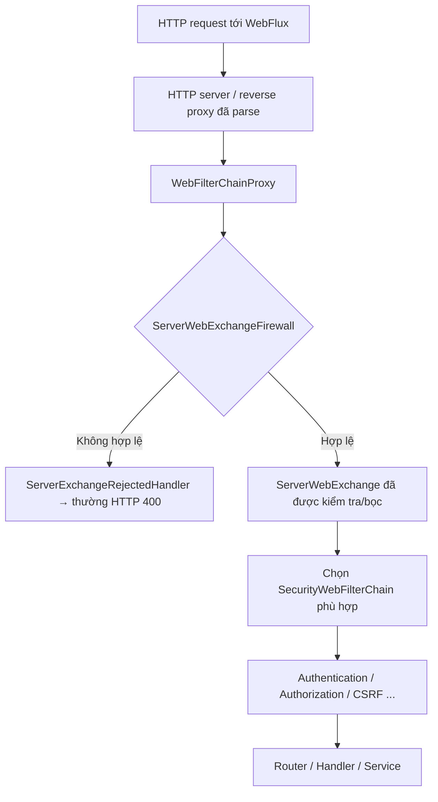

# ServerWebExchangeFirewall và phạm vi hỗ trợ theo phiên bản

## 1. Vì sao ứng dụng Reactive cần HTTP firewall?

Một API Spring WebFlux có thể định nghĩa quy tắc:

- `/public/**` cho phép mọi người truy cập;
- `/api/private/**` yêu cầu xác thực;
- mọi đường dẫn khác bị từ chối.

Nhưng một URL không phải lúc nào cũng được các thành phần xử lý giống nhau. Reverse proxy, HTTP server, Spring WebFlux router và bộ chọn `SecurityWebFilterChain` có thể hiểu khác nhau về `/a/../b`, `//`, dấu chấm phẩy, dấu gạch chéo đã URL-encode, ký tự điều khiển hoặc HTTP method bất thường. Nếu bộ kiểm tra bảo mật và router chọn hai đường dẫn khác nhau, kẻ tấn công có thể thử **né đường dẫn được bảo vệ**.

Từ **Spring Security 6.4**, API Reactive có `ServerWebExchangeFirewall` để kiểm tra và, khi cần, bọc `ServerWebExchange` trước khi chọn security chain. Triển khai mặc định `StrictServerWebExchangeFirewall` thiên về **từ chối request đáng ngờ**, thay vì âm thầm chuẩn hóa rồi để các tầng tiếp tục diễn giải khác nhau.

Bài thuộc chương **Firewall trên Reactive** của mô-đun **SPRING_SECURITY_HTTP_PROTECTION**. Mô-đun hướng tới phòng vệ HTTP và trình duyệt trong Spring Security: CSRF, CORS, security headers, CSP, HSTS, HTTP firewall và session, cho cả Servlet lẫn Reactive. Ở đây, trọng tâm là **phạm vi hỗ trợ theo phiên bản** và cách cấu hình, kiểm thử, chẩn đoán Reactive HTTP firewall khi chạy sau reverse proxy/gateway.

Sau khi học, bạn có thể:

1. Nêu chính xác sự khác biệt giữa `ServerWebExchangeFirewall` (Reactive) và `HttpFirewall` (Servlet).
2. Xác định API có mặt **từ phiên bản nào**, và vì sao không nên áp ví dụ hiện tại lên mọi ứng dụng Spring Security 5.x/6.0–6.3.
3. Mô tả cách `WebFilterChainProxy` áp firewall trước bước lựa chọn `SecurityWebFilterChain`.
4. Cấu hình `StrictServerWebExchangeFirewall`, giới hạn HTTP methods, kiểm soát dấu chấm phẩy, header/parameter và cách xử lý request bị từ chối.
5. Kiểm thử bằng `StepVerifier`, `WebTestClient` và HTTP client đi qua proxy thật; tách lỗi firewall, authorization và tầng HTTP server.
6. Tránh giảm bảo vệ quá mức khi xử lý các tình huống matrix variables, URL encoding, gateway rewrite hoặc ứng dụng có nhiều security chains.

## 2. Bảng tương thích: phải xem đúng phiên bản Spring Security

**Mốc quan trọng:** Javadoc chính thức của `ServerWebExchangeFirewall`, `StrictServerWebExchangeFirewall` và phương thức `WebFilterChainProxy.setFirewall(...)` đều ghi **`Since: 6.4`**. `WebFilterChainProxy` bản thân đã tồn tại từ Spring Security 5.0, nhưng điều đó **không có nghĩa** firewall API Reactive được trình bày ở bài này đã có từ 5.0.

| Dải phiên bản | Trạng thái đối với `ServerWebExchangeFirewall` | Cách đọc ví dụ trong bài |
| --- | --- | --- |
| Spring Security **5.x** | Không giả định có interface/API Reactive firewall này | Không copy import hoặc Bean của `StrictServerWebExchangeFirewall`; dựa vào kiểm soát ở stack/hạ tầng tương ứng và cân nhắc nâng cấp |
| **6.0–6.3** | API có mốc giới thiệu ở **6.4**; không coi các phiên bản này hỗ trợ cùng API | Kiểm tra dependency/Javadoc đúng artifact thực tế; không lấy ví dụ 6.5/7.x làm bằng chứng nó tồn tại ở bản cũ |
| **6.4** | Bắt đầu hỗ trợ API trên theo mốc Javadoc; có `WebFilterChainProxy.setFirewall(...)` | Có thể cấu hình Bean phù hợp và kiểm thử; đối chiếu chính xác patch version |
| **6.5** | Có tài liệu `ServerWebExchangeFirewall` trong Reactive reference | Các cấu hình minh họa phù hợp sau khi kiểm tra chữ ký API của version đang chạy |
| **7.x** | Reference/Javadoc hiện hành tiếp tục mô tả `StrictServerWebExchangeFirewall` và rejection handler | Có thể áp nguyên tắc, nhưng xem chính xác kiểu tham số/behavior và test của bản 7.x |

**Không tự suy Spring Security version từ tên Spring Boot version.** Boot quản lý một bộ dependency theo BOM và có thể bị override. Nếu project thực tế dùng một dependency khác mong đợi, một import hợp lệ theo Javadoc 7.x vẫn có thể **không tồn tại** trong jar đang chạy.

Để tự đối chiếu phiên bản, tra:

- Dependency được resolve thực tế cho `spring-security-web` và `spring-security-config`, cùng BOM của dự án.
- Javadoc đã gắn phiên bản cụ thể, không chỉ `current` hoặc snapshot.
- Chữ ký method, package và các test từ build tương ứng.

Bài này dùng **Spring Security 6.4+**, Spring WebFlux và Java hiện đại (ví dụ `List.of`). Không khẳng định một class của Servlet thay thế được class Reactive vì tên gần giống nhau.

### 2.1. Một khác biệt nhỏ nhưng quan trọng trong tài liệu mẫu

Reference Reactive firewall có ví dụ giới hạn methods dưới dạng danh sách chuỗi `"GET"`, `"POST"`; trong Javadoc của `StrictServerWebExchangeFirewall` được kiểm tra ở nhánh 7.x, chữ ký là:

```java
void setAllowedHttpMethods(Collection<HttpMethod> allowedHttpMethods)
```

Với chữ ký này, Java nên truyền các giá trị `org.springframework.http.HttpMethod`, ví dụ:

```java
firewall.setAllowedHttpMethods(
    List.of(HttpMethod.GET, HttpMethod.POST));
```

Đừng mặc định sao chép nguyên `Arrays.asList("GET", "POST")` từ một trang hướng dẫn vào version có chữ ký `Collection<HttpMethod>`; code đó không phù hợp kiểu dữ liệu. **Luôn ưu tiên chữ ký trong Javadoc/IDE của version thực tế.**

## 3. Vị trí của firewall trong chuỗi xử lý WebFlux

Trong ứng dụng Reactive có Spring Security, `WebFilterChainProxy` điều phối nhiều `SecurityWebFilterChain` và áp dụng firewall ở phần đầu luồng. Về mặt ý tưởng:



`ServerWebExchangeFirewall` có API:

```java
Mono<ServerWebExchange> getFirewalledExchange(ServerWebExchange exchange)
```

Nó nhận `ServerWebExchange`, có thể **reject** bằng `ServerExchangeRejectedException` hoặc trả về một exchange đã được áp các quy tắc. `WebFilterChainProxy` sử dụng exchange hợp lệ để tiếp tục lựa chọn security filter chain và xử lý request.

**Hệ quả:** Khi một request bị firewall từ chối, controller có thể chưa được gọi và đoạn `authorizeExchange(...)` chưa được dùng để ra quyết định truy cập. `HTTP 400` từ firewall khác với `HTTP 401` do thiếu xác thực hoặc `HTTP 403` do không có quyền.

### 3.1. Không bypass `WebFilterChainProxy`

Spring Security Reactive thông thường đăng ký và sử dụng `WebFilterChainProxy` khi bật WebFlux security theo hướng dẫn framework. Đừng tự nối một số security WebFilter rời rồi bỏ qua proxy vì có thể đánh mất phần kiểm soát và cách chọn chuỗi mặc định.

Một số yếu tố ở **ngoài** hoặc **trước** firewall:

- CDN/reverse proxy có thể normalize hoặc rewrite URL trước khi request đến ứng dụng.
- HTTP server có thể từ chối request sai cú pháp trước WebFlux.
- WebFilter được vận hành ngoài `WebFilterChainProxy` có thể nhìn thấy request ở một giai đoạn khác.
- Một route tĩnh hoặc WebSocket handshake có cơ chế xử lý riêng sau tầng HTTP; phải kiểm tra đường đi cụ thể.
- Nếu ứng dụng không dùng Spring Security đúng cách, không được giả định Bean firewall sẽ tự bảo vệ mọi request.

**Firewall không thay thế việc chọn đúng SecurityWebFilterChain**, và càng không thay thế authorization ở service/method khi URL có nhiều cách biểu diễn.

## 4. Mặc định của `StrictServerWebExchangeFirewall`

`StrictServerWebExchangeFirewall` là triển khai mặc định ở các bản có API Reactive firewall này. Chủ đích của nó là **từ chối** nhiều request đáng ngờ; không nên xem nó như một URL sanitizer sẽ luôn sửa mọi input rồi cho request đi tiếp.

### 4.1. Những loại request đáng chú ý

| Nhóm | Ví dụ minh họa | Ý nghĩa phòng vệ |
| --- | --- | --- |
| Path chưa chuẩn hóa | `/secure/../admin`, các trường hợp `//` bất thường | Tránh security matcher và handler nhận path khác nhau |
| Semicolon/matrix path params | `/secure;role=guest/data` | Hạn chế nguồn khác biệt trong cách parse path |
| URL-encoded slash | `%2F` | Tránh bộ chọn route/bảo mật giải mã path không nhất quán |
| URL-encoded period | `%2E` | Liên quan path-traversal và giải mã không nhất quán |
| URL-encoded percent | `%25` | Giảm bề mặt double decoding |
| Backslash | `\` hoặc `%5C` | Một số tầng có thể hiểu khác như path separator |
| Null/control ký tự | `%00`, CR/LF đã mã hóa | Tránh request có ký tự nguy hiểm hoặc không nhất quán |
| URL chứa ký tự không in được/không hợp lệ | Tùy đầu vào cụ thể | Giảm ambiguity trước route matching |
| HTTP method bất thường | `TRACE` hoặc method không nằm trong allowlist | Giảm HTTP verb tampering và Cross-Site Tracing |
| Header/parameter names và values | Ký tự điều khiển/undefined codepoint | Giảm request parsing ambiguity |
| Hostname | Host không thuộc danh sách chấp nhận, nếu có predicate | Hạn chế một số host-related ambiguity theo chính sách |

Đây là **nhóm hành vi và ví dụ cần kiểm thử**, không phải lời hứa rằng mọi input minh họa đều đi tới firewall nguyên dạng. Netty, servlet container (nếu chạy stack khác), gateway hoặc URI builder có thể từ chối/chuẩn hóa sớm.

### 4.2. HTTP methods mặc định

Theo tài liệu Spring Security Reactive firewall, tập HTTP methods hợp lệ mặc định là:

```text
DELETE, GET, HEAD, OPTIONS, PATCH, POST, PUT
```

Bài test nên xác minh `TRACE` bị chặn, song cần phân biệt:

- Firewall chặn method: thường tạo lỗi reject tương ứng `400` tại `WebFilterChainProxy`.
- Endpoint không hỗ trợ method dù firewall cho phép: handler có thể trả `405 Method Not Allowed`.
- Spring Security authorization từ chối method/path: có thể là `401`/`403`.
- Proxy/server cấm method trước Spring: status có thể khác và controller không thấy request.

**Cẩn trọng với `OPTIONS`:** Nếu dùng CORS preflight, loại bỏ `OPTIONS` khỏi allowlist global có thể làm hỏng request hợp lệ trước khi cơ chế CORS được xử lý. Không giới hạn chỉ GET/POST khi ứng dụng thực sự dùng PUT/PATCH/DELETE/OPTIONS.

### 4.3. Semicolon và matrix variables

Mặc định `setAllowSemicolon(false)`. Một số ứng dụng cần matrix variables, nhưng semicolon cũng là nguồn lỗi khác biệt cách parse URL và có thể giúp né route matcher. Trước khi cho phép:

1. Xác định tính năng **thực sự** cần matrix variables.
2. Kiểm tra router và `authorizeExchange(...)` có cùng quan điểm về path/matrix params.
3. Test những biến thể encode, nhiều segment và qua proxy.
4. Cân nhắc thay matrix params bằng query parameters đã được validate.
5. Chỉ thay đổi **một** ràng buộc cần thiết, không vô hiệu cả firewall.

Một mô tả trong reference nói path parameters được xử lý phục vụ matching. Tuy nhiên, **không nên dựa vào ví dụ semicolon đã được loại bỏ rồi kết luận nó mặc nhiên được cho qua**: strict firewall mặc định *từ chối* semicolon. Nếu tự bật `setAllowSemicolon(true)`, phải kiểm tra path mà từng matcher và handler của đúng version thực sự nhìn thấy.

## 5. Cấu hình cơ bản Spring WebFlux với firewall mặc định

Đối với Spring Security 6.4+, nếu không có nhu cầu ngoại lệ, **giữ mặc định** là lựa chọn ưu tiên. Cấu hình một `SecurityWebFilterChain` rõ ràng:

```java
import org.springframework.context.annotation.Bean;
import org.springframework.context.annotation.Configuration;
import org.springframework.security.config.annotation.web.reactive.EnableWebFluxSecurity;
import org.springframework.security.config.web.server.ServerHttpSecurity;
import org.springframework.security.web.server.SecurityWebFilterChain;

@Configuration
@EnableWebFluxSecurity
class ReactiveSecurityConfig {

    @Bean
    SecurityWebFilterChain securityWebFilterChain(ServerHttpSecurity http) {
        return http.authorizeExchange(exchanges -> exchanges
                .pathMatchers("/public/**").permitAll()
                .pathMatchers("/api/private/**").authenticated()
                .anyExchange().denyAll())
            .build();
    }
}
```

`anyExchange().denyAll()` tạo default-deny cho mọi URL không được mô tả. Trong ứng dụng thật, cần bổ sung các route đăng nhập, health check, CORS preflight hoặc tài nguyên tĩnh được phép theo chính sách; **không** vô ý khóa endpoint cần thiết.

Bạn không cần tự tạo một instance `WebFilterChainProxy` chỉ để có firewall mặc định. Trước khi tự cấu hình, kiểm tra phiên bản và cách Spring Security đã dựng proxy trong application context.

### 5.1. Tùy chỉnh allowlist methods bằng Bean

Ví dụ với WebFlux và Spring Security **6.4+**, giới hạn methods tại firewall khi ứng dụng chỉ cần GET, HEAD, POST và OPTIONS:

```java
import java.util.List;

import org.springframework.context.annotation.Bean;
import org.springframework.context.annotation.Configuration;
import org.springframework.http.HttpMethod;
import org.springframework.security.web.server.firewall.StrictServerWebExchangeFirewall;

@Configuration
class ReactiveFirewallConfig {

    @Bean
    StrictServerWebExchangeFirewall serverWebExchangeFirewall() {
        StrictServerWebExchangeFirewall firewall =
            new StrictServerWebExchangeFirewall();

        firewall.setAllowedHttpMethods(List.of(
            HttpMethod.GET,
            HttpMethod.HEAD,
            HttpMethod.POST,
            HttpMethod.OPTIONS
        ));
        return firewall;
    }
}
```

Spring Security reference cho phép tùy chỉnh firewall bằng cách **expose Bean** của `StrictServerWebExchangeFirewall`. Bean này được hạ tầng Reactive security dùng để bảo vệ exchange khi wiring phù hợp với version đã chọn.

Lưu ý:

- Đây là **allowlist cho toàn bộ request** đi qua firewall; nó không phải rule `authorizeExchange` theo URL.
- Nếu API cần PUT/PATCH/DELETE, phải thêm các method được thiết kế hợp lệ; nếu không, request có thể bị chặn dù controller tồn tại.
- `TRACE` không được mở chỉ để “hỗ trợ kiểm tra HTTP”.
- Ví dụ dùng `HttpMethod` (kiểu tham số theo Javadoc tương ứng), không truyền một list `String` nếu API bản đang dùng yêu cầu `Collection<HttpMethod>`.
- Nếu không cần hạn chế thêm ngoài mặc định, **không cần định nghĩa Bean chỉ để lặp lại tất cả giá trị default**.

## 6. Các tùy chỉnh khác và giới hạn bảo mật

### 6.1. Cho phép semicolon có kiểm soát

Chỉ áp dụng sau khi đã đánh giá matrix variables, routing và security tests:

```java
import org.springframework.context.annotation.Bean;
import org.springframework.context.annotation.Configuration;
import org.springframework.security.web.server.firewall.StrictServerWebExchangeFirewall;

@Configuration
class MatrixVariableFirewallConfig {

    @Bean
    StrictServerWebExchangeFirewall serverWebExchangeFirewall() {
        var firewall = new StrictServerWebExchangeFirewall();
        firewall.setAllowSemicolon(true);
        return firewall;
    }
}
```

**Đây là phương án thay thế** Bean ở mục 5.1, không khai báo đồng thời hai Bean firewall để mong tự hợp nhất. Nếu muốn vừa chỉnh methods vừa cho phép semicolon, thực hiện cả hai cấu hình **trên cùng instance**.

### 6.2. Kiểm soát hostname

`StrictServerWebExchangeFirewall` có `setAllowedHostnames(Predicate<String>)`. Ví dụ giới hạn hostname được firewall nhìn thấy:

```java
import java.util.Set;

var allowed = Set.of("api.example.com", "internal-api.example.com");

firewall.setAllowedHostnames(allowed::contains);
```

Đây là **trích đoạn trong phương thức cấu hình Bean**, không phải cấu hình tự chạy độc lập. Trong thực tế, kiểm tra giá trị `Host` mà ứng dụng nhận sau reverse proxy, HTTPS termination và forwarding rules. Nếu gateway rewrite Host, predicate phải phù hợp kiến trúc, đồng thời **không tin tùy tiện `X-Forwarded-Host` từ client Internet**. Cho phép hostname không thay thế xác thực danh tính hoặc tenant isolation.

### 6.3. Header và parameter predicates

API có các phương thức:

```java
setAllowedHeaderNames(Predicate<String>)
setAllowedHeaderValues(Predicate<String>)
setAllowedParameterNames(Predicate<String>)
setAllowedParameterValues(Predicate<String>)
```

Mặc định strict firewall kiểm tra các ký tự được định nghĩa và ký tự control ở những thành phần này. Khi một integration gửi header User-Agent có Unicode bất thường hoặc một giá trị query legacy chứa ký tự không phù hợp, đừng ngay lập tức sửa:

```java
// KHÔNG khuyến nghị: vô hiệu gần như toàn bộ kiểm tra của các nhóm này.
firewall.setAllowedHeaderNames(value -> true);
firewall.setAllowedHeaderValues(value -> true);
firewall.setAllowedParameterNames(value -> true);
firewall.setAllowedParameterValues(value -> true);
```

Thay vào đó, xác định chính xác ký tự/nguồn gây lỗi, đánh giá phương pháp encode được thống nhất, xây predicate chỉ cho phép giá trị thực sự hợp lệ và thêm negative tests cho control characters. Một số header có thể đi qua proxy với cách encode/charset khác nhau; cần kiểm tra điểm chuyển đổi thật trước khi nới rule ở Spring.

### 6.4. URL-encoded slash, backslash, percent và ký tự khác

Strict firewall cung cấp những setter có tên diễn đạt rõ mục đích như:

```java
setAllowUrlEncodedSlash(boolean)
setAllowUrlEncodedPeriod(boolean)
setAllowUrlEncodedPercent(boolean)
setAllowBackSlash(boolean)
setAllowUrlEncodedDoubleSlash(boolean)
setAllowNull(boolean)
```

Một số bản còn thể hiện rõ các setter cho CR/LF và ký tự separator được encode trong Javadoc. **Không nên bật tất cả** để chấp nhận URL legacy. Nếu dữ liệu cần chứa slash như một phần ID, hãy cân nhắc **opaque ID**, mã hóa thành phần khác hoặc chuyển sang query/body phù hợp thay vì cố chấp nhận `%2F` trong path rồi làm matcher mơ hồ.

Ngoài ra, một số kiểm tra normalization/ký tự không in được được thiết kế là **không có công tắc bỏ qua** trên strict firewall. Không xem “nới vài setter” là khả năng tắt mọi rule.

### 6.5. Những lựa chọn không nên dùng

- `setUnsafeAllowAnyHttpMethod(true)`: bỏ kiểm tra method, có thể mở thêm bề mặt HTTP verb tampering và XST.
- `ServerWebExchangeFirewall.INSECURE_NOOP`: triển khai **không kiểm tra gì**, Javadoc ghi không an toàn; không dùng để chữa lỗi từ chối URL.
- Custom firewall luôn trả lại exchange mà không kiểm tra: về bản chất cũng vô hiệu hóa lớp bảo vệ.
- Cho phép `%2F`, `%25`, backslash và semicolon cùng lúc chỉ để một endpoint legacy hoạt động: cần đánh giá route-specific và test xuyên tầng trước khi giảm bảo vệ.

Giải pháp tốt hơn là sửa URL design hoặc cấu hình proxy/parser để request hợp lệ có một cách diễn giải thống nhất.

## 7. Xử lý request bị firewall từ chối

Khi một rule bị vi phạm, firewall tạo `ServerExchangeRejectedException`. `WebFilterChainProxy` sử dụng `ServerExchangeRejectedHandler` để chuyển tình huống đó thành HTTP response.

Mặc định theo tài liệu Spring Security Reactive firewall, `HttpStatusExchangeRejectedHandler` trả **HTTP 400 Bad Request**. Nếu ứng dụng cần thay status theo chính sách API, có thể expose Bean của `ServerExchangeRejectedHandler`:

```java
import org.springframework.context.annotation.Bean;
import org.springframework.context.annotation.Configuration;
import org.springframework.http.HttpStatus;
import org.springframework.security.web.server.firewall.HttpStatusExchangeRejectedHandler;
import org.springframework.security.web.server.firewall.ServerExchangeRejectedHandler;

@Configuration
class FirewallRejectionConfig {

    @Bean
    ServerExchangeRejectedHandler rejectedHandler() {
        return new HttpStatusExchangeRejectedHandler(HttpStatus.NOT_FOUND);
    }
}
```

Ví dụ này trả `404` thay vì `400` **chỉ để minh họa khả năng cấu hình**, không khuyến nghị đổi mọi lỗi thành 404. Chọn status nhất quán với observability, API contract và proxy; không lộ internal parsing details trong response.

**Phân biệt lỗi:**

| Status / tình huống | Nguồn có thể | Cách phân biệt |
| --- | --- | --- |
| `400` | Firewall mặc định từ chối exchange, hoặc server parse sai request | Kiểm tra log loại exception và request có vào ứng dụng chưa |
| `401` | Thiếu/không hợp lệ authentication | Xem Spring Security authentication entry point |
| `403` | Authentication hợp lệ nhưng authorization/CSRF từ chối | Xem access denied/CSRF |
| `404` | Không có handler, hoặc custom rejected handler trả 404 | Đối chiếu log firewall và routing |
| `405` | Handler có route nhưng method không được hỗ trợ | Khác với method bị firewall reject sớm |
| `502`/`503` từ edge | Gateway/proxy từ chối upstream hoặc lỗi hạ tầng | Theo dõi trace trước Spring |

Cần log **đủ để chẩn đoán nhưng không lưu raw URL/header chứa credential**. Với request có ký tự điều khiển/encoded payload, nên escape dữ liệu log và dùng request ID, loại rule, status, thời gian và đường xử lý. Rate-limit log với request lặp lại để tránh log flooding.

## 8. Reactive khác Servlet như thế nào?

| Đặc điểm | Reactive / WebFlux | Servlet / Spring MVC |
| --- | --- | --- |
| Interface firewall | `ServerWebExchangeFirewall` | `HttpFirewall` |
| Strict implementation | `StrictServerWebExchangeFirewall` | `StrictHttpFirewall` |
| Loại request/exchange | `ServerWebExchange` | `HttpServletRequest` / `FirewalledRequest` |
| Proxy bảo mật | `WebFilterChainProxy` | `FilterChainProxy` |
| Filter chain | `SecurityWebFilterChain` | `SecurityFilterChain` |
| Security DSL | `ServerHttpSecurity` | `HttpSecurity` |
| Exception bị từ chối | `ServerExchangeRejectedException` | `RequestRejectedException` |
| Handler | `ServerExchangeRejectedHandler` | `RequestRejectedHandler` |
| Ngữ nghĩa đồng bộ/bất đồng bộ | `Mono<ServerWebExchange>` | Servlet request/response |
| Mốc API đang học | **Từ 6.4** | Servlet HttpFirewall có lịch sử riêng, không dùng mốc Reactive cho Servlet |

**Không trộn import** `org.springframework.security.web.firewall.StrictHttpFirewall` vào một `@Bean` rồi kỳ vọng WebFlux tự sử dụng nó. Reactive cần `org.springframework.security.web.server.firewall.StrictServerWebExchangeFirewall`.

Tài liệu có thể nhắc `DefaultHttpFirewall` hoặc `servletPath/pathInfo` ở các ví dụ chung về URL normalization. Đây là khái niệm **Servlet**; không nên xem `DefaultHttpFirewall` là phương án cấu hình trực tiếp thay cho `StrictServerWebExchangeFirewall` trên WebFlux. Trước khi dùng đoạn ví dụ từ Servlet reference, phải đối chiếu API Reactive có thật ở phiên bản project.

## 9. Kiểm thử trực tiếp API firewall bằng JUnit và StepVerifier

Kiểm thử ở cấp firewall giúp cô lập việc **rule reject hay cho qua** mà không phụ thuộc HTTP server/gateway. Cần `spring-test`, `reactor-test` và Spring Security 6.4+.

```java
import static org.junit.jupiter.api.Assertions.assertEquals;

import org.junit.jupiter.api.Test;
import org.springframework.http.HttpMethod;
import org.springframework.mock.http.server.reactive.MockServerHttpRequest;
import org.springframework.mock.web.server.MockServerWebExchange;
import org.springframework.security.web.server.firewall.ServerExchangeRejectedException;
import org.springframework.security.web.server.firewall.StrictServerWebExchangeFirewall;

import reactor.test.StepVerifier;

class ReactiveFirewallUnitTest {

    private final StrictServerWebExchangeFirewall firewall =
        new StrictServerWebExchangeFirewall();

    @Test
    void validGetPasses() {
        var request = MockServerHttpRequest.get("/public/ping").build();
        var exchange = MockServerWebExchange.from(request);

        StepVerifier.create(firewall.getFirewalledExchange(exchange))
            .assertNext(firewalled ->
                assertEquals(HttpMethod.GET,
                    firewalled.getRequest().getMethod()))
            .verifyComplete();
    }

    @Test
    void traceIsRejectedByDefault() {
        var request = MockServerHttpRequest
            .method(HttpMethod.TRACE, "/public/ping")
            .build();
        var exchange = MockServerWebExchange.from(request);

        StepVerifier.create(firewall.getFirewalledExchange(exchange))
            .expectError(ServerExchangeRejectedException.class)
            .verify();
    }

    @Test
    void semicolonIsRejectedByDefault() {
        var request = MockServerHttpRequest
            .get("/public;role=guest/ping")
            .build();
        var exchange = MockServerWebExchange.from(request);

        StepVerifier.create(firewall.getFirewalledExchange(exchange))
            .expectError(ServerExchangeRejectedException.class)
            .verify();
    }
}
```

Đoạn test trên minh họa cách gọi **chính interface đang học**. Nếu mã thử không tạo được malformed URI vì `MockServerHttpRequest`/URI builder từ chối hoặc chuẩn hóa quá sớm, cần đổi chiến lược kiểm thử cho tình huống đó; không được kết luận firewall an toàn chỉ vì mock client không dựng được request.

Để test Bean tùy chỉnh, tạo instance đúng với production policy rồi thử cả hai chiều:

- `GET` còn được chấp nhận; `TRACE` vẫn bị reject;
- `OPTIONS`, `HEAD`, `PUT` chỉ được cho phép theo allowlist sản phẩm;
- Semicolon mặc định reject; nếu bật, kiểm tra matcher/handler tiếp tục xử lý chính xác;
- Một ký tự điều khiển trong header/parameter bị chặn theo rule thiết kế.

## 10. Kiểm thử tích hợp WebFlux qua WebTestClient

`WebTestClient` kết nối vào application context hoặc cổng HTTP test giúp kiểm tra **SecurityWebFilterChain và rejected handler**. Nếu test chỉ gọi trực tiếp firewall như mục 9, nó chưa xác nhận Bean đã được Spring wiring vào `WebFilterChainProxy`.

Ví dụ ứng dụng có endpoint public test:

```java
import org.springframework.web.bind.annotation.GetMapping;
import org.springframework.web.bind.annotation.RestController;
import reactor.core.publisher.Mono;

@RestController
class ProbeController {

    @GetMapping("/public/ping")
    Mono<String> ping() {
        return Mono.just("pong");
    }
}
```

Kiểm thử qua client đã gắn WebFlux security context:

```java
import org.junit.jupiter.api.Test;
import org.springframework.beans.factory.annotation.Autowired;
import org.springframework.boot.test.autoconfigure.web.reactive.AutoConfigureWebTestClient;
import org.springframework.boot.test.context.SpringBootTest;
import org.springframework.http.HttpMethod;
import org.springframework.test.web.reactive.server.WebTestClient;

@SpringBootTest
@AutoConfigureWebTestClient
class FirewallWebFluxTest {

    @Autowired WebTestClient client;

    @Test
    void normalGetIsAllowed() {
        client.get().uri("/public/ping")
            .exchange()
            .expectStatus().isOk()
            .expectBody(String.class).isEqualTo("pong");
    }

    @Test
    void traceIsRejected() {
        client.method(HttpMethod.TRACE).uri("/public/ping")
            .exchange()
            .expectStatus().isBadRequest();
    }
}
```

Test `TRACE` giả định request đi đến `WebFilterChainProxy` và mặc định rejected handler trả 400. Với một WebTestClient được bind vào app context/HTTP server khác, request có thể bị tầng thấp từ chối trước Spring; khi đó assert chính xác `400` có thể không áp dụng. **Đối chiếu test trực tiếp firewall, log và đường đi** để biết ai reject.

Nếu cấu hình custom handler ở mục 7 để trả `404`, assertion phải đổi theo behavior đã chọn. Test cần chạy với dependency `spring-security-web`/`spring-security-config` đúng version và `Spring Security WebFlux` thực sự được bật.

### 10.1. Không coi kết quả `401` hoặc `403` là firewall PASS

Nếu gửi request đáng ngờ mà chỉ thấy `401`, điều đó có thể nghĩa firewall chưa nhận dạng/không thấy path như kỳ vọng, hoặc request đã đi tới authentication/authorization. Kiểm tra loại exception và bảo đảm test có logic chứng minh **request bị chặn trước handler**, không chỉ status không phải 200.

## 11. Kiểm thử đường đi qua Netty, proxy và gateway

Đối với path ambiguity, HTTP client hoặc proxy có thể **tự chuẩn hóa trước**. Không thể chứng minh các trường hợp traversal/encoded slash bằng một mock URI đã vô tình biến thành đường dẫn khác.

Trong staging được phép, có thể dùng `curl --path-as-is` để hạn chế việc `curl` rút gọn `..`:

```bash
# Chỉ dùng môi trường kiểm thử được phép.
curl -i --path-as-is \
  'http://localhost:8080/secure/../admin'

curl -i --path-as-is \
  'http://localhost:8080/secure//admin'

curl -i --path-as-is \
  'http://localhost:8080/secure;flag=1/admin'

curl -i --path-as-is \
  'http://localhost:8080/secure%2Fadmin'

curl -i --path-as-is \
  'http://localhost:8080/secure%252Fadmin'
```

`--path-as-is` không bảo đảm reverse proxy, HTTP server hoặc framework giữ nguyên path. Kỳ vọng an toàn là request không được dùng để truy cập tài nguyên nằm ngoài quyền; **status thực có thể là 400, 404 hoặc một phản hồi từ gateway** tùy điểm từ chối.

Kiểm tra đồng thời:

1. Raw request target mà client gửi.
2. URL mà CDN/load balancer/proxy chuyển tiếp.
3. Log Spring WebFlux nhận được; đã bị normalize/reject trước chưa.
4. Security matcher và controller có được chạy không.
5. Cấu hình path rewrite/strip prefix/route matching, đặc biệt nếu dùng Spring Cloud Gateway.
6. Bất kỳ khác biệt về decode/re-encode `%2F`, `%25`, `%2E` giữa các tầng.

**Không thử payload trên hệ thống không được phép**, không gửi request tải lớn hoặc đưa credential thật vào URL khi kiểm thử.

## 12. Vì sao firewall không thay thế authentication và authorization?

HTTP firewall xử lý **hình dạng và tính hợp lệ của request**. Một path hợp lệ như `/api/private/orders/123` vẫn có thể gây lộ dữ liệu nếu service không kiểm tra owner/tenant.

Ví dụ:

```java
import org.springframework.context.annotation.Configuration;
import org.springframework.security.config.annotation.method.configuration.EnableReactiveMethodSecurity;

@Configuration
@EnableReactiveMethodSecurity
class ReactiveMethodSecurityConfig {
}
```

Khi có method security và một service thật, có thể dùng `@PreAuthorize(...)` cho chính sách phân quyền phù hợp. Với dữ liệu theo ID, service/repository cũng phải tra cứu theo principal/tenant hoặc xác nhận quyền trước khi trả dữ liệu. **Không chỉ dựa vào URL matcher** vì URL có thể thay đổi khi API phát triển.

| Cơ chế | Câu hỏi trả lời | Không giải quyết thay cho |
| --- | --- | --- |
| `ServerWebExchangeFirewall` | Request có biểu diễn HTTP/path đáng ngờ cần chặn không? | User có quyền đọc bản ghi không |
| `SecurityWebFilterChain` | Route nào yêu cầu xác thực/quyền ở web layer? | Phân quyền owner từng document |
| Reactive method security | Principal có quyền thực hiện method không? | Kiểm tra JSON/body và cache policy |
| CORS/CSRF | Trình duyệt khác origin/cookie tự động được thao tác thế nào? | URL normalization và method allowlist |
| Content Security Policy/HSTS | Browser được thực thi/tải gì, kết nối HTTPS ra sao? | Request firewall và service authorization |
| API gateway/WAF | Request có cần chặn/giới hạn trước origin? | Kiểm soát quyền trong ứng dụng |
| HTTP Cache-Control | Response có được lưu/dùng lại không? | Firewall, định dạng URL, authorization |

Một API có thể cần tất cả các lớp trên nhưng mỗi lớp giải quyết **một nhóm rủi ro khác nhau**.

## 13. Phạm vi bảo vệ và các giới hạn thường bị hiểu sai

### 13.1. Firewall không phải WAF toàn diện

`StrictServerWebExchangeFirewall` không thay thế:

- Hạn chế kích thước request body, chống quá tải và rate limiting;
- SQL injection/XSS validation ở business logic;
- Kiểm soát HTTP request smuggling ở proxy/server hoặc khác biệt HTTP/1.1–HTTP/2;
- CORS/CSRF, cookie/session, authentication và authorization;
- Phân quyền tenant/file/record;
- Quản lý secret, TLS/HSTS và kiểm tra nội dung upload.

Đừng gọi đây là “firewall bảo vệ mọi dạng tấn công web”. Nó là **lớp kiểm tra hình dạng request và tính nhất quán của HTTP/path** trong Spring Security Reactive.

### 13.2. Chỉ kiểm tra những request firewall thực sự thấy

Nếu URL được CDN normalize hoặc rewrite trước khi đến Spring, firewall không thể khôi phục raw path ban đầu từ dữ liệu đã bị thay. Nếu HTTP server từ chối method hoặc header lỗi trước WebFlux, không có `ServerExchangeRejectedException` từ Spring để quan sát. Chẩn đoán cần trace xuyên tầng.

### 13.3. Nhiều security chains và default deny

Một ứng dụng có thể có nhiều `SecurityWebFilterChain` theo `securityMatcher(...)`. Firewall cần được áp **trước bước chọn chuỗi**, nhưng các matcher vẫn phải có chính sách nhất quán và **catch-all** rõ ràng. Đừng tạo một chain chỉ match `/api/**` rồi cho phép tất cả URL ngoài chain nếu sản phẩm muốn default deny.

### 13.4. Phiên bản không khớp và ví dụ cũ

Khi một import không tồn tại hoặc method signature khác tài liệu:

- Kiểm tra resolved `spring-security-web`, `spring-security-config` và Javadoc của cùng phiên bản.
- Kiểm tra có thực sự dùng WebFlux hay đã đưa nhầm `spring-boot-starter-web` làm stack Servlet.
- Không dùng `StrictHttpFirewall` để “thay tạm” `StrictServerWebExchangeFirewall`.
- Không copy mù quáng ví dụ Servlet về `DefaultHttpFirewall` hoặc `servletPath` vào Reactive.
- Với Spring Security trước 6.4, không áp code `ServerWebExchangeFirewall` của bài này; lên kế hoạch nâng cấp và kiểm tra lại behavior sau nâng cấp.

## 14. Bảng kiểm tra triển khai và chẩn đoán

| Triệu chứng | Khả năng chính | Cách xử lý |
| --- | --- | --- |
| `ClassNotFoundException: ServerWebExchangeFirewall` | Version Spring Security quá cũ hoặc classpath lệch | Kiểm tra dependency; API có mốc từ 6.4 |
| `setAllowedHttpMethods(List<String>)` không compile | Javadoc bản đang chạy yêu cầu `Collection<HttpMethod>` | Dùng `HttpMethod.GET`/`POST` và đối chiếu signature |
| `/path;id=1` bị `400` | Strict firewall mặc định không cho semicolon | Sửa URL design, chỉ bật khi matrix variables thật cần |
| `PUT`/`PATCH` bất ngờ bị reject | Custom method allowlist quá hẹp | Thêm method cần thiết, giữ block TRACE |
| CORS preflight `OPTIONS` thất bại | Firewall allowlist thiếu OPTIONS hoặc CORS config khác | Phân biệt 400 firewall với 403 CORS; kiểm tra cả hai |
| URL có `%2F` bị từ chối | Strict firewall chặn encoded slash | Chuyển sang opaque identifier hoặc URI design khác |
| `400` ở CDN nhưng không có Spring logs | Edge/HTTP server chặn trước origin | Xem proxy/server logs và raw path |
| `400` ở Spring, không vào controller | Firewall reject hoặc WebFlux parse lỗi | Kiểm tra `ServerExchangeRejectedException` và trace |
| `401` thay vì `400` cho path bất thường | Authentication chạy trước hoặc path đã normalize | Kiểm tra thứ tự filter và raw path origin nhận |
| Tạo Bean firewall nhưng behavior không đổi | Sai stack Servlet/Reactive, Bean chưa được áp vào proxy hoặc version khác | Xác minh `WebFilterChainProxy`, app context và test direct |
| Cho semicolon qua rồi securityMatcher chọn sai | Khác biệt path parsing/matrix variables | Test matcher + handler cùng đường đi, tránh nới quá rộng |
| Tắt hết method validation để hỗ trợ TRACE | Dùng `setUnsafeAllowAnyHttpMethod(true)` | Thu hẹp allowlist đúng nhu cầu, không mở mọi method |
| Tên header khác thường bị chặn | Control/undefined codepoint hoặc proxy encoding | Điều tra nguồn, encode chuẩn, predicate ngoại lệ tối thiểu |
| Sửa code nhưng chỉ production còn lỗi | Gateway/CDN parse/normalize URL khác staging | So pipeline path rewrite và test E2E có proxy |
| User chưa đăng nhập nhận 403 thay 401 | Entry point/authorization config | Phân biệt với firewall reject theo logs |
| Không có log từ controller nhưng status 404 | Router không match hoặc custom rejected handler trả 404 | Bật telemetry ở filter/proxy thích hợp |

## 15. Ma trận kiểm thử khuyến nghị

| ID | Request/kịch bản | Kỳ vọng bảo mật |
| --- | --- | --- |
| F01 | GET `/public/ping` | Được xử lý bình thường |
| F02 | TRACE `/public/ping` | Bị firewall hoặc tầng thấp chặn; không thực thi handler |
| F03 | OPTIONS preflight hợp lệ | Không bị custom method allowlist từ chối nhầm |
| F04 | GET `/secure/../admin` | Không truy cập được admin ngoài quyền; xác định tầng reject |
| F05 | GET `/secure//admin` | Không bypass matcher; quan sát normalization |
| F06 | URL có `;` | Default reject; nếu custom allow thì vẫn đúng authorization |
| F07 | URL chứa `%2F` hoặc `%252F` | Không đi tắt qua security path rules |
| F08 | URL chứa `%2E`/`%00` | Không truy cập được dữ liệu ngoài quyền |
| F09 | Header/parameter có control character | Bị parser/firewall reject theo rule |
| F10 | Host header không cho phép | Bị chính sách host từ chối nếu có allowlist |
| F11 | GET `/api/private/me` không auth | Bị authentication/authorization từ chối, **không phải** do firewall |
| F12 | GET `/api/private/me` có auth đúng | Được phép theo quyền |
| F13 | Gửi ID dữ liệu người khác trên URL hợp lệ | Bị service/method authorization từ chối |
| F14 | Cùng path qua trực tiếp origin và qua gateway | Không có parsing/matcher mismatch |
| F15 | Nhiều `SecurityWebFilterChain` | Mỗi request chọn đúng chain và default-deny |
| F16 | Request URL xấu bị xử lý custom rejection status | Trả đúng status, không lộ dữ liệu nội bộ |

Chạy cả **direct firewall unit tests** lẫn **WebTestClient integration**, sau đó chạy **HTTP client qua reverse proxy** để xác nhận đúng thứ tự decode/rewrite. Các phép thử lỗi URL chỉ thực hiện trong môi trường được phép và có log an toàn.

## 16. Bài thực hành tổng hợp

Một ứng dụng Spring WebFlux có:

- `/public/**` không cần đăng nhập;
- `/api/private/**` phải xác thực;
- `/admin/**` chỉ dành cho quản trị viên;
- một số mobile client gửi URL có semicolon;
- reverse proxy đôi khi rewrite `//` và `%2F`;
- nhóm vận hành vừa nâng cấp Spring Security từ một phiên bản trước 6.4 lên nhánh 6.5/7.x.

**Yêu cầu:**

1. Xác định mốc hỗ trợ `ServerWebExchangeFirewall` và giải thích vì sao không được giả định API này tồn tại ở 6.0–6.3.
2. Vẽ vị trí `WebFilterChainProxy`, firewall, security matchers và handler trong WebFlux.
3. Cấu hình `StrictServerWebExchangeFirewall` chỉ cho phép các HTTP methods hợp lệ thật sự cần, giữ `OPTIONS` khi CORS preflight cần đến.
4. Đề xuất cách xử lý client dùng semicolon: ưu tiên đổi URL hay bật `setAllowSemicolon(true)`? Cần những test bổ sung nào?
5. Dùng StepVerifier xác nhận TRACE bị reject nhưng GET hợp lệ được chấp nhận.
6. Dùng WebTestClient chứng minh Bean firewall và rejected handler đã được wiring ở application.
7. Dùng `curl --path-as-is` so sánh URL chưa chuẩn hóa qua origin và proxy, đồng thời chỉ rõ vì sao không thể kết luận từ một status 400.
8. Phân biệt `StrictServerWebExchangeFirewall` với `StrictHttpFirewall` và `DefaultHttpFirewall` ở Servlet.
9. Khi một URL hoàn toàn hợp lệ bị một user trái quyền gọi, giải thích vì sao firewall không thể thay thế `@PreAuthorize`/resource owner checks.
10. Liệt kê tiêu chí nghiệm thu để cho phép triển khai thay đổi firewall trên production.

**Gợi ý đáp án:** API Reactive firewall đang học có mốc **6.4**. Mặc định nên dùng strict policy; chỉ nới một rule khi có nhu cầu thật, kiểm tra authorization và path parsing xuyên tầng. HTTP methods dùng kiểu `HttpMethod` theo Javadoc bản chạy. 400 từ firewall khác 401/403 do security; có thể 400/404 từ proxy trước origin. Unit test trực tiếp `getFirewalledExchange`, integration test qua `WebFilterChainProxy` và E2E test qua gateway kết hợp mới chứng minh được tuyến xử lý. Dù request hợp lệ, dữ liệu admin/tenant vẫn cần kiểm tra quyền ở service.

## Tài liệu tham khảo

- [Spring Security — ServerWebExchangeFirewall, Reactive Reference](https://docs.spring.io/spring-security/reference/reactive/exploits/firewall.html): mục đích, mặc định, tùy chỉnh Bean và rejected handler.
- [Spring Security 6.5 — Reactive Firewall](https://docs.spring.io/spring-security/reference/6.5/reactive/exploits/firewall.html): đối chiếu reference ở nhánh 6.5.
- [Spring Security — Javadoc ServerWebExchangeFirewall](https://docs.spring.io/spring-security/reference/api/java/org/springframework/security/web/server/firewall/ServerWebExchangeFirewall.html): `Since 6.4` và chữ ký `getFirewalledExchange`.
- [Spring Security — Javadoc StrictServerWebExchangeFirewall](https://docs.spring.io/spring-security/reference/api/java/org/springframework/security/web/server/firewall/StrictServerWebExchangeFirewall.html): các setter và quy tắc strict.
- [Spring Security — Javadoc WebFilterChainProxy](https://docs.spring.io/spring-security/reference/api/java/org/springframework/security/web/server/WebFilterChainProxy.html): `setFirewall` và `setExchangeRejectedHandler`.
- [Spring Security — Javadoc HttpStatusExchangeRejectedHandler](https://docs.spring.io/spring-security/reference/api/java/org/springframework/security/web/server/firewall/HttpStatusExchangeRejectedHandler.html): mặc định 400 và constructor tùy chọn status.
- [Spring Security — WebFlux Authorization](https://docs.spring.io/spring-security/reference/reactive/authorization/authorize-http-requests.html): `SecurityWebFilterChain`, route matchers và default-deny.
- [Spring Security — Reactive Method Security](https://docs.spring.io/spring-security/reference/reactive/authorization/method.html): `@EnableReactiveMethodSecurity` và `@PreAuthorize`.
- [Spring Framework — Testing WebTestClient](https://docs.spring.io/spring-framework/reference/testing/webtestclient.html): kiểm thử Reactive endpoint.
- [OWASP — HTTP Verb Tampering](https://owasp.org/www-community/attacks/HTTP_Verb_Tampering): nguy cơ khi xử lý HTTP methods thiếu nhất quán.
- [OWASP — Path Traversal](https://owasp.org/www-community/attacks/Path_Traversal): nền tảng về normalization và đường dẫn.
