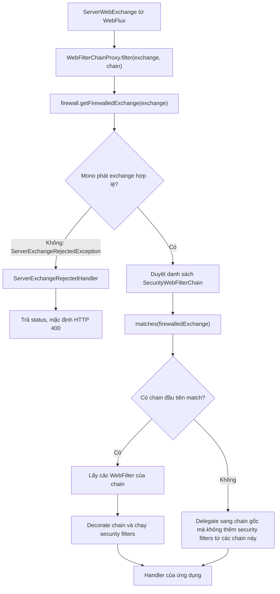

# StrictServerWebExchangeFirewall trong WebFilterChainProxy

## 1. Tình huống mở đầu: firewall phải đứng trước bước chọn security chain

Một hệ thống Spring WebFlux có endpoint công khai `GET /public/ping`, API yêu cầu đăng nhập `/api/**` và trang quản trị `/admin/**`. Ở tầng HTTP, cùng một tài nguyên có thể được biểu diễn bằng các URL đáng ngờ như:

- `/api/../admin/users`: path chứa phân đoạn đi lên thư mục;
- `/api//private/me`: hai dấu slash liên tiếp;
- `/api;tag=1/private/me`: path parameter/semicolon;
- `/api%2Fprivate/me`: slash đã được URL-encode;
- `TRACE /api/private/me`: method không nằm trong allowlist mặc định.

Nếu proxy, framework router và bộ chọn security chain hiểu các biểu diễn này khác nhau, một request có thể được chọn vào **chuỗi bảo mật không mong đợi** hoặc đi đến handler khác. Vì vậy, ở Spring Security Reactive hiện đại, `WebFilterChainProxy` áp `ServerWebExchangeFirewall` trước khi tìm `SecurityWebFilterChain` phù hợp. Triển khai mặc định là `StrictServerWebExchangeFirewall`, ưu tiên **từ chối request không an toàn** hơn là âm thầm chuẩn hóa.

Bài này thuộc chương **Firewall trên Reactive** của mô-đun **SPRING_SECURITY_HTTP_PROTECTION**. Mô-đun bao quát các lớp phòng vệ HTTP và trình duyệt trong Spring Security — CSRF, CORS, security headers, CSP, HSTS, HTTP firewall, bảo vệ session — cho cả **Servlet và Reactive**. Riêng bài này tập trung vào cơ chế **`StrictServerWebExchangeFirewall` bên trong `WebFilterChainProxy`**, nơi cấu hình, thứ tự thực thi, handler từ chối, phạm vi bảo vệ và cách kiểm thử toàn tuyến WebFlux.

### Mục tiêu học tập

Sau bài, người học có thể:

1. Mô tả vị trí `StrictServerWebExchangeFirewall` trong `WebFilterChainProxy` và lý do phải kiểm tra request **trước** lựa chọn security chain.
2. Đọc luồng Reactive từ `getFirewalledExchange(...)`, chọn chain bằng `matches(...)` đến `ServerExchangeRejectedHandler`.
3. Phân biệt **request bị firewall từ chối**, **request không khớp security chain**, **authentication failure** và **access denied**.
4. Cấu hình strict firewall mặc định hoặc một ngoại lệ có phạm vi nhỏ theo phiên bản Spring Security hỗ trợ.
5. Viết kiểm thử trực tiếp firewall, kiểm thử proxy và kiểm thử tích hợp WebFlux; đối chiếu với proxy/gateway thực.
6. Giải thích vì sao firewall không thay thế authentication, authorization, CORS/CSRF, method security, bảo vệ session và kiểm soát request ở hạ tầng.

## 2. Phiên bản và API: điểm bắt đầu cần xác minh

Javadoc chính thức của `ServerWebExchangeFirewall` và `StrictServerWebExchangeFirewall` ghi **Since 6.4**. Phương thức `WebFilterChainProxy.setFirewall(ServerWebExchangeFirewall)` cũng có mốc **Since 6.4**. Tuy nhiên, **`WebFilterChainProxy` tự nó tồn tại từ 5.0**; không được suy rằng mọi phiên bản từng có proxy đều có firewall API giống hiện tại.

| Phiên bản Spring Security | Cách đọc bài |
| --- | --- |
| 5.x | Không copy API Reactive firewall này; đối chiếu cơ chế sẵn có ở version thực tế |
| 6.0–6.3 | Không mặc nhiên có `ServerWebExchangeFirewall`/`StrictServerWebExchangeFirewall`; API được giới thiệu từ 6.4 |
| 6.4 | Có thể dùng API firewall Reactive theo version; kiểm tra patch version |
| 6.5.x | Có reference về `ServerWebExchangeFirewall`, strict implementation và Bean customization |
| 7.x | Có API liên quan; kiểm tra Javadoc cùng minor version vì chữ ký hoặc behavior có thể thay đổi |

Mọi ví dụ Java dưới đây giả định **Spring Security 6.4+**, Spring WebFlux và dependency phù hợp. Việc dùng Spring Boot không chứng minh chính xác Spring Security version nếu dependency bị override. Kiểm tra dependency đã resolve trong ứng dụng thực trước khi chạy ví dụ.

**Lưu ý về kiểu tham số:** Javadoc 6.5.x/7.x của `StrictServerWebExchangeFirewall` công bố:

```java
void setAllowedHttpMethods(Collection<HttpMethod> allowedHttpMethods)
```

Vì vậy ví dụ Java trong bài dùng `HttpMethod.GET`, `HttpMethod.POST`, v.v. Không copy máy móc một reference snippet cũ truyền `List<String>` nếu chữ ký trong jar của bạn là `Collection<HttpMethod>`.

## 3. Những đối tượng tham gia

| Thành phần | Vai trò | Package / API |
| --- | --- | --- |
| `WebFilterChainProxy` | WebFilter điều phối các `SecurityWebFilterChain`, gọi firewall rồi chọn chain | `org.springframework.security.web.server.WebFilterChainProxy` |
| `ServerWebExchangeFirewall` | Hợp đồng kiểm tra và có thể bọc exchange | `org.springframework.security.web.server.firewall.ServerWebExchangeFirewall` |
| `StrictServerWebExchangeFirewall` | Triển khai mặc định, từ chối path/method/header đáng ngờ | `org.springframework.security.web.server.firewall.StrictServerWebExchangeFirewall` |
| `ServerExchangeRejectedException` | Báo lỗi request bị reject do firewall | `org.springframework.security.web.server.firewall.ServerExchangeRejectedException` |
| `ServerExchangeRejectedHandler` | Chuyển rejection thành HTTP response | `org.springframework.security.web.server.firewall.ServerExchangeRejectedHandler` |
| `HttpStatusExchangeRejectedHandler` | Implementation trả HTTP status, mặc định 400 | `org.springframework.security.web.server.firewall.HttpStatusExchangeRejectedHandler` |
| `SecurityWebFilterChain` | Một tập WebFilter bảo mật và điều kiện `matches(exchange)` | `org.springframework.security.web.server.SecurityWebFilterChain` |
| `ServerHttpSecurity` | DSL xây từng security chain | `org.springframework.security.config.web.server.ServerHttpSecurity` |
| `ServerWebExchange` | Request, response và context WebFlux được truyền qua các WebFilter | `org.springframework.web.server.ServerWebExchange` |

Đừng nhầm **`WebFilterChainProxy` (Reactive)** với **`FilterChainProxy` (Servlet)** hoặc **`StrictServerWebExchangeFirewall` (Reactive)** với **`StrictHttpFirewall` (Servlet)**. Hai stack có mô hình HTTP input và bộ lọc khác nhau.

## 4. Luồng thực thi bên trong WebFilterChainProxy

Mã nguồn Spring Security hiện hành thể hiện luồng ở mức ý tưởng:



Một pseudo-code ngắn, **không phải bản chép nguyên mã nguồn**:

```java
// Pseudo-code để hiểu thứ tự, không phải API triển khai độc lập.
firewall.getFirewalledExchange(originalExchange)
    .flatMap(checked -> {
        SecurityWebFilterChain selected =
            firstMatchingSecurityChain(checked);
        return executeSelectedFiltersOrOriginalChain(
            checked, selected);
    })
    .onErrorResume(ServerExchangeRejectedException.class,
        rejected -> rejectedHandler.handle(originalExchange, rejected));
```

Ba chi tiết quan trọng:

1. **Firewall chạy trước khi chọn chain.** Matcher nhận exchange đã đi qua firewall, không phải tùy ý so với raw path chưa kiểm tra.
2. **Chain đầu tiên khớp được sử dụng.** Danh sách chain có thứ tự; nếu nhiều chain cùng có thể match, chain chọn trước quyết định security WebFilters chạy.
3. **Nếu không có security chain nào khớp, proxy vẫn có thể delegate tiếp đến WebFilterChain ban đầu**, nhưng **không chạy các security filters của một chain đã được chọn**. Firewall không tự biến “không có chain phù hợp” thành `denyAll()`.

Điểm thứ ba đặc biệt dễ nhầm: một request có path bình thường có thể **được strict firewall chấp nhận** nhưng không khớp bất kỳ `SecurityWebFilterChain` nào, sau đó đi tới handler không qua các security filters mong đợi. Cần bảo đảm có **catch-all chain** hoặc thiết kế phân vùng route rõ ràng, và không để vùng nhạy cảm ngoài phạm vi Spring Security.

### 4.1. Reactive pipeline có thể kết thúc trước handler

`getFirewalledExchange(...)` có kiểu trả về:

```java
Mono<ServerWebExchange> getFirewalledExchange(
    ServerWebExchange exchange)
```

Với request hợp lệ, Mono phát một exchange được chấp nhận; với request không hợp lệ, nó phát lỗi `ServerExchangeRejectedException`. Proxy có đường xử lý lỗi loại này qua `ServerExchangeRejectedHandler`; mặc định status là 400. Không nên coi mọi response 400 là lỗi từ Spring firewall, vì HTTP server hoặc proxy cũng có thể từ chối trước đó.

### 4.2. Original exchange và firewalled exchange

Firewall có thể **kiểm tra và bọc** exchange. Tài liệu reference nêu một số path parameters có thể được loại bỏ cho mục đích matching, nhưng strict firewall mặc định **từ chối semicolon**, nên không được suy ra request chứa dấu `;` luôn được chuẩn hóa rồi chấp nhận.

Điểm cần đối chiếu ở version đang chạy:

- Matcher bảo mật nhìn thấy exchange/path nào.
- Handler/router nhìn thấy path nào.
- Proxy có biến đổi URL hoặc giải mã trước khi đến Spring không.
- Có rule cấu hình ngoại lệ `setAllowSemicolon(true)` hay không.

Nếu muốn nới semicolon cho matrix variables, cần test cả **matcher lẫn handler**, thay vì chỉ thấy HTTP 200 trên một URL rồi kết luận an toàn.

## 5. StrictServerWebExchangeFirewall kiểm tra những gì?

`StrictServerWebExchangeFirewall` có chủ đích từ chối những request có thể tạo khác biệt giữa xử lý URL và bảo mật. Theo Javadoc, các nhóm kiểm tra quan trọng gồm:

| Nhóm kiểm tra | Ví dụ | Hậu quả cần tránh |
| --- | --- | --- |
| HTTP method không được phép | `TRACE /api/private/me` | XST, HTTP verb tampering hoặc route nhận method không mong đợi |
| Path không chuẩn hóa | `/api/../admin`, `/api//private` | Matcher và router nhìn các path khác nhau |
| Ký tự path không in được | Control characters / dữ liệu path bất thường | Parsing ambiguity hoặc bypass quy tắc |
| Semicolon | `/api;v=1/private` | Matrix/path parameters làm thay đổi matching |
| Slash đã encode | `%2F` | Router/gateway giải mã không đồng nhất |
| Dấu percent đã encode | `%25` | Double decoding |
| Backslash | `\` hoặc `%5C` | Khác biệt separator giữa các hệ thống |
| Null, CR, LF đã encode | `%00`, `%0D`, `%0A` | Ký tự điều khiển / log hoặc parsing ambiguity |
| Host ngoài allowlist | Host không phù hợp với predicate cấu hình | Hạn chế host-based ambiguity |
| Tên/giá trị header không hợp lệ | Control/undefined character | Request splitting hoặc khác biệt bộ parser |
| Tên/giá trị parameter không hợp lệ | Ký tự không hợp lệ trong parameter | Khác biệt parsing và validation |

Các dấu hiệu trên là **phạm vi kiểm tra cần hiểu và thử nghiệm**, không phải cam kết tất cả request thô sẽ vào tới Spring. Một số ký tự bị Netty, HTTP parser hoặc CDN reject/normalize trước.

### 5.1. HTTP methods mặc định

Allowlist mặc định được tài liệu Spring Security nêu là:

```text
DELETE, GET, HEAD, OPTIONS, PATCH, POST, PUT
```

Phân biệt kết quả:

- `TRACE` bị firewall mặc định từ chối nếu request đến được firewall.
- `POST` không được controller hỗ trợ nhưng nằm trong allowlist mặc định có thể đi đến WebFlux và trả `405`, **không phải firewall reject**.
- `POST` vào API có CSRF bảo vệ nhưng không có token có thể trả `403` do CSRF, dù method hợp lệ.
- `OPTIONS` hợp lệ có thể cần cho CORS preflight; bỏ khỏi allowlist sẽ làm hỏng luồng frontend.
- Nếu gateway chặn method trước Spring, status/trace khác với rejection ở `WebFilterChainProxy`.

### 5.2. Những quy tắc không nên nới

Javadoc mô tả strict firewall **không có công tắc tắt** kiểm tra URL normalization và ký tự URL không in được, vì rủi ro cao. Với một số thành phần được encode có setter riêng như `setAllowUrlEncodedSlash`, `setAllowUrlEncodedPercent`, `setAllowBackSlash`, nhưng việc mở các cổng này có thể làm matcher và handler hiểu request khác nhau.

Không dùng:

```java
firewall.setUnsafeAllowAnyHttpMethod(true);
```

chỉ vì một integration gửi method không hợp lệ. Cũng không dùng `ServerWebExchangeFirewall.INSECURE_NOOP` để “khắc phục” URL đang bị chặn. No-op bỏ qua lớp kiểm tra và không phù hợp làm cấu hình sản xuất.

## 6. Cấu hình mặc định trong Spring WebFlux

Khi ứng dụng dùng Spring Security Reactive 6.4+ và cấu hình chuẩn, `WebFilterChainProxy` mặc định dùng `StrictServerWebExchangeFirewall`. Không cần tạo custom Bean chỉ để nhận hành vi mặc định.

Ví dụ security chain cho ứng dụng minh họa:

```java
import org.springframework.context.annotation.Bean;
import org.springframework.context.annotation.Configuration;
import org.springframework.security.config.annotation.web.reactive.EnableWebFluxSecurity;
import org.springframework.security.config.web.server.ServerHttpSecurity;
import org.springframework.security.web.server.SecurityWebFilterChain;

@Configuration
@EnableWebFluxSecurity
class ReactiveSecurityConfig {

    @Bean
    SecurityWebFilterChain securityWebFilterChain(ServerHttpSecurity http) {
        return http.authorizeExchange(auth -> auth
                .pathMatchers("/public/**").permitAll()
                .pathMatchers("/api/**").authenticated()
                .anyExchange().denyAll())
            .build();
    }
}
```

Ở ví dụ này, **một chain áp cho các exchange thuộc phạm vi chain** và `anyExchange().denyAll()` từ chối URL chưa được mở. Với ứng dụng nhiều chain, vẫn cần có một chain cuối làm fallback hoặc chiến lược bảo vệ rõ ràng.

### 6.1. Vì sao không nên tự tạo WebFilterChainProxy không cần thiết?

Spring Security integration thường đăng ký `WebFilterChainProxy` từ các `SecurityWebFilterChain` của ứng dụng. Tự thay toàn bộ proxy hoặc tự đăng ký một WebFilterChainProxy khác có thể:

- Bỏ sót một số security chains hoặc thay thứ tự;
- Ghi đè cấu hình firewall/rejected handler;
- Thêm lớp lọc trùng lặp;
- Làm sai cơ chế enable/reactive security tích hợp sẵn.

Thông thường, để tùy chỉnh **firewall**, expose Bean `StrictServerWebExchangeFirewall` như tài liệu; để tùy chỉnh **security rules**, khai báo `SecurityWebFilterChain`. Chỉ tự xây proxy khi bạn thực sự điều khiển integration ở cấp framework và hiểu đầy đủ tác động.

## 7. Tùy chỉnh StrictServerWebExchangeFirewall bằng Bean

Reference Spring Security Reactive hướng dẫn expose `StrictServerWebExchangeFirewall` dưới dạng Bean để hạ tầng bảo mật sử dụng.

### 7.1. Giới hạn HTTP method có cân nhắc OPTIONS

Ví dụ ứng dụng chỉ cần GET, HEAD, POST và OPTIONS:

```java
import java.util.List;

import org.springframework.context.annotation.Bean;
import org.springframework.context.annotation.Configuration;
import org.springframework.http.HttpMethod;
import org.springframework.security.web.server.firewall.StrictServerWebExchangeFirewall;

@Configuration
class ReactiveFirewallConfiguration {

    @Bean
    StrictServerWebExchangeFirewall serverWebExchangeFirewall() {
        var firewall = new StrictServerWebExchangeFirewall();
        firewall.setAllowedHttpMethods(List.of(
            HttpMethod.GET,
            HttpMethod.HEAD,
            HttpMethod.POST,
            HttpMethod.OPTIONS
        ));
        return firewall;
    }
}
```

Ở version có chữ ký `Collection<HttpMethod>`, phải truyền các giá trị enum/class `HttpMethod`, **không truyền chuỗi `"GET"`/`"POST"`** theo ví dụ khác version.

Ví dụ cố tình chặn PUT/PATCH/DELETE toàn cục. Nếu API thật cần các method này, giữ allowlist mặc định hoặc bổ sung chúng. HTTP firewall allowlist **khác** authorization method-specific trong một `SecurityWebFilterChain`: một method bị firewall loại sớm sẽ không đến tầng kiểm tra quyền route.

### 7.2. Matrix variables và semicolon

Khi có yêu cầu thực sự về matrix variables, có thể cấu hình:

```java
@Bean
StrictServerWebExchangeFirewall serverWebExchangeFirewall() {
    var firewall = new StrictServerWebExchangeFirewall();
    firewall.setAllowSemicolon(true);
    return firewall;
}
```

Đây là **phương án thay thế Bean ở mục 7.1**, không khai báo hai Bean rồi mong framework tự trộn các setter. Nếu cần cả hai thay đổi, đặt trên **cùng instance**.

Rủi ro:

- Trên những đường dẫn có path parameters, router/matcher có thể không xử lý giống nhau.
- Proxy có thể bỏ hoặc biến đổi phần `;name=value` trước khi đến Spring.
- Một rule public `/assets/**` và private `/admin/**` có thể bị lựa chọn sai nếu request path được diễn giải khác nhau.
- Có thể thay đổi behavior giữa các phiên bản khi thuật toán path matching được nâng cấp.

Do đó, nếu có thể, ưu tiên query parameters/opaque IDs thay vì nới semicolon. Nếu nới, bắt buộc có test URL thực qua proxy và các chuỗi bảo mật.

### 7.3. Kiểm soát Host và header/parameter

Các setter quan trọng:

```java
firewall.setAllowedHostnames(host -> host.equals("api.example.com"));
firewall.setAllowedHeaderNames(name -> /* Predicate đã đánh giá */ true);
firewall.setAllowedHeaderValues(value -> /* Predicate đã đánh giá */ true);
firewall.setAllowedParameterNames(name -> /* Predicate đã đánh giá */ true);
firewall.setAllowedParameterValues(value -> /* Predicate đã đánh giá */ true);
```

Đoạn trên **chỉ minh họa chữ ký phương thức**. Các lambda `return true` cho header/parameter **không được dùng nguyên trong production** vì nới hoặc vô hiệu nhiều kiểm tra mặc định. Trong thực tế, dùng predicate allowlist/validation phù hợp và giữ kiểm tra control characters; chỉ ngoại lệ hẹp khi cần tương thích với client đáng tin.

`setAllowedHostnames(...)` phải phù hợp kiến trúc load balancer và gateway, tránh tin tùy tiện `X-Forwarded-Host` do client cung cấp nếu proxy chưa làm sạch header forward. Host check không thay authorization theo tenant.

## 8. Xử lý request bị firewall từ chối

Trong luồng `WebFilterChainProxy`, rejection được biểu diễn bằng `ServerExchangeRejectedException` và xử lý thông qua `ServerExchangeRejectedHandler`. Handler mặc định là `HttpStatusExchangeRejectedHandler`, trả **HTTP 400 Bad Request**.

Có thể thay đổi status/behavior bằng Bean nếu có hợp đồng API đặc biệt:

```java
import org.springframework.context.annotation.Bean;
import org.springframework.context.annotation.Configuration;
import org.springframework.http.HttpStatus;
import org.springframework.security.web.server.firewall.HttpStatusExchangeRejectedHandler;
import org.springframework.security.web.server.firewall.ServerExchangeRejectedHandler;

@Configuration
class ReactiveFirewallRejectionConfig {

    @Bean
    ServerExchangeRejectedHandler rejectedHandler() {
        return new HttpStatusExchangeRejectedHandler(HttpStatus.BAD_REQUEST);
    }
}
```

Ví dụ trả lại status mặc định để minh họa cơ chế Bean, không yêu cầu ứng dụng khai báo Bean này nếu không cần customization.

Một ví dụ đổi `400` thành `404` có thể được áp cho một số policy muốn hạn chế tiết lộ lý do reject, nhưng cần đánh giá observability và API contract, không tự động đổi mọi lỗi thành 404.

### 8.1. Đừng nhầm các status

| Status | Nguồn có thể | Ý nghĩa khi kiểm thử |
| --- | --- | --- |
| `400` | Firewall reject, Netty/parser reject, gateway reject | Cần trace để xác định chính xác tầng |
| `401` | Authentication entry point từ chối | Chưa chứng minh firewall đã chạy hoặc reject |
| `403` | Access denied hoặc CSRF | Request có thể đã qua firewall hợp lệ |
| `404` | Không có handler hoặc custom rejected handler | Xem log exception/route matching |
| `405` | Handler không hỗ trợ method | Khác với method bị firewall chặn sớm |
| `502`/`503` | Proxy/upstream error | Không suy rằng đó là Spring firewall |

Với request có path/header độc hại, log phải escape giá trị bất thường, tránh ghi raw credential, CR/LF hoặc payload không giới hạn. Ghi request ID, rule category, status và tầng xử lý là đủ cho phần lớn chẩn đoán.

## 9. Trường hợp có nhiều SecurityWebFilterChain

Cấu hình nhiều chain thường cần cho API stateless và web login/session tồn tại cùng ứng dụng:

- Chain API chỉ match `/api/**` và cấu hình bearer authentication.
- Chain cho website dùng session/cookie và form login.
- Chain cuối là catch-all có policy mặc định rõ ràng.

**Firewall không quyết định phân vùng API/web.** Nó kiểm tra exchange trước rồi `WebFilterChainProxy` chọn **chain đầu tiên có `matches(...)` trả true**. Thứ tự và phạm vi match của các chain quyết định filter nào chạy.

### 9.1. Một ví dụ thiết kế sai

Giả mã:

```text
SecurityWebFilterChain #1 chỉ match /api/**
Không có chain cho /admin/**
Không có catch-all chain

GET /admin/users với path hợp lệ
  -> Strict firewall chấp nhận
  -> Không chain bảo mật nào match
  -> WebFilterChainProxy delegate tiếp
  -> Nếu handler /admin/users tồn tại và không có bảo vệ khác,
     nó có thể được gọi mà không qua các security filters mong muốn
```

Đây là **lỗ hổng cấu hình security chain**, không phải lỗi strict firewall. Dùng `anyExchange().denyAll()` trong một **chain phù hợp cuối cùng** hoặc đảm bảo tất cả request cần bảo vệ đều match một chain có rule rõ ràng.

### 9.2. Vì sao thứ tự chain ảnh hưởng?

Nếu chain public quá rộng được đặt trước chain admin, request có thể match chain public và không chạy bộ lọc admin. Sửa bằng thứ tự từ cụ thể đến tổng quát, tránh matcher public chứa private routes và thêm integration tests chứng minh:

1. Request public dùng chain được phép.
2. Request API private không token bị từ chối.
3. Request admin thiếu role bị từ chối.
4. Route không dự kiến bị deny.
5. URL bất thường không khiến request trôi sang một chain ít nghiêm ngặt hơn.

## 10. Kiểm thử trực tiếp StrictServerWebExchangeFirewall

Dùng `StepVerifier` để kiểm tra behavior của riêng firewall mà không cần HTTP server hoặc gateway:

```java
import static org.junit.jupiter.api.Assertions.assertEquals;

import org.junit.jupiter.api.Test;
import org.springframework.http.HttpMethod;
import org.springframework.mock.http.server.reactive.MockServerHttpRequest;
import org.springframework.mock.web.server.MockServerWebExchange;
import org.springframework.security.web.server.firewall.ServerExchangeRejectedException;
import org.springframework.security.web.server.firewall.StrictServerWebExchangeFirewall;
import reactor.test.StepVerifier;

class StrictReactiveFirewallTest {

    final StrictServerWebExchangeFirewall firewall =
        new StrictServerWebExchangeFirewall();

    @Test
    void validGetPasses() {
        var request = MockServerHttpRequest.get("/public/ping").build();
        var exchange = MockServerWebExchange.from(request);

        StepVerifier.create(firewall.getFirewalledExchange(exchange))
            .assertNext(checked ->
                assertEquals(HttpMethod.GET,
                    checked.getRequest().getMethod()))
            .verifyComplete();
    }

    @Test
    void traceIsRejected() {
        var request = MockServerHttpRequest
            .method(HttpMethod.TRACE, "/public/ping")
            .build();
        var exchange = MockServerWebExchange.from(request);

        StepVerifier.create(firewall.getFirewalledExchange(exchange))
            .expectError(ServerExchangeRejectedException.class)
            .verify();
    }

    @Test
    void semicolonIsRejectedByDefault() {
        var request = MockServerHttpRequest
            .get("/public;tag=1/ping")
            .build();
        var exchange = MockServerWebExchange.from(request);

        StepVerifier.create(firewall.getFirewalledExchange(exchange))
            .expectError(ServerExchangeRejectedException.class)
            .verify();
    }
}
```

Kiểm thử này chứng minh **đối tượng firewall** chặn gì, nhưng chưa chứng minh Spring Boot/WebFlux đang inject chính instance đó vào `WebFilterChainProxy`. Nó cũng chưa chứng minh Netty hoặc gateway giữ raw request target như test mock.

Nếu mock request builder từ chối/chuẩn hóa một URI lạ trước khi gọi firewall, phải ghi nhận giới hạn công cụ; không kết luận rằng Spring đã reject path nguyên gốc.

## 11. Kiểm thử chính WebFilterChainProxy

Có thể kiểm tra hành vi **firewall reject trước khi downstream chain chạy** bằng một proxy tối giản và một security chain mô phỏng. Đây là unit test của `WebFilterChainProxy`, **không phải** cấu hình Spring Boot production:

```java
import static org.junit.jupiter.api.Assertions.assertEquals;
import static org.junit.jupiter.api.Assertions.assertFalse;

import java.util.concurrent.atomic.AtomicBoolean;

import org.junit.jupiter.api.Test;
import org.springframework.http.HttpMethod;
import org.springframework.http.HttpStatus;
import org.springframework.mock.http.server.reactive.MockServerHttpRequest;
import org.springframework.mock.web.server.MockServerWebExchange;
import org.springframework.security.web.server.WebFilterChainProxy;
import org.springframework.security.web.server.SecurityWebFilterChain;
import org.springframework.web.server.WebFilterChain;

import reactor.core.publisher.Flux;
import reactor.core.publisher.Mono;
import reactor.test.StepVerifier;

class WebFilterChainProxyFirewallTest {

    @Test
    void rejectedMethodNeverReachesDownstream() {
        SecurityWebFilterChain emptySecurityChain = new SecurityWebFilterChain() {
            @Override
            public Mono<Boolean> matches(
                    org.springframework.web.server.ServerWebExchange exchange) {
                return Mono.just(true);
            }

            @Override
            public Flux<org.springframework.web.server.WebFilter> getWebFilters() {
                return Flux.empty();
            }
        };

        WebFilterChainProxy proxy =
            new WebFilterChainProxy(emptySecurityChain);

        AtomicBoolean downstreamCalled = new AtomicBoolean(false);
        WebFilterChain downstream = exchange -> {
            downstreamCalled.set(true);
            return Mono.empty();
        };

        var exchange = MockServerWebExchange.from(
            MockServerHttpRequest
                .method(HttpMethod.TRACE, "/public/ping")
                .build());

        StepVerifier.create(proxy.filter(exchange, downstream))
            .verifyComplete();

        assertEquals(HttpStatus.BAD_REQUEST,
            exchange.getResponse().getStatusCode());
        assertFalse(downstreamCalled.get());
    }
}
```

Nếu test PASS, proxy đã xử lý reject và không chạy downstream trong trường hợp này. Tuy nhiên, nó không chứng minh tất cả Bean/chain production đã được wiring đúng. Cần test ApplicationContext ở mục tiếp theo.

### 11.1. Cần kiểm tra cả trường hợp không có chain nào khớp

Một phép thử bổ sung nên tạo `SecurityWebFilterChain.matches(exchange)` trả `Mono.just(false)`, gửi request **hợp lệ**, rồi xác nhận downstream được gọi. Điều này minh họa rằng:

- Firewall đã cho request đi qua;
- Không có chain match;
- Proxy có thể delegate tiếp;
- **Không có bảo đảm authorization mặc định** trừ khi ứng dụng cấu hình một catch-all security chain hoặc lớp bảo vệ khác.

Đây là điểm rất quan trọng khi viết nhiều `SecurityWebFilterChain` với `securityMatcher(...)`.

## 12. Kiểm thử tích hợp WebFlux với WebTestClient

Ứng dụng mẫu có endpoint public:

```java
import org.springframework.web.bind.annotation.GetMapping;
import org.springframework.web.bind.annotation.RestController;
import reactor.core.publisher.Mono;

@RestController
class PingController {

    @GetMapping("/public/ping")
    Mono<String> ping() {
        return Mono.just("pong");
    }
}
```

Nếu dùng cấu hình custom ở mục 7.1 (cho GET/HEAD/POST/OPTIONS nhưng **không** cho PUT), test sau giúp kiểm tra Bean firewall có được áp trong application context:

```java
import org.junit.jupiter.api.Test;
import org.springframework.beans.factory.annotation.Autowired;
import org.springframework.boot.test.autoconfigure.web.reactive.AutoConfigureWebTestClient;
import org.springframework.boot.test.context.SpringBootTest;
import org.springframework.test.web.reactive.server.WebTestClient;

@SpringBootTest
@AutoConfigureWebTestClient
class ReactiveFirewallIntegrationTest {

    @Autowired WebTestClient client;

    @Test
    void publicGetStillWorks() {
        client.get().uri("/public/ping")
            .exchange()
            .expectStatus().isOk()
            .expectBody(String.class).isEqualTo("pong");
    }

    @Test
    void putRejectedByCustomFirewall() {
        client.put().uri("/public/ping")
            .exchange()
            .expectStatus().isBadRequest();
    }
}
```

Vì `PUT` nằm trong **allowlist mặc định**, test `400` ở đây giúp phát hiện policy tùy chỉnh ở mức firewall. Nhưng một HTTP server, reverse proxy hoặc test client đôi khi chặn trước Spring; để xác nhận chính xác nơi reject, kết hợp log/trace hoặc test trực tiếp `getFirewalledExchange(...)` với cùng Bean.

Nếu không có custom allowlist, thay test `PUT` bằng method mặc định không được chấp nhận như `TRACE`, miễn là test stack có thể gửi nó đến firewall. Với Spring Security form login/session, một số method có thể trả `403` từ CSRF nếu **không bị firewall chặn**; không nhầm hai trạng thái.

### 12.1. Khi test kết quả tùy chỉnh rejected handler

Nếu expose Bean `ServerExchangeRejectedHandler` trả `404`, thay assertion phù hợp. Đồng thời xác nhận handler log an toàn và response không chứa raw request target hoặc exception message tiết lộ nội bộ. Đừng chỉ assert “không phải 200”, vì có thể request bị từ chối ở một tầng hoàn toàn khác.

## 13. Đi qua reverse proxy, gateway và Netty

WebFlux thường chạy với Reactor Netty hoặc runtime khác. Ở phía trước có thể có CDN, load balancer, Nginx hoặc Spring Cloud Gateway. Những tầng này có thể decode, chuẩn hóa, rewrite hoặc reject request trước khi nó tới `WebFilterChainProxy`.

Ví dụ test trên staging đã được cấp phép:

```bash
curl -i --path-as-is \
  'http://localhost:8080/api/../admin/users'

curl -i --path-as-is \
  'http://localhost:8080/api//private/me'

curl -i --path-as-is \
  'http://localhost:8080/api;mode=1/private/me'

curl -i --path-as-is \
  'http://localhost:8080/api%2Fprivate/me'

curl -i --path-as-is \
  'http://localhost:8080/api%252Fprivate/me'
```

`--path-as-is` hạn chế việc client tự loại bỏ `..` trước khi gửi; **không bảo đảm** Netty, proxy hoặc gateway giữ nguyên request-target. Cần đối chiếu:

1. URL mà HTTP client gửi trên đường mạng.
2. URL/protocol mà CDN, reverse proxy hoặc gateway chuyển đến ứng dụng.
3. Path/headers mà Spring thực sự thấy.
4. Firewall có reject `ServerExchangeRejectedException` hay không.
5. Security chain nào match, handler nào được gọi nếu request hợp lệ.
6. Có URL nào nhìn khác nhau giữa tầng security và router không.

### 13.1. Đừng dựa vào riêng status 400

Một request trả `400` ở edge có thể chưa từng tới ứng dụng. Nếu bạn muốn kiểm thử `StrictServerWebExchangeFirewall`, hãy so test trực tiếp API, WebTestClient và test qua proxy. Nếu muốn đảm bảo không bypass auth, hãy kiểm tra **tài nguyên nhạy cảm không thể truy cập trái quyền** dù status cuối là 400, 404, 401 hoặc 403 theo tầng.

### 13.2. Header Host và forwarded headers

Nếu bật `setAllowedHostnames(...)`, Host mà ứng dụng nhận có thể đã được proxy thay đổi. Cần thống nhất chính sách trust đối với forwarded headers và tránh chấp nhận `X-Forwarded-Host` từ client không đáng tin. Host allowlist không tự chống tenant data leak nếu service bỏ qua quyền hoặc ứng dụng dùng Host làm tenant ID mà không kiểm chứng.

### 13.3. Không cho WebSocket hoặc chức năng đặc biệt đi tắt qua bảo vệ

Nếu ứng dụng có WebSocket, SockJS hoặc gateway routes riêng, cần xác minh handshake HTTP và URL liên quan **thực sự đi qua security infrastructure mong muốn**. Không giả định mọi protocol upgrade, static file handler hoặc đường nội bộ tự động chạy cùng proxy nếu kiến trúc đã tự cấu hình WebFilters.

## 14. Reactive firewall khác những lớp bảo vệ khác

| Cơ chế | Kiểm soát gì? | Không thay thế được |
| --- | --- | --- |
| `StrictServerWebExchangeFirewall` | Path, method, headers, parameters đáng ngờ | Authentication/authorization và request body validation |
| `WebFilterChainProxy` | Tổ chức các security chains, áp firewall và chọn chain | Quyền trên bản ghi/tenant nếu service thiếu kiểm tra |
| `SecurityWebFilterChain` | Authentication, authorization, CSRF, CORS, headers theo cấu hình | Kiểm soát chủ động từ CDN/gateway ở ngoài Spring |
| Reactive method security | Quyền tại service/method | HTTP parser/gateway normalization |
| HTTP firewall ở edge/WAF | Chặn và giới hạn traffic trước origin | Authorization ở ứng dụng |
| CSP và `X-Content-Type-Options` | Giảm rủi ro browser diễn giải/thực thi nội dung sai | Path normalization và HTTP verb validation |
| HSTS/HTTPS | Bảo vệ kênh và ngăn downgrade | Không xác định route/tenant đúng |
| `Cache-Control: no-store` | Ngăn cache HTTP lưu response nhạy cảm | Không chặn path traversal hay rò rỉ ở origin |
| Session/CSRF/CORS | Quản lý phiên và quyền trình duyệt thay đổi/đọc response | Không chặn encoded slash trước route matcher |

Một request **hợp lệ về cú pháp** như `GET /api/documents/123` vẫn phải kiểm tra principal có quyền xem tài liệu 123 hay không. Đây là lý do Spring Security khuyến khích method security và default deny trong route security, không dựa hoàn toàn vào URL patterns.

## 15. Chẩn đoán sự cố thực tế

| Triệu chứng | Nghi vấn | Cách xử lý |
| --- | --- | --- |
| `StrictServerWebExchangeFirewall` không tồn tại trong IDE | Spring Security trước 6.4, dependency lệch hoặc sai stack | Kiểm tra resolved version và artifact |
| Bean custom khai báo nhưng `PUT` vẫn được xử lý | Bean không được wiring, đang chạy Servlet hoặc proxy tự tạo | Kiểm tra `WebFilterChainProxy`, test direct và integration |
| `POST` hợp lệ trả `403` | CSRF/security rule chặn chứ không nhất thiết firewall | Xem exception và request pipeline |
| `TRACE` trả `400` nhưng không có log Spring | Netty/gateway có thể reject trước | Đối chiếu origin và edge trace |
| Semicolon path bị reject | Strict default không cho phép semicolon | Thiết kế lại URL; nếu nới cần test matcher/router |
| Đường dẫn `%2F` không hoạt động | Encoded slash bị chặn hoặc normalize ở proxy/server | Dùng opaque ID hoặc sửa URL design |
| Request path hợp lệ đi tới handler dù chưa auth | Không có chain nào match hoặc rule public quá rộng | Thêm catch-all chain/default deny; kiểm tra thứ tự |
| API admin dùng chain public | Chain được đăng ký sai thứ tự hoặc matcher quá rộng | Sắp xếp từ cụ thể đến tổng quát, test chain selection |
| `401` được cho là firewall reject | Authentication failure khác rejection | Phân loại log/status/exception |
| Custom rejected handler trả `404` như router không tìm thấy | Tùy biến status làm mờ nguồn lỗi | Gắn trace ID, metrics và loại exception |
| Matrix variables hoạt động ở dev nhưng fail sau proxy | Gateway sửa path/semicolon | So request-target trước/sau proxy và matcher |
| Sau khi thêm allowlist methods, CORS preflight lỗi | Thiếu `OPTIONS` | Sửa allowlist + test CORS đúng thứ tự |
| Header từ client cũ bị chặn | Character predicate không chấp nhận một chuỗi | Đánh giá nguồn/encoding và nới tối thiểu |
| Lỗi xuất hiện sau upgrade | Behavior/API/matcher hoặc proxy config đổi | Khóa version, test suite URL bất thường trước deploy |
| Tệp riêng bị truy cập với URL bình thường | Thiếu object-level authorization | Kiểm tra method service và tenant scope, không chỉ firewall |

Quy trình gỡ lỗi đề xuất: **(1)** xác nhận version; **(2)** tái hiện direct firewall; **(3)** test WebTestClient; **(4)** thử đúng path qua Netty/proxy; **(5)** phân loại 400/401/403/404/405; **(6)** đối chiếu security matcher và handler; **(7)** sửa rule nhỏ nhất rồi chạy lại toàn bộ test.

## 16. Ma trận regression trước khi triển khai

| ID | Request | Kỳ vọng |
| --- | --- | --- |
| R01 | GET `/public/ping` | 200 theo contract |
| R02 | TRACE `/public/ping` | Reject bởi firewall hoặc tầng thấp; không gọi handler |
| R03 | PUT `/public/ping` với custom allowlist loại PUT | Nếu tới Spring firewall, 400 |
| R04 | OPTIONS CORS preflight hợp lệ | Không bị custom method allowlist chặn sai |
| R05 | Path có `../` | Không bypass security matcher |
| R06 | Path có `//` | Không được chọn chain kém bảo vệ |
| R07 | Path có `;` | Mặc định reject; nếu cho phép phải nhất quán matching |
| R08 | Path có `%2F` / `%25` | Không bỏ qua kiểm soát private URL |
| R09 | Header/control value bất thường | Bị parser/firewall kiểm tra đúng |
| R10 | Host ngoài allowlist nếu bật | Bị reject theo policy |
| R11 | GET `/api/private/me` anonymous | Không được đọc dữ liệu, auth entry point phù hợp |
| R12 | GET admin thiếu role | Bị authorization từ chối |
| R13 | Path bình thường không match chain riêng | Catch-all chain áp default deny |
| R14 | Nhiều chain cạnh tranh match | Chọn đúng chain theo thứ tự |
| R15 | Request từ CDN/gateway với URL mã hóa | Không bypass do decode/rewrite khác biệt |
| R16 | Custom rejected handler | Trả đúng status và ghi log an toàn |

Không cần biến một request bất thường thành tải lớn hoặc fuzz toàn hệ thống để hiểu những invariant này. Chạy test với phạm vi đã được cấp phép, dữ liệu giả, và chỉ giữ kết quả/trace an toàn.

## 17. Bài thực hành tổng hợp

Một ứng dụng Spring WebFlux chạy Spring Security 6.5+ có:

- `GET /public/ping` công khai;
- `GET /api/private/me` yêu cầu đăng nhập;
- `/admin/**` cần role quản trị;
- hai `SecurityWebFilterChain` được đăng ký cho API và public nhưng **chưa có catch-all chain**;
- reverse proxy chuyển tiếp URL có nhiều dấu slash và path segment `;`;
- đội vận hành muốn chỉ cho phép GET, POST mà quên CORS preflight OPTIONS.

**Yêu cầu thực hiện:**

1. Vẽ thứ tự `WebFilterChainProxy → StrictServerWebExchangeFirewall → matches → selected filters → handler`.
2. Giải thích tại sao một URL hợp lệ không khớp chain nào vẫn có thể đi vào handler và tại sao firewall không phải default-deny authorization.
3. Đề xuất một catch-all security chain hoặc chiến lược coverage tương đương, đảm bảo `/admin/**` không bị bỏ qua.
4. Viết Bean `StrictServerWebExchangeFirewall` với method allowlist phù hợp API và CORS thực tế; dùng `HttpMethod` đúng kiểu của Javadoc.
5. Viết StepVerifier test GET pass và TRACE fail, rồi WebTestClient test chứng minh cấu hình Bean đang được áp.
6. Thử `/api/../admin` và `/api;flag=1/private` trực tiếp tại origin và sau reverse proxy; nêu lý do một `400` chưa xác định được tầng từ chối.
7. Nếu có yêu cầu matrix variables, đánh giá khi nào nới `setAllowSemicolon(true)` và những regression tests cần có.
8. Đề xuất rejected handler và telemetry sao cho không lộ token, payload hoặc raw URL độc hại.
9. Phân biệt lỗi service authorization, lỗi chọn chain và lỗi firewall khi một tài liệu thuộc Alice bị Bob truy cập.
10. Lập danh sách các ca regression cần chạy lại sau nâng cấp Spring Security hoặc thay đổi proxy rewrite rules.

**Hướng dẫn đáp án:** Firewall kiểm tra request trước khi chọn chain, nhưng không cấp quyền cho URL hợp lệ. Không có chain match có thể dẫn đến delegation không chạy security filters, nên cần coverage/default-deny rõ ràng. Tùy chỉnh method allowlist phải cân nhắc `OPTIONS`, không bật `setUnsafeAllowAnyHttpMethod(true)`. Với path ambiguity, ưu tiên reject và sửa URL/proxy để thống nhất parsing. Test đơn vị firewall, test proxy và test E2E qua proxy đều cần thiết; cuối cùng service vẫn phải phân quyền theo record/tenant.

## Tài liệu tham khảo

- [Spring Security — Reactive ServerWebExchangeFirewall Reference](https://docs.spring.io/spring-security/reference/reactive/exploits/firewall.html): vai trò firewall, strict defaults, Bean customization và rejected handler.
- [Spring Security — Javadoc WebFilterChainProxy](https://docs.spring.io/spring-security/reference/api/java/org/springframework/security/web/server/WebFilterChainProxy.html): `setFirewall`, `setExchangeRejectedHandler` và việc delegate filter chain.
- [Spring Security — Javadoc ServerWebExchangeFirewall](https://docs.spring.io/spring-security/reference/api/java/org/springframework/security/web/server/firewall/ServerWebExchangeFirewall.html): `getFirewalledExchange` và interface được giới thiệu từ 6.4.
- [Spring Security — Javadoc StrictServerWebExchangeFirewall](https://docs.spring.io/spring-security/reference/api/java/org/springframework/security/web/server/firewall/StrictServerWebExchangeFirewall.html): các rule và setter có sẵn.
- [Spring Security — Javadoc ServerExchangeRejectedHandler](https://docs.spring.io/spring-security/reference/api/java/org/springframework/security/web/server/firewall/ServerExchangeRejectedHandler.html): xử lý rejection.
- [Spring Security — Source WebFilterChainProxy](https://github.com/spring-projects/spring-security/blob/main/web/src/main/java/org/springframework/security/web/server/WebFilterChainProxy.java): luồng `filter` và chọn `SecurityWebFilterChain`.
- [Spring Security — WebFlux Authorization](https://docs.spring.io/spring-security/reference/reactive/authorization/authorize-http-requests.html): matcher, `denyAll` và security routes.
- [Spring Security — Reactive Method Security](https://docs.spring.io/spring-security/reference/reactive/authorization/method.html): kiểm soát quyền ở service.
- [Spring Security — Reactive Testing](https://docs.spring.io/spring-security/reference/reactive/test/index.html): WebTestClient và authentication testing.
- [Spring Framework — WebTestClient](https://docs.spring.io/spring-framework/reference/testing/webtestclient.html): kiểm thử ứng dụng WebFlux.
- [OWASP — HTTP Verb Tampering](https://owasp.org/www-community/attacks/HTTP_Verb_Tampering): rủi ro method handling.
- [OWASP — Path Traversal](https://owasp.org/www-community/attacks/Path_Traversal): path normalization và parsing ambiguity.
