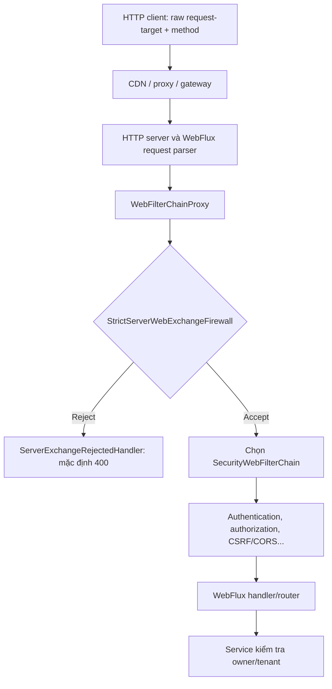
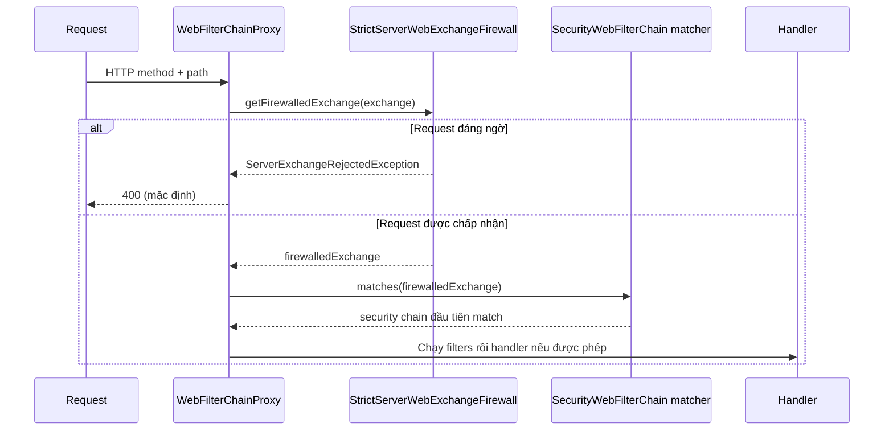

# Kiểm tra đường dẫn và phương thức HTTP

## 1. Vì sao cần kiểm tra cả đường dẫn lẫn HTTP method?

Một ứng dụng Spring WebFlux dùng Spring Security thường định nghĩa các quy tắc như:

- `GET /public/ping`: được truy cập công khai;
- `GET /api/reports/**`: chỉ người có quyền đọc báo cáo;
- `POST /api/reports/**`: chỉ người có quyền tạo báo cáo;
- `/admin/**`: chỉ quản trị viên;
- các URL còn lại: từ chối theo mặc định.

Thoạt nhìn, chỉ cần matcher theo đường dẫn và HTTP method. Tuy nhiên request HTTP có thể đi qua CDN, reverse proxy, gateway, HTTP parser và WebFlux router, mỗi tầng có thể xử lý khác nhau đối với:

```text
/api/reports/../admin/export
/api//reports/123
/api/reports;view=public/123
/api%2Freports/123
/api%252Freports/123
/api/reports/%2e%2e/admin
TRACE /api/reports/123 HTTP/1.1
```

Nếu tầng bảo mật cho rằng request thuộc `/public/**` nhưng router lại chuyển tới handler `/admin/**`, hoặc một HTTP method bị biến đổi trước khi authorization, có nguy cơ **bỏ qua kiểm soát truy cập dựa trên URL/method**.

Từ **Spring Security 6.4**, stack Reactive hỗ trợ `ServerWebExchangeFirewall`; triển khai mặc định `StrictServerWebExchangeFirewall` kiểm tra request trước khi `WebFilterChainProxy` chọn `SecurityWebFilterChain`. Firewall **ưu tiên từ chối biểu diễn HTTP đáng ngờ** thay vì cố sửa request không nhất quán.

Bài thuộc chương **Firewall trên Reactive** của mô-đun **SPRING_SECURITY_HTTP_PROTECTION**. Mô-đun đào tạo cách bảo vệ HTTP và trình duyệt trong Spring Security, gồm CSRF, CORS, security headers, CSP, HSTS, HTTP firewall và session, cho cả **Servlet** và **Reactive**. Chủ đề trực tiếp ở đây là **kiểm tra đường dẫn và phương thức HTTP**: hiểu quy tắc, cấu hình đúng, kiểm thử đường đi của request và phân biệt lỗi firewall với lỗi xác thực/phân quyền.

### Kết quả học tập

Hoàn thành bài, người học có thể:

1. Phân biệt request-target trên đường truyền, path parser, matcher bảo mật và handler mapping.
2. Nhận diện các dạng path không chuẩn hóa, separator được encode, matrix parameter và double decoding có thể ảnh hưởng route matching.
3. Liệt kê tập HTTP methods mặc định được strict firewall cho phép; hiểu ảnh hưởng khi giới hạn `OPTIONS`, `HEAD`, `PUT`, `PATCH` hoặc `DELETE`.
4. Cấu hình `StrictServerWebExchangeFirewall` trong Spring WebFlux 6.4+, bảo toàn chính sách `deny-by-default`.
5. Viết test trực tiếp firewall, `WebTestClient`, test qua HTTP server/gateway và đánh giá status `400/401/403/404/405`.
6. Chẩn đoán xung đột giữa firewall, CORS, CSRF, authorization, gateway rewrite và endpoint có nhiều security chains.
7. Giải thích vì sao firewall không thay thế quyền truy cập theo owner/tenant, validation đầu vào và các lớp bảo vệ HTTP còn lại.

## 2. Mô hình đe dọa: bốn cách nhìn cùng một URL

Một request có thể đi qua các tầng:



Tưởng tượng client gửi `GET /api/../admin/users`. Có ít nhất bốn thứ cần phân biệt:

| Cách nhìn | Thành phần | Rủi ro nếu khác nhau |
| --- | --- | --- |
| Raw request-target | Client hoặc proxy khi nhận HTTP | Phần `..`, `%2F`, dấu `;` bị sửa trước khi Spring nhận |
| URI/path đã parse | HTTP server, WebFlux `ServerHttpRequest` | Normalize hoặc decode trước khi firewall nhìn thấy |
| Security matching | `WebFilterChainProxy` và `SecurityWebFilterChain.matches(...)`; `authorizeExchange(...)` | Chọn nhầm chain/rule public |
| Handler routing | WebFlux `HandlerMapping`/functional routing | Chuyển request đến controller hoặc function khác rule bảo mật mong đợi |

Một phép thử chỉ gọi controller với `MockServerWebExchange` đã chuẩn hóa có thể **không chứng minh** raw URL nguy hiểm được nhận/loại đúng trên đường thật. Vì vậy phải kết hợp **unit test → application integration → proxy end-to-end**.

### 2.1. Hai bất biến thiết kế

**Bất biến về path:** Không có biểu diễn URL nào được xử lý như “đường dẫn công khai” ở bảo mật nhưng lại đến handler có dữ liệu riêng hoặc quản trị.

**Bất biến về method:** Một HTTP method bị firewall cấm không đến được handler; một method được firewall cho qua vẫn phải chịu **quy tắc authorization và nghiệp vụ** tương ứng.

Không đồng nhất “firewall chấp nhận request” với “người dùng được phép thực hiện thao tác”.

## 3. Vị trí kiểm tra trong Spring Security Reactive

`WebFilterChainProxy` dùng `ServerWebExchangeFirewall` trước khi tìm security chain. API:

```java
Mono<ServerWebExchange> getFirewalledExchange(
    ServerWebExchange exchange);
```

Với request hợp lệ, firewall phát exchange được kiểm tra; với request đáng ngờ, nó phát `ServerExchangeRejectedException`. Handler mặc định `HttpStatusExchangeRejectedHandler` trả `400 Bad Request` khi Spring xử lý rejection.



**Mốc phiên bản:** `ServerWebExchangeFirewall` và `StrictServerWebExchangeFirewall` có Javadoc ghi **Since 6.4**. `WebFilterChainProxy` đã tồn tại từ 5.0, nhưng phương thức `setFirewall(ServerWebExchangeFirewall)` xuất hiện từ 6.4. Không copy code Reactive firewall vào Spring Security 5.x hoặc 6.0–6.3 mà không kiểm tra dependency/version thực.

### 3.1. Firewall kiểm tra trước chain, nhưng không phải default-deny

Khi firewall đã cho request đi qua mà **không có `SecurityWebFilterChain` nào khớp**, `WebFilterChainProxy` có thể chuyển tiếp tới chain gốc **mà không chạy một bộ security filters nào từ các chain được cấu hình**. Nếu handler nhạy cảm tồn tại ngoài phạm vi match, nó có nguy cơ không được bảo vệ theo mong muốn.

Vì vậy:

- Cần đảm bảo mọi URL nhạy cảm đều nằm trong phạm vi một security chain phù hợp.
- Với nhiều chain, sắp thứ tự từ cụ thể đến tổng quát, thêm **catch-all chain** có rule từ chối mặc định.
- Trong một chain bao phủ toàn ứng dụng, dùng `anyExchange().denyAll()` ở cuối nếu đó là chính sách dự kiến.
- Không trông chờ strict firewall từ chối một URL **hợp lệ** chỉ vì URL đó nằm ngoài `/api/**`.

## 4. Kiểm tra đường dẫn: các nhóm cần hiểu

`StrictServerWebExchangeFirewall` có các quy tắc nghiêm ngặt: từ chối URL không chuẩn hóa, ký tự không in được và các mẫu đáng ngờ trong URL/path. Một số nhóm có setter cho phép nới quy tắc cụ thể; nhưng kiểm tra normalization và ký tự không in được được thiết kế là **không có công tắc vô hiệu hoàn toàn**.

### 4.1. Bảng các dạng path và hậu quả

| Dạng | Ví dụ minh họa | Vì sao đáng ngờ? | Cách xử lý khuyến nghị |
| --- | --- | --- | --- |
| Phân đoạn `..` | `/api/../admin` | Tầng A chuẩn hóa, tầng B không chuẩn hóa → matcher lệch | Từ chối biểu diễn chưa chuẩn hóa |
| Slash kép | `/api//admin` | Parser/router có thể gộp slash khác nhau | Kiểm tra normalization và proxy |
| Semicolon | `/api;v=1/private` | Path params/matrix variables tạo khác biệt matching | Mặc định reject; chỉ nới khi thật cần |
| Encoded slash | `/api%2Fprivate/me` | `%2F` có thể được decode thành dấu `/` ở tầng sau | Không cho qua mặc định |
| Encoded double slash | `/api%2F%2Fprivate` | Có thể tạo hai slash sau khi decode | Không mở nới tùy tiện |
| Encoded dot | `/api/%2E%2E/admin` | Có thể biến thành traversal sau decode | Tránh encoded period |
| Encoded percent | `/api%252Fprivate` | `%25` có thể cho phép double-decoding | Không cho mặc định |
| Backslash | `/api\private` hoặc `%5C` | Một số hệ thống coi `\` như separator | Từ chối theo strict policy |
| Null/control | `%00`, `%0D`, `%0A` | Parser/log/route không nhất quán | Không chấp nhận |
| Encoded separator Unicode | `%E2%80%A8`, `%E2%80%A9` | Có thể ảnh hưởng xử lý chuỗi và parser | Dựa trên quy tắc nghiêm ngặt, kiểm thử theo version |
| Path có encoding sai | `%` đứng riêng hoặc chuỗi percent-encoding lỗi | Không thể parse/đánh giá thống nhất | Có thể bị HTTP server chặn trước Spring |

Bảng mô tả **đầu vào cần kiểm tra trong môi trường được phép**, không phải khẳng định tất cả request đều tới được firewall: HTTP client, gateway hoặc Netty có thể tự chuẩn hóa hoặc từ chối trước.

### 4.2. Path traversal không đồng nghĩa quyền truy cập theo đối tượng

URL `/api/documents/123` không có ký tự đáng ngờ và có thể được firewall chấp nhận, nhưng Bob vẫn không được đọc tài liệu 123 nếu tài liệu thuộc Alice. **Object-level authorization** phải ở service/method/repository. Firewall không suy được owner hoặc tenant của bản ghi chỉ từ việc path có đúng cú pháp.

### 4.3. Semicolon và matrix variables

Ví dụ:

```text
GET /orders;year=2026/123
GET /secure;role=user/report
```

Một số WebFlux route hoặc gateway có thể phân tách path parameters. `StrictServerWebExchangeFirewall` mặc định **không cho phép semicolon** (Javadoc: `setAllowSemicolon(false)`). Trang reference có mô tả path parameters có thể được loại khỏi path phục vụ matching, nhưng không nên hiểu rằng strict mặc định tự động chấp nhận mọi URL chứa `;`.

Nếu ứng dụng thật dùng matrix variables, có thể cấu hình:

```java
firewall.setAllowSemicolon(true);
```

Chỉ thực hiện sau khi đã kiểm thử security matcher, handler mapping, proxy rewrite, route cùng tên và URL có semicolon ở nhiều segment. Khi không bắt buộc phải dùng matrix variables, chuyển dữ liệu sang **query parameter đã validate** hoặc body được định nghĩa rõ.

**Không đặt session ID vào URL** kiểu `;jsessionid=...` như một phương án thay cookie: URL có thể bị ghi log, lưu browser history, sao chép hoặc xuất hiện trong referer.

### 4.4. Encoded slash và opaque identifier

Một ID nghiệp vụ tự chứa dấu slash có thể khiến client muốn gửi:

```text
GET /files/team%2Ffinance
```

Nhưng slash `%2F` thường bị strict firewall từ chối để tránh routing bypass. Thiết kế tốt hơn:

```text
GET /files/6ae03b2e-3f2d-4ab6-a48d-bb0a2b74df41
GET /files?key=team%2Ffinance   (chỉ khi được validate và authorization)
```

Dùng ID vô nghĩa/UUID trong path và tra storage key phía server; không cần nới encoded slash. Với request có query mang path hoặc key nội bộ, vẫn phải validate, chống traversal và kiểm tra quyền; `setAllowUrlEncodedSlash(false)` ở URL path không thay nhiệm vụ bảo vệ storage.

### 4.5. Tương tác raw path, decoded path và context path

WebFlux có các API như `exchange.getRequest().getURI().getRawPath()` và `exchange.getRequest().getPath().pathWithinApplication()`. Hai cách nhìn này không nên bị xem là luôn tương đương từng ký tự; chúng có thể khác về percent-encoding, cách phân tách segments hoặc context path.

Khi chẩn đoán một request, so sánh **đường dẫn đã được gửi** với **đường dẫn đã qua proxy/parser**, thay vì tự gọi URL-decode hai lần rồi đưa cho authorization matcher. Không tự viết filter chuẩn hóa URL tùy ý để “chữa” lỗi strict firewall; cách normalize khác nhau giữa các tầng chính là một phần threat model.

## 5. Kiểm tra HTTP method: allowlist global và quyền theo route

### 5.1. Các method mặc định được strict firewall cho phép

Theo Spring Security Reactive reference, danh sách default là:

```text
DELETE, GET, HEAD, OPTIONS, PATCH, POST, PUT
```

Tập này nhằm chặn method bất thường và giảm HTTP Verb Tampering/Cross-Site Tracing (XST). `TRACE` không nằm trong danh sách. HTTP methods **phân biệt chữ hoa/chữ thường** theo giao thức; đừng dựa vào việc client/proxy sửa `get` thành `GET` để hợp thức hóa request.

| Method | Trường hợp thông thường | Điều cần kiểm tra |
| --- | --- | --- |
| `GET` | Đọc tài nguyên | Không có side effect trái contract; authentication/authorization vẫn chạy |
| `HEAD` | Lấy metadata của GET | Phải bảo vệ như GET nếu resource nhạy cảm |
| `OPTIONS` | CORS preflight và thông tin khả năng hỗ trợ | Không vô tình loại khỏi global allowlist nếu frontend dùng CORS |
| `POST` | Tạo/thay đổi trạng thái | Có CSRF protection nếu dùng cookie/session phù hợp |
| `PUT` | Cập nhật toàn phần | Phân quyền theo resource, method-level policy |
| `PATCH` | Cập nhật từng phần | Phân quyền theo record và input validation |
| `DELETE` | Xóa tài nguyên | Chỉ người có quyền được thực hiện |
| `TRACE` | HTTP diagnostic method | Mặc định bị strict firewall từ chối, không nên mở tùy tiện |
| Extension method `PROPFIND` | Một số giao thức mở rộng/WebDAV | Không nằm trong default allowlist; chỉ xem xét khi ứng dụng thật sự cần |

**Một method được firewall cho phép không có nghĩa controller sẽ xử lý nó.** `POST /public/ping` có thể trả `405 Method Not Allowed` vì handler chỉ hỗ trợ GET, mặc dù POST đã qua firewall. Nếu POST có bảo vệ CSRF, request có thể trả 403 trước khi đến handler.

### 5.2. Hai lớp chính sách không được nhầm lẫn

- `StrictServerWebExchangeFirewall.setAllowedHttpMethods(...)`: giới hạn **toàn cục** những method có thể đi qua firewall cho các exchange được kiểm tra.
- `authorizeExchange().pathMatchers(HttpMethod.GET, "...")`: quy định **ai có quyền** gọi một đường dẫn bằng method cụ thể.
- `@GetMapping`/`@PostMapping`: quy định **handler** có hỗ trợ method ấy không.
- Method security/điều kiện service: người gọi có quyền thực hiện thao tác trên bản ghi cụ thể hay không.

Một request `DELETE /api/reports/123` có thể **vượt qua allowlist firewall mặc định**, nhưng vẫn phải bị authorization hoặc handler mapping từ chối nếu ứng dụng không hỗ trợ xóa.

### 5.3. Tại sao không chỉ cho phép GET/POST một cách máy móc?

Giới hạn methods quá mức có thể phá hỏng:

- CORS preflight `OPTIONS`;
- `HEAD` cho tệp, ảnh hoặc metadata;
- `PUT`, `PATCH`, `DELETE` của API REST;
- một số cơ chế health check/proxy đang dùng method hợp lệ;
- tích hợp cần method đặc biệt đã được thiết kế và bảo vệ.

Trước khi giới hạn, hãy lập **bản đồ method thực tế** theo route và client, rồi test cả positive/negative paths. Không bật `setUnsafeAllowAnyHttpMethod(true)` chỉ để tránh lỗi; lệnh đó tắt validation HTTP method.

### 5.4. Method override và proxy rewrite

Một số hệ thống hỗ trợ method tunneling, ví dụ form gửi POST nhưng middleware đọc một trường hoặc header để chuyển sang PUT/DELETE. Nếu có, cần xác định **thời điểm method được biến đổi so với firewall, CSRF, security matcher và handler**. Không cho một request được kiểm tra như POST công khai nhưng thực hiện như DELETE nhạy cảm sau đó.

Trong ứng dụng mới, ưu tiên client gửi method đúng theo API contract và cấu hình CORS/CSRF tương ứng. Nếu phải giữ method override cho legacy, viết kiểm thử xuyên tầng thay vì chỉ thêm một rule cho phép.

## 6. Cấu hình mặc định Spring WebFlux

Cấu hình một security chain có quy tắc rõ ràng, dùng `denyAll` cho những URL không thuộc danh sách được phép:

```java
import org.springframework.context.annotation.Bean;
import org.springframework.context.annotation.Configuration;
import org.springframework.http.HttpMethod;
import org.springframework.security.config.annotation.web.reactive.EnableWebFluxSecurity;
import org.springframework.security.config.web.server.ServerHttpSecurity;
import org.springframework.security.web.server.SecurityWebFilterChain;

@Configuration
@EnableWebFluxSecurity
class ReactiveSecurityConfig {

    @Bean
    SecurityWebFilterChain securityWebFilterChain(ServerHttpSecurity http) {
        return http
            .authorizeExchange(ex -> ex
                .pathMatchers(HttpMethod.GET, "/public/ping").permitAll()
                .pathMatchers(HttpMethod.GET, "/api/reports/**")
                    .hasAuthority("SCOPE_reports.read")
                .pathMatchers(HttpMethod.POST, "/api/reports/**")
                    .hasAuthority("SCOPE_reports.write")
                .pathMatchers("/admin/**").hasRole("ADMIN")
                .anyExchange().denyAll())
            .build();
    }
}
```

Đây là một **ví dụ authorization rules**, không phải ứng dụng production chạy độc lập. Cần thêm authentication mechanism (OAuth2 resource server/bearer, session/form login, ...) và CORS/CSRF theo kiến trúc. Quyền `SCOPE_reports.read/write` là authority minh họa; security configuration thật phải đồng bộ với cách chuyển claims/roles thành authorities.

**Phạm vi bảo vệ:** Security chain trên phải được áp tới mọi route mong muốn. Nếu dùng nhiều `SecurityWebFilterChain` với `securityMatcher(...)`, một chain API không match `/admin/**` không tự bảo vệ admin. Cần catch-all chain ở cuối hoặc chiến lược coverage tương đương.

### 6.1. Kiểm tra method theo route nhưng không quên service security

Ví dụ handler Reactive:

```java
import org.springframework.web.bind.annotation.GetMapping;
import org.springframework.web.bind.annotation.PathVariable;
import org.springframework.web.bind.annotation.RestController;
import reactor.core.publisher.Mono;

@RestController
class ReportController {

    private final ReportService reports;

    ReportController(ReportService reports) {
        this.reports = reports;
    }

    @GetMapping("/api/reports/{id}")
    Mono<ReportView> read(@PathVariable String id) {
        return reports.loadAuthorizedReport(id);
    }
}
```

`ReportService` và `ReportView` là các type ứng dụng cần tự định nghĩa. Service phải dựa trên principal/tenant đang được xác thực, kiểm tra quyền của bản ghi `id`; nếu không, Alice và Bob cùng có `SCOPE_reports.read` vẫn có thể truy cập dữ liệu của nhau.

## 7. Tùy chỉnh phương thức HTTP với StrictServerWebExchangeFirewall

Mặc định strict firewall đã cho phép bảy method chuẩn. Chỉ định Bean tùy chỉnh khi có yêu cầu rõ ràng và đã phân tích route/client.

Ví dụ ứng dụng chỉ dùng GET, HEAD, POST và OPTIONS:

```java
import java.util.List;
import org.springframework.context.annotation.Bean;
import org.springframework.context.annotation.Configuration;
import org.springframework.http.HttpMethod;
import org.springframework.security.web.server.firewall.StrictServerWebExchangeFirewall;

@Configuration
class ReactiveFirewallConfig {

    @Bean
    StrictServerWebExchangeFirewall serverWebExchangeFirewall() {
        var firewall = new StrictServerWebExchangeFirewall();
        firewall.setAllowedHttpMethods(List.of(
            HttpMethod.GET,
            HttpMethod.HEAD,
            HttpMethod.POST,
            HttpMethod.OPTIONS
        ));
        return firewall;
    }
}
```

Với Javadoc của `StrictServerWebExchangeFirewall` thuộc Spring Security 6.5.x/7.x, chữ ký là:

```java
void setAllowedHttpMethods(Collection<HttpMethod> allowedHttpMethods)
```

Do đó ví dụ dùng `HttpMethod.GET`, `HttpMethod.POST`... thay vì truyền `List<String>`. Một số đoạn reference hiển thị list chuỗi, nhưng code phải theo **chữ ký thực tế trong dependency**.

Hệ quả của cấu hình này:

- `GET`, `HEAD`, `POST`, `OPTIONS` được firewall cho qua nếu path/header hợp lệ;
- `PUT`, `PATCH`, `DELETE` bị từ chối ở firewall, **ngay cả khi controller có mapping**;
- `TRACE` vẫn bị từ chối;
- API dùng `PUT`/`PATCH`/`DELETE` thật sẽ hỏng nếu deploy cấu hình không phù hợp.

### 7.1. Không vô hiệu toàn bộ kiểm tra method

```java
// Ví dụ KHÔNG nên sử dụng để "sửa" lỗi method.
firewall.setUnsafeAllowAnyHttpMethod(true);
```

API này vô hiệu hóa validation HTTP method, mở rộng bề mặt HTTP Verb Tampering/XST. Khi cần hỗ trợ một method hợp lệ mới, hãy thêm **đúng method đó** vào allowlist và bổ sung route authorization/test.

### 7.2. Khi có CORS preflight

Một browser có thể gửi:

```http
OPTIONS /api/reports HTTP/1.1
Origin: https://frontend.example.com
Access-Control-Request-Method: POST
Access-Control-Request-Headers: authorization,content-type
```

Nếu firewall custom loại `OPTIONS`, preflight có thể bị reject **trước khi phần CORS của ứng dụng có cơ hội xử lý**. Tuy nhiên, **cho phép OPTIONS ở firewall chưa tự cấu hình CORS**: còn phải kiểm soát allowed origins, methods, headers, credentials tại `CorsWebFilter`/Spring Security CORS integration và kiểm tra policy ở gateway.

Nếu dùng cookie cho thao tác thay đổi trạng thái, CORS không thay CSRF protection. Method `POST` được firewall chấp nhận vẫn có thể nhận `403` vì thiếu CSRF token.

## 8. Tùy chỉnh path có giới hạn: nên ưu tiên sửa URL design

Strict firewall cung cấp một số setter như:

```java
setAllowSemicolon(boolean)
setAllowUrlEncodedSlash(boolean)
setAllowUrlEncodedDoubleSlash(boolean)
setAllowUrlEncodedPeriod(boolean)
setAllowUrlEncodedPercent(boolean)
setAllowBackSlash(boolean)
setAllowNull(boolean)
setAllowUrlEncodedCarriageReturn(boolean)
setAllowUrlEncodedLineFeed(boolean)
```

**Không nên gọi hàng loạt với `true`** chỉ để các URL cũ tải được. Việc chấp nhận encoded slash, percent và semicolon cùng lúc có thể tạo thêm cách diễn giải URL khác nhau ở gateway, matcher và handler. Hãy xác định chính xác URL hợp lệ nào bị chặn, nguyên nhân nằm ở client/proxy/framework hay firewall, rồi đánh giá thay thế an toàn.

### 8.1. Một ngoại lệ có thể cân nhắc: matrix variables

```java
@Bean
StrictServerWebExchangeFirewall serverWebExchangeFirewall() {
    var firewall = new StrictServerWebExchangeFirewall();

    // Chỉ khi đã đánh giá và kiểm thử matrix variables.
    firewall.setAllowSemicolon(true);

    return firewall;
}
```

Đây là **phương án thay thế** cấu hình Bean ở mục 7, không tạo hai Bean `StrictServerWebExchangeFirewall` cạnh tranh. Nếu muốn cấu hình semicolon và method allowlist, thay đổi **cùng một instance**.

Khi bật semicolon, phải kiểm tra:

- `/public;foo=1/ping` có bị match nhầm với route không có parameter?
- `/admin;foo=1/users` vẫn yêu cầu admin?
- URL có semicolon ở **nhiều path segments** có cùng behavior?
- Reverse proxy có bỏ path parameters trước khi đến Spring?
- Trường hợp encoded semicolon (`%3B`) được xử lý thế nào?
- Nếu app dùng functional routes và annotated controllers, cả hai đều có chính sách nhất quán?

Nếu tất cả chỉ để truyền một tham số hiển thị, thường **query parameter** đã validate đơn giản và dễ bảo vệ hơn.

### 8.2. Encoded slash: tránh nới khi không cần

Đường dẫn `/objects/team%2Ffinance` có thể cần nhiều vòng decode. Nên cân nhắc biểu diễn `/objects/{uuid}` và tra storage key ở service. Nếu ứng dụng buộc phải hỗ trợ encoded slash, test cần bao gồm nguyên dạng `%2F`, chữ thường `%2f`, double-encoding `%252F`, wildcard matchers và đường đi qua từng proxy.

### 8.3. Tránh tự normalize rồi mới authorization

Một filter tự viết:

```java
// GIẢ MÃ CẦN TRÁNH
String normalized = decodeTwice(path).replace("//", "/");
authorizeByPattern(normalized);
```

có thể không giống cách WebFlux handler chọn route và mở ra bypass. Thay vào đó, để framework/firewall chuẩn hóa theo cơ chế được thiết kế, **từ chối biểu diễn mơ hồ**, giảm số cách biểu diễn identifier và chỉ dùng các matcher đơn giản, dễ kiểm chứng.

## 9. So sánh với Servlet: API giống mục tiêu nhưng khác stack

| Khía cạnh | Reactive / WebFlux | Servlet / Spring MVC |
| --- | --- | --- |
| Firewall interface | `ServerWebExchangeFirewall` | `HttpFirewall` |
| Strict implementation | `StrictServerWebExchangeFirewall` | `StrictHttpFirewall` |
| Đầu vào | `ServerWebExchange` | `HttpServletRequest` |
| Security proxy | `WebFilterChainProxy` | `FilterChainProxy` |
| Filter chain | `SecurityWebFilterChain` | `SecurityFilterChain` |
| DSL | `ServerHttpSecurity` | `HttpSecurity` |
| Exception | `ServerExchangeRejectedException` | `RequestRejectedException` |
| Handler lỗi | `ServerExchangeRejectedHandler` | `RequestRejectedHandler` |
| Mốc Reactive API | `Since 6.4` | Servlet firewall có lịch sử khác, không dùng mốc này |

Không tạo Bean `StrictHttpFirewall` và mong WebFlux dùng nó. Package Reactive là `org.springframework.security.web.server.firewall.StrictServerWebExchangeFirewall`; package Servlet là `org.springframework.security.web.firewall.StrictHttpFirewall`.

**Lưu ý với Javadoc:** Một vài phần mô tả strict Reactive firewall nhắc servlet container hoặc `DefaultHttpFirewall` vì có nền tảng thiết kế chung. Điều đó không biến `DefaultHttpFirewall` của Servlet thành một implementation `ServerWebExchangeFirewall`. Chọn đúng API theo stack thực tế.

## 10. Test trực tiếp firewall bằng StepVerifier

Kiểm thử đơn vị này cô lập chính `StrictServerWebExchangeFirewall`. Cần Spring Security có Reactive firewall API, `spring-test`, JUnit 5 và `reactor-test`.

```java
import static org.junit.jupiter.api.Assertions.assertEquals;

import java.util.List;
import org.junit.jupiter.api.Test;
import org.springframework.http.HttpMethod;
import org.springframework.mock.http.server.reactive.MockServerHttpRequest;
import org.springframework.mock.web.server.MockServerWebExchange;
import org.springframework.security.web.server.firewall.ServerExchangeRejectedException;
import org.springframework.security.web.server.firewall.StrictServerWebExchangeFirewall;
import reactor.test.StepVerifier;

class ReactivePathAndMethodFirewallTest {

    private final StrictServerWebExchangeFirewall firewall =
        new StrictServerWebExchangeFirewall();

    @Test
    void getWithNormalPathPasses() {
        var request = MockServerHttpRequest.get("/public/ping").build();
        var exchange = MockServerWebExchange.from(request);

        StepVerifier.create(firewall.getFirewalledExchange(exchange))
            .assertNext(valid -> assertEquals(
                HttpMethod.GET, valid.getRequest().getMethod()))
            .verifyComplete();
    }

    @Test
    void traceIsRejected() {
        var request = MockServerHttpRequest
            .method(HttpMethod.TRACE, "/public/ping")
            .build();

        StepVerifier.create(firewall.getFirewalledExchange(
                MockServerWebExchange.from(request)))
            .expectError(ServerExchangeRejectedException.class)
            .verify();
    }

    @Test
    void semicolonIsRejectedByDefault() {
        var request = MockServerHttpRequest
            .get("/public;variant=1/ping")
            .build();

        StepVerifier.create(firewall.getFirewalledExchange(
                MockServerWebExchange.from(request)))
            .expectError(ServerExchangeRejectedException.class)
            .verify();
    }

    @Test
    void customPolicyRejectsPutButAllowsOptions() {
        var custom = new StrictServerWebExchangeFirewall();
        custom.setAllowedHttpMethods(List.of(
            HttpMethod.GET, HttpMethod.HEAD,
            HttpMethod.POST, HttpMethod.OPTIONS));

        var put = MockServerWebExchange.from(
            MockServerHttpRequest
                .method(HttpMethod.PUT, "/public/ping").build());
        var options = MockServerWebExchange.from(
            MockServerHttpRequest
                .method(HttpMethod.OPTIONS, "/public/ping").build());

        StepVerifier.create(custom.getFirewalledExchange(put))
            .expectError(ServerExchangeRejectedException.class)
            .verify();

        StepVerifier.create(custom.getFirewalledExchange(options))
            .expectNextCount(1)
            .verifyComplete();
    }
}
```

Những test này xác minh **hành vi instance firewall**, chưa chứng minh Bean đã được wiring vào `WebFilterChainProxy` của application, hoặc HTTP client/proxy có giữ raw URI như bạn tưởng.

### 10.1. Vì sao không test mọi path xấu bằng một MockServerHttpRequest?

`MockServerHttpRequest`, `URI` builder hoặc Spring `RequestPath` có thể **từ chối hoặc chuẩn hóa URI trước** khi gọi firewall. Ví dụ `/a/../b` có thể không được giữ nguyên như raw request-target. Nếu fixture bị biến đổi, test không còn là test hành vi xử lý raw traversal.

Một chiến lược đúng:

1. Ở unit test, dùng các trường hợp mà mock giữ nguyên và kiểm tra rejection thực.
2. Với raw encoded path/traversal, dùng integration test qua HTTP server và proxy với công cụ giữ request-target.
3. Ghi nhận tầng reject thực (HTTP parser, firewall hay gateway).
4. Không suy rằng test truyền URI đã chuẩn hóa PASS thì hệ thống miễn nhiễm với request-target mơ hồ.

## 11. WebTestClient: xác nhận cấu hình thực sự áp dụng

Ví dụ endpoint kiểm thử:

```java
import org.springframework.web.bind.annotation.GetMapping;
import org.springframework.web.bind.annotation.RestController;
import reactor.core.publisher.Mono;

@RestController
class PublicProbeController {
    @GetMapping("/public/ping")
    Mono<String> ping() {
        return Mono.just("pong");
    }
}
```

Test Spring Boot WebFlux, với **Bean firewall tùy chỉnh ở mục 7** (cho GET, HEAD, POST, OPTIONS nhưng không cho PUT):

```java
import org.junit.jupiter.api.Test;
import org.springframework.beans.factory.annotation.Autowired;
import org.springframework.boot.test.autoconfigure.web.reactive.AutoConfigureWebTestClient;
import org.springframework.boot.test.context.SpringBootTest;
import org.springframework.test.web.reactive.server.WebTestClient;

@SpringBootTest
@AutoConfigureWebTestClient
class ReactiveFirewallIntegrationTest {

    @Autowired WebTestClient client;

    @Test
    void validGetReachesHandler() {
        client.get().uri("/public/ping")
            .exchange()
            .expectStatus().isOk()
            .expectBody(String.class).isEqualTo("pong");
    }

    @Test
    void putIsRejectedByCustomFirewall() {
        client.put().uri("/public/ping")
            .exchange()
            .expectStatus().isBadRequest();
    }
}
```

Giả thiết: `WebTestClient` đã đi qua WebFlux Security WebFilters, hạ tầng đã nhận đúng Bean `StrictServerWebExchangeFirewall` và rejected handler mặc định trả 400. Một test client kết nối qua proxy/HTTP server khác có thể bị từ chối **trước** Spring; khi đó cần log/trace hoặc unit test firewall để xác nhận nguồn reject.

Nếu **không** cấu hình custom method allowlist, `PUT` được strict firewall **cho qua theo mặc định** và handler chỉ hỗ trợ GET thường trả `405`. Vì vậy đừng sao chép assertion `400` trên vào test dùng toàn bộ defaults.

### 11.1. Test 400 không thay cho test authorization

Hãy viết thêm integration tests:

- `GET /api/reports/123` không có credential phải bị từ chối theo authentication entry point của ứng dụng.
- Người dùng có `SCOPE_reports.read` được xem đúng báo cáo thuộc quyền.
- Người không có quyền hoặc thuộc tenant khác không được đọc báo cáo.
- `POST /api/reports` không có CSRF token trong ứng dụng dùng cookie/session có thể bị `403` dù method được firewall cho phép.
- URL không match rule rõ ràng phải bị `denyAll`, không được trôi vào handler công khai.

Với API bearer token, status chưa đăng nhập thường là `401`; với form login có thể redirect hoặc behavior khác. **Assert theo contract**, không dùng một status duy nhất cho mọi kiến trúc.

## 12. Chạy test qua HTTP server, proxy và gateway

Kiểm thử integration chỉ thật sự bao phủ raw URL khi request đi qua đúng các tầng parse/rewrite đang dùng.

### 12.1. Dùng curl trong môi trường được phép

```bash
# Ứng dụng test local; không thử trên hệ thống chưa được cho phép.
curl -i --path-as-is \
  'http://localhost:8080/api/reports/../admin/users'

curl -i --path-as-is \
  'http://localhost:8080/api//reports/123'

curl -i --path-as-is \
  'http://localhost:8080/api;mode=read/reports/123'

curl -i --path-as-is \
  'http://localhost:8080/api%2Freports/123'

curl -i --path-as-is \
  'http://localhost:8080/api%252Freports/123'

curl -i -X TRACE \
  'http://localhost:8080/public/ping'
```

`--path-as-is` hạn chế curl tự bỏ các phân đoạn `..`, **không bảo đảm** reverse proxy, Netty hoặc WebFlux giữ nguyên raw path. Khi đo qua TLS, giữ xác minh certificate đúng; không dùng `-k` như một “mẹo sửa” test security.

### 12.2. So cùng request tại nhiều điểm

| Điểm đo | Cần ghi lại |
| --- | --- |
| Client | Method, raw request-target đã gửi, test ID |
| Reverse proxy/gateway | Path/method nhận và forward; có rewrite/decode không |
| WebFlux HTTP server | Request có vào ứng dụng không; nếu không, status do ai trả |
| Firewall | Có `ServerExchangeRejectedException` không; loại rule hoặc status |
| `SecurityWebFilterChain` | Chain nào match, authn/authz được xử lý thế nào |
| Handler/service | Handler có được gọi không; có phân quyền record/tenant đúng không |

Không ghi raw URL/header chứa credential, control characters hoặc dữ liệu cá nhân vào log thông thường. Dùng test IDs và escape các chuỗi bất thường để tránh log injection.

### 12.3. Proxy normalization: điểm dễ kết luận sai

Ví dụ curl gửi `/a/../admin` nhưng gateway rút gọn thành `/admin` trước khi chuyển tiếp. Spring firewall có thể chấp nhận `/admin` vì nó **không thấy** phân đoạn `..`. Điều quan trọng phải kiểm tra tiếp là `/admin` vẫn được bảo vệ bằng quyền ADMIN, không được chọn nhầm public chain.

Ngược lại, nếu origin nhận raw path đáng ngờ nhưng matcher và router hiểu khác nhau, strict firewall cần chặn hoặc ứng dụng phải sửa kiến trúc. Không đánh đồng “status 400” với “chính Spring firewall đã chặn”; upstream cũng có thể trả 400/404.

## 13. Đọc status một cách đúng nghĩa

| Status | Nguyên nhân có thể | Có chứng minh path/method check an toàn? |
| --- | --- | --- |
| `400 Bad Request` | Strict firewall, Netty/HTTP parser, proxy reject | **Chưa đủ** nếu không biết tầng |
| `401 Unauthorized` | Chưa xác thực | Không cho biết request đã bị firewall reject |
| `403 Forbidden` | Thiếu quyền hoặc CSRF violation | Có thể đã qua firewall hợp lệ |
| `404 Not Found` | Không có handler hoặc custom rejected handler | Cần phân biệt router và firewall |
| `405 Method Not Allowed` | Handler không hỗ trợ method | Method có thể được firewall cho phép |
| `200 OK` | Route/handler đã trả response | Chỉ an toàn khi đúng handler và đúng quyền |
| `302 Found` | Redirect sang login hoặc route khác | Cần kiểm tra redirect chain và không lộ dữ liệu |
| `502/503` | Gateway/upstream error | Không suy ra hành vi firewall tại Spring |

Mặc định `HttpStatusExchangeRejectedHandler` trả 400 khi **Spring firewall** reject; nếu ứng dụng cấu hình Bean `ServerExchangeRejectedHandler` khác, status có thể đổi. Một request `TRACE` bị từ chối tại edge trước khi tới Spring cũng có thể trả status khác.

## 14. Các tình huống xung đột thường gặp

### 14.1. CORS preflight bị chặn do method allowlist

**Triệu chứng:** Frontend khác origin gọi `POST /api/reports` và nhận lỗi CORS; DevTools thấy `OPTIONS` không thành công.

**Kiểm tra:** Firewall custom có bỏ `OPTIONS` không? Nếu `OPTIONS` được cho qua, CORS policy có cho origin, method, headers và credentials cần thiết không? Proxy có chặn preflight không?

**Khắc phục:** Thêm `OPTIONS` nếu preflight hợp lệ, cấu hình CORS phù hợp và kiểm thử đúng flow. Không bật `setUnsafeAllowAnyHttpMethod(true)`.

### 14.2. REST client bị 400 khi PUT/PATCH/DELETE

**Triệu chứng:** Controller `@PatchMapping` tồn tại nhưng request trả 400 và controller không chạy.

**Kiểm tra:** Có Bean `setAllowedHttpMethods(List.of(GET, POST))` không? Nếu method bị firewall chặn, request không đến handler.

**Khắc phục:** Cập nhật allowlist theo contract thật; đồng thời kiểm soát quyền cho PATCH/DELETE ở authorization layer. Không nhầm 400 với 405 do handler không hỗ trợ method.

### 14.3. Route dùng semicolon/matrix variables

**Triệu chứng:** `/orders;year=2026/123` hoạt động ở môi trường cũ nhưng bị reject khi bật strict firewall.

**Khắc phục:** Ưu tiên thiết kế URL mới; nếu buộc nới `setAllowSemicolon(true)`, thử biến thể ở nhiều path segments, qua gateway và với public/private matchers để tránh bypass.

### 14.4. Encoded slash trong document ID

**Triệu chứng:** `/files/a%2Fb` bị reject.

**Khắc phục:** Sử dụng opaque ID hoặc UUID trong URL, tra storage key ở service. Không mở encoded slash chỉ vì tên file/ID tùy ý chứa dấu `/`; rủi ro normalization và đường đi qua proxy đáng kể.

### 14.5. Một URL hợp lệ không được bảo vệ

**Triệu chứng:** `GET /admin/health` đi đến handler mà không hỏi xác thực.

**Nguyên nhân có thể:** Nhiều security chains có phạm vi `securityMatcher` chưa phủ `/admin/**`, hoặc public chain quá rộng đứng trước.

**Khắc phục:** Thêm catch-all chain hoặc chain admin chính xác, `anyExchange().denyAll()` theo policy. Firewall không quyết định user có role ADMIN.

### 14.6. 404 giả giống firewall rejection

**Triệu chứng:** `/api;flag=1/me` trả 404; nhóm cho rằng “không có route”.

**Nguyên nhân có thể:** Custom `ServerExchangeRejectedHandler` trả 404 thay 400.

**Khắc phục:** Phân loại qua exception/metrics/trace ở Spring. Tránh báo lỗi dựa vào status duy nhất.

## 15. Ma trận kiểm thử đề xuất

| ID | Input | Kỳ vọng an toàn |
| --- | --- | --- |
| P01 | `GET /public/ping` | Được xử lý bình thường |
| P02 | `GET /api/reports/123` với quyền hợp lệ | Đúng handler, đúng owner/tenant |
| P03 | `GET /api/reports/123` không đăng nhập | Bị authentication từ chối |
| P04 | `GET /admin/users` thiếu role | Bị authorization từ chối |
| P05 | `GET /api/reports/../admin` | Không bypass admin rule |
| P06 | `GET /api//reports/123` | Không chọn public chain do slash bất thường |
| P07 | `GET /api;v=1/reports` | Default semicolon reject; nếu nới phải test matcher/router |
| P08 | `GET /api%2Freports/123` | Không bypass do encoded slash |
| P09 | `GET /api%252Freports/123` | Không bypass do double decoding |
| P10 | `GET /api/%2e%2e/admin` | Không đi tắt qua quyền admin |
| P11 | Path chứa `%00` hoặc encoded control | Bị parser/firewall xử lý an toàn |
| M01 | `TRACE /public/ping` | Bị từ chối; không gọi handler |
| M02 | `OPTIONS` CORS preflight hợp lệ | Không bị method allowlist từ chối sai |
| M03 | `HEAD` tới tài nguyên riêng | Kiểm soát quyền như GET |
| M04 | `PUT /public/ping` với allowlist exclude PUT | Firewall reject nếu request tới được Spring |
| M05 | `POST /public/ping` khi chỉ có GET mapping | Không tự biến thành GET; có thể 405 hoặc security/CSRF status |
| M06 | `PATCH /api/reports/123` | Chỉ hoạt động nếu có method+authz phù hợp |
| M07 | `DELETE /api/reports/123` | Không được cấp quyền chỉ vì firewall cho phép |
| X01 | URL path qua origin và proxy | Bảo vệ nhất quán dù proxy rewrite |
| X02 | Request đúng path nhưng khác tenant | Owner/tenant check vẫn chạy |
| X03 | Nhiều security chains | Không URL nhạy cảm nào nằm ngoài chain có bảo vệ |
| X04 | Header/path lạ ở tầng gateway | Không lộ raw control chars/credentials trong log |
| X05 | Nâng cấp Spring Security hoặc thay proxy | Regression không thay đổi kết quả bảo mật |

Với test về HTTP method, **không bỏ qua tính bất đồng của tầng server**. Một request `TRACE` có thể bị gateway chặn trước Spring; kết quả này hữu ích cho bảo vệ tổng thể nhưng không chứng minh direct firewall code đã chạy.

## 16. Quy trình triển khai thay đổi an toàn

1. **Inventory:** Liệt kê URL, methods, security chains, client chính thức, CORS preflight, matrix variables và gateway rewrites.
2. **Version check:** Đối chiếu Spring Security đã resolve; API Reactive firewall từ 6.4, không lẫn Servlet.
3. **Baseline:** Giữ strict defaults, đặc biệt normalization, encoded slash và method validation.
4. **Exception review:** Chỉ thêm ngoại lệ hẹp có chủ sở hữu, threat model và positive/negative tests.
5. **Application authorization:** Đảm bảo catch-all deny và kiểm tra owner/tenant tại service.
6. **Test trực tiếp:** `StepVerifier` cho GET, TRACE, semicolon, custom method allowlist.
7. **Integration:** `WebTestClient` với Bean/firewall thực, phân biệt `400` từ firewall với `403` CSRF hoặc `405` handler.
8. **End-to-end:** Test HTTP client giữ path đi qua proxy/gateway, quan sát normalization/rewrite và chain selection.
9. **Observability:** Log có kiểm soát, metric rejection theo rule/tầng, không ghi raw credential/payload.
10. **Regression khi đổi hạ tầng:** Chạy lại khi thay Spring Security, Reactor Netty, CDN, gateway hoặc HTTP routing rules.

Không nên “sửa” lỗi strict firewall bằng cách tắt toàn bộ `WebFilterChainProxy` hoặc chuyển sang cấu hình no-op. Nếu client cần gửi URL không tương thích với chính sách an toàn, thay đổi thiết kế URI thường bền vững hơn nới nhiều rule nguy hiểm.

## 17. Bài thực hành tổng hợp

Một ứng dụng Spring WebFlux dùng Spring Security 6.5+ có:

- `GET /public/ping` công khai;
- `GET /api/reports/{id}` yêu cầu `SCOPE_reports.read` và quyền sở hữu báo cáo;
- `POST /api/reports` yêu cầu `SCOPE_reports.write`;
- `/admin/**` chỉ ADMIN;
- frontend từ origin khác có gửi OPTIONS preflight;
- một legacy client gửi path có `;v=1` hoặc dùng ID chứa dấu `/`;
- một reverse proxy có rule gộp nhiều slash và loại phân đoạn `..`.

Nhóm vận hành đặt method allowlist chỉ gồm GET/POST để “tăng bảo mật”. Sau đó frontend báo CORS lỗi, lệnh HEAD kiểm tra file cũng lỗi, trong khi `/admin/users` có lúc bị gọi mà không xác thực do chain matcher sai.

**Yêu cầu học viên:**

1. Phân biệt ba nguyên nhân độc lập: method firewall, CORS/CSRF và thiếu security chain coverage.
2. Chọn allowlist method hợp lý cho hệ thống, nêu rõ có cần HEAD/OPTIONS/PATCH/DELETE không.
3. Viết Bean `StrictServerWebExchangeFirewall` theo chữ ký `Collection<HttpMethod>` và không dùng `setUnsafeAllowAnyHttpMethod(true)`.
4. Thiết kế một `SecurityWebFilterChain` có `GET /public/ping` công khai, API method-specific authorities, admin role và default-deny.
5. Giải thích vì sao `/api/reports/../admin` nguy hiểm nếu proxy, security matcher và router không thống nhất.
6. Đề xuất thay thế URL có semicolon/encoded slash để không phải nới strict firewall.
7. Viết StepVerifier test GET pass, TRACE fail, semicolon fail và custom policy PUT fail.
8. Viết WebTestClient test chứng minh Bean method allowlist đã được wiring, tránh nhầm 400 với 405.
9. Lập ma trận thử qua origin và reverse proxy bằng `curl --path-as-is`; xác định tầng reject với trace.
10. Tạo một test Alice/Bob có cùng `SCOPE_reports.read` nhưng chỉ Alice sở hữu báo cáo 123, để chứng minh firewall và scope không thay object-level authorization.

### Gợi ý đáp án

- Method allowlist phải phản ánh contract thật; `OPTIONS` thường cần cho CORS preflight, `HEAD` có thể cần cho metadata; PUT/PATCH/DELETE chỉ thêm nếu được sử dụng.
- Strict firewall kiểm tra **hình dạng request**, còn `authorizeExchange` kiểm tra quyền theo method/path và service kiểm tra owner/tenant.
- URL có `..`, `//`, `%2F` hoặc `;` cần được xử lý an toàn, không để proxy và router hiểu khác matcher. Ưu tiên thiết kế opaque IDs và từ chối URL mơ hồ.
- `400` có thể đến từ Spring firewall hoặc tầng trước; `403` có thể do CSRF/authorization, `405` thường do handler không hỗ trợ method.
- Không có security chain khớp không đồng nghĩa bị từ chối; ứng dụng cần coverage/catch-all deny.
- Một bộ kiểm thử đạt phải có cả **unit firewall**, **application integration** và **network path tests**, cùng test phân quyền dữ liệu.

## Tài liệu tham khảo

- [Spring Security — Reactive ServerWebExchangeFirewall](https://docs.spring.io/spring-security/reference/reactive/exploits/firewall.html): nguyên tắc reject URL bất thường, phương thức HTTP mặc định và cách cấu hình.
- [Spring Security 6.5 — StrictServerWebExchangeFirewall Javadoc](https://docs.spring.io/spring-security/site/docs/6.5.x/api/org/springframework/security/web/server/firewall/StrictServerWebExchangeFirewall.html): danh sách rule, kiểu `Collection<HttpMethod>`, các setter URL và method.
- [Spring Security — ServerWebExchangeFirewall Javadoc](https://docs.spring.io/spring-security/reference/api/java/org/springframework/security/web/server/firewall/ServerWebExchangeFirewall.html): interface `getFirewalledExchange` và mốc 6.4.
- [Spring Security — WebFilterChainProxy Javadoc](https://docs.spring.io/spring-security/reference/api/java/org/springframework/security/web/server/WebFilterChainProxy.html): vị trí firewall và proxy security chains.
- [Spring Security — Reactive HTTP Authorization](https://docs.spring.io/spring-security/reference/reactive/authorization/authorize-http-requests.html): `authorizeExchange`, method/path matchers và default-deny.
- [Spring Security — Reactive Method Security](https://docs.spring.io/spring-security/reference/reactive/authorization/method.html): kiểm tra quyền ở service/method.
- [Spring Security — Reactive CORS](https://docs.spring.io/spring-security/reference/reactive/integrations/cors.html): preflight, CORS policy và thứ tự xử lý.
- [Spring Security — Reactive CSRF](https://docs.spring.io/spring-security/reference/reactive/exploits/csrf.html): CSRF cho thao tác thay đổi trạng thái.
- [Spring Framework — WebTestClient](https://docs.spring.io/spring-framework/reference/testing/webtestclient.html): kiểm thử WebFlux.
- [RFC 9110 — HTTP Semantics](https://www.rfc-editor.org/rfc/rfc9110.html): HTTP method semantics và status.
- [RFC 3986 — Uniform Resource Identifier](https://www.rfc-editor.org/rfc/rfc3986.html): các thành phần URI, percent-encoding và dot segments.
- [OWASP — HTTP Verb Tampering](https://owasp.org/www-community/attacks/HTTP_Verb_Tampering): rủi ro xử lý method không nhất quán.
- [OWASP — Path Traversal](https://owasp.org/www-community/attacks/Path_Traversal): rủi ro normalization và traversal.
