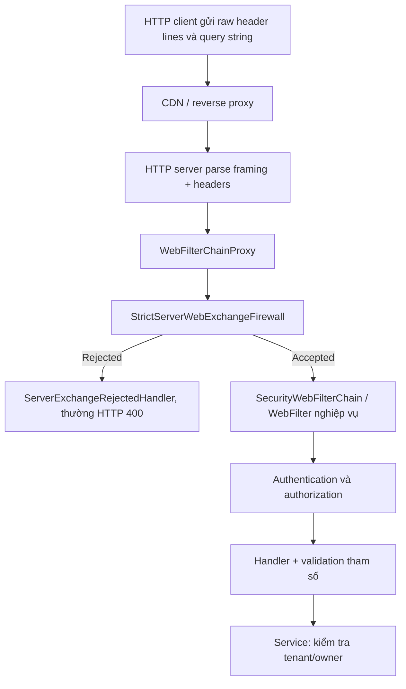

# Kiểm tra header cùng tên, giá trị tham số

## 1. Bối cảnh: một tên header có thể mang nhiều giá trị

Một API Spring WebFlux xử lý:

```http
GET /api/reports?tenant=red&report=42 HTTP/1.1
Host: api.example.com
Authorization: Bearer token-test-A
Accept: application/json
```

Bộ lọc Spring Security xác thực bearer token, sau đó service xác minh người gọi được phép xem báo cáo 42 trong tenant Red. Nhưng điều gì xảy ra khi client gửi **hai header cùng tên**, hoặc **hai query parameters cùng tên**?

```http
GET /api/reports?tenant=red&tenant=blue&report=42 HTTP/1.1
Host: api.example.com
Authorization: Bearer token-test-A
authorization: Bearer token-test-B
Accept: application/json
```

Nếu API gateway chọn giá trị cuối, một WebFilter chọn giá trị đầu, còn service chọn biến thể khác, các tầng có thể đưa ra những quyết định không nhất quán. Một số header cho phép nhiều giá trị theo cú pháp; một số khác **không**. Một `@RequestParam String tenant` thường không thể diễn đạt đầy đủ sự mơ hồ khi query chứa hai `tenant`, trong khi `MultiValueMap<String, String>` giữ nhiều giá trị.

Bài này thuộc chương **Firewall trên Reactive** của mô-đun **SPRING_SECURITY_HTTP_PROTECTION**, nơi người học triển khai các lớp phòng vệ HTTP và trình duyệt trong Spring Security: CSRF, CORS, security headers, CSP, HSTS, HTTP firewall và bảo vệ session trên cả Servlet lẫn Reactive. Trọng tâm là **kiểm tra header cùng tên, tên/giá trị header và giá trị tham số**, đặc biệt những điểm `StrictServerWebExchangeFirewall` tự bảo vệ được và những quy tắc **ứng dụng/HTTP server/proxy phải chủ động bổ sung**.

### Kết quả học tập

Sau bài này, bạn có thể:

1. Phân biệt **header trùng tên**, **tên header không hợp lệ**, **giá trị header không hợp lệ** và **query parameter xuất hiện nhiều lần**.
2. Giải thích vì sao HTTP header names **không phân biệt hoa/thường**, trong khi ngữ nghĩa nhiều giá trị phụ thuộc định nghĩa của từng field.
3. Nêu đúng mặc định của `StrictServerWebExchangeFirewall` với header names/values, parameter names và **parameter values**.
4. Cấu hình các predicate của firewall mà không vô hiệu hóa toàn bộ kiểm tra mặc định.
5. Thêm WebFilter kiểm tra một số trường nghiệp vụ cần giá trị duy nhất, chẳng hạn bearer `Authorization` và `tenant` trong query, khi kiến trúc yêu cầu.
6. Xác định giới hạn của WebFilter với `Content-Length`/`Transfer-Encoding`, nguy cơ HTTP request smuggling và vai trò của proxy/HTTP server.
7. Kiểm thử Servlet/Reactive, mock HTTP exchange và đường đi qua reverse proxy, phân biệt kết quả do firewall, authn/authz, parser hoặc gateway gây ra.

## 2. Phân biệt bốn nhóm vấn đề

Cùng một câu “header không hợp lệ” có thể chỉ bốn lỗi khác nhau:

| Nhóm | Ví dụ | Cần kiểm soát ở đâu? |
| --- | --- | --- |
| **Tên header không hợp lệ** | Tên chứa khoảng trắng hoặc ký tự điều khiển | HTTP parser và `setAllowedHeaderNames(...)` theo API/đường đi |
| **Giá trị header không hợp lệ** | Giá trị chứa CR/LF, control hoặc code point chưa định nghĩa | HTTP parser và `setAllowedHeaderValues(...)` |
| **Header trùng tên** | Hai dòng `Authorization` khác nhau hoặc `authorization` khác casing | Rule HTTP field, parser, edge và kiểm tra ngữ nghĩa riêng cho field |
| **Tham số trùng tên / giá trị không hợp lệ** | `?tenant=red&tenant=blue` hoặc `?limit=abc` | Query parser, `setAllowedParameterValues(...)` và validation ở handler/service |

**Không có quan hệ tương đương:** Một tên header có ký tự hợp lệ **không có nghĩa** trường đó được phép xuất hiện hai lần; ngược lại, một header hợp lệ có nhiều giá trị như `Accept` không phải mặc nhiên là tấn công.

### 2.1. Tên HTTP field không phân biệt hoa/thường

Theo RFC 9110, `Authorization`, `authorization` và `AUTHORIZATION` là **cùng một field name** về mặt ngữ nghĩa:

```http
Authorization: Bearer token-A
authorization: Bearer token-B
```

Đây không phải hai nhóm header độc lập để ứng dụng tự chọn một theo chữ hoa/thường. `HttpHeaders` của Spring hỗ trợ truy vấn tên không phân biệt hoa/thường, nhưng việc **lặp field lines** và cách thư viện/adapter bảo toàn giá trị cần được kiểm tra theo phiên bản.

Không viết:

```java
// Thiết kế nguy hiểm: coi chữ hoa/thường tạo ra các danh tính khác nhau.
String tokenA = rawMap.get("Authorization");
String tokenB = rawMap.get("authorization");
```

và không xây auth logic bằng việc iterate một raw map tùy thuộc cách HTTP server bảo toàn casing.

### 2.2. Header trùng tên có thể đúng hoặc sai

RFC 9110 cho phép gộp nhiều field lines cùng tên thành danh sách phân cách dấu phẩy **nếu định nghĩa field đó cho phép danh sách**. Thứ tự giá trị phải được giữ khi gộp. `Set-Cookie` trong **response** là trường hợp đặc biệt: thường xuất hiện nhiều dòng nhưng không thể gộp thành một comma-list thông thường.

Ví dụ `Accept` có thể biểu diễn nhiều lựa chọn:

```http
Accept: application/json
Accept: text/plain
```

Tầng trung gian có thể trình bày thành:

```http
Accept: application/json, text/plain
```

Theo ngữ nghĩa của `Accept`, đây thường là một danh sách hợp lệ. **Không áp quy tắc “mọi tên header chỉ được xuất hiện một lần” lên mọi request** nếu muốn tuân thủ HTTP và hỗ trợ client hợp lệ.

Ngược lại, với API chỉ nhận một bearer credential, hai `Authorization` cùng tên cần được coi là **ambiguous** theo chính sách của ứng dụng. Một rule kiểm soát ở gateway/ứng dụng phải xử lý rõ ràng, không tùy tiện lấy first/last. `StrictServerWebExchangeFirewall` kiểm tra tính hợp lệ tên/giá trị nhưng **không được coi là bộ phát hiện mọi duplicate field**.

### 2.3. Query parameter trùng tên khác duplicate HTTP header

`GET /api/reports?tenant=red&tenant=blue` không có hai HTTP header; nó có **hai giá trị query** của key `tenant`. API có thể chủ động hỗ trợ nhiều giá trị cho một số keys, ví dụ `?tag=java&tag=spring`, nhưng với những keys có ngữ nghĩa “chính xác một giá trị” như `tenant`, `paymentId`, `redirect_uri` hay `limit`, lặp lại có thể gây **HTTP parameter pollution** hoặc sai phạm vi nghiệp vụ.

## 3. Bản đồ request trong WebFlux



Từng tầng có phạm vi khác nhau:

- **HTTP server và proxy** phải parse message framing, giới hạn header section, xử lý `Content-Length`/`Transfer-Encoding`, không diễn giải mơ hồ ranh giới request.
- **Strict firewall** kiểm tra các điều kiện suspicious request mà API hỗ trợ: method, path, hostname, header names/values, parameter names/values.
- **WebFilter bổ sung** có thể áp các quy tắc nghiệp vụ *đúng một giá trị* cho các keys bảo mật; nhưng nó chỉ thấy representation đã được HTTP parser chấp nhận.
- **Authentication** xác định principal bằng credential theo contract, không được tùy chọn một trong nhiều credential mâu thuẫn theo cách ngẫu nhiên.
- **Authorization và service** kiểm tra quyền trên tenant/document; dù mọi header hợp lệ, user vẫn có thể cố đọc tài liệu người khác.

Một request bị HTTP server chặn trước `WebFilterChainProxy` có thể trả `400` mà **không** phát `ServerExchangeRejectedException` từ Spring; muốn xác định tầng từ chối cần có trace và negative tests.

## 4. StrictServerWebExchangeFirewall kiểm tra header và parameter như thế nào?

### 4.1. API và mốc phiên bản

Trong Spring Security Reactive, interface `ServerWebExchangeFirewall` và `StrictServerWebExchangeFirewall` có Javadoc ghi **Since 6.4**. `WebFilterChainProxy` sử dụng firewall trước khi chọn `SecurityWebFilterChain`. Không sao chép ví dụ này sang Spring Security 5.x hoặc 6.0–6.3 khi chưa đối chiếu dependency thực.

Các điểm tùy chỉnh chính:

```java
void setAllowedHeaderNames(Predicate<String> allowedHeaderNames);
void setAllowedHeaderValues(Predicate<String> allowedHeaderValues);
void setAllowedParameterNames(Predicate<String> allowedParameterNames);
void setAllowedParameterValues(Predicate<String> allowedParameterValues);
```

Javadoc có các constant predicate:

```java
StrictServerWebExchangeFirewall.ALLOWED_HEADER_NAMES
StrictServerWebExchangeFirewall.ALLOWED_HEADER_VALUES
StrictServerWebExchangeFirewall.ALLOWED_PARAMETER_NAMES
StrictServerWebExchangeFirewall.ALLOWED_PARAMETER_VALUES
```

**Đây là predicate trên chuỗi tên/giá trị**, không phải API nhận `HeaderName + toàn bộ List<String>` để quyết định một field có được phép lặp hay không. Tránh hiểu nhầm tên `setAllowedHeaderNames` là “cấm nhiều header cùng tên”.

### 4.2. Mặc định: ba nhóm kiểm tra ký tự, một nhóm cho phép giá trị

| Thành phần | Default theo Spring Security Javadoc 6.5.x | Ý nghĩa |
| --- | --- | --- |
| Header **name** | Từ chối ISO control characters và undefined code points | Tên không được chứa ký tự mà strict policy coi là không hợp lệ |
| Header **value** | Từ chối ISO control characters và undefined code points | Giảm xử lý giá trị chứa ký tự điều khiển/bất thường |
| Parameter **name** | Từ chối ISO control characters và undefined code points | Tránh key query bất thường |
| Parameter **value** | **Mặc định cho phép mọi giá trị** theo predicate này | Ứng dụng tự đặt validation bổ sung nếu cần |
| Hostname | Mặc định không hạn chế bằng hostname predicate | Có thể giới hạn `setAllowedHostnames` nếu phù hợp topology |

Điểm dễ bỏ sót nhất là **parameter values mặc định không bị giới hạn bởi một predicate chặn control/undefined tương tự header values**. Điều này **không** có nghĩa một raw request chứa bất kỳ bytes nào sẽ đến được controller: parser, URL/path rules, server và các lớp khác có thể từ chối trước. Nhưng application không nên dựa vào firewall default như một validator đủ cho `?limit=...`, `?tenant=...` hoặc `?redirect=...`.

### 4.3. Code point, ISO control và kiểm tra business syntax là ba việc khác nhau

Một giá trị có thể có các Unicode code points hợp lệ nhưng vẫn **không đúng hợp đồng nghiệp vụ**. Ví dụ `limit=thirty` có chữ cái bình thường và được default firewall chấp nhận, nhưng backend cần số nguyên trong khoảng cho phép.

Tương tự, `tenant=red,blue` là chuỗi bình thường nhưng không phải tenant ID hợp lệ nếu API quy định mỗi request chỉ có đúng một tenant. `user=admin` trong query không được phép ghi đè danh tính principal chỉ vì input hợp lệ.

### 4.4. Header values dạng Unicode và legacy clients

Tài liệu Spring Security có ví dụ một số `User-Agent` trên thiết bị cũ chứa ký tự ngoài ISO-8859-1 khiến máy chủ diễn giải thành code points bất thường. Thay vì mở mọi header values bằng predicate luôn `true`, cách tiếp cận an toàn là:

1. Xác định **đúng header/value** bị false reject, với dữ liệu thử nghiệm được phép.
2. So phiên bản Netty/HTTP server/proxy và cách decode.
3. Ưu tiên sửa encoding ở client/gateway để thống nhất.
4. Nếu thực sự cần ngoại lệ, dùng predicate hẹp và giữ kiểm tra control characters.
5. Test cả trường hợp hợp lệ và một số giá trị có CR/LF/null/undefined để bảo đảm không vô tình cho qua.

Không mặc định “mọi emoji hoặc tiếng Việt trong header đều cần chặn”; cần xét HTTP field syntax thực tế và cách parser của stack xử lý encoding. Cách encode Unicode trong URL, JSON body và header **khác nhau**.

## 5. RFC 9110: xử lý header cùng tên mà không mất ngữ nghĩa

### 5.1. Trường có danh sách giá trị: không chặn tùy tiện

`Accept`, `Accept-Encoding` và các trường được định nghĩa theo list syntax có thể xuất hiện dưới dạng nhiều field lines hoặc một comma-separated value theo quy tắc của từng trường.

```http
GET /public/report HTTP/1.1
Accept: application/json
Accept: text/csv
```

Với trường này, cần để server/client thương lượng representation theo đúng HTTP semantics. Một filter chung “nếu bất kỳ header nào có `values.size() > 1` thì 400” có thể phá vỡ request hợp lệ.

Ngoài ra, response `Set-Cookie` không thể xử lý như một comma-list thông thường. Không gộp tất cả `Set-Cookie` thành một chuỗi phân cách dấu phẩy khi trả response.

### 5.2. Trường có ngữ nghĩa đơn: kiểm tra chặt

Với các header nhạy cảm hoặc không cho phép multiple field lines theo chính sách API, cần kiểm tra:

| Header | Trạng thái cần lưu ý | Hướng bảo vệ |
| --- | --- | --- |
| `Authorization` | API bearer-only thường mong đợi đúng một credential | Không tùy tiện lấy first/last khi xuất hiện nhiều values |
| `Host` | Dùng cho host routing; ở HTTP/1.1 có quy tắc bắt buộc riêng | HTTP server/proxy phải kiểm tra Host và target phù hợp |
| `Content-Length` | Quyết định độ dài message body, cực kỳ nhạy với duplicates | Kiểm tra framing ở server/proxy theo RFC 9112 |
| `Transfer-Encoding` | Quyết định framing chunked và trung gian | Không cho parser bất đồng với Content-Length |
| `X-Tenant` hoặc custom routing header | Nếu dùng làm tenant hint | Không tin để cấp quyền; chỉ chấp nhận theo contract và xác nhận từ token |
| `Origin` | Liên quan CORS/CSRF và security decisions | Kiểm tra theo chuẩn/stack; không tự ghép nhiều origin |
| `X-Forwarded-Host`/`Forwarded` | Do trusted proxy cung cấp trong topology được cấu hình | Không tin từ Internet client khi chưa làm sạch |

**Authorization:** Khi nhận hai dòng `Authorization`, không được kết luận strict firewall sẽ tự reject tất cả trường hợp vì **trùng tên**. Cần thêm guard cho API hoặc policy ở edge nếu framework authentication chưa áp quy tắc mong muốn.

### 5.3. Casing và việc iterate HttpHeaders

Spring `HttpHeaders` cho phép `getFirst(name)`, `get(name)` và `getOrEmpty(name)`. Ý nghĩa cơ bản:

```java
String first = headers.getFirst("Authorization");
List<String> all = headers.getOrEmpty("Authorization");
```

- `getFirst` **chỉ lấy một giá trị**, có thể che các giá trị còn lại khi request mơ hồ.
- `getOrEmpty` trả danh sách values mà adapter hiện tại cung cấp; phù hợp hơn nếu muốn kiểm tra có nhiều field values.
- Tên header được truy vấn không phân biệt hoa/thường theo API, nhưng cách **iterate toàn bộ map** từng có những khác biệt giữa backing implementations và phiên bản framework.

Khi cần duyệt toàn bộ header name/value entries, Spring Framework có `HttpHeaders.headerSet()` ở các phiên bản hỗ trợ (ví dụ Spring 6.1.15+), giúp tránh lặp các key cùng tên khác casing trên một số native adapters. **Đừng dùng số lượng entry của `keySet()`/`entrySet()` làm bằng chứng chắc chắn không có duplicate raw header lines**, vì parser đã có thể gộp hoặc chuẩn hóa chúng.

## 6. Request smuggling: tại sao WebFilter không thể sửa mọi duplicate header?

Một request HTTP/1.1 sai hoặc mơ hồ về message framing có thể chứa:

```http
POST /api/orders HTTP/1.1
Host: api.example.com
Content-Length: 20
Transfer-Encoding: chunked
```

Ví dụ trên chỉ minh họa **kết hợp framing nguy hiểm**; không phải payload thực thi. HTTP/1.1 có quy tắc xử lý rất cụ thể trong RFC 9112. Khi proxy và backend không thống nhất nơi kết thúc request, một phần bytes có thể bị một tầng hiểu thành request kế tiếp. Đây là một nhánh của **HTTP request smuggling**.

### 6.1. Vai trò của RFC 9112

Đối với HTTP/1.1:

- Sender **không được** gửi `Content-Length` trong message có `Transfer-Encoding`.
- Server nhận request có cả hai có thể reject hoặc xử lý theo `Transfer-Encoding` theo điều kiện chuẩn; RFC yêu cầu đóng kết nối sau khi xử lý trường hợp này để tránh tấn công do parsing không nhất quán.
- `Content-Length` không hợp lệ hoặc không thể phân giải an toàn là lỗi message framing, không phải một query validation thông thường.
- Duplicate `Content-Length` có các quy tắc parsing/khôi phục nghiêm ngặt; không đơn giản gộp hoặc chọn giá trị bất kỳ.

**Nguyên tắc triển khai an toàn:** đặt chính sách strict và parser alignment ở **CDN/reverse proxy/HTTP server**. Một `WebFilter` chạy sau khi Netty đã parse request **không thể khôi phục nguyên dạng raw bytes của message framing** và không phải nơi phù hợp duy nhất để chống CL/TE ambiguity.

### 6.2. Kiểm thử framing ở đâu?

| Tầng | Trách nhiệm |
| --- | --- |
| Edge/CDN | Giới hạn kích thước header, cấm request framing không hợp lệ, không forward mơ hồ |
| Reverse proxy | Parse HTTP/1.1 nhất quán, xử lý CL/TE đúng RFC, không bỏ qua dấu hiệu tấn công |
| HTTP server | Reject/close connection theo framing requirements |
| Spring WebFlux firewall | Kiểm tra exchange đã parse: tên/giá trị header và input policy |
| Authentication/authorization | Không tin credential/tenant header mơ hồ |
| Application metrics | Ghi số request bị chặn/nguồn lỗi ở mức an toàn, không log raw secrets |

Không thực hiện test request smuggling thực tế trên môi trường không được phép; các bài test framing thuộc kế hoạch kiểm thử hạ tầng có phê duyệt, có thể ảnh hưởng tới các request khác trên kết nối dùng chung.

## 7. Parameter values: vì sao default không phải validation?

Giả sử API cho phép:

```http
GET /api/reports?limit=20&tenant=red HTTP/1.1
```

Một số input có thể vượt qua **default parameter value predicate** của firewall nhưng vẫn sai:

```text
/api/reports?limit=not-a-number
/api/reports?limit=-100
/api/reports?limit=99999999999999
/api/reports?tenant=red&tenant=blue
/api/reports?sort=unknown-field
/api/reports?redirect=https%3A%2F%2Fevil.example
```

Phân loại:

- `limit` cần kiểu số nguyên, giới hạn min/max để tránh xử lý quá tải.
- `tenant` cần **đúng một giá trị** nếu API contract quy định vậy; không lấy tenant từ query như nguồn sự thật để bypass principal claims.
- `sort` cần allowlist cột hợp lệ, không đưa raw value vào câu truy vấn SQL/HQL.
- `redirect` cần allowlist destination an toàn, không mở thành open redirect/SSRF chỉ vì chuỗi có thể parse thành URL.
- Input mang encoded characters có thể được URI parser decode; đừng tự decode thêm lần nữa rồi thay đổi ý nghĩa.

### 7.1. Query, form data và JSON body không phải một

`ServerHttpRequest.getQueryParams()` phản ánh query parameters trên URI. `ServerWebExchange.getFormData()` dùng cho form body, `getMultipartData()` cho multipart. JSON body có parser/DTO riêng. **Một rule `setAllowedParameterValues` của firewall không thay thế validation JSON schema, form upload, multipart file hoặc business DTO.**

Với Spring WebFlux, có thể dùng Bean Validation (`@Valid`/`@Validated`), typed request models, service-level authorization và giới hạn độ dài request/body. Đặc biệt không dùng global predicate quá chặt cho mọi query value nếu ứng dụng cần Unicode/full-text search.

### 7.2. Quy tắc “scalar” khác quy tắc “list”

| Query key | Contract | Ví dụ hợp lệ | Ví dụ không hợp lệ |
| --- | --- | --- | --- |
| `limit` | Đúng một số nguyên trong dải | `limit=20` | `limit=10&limit=500` |
| `tenant` | Nếu được dùng, đúng một key và phải được kiểm tra với principal | `tenant=red` | `tenant=red&tenant=blue` |
| `sort` | Một giá trị thuộc allowlist | `sort=createdAt` | `sort=unknownField` |
| `tag` | Có thể hỗ trợ nhiều giá trị theo contract | `tag=java&tag=spring` | Chỉ sai nếu app không hỗ trợ list |
| `redirect_uri` | Một URI đã đăng ký theo protocol phù hợp | `redirect_uri=...` đúng contract | Nhiều URI hoặc URI không đăng ký |
| `page` | Một số nguyên không âm | `page=1` | `page=-999999` |

**Đừng cấm tất cả duplicate query keys** chỉ vì có một số keys nhạy cảm. Nếu sản phẩm hỗ trợ tìm kiếm nhiều tags, nhiều `tag` là hợp lệ và cần được giữ.

## 8. Cấu hình StrictServerWebExchangeFirewall an toàn

### 8.1. Giữ mặc định trước, chỉ bổ sung rule cần thiết

Cấu hình Spring WebFlux thông thường có thể chỉ cần security chain:

```java
import org.springframework.context.annotation.Bean;
import org.springframework.context.annotation.Configuration;
import org.springframework.security.config.annotation.web.reactive.EnableWebFluxSecurity;
import org.springframework.security.config.web.server.ServerHttpSecurity;
import org.springframework.security.web.server.SecurityWebFilterChain;

@Configuration
@EnableWebFluxSecurity
class ReactiveSecurityConfig {

    @Bean
    SecurityWebFilterChain chain(ServerHttpSecurity http) {
        return http.authorizeExchange(auth -> auth
                .pathMatchers("/public/**").permitAll()
                .pathMatchers("/api/**").authenticated()
                .anyExchange().denyAll())
            .build();
    }
}
```

Nếu không có ngoại lệ, **không cần tự khai báo Bean strict firewall chỉ để lặp lại defaults**. Spring Security Reactive dùng `StrictServerWebExchangeFirewall` trong `WebFilterChainProxy` ở phiên bản hỗ trợ API.

Nếu có nhiều `SecurityWebFilterChain` với `securityMatcher(...)`, cần đảm bảo mọi URL nhạy cảm được phủ bởi một chain thích hợp; request được firewall chấp nhận nhưng không match security chain nào có thể tiếp tục tới handler mà thiếu filters mong đợi.

### 8.2. Một ví dụ giới hạn parameter values toàn cục

Nếu sản phẩm có contract **mọi query value đều ngắn và không chứa control characters**, có thể cấu hình:

```java
import org.springframework.context.annotation.Bean;
import org.springframework.context.annotation.Configuration;
import org.springframework.security.web.server.firewall.StrictServerWebExchangeFirewall;

@Configuration
class ReactiveFirewallConfig {

    @Bean
    StrictServerWebExchangeFirewall serverWebExchangeFirewall() {
        var firewall = new StrictServerWebExchangeFirewall();

        // Chính sách bổ sung chỉ phù hợp khi tất cả query values
        // của ứng dụng đáp ứng các giới hạn này.
        firewall.setAllowedParameterValues(value ->
            value != null
            && value.length() <= 2048
            && value.chars().noneMatch(ch ->
                ch == '\r' || ch == '\n' || ch == 0));

        // Giữ các predicate mặc định cho header name/value
        // và parameter name; không set thành always-true.
        return firewall;
    }
}
```

Đây chỉ là **một policy minh họa**, không phải chính sách tốt cho mọi ứng dụng:

- `setAllowedParameterValues` áp trên **giá trị tham số**, không riêng `tenant` hoặc `limit`.
- `String.length()` đo số UTF-16 code units, **không** phải kích thước bytes HTTP. Giới hạn raw URI/header/body vẫn phải ở server/gateway.
- Nếu có Unicode hoặc query full-text dài, policy phải được thiết kế lại.
- Nó không cấm duplicated keys, không validate kiểu số hoặc ownership.
- Một input có thể bị parser từ chối trước khi predicate được gọi.
- Không nới `setAllowedHeaderValues(...)`/`setAllowedHeaderNames(...)` bằng predicate `value -> true` chỉ để fix một legacy client.

### 8.3. Tùy chỉnh header predicate nhưng giữ baseline

Nếu cần thêm một constraint cho **tất cả** header values, kết hợp với predicate mặc định thay vì thay hoàn toàn:

```java
import java.util.function.Predicate;
import org.springframework.security.web.server.firewall.StrictServerWebExchangeFirewall;

var firewall = new StrictServerWebExchangeFirewall();

Predicate<String> baseline =
    StrictServerWebExchangeFirewall.ALLOWED_HEADER_VALUES;

// Ví dụ chỉ khi đã xác nhận mọi header giá trị <= 8192 ký tự.
// Với header lớn hợp lệ như Cookie, có thể phải chọn giới hạn
// khác hoặc đặt giới hạn bytes ở HTTP server/gateway.
firewall.setAllowedHeaderValues(value ->
    baseline.test(value) && value.length() <= 8192);
```

Đoạn này là **trích đoạn Bean configuration**; không dùng đồng thời nhiều Bean firewall vì framework không tự hợp nhất các instance.

**Lưu ý:** Những giới hạn kiểu này có thể khiến ứng dụng hỏng nếu header cookie, trace context, JWT hoặc một integration hợp lệ lớn hơn policy; đo kích thước ở hạ tầng và thiết kế giới hạn tương ứng. Đây không phải thay thế cấu hình **max header size** ở Netty/proxy.

### 8.4. Ngoại lệ theo một client legacy

Tài liệu Spring Security mô tả trường hợp User-Agent đặc biệt chứa ký tự bị decode không như mong đợi. Nếu cần nới, hãy:

1. Xác định nguyên nhân encoding theo client và HTTP server cụ thể.
2. Giữ baseline reject control/undefined cho phần lớn giá trị.
3. Thêm ngoại lệ có mẫu hẹp, đã review và có test.
4. Kiểm thử production proxy route có cùng cơ chế parse/normalize.
5. Ưu tiên sửa client/proxy, giảm nhu cầu nới global predicate.

Không copy ví dụ `header -> true` từ reference mà bỏ qua warning: **tắt validation của header values** là mở rộng bề mặt nguy hiểm.

## 9. Kiểm tra duplicate Authorization và scalar query keys trong WebFilter

Vì default firewall predicate không đồng nghĩa duplicate detection, ứng dụng có thể bổ sung một **WebFilter nghiệp vụ** cho các giá trị cần duy nhất. Ví dụ sau giả định API **chỉ chấp nhận một bearer credential**, các query keys `tenant` và `limit` là scalar, và được áp trong một security chain bao phủ `/api/**`.

### 9.1. WebFilter cho input mơ hồ

```java
import java.util.List;
import java.util.Set;

import org.springframework.http.HttpHeaders;
import org.springframework.http.HttpStatus;
import org.springframework.util.MultiValueMap;
import org.springframework.web.server.ServerWebExchange;
import org.springframework.web.server.WebFilter;
import org.springframework.web.server.WebFilterChain;
import reactor.core.publisher.Mono;

final class AmbiguousRequestWebFilter implements WebFilter {

    private static final Set<String> SCALAR_QUERY_KEYS =
        Set.of("tenant", "limit");

    @Override
    public Mono<Void> filter(
            ServerWebExchange exchange, WebFilterChain chain) {

        HttpHeaders headers = exchange.getRequest().getHeaders();
        List<String> authorization =
            headers.getOrEmpty(HttpHeaders.AUTHORIZATION);

        // Chính sách của API này: chỉ hỗ trợ một Bearer credential.
        // Một số adapter/proxy có thể gộp nhiều header lines thành
        // một giá trị dấu phẩy; Bearer token không chấp nhận dấu phẩy.
        if (authorization.size() > 1
                || (authorization.size() == 1
                    && authorization.get(0).contains(","))) {
            return badRequest(exchange);
        }

        MultiValueMap<String, String> query =
            exchange.getRequest().getQueryParams();

        for (String key : SCALAR_QUERY_KEYS) {
            List<String> values = query.get(key);
            if (values != null && values.size() != 1) {
                return badRequest(exchange);
            }
        }

        return chain.filter(exchange);
    }

    private Mono<Void> badRequest(ServerWebExchange exchange) {
        exchange.getResponse().setStatusCode(HttpStatus.BAD_REQUEST);
        return exchange.getResponse().setComplete();
    }
}
```

Đây là **rule của ứng dụng**, không phải hành vi mặc định của Spring Security. Nó có các giới hạn cần hiểu:

- Lệnh chặn comma trong `Authorization` hợp lý với endpoint **Bearer-only**; **không** tái sử dụng máy móc cho một hệ thống còn hỗ trợ Digest authentication (có cú pháp chứa dấu phẩy).
- Tầng proxy/parser có thể đã chuẩn hóa hoặc loại bỏ một header line trước WebFilter; không thể chứng minh raw duplicate lines được xử lý đúng chỉ bằng request đã parse.
- Code chỉ bắt duplication ở **query**. Form body/JSON/multipart cần validation riêng.
- Một `tenant` duy nhất vẫn **không** được xem là đáng tin: identity/tenant phải xác nhận từ principal và policy ở service.
- Một `limit` duy nhất vẫn cần parse số, min/max và chống quá tải.
- Header `Content-Length`/`Transfer-Encoding` phải được xử lý ở HTTP server/proxy, không dùng bộ lọc này để thay thế.
- Một số phiên bản/framework có thể diễn giải nhiều values theo cách khác; test với chính stack đang deploy.

### 9.2. Đặt WebFilter vào SecurityWebFilterChain

Nếu muốn guard chạy **sau firewall nhưng trước các bộ lọc xác thực** trong chain, thêm nó vào `ServerHttpSecurity` bằng `SecurityWebFiltersOrder.FIRST`:

```java
import org.springframework.context.annotation.Bean;
import org.springframework.context.annotation.Configuration;
import org.springframework.security.config.annotation.web.reactive.EnableWebFluxSecurity;
import org.springframework.security.config.web.server.ServerHttpSecurity;
import org.springframework.security.config.web.server.SecurityWebFiltersOrder;
import org.springframework.security.web.server.SecurityWebFilterChain;

@Configuration
@EnableWebFluxSecurity
class ApiSecurityWithInputGuard {

    @Bean
    SecurityWebFilterChain securityWebFilterChain(ServerHttpSecurity http) {
        return http
            .addFilterAt(
                new AmbiguousRequestWebFilter(),
                SecurityWebFiltersOrder.FIRST)
            .authorizeExchange(auth -> auth
                .pathMatchers("/public/**").permitAll()
                .pathMatchers("/api/**").authenticated()
                .anyExchange().denyAll())
            .build();
    }
}
```

Đây là **phương án cấu hình thay thế** security chain ở mục 8, không đăng ký các chain trùng nhau cho cùng URL. Trong Spring Security 6.4+, `WebFilterChainProxy` áp firewall trước khi chạy security filters của selected chain.

**Chú ý:** `WebFilter` thêm bằng `ServerHttpSecurity.addFilterAt(...)` chỉ chạy nếu request chọn **security chain chứa nó**. Với nhiều chain, phải đảm bảo route cần bảo vệ match chain phù hợp; một WebFilter toàn cục qua `@Component` có lifecycle/order khác và cần kiểm tra khi nó chạy so với `WebFilterChainProxy`. Không giả định thêm Bean WebFilter bất kỳ sẽ luôn đứng sau strict firewall.

### 9.3. Không nhầm guard với authorization

Bộ lọc này từ chối input mơ hồ, **không quyết định** ai có quyền xem tenant. Ví dụ cả:

```text
GET /api/reports?tenant=red
Authorization: Bearer bob-token
```

và:

```text
GET /api/reports?tenant=blue
Authorization: Bearer bob-token
```

đều có thể thỏa quy tắc mỗi key xuất hiện một lần. Service vẫn phải xác minh Bob có quyền với tenant Red/Blue và report ID tương ứng. Một lựa chọn đơn giản hơn là **không nhận tenant từ query** nếu tenant đã nằm trong token/session hoặc miền routing đáng tin.

## 10. Validation ở controller/service: quy tắc kiểu và khoảng giá trị

Ví dụ WebFlux endpoint `GET /api/reports` yêu cầu một `limit` số nguyên từ 1 đến 100:

```java
import org.springframework.http.CacheControl;
import org.springframework.http.MediaType;
import org.springframework.http.ResponseEntity;
import org.springframework.web.bind.annotation.GetMapping;
import org.springframework.web.bind.annotation.RequestParam;
import org.springframework.web.bind.annotation.RestController;
import reactor.core.publisher.Mono;

@RestController
class ReportController {

    private final ReportService service;

    ReportController(ReportService service) {
        this.service = service;
    }

    @GetMapping(
        path = "/api/reports",
        produces = MediaType.APPLICATION_JSON_VALUE)
    Mono<ResponseEntity<ReportPage>> list(
            @RequestParam(defaultValue = "20") int limit) {

        if (limit < 1 || limit > 100) {
            return Mono.error(
                new org.springframework.web.server.ResponseStatusException(
                    org.springframework.http.HttpStatus.BAD_REQUEST,
                    "limit phải thuộc [1,100]"));
        }

        // Service phải xác định principal/tenant thực qua context được
        // xác thực, không tin tenant do client tùy ý truyền.
        return service.listAuthorized(limit)
            .map(page -> ResponseEntity.ok()
                .contentType(MediaType.APPLICATION_JSON)
                .cacheControl(CacheControl.noStore())
                .body(page));
    }
}
```

`ReportService` và `ReportPage` là type minh họa cần được ứng dụng định nghĩa. Validation của `limit` **không** thay thế guard duplicate `?limit=1&limit=100` nếu API yêu cầu chính xác một giá trị; mỗi tầng phải có nhiệm vụ rõ ràng.

Với DTO, thêm Bean Validation hoặc validator tùy yêu cầu. Nếu dữ liệu trả về gắn tài khoản, dùng `Cache-Control: no-store` và bypass shared cache, không để kết quả theo tenant bị CDN dùng chung. Đây là phần kết nối chủ đề firewall với HTTP headers/session và chương Bộ nhớ đệm và MIME trong mô-đun.

## 11. Kiểm thử trực tiếp strict firewall bằng JUnit/StepVerifier

Mẫu dưới đây kiểm tra một policy parameter-value đã được cấu hình riêng. Vì default `ALLOWED_PARAMETER_VALUES` cho phép mọi giá trị, **phải thiết lập predicate mới trước khi test negative case**.

```java
import org.junit.jupiter.api.Test;
import org.springframework.mock.http.server.reactive.MockServerHttpRequest;
import org.springframework.mock.web.server.MockServerWebExchange;
import org.springframework.security.web.server.firewall.StrictServerWebExchangeFirewall;
import org.springframework.security.web.server.firewall.ServerExchangeRejectedException;
import reactor.test.StepVerifier;

class ReactiveParameterFirewallTest {

    @Test
    void shortParameterValueIsAccepted() {
        var firewall = new StrictServerWebExchangeFirewall();
        firewall.setAllowedParameterValues(v -> v != null && v.length() <= 5);

        var request = MockServerHttpRequest
            .get("/public/search?q=abc")
            .build();

        StepVerifier.create(firewall.getFirewalledExchange(
                MockServerWebExchange.from(request)))
            .expectNextCount(1)
            .verifyComplete();
    }

    @Test
    void longParameterValueIsRejectedByCustomPolicy() {
        var firewall = new StrictServerWebExchangeFirewall();
        firewall.setAllowedParameterValues(v -> v != null && v.length() <= 5);

        var request = MockServerHttpRequest
            .get("/public/search?q=abcdef")
            .build();

        StepVerifier.create(firewall.getFirewalledExchange(
                MockServerWebExchange.from(request)))
            .expectError(ServerExchangeRejectedException.class)
            .verify();
    }
}
```

**Giới hạn:** Test này giả định version/mock stack đưa `getQueryParams()` đến firewall theo đường phù hợp. Nếu mock/request decorator ở version đang dùng trì hoãn một bước validation, cần xác nhận thời điểm đánh giá hoặc dùng WebTestClient test với security chain thực. Không kết luận “default firewall từ chối chuỗi dài” — bài test đã **thay đổi predicate**.

### 11.1. Kiểm thử các predicate mặc định

Một bộ test bổ sung nên chứng minh:

- Tên header và header value bình thường được chấp nhận.
- Header có CR/LF/null được **HTTP parser hoặc firewall** từ chối; trong unit mock, input có thể bị chặn khi tạo request.
- Parameter name bình thường được chấp nhận.
- Default parameter **value** không tự áp business length limit.
- Khi custom predicate được áp, các giá trị ngoài policy bị reject.

Đừng gửi raw CR/LF qua một client production thật hoặc cố làm HTTP request splitting ngoài môi trường được phép. Mock của framework có thể không cho tạo header sai; điều đó không chứng minh mọi tầng network an toàn.

## 12. Kiểm thử WebFilter duplicate values độc lập

Ví dụ test `AmbiguousRequestWebFilter` ở mục 9 bằng `MockServerWebExchange`. Vì WebFilter độc lập với SecurityWebFilterChain, test này chứng minh chính **rule duplicate của ứng dụng**, không chứng minh strict firewall tự chặn duplicate:

```java
import static org.junit.jupiter.api.Assertions.assertEquals;
import static org.junit.jupiter.api.Assertions.assertFalse;

import java.util.concurrent.atomic.AtomicBoolean;
import org.junit.jupiter.api.Test;
import org.springframework.http.HttpStatus;
import org.springframework.mock.http.server.reactive.MockServerHttpRequest;
import org.springframework.mock.web.server.MockServerWebExchange;
import org.springframework.web.server.WebFilterChain;
import reactor.core.publisher.Mono;
import reactor.test.StepVerifier;

class AmbiguousRequestWebFilterTest {

    final AmbiguousRequestWebFilter guard =
        new AmbiguousRequestWebFilter();

    @Test
    void duplicateAuthorizationIsRejected() {
        var request = MockServerHttpRequest.get("/api/reports")
            .header("Authorization", "Bearer token-A", "Bearer token-B")
            .build();
        var exchange = MockServerWebExchange.from(request);

        AtomicBoolean downstreamCalled = new AtomicBoolean(false);
        WebFilterChain next = ex -> {
            downstreamCalled.set(true);
            return Mono.empty();
        };

        StepVerifier.create(guard.filter(exchange, next))
            .verifyComplete();

        assertEquals(HttpStatus.BAD_REQUEST,
            exchange.getResponse().getStatusCode());
        assertFalse(downstreamCalled.get());
    }

    @Test
    void duplicateTenantQueryIsRejected() {
        var request = MockServerHttpRequest
            .get("/api/reports?tenant=red&tenant=blue")
            .build();
        var exchange = MockServerWebExchange.from(request);

        StepVerifier.create(guard.filter(exchange, ex -> Mono.empty()))
            .verifyComplete();

        assertEquals(HttpStatus.BAD_REQUEST,
            exchange.getResponse().getStatusCode());
    }

    @Test
    void repeatedTagIsNotRejectedByThisGuard() {
        var request = MockServerHttpRequest
            .get("/api/reports?tag=java&tag=spring")
            .build();
        var exchange = MockServerWebExchange.from(request);

        AtomicBoolean downstreamCalled = new AtomicBoolean(false);

        StepVerifier.create(guard.filter(exchange, ex -> {
            downstreamCalled.set(true);
            return Mono.empty();
        })).verifyComplete();

        assertEquals(true, downstreamCalled.get());
    }
}
```

**Không khẳng định đây là test raw duplicate HTTP/1.1 lines.** Mock API có thể tổng hợp header values từ một list trong bộ nhớ; test chỉ khẳng định guard xử lý danh sách values mà WebFlux nhận. Thử raw duplicate header phải đi qua server/proxy cụ thể trong môi trường được phép.

### 12.1. Tránh dùng `getFirst` trong guard

Với input:

```http
Authorization: Bearer token-A
Authorization: Bearer token-B
```

`getFirst("Authorization")` có thể chỉ trả token-A. Nếu hệ thống khác chọn token-B, hai tầng có thể tạo security decisions khác nhau. Guard phải kiểm tra cả **số lượng values**, và theo contract bearer-only cần phát hiện các giá trị đã bị gộp bằng comma khi adapter có hành vi đó.

## 13. Kiểm thử tích hợp WebFlux với WebTestClient

Để chứng minh guard được thực sự thêm vào security chain, dùng WebTestClient cùng ứng dụng:

```java
import org.junit.jupiter.api.Test;
import org.springframework.beans.factory.annotation.Autowired;
import org.springframework.boot.test.autoconfigure.web.reactive.AutoConfigureWebTestClient;
import org.springframework.boot.test.context.SpringBootTest;
import org.springframework.test.web.reactive.server.WebTestClient;

@SpringBootTest
@AutoConfigureWebTestClient
class ReactiveHeaderIntegrationTest {

    @Autowired WebTestClient client;

    @Test
    void duplicateTenantReturnsBadRequest() {
        client.get()
            .uri("/api/reports?tenant=red&tenant=blue")
            .exchange()
            .expectStatus().isBadRequest();
    }

    @Test
    void duplicateAuthorizationReturnsBadRequest() {
        client.get()
            .uri("/api/reports")
            .header("Authorization",
                "Bearer token-A", "Bearer token-B")
            .exchange()
            .expectStatus().isBadRequest();
    }
}
```

Ở đây `400` là kỳ vọng **khi Bean/chain đang dùng `AmbiguousRequestWebFilter`** từ mục 9. Nếu ứng dụng chỉ bật `StrictServerWebExchangeFirewall` mặc định mà **không có guard**, đừng dùng test trên để tuyên bố firewall phải trả 400 do header bị lặp.

Cũng phải xác nhận `WebTestClient` thực sự đi qua Spring Security chain. Nếu ứng dụng chạy sau gateway hoặc có nhiều `SecurityWebFilterChain`, test bind ApplicationContext có thể bỏ qua tầng network hoặc một route không chọn chain chứa guard.

### 13.1. Test phân quyền cùng dữ liệu

Bổ sung test:

- Alice và Bob có token hợp lệ, cả hai gửi `tenant=red` **một lần**; chỉ Alice được xem dữ liệu thuộc quyền.
- Request anonymous không tự có quyền chỉ vì header/parameter đúng cú pháp.
- Với API login cookie, cần CSRF token theo contract cho thao tác đổi trạng thái.
- API trả dữ liệu riêng phải có `Cache-Control: no-store`.
- Một key `tag` cho phép nhiều values vẫn được handler xử lý đúng thứ tự/contract.

Guard input chỉ ngăn ambiguity; **authorization vẫn là lớp quyết định** có thể xem báo cáo/tenant nào.

## 14. Kiểm thử qua reverse proxy và HTTP server thật

Một test end-to-end cần quan sát đủ **raw headers → proxy → Netty/WebFlux → security filters**. Ví dụ test trong staging được phép:

```bash
# Chỉ dùng token và dữ liệu giả ở môi trường test.
curl -i \
  -H 'Authorization: Bearer token-A' \
  -H 'Authorization: Bearer token-B' \
  'https://staging.example.com/api/reports'

curl -i \
  -H 'Authorization: Bearer token-A' \
  'https://staging.example.com/api/reports?tenant=red&tenant=blue'

curl -i \
  -H 'Accept: application/json' \
  -H 'Accept: text/plain' \
  'https://staging.example.com/public/help'
```

Mục đích:

- Test đầu: xác định proxy/HTTP server/guard xử lý nhiều Authorization values thế nào.
- Test thứ hai: kiểm tra duplicate scalar query key đến WebFlux và bị guard từ chối.
- Test thứ ba: **không tự động coi hai Accept values là lỗi**; xem content negotiation và contract thực.

Đây không phải test CL/TE request smuggling; không gửi framing payload vào hệ thống dùng chung chưa được cấp phép. Nếu proxy hợp nhất hoặc từ chối một trong các trường trước origin, **status có thể đến từ proxy**, không phải Spring firewall.

### 14.1. Trace tối thiểu để phân biệt tầng

| Điểm | Điều cần xác nhận |
| --- | --- |
| Client | Raw header lines/casing và URL đã gửi bằng tool được phép |
| CDN/proxy | Header nào được giữ, gộp hoặc loại bỏ trước khi forward |
| HTTP server | Parser có reject request, giới hạn header/body thế nào |
| Strict firewall | Có `ServerExchangeRejectedException` không |
| Guard/chain | Có nhận nhiều values và trả 400 theo policy không |
| Authentication | Có chọn credential nào hay từ chối ambiguous credentials |
| Handler/service | Có tiếp cận resource, tenant, owner hợp lệ không |

**Log an toàn:** Chỉ ghi tên field, số lượng values, loại validation failure, request ID và tầng từ chối. Không log bearer token, cookie, password, raw PII hoặc header chứa control characters. Dữ liệu raw chỉ dùng cho forensic đã được phê duyệt và bảo vệ.

## 15. CORS, CSRF, session và security headers liên quan

Những điều sau độc lập với bài toán duplicate/parameter:

| Lớp | Giải quyết gì? | Không thay thế được |
| --- | --- | --- |
| **Strict firewall** | Header/parameter characters và request bất thường | Duplicate semantics, ownership |
| **Custom duplicate guard** | Quy tắc exactly-one cho Bearer/scalar query keys | HTTP framing và authorization |
| **CORS** | JS ở origin khác được phép đọc response nào | Header parser, object-level authorization |
| **CSRF** | Giảm request thay đổi trạng thái trái ý user dùng cookie/session | Kiểm tra duplicate tenant key |
| **Security response headers** | CSP, nosniff, HSTS, cache policy và browser defenses | Phân tích header request trùng tên |
| **Session/token authentication** | Xác định người gọi hợp lệ | Không bảo đảm tenant query đáng tin |
| **Method security** | Quyền gọi method hoặc đối tượng | Không xử lý CL/TE framing |
| **Rate limit/size limits** | Giới hạn lượng header, body, số request | Không giải quyết toàn bộ parser differential |

Một số request CORS preflight có `Access-Control-Request-Headers: authorization,content-type`. Đây **không phải** hai `Authorization`; nó là một header liệt kê các tên request headers mà browser dự định gửi. Đừng dùng duplicate guard đọc sai field này.

Khi truyền JWT/cookie qua proxy, cần đảm bảo gateway không tự gộp `Authorization` hoặc bỏ authentication header theo chính sách không rõ ràng; cả app và edge phải nhất quán trong việc từ chối trường mơ hồ.

## 16. So sánh Servlet và Reactive

| Đặc điểm | Reactive / Spring WebFlux | Servlet / Spring MVC |
| --- | --- | --- |
| Firewall API | `ServerWebExchangeFirewall`, `StrictServerWebExchangeFirewall` từ 6.4 | `HttpFirewall`, `StrictHttpFirewall` |
| Security proxy | `WebFilterChainProxy` | `FilterChainProxy` |
| Request headers | `ServerHttpRequest.getHeaders()` | `HttpServletRequest.getHeader(s)` và container adapter |
| Query values | `ServerHttpRequest.getQueryParams()` / `MultiValueMap` | `getParameterValues(...)` / MVC binding |
| Security chain | `SecurityWebFilterChain` | `SecurityFilterChain` |
| Custom interception | `WebFilter`, `ServerHttpSecurity.addFilterAt(...)` | Servlet `Filter`, `OncePerRequestFilter` hoặc Spring Security filter |
| Rejection | `ServerExchangeRejectedException` | `RequestRejectedException` |
| HTTP server framing | Reactor Netty hoặc runtime Reactive | Servlet container (Tomcat/Jetty/...) |
| Vấn đề trùng header | Phụ thuộc HTTP field semantics và adapter | Phụ thuộc HTTP field semantics và container |

Ví dụ Servlet có thể dùng `request.getHeaders("Authorization")` để kiểm tra nhiều values, nhưng nó vẫn quan sát request **đã được container parse**, không phải raw bytes HTTP. Một Servlet filter không thay thế cấu hình chống request smuggling ở Tomcat/Jetty/reverse proxy, tương tự giới hạn WebFilter bên Reactive.

## 17. Ma trận kiểm thử và chẩn đoán

| ID | Request / tình huống | Kỳ vọng / điều cần kiểm tra |
| --- | --- | --- |
| H01 | Một `Authorization: Bearer ...` hợp lệ | Authentication xử lý đúng contract |
| H02 | Hai `Authorization` khác values | Guard/edge từ chối nếu API yêu cầu một credential |
| H03 | `Authorization` + `authorization` | Trùng field name không phân biệt casing |
| H04 | Hai `Accept` hợp lệ | Không bị chặn chỉ vì có nhiều values |
| H05 | Header name chứa control char | HTTP parser/firewall từ chối |
| H06 | Header value có CR/LF | HTTP parser/firewall từ chối, không tạo response splitting |
| H07 | Legacy User-Agent khác encoding | Tìm nguyên nhân và ngoại lệ hẹp, không bật always-true |
| H08 | Trường `Content-Length` mâu thuẫn hoặc CL/TE cùng tồn tại | Kiểm thử parser/proxy theo RFC 9112, không chỉ WebFilter |
| P01 | `?limit=20` | Đúng một value, kiểu/giới hạn hợp lệ |
| P02 | `?limit=20&limit=200` | Guard từ chối nếu limit là scalar |
| P03 | `?tag=java&tag=spring` | Hợp lệ nếu API hỗ trợ nhiều tags |
| P04 | `?tenant=red&tenant=blue` | Từ chối ambiguity |
| P05 | `?limit=not-a-number` | Handler validation trả lỗi phù hợp |
| P06 | `?tenant=red` với Bob không có quyền Red | Authz từ chối dù query chỉ một value |
| P07 | Parameter value dài vượt custom policy | Firewall reject nếu predicate cấu hình và được áp |
| P08 | JSON body có hai property cùng tên | Validation/parser riêng; query predicate không thay thế |
| I01 | Mock firewall default | Phân biệt header names/values với parameter values |
| I02 | Mock duplicate guard | Từ chối multiple Authorization và scalar query |
| I03 | WebTestClient qua security chain | Guard được wiring đúng, không bị bỏ qua |
| I04 | Trực tiếp origin vs qua proxy | Cùng quyết định bảo mật, xác định tầng reject |
| I05 | Nhiều security chains | Không route nhạy cảm nào bypass guard/authorization |
| I06 | Sau nâng cấp Spring/Netty/gateway | Chạy regression vì parsing/normalization có thể đổi |

### 17.1. Chẩn đoán theo triệu chứng

| Hiện tượng | Nguyên nhân có thể | Hướng xử lý |
| --- | --- | --- |
| Bearer token thứ hai bị bỏ qua | Code dùng `getFirst`, proxy đã collapse hoặc auth filter chỉ lấy một value | Đặt policy exactly-one và test raw request qua proxy |
| Cùng URL có hai tenant values | Handler bind scalar từ multi-value query | Check count trước khi bind, xác minh principal/tenant ở service |
| `400` khi User-Agent có Unicode | Parser/strict header value predicate | Xác định encoding, nâng cấp/sửa client, ngoại lệ hẹp |
| `400` do query dài | Custom `setAllowedParameterValues` quá chặt | Điều chỉnh policy theo contract, không bỏ mọi validation |
| `Accept` xuất hiện hai lần và bị reject | Guard “cấm tất cả duplicates” sai RFC semantics | Chỉ chặn những keys thực sự single-valued |
| `Content-Length` sai nhưng WebFilter không thấy | Parser/gateway đã xử lý trước | Đánh giá HTTP framing ở proxy/Netty |
| Test mock PASS nhưng edge FAIL | HTTP adapter, casing, header folding/merging khác | Chạy test E2E và xem forwarding policy |
| `401` thay vì `400` trên multiple Authorization | Guard không chạy/trật thứ tự hoặc token bị xử lý trước | Kiểm tra SecurityWebFiltersOrder và chain coverage |
| Một route API ngoài chain vẫn chấp nhận header mơ hồ | Không match security chain có guard | Thêm catch-all/coverage hoặc kiểm tra global filter order |
| API dùng query `tenant` để cấp quyền | Tenant do client kiểm soát | Derive tenant từ principal, check owner/tenant server-side |
| Frontend CORS lỗi | Preflight/headers policy, không liên quan duplicate credential | Kiểm tra CORS/filter order, không nới firewall vô cớ |
| File download riêng bị cache chung | Cache-Control/CDN policy không đúng | `no-store` và bypass shared cache theo route riêng |

## 18. Bài tập tổng hợp

Ứng dụng báo cáo Spring WebFlux, Spring Security 6.5+, có:

- `GET /api/reports?tenant=...&limit=...` trả dữ liệu có phân quyền;
- `GET /public/help` cho phép content negotiation `Accept: text/html` hoặc `application/json`;
- bearer token để xác thực;
- một gateway nhận HTTP/1.1 từ Internet, rồi forward HTTP/2 đến origin;
- hai security chains: API và public;
- legacy client gửi `User-Agent` chứa một code point bất thường sau khi proxy decode.

Một ngày, gateway và backend phản ứng khác nhau với hai `Authorization`, hai `tenant`, và `Content-Length` bất thường. Một đồng nghiệp đề xuất `setAllowedHeaderValues(value -> true)` và cho rằng firewall sẽ “kiểm tra toàn bộ các header trùng tên”.

**Yêu cầu:**

1. Phân biệt **tên header hợp lệ**, **giá trị hợp lệ**, **header trùng tên** và **tham số trùng tên**.
2. Nêu default của bốn predicate ở `StrictServerWebExchangeFirewall`, đặc biệt `ALLOWED_PARAMETER_VALUES`.
3. Giải thích vì sao `Authorization` trùng tên không được xử lý bằng `getFirst` theo kiểu chọn tùy ý; đề xuất guard bearer-only.
4. Giải thích tại sao `Accept` có nhiều values không nên bị chặn chỉ vì nhiều header lines.
5. Viết WebFilter từ chối `tenant=red&tenant=blue` nhưng chấp nhận `tag=java&tag=spring` khi contract cho phép list.
6. Thêm guard vào `ServerHttpSecurity` sau firewall và trước auth, kiểm tra khi có nhiều security chains.
7. Viết predicate bổ sung cho `setAllowedParameterValues` có chính sách rõ ràng, không mặc định tắt header validation.
8. Thiết kế test StepVerifier cho custom parameter predicate và WebTestClient cho duplicate guard.
9. Nêu vì sao CL/TE framing phải được kiểm tra ở gateway/server theo RFC 9112; không dựa riêng WebFilter.
10. Mô tả cách kiểm tra User-Agent legacy qua proxy và cách thiết kế ngoại lệ hẹp.
11. Viết test Bob có `tenant=red` nhưng không có quyền Red, bảo đảm server từ chối dù input không trùng.
12. Xây dựng báo cáo pass/fail không ghi token, cookie hoặc dữ liệu cá nhân thật.

### Gợi ý lời giải

- **Strict firewall** xử lý header/parameter character rules, không được coi là giải pháp tự động cho mọi duplicate header.
- Tên header không phân biệt casing; duplicate fields chỉ hợp lệ theo **field-specific semantics**. `Accept` có thể là list, `Authorization` bearer-only yêu cầu đúng một credential.
- `setAllowedParameterValues` default cho phép mọi value; business validation cho `limit`, `tenant` và `redirect` phải làm riêng.
- Dùng `MultiValueMap` để kiểm tra scalar query key, `HttpHeaders.getOrEmpty` để xem values, không chỉ `getFirst`.
- Trong API bearer-only, từ chối multiple Authorization values và dạng comma-combined không hợp lệ cho Bearer.
- Với CL/TE, RFC 9112 và HTTP parser/proxy quan trọng nhất; WebFilter không khôi phục raw framing.
- Giữ baseline predicates, nới riêng trường hợp legacy thật sự cần thiết sau khi kiểm tra encoding.
- Dùng test unit, integration và proxy end-to-end; service vẫn kiểm tra owner/tenant.

## Tài liệu tham khảo

- [Spring Security — Reactive ServerWebExchangeFirewall](https://docs.spring.io/spring-security/reference/reactive/exploits/firewall.html): strict firewall, header/parameter validation và customization.
- [Spring Security 6.5 Javadoc — StrictServerWebExchangeFirewall](https://docs.spring.io/spring-security/reference/6.5/api/java/org/springframework/security/web/server/firewall/StrictServerWebExchangeFirewall.html): bốn predicate và default parameter values.
- [Spring Security Javadoc — ServerWebExchangeFirewall](https://docs.spring.io/spring-security/reference/api/java/org/springframework/security/web/server/firewall/ServerWebExchangeFirewall.html): `getFirewalledExchange` và mốc API.
- [Spring Security Javadoc — ServerHttpSecurity](https://docs.spring.io/spring-security/reference/api/java/org/springframework/security/config/web/server/ServerHttpSecurity.html): `addFilterAt` và Reactive security chains.
- [Spring Framework Javadoc — HttpHeaders](https://docs.spring.io/spring-framework/docs/current/javadoc-api/org/springframework/http/HttpHeaders.html): `getFirst`, `get`, `getOrEmpty`, casing và iteration.
- [Spring Framework — WebFlux Annotated Controllers](https://docs.spring.io/spring-framework/reference/web/webflux/controller.html): query binding, WebFlux handlers và validation.
- [Spring Security — Reactive Testing](https://docs.spring.io/spring-security/reference/reactive/test/index.html): integration với WebTestClient và security test support.
- [RFC 9110 — HTTP Semantics](https://www.rfc-editor.org/rfc/rfc9110.html): header field names, field order và duplicate field lines.
- [RFC 9112 — HTTP/1.1](https://www.rfc-editor.org/rfc/rfc9112.html): message framing, `Content-Length`, `Transfer-Encoding` và request smuggling risks.
- [RFC 8941 — Structured Field Values for HTTP](https://www.rfc-editor.org/rfc/rfc8941.html): syntax một số HTTP structured fields, khác với việc ghép tùy ý các header.
- [OWASP — HTTP Parameter Pollution](https://owasp.org/www-community/attacks/HTTP_Parameter_Pollution): tác động của multiple parameters.
- [OWASP — HTTP Request Smuggling](https://owasp.org/www-community/attacks/HTTP_Request_Smuggling): parser discrepancies ở proxy/backend.
