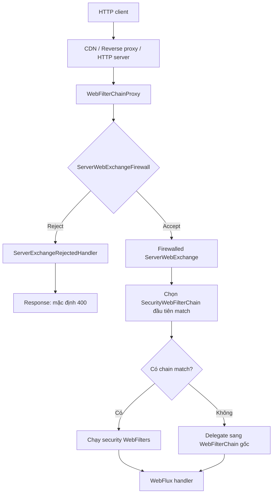

# Tùy chỉnh bean firewall trong cấu hình WebFlux

## 1. Tình huống: vì sao phải thay đổi firewall mặc định?

Một ứng dụng Spring WebFlux phục vụ API công khai và dữ liệu riêng tư:

- `GET /public/ping`: kiểm tra hệ thống;
- `GET /api/profile`: yêu cầu xác thực;
- `POST /api/documents`: tạo tài liệu;
- `OPTIONS /api/documents`: CORS preflight từ frontend ở origin khác;
- `/admin/**`: chỉ quản trị viên.

Spring Security có khả năng từ chối các request mang đường dẫn hoặc HTTP method bất thường **trước khi chúng được dùng để lựa chọn security chain**. Nhưng môi trường triển khai đôi khi có nhu cầu cụ thể: giới hạn các HTTP methods được phép, xử lý URL sử dụng matrix variables, kiểm tra hostname sau reverse proxy, áp tiêu chí riêng cho header hoặc query parameters, và quyết định status khi request bị firewall từ chối.

Với **Spring Security Reactive từ 6.4**, API phù hợp là `ServerWebExchangeFirewall` và triển khai mặc định `StrictServerWebExchangeFirewall`. Cách tùy chỉnh thông thường là **khai báo một Bean firewall** để hạ tầng Spring Security sử dụng trong `WebFilterChainProxy`; không cần viết một WebFilter mới để thay thế toàn bộ chuỗi bảo mật.

Bài nằm trong chương **Firewall trên Reactive** của mô-đun **SPRING_SECURITY_HTTP_PROTECTION**. Mô-đun học cách triển khai các lớp phòng vệ HTTP và trình duyệt với Spring Security — CSRF, CORS, security headers, CSP, HSTS, HTTP firewall và bảo vệ session — trên cả **Servlet** lẫn **Reactive**. Chủ đề của bài này là **tùy chỉnh Bean firewall trong cấu hình WebFlux** sao cho có lý do bảo mật, đúng API, tương thích ứng dụng, có kiểm thử và không vô tình vô hiệu lớp kiểm tra mặc định.

### Mục tiêu học tập

Sau bài học, bạn có thể:

1. Giải thích vì sao `StrictServerWebExchangeFirewall` được gắn ở `WebFilterChainProxy`, khác với `SecurityWebFilterChain` và `ServerHttpSecurity`.
2. Viết một Bean `StrictServerWebExchangeFirewall` và xác minh ứng dụng đang dùng **chính instance được cấu hình**.
3. Giới hạn HTTP methods an toàn, giữ `OPTIONS` khi ứng dụng cần CORS preflight.
4. Đánh giá có nên nới `setAllowSemicolon(true)`, host allowlist hoặc các rule encoded-path hay không.
5. Dùng các predicate header/parameter mà không tắt bỏ các kiểm tra mặc định.
6. Tùy chỉnh `ServerExchangeRejectedHandler` và phân biệt lỗi firewall với authentication, authorization, CSRF hoặc router.
7. Kiểm thử trực tiếp bằng `StepVerifier`, tích hợp `WebTestClient` và kiểm chứng đường đi thật qua HTTP server/proxy.
8. Nhận ra giới hạn: Bean firewall không thay authorization theo tenant/record, HTTP parser, rate limiting hoặc WAF.

## 2. Phạm vi phiên bản: đừng copy API theo tên mà bỏ qua dependency

Javadoc chính thức ghi **`Since: 6.4`** cho `StrictServerWebExchangeFirewall` và `ServerWebExchangeFirewall`; `WebFilterChainProxy.setFirewall(ServerWebExchangeFirewall)` cũng được ghi từ 6.4. `WebFilterChainProxy` là class có trước đó, nhưng không đồng nghĩa mọi phiên bản cũ đều có API firewall Reactive này.

| Nhánh Spring Security | Cách áp dụng |
| --- | --- |
| 5.x | Không giả định có `StrictServerWebExchangeFirewall`; kiểm tra API thực tế của dự án |
| 6.0–6.3 | Không dùng ví dụ ở bài này như một API được bảo đảm có mặt |
| 6.4 | Mốc bắt đầu của Reactive firewall API đang bàn tới; kiểm tra patch version |
| 6.5.x | Có tài liệu Reactive firewall và Javadoc phù hợp với các ví dụ 6.x |
| 7.x | Tiếp tục có API liên quan, nhưng cần kiểm tra tương thích và chữ ký ở đúng nhánh |

**Không suy trực tiếp phiên bản Spring Security từ phiên bản Spring Boot.** Boot thường quản lý dependency qua BOM; cấu hình override có thể đổi version của `spring-security-web`, `spring-security-config`. Nếu import không compile hoặc Bean không có tác dụng, kiểm tra dependency đã resolve trước khi sửa code.

### 2.1. Một khác biệt giữa ví dụ reference và chữ ký Javadoc

Trang hướng dẫn Reactive firewall có ví dụ gọi `setAllowedHttpMethods` với chuỗi `"GET"`, `"POST"`. Trong Javadoc Spring Security 6.5.x/7.x, chữ ký được công bố là:

```java
void setAllowedHttpMethods(Collection<HttpMethod> allowedHttpMethods)
```

Với chữ ký này, dùng các đối tượng `org.springframework.http.HttpMethod`:

```java
firewall.setAllowedHttpMethods(
    List.of(HttpMethod.GET, HttpMethod.HEAD, HttpMethod.POST));
```

Không lấy một đoạn hướng dẫn thuộc version khác để thay cho chữ ký của dependency đang chạy. Đây cũng là lý do các ví dụ trong bài ghi rõ giả định **Spring Security 6.4+, đặc biệt nhánh 6.5.x/7.x**.

## 3. Firewall Bean được dùng ở đâu?

Spring Security Reactive dùng `WebFilterChainProxy` để kết nối nhiều `SecurityWebFilterChain`. Khi đã hỗ trợ API firewall, proxy dùng `ServerWebExchangeFirewall` để kiểm tra exchange trước khi tìm chain phù hợp.



### 3.1. Tên API và trách nhiệm khác nhau

| Thành phần | Vai trò | Điều không thực hiện |
| --- | --- | --- |
| `ServerWebExchangeFirewall` | Hợp đồng kiểm tra và có thể bọc `ServerWebExchange` | Không quyết định quyền người dùng theo bản ghi |
| `StrictServerWebExchangeFirewall` | Triển khai strict, mặc định từ chối request đáng ngờ | Không phải WAF xử lý mọi lớp tấn công |
| `WebFilterChainProxy` | Áp firewall rồi chọn security chain | Không tự từ chối URL hợp lệ nếu không có chain match |
| `SecurityWebFilterChain` | Tập WebFilters chạy cho request match | Không quyết định chính sách firewall toàn cục |
| `ServerHttpSecurity` | DSL cấu hình authentication/authorization/CSRF/CORS/security headers | Không phải API để bật mọi setter strict firewall |
| `ServerExchangeRejectedHandler` | Xử lý request đã bị firewall reject | Không thay handler cho mọi `401`/`403` |
| Method security/service | Kiểm tra quyền với thao tác, user, tenant và record | Không sửa raw URL/parser mơ hồ |

**Một Bean firewall có hiệu lực ở cấp proxy**, không mặc định được cấu hình **riêng theo mỗi security chain**. Nếu có nhiều chain API, admin, website, cùng một `WebFilterChainProxy` sẽ kiểm tra request trước khi lựa chọn chain. Không thiết kế firewall Bean theo hướng “route này dùng firewall A, route kia dùng firewall B” nếu chưa tự xây một hạ tầng proxy tùy biến và đánh giá đầy đủ rủi ro.

### 3.2. Nếu không có chain nào match thì sao?

Firewall có thể chấp nhận một URL hoàn toàn hợp lệ, nhưng khi **không security chain nào match**, `WebFilterChainProxy` có thể delegate đến chain gốc mà không chạy security filters của các chain dự kiến. Vì vậy cần:

- Bao phủ mọi URL nhạy cảm bằng security chain phù hợp.
- Sắp thứ tự các chain từ cụ thể đến tổng quát.
- Dùng **catch-all chain** có `anyExchange().denyAll()` khi chính sách yêu cầu default-deny.
- Kiểm tra authorization tại service/method, nhất là dữ liệu theo owner/tenant.

**Firewall không thay default-deny authorization.**

## 4. Cấu hình WebFlux tiêu chuẩn: giữ firewall mặc định nếu không có nhu cầu thay đổi

Ví dụ security chain cho API demo:

```java
import org.springframework.context.annotation.Bean;
import org.springframework.context.annotation.Configuration;
import org.springframework.security.config.annotation.web.reactive.EnableWebFluxSecurity;
import org.springframework.security.config.web.server.ServerHttpSecurity;
import org.springframework.security.web.server.SecurityWebFilterChain;

@Configuration
@EnableWebFluxSecurity
class ReactiveSecurityConfig {

    @Bean
    SecurityWebFilterChain apiSecurity(ServerHttpSecurity http) {
        return http.authorizeExchange(auth -> auth
                .pathMatchers("/public/**").permitAll()
                .pathMatchers("/api/**").authenticated()
                .pathMatchers("/admin/**").hasRole("ADMIN")
                .anyExchange().denyAll())
            .build();
    }
}
```

Với setup chuẩn và version phù hợp, Spring Security sử dụng strict firewall mặc định. **Không bắt buộc** khai báo Bean `StrictServerWebExchangeFirewall` chỉ để đạt default behavior.

Ví dụ này tập trung vào route authorization. Ứng dụng thật phải khai báo authentication mechanism (bearer token, HTTP Basic, form login, session...), CORS, CSRF, logout, content headers và method security theo mô hình bảo mật. `authenticated()` ở `/api/**` không xác nhận người gọi sở hữu tài liệu có ID nào đó.

### 4.1. Khi nào thật sự cần một Bean riêng?

Chỉ cân nhắc khi có yêu cầu có thể kiểm thử:

- Restrict toàn hệ thống còn một tập HTTP methods nhỏ hơn mặc định.
- Cần matrix variables/semicolon hợp pháp với thiết kế URL đã đánh giá.
- Phải kiểm tra hostname theo topology đã kiểm soát.
- Có contract chung cho header values hoặc query parameter values.
- Cần một ngoại lệ cực hẹp cho client legacy mà không thể sửa ngay.
- Chính sách phản hồi khi firewall reject khác default 400 theo API contract.

Không nên tạo custom Bean chỉ để khắc phục hàng loạt status 400 chưa chẩn đoán được nguồn, vì rất có thể lỗi nằm ở proxy/HTTP server hoặc URI design.

## 5. Cách khai báo Bean StrictServerWebExchangeFirewall

Khai báo một Bean trong `@Configuration` được Spring Security quét:

```java
import org.springframework.context.annotation.Bean;
import org.springframework.context.annotation.Configuration;
import org.springframework.security.web.server.firewall.StrictServerWebExchangeFirewall;

@Configuration
class ReactiveFirewallConfig {

    @Bean
    StrictServerWebExchangeFirewall serverWebExchangeFirewall() {
        return new StrictServerWebExchangeFirewall();
    }
}
```

Bean trên lặp lại hành vi mặc định và thường không cần thiết, nhưng thể hiện **điểm mở rộng chính thức**: Spring Security Reactive reference hướng dẫn tùy chỉnh firewall bằng cách expose nó dưới dạng Bean.

Những điểm cần nhớ:

1. Bean phải nằm trong **ApplicationContext** quản lý Spring Security WebFlux.
2. Ứng dụng thực sự chạy WebFlux Security với `WebFilterChainProxy`, không vô tình chuyển sang Servlet stack.
3. Không đồng thời khai báo nhiều Bean firewall rồi mong framework tự hợp nhất.
4. Nếu dùng configuration riêng cho test, phải kiểm tra test context nhận **đúng Bean**.
5. Tùy chỉnh Bean không tự thay các rule `authorizeExchange(...)`.
6. Nếu ứng dụng tự tạo `WebFilterChainProxy` thay vì theo auto-configuration, phải tự đảm bảo proxy được cấu hình sử dụng đúng firewall; không nên tự dựng proxy khi không cần.

### 5.1. Không cần tự thay toàn bộ WebFilterChainProxy

Một anti-pattern dễ gặp là copy các `WebFilter` từ security chains, tự tạo `WebFilterChainProxy` rồi đăng ký thêm như một WebFilter mới chỉ để đổi một setter firewall. Điều đó có thể dẫn tới:

- Security filters chạy hai lần hoặc thiếu filter.
- Thứ tự các `SecurityWebFilterChain` bị sai.
- Cấu hình CSRF/CORS/authentication bị bỏ qua.
- Handler từ chối mặc định không còn như bạn kỳ vọng.
- Một số URL vô tình không match chain và không được bảo vệ.

Đối với nhu cầu thông thường, **expose Bean strict firewall** hoặc **Bean rejection handler**, để hạ tầng Spring Security làm phần wiring.

## 6. Ví dụ hoàn chỉnh: giới hạn HTTP methods bằng Bean

Mặc định strict firewall cho phép:

```text
DELETE, GET, HEAD, OPTIONS, PATCH, POST, PUT
```

Nếu ứng dụng chỉ sử dụng **GET, HEAD, POST, OPTIONS**, có thể giới hạn:

```java
import java.util.List;

import org.springframework.context.annotation.Bean;
import org.springframework.context.annotation.Configuration;
import org.springframework.http.HttpMethod;
import org.springframework.security.web.server.firewall.StrictServerWebExchangeFirewall;

@Configuration
class RestrictedMethodFirewallConfig {

    @Bean
    StrictServerWebExchangeFirewall serverWebExchangeFirewall() {
        StrictServerWebExchangeFirewall firewall =
            new StrictServerWebExchangeFirewall();

        firewall.setAllowedHttpMethods(List.of(
            HttpMethod.GET,
            HttpMethod.HEAD,
            HttpMethod.POST,
            HttpMethod.OPTIONS
        ));

        return firewall;
    }
}
```

Bảng kết quả kỳ vọng **khi request thực sự tới firewall**:

| Request | Strict default | Bean custom ở trên | Lý do |
| --- | --- | --- | --- |
| `GET /public/ping` | Cho phép về method | Cho phép về method | Dùng để đọc |
| `HEAD /public/ping` | Cho phép | Cho phép | Lấy metadata |
| `OPTIONS /api/documents` | Cho phép | Cho phép | CORS preflight |
| `POST /api/documents` | Cho phép | Cho phép | Tạo dữ liệu |
| `PUT /api/documents/1` | Cho phép về method | **Reject** | Không trong custom allowlist |
| `PATCH /api/documents/1` | Cho phép về method | **Reject** | Không trong custom allowlist |
| `DELETE /api/documents/1` | Cho phép về method | **Reject** | Không trong custom allowlist |
| `TRACE /public/ping` | **Reject** | **Reject** | Không trong mặc định |

**Quan trọng:** “Cho phép về method” chỉ nghĩa là vượt qua bước kiểm tra method của firewall; request vẫn có thể bị chặn vì path/header, authentication, authorization, CSRF, CORS hoặc handler không hỗ trợ method.

### 6.1. Ảnh hưởng tới CORS preflight

Frontend ở origin khác có thể gửi:

```http
OPTIONS /api/documents HTTP/1.1
Origin: https://frontend.example.com
Access-Control-Request-Method: POST
Access-Control-Request-Headers: authorization,content-type
```

Nếu custom Bean bỏ `OPTIONS`, request có thể bị firewall reject **trước khi cơ chế CORS được xử lý**. Ngược lại, thêm `OPTIONS` vào allowlist **không tự cho phép mọi origin**; vẫn cần cấu hình allowed origins, methods, headers, credentials ở CORS.

Đừng vô hiệu `CSRF` chỉ vì muốn CORS preflight chạy. Với phiên đăng nhập dựa trên cookie/session, `POST` được firewall chấp nhận vẫn có thể cần CSRF token theo chính sách ứng dụng. CORS và CSRF giải quyết hai nhóm rủi ro khác nhau.

### 6.2. Không tắt xác thực HTTP method

Đừng “chữa lỗi” bằng:

```java
// KHÔNG khuyến nghị cho production:
firewall.setUnsafeAllowAnyHttpMethod(true);
```

Javadoc cảnh báo việc này bỏ validation HTTP method và có thể mở rộng bề mặt HTTP Verb Tampering/Cross-Site Tracing. Nếu cần một method ngoài allowlist, đánh giá method đó, cập nhật allowlist và thêm test, không bật mọi method.

## 7. Tùy chỉnh semicolon và matrix variables

Strict firewall mặc định từ chối semicolon trong URL vì rủi ro path matching ambiguity. Một số ứng dụng có legacy routes hoặc matrix variables:

```text
GET /catalog;color=red/products;year=2026
```

Nếu có nhu cầu thực sự và không thể sửa API, có thể dùng:

```java
import org.springframework.context.annotation.Bean;
import org.springframework.context.annotation.Configuration;
import org.springframework.security.web.server.firewall.StrictServerWebExchangeFirewall;

@Configuration
class MatrixVariableFirewallConfig {

    @Bean
    StrictServerWebExchangeFirewall serverWebExchangeFirewall() {
        StrictServerWebExchangeFirewall firewall =
            new StrictServerWebExchangeFirewall();

        firewall.setAllowSemicolon(true);

        return firewall;
    }
}
```

**Đây là phương án thay thế ví dụ Bean ở mục 6**, không đăng ký cả hai trong cùng context. Nếu vừa giới hạn method vừa cho phép semicolon, gọi cả hai setter **trên một instance**.

### 7.1. Vì sao việc nới semicolon phải được kiểm thử theo route?

Path có semicolon có thể được xử lý khác nhau giữa:

- CDN và reverse proxy;
- HTTP server / WebFlux parser;
- `StrictServerWebExchangeFirewall`;
- `SecurityWebFilterChain.matches(exchange)`;
- `authorizeExchange(...).pathMatchers(...)`;
- WebFlux annotated/functional handler.

Giả sử `/admin/**` yêu cầu ADMIN. Sau khi cho phép semicolon, phải kiểm tra `/admin;mode=public/users` và những biến thể tương tự không được route/matcher hiểu thành public URL. Tài liệu Spring Security có mô tả path parameters phục vụ matching, nhưng strict mặc định **từ chối dấu `;`**; không nên hiểu mô tả normalization là cơ chế cho phép request đáng ngờ.

### 7.2. Có giải pháp đơn giản hơn không?

Thường có: chuyển matrix variables sang query parameters đã validate, hoặc sử dụng opaque IDs trong path. **Không đặt session ID trong URL**; URL có thể lộ qua browser history, log, sao chép và referrer. Các dữ liệu quan trọng cần dựa vào authentication, authorization ở service, không dựa vào path fragments do client tự khai báo.

## 8. Tùy chỉnh danh sách hostname

Javadoc có `setAllowedHostnames(Predicate<String>)`. Mặc định không áp hostname allowlist riêng; nếu một deployment chỉ được phục vụ qua những host cụ thể, có thể cấu hình:

```java
import java.util.Locale;
import java.util.Set;

Set<String> allowedHosts =
    Set.of("api.example.com", "internal-api.example.com");

firewall.setAllowedHostnames(host ->
    host != null
    && allowedHosts.contains(host.toLowerCase(Locale.ROOT)));
```

Đây là **trích đoạn bên trong phương thức cấu hình Bean**, với `firewall` đã được khởi tạo; không tạo Bean thứ hai.

### 8.1. Cẩn trọng với reverse proxy và forwarded headers

Ứng dụng WebFlux sau gateway có thể nhận Host khác với public hostname tùy cấu hình. `Forwarded` hoặc `X-Forwarded-Host` chỉ đáng tin nếu được proxy có thẩm quyền ghi/chuẩn hóa và Spring đã cấu hình xử lý theo topology tin cậy.

- Không tự coi bất kỳ `X-Forwarded-Host` do client gửi là sự thật.
- Xác định rõ Host thực sự mà firewall thấy ở origin.
- Test public hostname, internal hostname và host không được phép.
- Không dùng hostname allowlist như biện pháp thay thế kiểm tra tenant/owner; dù Host hợp lệ, service vẫn phải kiểm tra principal.
- Nếu có reverse proxy rewrite Host, cần đồng bộ allowlist theo đường đi thực chứ không chỉ môi trường local.

Chú ý một cấu hình quá chặt ở localhost có thể khiến integration test bị từ chối vì Host test mặc định khác với production. Test phải mô phỏng host phù hợp hoặc dùng policy riêng cho môi trường được quản lý, tránh tùy tiện tắt hẳn predicate.

## 9. Header và parameter predicates: mở rộng mà không vô hiệu hóa baseline

`StrictServerWebExchangeFirewall` cho phép cấu hình:

```java
setAllowedHeaderNames(Predicate<String>)
setAllowedHeaderValues(Predicate<String>)
setAllowedParameterNames(Predicate<String>)
setAllowedParameterValues(Predicate<String>)
```

Các predicate nhận **chuỗi tên hoặc giá trị đã được HTTP server/WebFlux cung cấp**. Chúng không tự kiểm tra object-level authorization, số lần header xuất hiện, JSON body, hoặc HTTP framing nguyên thủy.

### 9.1. Mặc định từng nhóm

| Nhóm | Mặc định đáng chú ý |
| --- | --- |
| Header names | Chặn ISO control characters và undefined Unicode code points |
| Header values | Chặn ISO control characters và undefined Unicode code points |
| Parameter names | Chặn ISO control characters và undefined Unicode code points |
| Parameter values | **Mặc định cho phép mọi giá trị** theo predicate tương ứng |
| Hostnames | **Mặc định cho phép mọi hostname** theo predicate tương ứng |

Các ràng buộc của HTTP parser, URL syntax, Netty hoặc proxy vẫn có thể reject request trước khi predicate chạy. Việc parameter value mặc định “allow any” **không** có nghĩa mọi raw bytes HTTP hợp lệ hoặc business input được chấp nhận.

### 9.2. Kết hợp với predicate mặc định

Nếu có yêu cầu mọi header values không quá dài theo contract, có thể nối thêm điều kiện nhưng **giữ baseline**:

```java
import java.util.function.Predicate;
import org.springframework.security.web.server.firewall.StrictServerWebExchangeFirewall;

// Trích đoạn ở bên trong @Bean.
Predicate<String> baseline =
    StrictServerWebExchangeFirewall.ALLOWED_HEADER_VALUES;

firewall.setAllowedHeaderValues(value ->
    value != null
    && baseline.test(value)
    && value.length() <= 8192);
```

Không copy cơ học giới hạn này lên production: cookie, JWT, trace metadata hoặc một header hợp lệ có thể dài hơn; `String.length()` là **UTF-16 code units**, không phải số bytes HTTP. Giới hạn kích thước header section thật nên được đặt và kiểm thử ở **HTTP server/proxy**. Khi chưa có yêu cầu, giữ mặc định.

Một anti-pattern:

```java
// NGUY HIỂM: thay thế kiểm tra bằng accept-all.
firewall.setAllowedHeaderNames(value -> true);
firewall.setAllowedHeaderValues(value -> true);
firewall.setAllowedParameterNames(value -> true);
```

Tài liệu chính thức minh họa cách thay predicate để tắt kiểm tra, nhưng điều đó **không phải khuyến nghị cấu hình mặc định**. Nếu một client cũ bị chặn vì giá trị `User-Agent` chứa code point bất thường, hãy kiểm tra encoding ở client/proxy và thêm ngoại lệ hẹp có test thay vì tắt hết.

### 9.3. Parameter values: global policy khác validation nghiệp vụ

Một ứng dụng có thể đặt giới hạn tổng quát:

```java
firewall.setAllowedParameterValues(value ->
    value != null
    && value.length() <= 1024
    && value.chars().noneMatch(
        c -> c == 0 || c == '\r' || c == '\n'));
```

Nhưng cần hiểu:

- Rule áp **mọi query parameter value** mà firewall kiểm tra, có thể làm hỏng tính năng search text dài.
- Nó không kiểm tra `limit` có phải số 1–100, `sort` có trong allowlist hoặc `tenant` có thuộc người dùng không.
- Nó không từ chối `?tenant=a&tenant=b` chỉ vì cùng key xuất hiện hai lần.
- Form/multipart/JSON body có parser/validation riêng.
- Nếu ứng dụng xử lý Unicode hoặc percent-encoding, hãy kiểm tra dữ liệu sau decode và không tự double-decode.

Với `limit`, `sort`, `tenant`, cần validation trong handler/service; với key chỉ được xuất hiện một lần, có thể cần một WebFilter hoặc request validation riêng theo contract.

### 9.4. Duplicate headers và request smuggling không được giải quyết bằng setter

`setAllowedHeaderNames(...)` kiểm tra **từng tên**, không tự quyết định một header được phép xuất hiện nhiều lần hay không. `Authorization` chứa nhiều credentials là trường hợp cần policy riêng của authentication/gateway. `Accept` có thể hợp lệ dưới dạng nhiều field values; không cấm tất cả duplicate fields một cách mù quáng.

Đối với `Content-Length` và `Transfer-Encoding` của HTTP/1.1, khác biệt cách parse giữa proxy và origin có thể dẫn tới request smuggling. Đây là trách nhiệm **framing ở HTTP server/gateway theo RFC 9112**; một WebFilter chạy sau parser không khôi phục được raw framing để thay thế cấu hình đó.

## 10. Các tùy chọn URL khác: vì sao không nên bật hàng loạt?

Javadoc có nhiều setter cho phép nới từng trường hợp, chẳng hạn:

```java
setAllowUrlEncodedSlash(boolean)
setAllowUrlEncodedDoubleSlash(boolean)
setAllowUrlEncodedPeriod(boolean)
setAllowUrlEncodedPercent(boolean)
setAllowBackSlash(boolean)
setAllowNull(boolean)
setAllowUrlEncodedCarriageReturn(boolean)
setAllowUrlEncodedLineFeed(boolean)
```

Các URL cần chú ý:

| URL/path | Mối quan tâm |
| --- | --- |
| `/api/../admin` | Dot segments và path traversal |
| `/api//private` | Khác biệt normalization slash |
| `/api%2Fprivate` | Slash encode có thể decode thành separator |
| `/api%252Fprivate` | Double encoding, `%25` |
| `/api/%2E%2E/admin` | Encoded period và traversal sau decode |
| `/api\private` | Backslash có thể bị coi là separator |
| `/api;v=1/private` | Semicolon và path parameters |
| `/api/%00/private` | Null/control characters |

**Không đặt tất cả setter thành `true`** để sửa một số URL legacy, vì đó có thể chính là nguyên nhân security matcher và router hiểu path khác nhau. Một số kiểm tra URL normalization/không in được là các ràng buộc strict không có công tắc tắt; đừng coi việc nới nhiều setter là cách vô hiệu mọi kiểm tra.

### 10.1. Thiết kế URL thay vì mở encoded slash

Nếu một tên file hoặc object key chứa dấu slash, dùng URL với opaque identifier:

```text
GET /api/documents/2b60b3bb-81e3-4ed8-b239-3e9f9504cf40
```

Sau đó service tra storage key theo ID và phân quyền. Không cố nhét đường dẫn lưu file `team/finance/report.pdf` trực tiếp vào path rồi bật `setAllowUrlEncodedSlash(true)`.

### 10.2. Không áp giải pháp Servlet trực tiếp cho WebFlux

Một số đoạn Javadoc mô tả workaround bằng `DefaultHttpFirewall` hoặc `servletPath` do lịch sử tài liệu Servlet. **`DefaultHttpFirewall` là API Servlet**, không phải Bean thay thế tương đương cho `ServerWebExchangeFirewall` của Reactive. Trong WebFlux phải dùng đúng package `org.springframework.security.web.server.firewall`.

## 11. Một Bean duy nhất với nhiều thay đổi có chủ đích

Nếu cần kết hợp **method allowlist** và **hạn chế parameter values**, có thể thực hiện trong cùng một Bean:

```java
import java.util.List;

import org.springframework.context.annotation.Bean;
import org.springframework.context.annotation.Configuration;
import org.springframework.http.HttpMethod;
import org.springframework.security.web.server.firewall.StrictServerWebExchangeFirewall;

@Configuration
class UnifiedReactiveFirewallConfig {

    @Bean
    StrictServerWebExchangeFirewall serverWebExchangeFirewall() {
        var firewall = new StrictServerWebExchangeFirewall();

        // Chỉ áp khi API contract thật dùng các method này.
        firewall.setAllowedHttpMethods(List.of(
            HttpMethod.GET, HttpMethod.HEAD,
            HttpMethod.POST, HttpMethod.OPTIONS));

        // Ví dụ chính sách chung do ứng dụng xác định.
        firewall.setAllowedParameterValues(value ->
            value != null && value.length() <= 2048);

        // Giữ nguyên các rule strict khác.
        // KHÔNG bật unsafeAllowAnyHttpMethod và không dùng INSECURE_NOOP.
        return firewall;
    }
}
```

Đây là **một cấu hình thay thế độc lập**, không khai báo cùng lúc với các class Bean ở mục 5–7. Một ứng dụng cần chọn **một** `StrictServerWebExchangeFirewall` có những setter đã được đánh giá. Nếu phải thay đổi theo profile hoặc environment, kiểm soát việc tạo Bean theo configuration có chủ đích và kiểm tra tính duy nhất trong ApplicationContext.

### 11.1. Các câu hỏi trước khi thêm setter

1. Input nào đang bị chặn, và do **tầng nào** trả lỗi?
2. Có thể sửa client URL/encoding thay vì nới firewall không?
3. Setter này có tác động **toàn bộ các security chains** không?
4. Có breaking changes cho CORS, HEAD, file download hoặc route không?
5. Có làm matcher public/private hiểu URL khác nhau không?
6. Có cần test qua gateway/proxy để bắt path rewrite?
7. Có negative test chứng minh những input nguy hiểm **vẫn bị từ chối**?
8. Ai sở hữu ngoại lệ, thời hạn rà soát và điều kiện gỡ bỏ?

## 12. Tùy chỉnh ServerExchangeRejectedHandler bằng Bean

Khi strict firewall reject, nó phát `ServerExchangeRejectedException`. `WebFilterChainProxy` dùng `ServerExchangeRejectedHandler` để tạo HTTP response; mặc định `HttpStatusExchangeRejectedHandler` trả **400 Bad Request**.

Ví dụ custom status `404 Not Found` nếu API contract thực sự yêu cầu:

```java
import org.springframework.context.annotation.Bean;
import org.springframework.context.annotation.Configuration;
import org.springframework.http.HttpStatus;
import org.springframework.security.web.server.firewall.HttpStatusExchangeRejectedHandler;
import org.springframework.security.web.server.firewall.ServerExchangeRejectedHandler;

@Configuration
class ReactiveFirewallRejectionConfig {

    @Bean
    ServerExchangeRejectedHandler rejectedHandler() {
        return new HttpStatusExchangeRejectedHandler(
            HttpStatus.NOT_FOUND);
    }
}
```

Bean này **độc lập** với Bean firewall: một Bean quyết định request nào bị từ chối, Bean còn lại quyết định response khi có rejection. Khi không cần thay status, **giữ mặc định 400** để quan sát lỗi rõ ràng.

### 12.1. Phân biệt các status

| Status | Nguồn điển hình | Ý nghĩa |
| --- | --- | --- |
| `400` | Strict firewall, HTTP server parser hoặc proxy reject | Cần trace để biết chính xác nơi từ chối |
| `401` | Authentication entry point | Không chứng minh firewall đã reject |
| `403` | Authorization hoặc CSRF | Request có thể đã qua firewall hợp lệ |
| `404` | Không có route hoặc custom rejected handler | Phân biệt bằng exception/log/trace |
| `405` | Handler không hỗ trợ HTTP method | Firewall có thể đã cho method đó qua |
| `502`/`503` | Gateway/upstream | Không suy trực tiếp là lỗi Spring firewall |

Không trả raw exception message, raw request-target hoặc header chứa credential trong body lỗi. Với observability, có thể ghi **số lượng rejection, loại nguyên nhân, request ID** và metadata đã làm sạch; cần tránh log injection từ CR/LF hoặc ký tự control.

### 12.2. Custom handler không thay thế các entry point khác

`ServerExchangeRejectedHandler` dùng cho `ServerExchangeRejectedException` từ firewall; không mặc nhiên xử lý:

- `AuthenticationException` → `ServerAuthenticationEntryPoint` hoặc cấu hình xác thực khác;
- `AccessDeniedException` → access denied handler;
- CSRF failure → Spring Security flow tương ứng;
- route không tồn tại → WebFlux handler mapping;
- HTTP parser reject trước WebFlux → server/proxy response.

Đừng đổi toàn bộ security error handling chỉ để làm một test firewall trả 404.

## 13. Khi ứng dụng có nhiều SecurityWebFilterChain

Một hệ thống có thể cần:

- chain cho `/api/**` dùng bearer token/stateless;
- chain cho website dùng session/form login;
- chain cho `/admin/**` có quyền nghiêm ngặt;
- một catch-all chain để tránh các URL không được bảo vệ.

`StrictServerWebExchangeFirewall` được áp **trước khi lựa chọn chain** ở `WebFilterChainProxy`. Do đó một Bean firewall thông thường **không chỉ giới hạn mỗi /api/** — nếu cấm `PUT` toàn cục, một route website hợp lệ dùng `PUT` cũng bị chặn.

### 13.1. Đặt thứ tự chain và fallback

Pseudo-configuration:

```text
Firewall toàn cục
  |
  +-- SecurityWebFilterChain #1: /api/** (bearer/API policy)
  +-- SecurityWebFilterChain #2: /admin/** (admin policy)
  +-- SecurityWebFilterChain #3: phần còn lại (public allowlist + denyAll)
```

Dùng `@Order` và `securityMatcher(...)` theo mức độ cụ thể, với fallback bao phủ các URL còn lại. Nếu không có chain nào match, `WebFilterChainProxy` có thể chuyển tiếp request đã qua firewall sang ứng dụng **không áp filters của các chain dự kiến**. Do đó, “đã có strict firewall” không phải bằng chứng mọi route đều yêu cầu xác thực.

### 13.2. Khi cần rule khác nhau theo route

Không nên đặt các predicate firewall mang logic phức tạp theo endpoint bằng cách cố suy đoán route trong `setAllowedHeaderValues(Predicate<String>)`, vì predicate này **chỉ nhận chuỗi value**, không nhận đủ exchange/path. Nếu yêu cầu “`limit` trên `/api/search` không được lớn hơn 100 nhưng endpoint khác cho phép 1000”, hãy dùng handler validation hoặc một WebFilter nghiệp vụ nằm trong chain phù hợp; **không biến global firewall thành business validator**.

## 14. Kiểm thử trực tiếp Bean firewall với JUnit và StepVerifier

Test đơn vị giúp xác minh những setter đã được áp mà không phụ thuộc gateway/HTTP server. Cần Spring Security có Reactive firewall API, `spring-test`, JUnit 5 và `reactor-test`.

### 14.1. Test mặc định cho request hợp lệ và TRACE

```java
import static org.junit.jupiter.api.Assertions.assertEquals;

import org.junit.jupiter.api.Test;
import org.springframework.http.HttpMethod;
import org.springframework.mock.http.server.reactive.MockServerHttpRequest;
import org.springframework.mock.web.server.MockServerWebExchange;
import org.springframework.security.web.server.firewall.ServerExchangeRejectedException;
import org.springframework.security.web.server.firewall.StrictServerWebExchangeFirewall;
import reactor.test.StepVerifier;

class ReactiveFirewallUnitTest {

    private final StrictServerWebExchangeFirewall firewall =
        new StrictServerWebExchangeFirewall();

    @Test
    void normalGetPasses() {
        var request = MockServerHttpRequest
            .get("/public/ping")
            .build();

        StepVerifier.create(firewall.getFirewalledExchange(
                MockServerWebExchange.from(request)))
            .assertNext(exchange ->
                assertEquals(HttpMethod.GET,
                    exchange.getRequest().getMethod()))
            .verifyComplete();
    }

    @Test
    void traceIsRejectedByDefault() {
        var request = MockServerHttpRequest
            .method(HttpMethod.TRACE, "/public/ping")
            .build();

        StepVerifier.create(firewall.getFirewalledExchange(
                MockServerWebExchange.from(request)))
            .expectError(ServerExchangeRejectedException.class)
            .verify();
    }
}
```

### 14.2. Test một instance custom

```java
import java.util.List;

import org.junit.jupiter.api.Test;
import org.springframework.http.HttpMethod;
import org.springframework.mock.http.server.reactive.MockServerHttpRequest;
import org.springframework.mock.web.server.MockServerWebExchange;
import org.springframework.security.web.server.firewall.ServerExchangeRejectedException;
import org.springframework.security.web.server.firewall.StrictServerWebExchangeFirewall;
import reactor.test.StepVerifier;

class RestrictedMethodFirewallUnitTest {

    private StrictServerWebExchangeFirewall createFirewall() {
        var firewall = new StrictServerWebExchangeFirewall();
        firewall.setAllowedHttpMethods(List.of(
            HttpMethod.GET, HttpMethod.HEAD,
            HttpMethod.POST, HttpMethod.OPTIONS));
        return firewall;
    }

    @Test
    void optionsIsAllowed() {
        var exchange = MockServerWebExchange.from(
            MockServerHttpRequest
                .method(HttpMethod.OPTIONS, "/api/documents")
                .build());

        StepVerifier.create(createFirewall().getFirewalledExchange(exchange))
            .expectNextCount(1)
            .verifyComplete();
    }

    @Test
    void putIsRejectedByCustomAllowlist() {
        var exchange = MockServerWebExchange.from(
            MockServerHttpRequest
                .method(HttpMethod.PUT, "/api/documents")
                .build());

        StepVerifier.create(createFirewall().getFirewalledExchange(exchange))
            .expectError(ServerExchangeRejectedException.class)
            .verify();
    }
}
```

Unit tests này dùng **instance tạo trong test**. Chúng chứng minh chính logic strict firewall, **không chứng minh Bean của application đã được inject vào `WebFilterChainProxy`**. Bước tiếp theo phải kiểm thử ApplicationContext.

### 14.3. Test request có semicolon

Nếu ứng dụng không bật `setAllowSemicolon(true)`, có thể test:

```java
var exchange = MockServerWebExchange.from(
    MockServerHttpRequest
        .get("/public;mode=1/ping")
        .build());

StepVerifier.create(firewall.getFirewalledExchange(exchange))
    .expectError(ServerExchangeRejectedException.class)
    .verify();
```

Đây là một **trích đoạn trong test** có biến `firewall` là strict instance. Nếu HTTP/mock URI parser xử lý URL trước khi gọi firewall, test cần ghi nhận hành vi đó; không giả định mọi raw payload đều tới ứng dụng nguyên trạng.

## 15. Kiểm thử ứng dụng WebFlux bằng WebTestClient

### 15.1. Một endpoint quan sát đơn giản

```java
import org.springframework.web.bind.annotation.GetMapping;
import org.springframework.web.bind.annotation.RestController;
import reactor.core.publisher.Mono;

@RestController
class PingController {

    @GetMapping("/public/ping")
    Mono<String> ping() {
        return Mono.just("pong");
    }
}
```

### 15.2. Integration test cho Bean method allowlist

Giả định application test đã cấu hình Bean giới hạn **GET, HEAD, POST, OPTIONS** như mục 6, cùng một security chain cho phép `/public/**`:

```java
import static org.junit.jupiter.api.Assertions.assertInstanceOf;

import org.junit.jupiter.api.Test;
import org.springframework.beans.factory.annotation.Autowired;
import org.springframework.boot.test.autoconfigure.web.reactive.AutoConfigureWebTestClient;
import org.springframework.boot.test.context.SpringBootTest;
import org.springframework.security.web.server.firewall.ServerWebExchangeFirewall;
import org.springframework.security.web.server.firewall.StrictServerWebExchangeFirewall;
import org.springframework.test.web.reactive.server.WebTestClient;

@SpringBootTest
@AutoConfigureWebTestClient
class ReactiveFirewallIntegrationTest {

    @Autowired WebTestClient client;
    @Autowired ServerWebExchangeFirewall firewall;

    @Test
    void configuredBeanHasExpectedType() {
        assertInstanceOf(StrictServerWebExchangeFirewall.class, firewall);
    }

    @Test
    void normalGetWorks() {
        client.get().uri("/public/ping")
            .exchange()
            .expectStatus().isOk()
            .expectBody(String.class).isEqualTo("pong");
    }

    @Test
    void putIsRejectedByCustomFirewall() {
        client.put().uri("/public/ping")
            .exchange()
            .expectStatus().isBadRequest();
    }
}
```

**Điều kiện của test:** Dự án phải có `ServerWebExchangeFirewall` Bean được inject theo interface, không có Bean cạnh tranh và `WebTestClient` đi qua Spring Security integration. Trường hợp `@Autowired ServerWebExchangeFirewall` không tồn tại vì ứng dụng chỉ dùng default instance nội bộ, không dùng assertion Bean; ví dụ này áp dụng khi bạn **đã expose Bean custom**.

Với **strict mặc định không custom**, `PUT` là method được firewall cho phép; handler chỉ có `@GetMapping` có thể trả `405` hoặc một status security/CSRF khác, **không** được assert `400` vì default firewall chặn PUT. Test `400` ở đây chỉ hợp lý với **Bean custom loại PUT** và đường test thực sự tới Spring firewall.

### 15.3. Kiểm chứng đúng nguyên nhân reject

Một `400` trong WebTestClient không phải bằng chứng tuyệt đối do firewall: Netty hoặc WebFlux parser có thể reject sớm. Để tách nguyên nhân:

1. Trực tiếp gọi Bean với `StepVerifier` và cùng input.
2. Integration test thông qua `WebFilterChainProxy`/ApplicationContext.
3. Kiểm tra trace hoặc telemetry từ rejected handler.
4. Nếu qua HTTP server, quan sát server/proxy logs.
5. Với `400` custom policy, so sánh cùng request khi chưa giới hạn method trong môi trường thử nghiệm; default PUT có thể đi tới handler rồi trả 405.

Nếu có custom rejected handler trả 404, cập nhật assertion tương ứng và xác nhận handler thật được wiring.

## 16. Kiểm thử bằng curl qua HTTP server và reverse proxy

Một mock HTTP exchange không thể chứng minh CDN hoặc reverse proxy giữ path nguyên dạng. Dùng môi trường test được phép, không gửi dữ liệu đăng nhập thật:

```bash
curl -i \
  'http://localhost:8080/public/ping'

curl -i -X PUT \
  'http://localhost:8080/public/ping'

curl -i --path-as-is \
  'http://localhost:8080/public;mode=1/ping'

curl -i --path-as-is \
  'http://localhost:8080/api/../admin/users'

curl -i --path-as-is \
  'http://localhost:8080/api%2Fprivate/me'

curl -i -X OPTIONS \
  -H 'Origin: https://frontend.example.com' \
  -H 'Access-Control-Request-Method: POST' \
  'http://localhost:8080/api/documents'
```

**Không suy từ status 400 đơn độc.** `curl --path-as-is` hạn chế client tự rút gọn các phân đoạn path, nhưng proxy, HTTP server hoặc WebFlux parser vẫn có thể chuẩn hóa/từ chối trước Spring. Cần đối chiếu cùng request ở origin và qua gateway.

### 16.1. Ma trận kiểm thử theo tầng

| Điểm kiểm tra | Câu hỏi |
| --- | --- |
| Client | Method và raw request-target có đúng như test mong muốn? |
| CDN/reverse proxy | Có rewrite/decode/gộp slash hoặc bỏ semicolon không? |
| HTTP server | Request có tới WebFlux hay đã bị parse error? |
| WebFilterChainProxy | Có áp Bean firewall được cấu hình không? |
| Strict firewall | Rule nào reject request? |
| Rejected handler | Default 400 hay custom status? |
| SecurityWebFilterChain | Chain nào match sau firewall? |
| Authentication/authorization | Người gọi có quyền với route và record không? |
| Handler/service | Có thực thi khi request đáng ra phải reject không? |

### 16.2. Lưu ý khi test hostname

Nếu Bean có `setAllowedHostnames(...)`, request local thường dùng `Host: localhost`. Nếu chỉ allow `api.example.com`, các test local có thể bị reject dù path/method đúng. Hãy cấu hình hostname test tương ứng trong môi trường được quản lý, hoặc gửi request với Host phù hợp topology, **không mở hostname predicate quá rộng trong production chỉ vì test không setup đúng**.

## 17. Servlet và Reactive: cùng mục tiêu, Bean khác hoàn toàn

| Khía cạnh | Reactive — Spring WebFlux | Servlet — Spring MVC |
| --- | --- | --- |
| Firewall interface | `ServerWebExchangeFirewall` | `HttpFirewall` |
| Strict implementation | `StrictServerWebExchangeFirewall` | `StrictHttpFirewall` |
| Package strict class | `org.springframework.security.web.server.firewall` | `org.springframework.security.web.firewall` |
| Security proxy | `WebFilterChainProxy` | `FilterChainProxy` |
| Security chain | `SecurityWebFilterChain` | `SecurityFilterChain` |
| Configuration DSL | `ServerHttpSecurity` | `HttpSecurity` |
| Request type | `ServerWebExchange` | `HttpServletRequest` |
| Rejection exception | `ServerExchangeRejectedException` | `RequestRejectedException` |
| Rejected handler | `ServerExchangeRejectedHandler` | `RequestRejectedHandler` |
| Chủ đề kiểm thử | `StepVerifier`, `WebTestClient` | `MockMvc`/Servlet filter tests |

Đừng thay import bằng một class gần tên:

```java
// Không phải Bean Reactive firewall:
import org.springframework.security.web.firewall.StrictHttpFirewall;

// Dùng trên WebFlux:
import org.springframework.security.web.server.firewall.StrictServerWebExchangeFirewall;
```

Một dự án Spring Boot có cả `spring-boot-starter-web` và `spring-boot-starter-webflux` có thể khởi chạy **Servlet application** theo cơ chế auto-detection; phải kiểm tra loại ứng dụng, security chain và HTTP server thật, không giả định có WebFlux Security chỉ vì có dependency WebFlux.

## 18. Các cấu hình nguy hiểm cần tránh

| Anti-pattern | Rủi ro | Thay thế |
| --- | --- | --- |
| `ServerWebExchangeFirewall.INSECURE_NOOP` | Bỏ kiểm tra HTTP firewall | Giữ strict và chỉ nới ngoại lệ nhỏ |
| `setUnsafeAllowAnyHttpMethod(true)` | Mọi method được cho phép về mặt firewall | Allowlist chính xác methods thực sự dùng |
| Cho phép semicolon + encoded slash + backslash + percent cùng lúc | Mở nhiều cách parse path | Thiết kế lại URL, kiểm thử path xuyên tầng |
| `setAllowedHeaderValues(x -> true)` | Bỏ baseline header validation | Giữ predicate mặc định, thêm ngoại lệ hẹp |
| Nhiều Bean strict firewall đồng thời | Không có cơ chế tự ghép policy, có thể gây wiring ambiguity | Một Bean hợp nhất setters |
| Tự dựng thêm `WebFilterChainProxy` | Dễ sai filter order/chain coverage | Expose Bean firewall theo integration mặc định |
| Cấu hình only GET/POST mà bỏ OPTIONS/HEAD | Phá CORS preflight, HEAD và API hợp lệ | Inventory HTTP methods, test đầy đủ |
| Chỉ test Bean bằng StepVerifier | Không chứng minh ApplicationContext dùng Bean | Bổ sung WebTestClient và E2E proxy |
| Đổi rejected handler sang 404 rồi kết luận mọi 404 do firewall | Mất khả năng phân loại lỗi | Trace/metrics theo exception và tầng |
| Tin `X-Forwarded-Host` từ client | Host policy bị giả mạo | Trusted proxy chain và header sanitation |
| Tùy chỉnh global parameter predicate để validate từng endpoint | Dễ chặn nhầm chức năng và không có đủ context | Handler/WebFilter nghiệp vụ theo route |
| Dùng firewall thay kiểm tra quyền đối tượng | IDOR/BOLA vẫn xảy ra | Service/method authorization theo principal, tenant |
| Tắt Spring Security để asset URL có dấu `;` chạy | Mất các lớp authn/CSRF/headers khác | Sửa URL hoặc ngoại lệ được kiểm thử |

## 19. Chẩn đoán lỗi Bean firewall trên môi trường thật

| Triệu chứng | Nguyên nhân nghi ngờ | Cách xác minh |
| --- | --- | --- |
| Không tìm thấy `StrictServerWebExchangeFirewall` khi compile | Version Spring Security cũ hơn API hoặc sai dependency | Xem resolved dependency và Javadoc đúng version |
| Bean custom có nhưng mọi PUT vẫn chạy | Không áp Bean, đang chạy Servlet, chain/proxy tùy biến hoặc test đi đường khác | Kiểm tra loại application, Bean và proxy; test trực tiếp + integration |
| POST/PUT bị 403 thay vì 400 | CSRF hoặc authorization đã xử lý | Xem trace security/exception, không đoán từ status |
| OPTIONS preflight nhận 400 | Method allowlist thiếu OPTIONS hoặc parser/proxy reject | Test trực tiếp firewall và trace CORS |
| GET public cũng 400 sau khi thêm host allowlist | Host thực khác allowlist (localhost/internal Host) | Quan sát Host do firewall thấy, sửa topology/test |
| Legacy URL matrix variable không chạy | Semicolon strict default reject | Sửa URL design; chỉ nới khi có test |
| Một số URI có `%2F` bị reject | Encoded slash bị chặn đúng chính sách | Dùng opaque ID, không bật nới hàng loạt |
| Bean rejected handler trả 404 nhưng controller không chạy | Firewall từ chối request | Ghi metric rejection và phân biệt route 404 |
| Tự dựng proxy gây 401/403 không nhất quán | Trùng proxy, sai chain order, thiếu filter | Trở về Spring Security integration chuẩn |
| Header lạ bị 400 ở một môi trường | Client/proxy decode khác nhau, strict predicate | So header ở edge/origin, ngoại lệ hẹp nếu cần |
| Query tìm kiếm dài bị reject sau custom policy | Global parameter length limit quá nhỏ | Review contract, test full-text/Unicode |
| Không đăng nhập vẫn vào được URL nhạy cảm | Chain coverage thiếu fallback hoặc rule public rộng | Kiểm tra matcher và default deny, không đổ cho firewall |
| Test StepVerifier PASS nhưng curl qua CDN khác | Proxy/server normalize hoặc reject sớm | So từng tầng và nguyên nhân thực |
| Chỉ thấy HTTP 400 trong log gateway | Request có thể chưa tới Spring | Trace request ID qua edge và origin |
| Nâng cấp Spring Security làm thay đổi behavior | Khác version/API hoặc request parsing | Chạy regression unit/integration/E2E trước deploy |

## 20. Checklist thay đổi Bean trước khi triển khai

### Kiểm tra kỹ thuật

- [ ] Đã xác nhận Spring Security version và runtime dùng WebFlux, không lẫn Servlet.
- [ ] Đã xác định rõ mục đích cần custom, thay vì mặc định đã đủ.
- [ ] Chỉ có một Bean `StrictServerWebExchangeFirewall` được ứng dụng chọn.
- [ ] Bean được hạ tầng `WebFilterChainProxy` sử dụng; test tích hợp chứng minh hành vi thay đổi.
- [ ] Method allowlist phản ánh GET/HEAD/OPTIONS/POST/PUT/PATCH/DELETE thực sự cần.
- [ ] Không bật `setUnsafeAllowAnyHttpMethod(true)` hoặc `INSECURE_NOOP`.
- [ ] Không vô hiệu baseline header validation bằng accept-all predicates.
- [ ] Path rules được nới tối thiểu; kiểm tra matrix variables, encoded slash, percent và proxy rewrite.
- [ ] Nếu có host allowlist, xử lý trusted forwarded headers đúng.
- [ ] Có `SecurityWebFilterChain` bao phủ mọi route nhạy cảm với fallback/default-deny.
- [ ] Authorization ở service/method bảo vệ đúng user, tenant, document.
- [ ] Rejected handler giữ default 400 hoặc custom status có lý do, không lộ raw input.
- [ ] Có StepVerifier, WebTestClient, HTTP client qua proxy và negative tests.
- [ ] Có log/metrics rejection an toàn, không ghi token và payload nhạy cảm.
- [ ] Đã kiểm tra CORS preflight, CSRF, session/login và security headers sau thay đổi.

### Tiêu chí chấp nhận

Một thay đổi firewall chỉ nên được xem là ổn khi **những request hợp lệ của ứng dụng vẫn hoạt động**, **request nguy hiểm vẫn bị từ chối**, **trạng thái từ chối được phân loại đúng**, và **không có route nhạy cảm nào bị bỏ ngoài security chain hoặc phân quyền đối tượng**. Đã PASS trong mock context chưa đồng nghĩa CDN/proxy production đã được kiểm tra.

## 21. Bài thực hành tổng hợp

Ứng dụng Spring WebFlux dùng Spring Security 6.5+ có:

- `GET /public/ping` công khai;
- `GET /api/profile` yêu cầu xác thực;
- `POST /api/reports` tạo báo cáo;
- `OPTIONS /api/reports` là CORS preflight;
- `GET /api/reports/{id}` chỉ cho owner/tenant của báo cáo;
- `/admin/**` chỉ cho role ADMIN;
- frontend và API qua một reverse proxy có thể thay đổi Host/path;
- client legacy dùng URL có semicolon `;v=1`;
- nhóm vận hành muốn block mọi method ngoài GET, HEAD, POST, OPTIONS.

### Bài tập

1. Kiểm tra API/phiên bản cần có để khai báo Bean `StrictServerWebExchangeFirewall` trong WebFlux.
2. Viết **một** Bean cấu hình method allowlist với kiểu `HttpMethod` đúng chữ ký Javadoc.
3. Giải thích vì sao không thể chỉ thêm GET/POST khi frontend sử dụng CORS preflight và hệ thống có HEAD requests.
4. Thiết kế hai phương án cho legacy semicolon: thay URL hoặc nới `setAllowSemicolon(true)`; nêu test phải có nếu nới.
5. Nếu proxy thay Host, quyết định có cần hostname predicate và cách xác định Host đáng tin.
6. Giả lập một input query dài, viết predicate bổ sung nhưng không bỏ kiểm tra mặc định của header values.
7. Tạo một `ServerExchangeRejectedHandler` Bean trả status theo API contract và phân biệt 400/404 với 401/403/405.
8. Viết StepVerifier test GET/OPTIONS được phép, PUT/TRACE bị từ chối theo Bean custom.
9. Viết WebTestClient test ứng dụng với Bean đã được inject và endpoint public GET, xác định nguồn của response 400.
10. Chạy một tập `curl --path-as-is` qua origin/proxy để so encoded slash, semicolon, dot segments và request rewriting.
11. Kiểm tra nhiều security chains có fallback/default-deny và một user không thể đọc report ID của người khác.
12. Lập checklist triển khai, quy tắc rollback và log/metrics an toàn không lưu token.

### Định hướng đáp án

- API Reactive firewall có mốc từ Spring Security **6.4**; khai báo Bean `StrictServerWebExchangeFirewall` theo integration chuẩn, không tự thay toàn bộ proxy.
- Method allowlist phải chứa các method dùng thật; `OPTIONS` cần được tính cho CORS preflight, `HEAD` cho metadata nếu app dùng.
- Giữ strict defaults, chỉ thêm ngoại lệ cụ thể khi có test; tránh `unsafeAllowAnyHttpMethod` và `INSECURE_NOOP`.
- Một Bean firewall tác động tới các exchange qua `WebFilterChainProxy`, không tự phân quyền từng route. Security chain coverage/default-deny và method/service authorization vẫn bắt buộc.
- Nên ưu tiên sửa URL/opaque identifiers thay vì cho phép semicolon và encoded slash trên diện rộng.
- Kết hợp **StepVerifier + WebTestClient + E2E proxy**, và phân biệt HTTP parser, firewall, authn/authz, handler status.
- Rejection handler không nên trả raw path/header nhạy cảm; host allowlist phải đúng topology với trusted proxy.
- Test phải chứng minh cả **tính tương thích** (request hợp lệ pass) lẫn **phòng vệ** (request nguy hiểm fail).

## Tài liệu tham khảo

- [Spring Security — Reactive ServerWebExchangeFirewall](https://docs.spring.io/spring-security/reference/reactive/exploits/firewall.html): Bean customization, strict defaults, phương thức và rejection handler.
- [Spring Security 6.5.x — StrictServerWebExchangeFirewall Javadoc](https://docs.spring.io/spring-security/site/docs/6.5.x/api/org/springframework/security/web/server/firewall/StrictServerWebExchangeFirewall.html): constructor, method allowlist, hostname, URL và header/parameter predicates.
- [Spring Security — ServerWebExchangeFirewall Javadoc](https://docs.spring.io/spring-security/reference/api/java/org/springframework/security/web/server/firewall/ServerWebExchangeFirewall.html): hợp đồng getFirewalledExchange, since 6.4.
- [Spring Security — WebFilterChainProxy Javadoc](https://docs.spring.io/spring-security/reference/api/java/org/springframework/security/web/server/WebFilterChainProxy.html): setFirewall, setExchangeRejectedHandler và việc lựa chọn security chain.
- [Spring Security — HttpStatusExchangeRejectedHandler Javadoc](https://docs.spring.io/spring-security/reference/api/java/org/springframework/security/web/server/firewall/HttpStatusExchangeRejectedHandler.html): reject status mặc định và custom.
- [Spring Security — Reactive HTTP Authorization](https://docs.spring.io/spring-security/reference/reactive/authorization/authorize-http-requests.html): authorizeExchange và default-deny.
- [Spring Security — Reactive Method Security](https://docs.spring.io/spring-security/reference/reactive/authorization/method.html): phân quyền service/method.
- [Spring Security — Reactive CORS](https://docs.spring.io/spring-security/reference/reactive/integrations/cors.html): preflight và tích hợp CORS.
- [Spring Security — Reactive CSRF](https://docs.spring.io/spring-security/reference/reactive/exploits/csrf.html): CSRF khi dùng cookie/session.
- [Spring Framework — WebTestClient](https://docs.spring.io/spring-framework/reference/testing/webtestclient.html): kiểm thử HTTP WebFlux.
- [RFC 9110 — HTTP Semantics](https://www.rfc-editor.org/rfc/rfc9110.html): HTTP methods, host semantics, request/response.
- [RFC 9112 — HTTP/1.1](https://www.rfc-editor.org/rfc/rfc9112.html): message framing, Content-Length và Transfer-Encoding.
- [OWASP — HTTP Verb Tampering](https://owasp.org/www-community/attacks/HTTP_Verb_Tampering): rủi ro method xử lý không nhất quán.
- [OWASP — Path Traversal](https://owasp.org/www-community/attacks/Path_Traversal): rủi ro normalization/path ambiguity.
