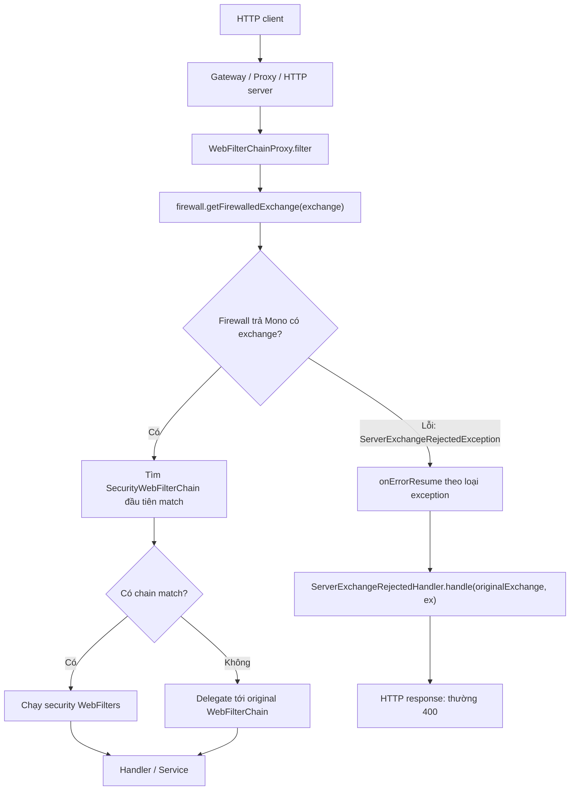
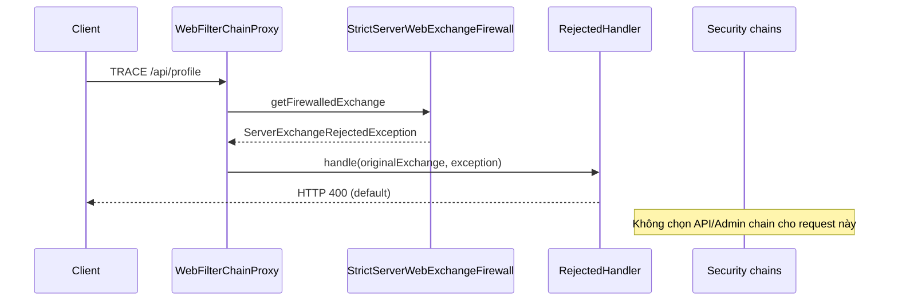
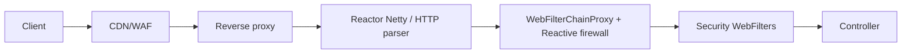

# ServerExchangeRejectedException và luồng lỗi

## 1. Bối cảnh: một HTTP 400 không phải lúc nào cũng là lỗi giống nhau

Một ứng dụng Spring WebFlux được bảo vệ bằng Spring Security có các endpoint `/public/**`, `/api/**` và `/admin/**`. Người dùng thông thường truy cập:

```http
GET /api/profile HTTP/1.1
Host: api.example.com
Authorization: Bearer <test-token>
```

Trong khi đó, một request bất thường có thể có:

```http
TRACE /api/profile HTTP/1.1
Host: api.example.com
```

hoặc đường dẫn chứa chuỗi đáng ngờ như `/api/../admin`, `/api;mode=1/profile`, `/api%2Fprofile`. Spring Security Reactive cần **chặn những dạng request có khả năng dẫn đến sự khác biệt khi phân tích HTTP/path**, trước khi router và authorization đưa ra quyết định khác nhau.

Với API Reactive firewall, `StrictServerWebExchangeFirewall` có thể phát ra `ServerExchangeRejectedException` khi một quy tắc bị vi phạm. `WebFilterChainProxy` chuyển lỗi đó cho `ServerExchangeRejectedHandler`; handler mặc định `HttpStatusExchangeRejectedHandler` trả **HTTP 400 Bad Request**.

Nhưng HTTP 400 cũng có thể xuất phát từ Netty, CDN, reverse proxy hoặc validation controller. Nếu không hiểu luồng lỗi, người vận hành dễ nới firewall không cần thiết, cấu hình handler sai hoặc hiểu lầm một lỗi xác thực `401`/phân quyền `403` là lỗi request path.

Bài thuộc chương **Firewall trên Reactive** của mô-đun **SPRING_SECURITY_HTTP_PROTECTION**. Mô-đun hướng tới các lớp phòng vệ HTTP và trình duyệt trong Spring Security, từ CSRF, CORS, security headers, CSP, HSTS, HTTP firewall đến session, với cả Servlet và Reactive. Ở đây, trọng tâm là **`ServerExchangeRejectedException` và toàn bộ luồng lỗi của Reactive firewall**, bao gồm thiết kế HTTP response, observability, kiểm thử và xử lý xung đột với những lớp bảo vệ khác.

### Mục tiêu học tập

Sau bài này, bạn có thể:

1. Xác định loại exception, package, constructor và phạm vi phiên bản của `ServerExchangeRejectedException`.
2. Giải thích thứ tự `getFirewalledExchange → chọn SecurityWebFilterChain → handler lỗi` trong `WebFilterChainProxy`.
3. Phân biệt firewall rejection với parsing error, authentication failure, access denied, CSRF failure, WebFlux 404/405 và exception nghiệp vụ.
4. Cấu hình `ServerExchangeRejectedHandler` bằng Bean, hoặc viết implementation trả JSON lỗi tối giản mà không lộ URL/header nguy hiểm.
5. Viết unit test bằng `StepVerifier`, test proxy bằng mock exchange, integration test bằng `WebTestClient` và HTTP test qua gateway.
6. Thiết kế log/metric với mã sự cố và hạn mức, không ghi credentials hoặc raw payload độc hại.
7. Chẩn đoán 400/404/401/403 trong hệ thống có nhiều security chains, Netty và reverse proxy.
8. Biết khi nào **không** nên nới các setter của `StrictServerWebExchangeFirewall`.

## 2. Bốn API cần phân biệt

Các thành phần nằm trong package `org.springframework.security.web.server.firewall` của Reactive:

| API | Loại | Trách nhiệm |
| --- | --- | --- |
| `ServerWebExchangeFirewall` | Interface | Kiểm tra và có thể bọc một `ServerWebExchange` |
| `StrictServerWebExchangeFirewall` | Implementation | Từ chối request đáng ngờ bằng `ServerExchangeRejectedException` |
| `ServerExchangeRejectedException` | `RuntimeException` | Tín hiệu một exchange đã bị firewall từ chối |
| `ServerExchangeRejectedHandler` | Interface | Chuyển sự kiện từ chối thành `Mono<Void>` response processing |
| `HttpStatusExchangeRejectedHandler` | Implementation | Trả HTTP status xác định; mặc định 400 |

`ServerExchangeRejectedException` có dạng:

```java
package org.springframework.security.web.server.firewall;

// Tóm lược kiểu API: đây không phải mã nguồn nguyên văn.
public class ServerExchangeRejectedException extends RuntimeException {
    public ServerExchangeRejectedException(String message) {
        super(message);
    }
}
```

Javadoc mô tả mục đích của class là báo một `ServerWebExchange` bị từ chối. Nó **không** phải `AuthenticationException`, `AccessDeniedException` hay `ResponseStatusException`. Cũng không phải `RequestRejectedException` của Spring Security Servlet.

### 2.1. Phiên bản Spring Security

Tài liệu/Javadoc hiện hành ghi **`Since: 6.4`** cho `ServerWebExchangeFirewall`, `StrictServerWebExchangeFirewall`, `ServerExchangeRejectedException` và `ServerExchangeRejectedHandler` trong nhánh API Reactive hiện đại. Vì vậy các ví dụ bài này lấy **Spring Security 6.4+** làm giả định vận hành.

Tuy nhiên, một số trang Javadoc cho các **bản vá cũ của nhánh 5.7.x** cũng liệt kê các class tương ứng với mốc khác do việc backport. Vì vậy không đưa ra kết luận tuyệt đối rằng *mọi* bản 5.x không có tên class này. Cần xác minh **jar đã resolve, chữ ký API và cấu hình thực tế**, không suy ngược chỉ từ Spring Boot version hoặc Javadoc `current`.

| Tình huống | Cách xử lý |
| --- | --- |
| Chạy 6.4+ | Đối chiếu Javadoc cùng minor/patch version và thử Bean wiring |
| Chạy 6.0–6.3 | Không mặc định copy API và cơ chế handler hiện hành; kiểm tra jar thực |
| Dùng bản 5.x backport | Kiểm tra class, setter và cơ chế Bean cụ thể của bản vá |
| Import compile nhưng custom handler không được gọi | Kiểm tra `WebFilterChainProxy`/security configuration đang chạy |
| App Boot có cả MVC và WebFlux | Kiểm tra runtime thực: có thể đang dùng stack Servlet |

Bài sử dụng Java 17+ theo các ví dụ Spring Security hiện đại. Không chạy ví dụ Reactive bằng cách import nhầm `org.springframework.security.web.firewall.RequestRejectedException` (Servlet).

## 3. Luồng request thành công và luồng bị firewall từ chối



**Thứ tự rất quan trọng:** Firewall áp dụng trước khi lựa chọn `SecurityWebFilterChain`. Một request bị chặn ở bước này thường không đi đến controller, không chạy các WebFilters của chain được chọn và không đến service để kiểm tra owner/tenant.

### 3.1. Chuỗi thành công

1. HTTP server tạo `ServerWebExchange` từ request đã parse.
2. `WebFilterChainProxy.filter(exchange, chain)` gọi `firewall.getFirewalledExchange(exchange)`.
3. Firewall xác định request có phù hợp các rule hay không.
4. Nếu hợp lệ, `Mono<ServerWebExchange>` phát exchange đã kiểm tra/bọc.
5. Proxy dò từng `SecurityWebFilterChain.matches(firewalledExchange)` và chọn **chain đầu tiên khớp**.
6. WebFilters của chain được chọn xử lý authentication, authorization, CSRF, security headers, v.v.
7. Nếu được phép, request tới handler/service.

**Nếu không có chain nào khớp**, proxy có thể delegate tiếp đến chuỗi gốc mà không áp security filters của các chain đã cấu hình. Đây là nguy cơ **thiếu coverage**, không phải firewall tự động `denyAll`. Thiết kế cần catch-all chain phù hợp hoặc quy tắc phủ toàn bộ URL nhạy cảm.

### 3.2. Chuỗi rejection

1. Firewall phát một `ServerExchangeRejectedException` thay vì exchange hợp lệ.
2. Reactor publisher chuyển sang đường lỗi.
3. `WebFilterChainProxy` áp `onErrorResume(ServerExchangeRejectedException.class, ...)`.
4. Proxy gọi `exchangeRejectedHandler.handle(originalExchange, exception)`.
5. Handler tạo response lỗi. Mặc định HTTP status là **400**.
6. Khi handler kết thúc thành công, `Mono<Void>` của proxy hoàn thành bình thường, không nhất thiết còn phát exception cho các tầng sau.

Nếu `ServerExchangeRejectedHandler` **tự phát lỗi**, lỗi mới có thể tiếp tục lan truyền. Không mặc định rằng `onErrorResume` nuốt mọi Throwable hoặc tự khôi phục khi response đã commit.

### 3.3. Mã giả đối chiếu với source

Luồng dưới đây được **diễn đạt lại để học** từ `WebFilterChainProxy` hiện hành, không phải bản chép nguyên source:

```java
Mono<Void> filter(ServerWebExchange original, WebFilterChain downstream) {
    return firewall.getFirewalledExchange(original)
        .flatMap(checked ->
            chooseSecurityChainThenFilter(checked, downstream))
        .onErrorResume(ServerExchangeRejectedException.class, ex ->
            rejectedHandler.handle(original, ex).then(Mono.empty()));
}
```

Điểm cần hiểu:

- Handler được gọi với **original exchange**, không phải mặc định là firewalled exchange.
- `onErrorResume` bám trên toàn publisher upstream nên về mặt operator nó bắt **đúng loại exception** nếu lỗi đó phát sinh ở phần upstream; mục đích thiết kế là xử lý firewall rejection.
- **Không tự ném `ServerExchangeRejectedException` từ controller để xử lý lỗi nghiệp vụ**: dùng `ResponseStatusException`, validation hoặc error handling đúng tầng. Nếu tự ném cùng loại ở downstream, tùy pipeline nó có thể bị bắt như firewall rejection, làm sai observability.
- Handler mặc định không tự gọi lại firewall hay chạy authentication.
- Khi rejection xảy ra trước selected chain, không nên giả định các response security headers do chain thêm vào đã được áp dụng.

## 4. Những gì khiến StrictServerWebExchangeFirewall từ chối request

`StrictServerWebExchangeFirewall` ưu tiên chặn request có khả năng gây khác biệt parser/matcher hoặc có ký tự không được phép. Các nhóm đáng chú ý:

| Nhóm | Đầu vào minh họa | Lý do |
| --- | --- | --- |
| HTTP method bất thường | `TRACE /api/profile` | Giảm XST và HTTP verb tampering |
| URL chưa chuẩn hóa | `/secure/../admin`, `/secure//admin` | Ngăn matcher và router diễn giải khác nhau |
| Dấu chấm phẩy | `/secure;role=user/admin` | Path parameters có thể làm sai matching |
| Encoded slash | `%2F` | Separator bị decode ở tầng khác |
| Encoded percent | `%25` | Nguy cơ double decoding |
| Backslash | `\` hoặc `%5C` | Một số thành phần xem như separator |
| Null/CR/LF encoded | `%00`, `%0D`, `%0A` | Ký tự điều khiển và ambiguity |
| Hostname | Host không nằm trong predicate cho phép nếu có cấu hình | Giới hạn host routing bất thường |
| Header name/value | Control hoặc undefined codepoint | Bảo vệ khỏi input không hợp lệ |
| Parameter name | Control hoặc undefined codepoint | Giảm ambiguity |
| Parameter value | Không thỏa predicate tùy chỉnh | Mặc định thường **cho phép** theo predicate này |

Các trường hợp trên là **ví dụ cần kiểm thử**, không khẳng định mọi raw payload sẽ đến firewall: Reactor Netty, HTTP client hoặc proxy có thể normalize/reject sớm.

### 4.1. HTTP methods được cho phép mặc định

Tài liệu Spring Security Reactive nêu:

```text
DELETE, GET, HEAD, OPTIONS, PATCH, POST, PUT
```

`TRACE` không nằm trong tập mặc định. Khi custom method allowlist, phải cân nhắc `OPTIONS` cho CORS preflight và `HEAD` cho metadata/tài liệu. Cho phép method ở firewall **không** đồng nghĩa handler được phép thực hiện hoặc người dùng có quyền.

### 4.2. Không sửa sai bằng cách tắt firewall

Không dùng các lựa chọn sau chỉ để tránh HTTP 400:

```java
// Chỉ để minh họa anti-pattern: KHÔNG sử dụng làm cấu hình production.
firewall.setUnsafeAllowAnyHttpMethod(true);

// ServerWebExchangeFirewall.INSECURE_NOOP
// là lựa chọn không kiểm tra firewall, không khuyến nghị.
```

Nếu một URL có `%2F` hoặc `;` bị từ chối, hãy xem lại thiết kế URI/matrix variables, parser/proxy và test security matcher. Chỉ mở ngoại lệ hẹp khi thực sự cần và có kiểm thử.

## 5. Kiểm thử exception độc lập với HTTP status

Lỗi ở cấp firewall có thể được kiểm tra bằng `StepVerifier`, không cần mở HTTP server.

### 5.1. Test một request hợp lệ

```java
import static org.junit.jupiter.api.Assertions.assertEquals;

import org.junit.jupiter.api.Test;
import org.springframework.http.HttpMethod;
import org.springframework.mock.http.server.reactive.MockServerHttpRequest;
import org.springframework.mock.web.server.MockServerWebExchange;
import org.springframework.security.web.server.firewall.StrictServerWebExchangeFirewall;
import reactor.test.StepVerifier;

class ReactiveFirewallAcceptTest {

    @Test
    void normalGetPasses() {
        var firewall = new StrictServerWebExchangeFirewall();
        var request = MockServerHttpRequest.get("/public/ping").build();
        var exchange = MockServerWebExchange.from(request);

        StepVerifier.create(firewall.getFirewalledExchange(exchange))
            .assertNext(checked ->
                assertEquals(HttpMethod.GET,
                    checked.getRequest().getMethod()))
            .verifyComplete();
    }
}
```

Với request hợp lệ, publisher phát **một exchange** và hoàn thành, không phát exception.

### 5.2. Test request method bị chặn

```java
import org.junit.jupiter.api.Test;
import org.springframework.http.HttpMethod;
import org.springframework.mock.http.server.reactive.MockServerHttpRequest;
import org.springframework.mock.web.server.MockServerWebExchange;
import org.springframework.security.web.server.firewall.ServerExchangeRejectedException;
import org.springframework.security.web.server.firewall.StrictServerWebExchangeFirewall;
import reactor.test.StepVerifier;

class ReactiveFirewallRejectionTest {

    @Test
    void traceEmitsServerExchangeRejectedException() {
        var firewall = new StrictServerWebExchangeFirewall();
        var request = MockServerHttpRequest
            .method(HttpMethod.TRACE, "/public/ping")
            .build();
        var exchange = MockServerWebExchange.from(request);

        StepVerifier.create(firewall.getFirewalledExchange(exchange))
            .expectError(ServerExchangeRejectedException.class)
            .verify();
    }
}
```

Điều này **xác định loại exception** ở ngay firewall. Nó không xác nhận HTTP response status vì ở test trực tiếp này **không có** `WebFilterChainProxy` và `ServerExchangeRejectedHandler`.

### 5.3. Test semicolon

```java
var firewall = new StrictServerWebExchangeFirewall();

var request = MockServerHttpRequest
    .get("/public;mode=debug/ping")
    .build();

StepVerifier.create(firewall.getFirewalledExchange(
        MockServerWebExchange.from(request)))
    .expectError(ServerExchangeRejectedException.class)
    .verify();
```

Đây là trích đoạn đặt trong một method test có import tương tự mục 5.2. Nếu dùng `setAllowSemicolon(true)` hoặc một HTTP/mock parser loại dấu semicolon trước firewall, kết quả sẽ khác. **Phải test đúng phiên bản/cấu hình đang chạy.**

## 6. Handler mặc định: HttpStatusExchangeRejectedHandler

Javadoc xác nhận:

```java
new HttpStatusExchangeRejectedHandler();
```

sử dụng HTTP **400**.

Constructor cho phép đổi status:

```java
new HttpStatusExchangeRejectedHandler(HttpStatus.NOT_FOUND);
```

`HttpStatusExchangeRejectedHandler` implement `ServerExchangeRejectedHandler`, với chữ ký:

```java
Mono<Void> handle(
    ServerWebExchange exchange,
    ServerExchangeRejectedException exception);
```

**Không tự giả định body JSON hoặc cấu trúc `ProblemDetail` mặc định.** Mục đích được tài liệu nêu là gửi status; nếu API contract yêu cầu body lỗi cụ thể thì phải cấu hình handler riêng và kiểm thử nó.

### 6.1. Test handler mặc định độc lập

```java
import static org.junit.jupiter.api.Assertions.assertEquals;

import org.junit.jupiter.api.Test;
import org.springframework.http.HttpStatus;
import org.springframework.mock.http.server.reactive.MockServerHttpRequest;
import org.springframework.mock.web.server.MockServerWebExchange;
import org.springframework.security.web.server.firewall.HttpStatusExchangeRejectedHandler;
import org.springframework.security.web.server.firewall.ServerExchangeRejectedException;
import reactor.test.StepVerifier;

class RejectedHandlerUnitTest {

    @Test
    void defaultHandlerProducesBadRequest() {
        var exchange = MockServerWebExchange.from(
            MockServerHttpRequest.get("/public/ping").build());

        var handler = new HttpStatusExchangeRejectedHandler();

        StepVerifier.create(handler.handle(
                exchange,
                new ServerExchangeRejectedException("test rejection")))
            .verifyComplete();

        assertEquals(
            HttpStatus.BAD_REQUEST,
            exchange.getResponse().getStatusCode());
    }

    @Test
    void handlerCanUseConfiguredNotFoundStatus() {
        var exchange = MockServerWebExchange.from(
            MockServerHttpRequest.get("/public/ping").build());

        var handler =
            new HttpStatusExchangeRejectedHandler(HttpStatus.NOT_FOUND);

        StepVerifier.create(handler.handle(
                exchange,
                new ServerExchangeRejectedException("test rejection")))
            .verifyComplete();

        assertEquals(
            HttpStatus.NOT_FOUND,
            exchange.getResponse().getStatusCode());
    }
}
```

Tạo một exception kiểm thử trong unit test để **gọi trực tiếp handler** là hợp lệ. Nhưng không dùng `ServerExchangeRejectedException` làm exception nghiệp vụ trong controller ngoài production.

### 6.2. Vì sao 400 hợp lý?

Một HTTP request có URI/method/header mơ hồ là request không đáp ứng các yêu cầu phía server; 400 giúp client/gateway phân loại lỗi input trước khi đòi người dùng đăng nhập. Tuy nhiên, 400 không phải bằng chứng duy nhất rằng strict firewall đã reject; parser ở tầng trước cũng có thể trả 400.

Một số tổ chức muốn trả **404** cho các URL đáng ngờ để tránh tạo tín hiệu khác nhau. Điều này có thể được cấu hình, nhưng phải được cân nhắc: 404 cũng có thể do route không tồn tại, khiến vận hành khó phân biệt nếu thiếu metrics/trace. Không đổi status để che lỗi wiring.

## 7. Cấu hình rejected handler trong Spring WebFlux

Theo Spring Security Reactive reference, cách phổ biến là expose Bean `ServerExchangeRejectedHandler`.

### 7.1. Giữ default 400: không cần Bean riêng

```java
import org.springframework.context.annotation.Bean;
import org.springframework.context.annotation.Configuration;
import org.springframework.security.config.annotation.web.reactive.EnableWebFluxSecurity;
import org.springframework.security.config.web.server.ServerHttpSecurity;
import org.springframework.security.web.server.SecurityWebFilterChain;

@Configuration
@EnableWebFluxSecurity
class ReactiveSecurityConfig {

    @Bean
    SecurityWebFilterChain chain(ServerHttpSecurity http) {
        return http.authorizeExchange(auth -> auth
                .pathMatchers("/public/**").permitAll()
                .pathMatchers("/api/**").authenticated()
                .anyExchange().denyAll())
            .build();
    }
}
```

Khi dùng integration chuẩn với API firewall Reactive, một request bị strict firewall reject sẽ được handler mặc định của `WebFilterChainProxy` chuyển thành HTTP 400. Security rules trên chỉ minh họa **authorization**, không phải config bật một exception type.

### 7.2. Tùy chỉnh status bằng Bean

Nếu API contract đã thống nhất dùng `404` cho firewall rejection:

```java
import org.springframework.context.annotation.Bean;
import org.springframework.context.annotation.Configuration;
import org.springframework.http.HttpStatus;
import org.springframework.security.web.server.firewall.HttpStatusExchangeRejectedHandler;
import org.springframework.security.web.server.firewall.ServerExchangeRejectedHandler;

@Configuration
class RejectedRequestConfig {

    @Bean
    ServerExchangeRejectedHandler rejectedHandler() {
        return new HttpStatusExchangeRejectedHandler(
            HttpStatus.NOT_FOUND);
    }
}
```

Đây là **phương án thay thế** hành vi default; không cần đồng thời tạo thêm một Bean `HttpStatusExchangeRejectedHandler` khác không được sử dụng.

Lưu ý:

- Cấu hình phải được load vào **Reactive ApplicationContext** chứa `WebFilterChainProxy`.
- Nếu ứng dụng tự xây proxy hoặc dùng version khác, phải kiểm tra Bean đã được gắn thực sự.
- Thay status không tự thay các predicate của `StrictServerWebExchangeFirewall`.
- `404` từ handler này không đồng nghĩa mọi `404` trong ứng dụng đều đến từ firewall.
- Một số phiên bản nhánh cũ có cách tích hợp Bean khác; dùng integration test thay cho niềm tin vào tên Bean.

### 7.3. Handler status không phải security filter

`ServerExchangeRejectedHandler` không phải `WebFilter` để thêm bằng `ServerHttpSecurity.addFilterAt(...)`. Handler được proxy gọi khi phát hiện exception đúng loại. Đặt một WebFilter global để bắt mọi `400` không tương đương với cách này.

## 8. Tự viết ServerExchangeRejectedHandler không lộ dữ liệu request

Một API JSON có thể muốn response ổn định:

```http
HTTP/1.1 400 Bad Request
Content-Type: application/json
Cache-Control: no-store

{"error":"invalid_http_request"}
```

**Không** phản chiếu `exception.getMessage()` hoặc URL/header/raw path vào JSON lỗi. Chúng có thể chứa payload điều khiển, token hoặc thông tin nội bộ. Với lỗi firewall, đáp án client nên ngắn gọn và ít chi tiết.

### 8.1. Implementation với JSON cố định

```java
import java.nio.charset.StandardCharsets;

import org.springframework.http.HttpHeaders;
import org.springframework.http.HttpStatus;
import org.springframework.http.MediaType;
import org.springframework.http.server.reactive.ServerHttpResponse;
import org.springframework.security.web.server.firewall.ServerExchangeRejectedException;
import org.springframework.security.web.server.firewall.ServerExchangeRejectedHandler;
import org.springframework.web.server.ServerWebExchange;
import reactor.core.publisher.Mono;

final class SafeJsonRejectedHandler
        implements ServerExchangeRejectedHandler {

    private static final byte[] BODY =
        "{\"error\":\"invalid_http_request\"}"
            .getBytes(StandardCharsets.UTF_8);

    @Override
    public Mono<Void> handle(
            ServerWebExchange exchange,
            ServerExchangeRejectedException rejected) {

        ServerHttpResponse response = exchange.getResponse();

        // Không thể tin rằng status/headers còn thay đổi được
        // khi response đã commit. Không cố ghi thêm body lúc đó.
        if (response.isCommitted()) {
            return Mono.empty();
        }

        response.setStatusCode(HttpStatus.BAD_REQUEST);
        response.getHeaders().setContentType(MediaType.APPLICATION_JSON);
        response.getHeaders().set(HttpHeaders.CACHE_CONTROL, "no-store");

        return response.writeWith(Mono.fromSupplier(() ->
            response.bufferFactory().wrap(BODY)));
    }
}
```

Ở đây:

- Body là **hằng số**, không chứa chi tiết violation hoặc input của client.
- `no-store` hạn chế HTTP cache lưu error body.
- `MediaType.APPLICATION_JSON` phản ánh đúng bytes trả.
- `Mono<Void>` được trả về từ `response.writeWith(...)`: không gọi `subscribe()` thủ công.
- `response.isCommitted()` được kiểm tra để tránh thử viết headers/body sau khi response bắt đầu, nhưng tình huống commit muộn vẫn có thể xảy ra do race; test và quan sát phù hợp.
- Không lạm dụng `isCommitted()` để âm thầm che các lỗi nghiêm trọng ở downstream; cần telemetry ở tầng khác.

**Giới hạn ví dụ:** Một exception do firewall kiểm tra ở đầu pipeline thường phát sinh trước khi response commit. Nếu một WebFilter/controller downstream tự phát cùng loại exception **sau khi đã gửi body**, handler không thể bảo đảm đổi sang 400/JSON sạch. Không sử dụng exception này để báo lỗi business.

### 8.2. Đăng ký implementation bằng Bean

```java
import org.springframework.context.annotation.Bean;
import org.springframework.context.annotation.Configuration;
import org.springframework.security.web.server.firewall.ServerExchangeRejectedHandler;

@Configuration
class JsonRejectionConfiguration {

    @Bean
    ServerExchangeRejectedHandler rejectedHandler() {
        return new SafeJsonRejectedHandler();
    }
}
```

Đây là **phương án thay thế** Bean trả `404` ở mục 7.2. Chỉ định một chính sách lỗi nhất quán trong ApplicationContext để tránh ambiguity.

### 8.3. Nếu không cần body lỗi: đơn giản hơn

Trả status mặc định với `HttpStatusExchangeRejectedHandler` thường đủ và có ít code hơn. Chỉ viết custom handler khi có contract JSON/telemetry rõ ràng; custom code làm tăng trách nhiệm kiểm thử content type, response commit, encoding, cache và xử lý lỗi.

## 9. Phân loại 400 / 401 / 403 / 404 / 405 và nguồn lỗi

Một sai lầm thường gặp: mọi request không thành công đều được gán nhãn “firewall chặn”. Đúng hơn, cần phân biệt:

| Status/tình huống | Nguồn có thể | Có phải `ServerExchangeRejectedException`? |
| --- | --- | --- |
| `400` với path đáng ngờ | Reactive firewall, Netty, gateway | **Có thể**, phải kiểm tra |
| `400` do DTO/Bean Validation | WebFlux handler/controller | Thường **không** |
| `401` | Authentication entry point | Thường **không** |
| `403` | Access denied, CSRF failure, policy | Thường **không** |
| `404` | Router không match, hoặc custom rejected handler | Có thể, nhưng không suy chỉ từ status |
| `405` | Handler không hỗ trợ method | Không mặc định là firewall |
| `415` | Unsupported media type/consumes | Không phải firewall method rejection |
| `429` | Rate limiter/gateway | Không tự là firewall |
| `502`/`503` | Proxy/upstream | Không chứng minh lỗi tại Spring |
| Network reset | HTTP parser/server đóng kết nối | Có thể Spring chưa nhận request |

### 9.1. Ví dụ: TRACE, POST và DELETE

- `TRACE /public/ping`: strict firewall mặc định không cho phép method; có thể reject sớm.
- `POST /public/ping`: POST nằm trong allowlist firewall, nhưng handler chỉ có `@GetMapping` thì có thể trả 405. Nếu CSRF bật và request không có token, có thể trả 403 trước handler.
- `DELETE /api/documents/1`: DELETE nằm trong allowlist firewall, nhưng authorization và business service phải tự quyết định ai có quyền xóa.
- `GET /api/private/me` không credential: URL/method hợp lệ, firewall cho qua; Spring Security có thể trả 401 hoặc redirect login theo authentication mechanism.
- `GET /api/private/me` đã đăng nhập nhưng thiếu quyền: có thể trả 403.
- `GET /api/private/does-not-exist` với auth đúng: handler có thể trả 404.

**Firewall quyết định tính chấp nhận của request shape, không phải quyền truy cập tài nguyên.**

### 9.2. Không trộn exception Servlet và Reactive

| Khía cạnh | Reactive / WebFlux | Servlet / MVC |
| --- | --- | --- |
| Firewall interface | `ServerWebExchangeFirewall` | `HttpFirewall` |
| Strict implementation | `StrictServerWebExchangeFirewall` | `StrictHttpFirewall` |
| Rejection exception | `ServerExchangeRejectedException` | `RequestRejectedException` |
| Exception handler | `ServerExchangeRejectedHandler` | `RequestRejectedHandler` |
| Default HTTP status handler | `HttpStatusExchangeRejectedHandler` | `HttpStatusRequestRejectedHandler` |
| Security proxy | `WebFilterChainProxy` | `FilterChainProxy` |
| Request abstraction | `ServerWebExchange` | `HttpServletRequest` |
| Kiểm thử | StepVerifier, WebTestClient | MockMvc, Servlet filter tests |

Không import `org.springframework.security.web.firewall.RequestRejectedException` vào một handler Reactive và chờ nó nhận lỗi WebFlux.

## 10. Luồng lỗi khi có nhiều SecurityWebFilterChain

Ví dụ hệ thống có:

- Chain 1: `/api/**` dùng bearer authentication.
- Chain 2: `/admin/**` dùng role admin.
- Chain 3: các URL còn lại dùng session và default-deny.

`StrictServerWebExchangeFirewall` chạy **trước** khi proxy lựa chọn chain:



Một request hợp lệ `GET /api/profile` được firewall chấp nhận rồi mới chọn API chain. Nếu không chain nào match, request có thể đi tiếp mà không qua các security filters đã định; cần catch-all policy.

**Hệ quả đối với error handling:** Một `ServerExchangeRejectedHandler` Bean thông thường áp ở cấp proxy, không chỉ riêng chain API. Vì vậy đừng giả định có thể trả JSON cho `/api/**` và HTML cho website thông qua selected chain khi firewall đã reject **trước khi chọn chain**. Nếu sản phẩm bắt buộc phân biệt response, phải có logic an toàn và đơn giản ở handler dựa trên thông tin đáng tin, không tạo bypass từ việc phân tích một raw path đáng ngờ.

## 11. Reactor semantics: không dùng exception như điều khiển luồng nghiệp vụ

`ServerWebExchangeFirewall#getFirewalledExchange` trả `Mono<ServerWebExchange>`. Cần hiểu sự khác biệt giữa ba kết quả:

| Reactor signal | Ý nghĩa |
| --- | --- |
| `onNext(firewalledExchange)` rồi `onComplete` | Firewall chấp nhận exchange |
| `onError(ServerExchangeRejectedException)` | Firewall reject theo rule |
| `onError(exception khác)` | Có lỗi khác; không phải nhánh xử lý rejection mặc định |

`WebFilterChainProxy` lọc cụ thể `ServerExchangeRejectedException.class`. Nó không có nghĩa mọi exception từ server đều được đổi sang 400.

### 11.1. Không `try/catch` đồng bộ rồi nghĩ đã bắt mọi Mono error

Đây là cách **không đúng** để thử bắt mọi lỗi Reactive:

```java
try {
    Mono<ServerWebExchange> result =
        firewall.getFirewalledExchange(exchange);
    // Mono có thể chỉ phát lỗi khi subscribe.
} catch (ServerExchangeRejectedException ex) {
    // Không bảo đảm nhánh này chạy với lỗi phát trên publisher.
}
```

Test Reactor đúng cách dùng:

```java
StepVerifier.create(firewall.getFirewalledExchange(exchange))
    .expectError(ServerExchangeRejectedException.class)
    .verify();
```

Mục đích là kiểm tra **terminal signal**, không chỉ kiểm tra quá trình tạo `Mono`.

### 11.2. Không gọi `subscribe()` trong handler

Sai:

```java
// Không làm: mất liên kết error/cancel/backpressure của pipeline.
response.setComplete().subscribe();
return Mono.empty();
```

Đúng:

```java
return response.setComplete();
```

Hoặc nếu ghi bytes:

```java
return response.writeWith(Mono.just(dataBuffer));
```

Khi trả publisher, framework kiểm soát subscription, lifecycle và error propagation.

### 11.3. Handler gặp lỗi thì sao?

Nếu custom handler tự throw hoặc trả `Mono.error(...)`, proxy không thể giả định đã có response lỗi hợp lệ. Cần:

- Giữ handler tối giản, không phụ thuộc external HTTP/database service để quyết định 400.
- Tránh thao tác blocking trên event loop.
- Không đợi một call log/metrics bên ngoài trước khi trả response.
- Test trường hợp I/O failure hoặc response commit nếu implementation có write body.
- Có telemetry an toàn ở cấp infrastructure, không chỉ dựa vào response body.

## 12. Thứ tự filter và lỗi bị chặn ở tầng nào?

Một request có thể bị từ chối **trước khi đến Spring Security**:



Nếu gateway nhận `GET /a/../b` rồi chuẩn hóa thành `GET /b`, Spring chỉ kiểm tra path đã được forward. Nếu Netty reject HTTP header không hợp lệ, `ServerExchangeRejectedException` **không xuất hiện** ở Spring. Nếu firewall reject, controller/security chain có thể chưa chạy. Nếu request vượt qua firewall nhưng thiếu token, authentication mới xử lý.

### 12.1. Gỡ lỗi theo tầng

1. Dùng test ID và biết chính xác request-target/method đã gửi.
2. Kiểm tra CDN/WAF có reject hay rewrite request không.
3. Kiểm tra HTTP server có nhận request hợp lệ để tạo `ServerWebExchange` không.
4. Kiểm tra `WebFilterChainProxy` và rejected handler có được gọi không.
5. Nếu không reject, xem security chain được chọn và authn/authz result.
6. Nếu tới controller, xem validation/business exception handler.
7. Không lấy `HTTP 400` làm bằng chứng rằng rule strict firewall đã kích hoạt.

### 12.2. Vì sao `curl --path-as-is` hữu ích nhưng chưa đủ?

Trong môi trường kiểm thử được phép:

```bash
curl -i --path-as-is \
  'http://localhost:8080/api/../admin/users'

curl -i --path-as-is \
  'http://localhost:8080/api;v=1/profile'

curl -i --path-as-is \
  'http://localhost:8080/api%2Fprofile'

curl -i -X TRACE \
  'http://localhost:8080/public/ping'
```

`--path-as-is` hạn chế việc curl tự rút gọn phân đoạn `..`. Nó **không bảo đảm** proxy/HTTP server giữ nguyên path hay xử lý lỗi giống nhau giữa các phiên bản. Với test authorization, mục tiêu là không thể truy cập trái quyền và xác định tầng reject, không phải luôn đòi 400 cho mọi payload.

Không chạy những test này ngoài môi trường được cấp phép hoặc đưa token/cookie thật vào log.

## 13. Testing tại WebFilterChainProxy: exception được chuyển thành status

Test trực tiếp firewall ở mục 5 chứng minh loại lỗi. Cần một test cấp proxy để xác minh **handler được gọi** và downstream không chạy khi request bị chặn.

### 13.1. Proxy sử dụng handler mặc định

```java
import static org.junit.jupiter.api.Assertions.assertEquals;
import static org.junit.jupiter.api.Assertions.assertFalse;

import java.util.Collections;
import java.util.concurrent.atomic.AtomicBoolean;

import org.junit.jupiter.api.Test;
import org.springframework.http.HttpMethod;
import org.springframework.http.HttpStatus;
import org.springframework.mock.http.server.reactive.MockServerHttpRequest;
import org.springframework.mock.web.server.MockServerWebExchange;
import org.springframework.security.web.server.SecurityWebFilterChain;
import org.springframework.security.web.server.WebFilterChainProxy;
import org.springframework.web.server.WebFilterChain;
import reactor.core.publisher.Mono;
import reactor.test.StepVerifier;

class ReactiveProxyRejectTest {

    @Test
    void rejectedTraceDoesNotReachDownstream() {
        var proxy = new WebFilterChainProxy(
            Collections.<SecurityWebFilterChain>emptyList());

        var exchange = MockServerWebExchange.from(
            MockServerHttpRequest
                .method(HttpMethod.TRACE, "/public/ping")
                .build());

        AtomicBoolean downstreamCalled = new AtomicBoolean();
        WebFilterChain downstream = ex -> {
            downstreamCalled.set(true);
            return Mono.empty();
        };

        StepVerifier.create(proxy.filter(exchange, downstream))
            .verifyComplete();

        assertEquals(HttpStatus.BAD_REQUEST,
            exchange.getResponse().getStatusCode());
        assertFalse(downstreamCalled.get());
    }
}
```

Vì không có security chains trong proxy test, một request **hợp lệ** có thể được delegate tới downstream; nhưng `TRACE` bị strict firewall mặc định reject trước khi chuyện chọn chain xảy ra.

### 13.2. Đặt custom handler để kiểm tra wiring

```java
import static org.junit.jupiter.api.Assertions.assertEquals;

import java.util.Collections;

import org.junit.jupiter.api.Test;
import org.springframework.http.HttpMethod;
import org.springframework.http.HttpStatus;
import org.springframework.mock.http.server.reactive.MockServerHttpRequest;
import org.springframework.mock.web.server.MockServerWebExchange;
import org.springframework.security.web.server.SecurityWebFilterChain;
import org.springframework.security.web.server.WebFilterChainProxy;
import org.springframework.security.web.server.firewall.HttpStatusExchangeRejectedHandler;
import reactor.core.publisher.Mono;
import reactor.test.StepVerifier;

class ReactiveProxyCustomStatusTest {

    @Test
    void customHandlerReturnsNotFound() {
        var proxy = new WebFilterChainProxy(
            Collections.<SecurityWebFilterChain>emptyList());

        proxy.setExchangeRejectedHandler(
            new HttpStatusExchangeRejectedHandler(
                HttpStatus.NOT_FOUND));

        var exchange = MockServerWebExchange.from(
            MockServerHttpRequest
                .method(HttpMethod.TRACE, "/public/ping")
                .build());

        StepVerifier.create(proxy.filter(exchange, ex -> Mono.empty()))
            .verifyComplete();

        assertEquals(
            HttpStatus.NOT_FOUND,
            exchange.getResponse().getStatusCode());
    }
}
```

Đây là test cấp proxy, **không chứng minh Spring Boot auto-configuration đã dùng Bean trong ApplicationContext**. Production nên dùng cách expose Bean theo reference và thêm integration test.

### 13.3. Test không có chain match khác firewall reject

Tạo một `SecurityWebFilterChain` với `matches(exchange)` trả `Mono.just(false)` và gửi `GET` hợp lệ. Khi đó downstream có thể được gọi; không xem “firewall được bật” là cơ chế mặc định bảo vệ mọi URL. Với ứng dụng thật, bổ sung catch-all chain có `denyAll()` và test không route nhạy cảm nào rơi ngoài scope.

## 14. WebTestClient: kiểm chứng ApplicationContext và response thực tế

Tạo một endpoint public test:

```java
import org.springframework.web.bind.annotation.GetMapping;
import org.springframework.web.bind.annotation.RestController;
import reactor.core.publisher.Mono;

@RestController
class PublicPingController {

    @GetMapping("/public/ping")
    Mono<String> ping() {
        return Mono.just("pong");
    }
}
```

Với Spring Boot WebFlux có `spring-boot-starter-test`, `spring-security-test`, `@EnableWebFluxSecurity` và một `SecurityWebFilterChain`:

```java
import org.junit.jupiter.api.BeforeEach;
import org.junit.jupiter.api.Test;
import org.springframework.beans.factory.annotation.Autowired;
import org.springframework.boot.test.context.SpringBootTest;
import org.springframework.context.ApplicationContext;
import org.springframework.http.HttpMethod;
import org.springframework.security.test.web.reactive.server
    .SecurityMockServerConfigurers;
import org.springframework.test.web.reactive.server.WebTestClient;

@SpringBootTest
class FirewallRejectionWebFluxTest {

    @Autowired ApplicationContext context;
    WebTestClient client;

    @BeforeEach
    void setup() {
        client = WebTestClient.bindToApplicationContext(context)
            .apply(SecurityMockServerConfigurers.springSecurity())
            .configureClient().build();
    }

    @Test
    void validGetWorks() {
        client.get().uri("/public/ping")
            .exchange()
            .expectStatus().isOk()
            .expectBody(String.class).isEqualTo("pong");
    }

    @Test
    void traceIsRejectedByDefaultHandler() {
        client.method(HttpMethod.TRACE).uri("/public/ping")
            .exchange()
            .expectStatus().isBadRequest();
    }
}
```

Test này giả định **handler mặc định 400** và request đi đến `WebFilterChainProxy`. Nếu ứng dụng khai báo Bean custom `404` ở mục 7.2, assertion cần đổi tương ứng. Nếu mock/server parse request trước firewall và trả lỗi riêng, cần phân biệt bằng telemetry/test direct.

### 14.1. Test custom JSON handler

Nếu application context đăng ký `SafeJsonRejectedHandler` ở mục 8 thay cho default:

```java
client.method(HttpMethod.TRACE)
    .uri("/public/ping")
    .exchange()
    .expectStatus().isBadRequest()
    .expectHeader().contentTypeCompatibleWith(MediaType.APPLICATION_JSON)
    .expectHeader().valueEquals(
        "Cache-Control", "no-store")
    .expectBody()
    .jsonPath("$.error").isEqualTo("invalid_http_request");
```

Đây là trích đoạn test đặt trong class có biến `client` như mục 14; cần import `org.springframework.http.MediaType`. Đoạn này giả định Bean `SafeJsonRejectedHandler` đã được đăng ký và WebTestClient chạy qua security integration.

**Không** so sánh JSON lỗi với `exception.getMessage()`, vì mục tiêu là không trả chi tiết input nguy hiểm về cho client.

### 14.2. Kiểm tra Bean thực sự được áp

Một test chỉ nhìn class Bean trong context **chưa đủ** chứng minh proxy dùng nó. Bằng chứng có sức thuyết phục:

1. Bean `ServerExchangeRejectedHandler` đã được register.
2. Một request bị firewall reject cho response thay đổi như Bean yêu cầu (ví dụ status 404 hoặc body JSON).
3. Handler có thể được quan sát trong test bằng mock/spy nếu cần, nhưng không dựa vào message chứa dữ liệu nhạy cảm.
4. Test end-to-end qua Netty/gateway xác nhận nơi reject thực và proxy không thay response trái policy.

## 15. Logging và observability an toàn

Firewall rejection có thể xảy ra với request chứa **CR/LF, encoded control characters, URL path bất thường, header nguy hiểm hoặc Host giả mạo**. Logging nguyên văn input có thể gây log injection, lộ bearer token, cookie hoặc khối lượng log lớn khi bị quét liên tục.

### 15.1. Nên ghi gì?

| Dữ liệu | Có nên ghi? | Ghi chú |
| --- | --- | --- |
| Thời điểm, environment, service | Có | Phục vụ tương quan |
| Request ID/tracing ID đã kiểm soát | Có | Không dùng raw user-supplied ID không validate |
| Tầng reject (edge/Netty/firewall) | Có | Để phân loại nguồn lỗi |
| HTTP status trả về | Có | 400/404 tùy policy |
| Metric counter rejection | Có | Gắn label ít giá trị khác nhau |
| Route template hoặc nhóm rule đã chuẩn hóa | Có, nếu có thể xác định an toàn | Không ghi raw path bất thường |
| Exception message nguyên văn | **Không** trong log thông thường | Có thể chứa raw input/request details |
| `Authorization`, `Cookie`, token | **Không** | Dữ liệu nhạy cảm |
| Raw URI/query/header values | Tránh | Có thể chứa payload, PII và control chars |
| Stack trace cho mọi request reject | Tránh | Gây log flooding; lấy mẫu khi cần |

### 15.2. Ghi metric thay vì log mỗi payload

Có thể ghi counter với các nhãn ổn định như:

```text
reactive_http_firewall_rejected_total{
    service="spring-security-http-protection",
    source="webfilterchainproxy",
    status="400"
}
```

Ví dụ tên metric trên mang tính minh họa; không phải metric tích hợp sẵn được bảo đảm có ở Spring Security. Đừng dùng `exception.getMessage()`, raw URI hay token làm **metric label** vì cardinality và dữ liệu nhạy cảm.

Nếu custom handler ghi log, dùng metadata tối giản và hạn chế tốc độ:

```java
// Ý tưởng bên trong handler với logger đã cấu hình.
// Không in rejected.getMessage() hoặc request headers.
log.debug("Reactive firewall rejected request; requestId={}",
    exchange.getRequest().getId());
```

Trong production, logger cần rate-limiting/sampling thích hợp để tránh request flood làm bão log. Trường hợp cần forensic nâng cao, tuân thủ quy trình phê duyệt, bảo vệ và lưu giữ dữ liệu riêng, không lẫn vào log công khai.

### 15.3. Theo dõi response header từ phía proxy

Vì rejection diễn ra trước selected security chain, không được giả định bộ headers như CSP/HSTS/cache đã được một chain thêm đầy đủ vào response 400. Cần test **response cuối qua CDN/proxy**, kiểm tra ít nhất cache policy, content type (nếu có body), không lộ debug details và HTTPS/security headers theo chuẩn sản phẩm. Có thể có các WebFilters bên ngoài hoặc edge thêm headers, nhưng phải xác minh đường đi thật.

## 16. Những xung đột với CSRF, CORS, authentication và session

### 16.1. CORS preflight bị firewall reject

Một browser cross-origin có thể gửi:

```http
OPTIONS /api/documents HTTP/1.1
Origin: https://frontend.example.com
Access-Control-Request-Method: POST
Access-Control-Request-Headers: authorization,content-type
```

Nếu custom firewall loại `OPTIONS` khỏi method allowlist, nó có thể trả 400 **trước** khi CORS được đánh giá. Bổ sung OPTIONS nếu cần, nhưng vẫn phải định nghĩa allowed origins/methods/headers và credentials chính xác.

Không biến `ServerExchangeRejectedHandler` thành cách sửa CORS preflight bằng cách trả 200 cho mọi rejected request; đó là **che lỗi thay vì bảo vệ request**.

### 16.2. CSRF trả 403 không phải firewall reject

Trong ứng dụng cookie/session, `POST` hợp lệ về method/path có thể thiếu CSRF token. Kết quả thường là `403` từ CSRF, không phát `ServerExchangeRejectedException`. Không vô hiệu CSRF để làm một test path/method pass.

### 16.3. Authentication trả 401 hoặc redirect

`GET /api/private/me` không credential là một request có path và method hợp lệ; firewall có thể chấp nhận, rồi authentication entry point trả `401` hoặc redirect trang login theo ứng dụng. Không đổi status của rejection handler thành 401 để xử lý thiếu token — đó là **cơ chế khác**.

### 16.4. Session và logout

Sau logout, request với session cũ có thể bị từ chối do authentication/session, không phải firewall. Nếu đường dẫn logout chứa encoding bất thường và bị firewall chặn trước, logout handler có thể chưa chạy. Cần test đúng URL hợp lệ và trạng thái session thực, không suy session đã bị hủy chỉ từ một status 400.

### 16.5. Security headers và caching

Response 400 của firewall không phải body dữ liệu cá nhân, nhưng một custom JSON/error page có thể vô tình thêm thông tin riêng. Hãy dùng body lỗi tối giản và `Cache-Control: no-store` cho custom handler khi policy phù hợp; nếu caching response lỗi ở CDN, kiểm tra edge không ép `public` trái ý origin. Đây là điểm kết nối chương Reactive firewall với chương cache/MIME và browser security headers.

## 17. Phát hiện request bị từ chối trước Spring

### 17.1. HTTP parser và request framing

Reactor Netty hoặc gateway có thể từ chối request sai cú pháp trước khi tạo `ServerWebExchange`. Với HTTP/1.1, `Content-Length` và `Transfer-Encoding` liên quan message framing; nếu proxy và backend parse khác nhau có thể tạo request smuggling. **Reactive firewall không thay việc thiết lập parser alignment ở server/proxy** theo RFC 9112.

Một WebFilter chỉ thấy exchange đã được parse, không thể luôn khôi phục raw bytes để kiểm tra các trường hợp CL/TE ambiguity.

### 17.2. Reverse proxy normalize URL

Nếu client gửi `/api/../admin` nhưng proxy chuyển thành `/admin` trước khi forward, Spring có thể chỉ thấy đường dẫn đã được chuẩn hóa. Firewall không tự suy ra raw request-target ban đầu. Điều kiện an toàn tiếp theo là `/admin` phải được authorization bảo vệ. Test phải xem cả proxy rewriting và selected security chain.

### 17.3. Một request 404 có thể không có rejection

Nếu handler custom trả 404, một request bị reject và một route không tồn tại có thể đều có status 404. Chỉ status và response body không đủ để phân biệt. Cần telemetry ở **handler** hoặc đối chiếu test/direct origin.

## 18. Chẩn đoán theo triệu chứng

| Triệu chứng | Khả năng chính | Cách phân biệt |
| --- | --- | --- |
| `TRACE` trả `400`, controller không chạy | Strict firewall, Netty hoặc proxy reject | Test trực tiếp firewall và trace proxy/origin |
| `TRACE` trả `404` sau custom Bean | Handler đã đổi status hoặc router không hỗ trợ | Kiểm tra invocation của rejected handler |
| `POST` trả `403` | CSRF/authorization | Xem security chain, không gán cho firewall |
| `GET` private trả `401` | Thiếu/không hợp lệ credential | Xem authentication entry point |
| `PUT` trả `405` | Firewall đã cho qua nhưng controller không hỗ trợ method | Xác nhận allowlist và handler mapping |
| `GET /path;v=1` trả 400 | Strict mặc định cấm semicolon | Sửa URL design hoặc ngoại lệ hẹp có test |
| `%2F` bị 400 sau CDN | Encoded slash bị chặn, hoặc parser/proxy | So request-target trước/sau từng tầng |
| `400` nhưng không có Spring logs | Parser/edge reject trước `WebFilterChainProxy` | Xem gateway/Netty access logs |
| Custom handler Bean không có tác dụng | Không dùng WebFlux, version/wiring hoặc proxy tự tạo | Test ApplicationContext và proxy integration |
| Handler bị gọi nhưng body JSON trống | Response đã commit, encoder/writer hoặc publisher lỗi | Test handler unit và response lifecycle |
| Handler ghi raw exception message vào logs | Lộ payload/credential/log injection | Thay bằng event code, trace ID an toàn |
| App có nhiều chains nhưng status lỗi không theo chain | Firewall reject trước chain selection | Cấu hình handler ở cấp proxy, đừng phụ thuộc selected chain |
| URL hợp lệ đi qua firewall nhưng tới private handler không auth | Thiếu catch-all chain hoặc chain order sai | Kiểm tra matchers + authorization coverage |
| Sau upgrade version có status khác | Thay đổi parser/firewall/handler integration | So dependency/Javadoc và test regression |
| Nới firewall làm giảm số 400 nhưng phát sinh 403/404 lạ | Request đã đi sâu hơn vào auth/router | Đánh giá lại path/matcher và thiết kế URI |

**Quy trình điều tra:** (1) xác định version; (2) test firewall trực tiếp; (3) kiểm tra handler/proxy; (4) test WebTestClient; (5) test network qua Netty/proxy; (6) so status và logs từng tầng; (7) sửa tối thiểu rồi chạy lại mọi negative/positive tests.

## 19. Ma trận test đề xuất

| ID | Kịch bản | Kỳ vọng |
| --- | --- | --- |
| R01 | GET `/public/ping` | Firewall pass, handler được gọi |
| R02 | TRACE `/public/ping` | `ServerExchangeRejectedException` tại direct test |
| R03 | TRACE qua default proxy | HTTP 400, downstream không chạy |
| R04 | TRACE qua proxy custom 404 | HTTP 404, phân biệt route 404 bằng handler telemetry |
| R05 | Semicolon path mặc định | Reject nếu đến firewall còn dấu `;` |
| R06 | Encoded slash path | Không bypass private matcher |
| R07 | Dot segments/duplicate slashes | Không bypass route security; xác định tầng reject |
| R08 | Parameter value bị custom predicate cấm | Reject theo chính sách đã cấu hình |
| R09 | Valid OPTIONS preflight | Không bị custom method allowlist chặn nhầm |
| R10 | POST hợp lệ thiếu CSRF | Lỗi CSRF, không phải firewall exception |
| R11 | GET private anonymous | Authentication entry point, không phải firewall rejection |
| R12 | GET private unauthorized | Access denied theo policy, không phải firewall rejection |
| R13 | HTTP 400 từ controller validation | Không bị quy nhầm vào firewall |
| R14 | Custom JSON rejected handler | Body cố định, Content-Type đúng, no-store |
| R15 | Handler sau response commit | Không cố ghi headers/body đã commit |
| R16 | Không có SecurityWebFilterChain match | Không nhầm firewall pass với default-deny |
| R17 | Spring proxy vs gateway với cùng request | Không mất authorization do URL rewrite |
| R18 | Nhiều security chains | Rejection được xử lý trước chain selection |
| R19 | Request chứa raw control chars | Parser/firewall xử lý an toàn và không log raw payload |
| R20 | Nâng cấp Spring Security/Netty | Tái chạy regression, so lỗi/status |

Kết quả PASS không phải “mọi request bất thường nhất thiết HTTP 400”. Kỳ vọng đúng là **không thể dùng biểu diễn nguy hiểm để truy cập tài nguyên ngoài quyền**, và **luồng lỗi được xác định, ghi nhận và trả response đúng ở tầng liên quan**.

## 20. Thực hành: sửa một hệ thống sai luồng lỗi

Hệ thống Spring WebFlux có:

- `/public/**` công khai;
- `/api/**` dùng bearer token;
- `/admin/**` cần role ADMIN;
- reverse proxy có rewrite path;
- `ServerExchangeRejectedHandler` Bean trả 404;
- CORS preflight dùng `OPTIONS`;
- một custom firewall chỉ cho `GET` và `POST`.

Hiện tượng:

1. Frontend báo lỗi CORS khi gọi API vì preflight không hoàn thành.
2. Test `TRACE /public/ping` nhận 404, người vận hành cho rằng endpoint không tồn tại.
3. Một request `GET /api/private/me` không token trả 401.
4. `POST /api/documents` không có CSRF token trả 403 trong môi trường session.
5. Một URL `/admin;tag=public/users` bị reject nhưng gateway không ghi trace.
6. Developer muốn sửa bằng `INSECURE_NOOP` để “mọi request đều vào controller”.

### Yêu cầu

1. Mô tả đường đi từ `WebFilterChainProxy` qua `ServerWebExchangeFirewall`, `onErrorResume` và `ServerExchangeRejectedHandler`.
2. Chỉ ra **lỗi nào thực sự** là `ServerExchangeRejectedException` và lỗi nào là authn/CSRF/router.
3. Giải thích vì sao 404 có thể do custom rejected handler, không nhất thiết do không có route.
4. Thiết kế một Bean firewall bảo toàn strict defaults và giữ `OPTIONS` khi cần.
5. Viết unit test StepVerifier xác nhận TRACE bị reject, GET hợp lệ được chấp nhận.
6. Viết proxy-level test xác nhận downstream **không chạy** khi firewall reject.
7. Viết WebTestClient integration test cho custom rejected handler và response JSON cố định.
8. Thêm no-store/content-type phù hợp cho body lỗi; không phản chiếu exception message.
9. Thiết kế log/metrics để phân biệt gateway, Netty, firewall, authentication và controller.
10. Thử cùng request qua localhost và gateway, dùng `curl --path-as-is` khi cần để giữ request-target tại client.
11. Giải thích vì sao không dùng `setUnsafeAllowAnyHttpMethod(true)` hoặc `INSECURE_NOOP` để chữa status lỗi.
12. Đề xuất kiểm thử catch-all chain, role ADMIN và object-level authorization để tránh nhầm firewall với phân quyền.

### Định hướng đáp án

- API Reactive hiện hành dùng `ServerExchangeRejectedException` khi strict firewall reject; proxy bắt loại exception và chuyển cho handler, mặc định 400.
- Handler custom 404 chỉ đổi **cách phản hồi**, không biến URL độc hại thành hợp lệ.
- CORS `OPTIONS` cần được method allowlist cho qua nếu ứng dụng cần preflight; CORS policy vẫn phải được cấu hình riêng.
- `401` do authentication, `403` có thể do CSRF/authorization; không phải mọi lỗi security đều là firewall rejection.
- Handler JSON nên trả body cố định, không chứa raw path/header/token hay exception message.
- Test cần ba lớp: firewall unit → proxy/application integration → server/gateway E2E.
- Firewall không thay default-deny chain và service authorization; không dùng cấu hình no-op.
- Với proxy normalization, log an toàn phải chỉ ra tầng reject để chẩn đoán đúng nguyên nhân.

## 21. Checklist triển khai

- [ ] Xác minh Spring Security version/API, không nhầm Reactive với Servlet.
- [ ] `StrictServerWebExchangeFirewall` đang được dùng trong `WebFilterChainProxy`.
- [ ] Không dùng `INSECURE_NOOP` hoặc tắt method validation vô cớ.
- [ ] Chỉ nới URL rules khi có nghiệp vụ thật và test matcher/handler xuyên tầng.
- [ ] Default rejected handler trả status theo contract; custom Bean được test trong context.
- [ ] Không dùng `ServerExchangeRejectedException` làm lỗi nghiệp vụ.
- [ ] JSON error body không chứa exception message/raw request/header/PII.
- [ ] Response lỗi không bị cache sai ở proxy/CDN.
- [ ] Handler hoạt động đúng trong Reactor pipeline, không gọi `subscribe()` thủ công.
- [ ] Không ghi raw credentials, cookie, query hoặc control characters vào logs.
- [ ] Có metric/trace phân biệt edge, HTTP parser, firewall, authentication, authorization và controller.
- [ ] CORS OPTIONS, CSRF, logout/session và response security headers đã được kiểm tra.
- [ ] Mọi URL nhạy cảm nằm trong security chain phù hợp; có catch-all deny theo policy.
- [ ] Test StepVerifier, proxy test, WebTestClient và curl qua hạ tầng thật đã được thực hiện trong môi trường được phép.
- [ ] Bổ sung regression sau khi đổi proxy rewrite, Reactor Netty, Spring Security hoặc phương thức xác thực.

## Tài liệu tham khảo

- [Spring Security — Reactive ServerWebExchangeFirewall](https://docs.spring.io/spring-security/reference/reactive/exploits/firewall.html): strict firewall, rejected handler và Bean customization.
- [Spring Security — ServerExchangeRejectedException Javadoc](https://docs.spring.io/spring-security/reference/api/java/org/springframework/security/web/server/firewall/ServerExchangeRejectedException.html): `RuntimeException` và mục đích sử dụng.
- [Spring Security — ServerExchangeRejectedHandler Javadoc](https://docs.spring.io/spring-security/reference/api/java/org/springframework/security/web/server/firewall/ServerExchangeRejectedHandler.html): `handle(exchange, rejected)` và `Mono<Void>`.
- [Spring Security — HttpStatusExchangeRejectedHandler Javadoc](https://docs.spring.io/spring-security/reference/api/java/org/springframework/security/web/server/firewall/HttpStatusExchangeRejectedHandler.html): constructor mặc định 400 và custom status.
- [Spring Security — ServerWebExchangeFirewall Javadoc](https://docs.spring.io/spring-security/reference/api/java/org/springframework/security/web/server/firewall/ServerWebExchangeFirewall.html): `getFirewalledExchange` và mốc phiên bản.
- [Spring Security — StrictServerWebExchangeFirewall Javadoc](https://docs.spring.io/spring-security/reference/api/java/org/springframework/security/web/server/firewall/StrictServerWebExchangeFirewall.html): quy tắc reject và các setter.
- [Spring Security — WebFilterChainProxy Javadoc](https://docs.spring.io/spring-security/reference/api/java/org/springframework/security/web/server/WebFilterChainProxy.html): cấu hình firewall/rejected handler.
- [Spring Security — WebFilterChainProxy source](https://github.com/spring-projects/spring-security/blob/main/web/src/main/java/org/springframework/security/web/server/WebFilterChainProxy.java): `onErrorResume` và lựa chọn security chain.
- [Spring Security — Reactive HTTP Authorization](https://docs.spring.io/spring-security/reference/reactive/authorization/authorize-http-requests.html): `authorizeExchange` và default-deny.
- [Spring Security — Reactive CSRF](https://docs.spring.io/spring-security/reference/reactive/exploits/csrf.html): CSRF và lỗi 403.
- [Spring Security — Reactive CORS](https://docs.spring.io/spring-security/reference/reactive/integrations/cors.html): CORS preflight.
- [Spring Framework — WebTestClient](https://docs.spring.io/spring-framework/reference/testing/webtestclient.html): integration tests.
- [Project Reactor — Testing](https://projectreactor.io/docs/core/release/reference/testing.html): `StepVerifier`, terminal signals và publisher testing.
- [RFC 9110 — HTTP Semantics](https://www.rfc-editor.org/rfc/rfc9110.html): phương thức, status và request semantics.
- [RFC 9112 — HTTP/1.1](https://www.rfc-editor.org/rfc/rfc9112.html): HTTP request parsing/framing.
- [OWASP — HTTP Verb Tampering](https://owasp.org/www-community/attacks/HTTP_Verb_Tampering): method handling risk.
- [OWASP — Path Traversal](https://owasp.org/www-community/attacks/Path_Traversal): URL/path normalization ambiguity.
