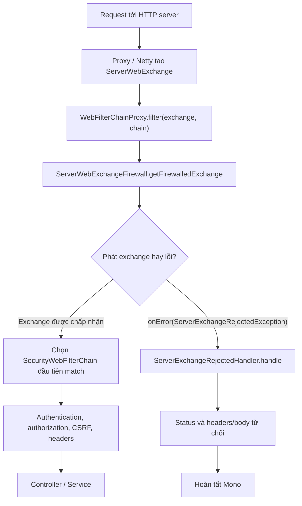
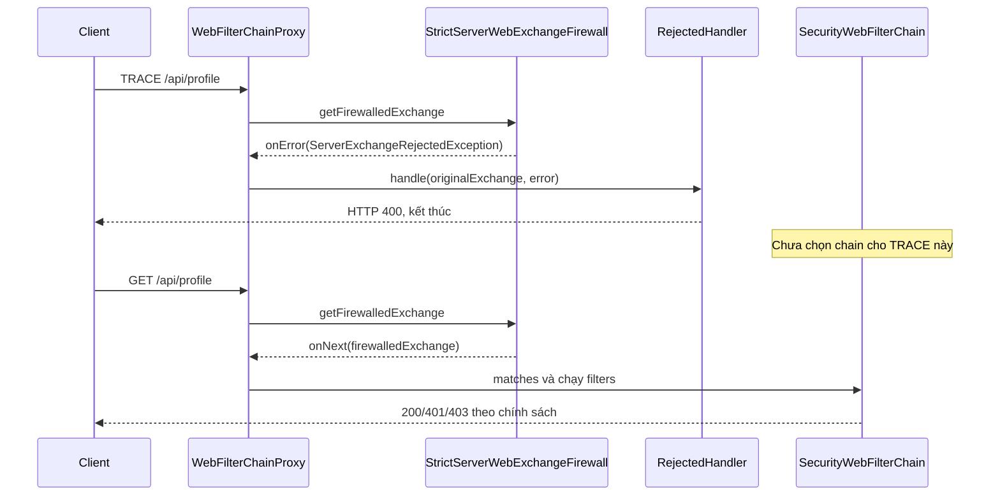

# ServerExchangeRejectedHandler cùng phản hồi từ chối

## 1. Vì sao phản hồi khi firewall từ chối cần một handler riêng?

Trong ứng dụng Spring WebFlux có Spring Security, các request hợp lệ đi qua chuỗi WebFilter bảo mật để được xác thực, phân quyền, kiểm tra CSRF và áp dụng security headers. Nhưng một request có hình dạng nguy hiểm — chẳng hạn `TRACE /api/profile`, đường dẫn chứa `/../`, dấu chấm phẩy không được phép hoặc encoded slash `%2F` — có thể bị **Reactive HTTP firewall từ chối ngay trước khi chọn security chain**.

Khi đó hệ thống cần trả một HTTP response có chủ đích. Không nên phản chiếu raw URL, bearer token, cookie hoặc lý do kỹ thuật quá chi tiết vào body; cũng không nên mặc định chuyển tất cả sự kiện từ chối sang `401` hoặc `403`, vì request bị từ chối do **hình dạng HTTP không hợp lệ**, không nhất thiết do user thiếu xác thực/quyền.

Trong Spring Security Reactive, `StrictServerWebExchangeFirewall` phát `ServerExchangeRejectedException`; `WebFilterChainProxy` dùng `ServerExchangeRejectedHandler` để tạo response. Triển khai mặc định là `HttpStatusExchangeRejectedHandler` trả **HTTP 400 Bad Request**. Ứng dụng có thể giữ response tối giản, đổi status qua Bean hoặc tự viết handler trả JSON ổn định.

Bài thuộc chương **Firewall trên Reactive** của mô-đun **SPRING_SECURITY_HTTP_PROTECTION**. Mô-đun dạy áp dụng phòng vệ HTTP và trình duyệt từ CSRF, CORS, security headers, CSP, HSTS đến HTTP firewall, bảo vệ session cho cả Servlet và Reactive. Riêng bài này đi sâu vào **`ServerExchangeRejectedHandler` và phản hồi từ chối**, gồm thiết kế API contract, Reactor publisher, response commit, observability, kiểm thử và xử lý xung đột với gateway/các lớp bảo vệ khác.

### Kết quả học tập

Sau bài, bạn có thể:

1. Giải thích đúng vai trò của `ServerExchangeRejectedHandler`, `ServerExchangeRejectedException` và `HttpStatusExchangeRejectedHandler`.
2. Lần theo luồng `WebFilterChainProxy.filter(...)` từ kiểm tra firewall đến `onErrorResume(...)` và response cuối.
3. Giữ mặc định HTTP 400 hoặc khai báo Bean để trả status khác, hiểu giới hạn của mỗi lựa chọn.
4. Viết custom handler tạo JSON/Problem Details tối giản, ngăn lộ dữ liệu và không chặn event loop.
5. Xử lý `HEAD`, response đã commit, `Mono<Void>` và headers một cách có kiểm soát.
6. Phân biệt firewall rejection với `401`, `403`, `404`, `405`, lỗi CORS/CSRF và lỗi HTTP parser/gateway.
7. Kiểm thử trực tiếp handler, kiểm thử `WebFilterChainProxy`, `WebTestClient` và tuyến Netty/proxy thực.
8. Thiết kế logging/metrics, quy tắc CORS/cache và checklist triển khai mà không vô hiệu strict firewall.

## 2. Hợp đồng API và phạm vi phiên bản

Những type chính nằm trong package Reactive `org.springframework.security.web.server.firewall`:

| Type | Vai trò | Điều quan trọng |
| --- | --- | --- |
| `ServerWebExchangeFirewall` | Kiểm tra và có thể bọc `ServerWebExchange` | `getFirewalledExchange(exchange)` trả `Mono<ServerWebExchange>` |
| `StrictServerWebExchangeFirewall` | Triển khai strict mặc định | Từ chối request đáng ngờ thay vì tự sửa mọi input |
| `ServerExchangeRejectedException` | `RuntimeException` báo một exchange bị reject | Không phải lỗi authentication hay controller |
| `ServerExchangeRejectedHandler` | Interface chuyển rejection thành xử lý response | `handle(exchange, exception)` trả `Mono<Void>` |
| `HttpStatusExchangeRejectedHandler` | Handler đơn giản trả status | Constructor không tham số chọn 400; constructor nhận `HttpStatus` |
| `WebFilterChainProxy` | Áp firewall, chọn security chains và xử lý rejection | Có `setExchangeRejectedHandler(...)` |

Chữ ký cốt lõi:

```java
public interface ServerExchangeRejectedHandler {

    Mono<Void> handle(
        ServerWebExchange exchange,
        ServerExchangeRejectedException exception
    );
}
```

`ServerExchangeRejectedException` có constructor nhận `String message`. Handler nhận đối tượng exception để có thể quan sát **loại sự cố**, nhưng không có yêu cầu phải trả `getMessage()` cho client.

### 2.1. Kiểm tra đúng phiên bản trước khi dùng

Javadoc của nhánh Spring Security **6.4+** ghi `Since: 6.4` cho các API Reactive firewall và rejection handler được bàn ở đây. `WebFilterChainProxy` có mặt từ 5.0, nhưng không thể lấy tuổi đời của proxy để suy ra tuổi đời tất cả setter/handler.

Có một lưu ý về các nhánh bảo trì: Javadoc của **5.8.16** có thể liệt kê `ServerExchangeRejectedException` với mốc `5.7.13` do backport. Vì thế không nên khẳng định mọi artifact 5.x đều thiếu hoàn toàn class này; **khả năng class tồn tại và việc tự động wiring Bean không phải cùng một điều**. Với dự án trước 6.4, hãy đối chiếu cả jar, chữ ký class, cấu hình security và test trên version thực tế.

| Tình huống | Cách quyết định |
| --- | --- |
| Spring Security 6.4+ | Dùng reference/Javadoc Reactive tương ứng, test Bean customization |
| Spring Security 6.0–6.3 | Không copy ví dụ của 6.5/7.x rồi giả định hoạt động |
| Nhánh 5.7.x/5.8.x bảo trì | Xem chính xác patch release và cách tích hợp |
| Spring Boot có cả `starter-web` và `starter-webflux` | Xác định ứng dụng thật là Servlet hay Reactive |
| IDE không thấy type hoặc test không gọi Bean | Kiểm tra resolved `spring-security-web`/`spring-security-config` và application context |

Ví dụ Java bên dưới nhắm tới Spring Security **6.4+**, Spring WebFlux và Java 17+; các snippet mô tả những cấu hình **thay thế**, không được khai báo tất cả Bean cùng một lúc.

## 3. Luồng lỗi trong WebFilterChainProxy



Phần quan trọng trong mã nguồn `WebFilterChainProxy` hiện hành có dạng:

```java
return this.firewall.getFirewalledExchange(exchange)
    .flatMap((checked) -> filterFirewalledExchange(checked, chain))
    .onErrorResume(ServerExchangeRejectedException.class,
        (rejected) -> this.exchangeRejectedHandler
            .handle(exchange, rejected)
            .then(Mono.empty()));
```

Đây là một **trích đoạn giải thích luồng**, không phải cách tạo lại proxy cho ứng dụng. Nó cho thấy bốn điều:

1. Firewall kiểm tra **trước** khi tìm `SecurityWebFilterChain`. Với lỗi ban đầu từ firewall, security chain/handler thường chưa chạy.
2. `onErrorResume` chọn **đúng loại `ServerExchangeRejectedException`**, không tự chuyển mọi exception thành 400.
3. Handler được gọi với **original exchange** (`exchange` trước khi firewall trả exchange đã kiểm tra), nên không được giả định dữ liệu request đã được chuẩn hóa an toàn để phản chiếu.
4. Khi handler trả `Mono<Void>` hoàn thành, request xử lý rejection kết thúc; `WebFilterChainProxy` không tiếp tục đến controller cho request đó.

**Sắc thái Reactor:** Operator `onErrorResume` được đặt sau `flatMap` trên toàn upstream publisher. Do đó nếu một thành phần downstream cố tình phát cùng loại `ServerExchangeRejectedException`, operator cũng có thể bắt. **Không dùng exception này cho nghiệp vụ trong controller**, và không giả định luôn bắt nguồn từ firewall nếu ứng dụng tự phát lại type đó.

### 3.1. Hai request, hai đường đi khác nhau



### 3.2. Một HTTP 400 không tự chứng minh firewall đã chạy

Trước Spring Security còn có CDN, reverse proxy và HTTP parser. Từng tầng có thể reject path, method hoặc header theo cách riêng. Chỉ khi quan sát thấy `ServerExchangeRejectedHandler` được gọi, hoặc test trực tiếp firewall phát `ServerExchangeRejectedException`, mới có bằng chứng về **nhánh rejection Spring Security**.

## 4. Mặc định: HttpStatusExchangeRejectedHandler

Spring Security reference quy định `HttpStatusExchangeRejectedHandler` được sử dụng mặc định để trả **400 Bad Request** khi firewall từ chối request.

API đơn giản:

```java
// Giữ hành vi mặc định: 400.
new HttpStatusExchangeRejectedHandler();

// Chọn status theo contract riêng: 404.
new HttpStatusExchangeRejectedHandler(HttpStatus.NOT_FOUND);
```

Nếu ứng dụng chỉ cần từ chối request đáng ngờ với status 400, **không cần khai báo Bean custom**. Giữ default giảm code và tránh tạo thêm điểm có thể lộ dữ liệu qua error body.

### 4.1. Không nên mặc định suy ra body JSON

Javadoc mô tả handler là implementation gửi error với status cấu hình. Không nên viết test giả định nó tự trả:

```json
{"error":"invalid_request"}
```

hoặc RFC 9457 Problem Details khi ứng dụng **chưa** khai báo cách tạo body. Một status-only response là hợp lệ theo contract đã thống nhất; việc chuyển status sang JSON phải được thực hiện qua custom handler và kiểm thử riêng.

### 4.2. Khi nào giữ 400, khi nào cân nhắc 404?

| Lựa chọn | Ưu điểm | Hạn chế |
| --- | --- | --- |
| `400 Bad Request` (mặc định) | Đúng ngữ nghĩa request không hợp lệ; dễ chẩn đoán | Người gọi biết request bị từ chối ở một dạng không hợp lệ |
| `404 Not Found` | Có thể tránh phân biệt URL “khả nghi” với URL không tồn tại theo policy | 404 cũng do router, dễ gây hiểu lầm khi thiếu telemetry |
| `403 Forbidden` | Thường **không nên** thay mặc định | Gây nhầm với access denied, dù người gọi chưa được xác thực |
| `401 Unauthorized` | **Không phù hợp** để thay toàn bộ firewall rejection | 401 yêu cầu semantics về challenge/authentication; đây không phải lỗi token |
| `429 Too Many Requests` | Chỉ dùng nếu thực sự có rate-limiting contract | Firewall rejection không đồng nghĩa rate-limit |
| `500 Internal Server Error` | Không nên cho request bị từ chối theo policy thông thường | Gắn nhầm lỗi client vào sự cố server |

Nên giữ 400 trừ khi có yêu cầu API rõ ràng. Nếu đổi 404, tiêu chí test và monitoring phải **phân biệt router 404 với firewall 404**.

## 5. Cấu hình Bean thay status trong Spring WebFlux

Cách customization được Spring Security Reactive reference hướng dẫn là expose một Bean `ServerExchangeRejectedHandler`.

### 5.1. Một Bean trả 404

```java
import org.springframework.context.annotation.Bean;
import org.springframework.context.annotation.Configuration;
import org.springframework.http.HttpStatus;
import org.springframework.security.web.server.firewall.HttpStatusExchangeRejectedHandler;
import org.springframework.security.web.server.firewall.ServerExchangeRejectedHandler;

@Configuration
class ReactiveRejectedHandlerConfig {

    @Bean
    ServerExchangeRejectedHandler serverExchangeRejectedHandler() {
        return new HttpStatusExchangeRejectedHandler(
            HttpStatus.NOT_FOUND);
    }
}
```

Khi hạ tầng Spring Security Reactive tương ứng nhận Bean này, một request firewall-rejected được trả 404 thay vì 400. **Cấu hình này không làm firewall nới bất kỳ quy tắc nào.**

Để tránh lỗi wiring:

- Bean phải tồn tại trong đúng **Reactive ApplicationContext** chứa `WebFilterChainProxy`.
- Không đăng ký nhiều Bean `ServerExchangeRejectedHandler` cạnh tranh khi không có quy tắc chọn Bean rõ ràng.
- Không tự tạo thêm `WebFilterChainProxy` chỉ để đổi status; proxy có thể chạy trùng/thiếu security filters.
- Nếu ứng dụng sử dụng proxy tự tạo hoặc cơ chế tích hợp custom, kiểm tra `setExchangeRejectedHandler(...)` đã nhận đúng instance.
- Với các phiên bản cũ/backport, phải test thực tế thay vì chỉ dựa vào tên method hoặc Bean.

### 5.2. Đừng trộn Bean handler với Bean firewall

`StrictServerWebExchangeFirewall` trả lời **request nào bị reject?**, còn `ServerExchangeRejectedHandler` trả lời **phản hồi nào được gửi khi reject?**

```java
@Bean
StrictServerWebExchangeFirewall reactiveFirewall() {
    var firewall = new StrictServerWebExchangeFirewall();
    // Chỉ tùy chỉnh rule khi có yêu cầu thật.
    return firewall;
}

@Bean
ServerExchangeRejectedHandler rejectedHandler() {
    return new HttpStatusExchangeRejectedHandler(
        HttpStatus.BAD_REQUEST);
}
```

Đây là ví dụ hai **loại Bean khác nhau** có thể cùng tồn tại. Không hiểu chúng là hai handler cùng xử lý một request, và không đưa `ServerExchangeRejectedHandler` vào `ServerHttpSecurity.addFilterAt(...)`: nó không phải một `WebFilter`.

### 5.3. Phân biệt với exceptionHandling của ServerHttpSecurity

`ServerHttpSecurity.exceptionHandling(...)` cấu hình các điểm vào/handler cho lỗi **authentication và access denied** trong security chain, không phải API thay thế trực tiếp cho `ServerExchangeRejectedHandler` của firewall đứng ở proxy.

Một request `GET /api/me` thiếu token có thể cần `ServerAuthenticationEntryPoint`, còn `TRACE /api/me` bị firewall chặn trước khi kiểm tra token. Hai lỗi có thể đi qua hai nhánh cấu hình độc lập.

## 6. Thiết kế contract cho phản hồi từ chối

Một response từ chối nên có các thuộc tính:

1. **Status có chủ đích:** thường là 400, hoặc 404 nếu đã được đánh giá.
2. **Không tiết lộ input:** không đưa exception message, raw URL, query, cookie, token hay internal stack trace ra client.
3. **Body ngắn và ổn định:** client có thể nhận biết `code`, không cần nội dung kỹ thuật chi tiết.
4. **Content-Type đúng:** nếu trả JSON thì khai báo `application/json` hoặc `application/problem+json` tương ứng.
5. **Không bị shared cache sử dụng sai:** cân nhắc `Cache-Control: no-store` cho error body, đặc biệt nếu có request-specific data.
6. **Không gây tác dụng phụ:** không tạo session, không gọi DB/external service chỉ để soạn 400.
7. **Không làm rối auth semantics:** đừng biến firewall rejection thành login challenge hoặc redirect form login.
8. **Có thể đo đạc:** tách metric/log rejection an toàn với request ID không nhạy cảm.

### 6.1. Status-only hay JSON body?

| Kiểu response | Ví dụ | Khi nào phù hợp |
| --- | --- | --- |
| Status-only | `HTTP/1.1 400 Bad Request` | Phần lớn firewall rejection; ít code |
| JSON cố định | `{"code":"invalid_http_request"}` | API client cần mã lỗi ổn định |
| Problem Details | `application/problem+json` với `type/title/status` | Tổ chức đã dùng RFC 9457 |
| HTML generic | Trang lỗi tĩnh không chứa input | Website cần UI lỗi, nhưng cân nhắc CSP và cache |
| Redirect login | `302 /login` | **Không nên** dùng cho rejection vì hình dạng request nguy hiểm |

**Không phản chiếu** chuỗi như `/admin;hack=1/../foo` vào body với lý do “giúp debug”, bởi chính input đó có thể chứa dữ liệu nhạy cảm hoặc ký tự ảnh hưởng browser/parser/log.

### 6.2. Problem Details không bắt buộc phải lộ `detail`/`instance`

Một phản hồi an toàn có thể là:

```http
HTTP/1.1 400 Bad Request
Content-Type: application/problem+json
Cache-Control: no-store
X-Content-Type-Options: nosniff

{
  "type": "about:blank",
  "title": "Bad Request",
  "status": 400,
  "code": "request_rejected"
}
```

`code` là extension member ứng dụng định nghĩa. **Không cần** điền `detail` bằng `exception.getMessage()` hoặc `instance` bằng raw request URI. Nếu dùng status 404, cũng phải cập nhật `status/title` cho nhất quán, không để HTTP 404 nhưng JSON `status:400`.

## 7. Custom ServerExchangeRejectedHandler trả Problem Details cố định

Nếu API cần body, ví dụ dưới đây minh họa một implementation **Reactive không block**, không phản chiếu request.

### 7.1. Implementation đầy đủ

```java
import java.nio.charset.StandardCharsets;

import org.springframework.http.HttpHeaders;
import org.springframework.http.HttpMethod;
import org.springframework.http.HttpStatus;
import org.springframework.http.MediaType;
import org.springframework.http.server.reactive.ServerHttpResponse;
import org.springframework.security.web.server.firewall.ServerExchangeRejectedException;
import org.springframework.security.web.server.firewall.ServerExchangeRejectedHandler;
import org.springframework.web.server.ServerWebExchange;
import reactor.core.publisher.Mono;

public final class SafeProblemRejectedHandler
        implements ServerExchangeRejectedHandler {

    private static final byte[] BODY = (
        "{"
        + "\"type\":\"about:blank\","
        + "\"title\":\"Bad Request\","
        + "\"status\":400,"
        + "\"code\":\"request_rejected\""
        + "}"
    ).getBytes(StandardCharsets.UTF_8);

    @Override
    public Mono<Void> handle(
            ServerWebExchange exchange,
            ServerExchangeRejectedException rejected) {

        ServerHttpResponse response = exchange.getResponse();

        if (response.isCommitted()) {
            // Không thể thay status/header hoặc ghi lại body lúc này.
            // Propagate để hạ tầng biết response đã commit.
            return Mono.error(rejected);
        }

        response.setStatusCode(HttpStatus.BAD_REQUEST);
        response.getHeaders().setContentType(
            MediaType.parseMediaType("application/problem+json"));
        response.getHeaders().set(
            HttpHeaders.CACHE_CONTROL, "no-store");
        response.getHeaders().set(
            "X-Content-Type-Options", "nosniff");

        // HEAD không gửi response body.
        if (HttpMethod.HEAD.equals(exchange.getRequest().getMethod())) {
            return response.setComplete();
        }

        return response.writeWith(Mono.fromSupplier(
            () -> response.bufferFactory().wrap(BODY)));
    }
}
```

Ví dụ có các đặc điểm quan trọng:

- Handler **không dùng nội dung** của `rejected.getMessage()` hoặc `exchange.getRequest().getURI()` để tạo body.
- `BODY` là một mảng byte không biến đổi sau khi khởi tạo; từng request tạo `DataBuffer` wrapper khi publisher được subscribe.
- `writeWith(Mono<...>)` trả `Mono<Void>` để WebFlux điều khiển subscription/lifecycle; không gọi `subscribe()` thủ công.
- `HEAD` chỉ tạo status/headers, không trả body. Nếu sản phẩm yêu cầu `Content-Length` với HEAD, phải thiết kế rõ semantics/adapter và test.
- Không tự set `Content-Length` cho response đang được xử lý bởi compression/transfer-encoding middleware; để server tính hoặc thiết lập có kiểm soát nếu contract yêu cầu.
- Với `response.isCommitted()`, implementation **không cố ghi lại một response đã bắt đầu**; thay vào đó báo lỗi để hạ tầng xử lý. Tình huống này thường hiếm với reject ngay tại firewall nhưng vẫn cần nhận diện khi vận hành.
- Việc thêm `X-Content-Type-Options: nosniff` là chủ động vì response lỗi có thể được tạo **trước khi selected security chain áp security headers**.
- `Cache-Control: no-store` chỉ là lớp HTTP-cache policy; CDN/proxy có rule ép cache vẫn cần được kiểm tra.

Lưu ý chuyên môn: Dùng `Mono.error(rejected)` khi response đã commit không thể “quay ngược” bytes đã gửi. Nó chỉ **không che giấu lỗi**; kết nối có thể bị đóng hoặc ghi lỗi bởi hạ tầng. Không làm cho một request có body đã commit trở lại trạng thái an toàn bằng cách thử write lần hai.

### 7.2. Bean đăng ký handler

```java
import org.springframework.context.annotation.Bean;
import org.springframework.context.annotation.Configuration;
import org.springframework.security.web.server.firewall.ServerExchangeRejectedHandler;

@Configuration
class SafeProblemConfig {

    @Bean
    ServerExchangeRejectedHandler rejectedHandler() {
        return new SafeProblemRejectedHandler();
    }
}
```

Chỉ sử dụng **một** Bean `ServerExchangeRejectedHandler` phù hợp trong cùng context. Nếu đã dùng Bean trả 404 ở mục 5.1, coi Bean này là **phương án thay thế**.

### 7.3. Khi nào không nên dùng custom handler?

Nếu client chỉ cần biết 400, giữ `HttpStatusExchangeRejectedHandler` mặc định. Tự viết handler làm tăng trách nhiệm với Content-Type, HEAD semantics, DataBuffer, response commit, CORS, cache/headers và tests. Nhiều lỗi triển khai bắt đầu từ mong muốn “chuẩn hóa mọi lỗi thành JSON” nhưng vô tình phản chiếu raw input hoặc phụ thuộc DB/remote logging trên event loop.

## 8. Những lỗi dễ mắc khi viết Reactive handler

### 8.1. Gọi subscribe() thủ công

```java
// SAI: việc subscribe bị tách khỏi lifecycle request.
response.setComplete().subscribe();
return Mono.empty();
```

Cách đúng:

```java
return response.setComplete();
```

Nếu có body:

```java
return response.writeWith(
    Mono.fromSupplier(() ->
        response.bufferFactory().wrap(fixedBytes)));
```

Framework phải quản lý subscription. Tự `subscribe()` dễ khiến lỗi, cancel và response commit lệch thời điểm.

### 8.2. Dùng Blocking IO trên event loop

Không gọi:

```java
// Không nên trong handler của Netty event loop:
boolean accepted = externalAuditClient.blockingSend(rejected);
```

trước khi trả 400. Nếu external audit server chậm, request sẽ giữ event loop và có thể làm cạn tài nguyên.

Thay bằng metric/log nội bộ ngắn, không blocking; nếu tổ chức yêu cầu audit bền vững, dùng cơ chế quan sát/queue độc lập được thiết kế với giới hạn, không làm phản hồi rejection phụ thuộc remote call. **Không cần biết full exception message** để đếm số request bị từ chối.

### 8.3. Trả chi tiết exception trực tiếp

```java
// SAI: raw request-target hoặc giá trị header có thể xuất hiện
// trong message hoặc exception stack.
String body = rejected.getMessage();
```

Điều đó mở cửa cho lộ dữ liệu, log injection và fingerprint policy. Response client nên dùng một error code cố định; nội bộ có thể dùng loại metric đã chuẩn hóa.

### 8.4. Thay đổi status/header sau khi commit

Một response đã `isCommitted()` không thể đổi sang 400 một cách đáng tin cậy. Handler phải biết giới hạn này và không gửi body khác chồng lên bytes đã gửi. Trong luồng chuẩn, firewall rejection xảy ra sớm, nhưng error type có thể bị app khác phát từ downstream; đừng sử dụng nó cho nghiệp vụ.

### 8.5. Tạo session/cookie chỉ để gửi lỗi

Không cần khởi tạo session, đặt `Set-Cookie`, redirect hoặc ghi dữ liệu cho một request bị firewall reject. Những thao tác này tạo tác dụng phụ không cần thiết và dễ gây vấn đề bảo mật/tracking.

## 9. Phân biệt luồng lỗi của firewall với các lớp bảo vệ khác

| Trường hợp | Tầng xử lý điển hình | Kết quả thường gặp | Có phải ServerExchangeRejectedHandler? |
| --- | --- | --- | --- |
| `TRACE /public/ping` tới strict firewall | Firewall | 400 mặc định | **Có**, nếu Spring firewall reject |
| Path chứa `;` bị strict reject | Firewall | 400 mặc định | **Có**, nếu dấu `;` còn khi tới Spring |
| HTTP request sai framing | Netty/proxy | 400 hoặc đóng kết nối | Thường **không** |
| `GET /api/me` không bearer token | Authentication entry point | 401 hoặc login redirect | Không |
| User thiếu role truy cập admin | Authorization / access denied | 403 | Không |
| Cookie-based POST không CSRF token | CSRF filter | 403 | Không |
| Controller không tìm thấy route | WebFlux router | 404 | Không |
| Handler không hỗ trợ method | WebFlux handler mapping | 405 | Không |
| JSON DTO không đúng cấu trúc | Body parser/validation | 400/422 theo contract | Không |
| Rate limit vượt ngưỡng | Gateway/rate limiter | 429 | Không |
| Custom rejected handler trả 404 | Firewall rejection handler | 404 | **Có**, nhưng không suy chỉ từ status |

### 9.1. Vì sao không tùy tiện trả 401 hoặc 403?

`401` là tín hiệu authentication challenge với semantics riêng; `403` nói về authorization, không phải URI/method nguy hiểm. Một request bị reject có thể chưa hề đến authentication. Nếu tất cả đều trả 401, client có thể cố refresh token khi lỗi thật là encoded slash/TRACE; việc này không giải quyết nguyên nhân.

### 9.2. Vì sao WebExceptionHandler không thay thế?

`WebExceptionHandler` là một điểm mở rộng xử lý exception ở WebFlux framework. Nó có thể được dùng cho lỗi khác ở application, nhưng **không phải cơ chế được Spring Security Reactive reference khuyến nghị để cấu hình riêng firewall rejection**: `WebFilterChainProxy` đã xử lý `ServerExchangeRejectedException` bằng `ServerExchangeRejectedHandler`. Nếu bạn chỉ custom một global `WebExceptionHandler`, có thể nó không nhìn thấy exception đã được proxy chuyển thành HTTP response.

### 9.3. Với Servlet, tên API khác

| Khía cạnh | Reactive / WebFlux | Servlet / Spring MVC |
| --- | --- | --- |
| Firewall | `ServerWebExchangeFirewall` | `HttpFirewall` |
| Strict implementation | `StrictServerWebExchangeFirewall` | `StrictHttpFirewall` |
| Rejection exception | `ServerExchangeRejectedException` | `RequestRejectedException` |
| Rejection handler | `ServerExchangeRejectedHandler` | `RequestRejectedHandler` |
| Status handler | `HttpStatusExchangeRejectedHandler` | `HttpStatusRequestRejectedHandler` |
| Proxy | `WebFilterChainProxy` | `FilterChainProxy` |
| Request model | `ServerWebExchange` | `HttpServletRequest` |
| Test tools | `StepVerifier`, `WebTestClient` | Servlet filter test, `MockMvc` |

Không import `org.springframework.security.web.firewall.RequestRejectedHandler` vào WebFlux. Một ứng dụng có cả Spring MVC/WebFlux dependencies phải kiểm tra runtime stack thật trước khi thiết kế Bean.

## 10. Header của response bị reject: vì sao cần xét riêng?

Firewall rejection xảy ra **trước khi một `SecurityWebFilterChain` được chọn**. Vì thế không thể tự động suy rằng bộ response security headers nằm trong selected chain sẽ được áp cho response 400.

### 10.1. Nhóm header cần xem xét

| Header | Mục tiêu | Lưu ý |
| --- | --- | --- |
| `Cache-Control: no-store` | Không lưu error body/metadata nhạy cảm | Kiểm tra CDN không override |
| `Content-Type: application/problem+json` | Trình duyệt/client diễn giải đúng JSON | Phải đúng với bytes thực |
| `X-Content-Type-Options: nosniff` | Hạn chế MIME sniffing | Có thể được thêm tại handler hoặc proxy |
| `Content-Security-Policy` | Khi response là HTML, giới hạn nội dung thực thi | HTML error page cần CSP phù hợp |
| `Strict-Transport-Security` | Bảo vệ kết nối HTTPS trên browser | Thường quản lý ở TLS terminator/outer WebFilter theo topology |
| `Access-Control-Allow-Origin` | Cho browser đọc response khi CORS hợp lệ | Không echo mọi Origin chỉ để sửa CORS error |
| `Vary: Origin` | Phân biệt CORS variants nếu response phụ thuộc Origin | Không thay authorization hoặc `no-store` |
| `Retry-After` | Phù hợp một số rate-limit/service availability errors | Không tự thêm cho firewall 400 |

Nếu tổ chức yêu cầu HSTS/CSP cho mọi response kể cả rejection, cần **đo response cuối thực tế** qua gateway/HTTPS và thiết kế việc thêm header ở tầng có thể bao phủ cả early rejection, không chỉ cấu hình chain thông thường.

### 10.2. HTTP 404 của firewall có thể bị cache nhầm

Một CDN có thể có policy cache error responses, đặc biệt 404. Nếu bạn đổi rejection mặc định từ 400 sang 404, cần kiểm tra:

- CDN có cache 404 theo URL hay status không?
- Cache key có phân biệt Host, path và những context cần thiết không?
- Có log/cache poisoning khi URL chứa phần encode bất thường?
- Error body có data theo request/user hay chỉ JSON cố định?
- Có `Cache-Control: no-store` hoặc bypass phù hợp không?

Đừng đổi sang 404 chỉ vì muốn ẩn logic mà không xem chính sách cache/observability.

## 11. CORS và trình duyệt: khi nào client không đọc được JSON lỗi?

Với request từ browser cross-origin, một response firewall-rejected có thể **không qua CORS WebFilters nằm trong selected chain**. Vì vậy browser có thể chỉ hiển thị lỗi CORS/network cho JavaScript, dù server đã gửi 400/JSON đúng.

### 11.1. Không tự echo Origin bất kỳ

Đoạn sau **không** nên dùng:

```java
// KHÔNG NÊN: mở phản hồi cho bất kỳ Origin nào.
response.getHeaders().set(
    "Access-Control-Allow-Origin",
    exchange.getRequest().getHeaders().getOrigin());
```

Đặc biệt nguy hiểm khi đi cùng `Access-Control-Allow-Credentials: true` hoặc khi response chứa dữ liệu request-specific. Nếu API contract cần browser đọc được JSON lỗi, hãy dùng **CORS policy được kiểm soát ở một tầng bao phủ rejection** (proxy/WebFilter ở vị trí thích hợp) và kiểm tra đúng allowed origins, credentials, headers và preflight.

Không tự suy CORS headers sẽ được thêm bởi `ServerHttpSecurity.cors(...)` nếu request bị strict firewall reject trước khi chain chạy.

### 11.2. OPTIONS preflight và firewall

Mặc định strict firewall cho phép `OPTIONS`, vì nó nằm trong tập methods chuẩn. Nếu cấu hình firewall custom chỉ GET/POST và loại OPTIONS, preflight có thể bị từ chối trước khi CORS đánh giá. **Thêm OPTIONS vào allowlist không tự định nghĩa CORS policy**. Cần test cả “method không bị firewall reject” và “CORS thực sự cho phép origin hợp lệ”.

## 12. Test handler status-only độc lập với Spring context

### 12.1. Unit test default 400 và custom 404

Với JUnit 5, `spring-test` và `reactor-test`:

```java
import static org.junit.jupiter.api.Assertions.assertEquals;

import org.junit.jupiter.api.Test;
import org.springframework.http.HttpStatus;
import org.springframework.mock.http.server.reactive.MockServerHttpRequest;
import org.springframework.mock.web.server.MockServerWebExchange;
import org.springframework.security.web.server.firewall.HttpStatusExchangeRejectedHandler;
import org.springframework.security.web.server.firewall.ServerExchangeRejectedException;
import reactor.test.StepVerifier;

class HttpStatusRejectedHandlerTest {

    @Test
    void defaultHandlerReturns400() {
        var exchange = MockServerWebExchange.from(
            MockServerHttpRequest.get("/public/ping").build());

        var handler = new HttpStatusExchangeRejectedHandler();

        StepVerifier.create(handler.handle(
                exchange,
                new ServerExchangeRejectedException("test")))
            .verifyComplete();

        assertEquals(HttpStatus.BAD_REQUEST,
            exchange.getResponse().getStatusCode());
    }

    @Test
    void configurableHandlerCanReturn404() {
        var exchange = MockServerWebExchange.from(
            MockServerHttpRequest.get("/public/ping").build());

        var handler = new HttpStatusExchangeRejectedHandler(
            HttpStatus.NOT_FOUND);

        StepVerifier.create(handler.handle(
                exchange,
                new ServerExchangeRejectedException("test")))
            .verifyComplete();

        assertEquals(HttpStatus.NOT_FOUND,
            exchange.getResponse().getStatusCode());
    }
}
```

Trong unit test, tự tạo `ServerExchangeRejectedException` để gọi handler là hợp lý. **Không chuyển cách này thành việc ném exception cùng type ở controller**.

### 12.2. Handler test khác firewall test

Test trên xác minh **handler đổi status** nhưng chưa chứng minh `StrictServerWebExchangeFirewall` reject `TRACE` hoặc Bean đã được gắn vào `WebFilterChainProxy`. Những điều đó cần test khác.

## 13. Test SafeProblemRejectedHandler: status, headers và body

Kiểm thử implementation ở mục 7 mà không phụ thuộc server:

```java
import static org.junit.jupiter.api.Assertions.assertEquals;
import static org.junit.jupiter.api.Assertions.assertFalse;

import org.junit.jupiter.api.Test;
import org.springframework.http.HttpHeaders;
import org.springframework.http.HttpStatus;
import org.springframework.http.MediaType;
import org.springframework.mock.http.server.reactive.MockServerHttpRequest;
import org.springframework.mock.web.server.MockServerWebExchange;
import org.springframework.security.web.server.firewall.ServerExchangeRejectedException;
import reactor.test.StepVerifier;

class SafeProblemRejectedHandlerTest {

    @Test
    void emitsFixedProblemWithoutLeakingExceptionMessage() {
        var exchange = MockServerWebExchange.from(
            MockServerHttpRequest.get("/public/ping").build());

        var handler = new SafeProblemRejectedHandler();
        var failure = new ServerExchangeRejectedException(
            "sensitive-test-marker");

        StepVerifier.create(handler.handle(exchange, failure))
            .verifyComplete();

        assertEquals(HttpStatus.BAD_REQUEST,
            exchange.getResponse().getStatusCode());

        assertEquals(
            MediaType.parseMediaType("application/problem+json"),
            exchange.getResponse().getHeaders().getContentType());
        assertEquals("no-store",
            exchange.getResponse().getHeaders()
                .getFirst(HttpHeaders.CACHE_CONTROL));
        assertEquals("nosniff",
            exchange.getResponse().getHeaders()
                .getFirst("X-Content-Type-Options"));

        StepVerifier.create(
            exchange.getResponse().getBodyAsString())
            .assertNext(body -> {
                assertEquals(
                    "{\"type\":\"about:blank\","
                    + "\"title\":\"Bad Request\","
                    + "\"status\":400,"
                    + "\"code\":\"request_rejected\"}",
                    body);
                assertFalse(body.contains("sensitive-test-marker"));
            })
            .verifyComplete();
    }
}
```

Test này chứng minh **phản hồi đúng từ handler đơn lẻ**. Nếu body không được ghi vì mock response đã commit hoặc logic khác, test sẽ fail. Nó không chứng minh auto-wiring của Spring Security.

### 13.1. Test HEAD

Với `HEAD`, test cần xác nhận status/headers đúng và **không có response body**. Spring HTTP server cũng có thể áp quy tắc HEAD khi encode response, nhưng handler riêng nên tuân contract trước khi gửi bytes.

```java
var exchange = MockServerWebExchange.from(
    MockServerHttpRequest
        .method(org.springframework.http.HttpMethod.HEAD, "/public/ping")
        .build());

StepVerifier.create(
    new SafeProblemRejectedHandler().handle(
        exchange,
        new ServerExchangeRejectedException("test")))
    .verifyComplete();

// Kiểm tra status và không có body theo MockServerHttpResponse
// của version Spring Framework đang dùng.
```

Đây là trích đoạn trong test đã có imports/method context; dùng thêm assertion phù hợp với API response mock của phiên bản thực.

## 14. Test WebFilterChainProxy: handler có được gọi hay không?

Một test cấp proxy cần tách **firewall phát lỗi** và **handler chuyển lỗi**. Để tránh phụ thuộc raw URI có thể bị mock parser chuẩn hóa, có thể dùng một `ServerWebExchangeFirewall` test double cố tình phát exception.

```java
import static org.junit.jupiter.api.Assertions.assertEquals;
import static org.junit.jupiter.api.Assertions.assertFalse;

import java.util.List;
import java.util.concurrent.atomic.AtomicBoolean;

import org.junit.jupiter.api.Test;
import org.springframework.http.HttpStatus;
import org.springframework.mock.http.server.reactive.MockServerHttpRequest;
import org.springframework.mock.web.server.MockServerWebExchange;
import org.springframework.security.web.server.SecurityWebFilterChain;
import org.springframework.security.web.server.WebFilterChainProxy;
import org.springframework.security.web.server.firewall.HttpStatusExchangeRejectedHandler;
import org.springframework.security.web.server.firewall.ServerExchangeRejectedException;
import org.springframework.web.server.WebFilterChain;
import reactor.core.publisher.Mono;
import reactor.test.StepVerifier;

class ReactiveRejectionProxyTest {

    @Test
    void proxyUsesConfiguredHandlerAndSkipsDownstream() {
        var proxy = new WebFilterChainProxy(
            List.<SecurityWebFilterChain>of());

        proxy.setFirewall(exchange ->
            Mono.error(new ServerExchangeRejectedException(
                "synthetic-test-rejection")));

        proxy.setExchangeRejectedHandler(
            new HttpStatusExchangeRejectedHandler(
                HttpStatus.NOT_FOUND));

        AtomicBoolean downstreamCalled = new AtomicBoolean();
        WebFilterChain downstream = exchange -> {
            downstreamCalled.set(true);
            return Mono.empty();
        };

        var exchange = MockServerWebExchange.from(
            MockServerHttpRequest.get("/public/ping").build());

        StepVerifier.create(proxy.filter(exchange, downstream))
            .verifyComplete();

        assertEquals(HttpStatus.NOT_FOUND,
            exchange.getResponse().getStatusCode());
        assertFalse(downstreamCalled.get());
    }
}
```

Đây là **test cơ chế proxy**, không dùng security chains thật và không có cấu hình Spring Boot. Lợi ích là chứng minh `WebFilterChainProxy` chuyển `ServerExchangeRejectedException` sang handler và **không chạy downstream**.

### 14.1. Test riêng StrictServerWebExchangeFirewall

Test khác cần xác minh strict firewall thật phát loại exception mong đợi:

```java
import org.junit.jupiter.api.Test;
import org.springframework.http.HttpMethod;
import org.springframework.mock.http.server.reactive.MockServerHttpRequest;
import org.springframework.mock.web.server.MockServerWebExchange;
import org.springframework.security.web.server.firewall.ServerExchangeRejectedException;
import org.springframework.security.web.server.firewall.StrictServerWebExchangeFirewall;
import reactor.test.StepVerifier;

class StrictFirewallExceptionTest {

    @Test
    void traceIsRejected() {
        var exchange = MockServerWebExchange.from(
            MockServerHttpRequest
                .method(HttpMethod.TRACE, "/public/ping")
                .build());

        var firewall = new StrictServerWebExchangeFirewall();

        StepVerifier.create(
            firewall.getFirewalledExchange(exchange))
            .expectError(ServerExchangeRejectedException.class)
            .verify();
    }
}
```

**Phân tách bằng chứng:** test strict firewall xác định **ai tạo exception**; test proxy xác định **ai xử lý exception**; test ApplicationContext xác định **Bean thực sự được wiring**.

## 15. WebTestClient integration: xác minh Bean trong ứng dụng

Giả sử ứng dụng Spring Boot WebFlux có:

- `@EnableWebFluxSecurity` và `SecurityWebFilterChain` bảo vệ URL;
- Bean `SafeProblemRejectedHandler` ở mục 7;
- một controller công khai `GET /public/ping`;
- `WebTestClient` đi qua security integration.

### 15.1. Probe endpoint

```java
import org.springframework.web.bind.annotation.GetMapping;
import org.springframework.web.bind.annotation.RestController;
import reactor.core.publisher.Mono;

@RestController
class PublicProbeController {

    @GetMapping("/public/ping")
    Mono<String> ping() {
        return Mono.just("pong");
    }
}
```

### 15.2. Integration test

```java
import org.junit.jupiter.api.Test;
import org.springframework.beans.factory.annotation.Autowired;
import org.springframework.boot.test.autoconfigure.web.reactive.AutoConfigureWebTestClient;
import org.springframework.boot.test.context.SpringBootTest;
import org.springframework.http.HttpHeaders;
import org.springframework.http.HttpMethod;
import org.springframework.http.MediaType;
import org.springframework.test.web.reactive.server.WebTestClient;

@SpringBootTest
@AutoConfigureWebTestClient
class ReactiveRejectionIntegrationTest {

    @Autowired WebTestClient client;

    @Test
    void validGetStillWorks() {
        client.get()
            .uri("/public/ping")
            .exchange()
            .expectStatus().isOk()
            .expectBody(String.class).isEqualTo("pong");
    }

    @Test
    void rejectedTraceGetsSafeProblemResponse() {
        client.method(HttpMethod.TRACE)
            .uri("/public/ping")
            .exchange()
            .expectStatus().isBadRequest()
            .expectHeader().valueEquals(
                HttpHeaders.CACHE_CONTROL, "no-store")
            .expectHeader().contentTypeCompatibleWith(
                MediaType.parseMediaType("application/problem+json"))
            .expectBody()
            .jsonPath("$.code")
                .isEqualTo("request_rejected");
    }
}
```

Đoạn kiểm thử dùng `MediaType.parseMediaType(...)` để truyền đúng đối tượng `MediaType` cho assertion `contentTypeCompatibleWith`. Giữ imports và đường tích hợp security phù hợp Spring Framework version đang dùng.

**Giới hạn:** Test chỉ phù hợp khi custom handler đã được Bean-wired; nếu không, default thường trả 400 nhưng không phải body Problem Details. Một `TRACE` có thể bị HTTP server/test client reject trước `WebFilterChainProxy` trong một số môi trường; kết hợp proxy test để xác nhận nguyên nhân.

### 15.3. Với Bean trả 404

Nếu ứng dụng dùng `HttpStatusExchangeRejectedHandler(HttpStatus.NOT_FOUND)` ở mục 5, test phải mong 404 và **không** đòi JSON body nếu handler không được thiết kế trả JSON. Không lấy response status 404 làm bằng chứng auto-wiring duy nhất nếu router cũng có thể trả 404; cần test direct/proxy hoặc telemetry chứng minh handler đã được gọi.

## 16. Kiểm thử E2E qua Netty và reverse proxy

Thực hiện trong môi trường **được cấp phép**, với dữ liệu giả. Cùng một request có thể được xử lý khác nhau ở proxy và origin:

```bash
# Mục đích: so request hợp lệ và không hợp lệ.
curl -i 'http://localhost:8080/public/ping'

curl -i -X TRACE 'http://localhost:8080/public/ping'

curl -i --path-as-is \
  'http://localhost:8080/secure/../admin'

curl -i --path-as-is \
  'http://localhost:8080/secure;role=guest/report'

curl -i --path-as-is \
  'http://localhost:8080/secure%2Freport'
```

`--path-as-is` hạn chế `curl` tự rút gọn dot segments, **không đảm bảo** Netty/proxy không sửa path. Khi test qua gateway, phải so request-target client đã gửi với request-target origin nhìn thấy và ghi nhận **tầng tạo response**.

| Điểm quan sát | Câu hỏi |
| --- | --- |
| Client | Raw method/path đã gửi là gì? |
| CDN/WAF | Có deny/normalize request trước Spring không? |
| Reverse proxy | Có rewrite URL, thay Host, strip headers không? |
| Reactor Netty | Parser có chấp nhận request để tạo `ServerWebExchange` không? |
| WebFilterChainProxy | Firewall có phát `ServerExchangeRejectedException` không? |
| Rejection handler | Default/custom Bean có được gọi không? |
| SecurityWebFilterChain | Nếu firewall chấp nhận, chain nào match? |
| Controller/service | Request có tới handler không, phân quyền dữ liệu đúng không? |

**Không gửi raw HTTP request-smuggling payload trên hệ thống không được phép**. Kiểm tra `Content-Length`/`Transfer-Encoding` thuộc phương án test hạ tầng có phê duyệt riêng; một WebFilter sau HTTP parser không thể thay proxy/server trong vấn đề message framing.

### 16.1. Test header có được giữ qua edge?

Khi custom handler trả `Content-Type`, `Cache-Control` và `nosniff`, proxy/CDN có thể thêm hoặc ghi đè headers. Nên kiểm thử response cuối qua HTTPS domain thực, không chỉ test MockServerWebExchange.

Nếu tổ chức bắt buộc thêm HSTS cho mọi HTTPS response, kiểm tra cấu hình ở TLS terminator/outer infrastructure vì firewall reject có thể xảy ra trước security chain thêm HSTS. Đừng tắt TLS certificate verification để thực hiện kiểm thử.

## 17. Quan sát và báo cáo lỗi an toàn

Một rejected request có thể mang URL chứa encoded control characters, header độc hại hoặc credential. Đừng ghi `rejected.getMessage()` hoặc raw request-target vào log thông thường.

### 17.1. Trường nên ghi

| Thuộc tính | Khuyến nghị |
| --- | --- |
| Timestamp/service/environment | Ghi |
| Request ID đã sinh hoặc validate | Ghi |
| Loại event `FIREWALL_REJECTED` | Ghi |
| Status cuối của handler | Ghi |
| Lớp từ chối (proxy/Netty/Spring firewall) | Ghi nếu xác định được |
| Số lượng request cùng loại theo thời gian | Đếm, sampling/rate limit |
| Raw `Authorization`/`Cookie`/token | Không ghi |
| Exception message hoặc stack trace đầy đủ của mọi rejected request | Tránh |
| Raw URI/query/header values có control chars | Không ghi vào log thông thường |
| Label metric theo user input | Không dùng vì lộ dữ liệu và cardinality lớn |

Ví dụ metric minh họa:

```text
spring_reactive_firewall_rejections_total{
  service="spring-security-http-protection",
  outcome="rejected",
  http_status="400"
}
```

Đây là tên **tự đề xuất**, không phải metric được Spring Security đảm bảo xuất ra tự động. Không dùng raw exception message làm label và không tạo metric cardinality cao bằng từng URI.

### 17.2. Ghi log ở đâu?

Đặt telemetry ở tầng có khả năng quan sát chắc chắn rejection, chẳng hạn một custom `ServerExchangeRejectedHandler` hoặc tracing ở proxy. Không phụ thuộc vào controller `@ExceptionHandler` vì controller **chưa chạy** khi firewall reject sớm.

Nếu có tracing framework, gắn tag ổn định như `security.rejection=firewall` và status, tránh đưa chuỗi raw user input vào trace attributes. Giới hạn tốc độ log vì một bot có thể gửi hàng nghìn malformed requests.

## 18. Chẩn đoán sự cố

| Triệu chứng | Giả thuyết | Hướng kiểm tra |
| --- | --- | --- |
| TRACE trả 400 nhưng custom handler không được gọi | Netty/proxy đã reject trước Spring | So direct firewall, proxy unit và log tầng trước |
| TRACE trả 404 sau đổi Bean | Handler custom được áp hoặc router 404 | Test proxy/telemetry riêng; không suy từ status |
| `400` có full exception message trong body | Custom error handling phản chiếu input | Thay bằng body cố định, không ghi raw details |
| HTTP response đã commit khi handler chạy | Exception cùng loại phát muộn/downstream | Không dùng exception này cho nghiệp vụ; xem lifecycle |
| Client browser không đọc được JSON 400 | CORS không bao phủ early rejection | Kiểm tra CORS policy ở outer filter/proxy và Origin allowlist |
| Custom handler 404 bị CDN cache | Edge rule cache 404 | Thêm no-store/bypass, verify E2E |
| POST trả 403 | CSRF/authorization, không phải firewall | Xem CSRF token/authz chain |
| GET private trả 401 | Authentication entry point | Không thay rejected handler để sửa |
| PUT trả 405 | Handler không hỗ trợ method | Phân biệt allowlist firewall với controller mapping |
| Bean tồn tại nhưng response vẫn default 400 | Bean chưa được proxy wiring, sai stack hoặc test gọi đường khác | Kiểm tra Reactive ApplicationContext và integration test |
| Hai handler Bean cùng type | Bean selection ambiguity/configuration không nhất quán | Giữ một handler có chủ đích |
| Sau nâng cấp dependency, test body/status đổi | Thay đổi version/HTTP parser/Bean wiring | Đối chiếu Javadoc và regression |
| Mọi rejection tạo stack trace rất lớn | Logging quá chi tiết hoặc traffic scan | Sampling/metrics, không log raw input |
| Một URL hợp lệ vào handler mà không auth | Không security chain match/catch-all thiếu | Sửa chain coverage; firewall không phải default deny |
| Test HEAD có body | Custom handler bỏ qua HTTP HEAD semantics | Không ghi bytes cho HEAD; test HTTP server/proxy |

### 18.1. Trình tự điều tra ngắn

1. Xác nhận version và runtime WebFlux.
2. Test handler trực tiếp: status và response body/headers.
3. Test firewall trực tiếp: `ServerExchangeRejectedException`.
4. Test proxy trực tiếp: handler được gọi và downstream không chạy.
5. Test ApplicationContext bằng WebTestClient: đúng Bean đã được tích hợp.
6. Test qua Netty và gateway: raw request có thật sự tới Spring không?
7. Phân biệt 400/401/403/404/405, không nới firewall cho tới khi biết nguyên nhân.
8. Chạy lại test an toàn và test backward compatibility sau khi sửa.

## 19. Ma trận kiểm thử nên có trong pipeline

| ID | Kịch bản | Kỳ vọng |
| --- | --- | --- |
| H01 | Default handler với synthetic exception | Trả 400 |
| H02 | Handler cấu hình 404 | Trả 404, không khẳng định có JSON body |
| H03 | Custom Problem handler | `application/problem+json`, status 400, body cố định |
| H04 | Exception message chứa marker nhạy cảm | Marker không có trong response |
| H05 | Custom handler cho HEAD | Không gửi body |
| H06 | Response đã commit | Không cố write status/body lần hai |
| H07 | Rejection handler không blocking | Không gọi I/O đồng bộ trước khi hoàn tất |
| F01 | Strict firewall với GET chuẩn | Phát exchange hợp lệ |
| F02 | Strict firewall với TRACE | Phát `ServerExchangeRejectedException` |
| F03 | Strict firewall với semicolon mặc định | Reject nếu input đến firewall còn dấu `;` |
| P01 | WebFilterChainProxy dùng handler custom | Handler được gọi, downstream không chạy |
| P02 | Proxy không có chain match với request hợp lệ | Không nhầm firewall pass với authorization deny |
| I01 | WebTestClient gọi public GET | Success theo contract |
| I02 | WebTestClient gọi TRACE | Status/body theo handler đã cấu hình |
| I03 | CORS OPTIONS hợp lệ | Không bị custom method allowlist reject sai |
| I04 | POST cookie thiếu CSRF | Lỗi CSRF, không nhầm firewall |
| I05 | GET private không auth | Lỗi authentication, không nhầm firewall |
| E01 | Raw URI bất thường qua proxy | Không bypass quyền, xác định tầng reject |
| E02 | Response custom qua CDN | Cache-Control, Content-Type, nosniff không bị ghi đè trái policy |
| E03 | Đổi handler 400→404 | Monitor phân biệt firewall 404 với route 404 |
| E04 | Nâng cấp Spring Security/Netty | Regression các status/headers/response |

Bài test pass có ý nghĩa khi nó chứng minh đúng **tầng chịu trách nhiệm**; chỉ assert `status != 200` có thể bỏ qua lỗi route security hoặc đổi status không mong đợi.

## 20. Bài thực hành tổng hợp: chuẩn hóa phản hồi từ chối cho API Reactive

Một ứng dụng Spring WebFlux dùng Spring Security 6.5+ có:

- `GET /public/ping` công khai;
- `GET /api/profile` yêu cầu bearer token;
- `POST /api/documents` yêu cầu xác thực và chính sách CSRF theo kiến trúc;
- `/admin/**` yêu cầu role ADMIN;
- frontend chạy khác origin qua CDN;
- custom `StrictServerWebExchangeFirewall` chỉ cho GET và POST;
- `ServerExchangeRejectedHandler` đang trả 404;
- một số client mong `application/problem+json` với mã lỗi ổn định.

Đội vận hành thấy:

1. `OPTIONS /api/documents` nhận 404 và frontend báo CORS error.
2. `TRACE /public/ping` nhận 404, nhưng controller không chạy.
3. `GET /api/profile` không bearer token nhận 401.
4. `POST /api/documents` thiếu CSRF trong flow cookie nhận 403.
5. Proxy không ghi rõ liệu lỗi 404 đến từ router hay rejected handler.
6. Một developer muốn in `exception.getMessage()` vào JSON để tiện debug.

### Bài tập

1. Vẽ luồng `WebFilterChainProxy → StrictServerWebExchangeFirewall → onErrorResume → ServerExchangeRejectedHandler`.
2. Phân biệt sự kiện nào thật sự có `ServerExchangeRejectedException`, sự kiện nào thuộc CORS, CSRF, authentication hoặc routing.
3. Giữ mặc định 400 hay đổi 404? Trình bày trade-off về semantics, cache và observability.
4. Viết Bean `ServerExchangeRejectedHandler` chỉ trả 400 hoặc 404; nêu cách chứng minh Bean được wiring.
5. Viết một custom handler trả Problem Details **cố định**, không lộ exception message/URI/token.
6. Bổ sung `Cache-Control: no-store` và `X-Content-Type-Options: nosniff` nếu policy áp dụng cho response JSON.
7. Giải thích vì sao `OPTIONS` cần nằm trong method allowlist để preflight tới CORS logic; thêm OPTIONS không tự mở mọi origin.
8. Viết StepVerifier test cho default handler 400, custom handler 404 và strict firewall TRACE rejection.
9. Viết proxy test chứng minh custom handler được gọi và downstream không chạy.
10. Viết WebTestClient test status, Content-Type, Cache-Control và JSON `code`.
11. Dùng curl qua origin/proxy để xác định URL có semicolon/encoded slash bị chặn ở đâu.
12. Tạo một metric và quy tắc logging an toàn, không dùng raw URI/token hoặc exception message.
13. Kiểm tra HEAD semantics và xử lý response đã commit.
14. Chứng minh security chains có catch-all default deny và service bảo vệ đúng owner/tenant, không trông chờ firewall thực hiện nhiệm vụ đó.

### Gợi ý đáp án

- Strict firewall reject request đáng ngờ; proxy bắt `ServerExchangeRejectedException` và gọi handler **trước khi selected chain chạy**.
- `HttpStatusExchangeRejectedHandler` mặc định trả 400; custom Bean 404 thay status, không đổi chính sách firewall.
- Client cần JSON có thể nhận `application/problem+json` với `type/title/status/code` cố định; không phản chiếu `getMessage()`.
- Với frontend CORS, xử lý `OPTIONS` và chính sách allowed origin/method/header là trách nhiệm riêng; error response early có thể thiếu CORS headers nếu không có outer policy.
- `401`/`403` thuộc authn/authz/CSRF, không phải mặc định firewall rejection.
- Test phải tách **handler → proxy → ApplicationContext → proxy/CDN thật**.
- Logging dùng request ID hợp lệ, loại event và status; metrics label cố định, không chứa raw input.
- Không tắt strict firewall hoặc vô hiệu hóa validation methods để “giảm lỗi” khi chưa biết tầng gây lỗi.

## 21. Checklist nghiệm thu

- [ ] Đúng Spring Security version/API và runtime WebFlux, không nhầm Servlet.
- [ ] `ServerExchangeRejectedHandler` được chọn một cách rõ ràng trong ApplicationContext.
- [ ] Phản hồi mặc định 400 hoặc status custom có tài liệu thiết kế.
- [ ] Không dùng `ServerExchangeRejectedException` như exception nghiệp vụ.
- [ ] JSON error không chứa raw exception message, URI, credentials, PII hoặc stack trace.
- [ ] Problem Details status/title khớp HTTP status cuối.
- [ ] Content-Type, no-store, nosniff và HEAD semantics được kiểm thử nếu custom body.
- [ ] Handler không blocking, không tự `subscribe()` và không cố ghi response đã commit.
- [ ] CORS policy được kiểm tra trên response bị firewall reject nếu browser phải đọc body.
- [ ] Không biến firewall rejection thành 401/403 sai ngữ nghĩa.
- [ ] Custom 404 không bị CDN cache sai hoặc trộn với route 404 trong monitoring.
- [ ] Hạ tầng ghi nhận có phân biệt edge, HTTP parser, firewall, authentication, authorization và controller.
- [ ] Log/metric không chứa token, cookie, exception message hoặc raw path bất thường.
- [ ] StepVerifier, proxy-level, WebTestClient và network-path tests đều PASS trong phạm vi được cấp phép.
- [ ] Các `SecurityWebFilterChain` có coverage/default deny và service vẫn kiểm tra quyền trên từng record/tenant.
- [ ] Có kế hoạch regression khi đổi Spring Security, gateway, Netty, routing hoặc error contract.

## Tài liệu tham khảo

- [Spring Security — Reactive ServerWebExchangeFirewall](https://docs.spring.io/spring-security/reference/reactive/exploits/firewall.html): mặc định, tùy biến Bean và `ServerExchangeRejectedHandler`.
- [Spring Security — ServerExchangeRejectedHandler Javadoc](https://docs.spring.io/spring-security/reference/api/java/org/springframework/security/web/server/firewall/ServerExchangeRejectedHandler.html): hợp đồng `handle(exchange, exception)`.
- [Spring Security — HttpStatusExchangeRejectedHandler Javadoc](https://docs.spring.io/spring-security/reference/api/java/org/springframework/security/web/server/firewall/HttpStatusExchangeRejectedHandler.html): handler trả status mặc định 400 và constructor custom.
- [Spring Security — ServerExchangeRejectedException Javadoc](https://docs.spring.io/spring-security/reference/api/java/org/springframework/security/web/server/firewall/ServerExchangeRejectedException.html): loại lỗi từ chối exchange.
- [Spring Security — StrictServerWebExchangeFirewall Javadoc](https://docs.spring.io/spring-security/reference/api/java/org/springframework/security/web/server/firewall/StrictServerWebExchangeFirewall.html): các quy tắc firewall.
- [Spring Security — WebFilterChainProxy Javadoc](https://docs.spring.io/spring-security/reference/api/java/org/springframework/security/web/server/WebFilterChainProxy.html): `setExchangeRejectedHandler` và `setFirewall`.
- [Spring Security — WebFilterChainProxy source](https://github.com/spring-projects/spring-security/blob/main/web/src/main/java/org/springframework/security/web/server/WebFilterChainProxy.java): luồng `getFirewalledExchange`/`onErrorResume`.
- [Spring Security — Reactive Authorization](https://docs.spring.io/spring-security/reference/reactive/authorization/authorize-http-requests.html): security chains và default deny.
- [Spring Security — Reactive CORS](https://docs.spring.io/spring-security/reference/reactive/integrations/cors.html): preflight và allowed-origin policy.
- [Spring Security — Reactive CSRF](https://docs.spring.io/spring-security/reference/reactive/exploits/csrf.html): phân biệt lỗi CSRF với firewall.
- [Spring Framework — WebTestClient](https://docs.spring.io/spring-framework/reference/testing/webtestclient.html): integration tests WebFlux.
- [Project Reactor — Testing](https://projectreactor.io/docs/core/release/reference/testing.html): `StepVerifier` và publisher lifecycle.
- [RFC 9457 — Problem Details for HTTP APIs](https://www.rfc-editor.org/rfc/rfc9457.html): `application/problem+json`, `type`, `title`, `status` và extension members.
- [RFC 9110 — HTTP Semantics](https://www.rfc-editor.org/rfc/rfc9110.html): HTTP status/HEAD và response semantics.
- [RFC 9112 — HTTP/1.1](https://www.rfc-editor.org/rfc/rfc9112.html): message framing, HTTP parser và proxy.
- [OWASP — HTTP Verb Tampering](https://owasp.org/www-community/attacks/HTTP_Verb_Tampering): rủi ro method handling.
- [OWASP — Path Traversal](https://owasp.org/www-community/attacks/Path_Traversal): URI/path normalization.
