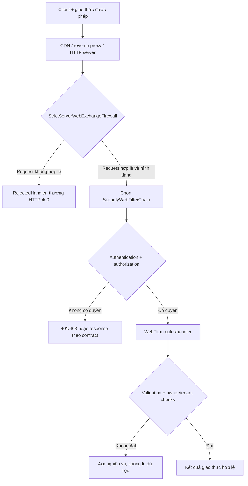

# Kiểm soát các ngoại lệ cần thiết cho giao thức ứng dụng

## 1. Bài toán: một giao thức hợp lệ vẫn có thể bị HTTP firewall từ chối

Một ứng dụng **Spring WebFlux** vận hành API REST thông thường bên cạnh một cổng đồng bộ tài liệu kiểu **WebDAV**. Phần lớn request có method `GET`, `POST`, `PUT`, `PATCH` hoặc `DELETE`, nhưng đối tác còn cần:

```http
PROPFIND /dav/documents/42 HTTP/1.1
Host: files.example.com
Depth: 0
Authorization: Bearer <test-token>
```

Một client đời cũ khác sử dụng matrix parameters:

```http
GET /catalog;language=vi/items;year=2026 HTTP/1.1
Host: files.example.com
```

Và một kho lưu trữ cũ định danh tài liệu bằng key chứa dấu slash: `team/finance/report`; client muốn gửi `/files/team%2Ffinance%2Freport`. Khi triển khai **`StrictServerWebExchangeFirewall`**, nhóm vận hành bắt đầu nhận phản hồi 400 cho một số yêu cầu. Cách sửa nhanh thường được đề xuất là “cho phép mọi method, mọi ký tự path và tất cả header values”. Đây lại chính là cách phá bỏ lớp bảo vệ trước URL matching.

**Mục tiêu của bài không phải tắt firewall, mà là phân biệt ngoại lệ giao thức thật sự cần với input đáng ngờ, chọn cách mở hẹp nhất và chứng minh toàn hệ thống vẫn phân quyền đúng.**

Bài thuộc chương **Firewall trên Reactive** của mô-đun **SPRING_SECURITY_HTTP_PROTECTION**. Phạm vi mô-đun bao gồm các lớp phòng vệ HTTP và trình duyệt trong Spring Security — CSRF, CORS, security headers, CSP, HSTS, HTTP firewall, session — với cả **Servlet và Reactive**, kiểm thử kịch bản tấn công web và chẩn đoán xung đột khi triển khai. Chủ đề riêng tại đây là **kiểm soát các ngoại lệ cần thiết cho giao thức ứng dụng**: HTTP extension methods, matrix variables, URL encoding, hostname, header/parameter quirks, gateway normalization và các chính sách bảo vệ bổ sung khi cần tương thích.

### Kết quả học tập

Sau bài, người học có thể:

1. Phân loại được **ngoại lệ của firewall policy** với **Java exception** hoặc lỗi HTTP bình thường.
2. Xác định khi nào strict defaults nên giữ nguyên và khi nào thật sự cần một ngoại lệ có lý do.
3. Cấu hình `StrictServerWebExchangeFirewall` bằng **một Bean duy nhất** với method allowlist có hỗ trợ một extension method hợp lệ.
4. Giải thích vì sao `setAllowSemicolon(true)` hay `setAllowUrlEncodedSlash(true)` có phạm vi tác động **toàn cục**, không mặc nhiên chỉ mở cho một endpoint.
5. Phân biệt method được firewall cho qua với method được router hỗ trợ và user có quyền thực hiện.
6. Giữ đúng CORS preflight, CSRF, authorization theo resource và kiểm tra tenant khi có ngoại lệ giao thức.
7. Viết tests dương/âm cho direct firewall, `WebTestClient` và request qua reverse proxy thật.
8. Thiết lập hồ sơ thay đổi, giám sát, rollback và tiêu chí nghiệm thu mà không cần `INSECURE_NOOP` hoặc accept-all predicates.

## 2. “Ngoại lệ” ở đây có nghĩa gì?

Từ *ngoại lệ* trong nhan đề chỉ **trường hợp được phép khác với chính sách strict mặc định vì yêu cầu hợp lệ của giao thức/ứng dụng** (policy exception). Nó khác với:

- `ServerExchangeRejectedException`: Java exception/publisher error mà firewall phát khi **không** chấp nhận request;
- `ServerExchangeRejectedHandler`: thành phần tạo phản hồi HTTP cho lỗi trên;
- `ExceptionHandler` của controller: xử lý lỗi ứng dụng, thường xảy ra sau routing;
- `401`/`403`: từ chối xác thực/phân quyền, không phải phương tiện để khai báo allowlist request shape.

Ví dụ cụ thể: thêm `PROPFIND` vào `setAllowedHttpMethods(...)` là **ngoại lệ cho HTTP method**. Khi client dùng `TRACE` bị reject, firewall có thể phát `ServerExchangeRejectedException`. Hai khái niệm không thay thế nhau.

### 2.1. Tại sao strict là điểm xuất phát?

`StrictServerWebExchangeFirewall` mặc định từ chối các URL chưa chuẩn hóa, một số ký tự/biểu diễn nguy hiểm, semicolon, encoded slash, encoded percent, backslash và HTTP methods ngoài allowlist. Nó ưu tiên từ chối thay vì tự sửa path rồi cho đi tiếp vì:

- HTTP server, reverse proxy, security matcher và handler có thể **decode/normalize khác nhau**;
- cùng request có thể được coi là route công khai ở nơi này, route riêng tư ở nơi khác;
- percent-encoding, double decoding và matrix variables làm tăng cách biểu diễn cùng một tài nguyên;
- một số rủi ro chỉ xuất hiện khi có nhiều `SecurityWebFilterChain` hoặc gateway rewrite.

Đó là phòng vệ **trước URL routing**, không phải kiểm tra người dùng có được xem tài liệu cụ thể hay không. Phân quyền phải tiếp tục ở security chain và service.

## 3. Phạm vi phiên bản và kiểu dữ liệu chính xác

Javadoc Spring Security **6.5.x** và hiện hành của `StrictServerWebExchangeFirewall` ghi `Since: 6.4`. `WebFilterChainProxy` tồn tại trước đó, và một số bản bảo trì cũ có backport một số class, nên với hệ thống legacy phải đối chiếu **artifact/version cụ thể**, không chỉ tên Spring Boot.

| Thành phần | Spring Security Reactive | Servlet counterpart |
| --- | --- | --- |
| Contract | `ServerWebExchangeFirewall` | `HttpFirewall` |
| Strict implementation | `StrictServerWebExchangeFirewall` | `StrictHttpFirewall` |
| Security proxy | `WebFilterChainProxy` | `FilterChainProxy` |
| Security chain | `SecurityWebFilterChain` | `SecurityFilterChain` |
| DSL | `ServerHttpSecurity` | `HttpSecurity` |
| Rejection | `ServerExchangeRejectedException` | `RequestRejectedException` |
| Rejection handler | `ServerExchangeRejectedHandler` | `RequestRejectedHandler` |

**Không lấy `StrictHttpFirewall` hoặc `DefaultHttpFirewall` của Servlet làm Bean cho WebFlux.** Hai stack có API HTTP request và cách đăng ký filter khác nhau.

### 3.1. Chữ ký method allowlist

Javadoc Reactive `StrictServerWebExchangeFirewall` nhánh 6.5.x có:

```java
void setAllowedHttpMethods(Collection<HttpMethod> allowedHttpMethods)
```

với `HttpMethod` là `org.springframework.http.HttpMethod`. Một số snippet ở trang reference dùng `List<String>`; **Java code phải bám chữ ký của Javadoc/IDE cho version đã resolve**. Spring Framework 6/7 có:

```java
HttpMethod.GET
HttpMethod.POST
HttpMethod.valueOf("PROPFIND")
```

`HttpMethod.valueOf("PROPFIND")` tạo đối tượng cho extension method; nó **không tự đăng ký route, không tự thiết lập CORS và không cấp quyền cho method ấy**.

### 3.2. Quy tắc mặc định quan trọng

| Nhóm | Default/ý nghĩa chính |
| --- | --- |
| HTTP method | Cho phép `DELETE, GET, HEAD, OPTIONS, PATCH, POST, PUT` |
| Semicolon | Mặc định **không** cho phép; liên quan matrix variables và path matching ambiguity |
| Encoded slash `%2F` | Mặc định từ chối; có thể tạo path separator sau decode |
| Encoded percent `%25` | Mặc định từ chối, liên quan double decoding |
| Backslash `\` và encoded `%5C` | Mặc định từ chối |
| URL không chuẩn hóa | Từ chối; strict policy không có công tắc tắt toàn bộ |
| URL có ký tự không in được | Từ chối; không xem đây là ngoại lệ thông thường |
| Header names và values | Chặn control characters/undefined code points theo default predicates |
| Parameter names | Chặn control characters/undefined code points |
| Parameter values | **Default predicate cho phép mọi giá trị**; validation nghiệp vụ làm riêng |
| Hostnames | Default predicate không giới hạn hostname; có thể cấu hình allowlist theo topology |

Một payload có thể bị **Netty, CDN hoặc proxy từ chối trước** và không bao giờ được strict firewall nhìn thấy. Các ví dụ đầu vào bên dưới phải được thử trên đường đi thực của ứng dụng.

## 4. Mô hình “chấp nhận hẹp, vẫn kiểm soát quyền”

Thiết kế một ngoại lệ phải xét ít nhất ba quyết định độc lập:



**Một ngoại lệ firewall chỉ thay điều kiện ở bước C**. Nó không mở khóa các bước F và I; nó cũng không buộc WebFlux router ở bước H phải hiểu thêm một method chưa được mapping.

### 4.1. Quyết định ở từng lớp

| Tầng | Câu hỏi | Ví dụ khi thêm PROPFIND |
| --- | --- | --- |
| Reverse proxy | Có chuyển tiếp extension method này không? | Không chặn/biến đổi method ngoài ý muốn |
| HTTP server | Parser có chấp nhận method hợp lệ không? | Không dùng method override |
| Reactive firewall | Method có nằm trong allowlist? | Thêm duy nhất `HttpMethod.valueOf("PROPFIND")` |
| Security chain | User có quyền đọc metadata tài liệu? | Scope/authority/role hoặc method security |
| Router | Có handler nào thật sự hỗ trợ PROPFIND? | Functional route với method predicate |
| Service | User có được xem metadata của document ID? | Kiểm tra principal/tenant/owner |
| Response | Có đúng XML/status và cache policy? | Kiểm soát metadata nhạy cảm và caching |

Đổi firewall mà không kiểm tra các tầng kia thường tạo lỗi 400→403/404/405 thay vì tạo tính tương thích hoàn chỉnh.

## 5. Quy trình phê duyệt một ngoại lệ giao thức

Không nới rule chỉ vì một client gặp `400`. Mỗi đề xuất cần một *hồ sơ ngoại lệ* tối thiểu:

| Câu hỏi | Ví dụ câu trả lời đủ cụ thể |
| --- | --- |
| Ai yêu cầu? | Đối tác đồng bộ tài liệu sử dụng WebDAV |
| Lưu lượng nằm ở đâu? | `/dav/**` qua gateway `files.example.com` |
| Bắt buộc điều gì? | Chỉ `PROPFIND` đọc metadata, `Depth: 0` |
| Rule strict nào đang chặn? | Method `PROPFIND` ngoài default allowlist |
| Có thay giao thức/URI được không? | Không trong giai đoạn chuyển đổi; roadmap thay client |
| Phạm vi nới thật sự? | Một method toàn proxy; endpoint tự kiểm soát path/quyền |
| Điều kiện không đổi | Vẫn chặn `TRACE`, semicolon, encoded slash, traversal |
| Ai duyệt và giám sát? | Chủ hệ thống và reviewer bảo mật |
| Test dương/âm nào? | PROPFIND đúng quyền pass; TRACE, anonymous, wrong tenant fail |
| Khi nào thu hồi? | Khi client chuyển API mới hoặc hết thời hạn ngoại lệ |

**Mặc định “không có ngoại lệ” là một kết quả hợp lệ.** Nếu đối tác có thể đổi cách đặt ID tài liệu hoặc dùng query/body thay encoded slash, đó thường là giải pháp ít rủi ro hơn nới path validation trên toàn ứng dụng.

### 5.1. Phân loại mức độ rủi ro

| Ngoại lệ | Rủi ro tương đối | Quyết định ưu tiên |
| --- | --- | --- |
| Giữ `OPTIONS` cho CORS | Thường là tương thích cần thiết trong default | Không cần custom vì OPTIONS đã được phép |
| Thêm method mở rộng duy nhất được protocol quy định | Cần review route/quyền và hạ tầng | Có thể cân nhắc với tests |
| Cho matrix parameters bằng `setAllowSemicolon(true)` | Cao hơn do URL matching ambiguity | Ưu tiên đổi URL; chỉ nới sau test |
| Cho `%2F`/`%25` để mang path trong ID | Cao vì decode/routing mismatch | Ưu tiên opaque ID |
| Ngoại lệ một header value legacy | Phụ thuộc encoding và predicate scope | Sửa client/proxy trước |
| Host allowlist cho topology tin cậy | Thường là **thắt chặt**, không phải nới | Có thể áp với test proxy |
| `setUnsafeAllowAnyHttpMethod(true)` | Rất cao, tắt method validation | Không dùng để giải quyết tương thích thường ngày |
| `ServerWebExchangeFirewall.INSECURE_NOOP` | Rất cao, bỏ kiểm tra | Không dùng production |

Rủi ro không chỉ phụ thuộc một setter; **sự kết hợp nhiều ngoại lệ** có thể tạo ra các đường parsing chưa được xét riêng lẻ.

## 6. Ví dụ chính: thêm PROPFIND mà vẫn giữ mặc định khác

### 6.1. Bản thiết kế tối thiểu

Ứng dụng hỗ trợ một subset WebDAV: client chỉ được yêu cầu metadata bằng `PROPFIND`. Nó **không** triển khai `COPY`, `MOVE`, `LOCK`, `UNLOCK`, `PROPPATCH` hoặc `MKCOL`.

Có thể tạo Bean:

```java
import java.util.List;

import org.springframework.context.annotation.Bean;
import org.springframework.context.annotation.Configuration;
import org.springframework.http.HttpMethod;
import org.springframework.security.web.server.firewall.StrictServerWebExchangeFirewall;

@Configuration
class ProtocolAwareReactiveFirewallConfiguration {

    @Bean
    StrictServerWebExchangeFirewall serverWebExchangeFirewall() {
        var firewall = new StrictServerWebExchangeFirewall();

        // Giữ các method chuẩn đã có trong default, cộng đúng
        // một extension method mà giao thức ứng dụng cần.
        firewall.setAllowedHttpMethods(List.of(
            HttpMethod.DELETE,
            HttpMethod.GET,
            HttpMethod.HEAD,
            HttpMethod.OPTIONS,
            HttpMethod.PATCH,
            HttpMethod.POST,
            HttpMethod.PUT,
            HttpMethod.valueOf("PROPFIND")
        ));

        // Không nới semicolon, encoded slash, encoded percent,
        // backslash, null, CR/LF hoặc các URL bất thường.
        return firewall;
    }
}
```

**Giả định:** Spring Security 6.4+/6.5.x với method signature `Collection<HttpMethod>`. Nếu dependency có chữ ký khác, không ép kiểu hoặc copy snippet sang bản khác; xác minh Javadoc chính xác của jar.

Cấu hình này chỉ mở thêm **một HTTP method** ở cấp firewall. Vì Bean áp dụng trước khi chọn `SecurityWebFilterChain`, `PROPFIND` hợp lệ về hình dạng có thể đi tới **mọi URL** nếu không có lớp route/authorization chặn. Chính vì vậy cần **deny by default** ở security chain và chỉ mở `PROPFIND` trên `/dav/**`.

### 6.2. Security chain: đừng “permitAll” vì method đã được whitelist

Một ví dụ WebFlux:

```java
import org.springframework.context.annotation.Bean;
import org.springframework.context.annotation.Configuration;
import org.springframework.http.HttpMethod;
import org.springframework.security.config.annotation.web.reactive.EnableWebFluxSecurity;
import org.springframework.security.config.web.server.ServerHttpSecurity;
import org.springframework.security.web.server.SecurityWebFilterChain;

@Configuration
@EnableWebFluxSecurity
class ProtocolAwareReactiveSecurityConfiguration {

    private static final HttpMethod PROPFIND =
        HttpMethod.valueOf("PROPFIND");

    @Bean
    SecurityWebFilterChain securityChain(ServerHttpSecurity http) {
        return http.authorizeExchange(auth -> auth
                .pathMatchers(HttpMethod.GET, "/public/ping")
                    .permitAll()
                .pathMatchers(PROPFIND, "/dav/**")
                    .hasAuthority("SCOPE_dav.metadata.read")
                .pathMatchers("/dav/**")
                    .denyAll()
                .anyExchange()
                    .denyAll())
            .build();
    }
}
```

Các điểm cần hiểu:

- `hasAuthority("SCOPE_dav.metadata.read")` là chính sách ví dụ; app thật phải có authentication mechanism tạo ra authority đó.
- Chỉ `PROPFIND /dav/**` có thể qua **authorization theo method + route**; method đó trên `/admin/**` hoặc `/public/**` không được chấp nhận bởi `anyExchange().denyAll()`.
- `/dav/**` với `COPY`, `MOVE` hoặc method khác mặc dù có thể tới firewall/parser sẽ vẫn bị deny ở authorization; method không nằm firewall allowlist bị reject sớm.
- Nếu cần `GET`/`HEAD`/`OPTIONS` ở `/dav/**`, phải thêm các rule có lý do, không mở `permitAll` toàn bộ.
- `@EnableWebFluxSecurity` không tự thiết lập bearer/JWT validation; cấu hình resource server/form login hoặc phương thức auth của dự án theo contract.
- Service vẫn phải xác minh **người dùng có quyền xem metadata của đúng document/tenant**, không chỉ có scope đọc metadata.

**Lưu ý về CSRF:** Với giao thức tùy chỉnh chạy bằng cookie/session, cần xác định thao tác có thay đổi trạng thái và cấu hình CSRF tương ứng. Không coi một method mở rộng là an toàn chỉ vì tên nghe giống truy vấn.

### 6.3. Router phải hỗ trợ extension method

Một route *minh họa* bằng Spring WebFlux functional endpoint:

```java
import org.springframework.context.annotation.Bean;
import org.springframework.context.annotation.Configuration;
import org.springframework.http.HttpMethod;
import org.springframework.http.MediaType;
import org.springframework.web.reactive.function.server.RouterFunction;
import org.springframework.web.reactive.function.server.RouterFunctions;
import org.springframework.web.reactive.function.server.RequestPredicates;
import org.springframework.web.reactive.function.server.ServerResponse;

@Configuration
class DavReadOnlyRoutes {

    @Bean
    RouterFunction<ServerResponse> davMetadataRoute() {
        return RouterFunctions.route(
            RequestPredicates.method(HttpMethod.valueOf("PROPFIND"))
                .and(RequestPredicates.path("/dav/documents/{id}")),
            request -> {
                String id = request.pathVariable("id");

                // CHỈ MINH HỌA: thay bằng service thật xác minh
                // quyền đọc metadata theo principal/tenant và id.
                // Không trả metadata thật trước khi kiểm tra quyền.
                return ServerResponse
                    .status(501)
                    .contentType(MediaType.TEXT_PLAIN)
                    .bodyValue("WebDAV metadata service not implemented");
            });
    }
}
```

Ở đây `501` cố ý biểu thị **handler nghiệp vụ chưa được triển khai**; snippet minh họa rằng route có thể nhận extension method, **không phải WebDAV implementation hoàn chỉnh**. Production cần:

1. Bắt `Depth` hợp lệ theo subset giao thức;
2. Xác thực principal;
3. Kiểm tra owner/tenant trước khi đọc metadata;
4. Trả kết quả XML/WebDAV chính xác, như `207 Multi-Status` khi áp dụng;
5. Không đưa path nội bộ, danh sách tài liệu ngoài quyền hoặc token vào response;
6. Đặt cache policy phù hợp với metadata riêng tư.

**Firewall cho phép `PROPFIND` không tự tạo router**, và router có handler không đồng nghĩa client có quyền.

### 6.4. Vì sao không dùng `HttpMethod.TRACE` cho mục đích debug?

`TRACE` là HTTP method có lịch sử rủi ro Cross-Site Tracing. Dùng logs, tracing và health endpoints đã bảo vệ để chẩn đoán. Không đặt `setUnsafeAllowAnyHttpMethod(true)` hoặc mở TRACE để “làm WebDAV hoạt động”.

## 7. Giới hạn của extension method: method token, router và HTTP server

Một request `PROPFIND` đi qua nhiều thành phần. Mỗi nơi có thể có allowlist riêng:

| Tầng | Triệu chứng khi chưa hỗ trợ | Cần điều chỉnh gì? |
| --- | --- | --- |
| CDN/WAF | `403`/`405` hoặc blocked edge event | Policy chấp nhận method có tên chính xác, không mở tất cả |
| Reverse proxy | Method bị chặn hoặc route bị chuyển sai | Forward method nguyên nghĩa và đúng target |
| Reactor Netty/HTTP parser | Không tạo request/exchange | Đối chiếu khả năng parse và cấu hình server/version |
| `StrictServerWebExchangeFirewall` | `ServerExchangeRejectedException` | Bean method allowlist |
| `SecurityWebFilterChain` | `401`/`403` hoặc denyAll | Scope/authority/route matcher |
| WebFlux Router | `404`/`405`/`501` | Route method-specific và handler nghiệp vụ |
| Service | `403`/`404` nghiệp vụ | Phân quyền owner/tenant và data visibility |
| Client | Không hiểu XML/status headers | Đúng response contract và WebDAV semantics |

Đừng áp dụng workaround `X-HTTP-Method-Override` chỉ vì proxy cấm extension method. Việc thay method sau khi firewall hoặc security matcher đã đánh giá có thể gây khác biệt giữa policy và handler. Nếu thực sự dùng method tunneling, phải định nghĩa thứ tự transform và **kiểm thử toàn tuyến**, nhưng thường nên hỗ trợ đúng method ở từng tầng hoặc thay giao thức.

### 7.1. Chọn subset WebDAV thay vì mở toàn bộ

| Method | Nghiệp vụ thường gặp | Rủi ro đặc thù |
| --- | --- | --- |
| `PROPFIND` | Lấy thuộc tính tài nguyên | Liệt kê metadata hoặc depth quá lớn |
| `PROPPATCH` | Cập nhật thuộc tính | Thay đổi dữ liệu, cần quyền ghi/CSRF theo kiến trúc |
| `MKCOL` | Tạo collection | Quyền tạo/scope và giới hạn tên |
| `COPY` | Sao chép tài nguyên | Phân quyền cả source/destination |
| `MOVE` | Di chuyển | Phân quyền ghi/xóa trên cả hai phía |
| `LOCK`/`UNLOCK` | Điều khiển khóa | Giới hạn lock lifetime và owner |
| `REPORT` | Tính năng mở rộng theo giao thức khác | Schema, phạm vi truy vấn và tài nguyên |

Không mở các method trên chỉ vì sử dụng “WebDAV” như một nhãn chung. Mỗi method bổ sung làm tăng đường code, chính sách quyền và test cases. Với `PROPFIND`, giới hạn `Depth` và số lượng kết quả để ngăn duyệt cây tài liệu hoặc tiêu tốn tài nguyên.

### 7.2. Depth và header đặc trưng không nhất thiết cần ngoại lệ firewall

WebDAV có các header như `Depth`, `Destination`, `Overwrite`, `If`, `Lock-Token`. Strict firewall **không dùng một allowlist tên header WebDAV cố định**; tên header hợp lệ và giá trị hợp lệ theo default predicates thường đi qua, nên **không tự cần `setAllowedHeaderNames(x -> true)`**.

Tuy nhiên, app phải kiểm tra ngữ nghĩa:

- `Depth` giới hạn `0`/`1` theo capability; `infinity` có thể làm tăng tải, phải có policy rõ;
- `Destination` không được tự do chuyển tài nguyên ra host ngoài quy định;
- `If`/`Lock-Token` phải được parse và kiểm tra owner/lock status;
- Duplicate conflicting headers và raw framing cần policy parser/gateway riêng, không được giải quyết bằng `setAllowedHeaderValues(...)` đơn thuần.

## 8. Giao thức dùng matrix variables: mở semicolon hay thay URL?

Một ứng dụng legacy có URI:

```text
GET /catalog;color=red/products;year=2026
GET /warehouse;site=hcm/items;version=2
```

`StrictServerWebExchangeFirewall` mặc định từ chối semicolon. Javadoc nhấn mạnh đây là nguồn URL matching ambiguity và có thể liên quan bypass/reflected file download; việc bật `setAllowSemicolon(true)` **không phải một chỉnh sửa vô hại**.

### 8.1. Phương án A — chuyển sang query parameters được kiểm tra

```text
GET /catalog/products?color=red&year=2026
GET /warehouse/items?site=hcm&version=2
```

Ưu điểm: route template ít mơ hồ hơn, ít phụ thuộc proxy path parameter handling. Nhưng query values vẫn cần validation và quyền: `site=hcm` không cho phép client tự quyết định tenant.

### 8.2. Phương án B — ngoại lệ semicolon tạm thời

Nếu thay client chưa khả thi, Bean:

```java
import org.springframework.context.annotation.Bean;
import org.springframework.context.annotation.Configuration;
import org.springframework.security.web.server.firewall.StrictServerWebExchangeFirewall;

@Configuration
class LegacyMatrixParameterFirewallConfig {

    @Bean
    StrictServerWebExchangeFirewall serverWebExchangeFirewall() {
        var firewall = new StrictServerWebExchangeFirewall();

        // NGOẠI LỆ CÓ ĐÁNH GIÁ: có tác động toàn cục
        // lên exchange đi qua cùng WebFilterChainProxy.
        firewall.setAllowSemicolon(true);

        return firewall;
    }
}
```

Đây là **cấu hình thay thế** Bean `PROPFIND` ở mục 6. Nếu cả hai ngoại lệ đều cần, cấu hình **trong cùng một instance**; không khai báo hai Bean rồi giả định Spring tự gộp policy.

**Bật semicolon là toàn cục**, không phải “chỉ cho `/catalog/**`”. Do đó phải test:

```text
/public;role=admin/info
/admin;mode=public/users
/api;ignored=1/private/me
/catalog;color=red/products
/catalog%3Bcolor=red/products
/a;b=1/../admin
```

Kỳ vọng không phải mọi request đều 200, mà là **không request nào đến được handler có quyền cao hơn hoặc resource khác với quyết định bảo mật**. Nhiều request vẫn có thể bị HTTP server/strict normalization chặn vì lý do độc lập.

### 8.3. Không đặt session ID trong URL

`/private;jsessionid=...` làm session identifier có thể xuất hiện trong logs, history, chia sẻ link hoặc referrer. Nếu mục đích cho semicolon chỉ là tracking session, nên chuyển sang **cookie bảo mật** và session management phù hợp, không mở firewall.

## 9. Giao thức chứa slash trong identifier: không vội nới encoded slash

Một object key có thể là `team/finance/q4`; nếu đưa trực tiếp vào path:

```text
GET /files/team%2Ffinance%2Fq4
```

`%2F` có thể được giải mã thành dấu slash **trước hoặc sau** security route matching. Khi các tầng không thống nhất, một key được coi là *một segment* ở tầng này có thể thành *ba segments* ở tầng kia.

### 9.1. Giải pháp ưu tiên: opaque ID

```text
GET /files/70b6d213-8fb3-47d2-b356-273869fbfd42
```

Service ánh xạ ID sang storage key nội bộ và kiểm tra owner/tenant:

```text
opaqueId -> metadata row -> authorized principal/tenant
         -> safe internal storage key
         -> actual object
```

Không lấy đường dẫn file do client gửi để nối thẳng vào thư mục lưu trữ. Validate storage key ngay cả khi đã dùng opaque ID.

### 9.2. Nếu buộc phải thử nới `%2F`

API có:

```java
firewall.setAllowUrlEncodedSlash(true);
```

Nhưng **setter này không chứng minh end-to-end an toàn** và không bảo đảm mọi path chứa `%2F` được chấp nhận: parser, decoded URL blocklist và normalization checks khác vẫn có thể từ chối. Chỉ cân nhắc khi đã có:

- Đường dẫn/proxy giữ đúng raw target và không double-decode;
- Security matcher và router nhìn cùng một route/ID;
- Quyền được kiểm tra theo principal/tenant ở service;
- Negative tests với `%2f`, `%2F`, `%252F`, `%2e`, semicolon và dot segments;
- Phương án rollback rõ ràng.

**Không bật kèm `setAllowUrlEncodedPercent(true)`, `setAllowBackSlash(true)` và `setAllowUrlEncodedPeriod(true)` chỉ để vượt một test**, vì tổ hợp nhiều nới lỏng có thể tạo đường bypass khác.

### 9.3. Một số rule không có công tắc tắt

Strict firewall thiết kế không cho tắt kiểm tra URL normalization và ký tự URL không in được một cách đơn giản, vì rủi ro cao. Nếu protocol đòi gửi một request-target không an toàn, cần **thay thiết kế protocol/gateway normalization có kiểm soát** chứ không tự xây một firewall luôn trả input không kiểm tra.

**Không dùng `ServerWebExchangeFirewall.INSECURE_NOOP` trong production**. Điều đó bỏ cả một lớp bảo vệ cho mọi request đi qua proxy.

## 10. Ngoại lệ hostname và header do topology gây ra

### 10.1. Host allowlist thường là thắt chặt policy

Ứng dụng chạy qua `api.example.com` và `files.example.com`. Có thể dùng:

```java
import java.util.Locale;
import java.util.Set;

Set<String> allowedHosts =
    Set.of("api.example.com", "files.example.com");

firewall.setAllowedHostnames(host ->
    host != null
    && allowedHosts.contains(
        host.toLowerCase(Locale.ROOT)));
```

Đây là trích đoạn **bên trong Bean đã có `firewall`**, không phải một Bean khác. Khi có reverse proxy, giá trị Host mà WebFlux nhìn thấy có thể là internal hostname. Phải xác minh topology và chính sách trust cho `Forwarded`/`X-Forwarded-Host`; không tin những header đó trực tiếp từ client Internet khi chưa qua trusted proxy.

Hostname đúng **không chứng minh** tenant có quyền truy cập tài liệu; service vẫn cần authorization theo principal.

### 10.2. Client legacy có header value bị từ chối

Spring Security default predicates cho header names/values và parameter names tránh control characters và undefined Unicode code points. Một thiết bị legacy có thể gửi một `User-Agent` sau decode không tương thích với kiểm tra này.

Thay vì:

```java
// KHÔNG KHUYẾN NGHỊ: tắt hầu hết validation.
firewall.setAllowedHeaderNames(v -> true);
firewall.setAllowedHeaderValues(v -> true);
firewall.setAllowedParameterNames(v -> true);
```

hãy:

1. Đối chiếu raw bytes trên client/proxy và chuỗi đã được HTTP server decode.
2. Xác định chính xác field/value và số lượng client bị ảnh hưởng.
3. Sửa encoding theo protocol; không tự chuyển mọi header sang UTF-8 nếu contract/HTTP stack không hỗ trợ.
4. Khi chưa sửa được, định nghĩa ngoại lệ **giá trị cụ thể** và vẫn chặn control characters.
5. Thêm negative tests, timebox và metric để loại bỏ ngoại lệ sau nâng cấp client.

### 10.3. Vì sao predicate không phải rule theo tên header?

`setAllowedHeaderValues(Predicate<String>)` chỉ nhận **giá trị String**, không nhận đồng thời tên header. Một rule “cho phép value X nhưng chỉ trong header User-Agent” **không thể biểu diễn an toàn chỉ bằng predicate này**. Nếu mở value X, nó có thể được chấp nhận ở header khác về mặt ký tự. Cách khắc phục chính là sửa client/proxy; nếu cần policy phân biệt tên, dùng kiểm tra bổ sung có đủ request context, không đánh tráo ý nghĩa của setter.

### 10.4. Kết hợp baseline khi thắt chặt thêm

Khi cần giới hạn value length chung của header, giữ default:

```java
var baseline =
    StrictServerWebExchangeFirewall.ALLOWED_HEADER_VALUES;

firewall.setAllowedHeaderValues(value ->
    value != null
    && baseline.test(value)
    && value.length() <= 8192);
```

Đây là **thắt chặt**, không phải nới tương thích. Chiều dài ở đây là UTF-16 code units; giới hạn byte của HTTP header section/body phải ở Netty/proxy. Không áp `8192` máy móc khi JWT/cookie/trace metadata thật dài hơn.

## 11. Parameter values: ngoại lệ firewall không thay validation nghiệp vụ

Theo Javadoc, `ALLOWED_PARAMETER_VALUES` mặc định cho phép mọi giá trị. Do đó khi client gửi:

```text
/api/search?q=unicode%20text
/api/search?limit=not-a-number
/api/search?limit=10&limit=1000
/api/documents?tenant=red&tenant=blue
```

Không nên nói rằng strict firewall tự từ chối `limit=not-a-number` hay duplicate tenant keys. Chúng là **business validation** và **HTTP parameter pollution** issues cần xử lý ở endpoint/guard.

### 11.1. Khi thực sự cần global parameter predicate

Có thể kiểm soát constraint chung:

```java
firewall.setAllowedParameterValues(value ->
    value != null
    && value.length() <= 2048
    && value.chars().noneMatch(
        ch -> ch == 0 || ch == '\r' || ch == '\n'));
```

Chỉ dùng nếu contract toàn ứng dụng chấp nhận giới hạn này; nó sẽ tác động cả full-text search, URI callback và các ứng dụng khác đi qua cùng firewall. Thêm rule cho từng key `limit`, `tenant` hoặc `redirect_uri` thường phù hợp hơn ở handler/WebFilter có context và validation.

### 11.2. Duplicate header/parameter không chỉ là ký tự hợp lệ

Một `Authorization` bị lặp có thể tạo ambiguity về credential; hai `Accept` có thể hợp lệ theo HTTP list syntax. Đừng dùng “tất cả header names hợp lệ” như bằng chứng “không duplicate”. Theo RFC 9110, header names không phân biệt hoa/thường và duplicate fields phụ thuộc field-specific semantics.

Quan trọng hơn, framing `Content-Length` và `Transfer-Encoding` phải được parser/proxy xử lý nhất quán theo RFC 9112; **một WebFilter sau parse không khôi phục được raw HTTP framing**. Ngoại lệ ở firewall không thể sửa request smuggling ở hạ tầng.

## 12. Giao thức trình duyệt: OPTIONS, HEAD, WebSocket và CORS

Không phải mọi request hợp lệ gặp khó khăn đều cần ngoại lệ firewall.

### 12.1. OPTIONS đã được phép mặc định

CORS preflight có thể gửi:

```http
OPTIONS /dav/documents HTTP/1.1
Origin: https://frontend.example.com
Access-Control-Request-Method: PROPFIND
Access-Control-Request-Headers: authorization,depth
```

`OPTIONS` nằm trong allowlist mặc định. Khi browser muốn gửi `PROPFIND` cross-origin, phải đồng thời:

1. Cho `OPTIONS` qua firewall;
2. Cho `PROPFIND` qua firewall nếu protocol support;
3. Cấu hình CORS allowed origins, allowed methods và allowed headers phù hợp;
4. Chọn security chain/authorization đúng;
5. Kiểm tra gateway có forward preflight đúng không.

**Cho một method vào firewall không phải cho phép CORS origin**, và trả `200` cho mọi preflight không phải giải pháp nếu credential/route nhạy cảm.

### 12.2. HEAD có thể quan trọng với file/metadata

`HEAD` nằm trong allowlist mặc định. Một API files có thể dùng HEAD để lấy metadata hoặc kiểm tra tồn tại; **bảo vệ quyền như GET** với tài nguyên riêng tư. Đừng loại HEAD khỏi custom allowlist chỉ vì không có controller `@HeadMapping`. Spring WebFlux có thể có cơ chế xử lý HEAD tương ứng GET; kiểm tra behavior thực.

### 12.3. WebSocket handshake và Upgrade

WebSocket thường bắt đầu bằng HTTP `GET` kèm `Upgrade`/`Connection`. Method GET đã được strict firewall chấp nhận mặc định; không nhất thiết phải mở tất cả header values hoặc vô hiệu CSRF chỉ để “hỗ trợ WebSocket”.

Cần kiểm tra:

- HTTP upgrade có được proxy chuyển đúng không;
- path handshake thuộc security chain nào;
- session/cookie hoặc token được xác thực ở đâu;
- Origin được kiểm tra theo chính sách WebSocket;
- authorization trong thông điệp WebSocket sau handshake.

Nếu một giao thức không đi qua Spring WebFlux HTTP `WebFilterChainProxy` (ví dụ một server transport riêng), Bean Reactive firewall **không tự bảo vệ transport đó**.

## 13. Giao thức có HTTP body riêng: không nới firewall để sửa parser

Một số client gửi `Content-Type` riêng, XML, multipart, JSON Patch hoặc binary body. `StrictServerWebExchangeFirewall` **không phải body schema validator**. Nó không thay:

- `HttpMessageReader` hoặc codec WebFlux;
- XML parser có hạn chế entity expansion và external entities;
- JSON schema/Bean Validation;
- Multipart/file upload size limits;
- Server/body size limits và rate limiting;
- Bảo vệ file path ở service;
- Authentication và quyền thao tác.

Ví dụ `PROPFIND` có thể mang XML body, nhưng điều đó không tạo lý do để `setAllowedHeaderValues(v -> true)` hoặc `setAllowUrlEncodedSlash(true)`. Nếu HTTP 415 do `Content-Type` không hỗ trợ, xem cấu hình content negotiation/body readers; **đó không phải mặc định một `ServerExchangeRejectedException`**.

### 13.1. XML trong WebDAV và dữ liệu riêng tư

Nếu protocol cần XML:

- Không cho XML parser fetch entity/resource từ Internet hoặc filesystem tùy ý (chống XXE/SSRF);
- Giới hạn kích thước/depth;
- Xác thực trước khi trả thông tin metadata;
- Escape dữ liệu trước khi xuất XML;
- Đặt Content-Type đúng và không lưu metadata nhạy cảm vào shared cache.

**Firewall pass không phải “XML an toàn”**. Hai lớp có nhiệm vụ khác nhau.

## 14. Cấu hình một Bean cho nhiều ngoại lệ: tác động toàn cục

Giả sử ứng dụng trong thời kỳ chuyển đổi **vừa** cần PROPFIND **vừa** có matrix variables. Có thể kết hợp:

```java
import java.util.List;

import org.springframework.context.annotation.Bean;
import org.springframework.context.annotation.Configuration;
import org.springframework.http.HttpMethod;
import org.springframework.security.web.server.firewall.StrictServerWebExchangeFirewall;

@Configuration
class TransitionalFirewallConfiguration {

    @Bean
    StrictServerWebExchangeFirewall serverWebExchangeFirewall() {
        var firewall = new StrictServerWebExchangeFirewall();

        firewall.setAllowedHttpMethods(List.of(
            HttpMethod.DELETE,
            HttpMethod.GET,
            HttpMethod.HEAD,
            HttpMethod.OPTIONS,
            HttpMethod.PATCH,
            HttpMethod.POST,
            HttpMethod.PUT,
            HttpMethod.valueOf("PROPFIND")
        ));

        // Chỉ bật nếu đã có threat model / tests / hạn thu hồi.
        firewall.setAllowSemicolon(true);

        return firewall;
    }
}
```

**Đây là cấu hình thay thế**, không khai báo đồng thời với các Bean ở mục 6 hoặc 8. Mỗi Bean phải có lý do cụ thể. Vì `ServerWebExchangeFirewall` được gọi **trước** chọn security chain, cả hai nới lỏng có thể ảnh hưởng tới mọi route qua proxy.

### 14.1. Vì sao không có ngoại lệ “chỉ riêng URL” bằng các setter?

Các setter `setAllowSemicolon(boolean)`, `setAllowUrlEncodedSlash(boolean)` và `setAllowedHttpMethods(...)` gắn vào **cùng instance** firewall và không nhận `ServerWebExchange`/route matcher làm tham số cấu hình. Chúng không biểu thị “chỉ cho /dav/** và chỉ cho user A”.

Để bảo vệ phạm vi:

- Ở security chain, **chỉ cho method trên route yêu cầu** và deny các route khác;
- Ở handler/service, kiểm tra business input, principal, owner/tenant;
- Ở edge, có thể chặn/giới hạn method theo virtual host/route trước khi tới origin;
- Nếu không thể đảm bảo mức rủi ro của ngoại lệ path toàn cục, **thay kiến trúc tách ứng dụng/route sau proxy** thay vì làm strict firewall toàn hệ thống nới rộng;
- Không viết custom firewall dựa trên raw path có thể bị encode mơ hồ để quyết định route exception; điều đó có thể tái tạo chính lỗ hổng URL mismatch mà firewall phòng chống.

### 14.2. Nhiều SecurityWebFilterChain không tự cô lập firewall

```text
                  StrictServerWebExchangeFirewall
                             |
             +---------------+---------------+
             |               |               |
         API chain       DAV chain       Catch-all chain
          /api/**          /dav/**          các URL khác
```

Firewall chạy trước cả ba chain. Nếu proxy không tìm thấy chain match, một request hợp lệ về cú pháp có thể **delegate tới chain gốc** mà thiếu security filters dự kiến. Luôn có coverage/default-deny rõ ràng, và kiểm thử các đường nhạy cảm ngoài API/DAV.

## 15. Chẩn đoán trước khi tạo một ngoại lệ

Khi nhận được HTTP 400/403/404/405, thu thập dữ liệu có kiểm soát:

1. **Version:** Spring Security/WebFlux/Netty và loại application runtime;
2. **Input thật:** method, request-target và headers ở client test (không dùng credential thật);
3. **Gateway:** có rewrite, normalize hoặc filter HTTP method không?
4. **Netty:** request có được parser chấp nhận không?
5. **Firewall:** có `ServerExchangeRejectedException` không?
6. **Security chain:** nếu firewall pass, chain/matcher nào được chọn?
7. **Router:** endpoint method-specific có tồn tại không?
8. **Service:** user có quyền với đúng tài liệu/tenant không?

| Status / triệu chứng | Nguyên nhân có thể | Không nên vội làm |
| --- | --- | --- |
| `400` cho `PROPFIND` | Firewall method allowlist hoặc parser | Nới mọi method trước khi xác định tầng |
| `405` cho `PROPFIND` | Router/controller không hỗ trợ method | Đổi firewall thay vì thêm route |
| `401` cho `PROPFIND` | Thiếu credential hợp lệ | Bỏ authentication để “cho protocol chạy” |
| `403` cho `PROPFIND` | Thiếu authority/CSRF/CORS policy | Chuyển route thành permitAll |
| `400` cho semicolon | Strict default reject hoặc server parse | Bật tất cả encoded-path setters |
| `400` cho `%2F` | Strict firewall hoặc proxy/Netty | Tắt URL normalization |
| Browser báo CORS error | Preflight/response CORS policy | Bật `unsafeAllowAnyHttpMethod` |
| `404` sau custom rejected handler | Firewall reject được đổi status hoặc router không match | Suy rằng controller không tồn tại |
| `400` vì HTTP framing | HTTP server/proxy reject trước app | Dùng WebFilter để sửa Content-Length/TE |
| `200` với dữ liệu của tenant khác | Thiếu resource authorization | Cho rằng firewall pass chứng minh an toàn |

### 15.1. Status không phải là chứng cứ nguồn lỗi

`ServerExchangeRejectedHandler` mặc định trả 400, nhưng gateway/Netty cũng có thể trả 400. Một handler custom có thể trả 404, khiến firewall rejection giống route-not-found. Muốn biết chính xác cần **trace cấp firewall/proxy** hoặc test trực tiếp API, không chỉ xem status.

## 16. Test trực tiếp ngoại lệ HTTP method với StepVerifier

Để tách firewall khỏi router/proxy, dùng Spring Security API, `spring-test`, JUnit 5 và `reactor-test`. Đoạn test sau chủ động tạo cùng policy như Bean mục 6.

```java
import java.util.List;

import org.junit.jupiter.api.Test;
import org.springframework.http.HttpMethod;
import org.springframework.mock.http.server.reactive.MockServerHttpRequest;
import org.springframework.mock.web.server.MockServerWebExchange;
import org.springframework.security.web.server.firewall.ServerExchangeRejectedException;
import org.springframework.security.web.server.firewall.StrictServerWebExchangeFirewall;
import reactor.test.StepVerifier;

class ProtocolMethodFirewallTest {

    private StrictServerWebExchangeFirewall configured() {
        var firewall = new StrictServerWebExchangeFirewall();
        firewall.setAllowedHttpMethods(List.of(
            HttpMethod.DELETE,
            HttpMethod.GET,
            HttpMethod.HEAD,
            HttpMethod.OPTIONS,
            HttpMethod.PATCH,
            HttpMethod.POST,
            HttpMethod.PUT,
            HttpMethod.valueOf("PROPFIND")));
        return firewall;
    }

    @Test
    void propfindIsAllowedByFirewall() {
        var request = MockServerHttpRequest
            .method(HttpMethod.valueOf("PROPFIND"),
                    "/dav/documents/42")
            .header("Depth", "0")
            .build();

        StepVerifier.create(configured().getFirewalledExchange(
                MockServerWebExchange.from(request)))
            .expectNextCount(1)
            .verifyComplete();
    }

    @Test
    void traceIsStillRejected() {
        var request = MockServerHttpRequest
            .method(HttpMethod.TRACE, "/dav/documents/42")
            .build();

        StepVerifier.create(configured().getFirewalledExchange(
                MockServerWebExchange.from(request)))
            .expectError(ServerExchangeRejectedException.class)
            .verify();
    }

    @Test
    void normalGetAndOptionsRemainAllowed() {
        for (HttpMethod method :
                List.of(HttpMethod.GET, HttpMethod.OPTIONS)) {

            var request = MockServerHttpRequest
                .method(method, "/public/ping")
                .build();

            StepVerifier.create(configured().getFirewalledExchange(
                    MockServerWebExchange.from(request)))
                .expectNextCount(1)
                .verifyComplete();
        }
    }
}
```

**Bài test này chỉ chứng minh behavior của firewall instance**, chưa chứng minh Spring Boot đã dùng Bean chính thức trong `WebFilterChainProxy` hay Netty/proxy cho phép PROPFIND.

### 16.1. Test semicolon khi giữ default và khi nới

```java
import org.junit.jupiter.api.Test;
import org.springframework.mock.http.server.reactive.MockServerHttpRequest;
import org.springframework.mock.web.server.MockServerWebExchange;
import org.springframework.security.web.server.firewall.ServerExchangeRejectedException;
import org.springframework.security.web.server.firewall.StrictServerWebExchangeFirewall;
import reactor.test.StepVerifier;

class MatrixPathFirewallTest {

    private MockServerWebExchange matrixRequest() {
        return MockServerWebExchange.from(
            MockServerHttpRequest
                .get("/catalog;color=red/products")
                .build());
    }

    @Test
    void defaultRejectsSemicolon() {
        var strict = new StrictServerWebExchangeFirewall();
        StepVerifier.create(
            strict.getFirewalledExchange(matrixRequest()))
            .expectError(ServerExchangeRejectedException.class)
            .verify();
    }

    @Test
    void explicitSemicolonExceptionIsEvaluated() {
        var custom = new StrictServerWebExchangeFirewall();
        custom.setAllowSemicolon(true);

        StepVerifier.create(
            custom.getFirewalledExchange(matrixRequest()))
            .expectNextCount(1)
            .verifyComplete();
    }
}
```

Nếu mock/parser hoặc version đã chuẩn hóa URI trước khi firewall nhìn thấy, kết quả có thể khác. **Không kết luận chỉ từ một mock test rằng raw URL qua proxy đã an toàn.**

### 16.2. Negative cases bắt buộc sau nới semicolon

Một bộ tests khác cần kiểm tra:

```text
/admin;role=guest/users          → không lộ dữ liệu admin
/public;ignored=1/../admin      → không truy cập được ngoài quyền
/api%2Fprivate/me                → vẫn không bypass private route
/api%252Fprivate/me              → không tạo bypass double decode
/catalog;color=red/products     → chỉ pass nếu policy chấp nhận
TRACE /catalog;color=red        → vẫn reject
```

Kỳ vọng cụ thể có thể 400, 403, 404 hoặc status từ proxy; invariant quan trọng là **không chọn route/quyền sai** và nhận diện đúng tầng reject.

## 17. WebTestClient: chứng minh Bean được gắn vào WebFlux Security

Một endpoint đơn giản:

```java
import org.springframework.web.bind.annotation.GetMapping;
import org.springframework.web.bind.annotation.RestController;
import reactor.core.publisher.Mono;

@RestController
class PublicProbeController {

    @GetMapping("/public/ping")
    Mono<String> ping() {
        return Mono.just("pong");
    }
}
```

Integration test với application context có Bean PROPFIND ở mục 6:

```java
import org.junit.jupiter.api.Test;
import org.springframework.beans.factory.annotation.Autowired;
import org.springframework.boot.test.autoconfigure.web.reactive.AutoConfigureWebTestClient;
import org.springframework.boot.test.context.SpringBootTest;
import org.springframework.http.HttpMethod;
import org.springframework.test.web.reactive.server.WebTestClient;
import static org.springframework.security.test.web.reactive.server.SecurityMockServerConfigurers.mockUser;

@SpringBootTest
@AutoConfigureWebTestClient
class ProtocolCompatibilityIntegrationTest {

    @Autowired
    WebTestClient client;

    @Test
    void normalGetWorks() {
        client.get()
            .uri("/public/ping")
            .exchange()
            .expectStatus().isOk();
    }

    @Test
    void propfindOnPublicRouteIsNotAutomaticallyAuthorized() {
        client.mutateWith(mockUser("authenticated-but-not-authorized"))
            .method(HttpMethod.valueOf("PROPFIND"))
            .uri("/public/ping")
            .exchange()
            .expectStatus().isForbidden();
    }
}
```

Đoạn trên giả định một **catch-all chain denyAll** như mục 6.2, có dependency `spring-security-test` và `WebTestClient` đã đi qua Spring Security. `mockUser` tạo principal đã xác thực để kiểm tra rule **denyAll** rõ hơn, thay vì nhầm lẫn với lỗi anonymous authentication. Nếu thực tế handler, entry point, CSRF hoặc gateway trả status khác, phải **assert theo contract thực**, không cố duy trì `403` bằng cách nới firewall hoặc tắt auth.

Tốt hơn nữa, xác minh với một **test-scoped authorized principal** rằng:

- `PROPFIND /dav/documents/42` với authority đúng được gửi đến handler nhưng **chỉ đọc metadata đã được service cho phép**;
- anonymous request không được truy cập;
- principal của tenant Blue không đọc được tài liệu tenant Red;
- `PROPFIND /admin/users` vẫn bị deny;
- `TRACE` bị firewall reject trước handler.

Với bài học này, không thực thi một service WebDAV thực; `501` trong router mẫu chỉ giúp chứng minh route có thể được chọn. Test nghiệp vụ cần fixture/handler thật của ứng dụng.

## 18. Thử qua Netty và reverse proxy: đường đi phải giống production

Các test theo MockServerWebExchange không chứng minh server/gateway giữ nguyên raw HTTP request. Sử dụng môi trường staging được cấp phép, không dùng credential thật:

```bash
# Request tương thích cần được chuyển tiếp đúng method:
curl -i -X PROPFIND \
  -H 'Depth: 0' \
  'http://localhost:8080/dav/documents/42'

# Test method vẫn bị strict firewall từ chối:
curl -i -X TRACE \
  'http://localhost:8080/dav/documents/42'

# Test matrix variables (chỉ khi app có nhu cầu):
curl -i --path-as-is \
  'http://localhost:8080/catalog;color=red/products'

# Test parser/proxy nhất quán với URL khó:
curl -i --path-as-is \
  'http://localhost:8080/api/../admin'
curl -i --path-as-is \
  'http://localhost:8080/api%2Fprivate/me'
curl -i --path-as-is \
  'http://localhost:8080/api%252Fprivate/me'
```

`--path-as-is` hạn chế việc curl tự rút gọn dot-segments; nó **không bắt Netty/CDN giữ raw path**. Nếu một request không đi tới Spring, response status từ gateway/server không thể dùng để kết luận Bean firewall đã reject.

### 18.1. Đo ở từng hop

| Hop | Cần biết |
| --- | --- |
| Client | Method/URL/headers thực sự đã gửi |
| CDN/WAF | Có rule method allowlist, rewrite hay reject không |
| Reverse proxy | Có strip prefix, normalize slash, đổi Host không |
| HTTP server | Có chấp nhận request trước WebFlux không |
| WebFilterChainProxy | Firewall có reject hay accept |
| SecurityWebFilterChain | Chain nào match và quyền gì được áp |
| WebFlux Router | PROPFIND có route cụ thể, status gì |
| Service | Principal/tenant/owner được kiểm tra |
| Response/edge | XML/status/headers/cache có đúng protocol |

Nếu gateway luôn đổi `PROPFIND` thành `GET`, việc mở PROPFIND trong firewall sẽ không sửa nguyên nhân; đồng thời method rewrite không đồng nhất có thể gây bypass. Tránh “fix” bằng những filter chuyển method trễ.

### 18.2. Kiểm tra WebSocket và CORS cùng các giao thức khác

Một ngoại lệ method global có thể ảnh hưởng browser frontend. Chạy lại CORS preflight, GET/HEAD, WebSocket handshake, authentication cookie/bearer và CSRF theo kiến trúc. Ngoại lệ hẹp không nên làm mất `OPTIONS` hay các security response headers trên lỗi bị reject.

## 19. Rejection handling: ngoại lệ bị từ chối vẫn phải dễ chẩn đoán

Một request không nằm trong policy được firewall chấp nhận có thể phát `ServerExchangeRejectedException`. `WebFilterChainProxy` sử dụng `ServerExchangeRejectedHandler` để phản hồi; handler mặc định là `HttpStatusExchangeRejectedHandler` trả **HTTP 400 Bad Request**.

Bạn có thể khai báo:

```java
import org.springframework.context.annotation.Bean;
import org.springframework.context.annotation.Configuration;
import org.springframework.http.HttpStatus;
import org.springframework.security.web.server.firewall.HttpStatusExchangeRejectedHandler;
import org.springframework.security.web.server.firewall.ServerExchangeRejectedHandler;

@Configuration
class RejectionPolicyConfiguration {

    @Bean
    ServerExchangeRejectedHandler rejectedHandler() {
        return new HttpStatusExchangeRejectedHandler(
            HttpStatus.BAD_REQUEST);
    }
}
```

Bean này lặp lại default 400 để minh họa API; thông thường **không cần** nếu giữ mặc định. Không đổi mọi 400 sang 404 mà không đánh giá API semantics/cache/monitoring; 404 có thể bị CDN cache theo policy khác.

**Không phản chiếu exception message, raw path/header, bearer token hoặc query chứa dữ liệu riêng vào JSON lỗi**. CORS/CSRF/401/403 vẫn có handler/phạm vi xử lý riêng.

### 19.1. Một method hợp lệ mà không có quyền

`PROPFIND` được thêm vào allowlist nhưng anonymous client vẫn bị authentication entry point từ chối. Kết quả có thể 401 hoặc redirect login theo cấu hình. Đây là **hành vi đúng**; không phải firewall “chưa mở ngoại lệ”.

### 19.2. Method hợp lệ nhưng handler không tồn tại

Nếu firewall cho `PROPFIND` nhưng WebFlux không có route hỗ trợ, handler mapping có thể trả 404/405, hoặc status khác theo cấu hình. Đây cũng không phải chứng cứ phải nới thêm path/header rules.

### 19.3. Lỗi xảy ra trước Spring

Netty/proxy có thể trả 400/405 khi thấy method hoặc URL không hỗ trợ, trước cả `WebFilterChainProxy`. Dùng trace IDs và so direct unit test, application integration và real network path.

## 20. Testing CORS/CSRF và quyền sau ngoại lệ

Một policy tương thích hoàn chỉnh cần test hai hướng:

**Hướng chấp nhận:** Client giao thức hợp lệ thực hiện được chức năng được phép với credentials/headers đúng.

**Hướng từ chối:** Những input hoặc người gọi ngoài phạm vi vẫn không tới được tài nguyên hoặc thao tác trái quyền.

| Case | Request | Kỳ vọng |
| --- | --- | --- |
| C01 | `PROPFIND /dav/documents/42` với scope và owner đúng | Firewall pass, service chỉ trả metadata được phép |
| C02 | `PROPFIND /dav/documents/42` không token | Bị authentication từ chối |
| C03 | `PROPFIND` với scope đọc nhưng sai tenant | Bị service/method authorization từ chối |
| C04 | `PROPFIND /admin/users` | Bị route authorization deny |
| C05 | `TRACE /dav/documents/42` | Bị strict firewall hoặc tầng thấp chặn |
| C06 | `COPY`/`MOVE` không được hỗ trợ | Không được thực thi |
| C07 | `OPTIONS` preflight cho PROPFIND từ origin được phép | Đi qua CORS policy đúng |
| C08 | `OPTIONS` preflight từ origin không được phép | CORS từ chối, không echo Origin tùy tiện |
| C09 | `POST` dùng cookie nhưng thiếu CSRF token | Bị CSRF theo policy |
| C10 | `HEAD` tới metadata riêng | Không rò rỉ thông tin khi anonymous |
| C11 | `Depth: infinity` hoặc depth không hợp lệ | Bị application validation từ chối/giới hạn |
| C12 | `Destination` trỏ host không được phép | Bị business policy từ chối, không SSRF |
| C13 | `/catalog;color=red/products` khi được phê duyệt | Chỉ đúng route được phép |
| C14 | `/admin;role=user/users` sau nới semicolon | Không lộ admin data |
| C15 | `%2F`/`%252F` sau nới rule khác | Không bypass matcher |
| C16 | Gateway rewrite method/path | Security layer và router vẫn thống nhất |
| C17 | Không có security chain match | Catch-all deny, không bỏ trống route nhạy cảm |
| C18 | Logout/session cũ gọi PROPFIND | Không khôi phục truy cập riêng tư |
| C19 | Error response từ firewall | Không lộ token/exception message |
| C20 | Nâng cấp Netty/Spring Security/gateway | Regression pass với cùng invariant |

**Không dùng status != 200 làm bằng chứng đủ**: phải chứng minh handler nhạy cảm không được gọi, quyền không bị bypass, các request hợp lệ không bị phá hỏng và nhận biết đúng tầng chặn.

## 21. Hoạt động và rollback của ngoại lệ

Một thay đổi firewall có **phạm vi toàn proxy** nên cần kế hoạch triển khai như thay đổi bảo mật:

### 21.1. Baseline

Trước khi đổi, đo:

- tỷ lệ rejected requests theo status/nguồn;
- số client phụ thuộc extension method hoặc matrix variables;
- tỉ lệ thành công của request hợp lệ;
- số API route và security chains;
- sự khác biệt trực tiếp origin so với qua proxy;
- số lần request có semicolon, encoded slash hoặc method lạ (không log raw values).

Không dùng exception message làm metric label vì chứa input do client kiểm soát, dễ lộ dữ liệu và làm tăng cardinality.

### 21.2. Canary và giới hạn

Nếu có thể, triển khai trước tại môi trường staging hoặc một subset traffic/client có kiểm soát. Test lại:

1. Chức năng giao thức cần hỗ trợ đã hoạt động;
2. `TRACE` và các method ngoài policy vẫn bị reject;
3. Nhiều security chains/catch-all deny giữ nguyên behavior;
4. Authorization theo tenant/owner không đổi;
5. CORS/CSRF, security headers, caching và session vẫn đúng;
6. Proxy không mở thêm HTTP method trên toàn domain ngoài dự kiến.

Một tính năng bật ở **Bean** thường không thể chỉ áp một endpoint. Nếu tổ chức cần khác biệt rủi ro lớn, cân nhắc tách một WebFlux application/virtual host có security boundary độc lập.

### 21.3. Rollback

- Thu hồi `PROPFIND` khỏi allowlist nếu client đã chuyển giao thức mới hoặc có dấu hiệu bất thường;
- Tắt `setAllowSemicolon(true)` khi không còn client phụ thuộc;
- Khôi phục strict defaults; không thay bằng `INSECURE_NOOP`;
- Đồng bộ rollback ở gateway/HTTP server, không để app đã đóng nhưng edge vẫn chấp nhận request nguy hiểm rồi gây lỗi;
- Chạy lại negative tests sau rollback để chứng minh ngoại lệ thật sự không còn.

### 21.4. Hồ sơ quyết định ngắn

```yaml
# Ví dụ mẫu ghi trong tài liệu; không phải một file config cần tạo.
exception_id: DAV-PROPFIND-001
owner: team-document-api
reason: "Đối tác cần đọc metadata WebDAV trong thời kỳ chuyển đổi"
scope: "HTTP PROPFIND ở firewall, /dav/** ở security chain"
alternatives_considered:
  - "Chuyển đối tác sang REST API"
  - "Gateway adapter sang service nội bộ"
allowed_behavior: "Metadata của document thuộc quyền"
still_denied:
  - "TRACE"
  - "COPY/MOVE/LOCK/UNLOCK"
  - "Truy cập khác tenant/owner"
  - "Encoded slash và path traversal"
tests:
  - "StepVerifier direct firewall"
  - "WebTestClient integration"
  - "Proxy/curl end-to-end"
rollback: "Loại PROPFIND khỏi allowlist và policy edge"
review_date: "Xác định bởi owner trước triển khai"
```

Hồ sơ này giúp một ngoại lệ có **chủ sở hữu, lý do, điểm kết thúc và bằng chứng**, thay vì trở thành cấu hình nới rộng tồn tại mãi.

## 22. Anti-pattern cần tránh

| Anti-pattern | Vì sao nguy hiểm | Cách thay thế |
| --- | --- | --- |
| `setUnsafeAllowAnyHttpMethod(true)` để hỗ trợ một PROPFIND | Tắt validation toàn bộ methods | Allowlist gồm default + PROPFIND |
| `INSECURE_NOOP` | Bỏ hết kiểm tra firewall | Giữ strict |
| Cho semicolon và encoded slash cùng lúc để “mọi URI hoạt động” | Tăng parsing ambiguity | Sửa URL/opaque IDs hoặc một ngoại lệ được test |
| Tự double-decode URL trong WebFilter trước authorization | Matcher/router có thể khác nhau | Thống nhất parsing, ưu tiên từ chối URL mơ hồ |
| Dùng `setAllowedHeaderValues(v -> true)` | Bỏ default character validation | Sửa client encoding, ngoại lệ cực hẹp |
| Chỉ test rằng PROPFIND trả HTTP 200 | Có thể bỏ qua authz/owner | Test cùng resource với principal khác tenant |
| Chỉ cho route `/dav/**` là `permitAll` | Rò metadata/asset | Route method-specific và service authz |
| Mở mọi WebDAV methods chỉ vì tên giao thức | Rủi ro ghi/xóa/chuyển tài nguyên | Phê duyệt từng method/capability |
| Tưởng firewall Bean áp riêng `/dav/**` | Setters có phạm vi toàn proxy | Thêm authorization/route controls, tách boundary khi cần |
| Bỏ `OPTIONS` khỏi custom allowlist | CORS preflight thất bại | Inventory methods, giữ OPTIONS khi dùng |
| Dùng GET + method override header cho tất cả | Rủi ro chênh lệch semantics giữa tầng | Hỗ trợ method đúng/adapter rõ ràng |
| Coi mọi 400 là firewall | Có thể do Netty/proxy/parser | Tracing từng tầng và unit tests |
| Cho XML không giới hạn vì method đã được whitelist | DoS/XXE/metadata leak | XML parser, limit và owner checks riêng |
| Bỏ catch-all security chain | Route hợp lệ có thể bypass authn/authz | Default-deny coverage |
| Ghi raw URI/token để tìm nguyên nhân | Log injection/dữ liệu nhạy cảm | Log metadata/tags ổn định, masking |
| Không đặt ngày rà soát ngoại lệ | Cấu hình nguy hiểm kéo dài | Ownership/review/rollback plan |

## 23. Bài thực hành tổng hợp

Một nền tảng quản lý tài liệu có WebFlux API dùng Spring Security 6.5+, vận hành trên `files.example.com` qua CDN và reverse proxy. Nó có:

- `GET /public/ping` công khai;
- `GET /api/documents/{id}` yêu cầu scope đọc và quyền owner;
- `PROPFIND /dav/documents/{id}` phục vụ một client WebDAV cũ;
- `/admin/**` chỉ ADMIN;
- CORS preflight `OPTIONS` từ frontend thuộc origin được phép;
- Một số client gửi matrix variables `;year=2026`;
- Tên file ở storage có slash và được đề xuất dùng `%2F`;
- Một security chain API và một chain DAV, nhưng chưa có catch-all.

Khi bật strict firewall, đối tác gửi PROPFIND nhận 400; nhóm vận hành đề xuất cho mọi method, encoded slash, semicolon và mọi header values để khắc phục một lần.

### Yêu cầu

1. Xác định API Reactive firewall và phiên bản cần đối chiếu; giải thích khác biệt với Servlet.
2. Phân loại PROPFIND, matrix variables và encoded slash theo khả năng sửa client/URL và mức độ rủi ro.
3. Viết Bean `StrictServerWebExchangeFirewall` mở thêm đúng PROPFIND, vẫn giữ methods mặc định và các path rules.
4. Viết `SecurityWebFilterChain` chỉ cho PROPFIND ở `/dav/**` với scope phù hợp, thêm catch-all deny.
5. Giải thích vì sao method allowlist toàn proxy không phải authorization theo route.
6. Tạo functional route/handler stub cho PROPFIND mà không giả định firewall tự triển khai WebDAV.
7. Xác định kiểm tra `Depth`, XML body, owner/tenant, metadata visibility và caching.
8. Đề xuất cách chuyển storage key chứa slash thành opaque ID.
9. Với matrix variables, viết phương án dùng query parameters và phương án tạm bật `setAllowSemicolon(true)`; nêu những test bổ sung.
10. Dùng StepVerifier test PROPFIND pass, GET/OPTIONS pass, TRACE fail.
11. Dùng WebTestClient test PROPFIND ở path công khai không tự có quyền, tenant sai bị từ chối.
12. Dùng curl/HTTP client qua origin và gateway để phân biệt 400 do firewall với 405 do router/proxy.
13. Kiểm tra CORS preflight, cookie/CSRF nếu có, WebSocket/HEAD nếu ứng dụng sử dụng.
14. Viết hồ sơ ngoại lệ gồm owner, lý do, phạm vi, tests, ngày review, rollback.
15. Chứng minh `ServerExchangeRejectedHandler` không trả raw exception message hoặc credential.

### Gợi ý lời giải

- Ngoại lệ có cơ sở nhất là **PROPFIND** vì một client protocol thật cần nó; vẫn phải bảo vệ route ở web/service layer.
- Không mở encoded slash nếu có thể chuyển thành opaque ID; matrix variables nên chuyển sang query parameters nếu client sửa được.
- `setAllowedHttpMethods` của Reactive ở nhánh 6.5.x nhận `Collection<HttpMethod>`; `HttpMethod.valueOf("PROPFIND")` dùng cho extension method.
- `OPTIONS` đã được strict firewall mặc định cho phép nhưng CORS policy vẫn cần cấu hình hợp lệ.
- Duy trì `TRACE` bị chặn, không cho `COPY`/`MOVE`/`LOCK` ngoài scope.
- Khi nới semicolon, security matcher và router có thể hiểu path khác nhau qua proxy; negative tests phải chứng minh không bypass.
- Một user có `SCOPE_dav.metadata.read` vẫn phải bị từ chối khi tài liệu thuộc tenant khác.
- Tách test **firewall → WebFilterChainProxy/ApplicationContext → reverse proxy/end-to-end**.
- Ngoại lệ nào cũng cần chủ sở hữu, hạn rà soát, metrics và rollback; không dùng no-op hoặc accept-all.

## 24. Checklist nghiệm thu

- [ ] Đã xác nhận Spring Security version/API và ứng dụng thực sự chạy WebFlux Security.
- [ ] Có tài liệu giải thích **vì sao** client/giao thức cần ngoại lệ.
- [ ] Đã thử thay URI/client/gateway trước khi nới path rules.
- [ ] Chỉ có một Bean `StrictServerWebExchangeFirewall` được hạ tầng chọn.
- [ ] Method allowlist chỉ thêm những extension methods cần thiết.
- [ ] `TRACE` và methods khác ngoài policy vẫn bị chặn.
- [ ] Không bật `setUnsafeAllowAnyHttpMethod(true)` hoặc `INSECURE_NOOP`.
- [ ] Không bật đồng loạt semicolon, encoded slash/percent, backslash và null.
- [ ] Nếu cho matrix variables, có tests bảo vệ public/private/admin matchers.
- [ ] Host/forwarded headers đúng topology, không tin header do client tự khai báo.
- [ ] Giữ baseline header validation; mọi ngoại lệ encoding có review/test.
- [ ] Parameter values/duplicate fields được validation ở đúng tầng.
- [ ] Security chains có coverage/default-deny; extension method chỉ được phép ở route cần thiết.
- [ ] Authentication và method/service authorization kiểm tra owner/tenant.
- [ ] Có validation và resource limits riêng cho XML, body, Depth, metadata và response.
- [ ] CORS OPTIONS/CSRF/session/HEAD và security headers được hồi quy sau thay đổi.
- [ ] Có StepVerifier, WebTestClient và proxy E2E tests chạy trong môi trường được phép.
- [ ] Không lộ credential/raw input qua rejection response/log/metrics.
- [ ] Đã có owner, ngày rà soát, thời hạn ngoại lệ và cách rollback rõ ràng.

## Tài liệu tham khảo

- [Spring Security — Reactive ServerWebExchangeFirewall](https://docs.spring.io/spring-security/reference/reactive/exploits/firewall.html): strict defaults, Bean tùy chỉnh, semicolon và HTTP methods.
- [Spring Security 6.5 Javadoc — StrictServerWebExchangeFirewall](https://docs.spring.io/spring-security/site/docs/6.5.x/api/org/springframework/security/web/server/firewall/StrictServerWebExchangeFirewall.html): chữ ký setter, URL rules, predicates và default methods.
- [Spring Security — Javadoc ServerWebExchangeFirewall](https://docs.spring.io/spring-security/reference/api/java/org/springframework/security/web/server/firewall/ServerWebExchangeFirewall.html): hợp đồng request filtering.
- [Spring Security — Javadoc WebFilterChainProxy](https://docs.spring.io/spring-security/reference/api/java/org/springframework/security/web/server/WebFilterChainProxy.html): vị trí firewall trước security chains.
- [Spring Framework — HttpMethod Javadoc](https://docs.spring.io/spring-framework/docs/current/javadoc-api/org/springframework/http/HttpMethod.html): `HttpMethod.valueOf(String)` và method constants.
- [Spring Security — Reactive Authorization](https://docs.spring.io/spring-security/reference/reactive/authorization/authorize-http-requests.html): method/path authorization và deny by default.
- [Spring Security — Reactive Method Security](https://docs.spring.io/spring-security/reference/reactive/authorization/method.html): phân quyền ở service layer.
- [Spring Security — Reactive CORS](https://docs.spring.io/spring-security/reference/reactive/integrations/cors.html): preflight và allowed methods.
- [Spring Security — Reactive CSRF](https://docs.spring.io/spring-security/reference/reactive/exploits/csrf.html): bảo vệ thao tác với cookie/session.
- [Spring Framework — Functional WebFlux Endpoints](https://docs.spring.io/spring-framework/reference/web/webflux-functional.html): routing theo method và request predicate.
- [Spring Framework — WebTestClient](https://docs.spring.io/spring-framework/reference/testing/webtestclient.html): kiểm thử WebFlux tích hợp.
- [RFC 4918 — HTTP Extensions for Web Distributed Authoring and Versioning (WebDAV)](https://www.rfc-editor.org/rfc/rfc4918.html): PROPFIND, Depth, WebDAV methods và responses.
- [RFC 9110 — HTTP Semantics](https://www.rfc-editor.org/rfc/rfc9110.html): HTTP methods, field semantics và status.
- [RFC 9112 — HTTP/1.1](https://www.rfc-editor.org/rfc/rfc9112.html): message framing ở proxy/server.
- [RFC 3986 — URI Generic Syntax](https://www.rfc-editor.org/rfc/rfc3986.html): percent-encoding, path segments và dot segments.
- [OWASP — HTTP Verb Tampering](https://owasp.org/www-community/attacks/HTTP_Verb_Tampering): nguy cơ method không nhất quán.
- [OWASP — Path Traversal](https://owasp.org/www-community/attacks/Path_Traversal): rủi ro URL/path normalization.
