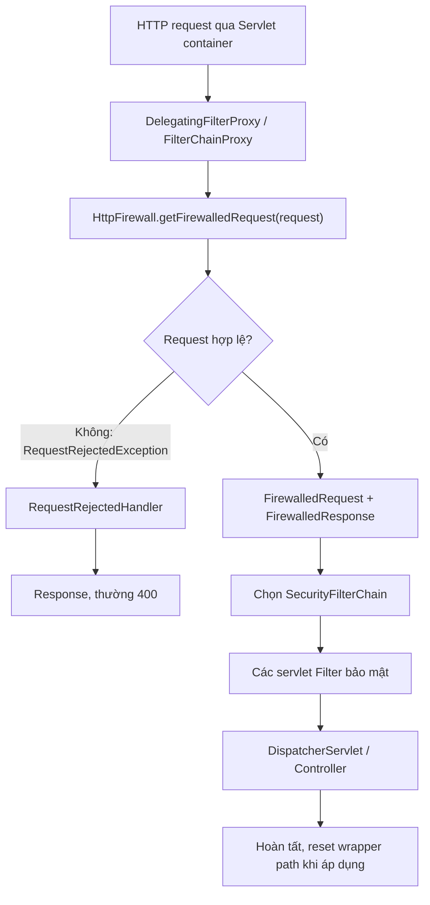
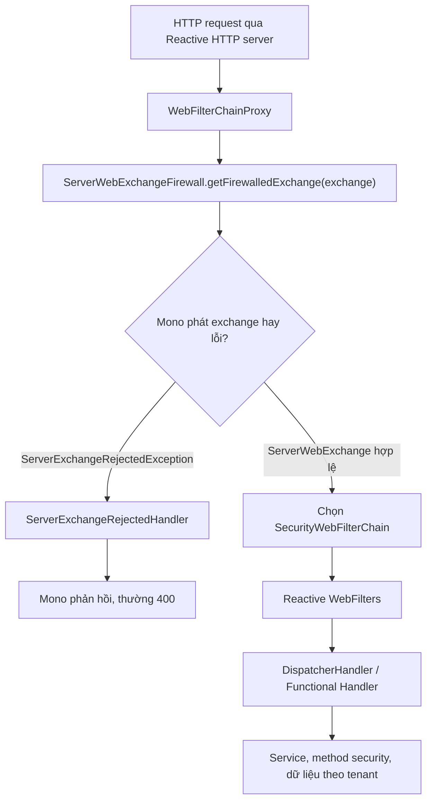

# Đối chiếu tùy chọn Reactive với tùy chọn Servlet

## 1. Bài toán: chuyển cấu hình firewall từ Spring MVC sang WebFlux

Một nhóm phát triển đang chuyển ứng dụng Spring MVC/Servlet sang Spring WebFlux. Ứng dụng bảo vệ API `/api/**`, trang quản trị `/admin/**` và tài nguyên công khai `/public/**`. Trong phiên bản Servlet, nhóm từng tùy chỉnh `StrictHttpFirewall` để giới hạn HTTP methods, không cho phép matrix variables và xử lý request bị từ chối với status HTTP 400. Khi chuyển sang Reactive, một thành viên chỉ đổi tên class rồi giữ nguyên toàn bộ imports, types và cách xử lý exception.

Kết quả có thể là:

- Code không biên dịch vì `setAllowedHttpMethods(...)` nhận **kiểu phần tử khác nhau**;
- Bean `StrictHttpFirewall` vẫn được tạo nhưng **không có tác dụng** với `WebFilterChainProxy`;
- Handler bắt `RequestRejectedException` không nhận `ServerExchangeRejectedException`;
- Unit test Servlet vẫn pass, nhưng HTTP server Reactive/gateway lại chuẩn hóa hoặc từ chối URL theo cách khác;
- Một URL hợp lệ không match bất kỳ `SecurityWebFilterChain` nào đi tiếp tới handler mà thiếu security filters mong muốn;
- CORS preflight `OPTIONS` hoặc thao tác `HEAD` bị chặn vì method allowlist được sao chép không đủ.

Bài này nằm trong chương **Firewall trên Reactive** của mô-đun **SPRING_SECURITY_HTTP_PROTECTION**. Phạm vi mô-đun là xây dựng các lớp phòng vệ HTTP/trình duyệt trong Spring Security, gồm CSRF, CORS, security headers, CSP, HSTS, HTTP firewall và bảo vệ session; học viên làm việc với cả **Servlet** và **Reactive**, kiểm thử tình huống tấn công web và chẩn đoán xung đột khi triển khai.

Chủ đề cụ thể **“Đối chiếu tùy chọn Reactive với tùy chọn Servlet”** không chỉ liệt kê hai class gần tên nhau. Mục tiêu là hiểu điểm tương đồng về **chính sách bảo mật**, điểm khác về **hợp đồng API và luồng runtime**, rồi biết cách chuyển đổi cấu hình mà không vô tình nới lỏng bảo vệ.

### Kết quả học tập

Sau bài, bạn có thể:

1. Lập bảng ánh xạ đúng giữa `StrictHttpFirewall`/`HttpFirewall` (Servlet) và `StrictServerWebExchangeFirewall`/`ServerWebExchangeFirewall` (Reactive).
2. Giải thích khác biệt giữa `FilterChainProxy` + servlet `Filter` và `WebFilterChainProxy` + `WebFilter`.
3. Chuyển method allowlist từ `Collection<String>` sang `Collection<HttpMethod>` một cách chính xác.
4. Nhận diện các nhóm tùy chọn tương đồng: semicolon, encoded slash, backslash, encoded percent, hostname và predicate header/parameter.
5. So sánh `RequestRejectedHandler` với `ServerExchangeRejectedHandler` và các status handlers tương ứng.
6. Hiểu khác biệt giữa `FirewalledRequest`/`HttpServletResponse` và `Mono<ServerWebExchange>`.
7. Viết cả cấu hình và kiểm thử đúng stack bằng MockMvc/Servlet request mocks hoặc StepVerifier/WebTestClient.
8. Phân tích các bất biến bảo mật giữ nguyên khi chuyển stack: CORS, CSRF, authorization, service/tenant checks, proxy normalization, no-store và security headers.
9. Xây checklist di chuyển và regression test theo các tình huống request thực tế.

## 2. Bảng ánh xạ API cốt lõi

| Vai trò | Servlet / Spring MVC | Reactive / Spring WebFlux |
| --- | --- | --- |
| Firewall contract | `HttpFirewall` | `ServerWebExchangeFirewall` |
| Triển khai strict | `StrictHttpFirewall` | `StrictServerWebExchangeFirewall` |
| Package | `org.springframework.security.web.firewall` | `org.springframework.security.web.server.firewall` |
| Security proxy | `FilterChainProxy` | `WebFilterChainProxy` |
| Chuỗi bảo mật | `SecurityFilterChain` | `SecurityWebFilterChain` |
| DSL cấu hình | `HttpSecurity` | `ServerHttpSecurity` |
| Bộ lọc | Servlet `Filter`, `OncePerRequestFilter` | Reactive `WebFilter` |
| HTTP request | `HttpServletRequest` | `ServerWebExchange` / `ServerHttpRequest` |
| HTTP response | `HttpServletResponse` | `ServerHttpResponse` |
| Khi firewall chấp nhận | `FirewalledRequest`/response wrapper | `Mono<ServerWebExchange>` |
| Khi firewall từ chối | `RequestRejectedException` | `ServerExchangeRejectedException` |
| Handler từ chối | `RequestRejectedHandler` | `ServerExchangeRejectedHandler` |
| Handler đơn giản trả status | `HttpStatusRequestRejectedHandler` | `HttpStatusExchangeRejectedHandler` |
| Công cụ test phù hợp | `MockHttpServletRequest`, `MockMvc` | `MockServerWebExchange`, `StepVerifier`, `WebTestClient` |
| Runtime HTTP thường gặp | Tomcat, Jetty hoặc Servlet container | Reactor Netty hoặc Reactive HTTP server |
| Cấu hình mặc định | Strict implementation thường được dùng | Strict implementation thường được dùng |

**Quan trọng:** Hai cơ chế phục vụ cùng mục tiêu nhưng **không implement interface của nhau**. Bean Servlet không trở thành Bean Reactive chỉ vì cùng tên “firewall”.

### 2.1. Kiểu import đúng

```java
// Servlet:
import org.springframework.security.web.firewall.HttpFirewall;
import org.springframework.security.web.firewall.StrictHttpFirewall;
import org.springframework.security.web.firewall.RequestRejectedException;
import org.springframework.security.web.firewall.RequestRejectedHandler;

// Reactive:
import org.springframework.security.web.server.firewall.ServerWebExchangeFirewall;
import org.springframework.security.web.server.firewall.StrictServerWebExchangeFirewall;
import org.springframework.security.web.server.firewall.ServerExchangeRejectedException;
import org.springframework.security.web.server.firewall.ServerExchangeRejectedHandler;
```

Một IDE có thể auto-import class gần tên; luôn kiểm tra **package** trước khi tin rằng Bean đang được Spring Security sử dụng.

### 2.2. Phiên bản không hoàn toàn đối xứng

Javadoc nhánh Spring Security 6.5.x ghi `StrictServerWebExchangeFirewall` có mốc **Since 6.4** theo class chính. `StrictHttpFirewall` của Servlet có lịch sử lâu hơn (`Since 4.2.4` trong Javadoc nhánh 6.4). Một số API/nhánh bảo trì có backport; vì vậy cần đối chiếu **đúng phiên bản dependency đã resolve**, không suy từ Spring Boot version hoặc số chữ số của class.

| Trường hợp | Điều cần làm |
| --- | --- |
| Dự án Servlet trên 5.x/6.0–6.3 | Đối chiếu `StrictHttpFirewall` đúng version; không copy hướng dẫn Reactive 6.5 |
| Dự án Reactive 6.4+ | Kiểm tra `ServerWebExchangeFirewall` và chữ ký setters trong jar |
| Dự án nâng lên 7.x | Kiểm tra `HttpMethod`, API deprecations, SecurityFilterChain DSL và integration tests |
| Boot có cả starter Web MVC và WebFlux | Xác định **application type thật**; không suy từ dependency |
| Lỗi import nhưng code “trông giống nhau” | Kiểm tra module `spring-security-web`, `spring-security-config` và đúng stack |

## 3. Hai luồng xử lý: giống mục đích, khác hợp đồng

### 3.1. Luồng Servlet



`HttpFirewall` có hai phương thức chính:

```java
FirewalledRequest getFirewalledRequest(
    HttpServletRequest request)
    throws RequestRejectedException;

HttpServletResponse getFirewalledResponse(
    HttpServletResponse response);
```

`FilterChainProxy` dùng request đã kiểm tra/bọc để chọn security chain. Với implementation mặc định, các giá trị liên quan `servletPath`/`pathInfo` có thể được tạm điều chỉnh để matching nhất quán và được khôi phục qua `FirewalledRequest.reset()` sau khi chuỗi filter xử lý. Đây là **đặc điểm Servlet** không nên sao chép nguyên thành API Reactive.

### 3.2. Luồng Reactive



`ServerWebExchangeFirewall` có phương thức:

```java
Mono<ServerWebExchange> getFirewalledExchange(
    ServerWebExchange exchange);
```

Với request bị reject, publisher phát `ServerExchangeRejectedException`. `WebFilterChainProxy` xử lý lỗi loại này bằng `ServerExchangeRejectedHandler`. Không có cặp `getFirewalledRequest()/getFirewalledResponse()` trả trực tiếp request/response kiểu Servlet.

### 3.3. Sự khác biệt ảnh hưởng việc viết extension

| Câu hỏi | Servlet | Reactive |
| --- | --- | --- |
| Request đang được kiểm tra là gì? | `HttpServletRequest` | `ServerWebExchange` |
| Trả giá trị hợp lệ bằng cách nào? | `FirewalledRequest` đồng bộ | `Mono<ServerWebExchange>` |
| Báo từ chối bằng gì? | `throw RequestRejectedException` | `Mono.error(ServerExchangeRejectedException)` |
| Handler phản hồi | `void handle(request, response, exception)` | `Mono<Void> handle(exchange, exception)` |
| Response được bọc tại firewall? | Interface có `getFirewalledResponse` | Exchange chứa request và response |
| Thay đổi path sau security matching? | `FirewalledRequest.reset()` ở luồng proxy | Không có API reset trực tiếp tương đương |
| Quản lý bất đồng bộ | Servlet container/async request nếu dùng | Reactor publisher và event loop |

**Không coi “Reactive = thêm Mono quanh Servlet filter” là cách chuyển đổi đúng.** Cần viết theo `ServerWebExchange`, không block event loop và không gọi `subscribe()` thủ công.

## 4. Tùy chọn HTTP method: khác biệt kiểu tham số là điểm dễ lỗi nhất

Cả hai strict implementations mặc định cho phép:

```text
DELETE, GET, HEAD, OPTIONS, PATCH, POST, PUT
```

Hai bên đều có `setUnsafeAllowAnyHttpMethod(true)` nhưng đó là lựa chọn nguy hiểm: tắt validation HTTP method, có thể mở rủi ro HTTP Verb Tampering và Cross-Site Tracing. Không dùng chỉ để khắc phục một client legacy.

### 4.1. Servlet: `Collection<String>`

Javadoc `StrictHttpFirewall` có:

```java
void setAllowedHttpMethods(Collection<String> allowedHttpMethods);
```

Ví dụ Bean Servlet giới hạn GET, HEAD, POST và OPTIONS:

```java
import java.util.List;

import org.springframework.context.annotation.Bean;
import org.springframework.context.annotation.Configuration;
import org.springframework.security.web.firewall.HttpFirewall;
import org.springframework.security.web.firewall.StrictHttpFirewall;

@Configuration
class ServletFirewallConfiguration {

    @Bean
    HttpFirewall httpFirewall() {
        var firewall = new StrictHttpFirewall();
        firewall.setAllowedHttpMethods(
            List.of("GET", "HEAD", "POST", "OPTIONS"));
        return firewall;
    }
}
```

Tên method là **chuỗi phân biệt hoa/thường** theo hợp đồng. Đừng dùng `"get"` và mặc định nó được coi như `"GET"`.

### 4.2. Reactive: `Collection<HttpMethod>`

Javadoc `StrictServerWebExchangeFirewall` nhánh 6.5.x/7.x có:

```java
void setAllowedHttpMethods(Collection<HttpMethod> allowedHttpMethods);
```

Ví dụ tương đương trong WebFlux:

```java
import java.util.List;

import org.springframework.context.annotation.Bean;
import org.springframework.context.annotation.Configuration;
import org.springframework.http.HttpMethod;
import org.springframework.security.web.server.firewall.StrictServerWebExchangeFirewall;

@Configuration
class ReactiveFirewallConfiguration {

    @Bean
    StrictServerWebExchangeFirewall serverWebExchangeFirewall() {
        var firewall = new StrictServerWebExchangeFirewall();
        firewall.setAllowedHttpMethods(List.of(
            HttpMethod.GET,
            HttpMethod.HEAD,
            HttpMethod.POST,
            HttpMethod.OPTIONS
        ));
        return firewall;
    }
}
```

Điểm khác không phải tên setter, mà là **kiểu phần tử của Collection**: Servlet dùng `String`, Reactive dùng `org.springframework.http.HttpMethod` ở version nêu trên.

### 4.3. Bảng chuyển đổi phương thức

| Yêu cầu | Servlet | Reactive |
| --- | --- | --- |
| Chỉ GET và POST | `List.of("GET", "POST")` | `List.of(HttpMethod.GET, HttpMethod.POST)` |
| Có CORS preflight | Thêm `"OPTIONS"` | Thêm `HttpMethod.OPTIONS` |
| Có HEAD cho metadata | Thêm `"HEAD"` | Thêm `HttpMethod.HEAD` |
| Extension `PROPFIND` | Thêm `"PROPFIND"` | Thêm `HttpMethod.valueOf("PROPFIND")` |
| Chặn TRACE | Không đưa `"TRACE"` vào allowlist | Không đưa `HttpMethod.TRACE` vào allowlist |
| Mở mọi method | `setUnsafeAllowAnyHttpMethod(true)`, **tránh** | `setUnsafeAllowAnyHttpMethod(true)`, **tránh** |

**Lưu ý:** Một vài ví dụ trong trang reference Reactive còn hiển thị `List<String>`. Đối chiếu **Javadoc của jar** khi compile; không đưa chuỗi vào nơi API hiện tại yêu cầu `Collection<HttpMethod>`.

### 4.4. Chặn method không phải chặn quyền

Nếu firewall cho phép `DELETE`, không có nghĩa user được xóa. Sau firewall cần `authorizeHttpRequests`/`authorizeExchange` hoặc method security, và service cần kiểm tra owner/tenant.

Nếu firewall **không cho** `PUT`, một controller `@PutMapping` hợp lệ vẫn không được gọi. Ngược lại, nếu method được cho qua nhưng controller không hỗ trợ, WebFlux/Spring MVC có thể trả **405**, không phải firewall rejection.

## 5. Tùy chọn URL: những setter tương tự không có nghĩa runtime giống nhau

Cả hai strict classes cung cấp các biện pháp liên quan URL normalization, separator, encoded symbols và control characters. Những tên setter dưới đây là các **cặp tương ứng thường gặp** trong Javadoc 6.5.x/7.x:

| Quy tắc URL | Servlet `StrictHttpFirewall` | Reactive `StrictServerWebExchangeFirewall` | Khuyến nghị |
| --- | --- | --- | --- |
| Semicolon/matrix variables | `setAllowSemicolon(boolean)` | `setAllowSemicolon(boolean)` | Mặc định false; chỉ nới sau test matcher/router |
| Encoded slash `%2F` | `setAllowUrlEncodedSlash(boolean)` | `setAllowUrlEncodedSlash(boolean)` | Giữ false, ưu tiên opaque ID |
| Encoded double slash `%2F%2F` | `setAllowUrlEncodedDoubleSlash(boolean)` | `setAllowUrlEncodedDoubleSlash(boolean)` | Giữ false |
| Encoded period `%2E` | `setAllowUrlEncodedPeriod(boolean)` | `setAllowUrlEncodedPeriod(boolean)` | Giữ false; traversal risk |
| Encoded percent `%25` | `setAllowUrlEncodedPercent(boolean)` | `setAllowUrlEncodedPercent(boolean)` | Giữ false; double decoding |
| Backslash hoặc `%5C` | `setAllowBackSlash(boolean)` | `setAllowBackSlash(boolean)` | Giữ false |
| Null/`%00` | `setAllowNull(boolean)` | `setAllowNull(boolean)` | Giữ false |
| Encoded CR `%0D` | `setAllowUrlEncodedCarriageReturn(boolean)` | `setAllowUrlEncodedCarriageReturn(boolean)` | Giữ false |
| Encoded LF `%0A` | `setAllowUrlEncodedLineFeed(boolean)` | `setAllowUrlEncodedLineFeed(boolean)` | Giữ false |
| Encoded line separator | `setAllowUrlEncodedLineSeparator(boolean)` | `setAllowUrlEncodedLineSeparator(boolean)` | Giữ false |
| Encoded paragraph separator | `setAllowUrlEncodedParagraphSeparator(boolean)` | `setAllowUrlEncodedParagraphSeparator(boolean)` | Giữ false |
| URL normalization | Strict validation | Strict validation | Không có công tắc tắt toàn bộ một cách an toàn |
| URL không in được | Strict validation | Strict validation | Không nới bằng cách bỏ firewall |

Bảng này mô tả **hướng đối chiếu**; nếu một setter khác tên hoặc không có ở phiên bản thực tế thì phải kiểm tra Javadoc tương ứng, không tạo method giả.

### 5.1. Khác biệt lớn nhất nằm ở đường đi trước firewall

Servlet:

```text
Client → CDN/proxy → Tomcat/Jetty Servlet parsing
       → HttpServletRequest (servletPath, pathInfo, requestURI)
       → StrictHttpFirewall → FilterChainProxy → DispatcherServlet
```

Reactive:

```text
Client → CDN/proxy → Reactor Netty HTTP parsing
       → ServerHttpRequest / RequestPath / ServerWebExchange
       → StrictServerWebExchangeFirewall → WebFilterChainProxy
       → DispatcherHandler / Functional Handler
```

Cả hai đều có thể được **HTTP server hoặc proxy chuẩn hóa/từ chối trước**, nhưng loại path abstraction khác nhau. Không nên kỳ vọng một test Servlet mô phỏng `getServletPath()` bao phủ cách WebFlux `RequestPath.pathWithinApplication()` phân tách segment.

### 5.2. Trường hợp semicolon

URL:

```text
/secure;mode=public/profile
/admin;role=user/users
/catalog;color=red/products
```

Semicolon có thể được parser/matcher/handler hiểu như path parameter. Cả hai strict firewalls mặc định từ chối. Khi nới:

```java
// Servlet:
StrictHttpFirewall servlet = new StrictHttpFirewall();
servlet.setAllowSemicolon(true);

// Reactive:
StrictServerWebExchangeFirewall reactive =
    new StrictServerWebExchangeFirewall();
reactive.setAllowSemicolon(true);
```

**Cấu hình tương tự không chứng minh kết quả matching tương đương.** ServletPath/pathInfo, WebFlux RequestPath, reverse proxy và framework router có thể xử lý khác nhau. Chạy negative tests cho **public/private/admin boundaries**, không chỉ test một URL matrix hợp lệ trả 200.

### 5.3. Trường hợp encoded slash

Một object key có dấu slash khiến client gửi:

```text
GET /files/team%2Ffinance%2Freport
```

Nếu mở `setAllowUrlEncodedSlash(true)` trong một stack, đừng tự động mở trong stack kia chỉ để giữ API cũ. Phải chứng minh decoder, matcher, handler và service giữ nhất quán. Giải pháp thường bền vững hơn là:

```text
GET /files/9be67517-32d3-4801-ab5d-8298d620c742
```

Sau đó service ánh xạ opaque ID thành storage key và kiểm tra quyền với chủ sở hữu. Không lấy raw path client gửi để nối thẳng vào đường dẫn filesystem.

### 5.4. Encoded percent và double decoding

`%25` có thể tạo `%` sau một lượt decode; một lượt tiếp theo có thể biến chuỗi `%252F` thành `%2F` rồi thành slash. Một số proxy decode nhiều hơn một tầng. Cả Servlet và WebFlux đều phải tránh tình huống **security matcher thấy URL A trong khi handler truy cập tài nguyên B**.

Không “khắc phục” bằng cách tự decode URL hai lần trong một filter rồi dùng kết quả này để authorization; cách xử lý có thể khác với router thực.

## 6. Header/parameter và host predicates: tương đồng về chữ ký, khác nơi nhận input

Những API hai strict classes đều cung cấp:

```java
setAllowedHeaderNames(Predicate<String>)
setAllowedHeaderValues(Predicate<String>)
setAllowedParameterNames(Predicate<String>)
setAllowedParameterValues(Predicate<String>)
setAllowedHostnames(Predicate<String>)
```

Tuy nhiên:

- Servlet nhận giá trị được Servlet container đưa qua `HttpServletRequest`.
- Reactive nhận giá trị được Reactive HTTP adapter/WebFlux đưa vào `ServerWebExchange`.
- HTTP server khác nhau có thể normalize/merge/lọc headers trước khi firewall đánh giá.
- Một predicate chỉ nhận **String** không tự biết đó là header nào hoặc route nào.
- Một method `setAllowedHeaderValues(Predicate<String>)` **không tự ngăn mọi duplicate header names**.
- Parameter values mặc định có thể **được phép hết** qua predicate tương ứng, nhưng handler/service vẫn phải validate.

### 6.1. Bảng defaults cần nhớ

| Dữ liệu | Servlet strict | Reactive strict | Nhiệm vụ bổ sung |
| --- | --- | --- | --- |
| Header names | Reject ISO controls/undefined code points | Tương tự | HTTP parser/field syntax |
| Header values | Reject ISO controls/undefined code points | Tương tự | Credential ambiguity, field-specific validation |
| Parameter names | Reject ISO controls/undefined code points | Tương tự | Query/form parser |
| Parameter values | Default predicate cho phép mọi giá trị | Default predicate cho phép mọi giá trị | Typed validation, max length, business constraints |
| Hostnames | Default predicate cho phép mọi host | Default predicate cho phép mọi host | Trusted proxy policy, host routing, tenant validation |

**Không suy rằng parameter values được firewall validate theo domain.** Query `?limit=abc` có thể được firewall chấp nhận nhưng phải bị validation từ chối nếu API cần số nguyên.

### 6.2. Giữ baseline khi thắt chặt

Servlet:

```java
import org.springframework.security.web.firewall.StrictHttpFirewall;

var firewall = new StrictHttpFirewall();
var baseline = StrictHttpFirewall.ALLOWED_HEADER_VALUES;
firewall.setAllowedHeaderValues(value ->
    value != null
    && baseline.test(value)
    && value.length() <= 8192);
```

Reactive:

```java
import org.springframework.security.web.server.firewall.StrictServerWebExchangeFirewall;

var firewall = new StrictServerWebExchangeFirewall();
var baseline = StrictServerWebExchangeFirewall.ALLOWED_HEADER_VALUES;
firewall.setAllowedHeaderValues(value ->
    value != null
    && baseline.test(value)
    && value.length() <= 8192);
```

Đây là **các trích đoạn minh họa, không phải hai Bean cùng được khai báo trong một app**. Đoạn này thêm giới hạn, nhưng `length()` đếm UTF-16 code units, không phải bytes của HTTP header. Phải tính đến JWT/cookie/trace headers dài hợp lệ và giới hạn HTTP parser/gateway. Trường hợp legacy encoding cần xử lý riêng, không dùng `value -> true` để tắt validation hàng loạt.

### 6.3. Duplicate Authorization và query values

Ví dụ:

```http
GET /api/reports?tenant=red&tenant=blue HTTP/1.1
Authorization: Bearer token-A
authorization: Bearer token-B
```

HTTP header names **không phân biệt hoa/thường**, nhưng số field values và cách proxy merge khác nhau theo field semantics. Một ứng dụng bearer-only thường phải **từ chối credential mơ hồ**, không chọn first/last tùy ý. Query `tenant` nếu là scalar phải yêu cầu **đúng một giá trị**; `tag` có thể hỗ trợ multiple values theo API contract.

Những yêu cầu này thuộc **request validation/authentication/tenant authorization** có context, không được bảo đảm chỉ bằng `setAllowedHeaderNames` hoặc `setAllowedParameterValues`.

### 6.4. HTTP framing là trách nhiệm sớm hơn cả hai firewalls

`Content-Length` và `Transfer-Encoding` có semantics về request message framing trong HTTP/1.1. Nếu proxy/backend parse khác nhau, có thể có request smuggling. Servlet filter và WebFlux WebFilter thường nhận request **đã được HTTP parser xử lý**; một predicate trên chuỗi header không thay thế cấu hình proxy/Netty/Tomcat theo RFC 9112.

## 7. Encoded/decoded URL blocklists và các API mở rộng

Cả hai strict implementations có các API liên quan encoded/decoded URL blocklists. Ví dụ tên method ở các nhánh tài liệu tương ứng:

```java
getEncodedUrlBlocklist()
getDecodedUrlBlocklist()
```

Đừng tự xóa các entry trong blocklist để chấp nhận URL legacy mà không hiểu toàn bộ đường parsing. Một setter cụ thể như `setAllowSemicolon(true)` đã cần threat model; sửa trực tiếp blocklist còn dễ gây phụ thuộc vào biểu diễn nội bộ.

### 7.1. Khác biệt không nên bỏ qua

- Servlet `HttpFirewall` có `getFirewalledRequest(...)` và `getFirewalledResponse(...)`; `FirewalledRequest` là request wrapper có `reset()` liên quan path matching.
- Reactive `ServerWebExchangeFirewall` tập trung vào `getFirewalledExchange(...)` dạng Reactor publisher; không có request/response pair giống Servlet.
- Các default blocklist có thể được điều chỉnh qua từng phiên bản; **đừng so số lượng entry** rồi kết luận tương đương tuyệt đối.
- Một path test bị chặn ở Tomcat nhưng đến được Netty không chứng minh Reactive firewall kém an toàn; cần biết **rule/tầng nào từ chối** và route authorization có an toàn hay không.

### 7.2. Khi muốn có ngoại lệ URL thật sự

Ưu tiên theo thứ tự:

1. Sửa API/URI design (opaque identifier, query parameter hợp lệ).
2. Sửa client/proxy normalization để thống nhất.
3. Chỉ khi thật cần, nới **một setter** có mô tả rủi ro và test.
4. Duy trì authorization ở route/service, không tin một URL “được firewall cho qua”.
5. Chạy regression qua **origin và reverse proxy**, không chỉ test mock.
6. Có ngày rà soát và rollback nếu ngoại lệ tạm thời.

## 8. Xử lý request bị từ chối: hai handler khác kiểu hoàn toàn

### 8.1. Servlet

`RequestRejectedHandler`:

```java
void handle(
    HttpServletRequest request,
    HttpServletResponse response,
    RequestRejectedException exception
) throws IOException, ServletException;
```

Một implementation có status:

```java
new HttpStatusRequestRejectedHandler();    // HTTP 400
new HttpStatusRequestRejectedHandler(404); // HTTP 404
```

`FilterChainProxy` có `setRequestRejectedHandler(RequestRejectedHandler)`. Handler mặc định thường trả **HTTP 400** trong integration hiện đại; nếu dùng version/config custom, hãy xác minh lại.

### 8.2. Reactive

`ServerExchangeRejectedHandler`:

```java
Mono<Void> handle(
    ServerWebExchange exchange,
    ServerExchangeRejectedException exception
);
```

Status implementation:

```java
new HttpStatusExchangeRejectedHandler(); // HTTP 400
new HttpStatusExchangeRejectedHandler(HttpStatus.NOT_FOUND); // HTTP 404
```

`WebFilterChainProxy` có `setExchangeRejectedHandler(ServerExchangeRejectedHandler)`. Handler không được `subscribe()` thủ công; Spring/WebFlux quản lý publisher.

### 8.3. Bảng chuyển đổi nhanh

| Cần làm | Servlet | Reactive |
| --- | --- | --- |
| Exception bị reject | `RequestRejectedException` | `ServerExchangeRejectedException` |
| Handler interface | `RequestRejectedHandler` | `ServerExchangeRejectedHandler` |
| Trả status 404 | `new HttpStatusRequestRejectedHandler(404)` | `new HttpStatusExchangeRejectedHandler(HttpStatus.NOT_FOUND)` |
| Kiểu return handler | `void` | `Mono<Void>` |
| Request argument | `HttpServletRequest` | `ServerWebExchange` |
| Response argument | `HttpServletResponse` | Lấy từ `exchange.getResponse()` |
| Proxy setter | `setRequestRejectedHandler(...)` | `setExchangeRejectedHandler(...)` |
| Có thể bị parser/proxy từ chối trước không? | Có | Có |

**Không đem `@ControllerAdvice` hoặc `@ExceptionHandler` của MVC sang thay cho rejection handler của firewall:** firewall thường reject trước khi controller được chọn. Ở Reactive cũng tương tự, global WebFlux exception handling không đương nhiên nhận exception đã bị `WebFilterChainProxy` xử lý.

## 9. Bean cấu hình Servlet: ví dụ đầy đủ và tách biệt

Cấu hình firewall và route authorization:

```java
import java.util.List;

import org.springframework.context.annotation.Bean;
import org.springframework.context.annotation.Configuration;
import org.springframework.http.HttpMethod;
import org.springframework.security.config.annotation.web.configuration.EnableWebSecurity;
import org.springframework.security.config.annotation.web.builders.HttpSecurity;
import org.springframework.security.web.SecurityFilterChain;
import org.springframework.security.web.firewall.HttpFirewall;
import org.springframework.security.web.firewall.StrictHttpFirewall;

@Configuration
@EnableWebSecurity
class ServletApiSecurityConfiguration {

    @Bean
    HttpFirewall httpFirewall() {
        var firewall = new StrictHttpFirewall();
        firewall.setAllowedHttpMethods(
            List.of("GET", "HEAD", "POST", "OPTIONS"));
        return firewall;
    }

    @Bean
    SecurityFilterChain securityFilterChain(HttpSecurity http)
            throws Exception {
        return http
            .authorizeHttpRequests(auth -> auth
                .requestMatchers(HttpMethod.GET, "/public/ping")
                    .permitAll()
                .requestMatchers("/api/**")
                    .authenticated()
                .requestMatchers("/admin/**")
                    .hasRole("ADMIN")
                .anyRequest().denyAll())
            .build();
    }
}
```

Đây là một **cấu hình minh họa** cho Spring Security Servlet hiện đại, không phải toàn bộ policy production. Cần thêm authentication mechanism (session, bearer token...), CORS, CSRF, security headers, method security và business authorization theo ứng dụng.

### 9.1. Ý nghĩa khi request đến

- `GET /public/ping` có thể tới handler công khai.
- `PUT /api/documents/42` bị firewall chặn vì PUT không có trong allowlist tùy chỉnh.
- `POST /api/documents` được firewall cho qua về method, nhưng còn phải qua CSRF/authn/authz.
- `OPTIONS` được phép về method; browser vẫn cần CORS policy đúng.
- `/admin/**` chỉ role ADMIN; đây là authorization, **không phải firewall setter**.

Một Bean `HttpFirewall` được Spring Security Servlet sử dụng khi được hạ tầng cấu hình tự động phù hợp. Nếu bạn tự xây `FilterChainProxy` thì cần cấu hình proxy đúng instance; không nên tự thêm một proxy trùng lặp.

## 10. Bean cấu hình Reactive: phiên bản tương đương

```java
import java.util.List;

import org.springframework.context.annotation.Bean;
import org.springframework.context.annotation.Configuration;
import org.springframework.http.HttpMethod;
import org.springframework.security.config.annotation.web.reactive.EnableWebFluxSecurity;
import org.springframework.security.config.web.server.ServerHttpSecurity;
import org.springframework.security.web.server.SecurityWebFilterChain;
import org.springframework.security.web.server.firewall.StrictServerWebExchangeFirewall;

@Configuration
@EnableWebFluxSecurity
class ReactiveApiSecurityConfiguration {

    @Bean
    StrictServerWebExchangeFirewall serverWebExchangeFirewall() {
        var firewall = new StrictServerWebExchangeFirewall();
        firewall.setAllowedHttpMethods(List.of(
            HttpMethod.GET,
            HttpMethod.HEAD,
            HttpMethod.POST,
            HttpMethod.OPTIONS
        ));
        return firewall;
    }

    @Bean
    SecurityWebFilterChain securityWebFilterChain(ServerHttpSecurity http) {
        return http
            .authorizeExchange(auth -> auth
                .pathMatchers(HttpMethod.GET, "/public/ping")
                    .permitAll()
                .pathMatchers("/api/**")
                    .authenticated()
                .pathMatchers("/admin/**")
                    .hasRole("ADMIN")
                .anyExchange().denyAll())
            .build();
    }
}
```

Bài học ở đây không phải đổi mọi `requestMatchers` thành `pathMatchers` theo máy móc, mà là hiểu framework:

- Servlet: `HttpSecurity`, `SecurityFilterChain`, `FilterChainProxy`, Servlet filters.
- Reactive: `ServerHttpSecurity`, `SecurityWebFilterChain`, `WebFilterChainProxy`, reactive WebFilters.
- Firewall Bean: **khác class và khác method element type**.
- Authentication/token/session: phải cấu hình lại theo stack.
- `anyRequest().denyAll()` và `anyExchange().denyAll()` giữ **ý tưởng default-deny** nhưng khác DSL.

### 10.1. Không đặt cả hai cấu hình vào cùng context để “dự phòng”

Nếu ứng dụng thật chạy WebFlux Security, Bean `StrictHttpFirewall` không thay Bean `StrictServerWebExchangeFirewall`. Nếu ứng dụng chạy Servlet, Bean Reactive có thể không tham gia filter chain. Nên xác định runtime rõ ràng, không khai báo cả hai chỉ vì module có dependency cho cả MVC và WebFlux.

Spring Boot có cả `spring-boot-starter-web` và `spring-boot-starter-webflux` có thể auto-detect **Servlet** là ứng dụng web chính. Luôn kiểm tra application type, beans/proxy và test thực tế.

## 11. Bean rejected handler: hai cấu hình tương đương về hành vi

### 11.1. Servlet — trả 404 cho request firewall reject

```java
import org.springframework.context.annotation.Bean;
import org.springframework.context.annotation.Configuration;
import org.springframework.security.web.firewall.HttpStatusRequestRejectedHandler;
import org.springframework.security.web.firewall.RequestRejectedHandler;

@Configuration
class ServletRejectionConfiguration {

    @Bean
    RequestRejectedHandler requestRejectedHandler() {
        return new HttpStatusRequestRejectedHandler(404);
    }
}
```

### 11.2. Reactive — trả 404 cho request firewall reject

```java
import org.springframework.context.annotation.Bean;
import org.springframework.context.annotation.Configuration;
import org.springframework.http.HttpStatus;
import org.springframework.security.web.server.firewall.HttpStatusExchangeRejectedHandler;
import org.springframework.security.web.server.firewall.ServerExchangeRejectedHandler;

@Configuration
class ReactiveRejectionConfiguration {

    @Bean
    ServerExchangeRejectedHandler serverExchangeRejectedHandler() {
        return new HttpStatusExchangeRejectedHandler(HttpStatus.NOT_FOUND);
    }
}
```

Hai Bean ở hai ví dụ phục vụ **hai ứng dụng/stack khác nhau**. Không copy class của bên này vào bên kia. Nếu không có lý do đổi status, để handler mặc định **400**; không cần Bean custom.

### 11.3. Khi API cần JSON lỗi

Với cả hai stack, body lỗi nên **ổn định và không phản chiếu raw URI, header hoặc exception message**. Nếu dùng JSON/Problem Details, set Content-Type chính xác, `Cache-Control: no-store` nếu phù hợp và cân nhắc `X-Content-Type-Options: nosniff` trên response tạo trước security chain.

Khác biệt triển khai:

- Servlet có thể gọi `response.setStatus(...)`/`response.getWriter()` theo lifecycle Servlet; cần xử lý encoding và response committed.
- Reactive cần `exchange.getResponse().writeWith(Publisher<DataBuffer>)` hoặc `setComplete()` và trả `Mono<Void>`, không gọi blocking IO hay `subscribe()`.
- `HEAD` không gửi response body; cần kiểm thử nếu custom handler có body.
- Một response bị firewall reject sớm có thể **chưa đi qua selected security chain**, nên response security headers do chain thêm không được tự suy là hiện diện. Kiểm tra response cuối qua proxy/TLS terminator.

## 12. Nhiều security chains: điểm giống nhau rất dễ bị bỏ qua

Cả Servlet `FilterChainProxy` và Reactive `WebFilterChainProxy` chọn **security chain phù hợp đầu tiên**. Firewall thường kiểm tra request trước khi chọn chain. Khi **không có chain match**, request có thể được delegate đến chain gốc **không qua security filters của selected chain**.

Ví dụ kiến trúc có:

```text
Chain #1: /api/**       (JWT/bearer)
Chain #2: /admin/**     (role ADMIN)
Chain #3: remainder     (public allowlist + denyAll)
```

Nếu thiếu chain #3, một URL hợp lệ về HTTP shape ở ngoài hai vùng có thể không được bảo vệ đúng. **Firewall không tự động biến mọi URL không match thành 403.**

### 12.1. Cách cấu hình mỗi DSL

Servlet:

```java
// Trong SecurityFilterChain được chọn:
http.authorizeHttpRequests(auth -> auth
    .requestMatchers("/public/**").permitAll()
    .requestMatchers("/api/**").authenticated()
    .anyRequest().denyAll());
```

Reactive:

```java
// Trong SecurityWebFilterChain được chọn:
http.authorizeExchange(auth -> auth
    .pathMatchers("/public/**").permitAll()
    .pathMatchers("/api/**").authenticated()
    .anyExchange().denyAll());
```

Đây là **snippet trong cấu hình**, không phải bean độc lập có thể paste không chỉnh sửa. Đặc biệt, `anyRequest().denyAll()` bên trong một chain chỉ áp khi chain đó được **securityMatcher** bao phủ; nếu không có chain match, rule không chạy. Áp dụng nguyên tắc tương tự với `anyExchange()`.

### 12.2. Bảo vệ theo đối tượng là bắt buộc

Cùng một path chuẩn `GET /api/documents/42` có thể được firewall cho phép ở cả hai stack, nhưng Alice và Bob vẫn phải bị phân quyền theo owner/tenant. Hãy đặt kiểm tra tại service/method/repository và dùng principal thật, không tin user ID hoặc tenant trong query/header do client tự chọn.

## 13. CORS, CSRF, session và security response headers: chính sách giống nhau, integration khác

| Nhu cầu | Servlet | Reactive | Điều giữ nguyên |
| --- | --- | --- | --- |
| CORS | Servlet CORS integration, `HttpSecurity.cors(...)` | Reactive CORS integration, `ServerHttpSecurity.cors(...)` | OPTIONS phải qua method firewall nếu dùng preflight |
| CSRF | `CsrfFilter` và Servlet CSRF support | `CsrfWebFilter` và Reactive CSRF support | State-changing request dùng cookie/session cần đánh giá CSRF |
| Session | `HttpSession`, Servlet security context | `WebSession`/Reactive SecurityContext | Cookie flags, logout, fixation/concurrency theo khả năng stack |
| HSTS | HTTP response header chain hoặc edge | HTTP response header chain hoặc edge | Chỉ bật khi HTTPS/topology phù hợp |
| CSP/nosniff | Servlet headers config | Reactive headers config | Content-Type đúng, tránh reflection |
| Cache-Control | Servlet response headers | Reactive response headers | `no-store` cho dữ liệu riêng tư và logout-sensitive responses |
| CORS error response | Có thể bị reject trước filters | Có thể bị reject trước selected chain | Nếu browser cần đọc lỗi, phải có policy outer/edge đúng |
| Authentication method-specific | URL rules và method security | Exchange rules và Reactive method security | Không coi method firewall allowlist là cấp quyền |

Không chuyển một chức năng sang WebFlux rồi tự động tắt CSRF vì “API đã Reactive”. Quyết định phụ thuộc **credential transport**, browser threat model và thao tác trạng thái, không phụ thuộc stack.

## 14. Kiểm thử Servlet ở cấp firewall

Test này kiểm tra class `StrictHttpFirewall` thật, độc lập với servlet container/MockMvc:

```java
import static org.junit.jupiter.api.Assertions.assertDoesNotThrow;
import static org.junit.jupiter.api.Assertions.assertThrows;

import java.util.List;

import org.junit.jupiter.api.Test;
import org.springframework.mock.web.MockHttpServletRequest;
import org.springframework.security.web.firewall.RequestRejectedException;
import org.springframework.security.web.firewall.StrictHttpFirewall;

class ServletFirewallTest {

    private StrictHttpFirewall restrictedFirewall() {
        var firewall = new StrictHttpFirewall();
        firewall.setAllowedHttpMethods(
            List.of("GET", "HEAD", "POST", "OPTIONS"));
        return firewall;
    }

    @Test
    void getIsAccepted() {
        var request = new MockHttpServletRequest(
            "GET", "/public/ping");

        assertDoesNotThrow(() ->
            restrictedFirewall().getFirewalledRequest(request));
    }

    @Test
    void putIsRejectedByCustomMethodPolicy() {
        var request = new MockHttpServletRequest(
            "PUT", "/public/ping");

        assertThrows(RequestRejectedException.class, () ->
            restrictedFirewall().getFirewalledRequest(request));
    }

    @Test
    void traceIsRejected() {
        var request = new MockHttpServletRequest(
            "TRACE", "/public/ping");

        assertThrows(RequestRejectedException.class, () ->
            restrictedFirewall().getFirewalledRequest(request));
    }
}
```

Nếu test path semicolon/encoded URI, hãy đảm bảo `MockHttpServletRequest` giữ đúng các giá trị như `requestURI`, `servletPath`/`pathInfo` theo test fixture; Mock HTTP servlet request có thể không tái hiện đầy đủ container parsing.

## 15. Kiểm thử Reactive ở cấp firewall bằng StepVerifier

```java
import static org.junit.jupiter.api.Assertions.assertEquals;

import java.util.List;
import org.junit.jupiter.api.Test;
import org.springframework.http.HttpMethod;
import org.springframework.mock.http.server.reactive.MockServerHttpRequest;
import org.springframework.mock.web.server.MockServerWebExchange;
import org.springframework.security.web.server.firewall.ServerExchangeRejectedException;
import org.springframework.security.web.server.firewall.StrictServerWebExchangeFirewall;
import reactor.test.StepVerifier;

class ReactiveFirewallTest {

    private StrictServerWebExchangeFirewall restrictedFirewall() {
        var firewall = new StrictServerWebExchangeFirewall();
        firewall.setAllowedHttpMethods(List.of(
            HttpMethod.GET, HttpMethod.HEAD,
            HttpMethod.POST, HttpMethod.OPTIONS));
        return firewall;
    }

    @Test
    void getIsAccepted() {
        var exchange = MockServerWebExchange.from(
            MockServerHttpRequest.get("/public/ping").build());

        StepVerifier.create(
            restrictedFirewall().getFirewalledExchange(exchange))
            .assertNext(accepted ->
                assertEquals(HttpMethod.GET,
                    accepted.getRequest().getMethod()))
            .verifyComplete();
    }

    @Test
    void putIsRejectedByCustomMethodPolicy() {
        var exchange = MockServerWebExchange.from(
            MockServerHttpRequest
                .method(HttpMethod.PUT, "/public/ping")
                .build());

        StepVerifier.create(
            restrictedFirewall().getFirewalledExchange(exchange))
            .expectError(ServerExchangeRejectedException.class)
            .verify();
    }

    @Test
    void traceIsRejected() {
        var exchange = MockServerWebExchange.from(
            MockServerHttpRequest
                .method(HttpMethod.TRACE, "/public/ping")
                .build());

        StepVerifier.create(
            restrictedFirewall().getFirewalledExchange(exchange))
            .expectError(ServerExchangeRejectedException.class)
            .verify();
    }
}
```

**Sự khác biệt của test không chỉ ở tên class:**

- Servlet dùng `assertThrows` khi `getFirewalledRequest(...)` trực tiếp ném exception.
- Reactive dùng `StepVerifier` để xác minh **onError terminal signal** của `Mono`.
- Không gọi `getFirewalledExchange(...)` rồi `try/catch` đồng bộ để kết luận mọi lỗi đã được bắt: lỗi có thể chỉ phát khi subscription diễn ra.

### 15.1. Mock nào có thể làm mất raw path?

Một URI builder, mock Servlet request, `MockServerHttpRequest` hoặc HTTP client có thể normalize `..`/`//` hoặc percent-encoding trước khi firewall nhìn thấy. Với raw path ambiguity, **test xuyên HTTP server/proxy** quan trọng hơn việc cố ép mock tạo input không hợp lệ. Không đưa ra kết luận phổ quát từ một mock test nếu raw representation đã bị đổi.

## 16. MockMvc và WebTestClient: hai công cụ integration khác nhau

### 16.1. Servlet — MockMvc test

Giả định ứng dụng có Bean `HttpFirewall` hạn chế GET/HEAD/POST/OPTIONS theo mục 9:

```java
import org.junit.jupiter.api.Test;
import org.springframework.beans.factory.annotation.Autowired;
import org.springframework.boot.test.autoconfigure.web.servlet.AutoConfigureMockMvc;
import org.springframework.boot.test.context.SpringBootTest;
import org.springframework.test.web.servlet.MockMvc;

import static org.springframework.test.web.servlet.request.MockMvcRequestBuilders.get;
import static org.springframework.test.web.servlet.request.MockMvcRequestBuilders.put;
import static org.springframework.test.web.servlet.result.MockMvcResultMatchers.status;

@SpringBootTest
@AutoConfigureMockMvc
class ServletFirewallIntegrationTest {

    @Autowired MockMvc mvc;

    @Test
    void publicGetWorks() throws Exception {
        mvc.perform(get("/public/ping"))
            .andExpect(status().isOk());
    }

    @Test
    void putIsRejectedByCustomFirewall() throws Exception {
        mvc.perform(put("/public/ping"))
            .andExpect(status().isBadRequest());
    }
}
```

**Điều kiện:** `/public/ping` có controller trả 200, Spring Security filters được áp vào MockMvc, Bean firewall thực sự được chọn, rejected handler trả 400. Nếu test chạy `standaloneSetup` mà bỏ `FilterChainProxy`, nó không xác minh firewall. Nếu có custom rejection handler 404, sửa assertion phù hợp.

### 16.2. Reactive — WebTestClient test

Giả định có Bean `StrictServerWebExchangeFirewall` hạn chế methods theo mục 10:

```java
import org.junit.jupiter.api.Test;
import org.springframework.beans.factory.annotation.Autowired;
import org.springframework.boot.test.autoconfigure.web.reactive.AutoConfigureWebTestClient;
import org.springframework.boot.test.context.SpringBootTest;
import org.springframework.test.web.reactive.server.WebTestClient;

@SpringBootTest
@AutoConfigureWebTestClient
class ReactiveFirewallIntegrationTest {

    @Autowired WebTestClient client;

    @Test
    void publicGetWorks() {
        client.get().uri("/public/ping")
            .exchange()
            .expectStatus().isOk();
    }

    @Test
    void putIsRejectedByCustomFirewall() {
        client.put().uri("/public/ping")
            .exchange()
            .expectStatus().isBadRequest();
    }
}
```

**Điều kiện:** WebTestClient đi qua Reactive Security WebFilters của application context; custom Bean đã được chọn; handler mặc định 400. Nếu dùng `bindToController` hoặc `bindToRouterFunction` đơn lẻ mà chưa apply security, test có thể bỏ qua firewall. Nếu test client kết nối qua proxy thật, status 400 còn có thể do parser/edge.

### 16.3. Tạo một endpoint chung cho hai test

Trong cả MVC và WebFlux có thể có controller:

```java
import org.springframework.web.bind.annotation.GetMapping;
import org.springframework.web.bind.annotation.RestController;

@RestController
class PublicPingController {

    @GetMapping("/public/ping")
    String ping() {
        return "pong";
    }
}
```

Đây là endpoint demo đơn giản; `@RestController` được Spring MVC và Spring WebFlux hỗ trợ, nhưng filter chain và HTTP runtime vẫn khác nhau. Với Reactive controller phức tạp, return type có thể là `Mono<String>`; bài test ở trên chỉ cần xác nhận HTTP 200.

## 17. Thử phản hồi bị từ chối ở cấp proxy

Một test đã assert firewall ném exception chưa đủ để biết **HTTP status cuối**.

### 17.1. Servlet: RequestRejectedHandler

Có thể unit test `HttpStatusRequestRejectedHandler` với mock request/response:

```java
import static org.junit.jupiter.api.Assertions.assertEquals;

import org.junit.jupiter.api.Test;
import org.springframework.mock.web.MockHttpServletRequest;
import org.springframework.mock.web.MockHttpServletResponse;
import org.springframework.security.web.firewall.HttpStatusRequestRejectedHandler;
import org.springframework.security.web.firewall.RequestRejectedException;

class ServletRejectHandlerTest {

    @Test
    void handlerUsesConfigured404() throws Exception {
        var request = new MockHttpServletRequest();
        var response = new MockHttpServletResponse();

        new HttpStatusRequestRejectedHandler(404).handle(
            request, response,
            new RequestRejectedException("synthetic-test-rejection"));

        assertEquals(404, response.getStatus());
    }
}
```

### 17.2. Reactive: ServerExchangeRejectedHandler

```java
import static org.junit.jupiter.api.Assertions.assertEquals;

import org.junit.jupiter.api.Test;
import org.springframework.http.HttpStatus;
import org.springframework.mock.http.server.reactive.MockServerHttpRequest;
import org.springframework.mock.web.server.MockServerWebExchange;
import org.springframework.security.web.server.firewall.HttpStatusExchangeRejectedHandler;
import org.springframework.security.web.server.firewall.ServerExchangeRejectedException;
import reactor.test.StepVerifier;

class ReactiveRejectHandlerTest {

    @Test
    void handlerUsesConfigured404() {
        var exchange = MockServerWebExchange.from(
            MockServerHttpRequest.get("/public/ping").build());

        var handler =
            new HttpStatusExchangeRejectedHandler(HttpStatus.NOT_FOUND);

        StepVerifier.create(handler.handle(
            exchange,
            new ServerExchangeRejectedException(
                "synthetic-test-rejection")))
            .verifyComplete();

        assertEquals(HttpStatus.NOT_FOUND,
            exchange.getResponse().getStatusCode());
    }
}
```

Hai test trên chỉ xác minh **handler trực tiếp**. Để xác minh auto-wiring, cần test `FilterChainProxy`/`WebFilterChainProxy` hoặc integration test trong ApplicationContext với request thật sự bị firewall reject.

### 17.3. Không nhầm loại lỗi với HTTP status

| HTTP result | Có thể xuất phát từ | Không nên kết luận |
| --- | --- | --- |
| `400` | Servlet/Reactive firewall, parser, validation hoặc gateway | “Chắc chắn firewall chặn” |
| `401` | Authentication entry point | “Firewall không chạy” |
| `403` | Authorization hoặc CSRF | “Method không được firewall cho phép” |
| `404` | Router không match hoặc custom rejected handler | “Chắc chắn không có controller” |
| `405` | Handler không hỗ trợ method | “Firewall đã reject method” |
| `415` | Content-Type/HTTP message reader | “Firewall từ chối JSON/XML” |
| `502`/`503` | Gateway/upstream | “Spring firewall trả lỗi” |

Bất kỳ kết luận nào về tầng từ chối phải được đối chiếu exception, handler invocation, gateway/HTTP server logs và integration test.

## 18. Kiểm thử raw URL qua proxy/HTTP server của từng stack

Trong môi trường được cấp phép, chạy cùng các request trên hai service staging tương ứng:

```bash
curl -i --path-as-is \
  'http://localhost:8080/api/../admin/users'

curl -i --path-as-is \
  'http://localhost:8080/api//private/me'

curl -i --path-as-is \
  'http://localhost:8080/api;foo=1/private/me'

curl -i --path-as-is \
  'http://localhost:8080/api%2Fprivate/me'

curl -i --path-as-is \
  'http://localhost:8080/api%252Fprivate/me'

curl -i -X TRACE \
  'http://localhost:8080/public/ping'
```

`--path-as-is` hạn chế curl tự bỏ `..`, nhưng **không buộc** Tomcat/Netty/proxy giữ request-target nguyên vẹn. Nếu dùng TLS, giữ kiểm tra certificate. Không gửi raw HTTP request-smuggling payload vào hệ thống dùng chung chưa được cho phép.

### 18.1. Ma trận so sánh có ý nghĩa

| Điểm đo | Servlet | Reactive |
| --- | --- | --- |
| Raw path do client gửi | Như nhau nếu dùng cùng tool | Như nhau |
| Proxy/gateway rewrite | Có thể có | Có thể có |
| HTTP parser ở origin | Servlet container | Reactor Netty / Reactive adapter |
| Path nhìn thấy ở app | `requestURI`, `servletPath`/`pathInfo` | `URI.rawPath`, `RequestPath` |
| Firewall class có thực thi? | `StrictHttpFirewall` | `StrictServerWebExchangeFirewall` |
| Loại rejection | `RequestRejectedException` | `ServerExchangeRejectedException` |
| Security chain match | `SecurityFilterChain` | `SecurityWebFilterChain` |
| Router | `DispatcherServlet` | `DispatcherHandler` |
| Kết quả cuối | Theo policy/handler/proxy | Theo policy/handler/proxy |

**Đừng đòi “status phải giống hệt” cho mọi malformed request** nếu hai HTTP servers reject ở những tầng khác nhau. Bất biến quan trọng là không bypass URL-based authz hoặc resource-level authorization, đồng thời client hợp lệ vẫn hoạt động.

### 18.2. Proxy có thể thay URL trước cả hai firewalls

Nếu gateway nhận `/api/../admin` rồi forward thành `/admin`, firewall chỉ thấy path đã được chuyển; không thể tự biết client từng gửi segment `..`. Điều cần bảo vệ tiếp theo là `/admin` vẫn yêu cầu role ADMIN, không match public chain.

Nếu một stack trả 400 còn stack kia trả 403 cho cùng request, cần xem **vị trí reject** thay vì ngay lập tức nới default của bên trả 400.

## 19. Các tình huống chuyển đổi hay lỗi

### 19.1. Mang Bean Servlet sang WebFlux

**Sai:**

```java
@Bean
StrictHttpFirewall firewall() {
    return new StrictHttpFirewall();
}
```

Nếu app là Reactive, đây không phải `ServerWebExchangeFirewall`; hạ tầng Reactive không tự dùng Bean đó. Sửa bằng Bean đúng `StrictServerWebExchangeFirewall` và kiểm tra integration.

### 19.2. Dùng `List<String>` cho Reactive method allowlist

**Sai ở API Reactive nhánh 6.5.x/7.x:**

```java
reactiveFirewall.setAllowedHttpMethods(
    List.of("GET", "POST"));
```

**Đúng:**

```java
reactiveFirewall.setAllowedHttpMethods(
    List.of(HttpMethod.GET, HttpMethod.POST));
```

Ngược lại, Servlet `StrictHttpFirewall` vẫn nhận `Collection<String>` theo Javadoc nhánh tương ứng.

### 19.3. Copy handler status khác kiểu

Servlet:

```java
new HttpStatusRequestRejectedHandler(404);
```

Reactive:

```java
new HttpStatusExchangeRejectedHandler(HttpStatus.NOT_FOUND);
```

Không thay `RequestRejectedException` bằng `ServerExchangeRejectedException` trong cùng `RequestRejectedHandler`; handler interface khác.

### 19.4. Bỏ OPTIONS khỏi allowlist

Cả hai stack có thể cần `OPTIONS` cho browser CORS preflight. Nếu bạn giới hạn method còn GET/POST, preflight có thể bị firewall chặn sớm. Nhưng **cho OPTIONS qua firewall không tự tạo CORS response**; cần allowed origins/methods/headers và credential policy đúng.

### 19.5. Không phủ mọi security chain

Một app có chain `/api/**` nhưng `/admin/**` nằm ngoài mọi chain. Firewall có thể chấp nhận URL chuẩn và proxy delegate tiếp tới handler. Phải có catch-all/default deny coverage; đừng tưởng strict firewall là global authorization.

### 19.6. Đổi HTTP parser mà không đổi test

Một Servlet container có thể reject encoded slash sớm, trong khi Reactive adapter chuyển đến firewall (hoặc ngược lại). Nếu integration test chỉ chạy mock, sự khác biệt production có thể không được phát hiện. Bổ sung E2E test qua **server thật và reverse proxy**.

### 19.7. Xử lý sai data caching/session sau chuyển stack

Trong ứng dụng gắn user, sau logout cần invalidation/session protection phù hợp và response `Cache-Control: no-store` cho dữ liệu nhạy cảm. Firewall chặn request path bất thường không có nghĩa browser/edge cache không còn bản cũ. Security headers, HSTS, CSP, nosniff và cache policy cần được hồi quy riêng.

## 20. Checklist mapping từng mục cấu hình khi chuyển stack

| Mục kiểm tra | Servlet cũ | Reactive mới | Cách chứng minh |
| --- | --- | --- | --- |
| Runtime thực | MVC/Servlet | WebFlux | ApplicationContext + HTTP server |
| Strict firewall | `StrictHttpFirewall` | `StrictServerWebExchangeFirewall` | Bean đúng type, proxy dùng |
| HTTP methods | `Collection<String>` | `Collection<HttpMethod>` | Code compile + negative tests |
| Semicolon | `setAllowSemicolon` | `setAllowSemicolon` | Matrix/public/private tests |
| Encoded slash/percent | Các setter tương ứng | Các setter tương ứng | Raw URL qua gateway |
| Header/parameter predicates | `Predicate<String>` | `Predicate<String>` | Unit & integration |
| Hostnames | Predicate theo Servlet Host | Predicate theo Reactive request Host | Proxy Forwarded headers test |
| URL blocklists | Encoded/decoded blocklists | Encoded/decoded blocklists | Không nới mà không có threat model |
| Rejection exception | `RequestRejectedException` | `ServerExchangeRejectedException` | Unit class test |
| Rejection handler | `RequestRejectedHandler` | `ServerExchangeRejectedHandler` | Status test và proxy wiring |
| Default status | Thường 400 | Thường 400 | Test status trực tiếp |
| Authorization DSL | `authorizeHttpRequests` | `authorizeExchange` | Anonymous/role/tenant tests |
| Chain coverage | `SecurityFilterChain` | `SecurityWebFilterChain` | Catch-all/unknown-route tests |
| CSRF/CORS | Servlet configuration | Reactive configuration | Preflight và state-changing tests |
| Browser headers | Security header writers | WebFlux header writers | HTTPS/edge response tests |
| Cache/logout | Servlet session/cache | Reactive session/cache | Browser/CDN/logout tests |
| Testing | MockMvc | WebTestClient | Có security integration |
| Network regression | Tomcat/Jetty + proxy | Netty + proxy | E2E comparison |

Đây là **danh sách chuyển đổi**, không phải bằng chứng rằng defaults ở hai stack **từng byte giống nhau**. Mỗi mục quan trọng phải được kiểm chứng theo phiên bản và hạ tầng thực tế.

## 21. Ma trận regression trước khi chuyển production

| ID | Request | Kỳ vọng bảo mật ở cả hai stack |
| --- | --- | --- |
| M01 | `GET /public/ping` | Public handler thành công |
| M02 | `PUT /public/ping` với custom allowlist loại PUT | Firewall reject nếu request tới firewall |
| M03 | `TRACE /public/ping` | Reject hoặc parser/edge chặn; không tới handler |
| M04 | CORS `OPTIONS` hợp lệ | Không bị firewall method allowlist chặn sai |
| M05 | `GET /api/me` không token | Bị authentication từ chối |
| M06 | `GET /admin/users` thiếu role | Bị authorization từ chối |
| M07 | `GET /api/document/42` sai tenant | Service không trả dữ liệu |
| U01 | `/api/../admin` | Không bypass admin authorization |
| U02 | `/api//private` | Không chọn nhầm public chain |
| U03 | `/api;role=user/private` | Default reject hoặc test nới semicolon an toàn |
| U04 | `/api%2Fprivate` | Không bypass encoded slash |
| U05 | `/api%252Fprivate` | Không bypass double decode |
| U06 | Encoded CR/LF/null | Parser/firewall từ chối an toàn |
| H01 | Header name/value có ký tự điều khiển | Parser/firewall reject, không log raw payload |
| H02 | Hai `Authorization` | Bảo vệ credential ambiguity theo policy |
| H03 | Hai `Accept` hợp lệ | Không cấm bừa list-valued fields |
| P01 | Query `?limit=abc` | Handler validation trả lỗi, không quy nhầm firewall |
| P02 | Query `?tenant=a&tenant=b` | Scalar validation theo API |
| S01 | Request hợp lệ không match chain riêng | Catch-all policy bảo vệ |
| S02 | POST cookie thiếu CSRF | CSRF bảo vệ theo kiến trúc |
| S03 | Logout rồi đọc dữ liệu riêng | Không còn quyền/session và không lộ cache |
| E01 | Request qua CDN/proxy | Không bypass do rewrite, rõ tầng reject |
| E02 | Response bị firewall reject | Headers/cache policy đúng, không lộ raw input |
| E03 | Nâng cấp server/framework | Các invariant trên vẫn giữ |

Mỗi test ghi rõ **tầng tạo status**: edge, HTTP parser, Spring firewall, authentication, authorization, handler hay service. Chỉ có `status != 200` là chưa đủ để xác nhận bảo vệ.

## 22. Quy trình di chuyển an toàn

1. **Inventory:** Chụp cấu hình `StrictHttpFirewall` hiện tại: methods, URL setters, header/parameter predicates, host allowlist, handler trả lỗi.
2. **Chọn runtime:** Xác nhận ứng dụng đích thật sự chạy WebFlux/Reactive Security; kiểm tra các starter trùng lặp.
3. **Khóa version:** Ghi version Spring Security, Framework, Boot và HTTP server đã resolve.
4. **Ánh xạ types:** Chuyển `Collection<String>` sang `Collection<HttpMethod>`; đổi firewall/interface/rejected handler đúng package.
5. **Giữ strict defaults:** Không tự copy mọi ngoại lệ cũ nếu API/proxy mới không còn cần.
6. **Di chuyển URL rules:** Nếu có semicolon/encoded slash, so sánh parser/matcher/router và cân nhắc sửa URI design.
7. **Di chuyển security chains:** Cấu hình `ServerHttpSecurity`, authentication, authorization, CORS, CSRF, session/headers và catch-all deny.
8. **Di chuyển tests:** Viết StepVerifier và WebTestClient test tương đương MockMvc; không chỉ đổi imports.
9. **Kiểm tra service authz:** Owner/tenant/record checks phải được giữ, nhất là các reactive pipelines không được bỏ qua `ReactiveSecurityContextHolder`.
10. **So E2E:** Chạy cùng request qua Servlet origin và WebFlux origin, rồi qua gateway production-like.
11. **Quan sát:** Ghi metric rejection theo stack/tầng/status, không dùng raw URI/token làm label.
12. **Triển khai:** Canary và rollback nếu policy trở nên quá lỏng hoặc làm hỏng client hợp lệ.

### 22.1. Những điều tuyệt đối không nên dùng như “lối tắt”

```java
// Trên cả hai stack: không dùng để "giải quyết mọi lỗi 400".
firewall.setUnsafeAllowAnyHttpMethod(true);

// Với Reactive:
ServerWebExchangeFirewall.INSECURE_NOOP

// Với Servlet: không thay StrictHttpFirewall bằng một firewall
// lỏng hơn chỉ để cho tất cả URL mơ hồ đi qua.
```

Không tắt CSRF/CORS hoặc authn/authz để che lỗi firewall. Nếu cần một ngoại lệ vì protocol thật, hãy đưa ra lý do, phạm vi, test negative và thời hạn rà soát.

## 23. Bài thực hành tổng hợp: di chuyển API tài liệu từ MVC sang WebFlux

Một hệ thống Spring MVC/Servlet chạy Spring Security 6.4 có:

- `GET /public/ping` công khai;
- `GET /api/documents/{id}` yêu cầu token và chủ sở hữu;
- `POST /api/documents` thay đổi trạng thái;
- `/admin/**` chỉ ADMIN;
- custom `StrictHttpFirewall` cho `GET, HEAD, POST, OPTIONS`;
- Bean `RequestRejectedHandler` trả 404;
- legacy client cần `/catalog;v=1/items` nhưng cấu hình hiện tại vẫn reject;
- CDN có thể normalize dot segments và encoded slash;
- một số response chứa dữ liệu tài khoản được cache sai.

**Yêu cầu học viên:**

1. Lập sơ đồ Servlet `FilterChainProxy → HttpFirewall → SecurityFilterChain` và Reactive `WebFilterChainProxy → ServerWebExchangeFirewall → SecurityWebFilterChain`.
2. Ghi đúng imports cho `StrictHttpFirewall` và `StrictServerWebExchangeFirewall`, cũng như hai exception types.
3. Chuyển method allowlist sang `Collection<HttpMethod>`, giữ `OPTIONS` cho CORS và `HEAD` cho metadata.
4. Viết một Bean `StrictServerWebExchangeFirewall` và một `SecurityWebFilterChain` đúng WebFlux với default-deny.
5. Thay `RequestRejectedHandler` thành `ServerExchangeRejectedHandler`, giữ 404 nếu API contract cần và test status đúng.
6. Giải thích vì sao 404 có thể do firewall hoặc route không tồn tại; thiết kế trace phân biệt hai nguồn.
7. Test `PUT` bị firewall custom reject ở Servlet qua `MockHttpServletRequest` và ở Reactive qua `StepVerifier`.
8. Test bằng MockMvc và WebTestClient có đi qua Spring Security, không test controller đơn lẻ.
9. Đánh giá xem có cần chuyển `setAllowSemicolon(true)` không; ưu tiên thay legacy URL hoặc negative tests public/private/admin.
10. Giải thích tại sao không nên bật encoded slash và percent chỉ để giữ storage path trong URL.
11. Chạy curl `--path-as-is` qua origin và CDN để xem normalization thực.
12. Bổ sung test Alice và Bob có cùng scope nhưng quyền trên tài liệu khác nhau.
13. Kiểm tra CSRF, CORS, HSTS, CSP, nosniff, session/logout và `Cache-Control: no-store` sau migration.
14. Lập kế hoạch canary, observability và rollback dựa trên những invariant bảo mật, không dựa vào việc tất cả HTTP status phải trùng hệt.

### Định hướng đáp án

- Hai stack cùng dùng ý tưởng strict rejection nhưng API request/response và types khác hẳn.
- Servlet `setAllowedHttpMethods(Collection<String>)`, Reactive `setAllowedHttpMethods(Collection<HttpMethod>)` theo Javadoc tương ứng.
- Firewall Servlet thường trực tiếp ném `RequestRejectedException`; Reactive dùng `Mono.error(ServerExchangeRejectedException)`.
- Status handler Servlet nhận `int`; Reactive nhận `HttpStatus` theo constructors minh họa.
- Path parsing cần thử trên Tomcat/Jetty và Reactor Netty cùng proxy, không suy từ mock.
- `anyRequest().denyAll()` và `anyExchange().denyAll()` chỉ bảo vệ trong phạm vi chain được chọn; catch-all rất quan trọng.
- CSRF, CORS, service authorization, HTTP headers và session/cache phải được rà soát riêng.
- Không đổi strict firewall thành no-op để di chuyển nhanh.

## 24. Checklist nghiệm thu

- [ ] Đã xác định chính xác loại runtime: Servlet hay Reactive.
- [ ] Đã xác nhận Spring Security/Framework/Boot dependency versions.
- [ ] Bean firewall đúng interface/package của stack, không chỉ cùng tên.
- [ ] Method allowlist dùng đúng `String` cho Servlet và `HttpMethod` cho Reactive.
- [ ] Giữ `OPTIONS`, `HEAD`, GET/POST và các methods thực sự cần.
- [ ] Không mở `setUnsafeAllowAnyHttpMethod(true)`.
- [ ] Không chuyển `INSECURE_NOOP` thành cấu hình production.
- [ ] Không nới semicolon, encoded slash/percent, backslash hoặc null khi chưa có threat model.
- [ ] Header/parameter predicates không tắt baseline character validation vô cớ.
- [ ] Đã kiểm tra Host/Forwarded headers qua trusted proxy.
- [ ] Rejected handler đúng loại và status/body theo contract.
- [ ] Không phản chiếu raw request-target, token, cookie hoặc exception message.
- [ ] Các security chains có thứ tự và coverage/default deny rõ ràng.
- [ ] Có authorization theo user/owner/tenant ở service.
- [ ] CORS OPTIONS/CSRF/session/login/logout được kiểm tra sau migration.
- [ ] Response security headers/cache được test cả trên 4xx và qua CDN/HTTPS.
- [ ] Có unit test firewall Servlet và Reactive với assertion đúng kiểu lỗi.
- [ ] MockMvc và WebTestClient integration thực sự áp security filters.
- [ ] Có E2E tests so raw path qua cả hai HTTP server/proxy.
- [ ] Có observability/rollback và regression suite sau nâng cấp dependency.

## Tài liệu tham khảo

- [Spring Security — Servlet HttpFirewall Reference](https://docs.spring.io/spring-security/reference/servlet/exploits/firewall.html): firewall Servlet, strict defaults và tùy chỉnh.
- [Spring Security — Reactive ServerWebExchangeFirewall Reference](https://docs.spring.io/spring-security/reference/reactive/exploits/firewall.html): firewall Reactive, strict defaults, Bean và handler.
- [Spring Security — StrictHttpFirewall Javadoc](https://docs.spring.io/spring-security/reference/api/java/org/springframework/security/web/firewall/StrictHttpFirewall.html): method `Collection<String>`, URL setter và predicates.
- [Spring Security 6.5 — StrictServerWebExchangeFirewall Javadoc](https://docs.spring.io/spring-security/site/docs/6.5.x/api/org/springframework/security/web/server/firewall/StrictServerWebExchangeFirewall.html): method `Collection<HttpMethod>`, URL setter và predicates.
- [Spring Security — HttpFirewall Javadoc](https://docs.spring.io/spring-security/reference/api/java/org/springframework/security/web/firewall/HttpFirewall.html): `getFirewalledRequest` và `getFirewalledResponse`.
- [Spring Security — ServerWebExchangeFirewall Javadoc](https://docs.spring.io/spring-security/reference/api/java/org/springframework/security/web/server/firewall/ServerWebExchangeFirewall.html): `getFirewalledExchange`.
- [Spring Security — FilterChainProxy Javadoc](https://docs.spring.io/spring-security/reference/api/java/org/springframework/security/web/FilterChainProxy.html): request/response wrappers và security chain selection.
- [Spring Security — WebFilterChainProxy Javadoc](https://docs.spring.io/spring-security/reference/api/java/org/springframework/security/web/server/WebFilterChainProxy.html): Reactive chain selection, firewall và rejected handler.
- [Spring Security — RequestRejectedHandler Javadoc](https://docs.spring.io/spring-security/reference/api/java/org/springframework/security/web/firewall/RequestRejectedHandler.html): Servlet rejection interface.
- [Spring Security — ServerExchangeRejectedHandler Javadoc](https://docs.spring.io/spring-security/reference/api/java/org/springframework/security/web/server/firewall/ServerExchangeRejectedHandler.html): Reactive rejection interface.
- [Spring Security — HttpStatusRequestRejectedHandler Javadoc](https://docs.spring.io/spring-security/reference/api/java/org/springframework/security/web/firewall/HttpStatusRequestRejectedHandler.html): Servlet status 400/404.
- [Spring Security — HttpStatusExchangeRejectedHandler Javadoc](https://docs.spring.io/spring-security/reference/api/java/org/springframework/security/web/server/firewall/HttpStatusExchangeRejectedHandler.html): Reactive status 400/404.
- [Spring Security — Servlet Authorization](https://docs.spring.io/spring-security/reference/servlet/authorization/authorize-http-requests.html): `authorizeHttpRequests` và default deny.
- [Spring Security — Reactive Authorization](https://docs.spring.io/spring-security/reference/reactive/authorization/authorize-http-requests.html): `authorizeExchange` và method/path matching.
- [Spring Framework — WebTestClient](https://docs.spring.io/spring-framework/reference/testing/webtestclient.html): Reactive application tests.
- [Spring Framework — MockMvc](https://docs.spring.io/spring-framework/reference/testing/mockmvc.html): Servlet MVC tests.
- [Project Reactor — StepVerifier](https://projectreactor.io/docs/core/release/reference/testing.html): kiểm tra terminal signals của Mono/Flux.
- [RFC 9110 — HTTP Semantics](https://www.rfc-editor.org/rfc/rfc9110.html): methods, status và header semantics.
- [RFC 9112 — HTTP/1.1](https://www.rfc-editor.org/rfc/rfc9112.html): parser/framing và security.
- [OWASP — HTTP Verb Tampering](https://owasp.org/www-community/attacks/HTTP_Verb_Tampering): nguy cơ method handling.
- [OWASP — Path Traversal](https://owasp.org/www-community/attacks/Path_Traversal): rủi ro normalization và traversal.
