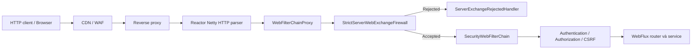

# Kiểm thử trên HTTP server thực và qua proxy

## 1. Bối cảnh: unit test của firewall đã xanh nhưng production vẫn có thể khác

Một ứng dụng **Spring WebFlux** dùng Spring Security để bảo vệ API tài liệu:

- `GET /public/ping` dành cho health check.
- `GET /api/documents/{id}` yêu cầu xác thực và kiểm tra quyền với từng tài liệu.
- `POST /api/documents` thay đổi trạng thái, dùng cookie/session hoặc bearer token tùy kiến trúc.
- `GET /admin/reports` chỉ dành cho quản trị viên.
- Frontend chạy khác origin nên gửi `OPTIONS` CORS preflight.

Trong unit test, nhóm phát triển dùng `MockServerWebExchange` để gọi trực tiếp `StrictServerWebExchangeFirewall`. Một số URL có `;`, `%2F`, `/../` hoặc method `TRACE` bị từ chối đúng kỳ vọng. Nhưng trên production lại xảy ra những hiện tượng khó giải thích:

1. Reverse proxy đã chuẩn hóa `/api/../admin` thành `/admin` trước khi gửi tới Spring.
2. CDN trả 403 cho `TRACE`, nhưng HTTP server origin trả 400.
3. Request `/api%2Fprivate` bị Reactor Netty hoặc proxy từ chối trước khi Spring tạo `ServerWebExchange`.
4. Một route nhạy cảm không match bất kỳ `SecurityWebFilterChain` nào nên không chạy các filter xác thực dự kiến.
5. Browser báo lỗi CORS thay vì hiển thị JSON lỗi từ server.
6. Response 404 từ một custom rejected handler bị CDN cache theo chính sách riêng.

**Vì vậy, test trực tiếp class firewall chỉ chứng minh một phần.** Cần bổ sung test qua **HTTP server thực**, qua **reverse proxy/CDN**, quan sát từng tầng và khẳng định bất biến bảo mật của cả đường đi.

Bài thuộc chương **Firewall trên Reactive** của mô-đun **SPRING_SECURITY_HTTP_PROTECTION**. Mô-đun hướng đến cấu hình và kiểm thử các lớp phòng vệ HTTP/trình duyệt trong Spring Security — CSRF, CORS, security headers, CSP, HSTS, firewall và session — trên cả Servlet lẫn Reactive. Trọng tâm của bài là **kiểm thử trên HTTP server thực và qua proxy** cho Spring Security WebFlux, không phải viết lại logic của firewall hay bỏ qua quyền ở service.

### Mục tiêu học tập

Sau bài, bạn có thể:

1. Phân biệt test mock, test kết nối HTTP server thực và test end-to-end qua proxy.
2. Dùng `@SpringBootTest(webEnvironment = RANDOM_PORT)` và `WebTestClient.bindToServer()` để xác nhận WebFlux HTTP server, security filters và handler vận hành cùng nhau.
3. Dùng `curl --path-as-is`, `--request-target` và HTTP/1.1 với dữ liệu test để quan sát khác biệt biểu diễn URL ở client và origin.
4. Giải thích khác biệt giữa `$request_uri` và `$uri` của NGINX, cũng như tác động của `proxy_pass` có/không có phần URI.
5. Thiết kế ma trận test method, path, encoding, hostname, headers, CORS, CSRF, authentication và authorization theo từng hop.
6. Xác định lỗi 400 phát sinh từ **proxy**, **HTTP parser** hay **ServerExchangeRejectedHandler**, không suy chỉ từ status.
7. Viết phép đo an toàn, không log bearer token, cookie, raw query hay payload bị từ chối.
8. Đặt tiêu chí nghiệm thu và rollback sau nâng cấp Spring Security, Reactor Netty, gateway hoặc cấu hình rewrite.

## 2. Khái niệm cốt lõi: ba mức kiểm thử không thay thế nhau

| Mức | Đường đi | Kiểm chứng tốt | Chưa thể chứng minh |
| --- | --- | --- | --- |
| **A. Direct firewall** | `MockServerWebExchange → StrictServerWebExchangeFirewall` | Predicate, method allowlist, `ServerExchangeRejectedException` | HTTP parser, security chain wiring, proxy rewrite |
| **B. Real HTTP server** | HTTP client → TCP/TLS → Reactor Netty → WebFlux → Spring Security | HTTP decoding, header handling, Bean wiring, HTTP status/headers | Hành vi của CDN/reverse proxy production |
| **C. Edge-to-origin** | HTTP client → CDN/WAF/reverse proxy → HTTP server → Spring Security → handler | Rewrite, normalization, forwarded headers, CORS, caching, route security xuyên tầng | Các hành vi không thể tái hiện nếu staging khác production |

Các lớp trên **bổ sung nhau**, không phải chọn một:

- Test A chạy nhanh trong CI và chỉ rõ **predicate** nào bị vi phạm.
- Test B chứng minh framework thực sự nhận HTTP request qua socket và áp bảo mật.
- Test C là nơi phát hiện sự khác biệt giữa **raw request-target ở client**, URI đã chuẩn hóa tại edge, path Spring thấy và path handler dùng.

Một test `WebTestClient.bindToApplicationContext(context)` có thể chạy toàn bộ WebFlux `WebHandler` chain trên **mock request/response**; nó khác với `WebTestClient.bindToServer()` kết nối qua mạng thật. Test chỉ dùng `bindToController(...)` thường còn bỏ qua nhiều Bean/filter cấp ứng dụng nếu không thêm integration thủ công.

### 2.1. Hình dung toàn tuyến



Các biến thể:

- `B` hoặc `C` có thể trả lỗi trước khi origin nhận request.
- `D` có thể trả 400 hoặc đóng kết nối trước khi Spring Security được gọi.
- `F` có thể tạo `ServerExchangeRejectedException`; handler mặc định trả **HTTP 400**.
- `I` có thể trả `401`/`403` hoặc redirect nếu credentials/quyền chưa phù hợp.
- `J` có thể trả `404`/`405` hoặc lỗi validation.
- Một custom rejected handler có thể trả `404` thay vì 400, nên **status không xác định chắc nguồn lỗi**.

## 3. Những bất biến bảo mật phải kiểm tra

Đừng chỉ viết assert “response không phải 200”. Bất biến có giá trị hơn:

| Mã | Bất biến cần đúng | Ví dụ |
| --- | --- | --- |
| B01 | Request hợp lệ đến đúng endpoint | `GET /public/ping` trả `pong` |
| B02 | Request hình dạng nguy hiểm không vượt strict policy | `TRACE` bị firewall/server/edge từ chối |
| B03 | URL mơ hồ không chuyển request công khai thành route riêng tư được truy cập | `/public/../admin` không lộ dữ liệu admin |
| B04 | Mọi URL nhạy cảm match security chain phù hợp | Không có đường vòng ngoài authentication |
| B05 | Authentication/authorization không phụ thuộc việc firewall đã pass | User thường không xem tài liệu khác tenant |
| B06 | CORS không cấp quyền truy cập dữ liệu | Origin được phép đọc response chưa đủ để bypass authorization |
| B07 | CSRF phù hợp credential model | POST bằng cookie/session phải được kiểm tra theo policy |
| B08 | Proxy và origin thống nhất request-target, method, Host hoặc từ chối an toàn | Không có route bypass do decode/rewrite khác nhau |
| B09 | Header và body response đúng contract | `Content-Type`/`Cache-Control`/`nosniff` khi áp dụng |
| B10 | Rejection được phân loại theo tầng | Phân biệt edge 400 và Spring firewall 400 |
| B11 | Test/metric không làm lộ dữ liệu | Không ghi token, cookie, raw URI riêng tư |
| B12 | Các kết quả vẫn giữ sau upgrade | Regression tái chạy trên đúng hạ tầng |

Ví dụ một request `/api/../admin` được proxy chuẩn hóa thành `/admin` và trả `403` cho người không có role ADMIN: đây **có thể là kết quả an toàn**, mặc dù Spring firewall chưa từng thấy chuỗi `..`. Không nên đòi mọi payload luôn trả 400 ở mọi tầng. Điều cần chứng minh là **không bypass được phân quyền**.

## 4. Phiên bản, dependency và loại runtime

### 4.1. Reactive firewall API

Với Spring Security Reactive ở các nhánh hiện đại (đặc biệt **6.4+**), những API quan trọng:

| Thành phần | Package / ý nghĩa |
| --- | --- |
| `ServerWebExchangeFirewall` | `org.springframework.security.web.server.firewall` |
| `StrictServerWebExchangeFirewall` | Triển khai strict |
| `ServerExchangeRejectedException` | Loại lỗi do firewall reject |
| `ServerExchangeRejectedHandler` | Handler chuyển rejection thành response |
| `HttpStatusExchangeRejectedHandler` | Mặc định HTTP 400 |
| `WebFilterChainProxy` | Áp firewall trước khi chọn security chain |
| `SecurityWebFilterChain` | Filters cho URL/exchange match |
| `ServerHttpSecurity` | DSL Reactive Security |

Javadoc cho biết `WebFilterChainProxy.setFirewall(...)` được thêm trong nhánh API 6.4. Không lấy một snippet thuộc Spring Security 6.5/7.x chạy nguyên trên 6.0–6.3 mà không xác minh dependency. Một số class có thể có backport; cần đối chiếu **artifact thật**, không suy bằng tên Spring Boot.

### 4.2. Phân biệt Spring Boot 3.5 và 4.x

Các ví dụ Java chạy HTTP server thật ở bài này dùng **Spring Boot 3.5.x + Java 17+**, vì API test/annotation ổn định và dễ minh họa. Spring Boot 4.x có thay đổi tổ chức package của một số test auto-configuration annotations. Khi dự án dùng 4.x, áp dụng ý tưởng tương tự nhưng dùng **import thực tế của version**.

Hai cách dựng client thường dùng:

- Spring Boot 3.5: `@SpringBootTest(webEnvironment = RANDOM_PORT)` + `@AutoConfigureWebTestClient` để inject client gắn tới server.
- Cách độc lập hơn với annotation auto-config: `@LocalServerPort` + `WebTestClient.bindToServer().baseUrl(...)`.

Chúng **không** tương đương với `@SpringBootTest` mặc định, vì default `webEnvironment=MOCK` không start embedded HTTP server.

### 4.3. Đừng vô tình chạy MVC/Servlet

Nếu project có đồng thời `spring-boot-starter-web` và `spring-boot-starter-webflux`, Spring Boot có thể ưu tiên **Servlet** runtime. Cần xác nhận `ApplicationContext` thực sự thuộc Reactive web application và đang dùng `SecurityWebFilterChain`/`WebFilterChainProxy`.

Trong ví dụ test có thể đặt:

```java
@SpringBootTest(
    webEnvironment = SpringBootTest.WebEnvironment.RANDOM_PORT,
    properties = "spring.main.web-application-type=reactive")
```

Nhưng **đừng ép reactive trong test rồi kết luận production cũng chạy reactive**. Cần kiểm tra profile/startup của origin thật, HTTP server được khởi động và dependency tree theo phạm vi công việc riêng. STEP 4 này chỉ viết bài, không chạy builds.

## 5. Thiết kế một ứng dụng mẫu có đường phân quyền rõ ràng

Để test có ý nghĩa, cần có một tập endpoint **đã biết trước** và security rules có thể kiểm tra độc lập.

### 5.1. SecurityWebFilterChain mẫu

```java
import org.springframework.context.annotation.Bean;
import org.springframework.context.annotation.Configuration;
import org.springframework.security.config.Customizer;
import org.springframework.security.config.annotation.web.reactive.EnableWebFluxSecurity;
import org.springframework.security.config.web.server.ServerHttpSecurity;
import org.springframework.security.web.server.SecurityWebFilterChain;

@Configuration
@EnableWebFluxSecurity
class DemoReactiveSecurity {

    @Bean
    SecurityWebFilterChain security(ServerHttpSecurity http) {
        return http
            .authorizeExchange(auth -> auth
                .pathMatchers("/public/**").permitAll()
                .pathMatchers("/admin/**").hasRole("ADMIN")
                .pathMatchers("/api/**").authenticated()
                .anyExchange().denyAll())
            .httpBasic(Customizer.withDefaults())
            .build();
    }
}
```

Ví dụ cố ý dùng HTTP Basic để các trường hợp 401/403 dễ tái hiện bằng **tài khoản giả trong môi trường test**. Ứng dụng production có thể dùng OAuth2 resource server/JWT, session hoặc mTLS theo kiến trúc thật. Không đưa password demo vào production và không coi Basic là yêu cầu bắt buộc của Reactive firewall.

Chú ý:

- `StrictServerWebExchangeFirewall` là một lớp riêng, không bật bằng `httpBasic(...)`.
- `anyExchange().denyAll()` giúp chặn các route khác trong chain bao phủ toàn bộ; cần bảo đảm không có security chain rộng hơn/cụ thể hơn chọn trước gây bypass.
- `hasRole("ADMIN")` kiểm tra authority của user; service vẫn phải kiểm tra owner/tenant cho từng document.
- CSRF mặc định của Spring Security cần xem xét với credential model. Khi dùng cookie/session, không tắt chỉ để làm POST test pass.

### 5.2. Tài khoản test nội bộ

```java
import org.springframework.context.annotation.Bean;
import org.springframework.context.annotation.Configuration;
import org.springframework.security.core.userdetails.MapReactiveUserDetailsService;
import org.springframework.security.core.userdetails.User;

@Configuration
class DemoUsers {

    @Bean
    MapReactiveUserDetailsService users() {
        var alice = User.withUsername("alice")
            .password("{noop}demo-password")
            .roles("USER")
            .build();

        var admin = User.withUsername("root-test")
            .password("{noop}demo-password")
            .roles("ADMIN")
            .build();

        return new MapReactiveUserDetailsService(alice, admin);
    }
}
```

`{noop}` chỉ phù hợp **test fixture** để minh họa; không dùng mật khẩu chưa băm ở môi trường thật. Các test cần tài khoản không có quyền đối với tài liệu cụ thể thì phải bổ sung user/fixture và business authorization cho resource.

### 5.3. Endpoint đơn giản để quan sát đường đi

```java
import org.springframework.web.bind.annotation.GetMapping;
import org.springframework.web.bind.annotation.PostMapping;
import org.springframework.web.bind.annotation.RestController;
import reactor.core.publisher.Mono;

@RestController
class DemoEndpoints {

    @GetMapping("/public/ping")
    Mono<String> ping() {
        return Mono.just("pong");
    }

    @GetMapping("/api/me")
    Mono<String> privateProbe() {
        return Mono.just("private-demo");
    }

    @GetMapping("/admin/reports")
    Mono<String> adminProbe() {
        return Mono.just("admin-demo");
    }

    @PostMapping("/api/documents")
    Mono<String> create() {
        return Mono.just("created-demo");
    }
}
```

Đây là **fixture kỹ thuật** cho kiểm thử security chain, không phải service quản lý tài liệu production. Không triển khai endpoint chứa dữ liệu thật bằng cách trả `admin-demo` hoặc `private-demo` cố định. Test quyền tài liệu phải có data fixture với owner/tenant được kiểm tra server-side.

## 6. Bắt đầu với direct firewall test để có mốc so sánh

Một test đơn vị nhanh với `MockServerWebExchange` giúp xác định behavior **của chính strict firewall**.

```java
import org.junit.jupiter.api.Test;
import org.springframework.http.HttpMethod;
import org.springframework.mock.http.server.reactive.MockServerHttpRequest;
import org.springframework.mock.web.server.MockServerWebExchange;
import org.springframework.security.web.server.firewall.ServerExchangeRejectedException;
import org.springframework.security.web.server.firewall.StrictServerWebExchangeFirewall;
import reactor.test.StepVerifier;

class FirewallUnitBaselineTest {

    private final StrictServerWebExchangeFirewall firewall =
        new StrictServerWebExchangeFirewall();

    @Test
    void normalGetPasses() {
        var exchange = MockServerWebExchange.from(
            MockServerHttpRequest.get("/public/ping").build());

        StepVerifier.create(firewall.getFirewalledExchange(exchange))
            .expectNextCount(1)
            .verifyComplete();
    }

    @Test
    void traceIsRejectedByDefaultMethodPolicy() {
        var exchange = MockServerWebExchange.from(
            MockServerHttpRequest
                .method(HttpMethod.TRACE, "/public/ping")
                .build());

        StepVerifier.create(firewall.getFirewalledExchange(exchange))
            .expectError(ServerExchangeRejectedException.class)
            .verify();
    }
}
```

Kết quả này không chứng minh:

- Reactor Netty cho request tới `WebFilterChainProxy` ở môi trường thật;
- Spring Boot đã dùng custom Bean firewall được định nghĩa trong app;
- Proxy giữ nguyên raw URI;
- CORS, CSRF và authentication chạy đúng;
- Handler bị từ chối trả status cuối nào.

**Không dùng mock để khẳng định chắc mã HTTP của request raw có control characters**. Mock parser/client có thể từ chối hoặc chuẩn hóa trước khi bạn quan sát được firewall.

## 7. Test HTTP server thực bằng @SpringBootTest RANDOM_PORT

### 7.1. Khi nào test thật sự có socket?

Spring Boot cung cấp:

```java
@SpringBootTest(
    webEnvironment = SpringBootTest.WebEnvironment.RANDOM_PORT)
```

Annotation này khởi động embedded web server và bind một port hệ điều hành chọn. Khác với mặc định `MOCK`, request của HTTP client đi qua mạng loopback, Reactor Netty, WebFlux và Spring Security trước khi tới handler.

Đừng nhầm:

| Setup | Embedded HTTP server? | Test raw HTTP parser? |
| --- | --- | --- |
| `WebTestClient.bindToController(...)` | Không | Không |
| `WebTestClient.bindToRouterFunction(...)` | Không | Không |
| `WebTestClient.bindToApplicationContext(...)` | Không | Không |
| `@SpringBootTest` mặc định | Thông thường không | Không |
| `@SpringBootTest(webEnvironment=RANDOM_PORT)` + `bindToServer()` | **Có** | **Có**, trong giới hạn HTTP client |
| Curl vào một instance đang chạy | **Có** | **Có**, phụ thuộc client/proxy |

### 7.2. Test đầy đủ với WebTestClient.bindToServer

Ví dụ Spring Boot 3.5:

```java
import org.junit.jupiter.api.BeforeEach;
import org.junit.jupiter.api.Test;
import org.springframework.boot.test.context.SpringBootTest;
import org.springframework.boot.test.web.server.LocalServerPort;
import org.springframework.http.HttpMethod;
import org.springframework.test.web.reactive.server.WebTestClient;

@SpringBootTest(
    webEnvironment = SpringBootTest.WebEnvironment.RANDOM_PORT,
    properties = "spring.main.web-application-type=reactive")
class RealHttpFirewallIntegrationTest {

    @LocalServerPort
    int port;

    WebTestClient client;

    @BeforeEach
    void setUp() {
        client = WebTestClient.bindToServer()
            .baseUrl("http://127.0.0.1:" + port)
            .build();
    }

    @Test
    void publicGetIsReachableThroughSocket() {
        client.get().uri("/public/ping")
            .exchange()
            .expectStatus().isOk()
            .expectBody(String.class).isEqualTo("pong");
    }

    @Test
    void defaultStrictFirewallRejectsTraceIfItReachesSpring() {
        client.method(HttpMethod.TRACE)
            .uri("/public/ping")
            .exchange()
            .expectStatus().isBadRequest();
    }

    @Test
    void anonymousApiRequestIsNotPublic() {
        client.get().uri("/api/me")
            .exchange()
            .expectStatus().isUnauthorized();
    }

    @Test
    void authenticatedNonAdminCannotReadAdminResource() {
        client.get().uri("/admin/reports")
            .headers(h -> h.setBasicAuth(
                "alice", "demo-password"))
            .exchange()
            .expectStatus().isForbidden();
    }
}
```

**Điều kiện của ví dụ:** App đang chạy fixture mục 5, strict firewall mặc định, security chain có HTTP Basic và rejected handler mặc định **400**. Nếu HTTP server hoặc một middleware reject `TRACE` sớm, response có thể là 400 từ **parser**, không phải từ Spring firewall; muốn chứng minh nguồn cần bổ sung telemetry hoặc proxy-level test.

Mặt khác, `403` ở test admin được mong đợi vì Alice đã xác thực nhưng thiếu `ROLE_ADMIN`. Nếu app dùng bearer token hoặc custom entry point, cần thay cách authenticate và expectation theo contract.

### 7.3. Test đúng custom method allowlist

Nếu production đã custom firewall chỉ cho `GET, HEAD, POST, OPTIONS`, một `PUT /public/ping` có thể bị firewall trả 400 trước controller. Nhưng **strict default cho phép PUT**; vì vậy không được viết test “PUT phải 400” khi chưa có custom Bean tương ứng.

```java
import java.util.List;
import org.springframework.context.annotation.Bean;
import org.springframework.context.annotation.Configuration;
import org.springframework.http.HttpMethod;
import org.springframework.security.web.server.firewall.StrictServerWebExchangeFirewall;

@Configuration
class RestrictiveFirewallExample {

    @Bean
    StrictServerWebExchangeFirewall serverWebExchangeFirewall() {
        var firewall = new StrictServerWebExchangeFirewall();

        firewall.setAllowedHttpMethods(List.of(
            HttpMethod.GET,
            HttpMethod.HEAD,
            HttpMethod.POST,
            HttpMethod.OPTIONS));

        return firewall;
    }
}
```

Đây là **phương án cấu hình thay thế** khi cần test `PUT` bị reject. Không đăng ký thêm Bean này cùng một Bean firewall khác rồi mong Spring tự gộp các chính sách.

### 7.4. Những gì RANDOM_PORT vẫn chưa bao phủ

- CDN/NGINX chưa tham gia đường đi.
- TLS termination, HTTP/2/3 negotiation có thể khác production.
- Firewall có thể thấy Host = `127.0.0.1` khác public Host.
- Một số URL bất thường bị HTTP client chuẩn hóa trước khi gửi.
- Cấu hình session/cookie của environment test có thể khác.
- Không có dữ liệu owner/tenant thật nếu fixture chỉ chứa public/admin probes.

Do đó RANDOM_PORT là **bước trung gian quan trọng**, không phải cấp cao nhất của kiểm thử bảo mật.

## 8. WebTestClient không phải công cụ duy nhất để kiểm tra raw request-target

`WebTestClient` rất thuận tiện với HTTP requests chuẩn. Nhưng khi test `/a/../b`, `%2F` hoặc `//`, URL builder, client adapter hoặc Java URI parser có thể thay đổi biểu diễn trước khi bytes đi ra socket.

Để giữ request-target ở phía client khi thực nghiệm, dùng `curl` trong **môi trường thử nghiệm được cấp phép**:

```bash
# Trên Windows PowerShell dùng curl.exe nếu "curl" bị alias khác.
# Không truyền bearer token/cookie thật trong các ví dụ.
curl --http1.1 -i --path-as-is \
  'http://127.0.0.1:8080/api/../admin/reports'

curl --http1.1 -i --path-as-is \
  'http://127.0.0.1:8080/api//private/me'

curl --http1.1 -i --path-as-is \
  'http://127.0.0.1:8080/api;test=1/private/me'

curl --http1.1 -i --path-as-is \
  'http://127.0.0.1:8080/api%2Fprivate/me'
```

`--path-as-is` làm curl không tự rút gọn đường dẫn như `..`/`.`. Nó **không** buộc CDN, NGINX, Netty hoặc Spring giữ raw path nguyên vẹn. Kiểm tra cả cách viết hoa/thường percent escape (`%2f` vs `%2F`) nếu parser/proxy của bạn có xử lý liên quan.

### 8.1. Dùng --request-target khi cần xác định target chính xác

Với HTTP/1.1 có thể chủ động yêu cầu curl gửi origin-form target:

```bash
curl --http1.1 -i --path-as-is \
  --request-target '/api/../admin/reports' \
  'http://127.0.0.1:8080/'

curl --http1.1 -i \
  --request-target '/api%2Fprivate/me' \
  'http://127.0.0.1:8080/'
```

Chỉ sử dụng trong môi trường đã cho phép kiểm thử security. `--request-target` thay request-target mà curl truyền đi; không có nghĩa một reverse proxy sẽ không rewrite khi forward.

### 8.2. Tại sao phải cố định HTTP protocol khi so sánh?

HTTP/1.1 sử dụng request line và `Host`; HTTP/2/3 biểu diễn target qua pseudo-headers như `:path` và `:authority`. Proxy có thể nhận HTTP/2 từ browser rồi forward HTTP/1.1 đến origin, vì thế khác biệt biểu diễn/canonicalization vẫn cần kiểm thử.

Khi chạy baseline, ghi rõ:

- HTTP/1.1 hoặc HTTP/2 từ client tới edge;
- HTTP version giữa edge và origin;
- Scheme HTTP/HTTPS, SNI/Host;
- có rewrite, prefix strip hoặc redirect không;
- header nào được trusted proxy chuẩn hóa;
- version của proxy/server và Spring Security.

**Đừng cho rằng HTTP 200/400 trong một protocol version chứng minh tất cả các protocol versions an toàn.**

## 9. NGINX: $request_uri khác $uri

Theo tài liệu NGINX:

- `$request_uri` là original request URI đầy đủ, bao gồm phần query string; đây là dữ liệu **không tin cậy** từ client.
- `$uri` là URI hiện tại đã chuẩn hóa trong quá trình xử lý request, có thể thay đổi bởi rewrite/internal redirect.
- `location` thông thường được chọn dựa trên URI **đã chuẩn hóa**: decode phần `%XX`, resolve `.`/`..` và có thể nén nhiều slash.

Ví dụ client gửi:

```text
GET /api/../admin/reports?sort=recent HTTP/1.1
Host: edge.example.test
```

Tại edge, hai cách quan sát có thể khác nhau:

```text
$request_uri = /api/../admin/reports?sort=recent
$uri         = /admin/reports
```

Đây là **minh họa có thể xảy ra**, phụ thuộc cấu hình và processing; đừng tự ghi lại raw query `$request_uri` trong access log production chỉ để chứng minh ví dụ. Với dữ liệu test giả trên staging cô lập, có thể quan sát raw-vs-normalized theo quy trình bảo mật.

### 9.1. proxy_pass có URI và không có URI

NGINX documentation phân biệt:

```nginx
# Ví dụ 1: proxy_pass KHÔNG kèm URI suffix.
location /app/ {
    proxy_pass http://127.0.0.1:8080;
}
```

Khi request gốc chưa bị rewrite, NGINX thường chuyển request URI theo biểu diễn nhận từ client; nếu URI đã thay đổi trong quá trình xử lý, NGINX có thể forward URI đã chuẩn hóa.

```nginx
# Ví dụ 2: proxy_pass CÓ phần URI /backend/.
location /app/ {
    proxy_pass http://127.0.0.1:8080/backend/;
}
```

Trong trường hợp thứ hai, phần URI **đã chuẩn hóa** match location được thay bằng URI của `proxy_pass`. Vì vậy raw request-target có thể khác target origin nhận, ngay cả khi client dùng `--path-as-is`.

**Không coi “proxy_pass không có URI = bảo đảm không normalize” là một quy tắc tuyệt đối.** NGINX location matching, rewrite/internal redirect và version/configuration đều có ảnh hưởng. Đừng tắt mọi normalization hoặc bật `merge_slashes off` ở production chỉ để làm test “giữ nguyên payload”.

### 9.2. Host và forwarded headers

Nếu gateway đặt:

```nginx
proxy_set_header Host $host;
proxy_set_header X-Forwarded-Proto $scheme;
```

origin có thể thấy hostname public thay vì internal. Nhưng giá trị Host do client gửi cần được gateway kiểm tra bằng virtual-host policy, không xem đó là lời khẳng định đáng tin tự thân.

Với `Forwarded`, `X-Forwarded-Host`, `X-Forwarded-Proto` hay `X-Forwarded-For`, phải thiết kế trust boundary: proxy đáng tin nên **loại bỏ/ghi đè** header client không đáng tin và chỉ gửi metadata được kiểm soát tới origin. Đừng tin một `X-Forwarded-Host` tùy ý để quyết định tenant, redirect URL, CSRF origin hoặc `setAllowedHostnames`.

## 10. Cấu hình reverse proxy thử nghiệm có giới hạn

Một mẫu NGINX cho staging **chỉ phục vụ minh họa cấu trúc**, không phải cấu hình TLS/WAF/cache production đầy đủ:

```nginx
# Ví dụ cấu hình cho máy test cô lập.
server {
    listen 8081;
    server_name edge.test.local;

    location / {
        # Không có URI suffix: so sánh với cấu hình có rewrite.
        proxy_pass http://127.0.0.1:8080;

        proxy_http_version 1.1;

        # Chỉ dùng khi edge kiểm soát Host và trust boundary.
        proxy_set_header Host $host;
        proxy_set_header X-Forwarded-Proto $scheme;

        # Không chuyển tiếp metadata forwarded tùy tiện từ client.
        proxy_set_header Forwarded "";
        proxy_set_header X-Forwarded-Host "";
    }
}
```

Giả định origin đang chạy cổng 8080. Với test `RANDOM_PORT`, cổng thay đổi mỗi lần, vì vậy **không thể dùng nguyên mẫu NGINX 8080 này mà không cấp động upstream port**. Hai quy trình phù hợp:

- **JUnit real server test** dùng `RANDOM_PORT`, kết nối trực tiếp với `127.0.0.1:<port>`.
- **E2E proxy test** chạy một instance staging riêng trên cổng định trước, hoặc orchestrator cấu hình động upstream cho NGINX/Testcontainers theo port đã cấp.

Không giả định start một `RANDOM_PORT` test sẽ làm NGINX tự nhận biết port. Nếu dùng Kubernetes/Ingress, test topology tương tự thật thay vì cố dùng NGINX local như một đại diện tuyệt đối.

### 10.1. Không thay các bảo vệ của edge bằng demo config

Production còn cần: TLS/cert verification, trusted proxy chain, header/body limits, request buffering, URI/method policy, health check, timeout, rate limiting, server-to-server TLS/mTLS nếu cần, cấu hình HTTP/2/3 và logging an toàn.

**Không tắt WAF, chuẩn hóa URI, xác minh certificate hoặc phương pháp xác thực chỉ để test “đi tới Spring firewall”.** Nếu edge chủ động chặn một payload, đó là bằng chứng ở đúng tầng; test direct origin riêng cho behavior của Spring.

## 11. So sánh request vào origin trực tiếp và qua proxy

Thiết kế test cố định hai base URLs:

```bash
# Địa chỉ mẫu; thay bằng origin/edge staging được cấp phép.
ORIGIN='http://127.0.0.1:8080'
EDGE='https://staging.example.test'

curl --http1.1 -i --path-as-is \
  "$ORIGIN/public/ping"
curl --http1.1 -i --path-as-is \
  "$EDGE/public/ping"

curl --http1.1 -i --path-as-is \
  "$ORIGIN/api/../admin/reports"
curl --http1.1 -i --path-as-is \
  "$EDGE/api/../admin/reports"
```

Đối với PowerShell, sử dụng `curl.exe` (và cú pháp biến `$env:ORIGIN`/`$env:EDGE` hoặc biến PowerShell thích hợp) thay vì sao chép nguyên shell Bash. Không dùng flag `-k`/`--insecure` để né lỗi TLS; nếu staging dùng CA nội bộ, cài trust đúng cách.

Kết quả có thể:

| Direct origin | Qua edge | Diễn giải có thể |
| --- | --- | --- |
| 400 | 400 | Cùng status nhưng **chưa chứng minh cùng tầng reject** |
| 400 | 403 | Edge chặn trước hoặc path đã được normalize rồi bị authorization chặn |
| 403 | 403 | Authz có thể được giữ, nhưng phải kiểm tra route thực |
| 400 | 404 | Edge/router/custom rejected handler khác chính sách |
| 200 | 403 | Edge policy nghiêm hơn cho request hợp lệ; cần xem lý do |
| 403 | 200 | **Ưu tiên điều tra**: proxy rewrite, chain mismatch, trust header hoặc cache |
| Không kết nối | 400/503 | Origin/edge chưa chạy, gateway lỗi; không suy là firewall |
| 401 | 200 | **Cảnh báo**: cache, auth headers, identity propagation hoặc route bypass |

**Đặc biệt:** 200 qua edge nhưng 403 khi gọi thẳng origin cho cùng principal/resource là tình huống cần điều tra ngay, dù nguyên nhân có thể chỉ là test fixture sai. Không chấp nhận kết quả đó là “đúng vì proxy tối ưu”.

## 12. Ma trận kiểm thử HTTP methods

`StrictServerWebExchangeFirewall` mặc định cho phép:

```text
DELETE, GET, HEAD, OPTIONS, PATCH, POST, PUT
```

`TRACE` không thuộc mặc định. Nếu Bean custom thay allowlist, phải test đúng rule mới.

| Test ID | Request | Kỳ vọng quan trọng |
| --- | --- | --- |
| HM01 | `GET /public/ping` | 200 và body đúng nếu app khỏe |
| HM02 | `HEAD /public/ping` | Không lộ body; response theo handler/policy |
| HM03 | `OPTIONS /api/documents` | Method không bị firewall cấm sai; CORS trả đúng policy |
| HM04 | `TRACE /public/ping` | Bị strict firewall hoặc parser/edge từ chối |
| HM05 | `PUT /public/ping` với default firewall | Không khẳng định firewall phải reject; có thể 403/405 |
| HM06 | `PUT /public/ping` với Bean custom bỏ PUT | Firewall reject nếu request đến Spring |
| HM07 | `PROPFIND /dav/...` khi có ngoại lệ được duyệt | Firewall pass nhưng auth/handler vẫn kiểm soát |
| HM08 | `COPY`/`MOVE` chưa được hỗ trợ | Không có thao tác ngoài quyền xảy ra |
| HM09 | Method lạ hoặc sai casing | Chặn an toàn; xác định server/firewall |
| HM10 | Method khác trên `/admin/**` | Không bypass rule ADMIN |

### 12.1. curl test

```bash
curl --http1.1 -i -X TRACE \
  'http://127.0.0.1:8080/public/ping'

curl --http1.1 -i -X OPTIONS \
  -H 'Origin: https://ui.example.test' \
  -H 'Access-Control-Request-Method: POST' \
  -H 'Access-Control-Request-Headers: authorization,content-type' \
  'http://127.0.0.1:8080/api/documents'
```

Đối với test CORS, không chỉ xem method không bị firewall chặn: phải kiểm tra `Access-Control-Allow-Origin`, `Access-Control-Allow-Methods`, `Access-Control-Allow-Headers` và credentials theo chính sách. Origin ngoài allowlist **không được** nhận một response cho phép CORS tùy tiện.

## 13. Ma trận kiểm thử đường dẫn và percent-encoding

Mục tiêu của bộ test này là kiểm tra **không có parser/matcher differential nào cho phép truy cập tài nguyên ngoài quyền**, không phải chế tạo nhiều payload để thấy càng nhiều HTTP 400 càng tốt.

| ID | Request-target minh họa | Rủi ro cần kiểm tra |
| --- | --- | --- |
| U01 | `/api/../admin/reports` | Dot-segment normalization |
| U02 | `/api/./private/me` | Segments `.` |
| U03 | `/api//private/me` | Double slash |
| U04 | `/api;mode=public/private/me` | Semicolon/path parameters |
| U05 | `/api%2Fprivate/me` | Encoded slash |
| U06 | `/api%2fprivate/me` | Case của percent encoding |
| U07 | `/api%252Fprivate/me` | Double decoding |
| U08 | `/api/%2E%2E/admin` | Encoded period/traversal |
| U09 | `/api%5Cprivate` | Backslash interpretation |
| U10 | `/api%00private` | Null/control character |
| U11 | `/admin;role=guest/reports` | Không bypass role ADMIN |
| U12 | `/public/../api/me` | Không nhầm public matcher |
| U13 | `/unknown/private` | Catch-all policy bảo vệ URL ngoài scope |
| U14 | `/api/documents/42` | Đúng tenant/owner khi path hợp lệ |

Một test phải lưu cả:

1. Request-target mà client **định gửi**.
2. Điều gì bị proxy rewrite/normalize.
3. Origin có nhận exchange hay không.
4. Firewall có reject không.
5. Security chain được chọn nếu accepted.
6. Service/handler có chạy không.
7. Status cuối và dữ liệu nào được trả.

Nếu request `/public/../api/me` tới origin dưới dạng `/api/me`, authentication vẫn phải yêu cầu token. Nếu edge trả 400 trước origin thì **không có lỗi**, nhưng test phải ghi nhận nguồn status.

### 13.1. Đừng tự double-decode trong security filters

Ví dụ path `%252F` có thể được giải mã thành `%2F` rồi slash khi xử lý nhiều lớp. Nếu custom WebFilter tự decode thêm một lượt để xác định public/private route, kết quả có thể khác WebFlux handler mapping. Không dùng cách này để “sửa” lỗi test. Ưu tiên URI design đơn giản, opaque IDs và policy strict.

## 14. Kiểm thử Host, Forwarded và virtual host routing

Khi kết nối trực tiếp với `http://127.0.0.1:8080`, Host sẽ không giống khi đi qua `https://api.example.test`. Nếu có `setAllowedHostnames(...)` hoặc multi-tenant routing theo Host, điều này làm test khác nhau.

### 14.1. Cases bắt buộc

| Case | Kiểm tra |
| --- | --- |
| Host public được phép | Request đi đúng app/virtual host |
| Host staging/internal | Chỉ được phép khi topology có chủ đích |
| Host lạ | Không lộ data hoặc sinh redirect tới host không đáng tin |
| `Forwarded: host=...` từ client trực tiếp | Không được tin khi không qua proxy đáng tin |
| `X-Forwarded-Host` từ client Internet | Edge phải làm sạch hoặc ghi đè |
| `X-Forwarded-Proto`/TLS termination | Redirect/cookie Secure/HSTS đúng |
| Host case khác | Hostname matching tuân contract, không suy tenant từ casing |
| HTTP/2 `:authority` | Test nếu production dùng HTTP/2 client-to-edge |

Không dùng Host hoặc forwarded header do client tự khai báo như một nguồn sự thật để cấp quyền tenant; tenant phải được xác định/đối chiếu với authenticated principal.

### 14.2. Ví dụ curl Host trong staging

```bash
curl --http1.1 -i \
  -H 'Host: api.example.test' \
  'http://127.0.0.1:8080/public/ping'
```

Cách trên minh họa Host header trong HTTP/1.1, **không tương đương** test TLS SNI của HTTPS. Với HTTPS nên dùng `--resolve` cho domain test để giữ hostname xác thực, SNI và certificate validation theo đúng môi trường:

```bash
curl -i \
  --resolve 'api.example.test:443:127.0.0.1' \
  'https://api.example.test/public/ping'
```

Ví dụ giả định staging có TLS hợp lệ ở port 443; đừng thay bằng `--insecure` để che lỗi certificate. HTTP/2/3 và reverse proxy có thể có các quy tắc routing khác nhau.

## 15. Header, parameter và HTTP framing: kiểm thử đúng tầng

### 15.1. Header tên và giá trị không hợp lệ

Spring Security strict firewall kiểm tra **header names/values** và **parameter names** dựa trên các predicates mặc định. Control characters có thể bị HTTP client hoặc Netty từ chối **trước** khi firewall chạy. Không cố tạo raw CR/LF injection bằng browser hoặc công cụ test kết nối hệ thống không được phép.

Nên test ba lớp:

- Unit mock cho predicate mà firewall nhận được.
- HTTP server test cho input hợp lệ và một số malformed requests **an toàn, có kiểm soát**.
- Proxy test cho giới hạn header-size, duplicate field rules và forwarding theo RFC.

### 15.2. Duplicate Authorization không phải chỉ là lỗi ký tự

Ví dụ (chỉ mô tả trường hợp để test):

```http
Authorization: Bearer token-test-A
authorization: Bearer token-test-B
```

HTTP field names không phân biệt hoa/thường. Một API bearer-only cần xử lý credential mơ hồ theo policy rõ ràng, không tự chọn first/last. Strict header-value predicate **không có nghĩa tự chặn tất cả duplicate names**; cần auth/gateway validation và test phù hợp.

Ngược lại, những field có list syntax như `Accept` có thể chứa nhiều values hợp lệ. Không áp blanket rule “mọi header phải đúng một giá trị”.

### 15.3. Parameter values và HTTP parameter pollution

`GET /api/documents?tenant=red&tenant=blue` có hai query values cùng key; default `setAllowedParameterValues(...)` không thay business validation. Với `tenant` scalar cần exactly-one nếu contract quy định; `tag` có thể cho multiple values.

Quan trọng hơn, dù `tenant=red` xuất hiện một lần, user Bob vẫn không được đọc tài liệu tenant Red nếu không có quyền.

### 15.4. Content-Length và Transfer-Encoding ở HTTP/1.1

Message framing `Content-Length` và `Transfer-Encoding` phải được **HTTP parser/proxy** xử lý theo RFC 9112. Nếu proxy và origin parse khác nhau, có nguy cơ HTTP request smuggling. Một WebFilter chỉ thấy request đã parse không thay thế khả năng chống CL/TE ambiguity ở edge và server.

Bài thực hành này **không hướng dẫn gửi payload request smuggling** qua hệ thống dùng chung. Những kiểm thử framing chuyên sâu phải nằm trong chương trình security testing của hạ tầng đã được phê duyệt, có vùng cô lập và bảo vệ các kết nối dùng chung.

## 16. CORS: test preflight và actual request riêng rẽ

Một browser gửi preflight:

```http
OPTIONS /api/documents HTTP/1.1
Origin: https://ui.example.test
Access-Control-Request-Method: POST
Access-Control-Request-Headers: authorization,content-type
```

Browser chỉ gửi actual `POST` theo chính sách nếu preflight thành công. Vì vậy test cần ít nhất bốn tình huống:

| ID | Tình huống | Kỳ vọng |
| --- | --- | --- |
| C01 | Origin được phép, method/header được phép | Preflight được xử lý theo policy |
| C02 | Origin ngoài allowlist | Không trả allow-origin cho origin lạ |
| C03 | Method bị custom firewall loại `OPTIONS` | Xác định firewall reject sớm; sửa allowlist nếu cần |
| C04 | Preflight pass nhưng actual POST thiếu quyền/CSRF | Actual request vẫn bị auth/CSRF từ chối |

**CORS không phải authorization**. `Access-Control-Allow-Origin` chỉ quản lý khả năng browser script ở origin khác đọc response; nó không xác thực user hay kiểm tra quyền trên tài liệu. Không bật `Access-Control-Allow-Credentials: true` với wildcard origin chỉ để làm các test pass.

### 16.1. Lỗi CORS do early rejection

Nếu firewall reject trước security chain, CORS filter đặt trong chain có thể chưa được chạy. Browser có thể hiển thị “CORS error” thay vì body JSON 400. Khi cần browser đọc được error response, thiết kế CORS policy ở một lớp bao phủ early rejection **có allowlist và trust boundary phù hợp**; không echo bất kỳ Origin nào.

Khi test qua gateway, so sánh response headers ở direct origin và edge, vì edge cũng có thể tự xử lý OPTIONS.

## 17. CSRF, authentication, authorization và session

### 17.1. Test POST với cookie/session

Khi app dùng browser cookie/session, POST đổi trạng thái thường cần CSRF token. Một `POST /api/documents` có method và path hợp lệ nhưng thiếu token có thể trả `403` từ CSRF. Đó **không phải** `ServerExchangeRejectedException`.

Đừng tắt CSRF toàn cục để làm integration test pass; nếu production stateless bearer-only và CSRF không áp dụng, phải có threat model và cấu hình chính xác cho auth model đó.

### 17.2. Test GET private không credential

`GET /api/me` là HTTP request hợp lệ về hình dạng; strict firewall nên cho qua. Authentication entry point có thể trả `401` hoặc login redirect tùy cách đăng nhập. Test này khẳng định security chain được chọn đúng, không chứng minh strict firewall reject.

### 17.3. Test tài liệu khác owner/tenant

Ví dụ data fixture:

| Document | Owner | Tenant |
| --- | --- | --- |
| 42 | Alice | Red |
| 77 | Bob | Blue |

Test cần assert:

- Alice GET /api/documents/42 thành công nếu có quyền.
- Bob GET /api/documents/42 bị từ chối hoặc trả 404 che tài nguyên theo policy.
- Bob không bypass bằng URI `/public/../api/documents/42` hoặc `/api%2Fdocuments/42`.
- Request anonymous không xem được tài liệu dù đường dẫn chuẩn.
- Không có caching chung làm Bob nhận body đã tạo cho Alice.

Nếu fixture chỉ có `GET /api/me` trả `private-demo`, **không thể** dùng nó thay test quyền đối tượng; phải xây endpoint/service fixture thực sự kiểm tra owner/tenant.

### 17.4. Logout và cache

Sau logout hoặc session invalidation, browser/proxy không được đưa lại dữ liệu riêng tư dưới dạng stale cached response. Kiểm tra `Cache-Control: no-store` cho các endpoint nhạy cảm và chính sách CDN bypass shared cache. Firewall chặn URL sai không có tác dụng xóa các bản dữ liệu đã lưu trong browser/CDN.

## 18. Xác định chính xác tầng tạo response: không chỉ nhìn mã 400

Để phân biệt **Spring firewall** với lỗi từ proxy/server, dùng nhiều bằng chứng:

1. **Direct unit test**: `StepVerifier` thấy `ServerExchangeRejectedException` với cùng input do mock cung cấp.
2. **Proxy-level test**: `WebFilterChainProxy` gọi `ServerExchangeRejectedHandler` khi firewall reject.
3. **Runtime metric** tại rejected handler: tăng khi Spring xử lý rejection.
4. **Origin access/HTTP parser metrics**: request có được parse và chuyển tới WebFlux không?
5. **Edge access/upstream metrics**: edge có gửi upstream request không, status upstream là gì?
6. **Client response**: so status/body/headers ở direct origin và qua proxy.

### 18.1. Chỉ thêm metric an toàn ở rejected handler

Một Bean đơn giản minh họa Spring Security Reactive:

```java
import org.springframework.context.annotation.Bean;
import org.springframework.context.annotation.Configuration;
import org.springframework.http.HttpStatus;
import org.springframework.security.web.server.firewall.ServerExchangeRejectedHandler;
import io.micrometer.core.instrument.MeterRegistry;

@Configuration
class FirewallRejectionMetricsConfig {

    @Bean
    ServerExchangeRejectedHandler rejectedHandler(
            MeterRegistry registry) {

        return (exchange, rejected) -> {
            registry.counter(
                "security.firewall.rejected",
                "source", "spring-webflux",
                "status", "400").increment();

            var response = exchange.getResponse();
            response.setStatusCode(HttpStatus.BAD_REQUEST);
            response.getHeaders().setCacheControl("no-store");
            return response.setComplete();
        };
    }
}
```

Ví dụ cần Micrometer `MeterRegistry` Bean trong ứng dụng. Đây là **một Bean handler thay thế**, không đăng ký cùng Bean `ServerExchangeRejectedHandler` khác. Metric name mang tính minh họa, không mặc định được Spring Security sinh ra.

Mục đích là khi HTTP 400 xuất hiện nhưng counter không tăng, bạn có lý do kiểm tra tầng trước. Tuy nhiên **không nên kết luận chỉ dựa trên counter = 0** nếu instrumentation không được load, metric export bị trễ hoặc request đi vào instance khác. Luôn ghép với request ID, instance ID, edge/upstream status và integration tests.

### 18.2. Không log raw rejected.getMessage()

Message của exception có thể chứa URL, header value hoặc control characters do client kiểm soát. Tránh:

```java
// KHÔNG NÊN:
log.warn("Firewall rejected: {}", rejected.getMessage());
```

Thay bằng event code, status, service/instance và request ID đã được tạo/kiểm soát. Nếu cần forensic raw request, phải có cơ chế cô lập, cấp quyền, giới hạn thời gian lưu và không dùng logs sản phẩm mặc định.

## 19. NGINX logging: quan sát tuyến mà không làm lộ dữ liệu

NGINX có thể ghi `$status` và `$upstream_status` để phân biệt response từ edge và origin. Ví dụ log format cho staging:

```nginx
log_format safe_hop
    't=$time_iso8601 '
    'rid=$request_id '
    'status=$status '
    'upstream_status=$upstream_status '
    'rt=$request_time '
    'urt=$upstream_response_time';

access_log /var/log/nginx/safe-hop.log safe_hop;
```

**Không thêm** `$request_uri`, `$args`, `$http_authorization`, `$http_cookie` hoặc `$request` vào log thông thường. Chúng có thể chứa dữ liệu cá nhân, bearer tokens hoặc ký tự độc hại. `$request_id` là ID do NGINX sinh; nếu client gửi `X-Request-ID`, phải xác định cách trust/validate trước khi dùng làm căn cứ điều tra.

### 19.1. Cách diễn giải upstream_status

| Edge `status` | `upstream_status` | Cách đọc có thể |
| --- | --- | --- |
| 400 | rỗng/`-` | Edge có thể đã reject trước origin |
| 400 | 400 | Origin trả 400, edge chuyển tiếp |
| 403 | 403 | Origin authz/CSRF hoặc chính sách khác; cần trace sâu hơn |
| 502 | rỗng/`-` hoặc nhiều values | Upstream lỗi kết nối/response, không nhất thiết firewall |
| 200 | 200 | Cả hai thành công, vẫn cần kiểm tra identity/resource |
| 200 | 403 | **Điều tra**: fallback/cache/response rewrite hoặc test mapping bất thường |

Nhiều upstream attempts hoặc cache có thể làm `$upstream_status` không đơn giản là một status duy nhất. Đừng viết alert rule chỉ dựa trên chuỗi này mà không hiểu proxy cache/retry topology.

### 19.2. Khi cần quan sát raw-vs-normalized path

Chỉ ở **staging cô lập**, dữ liệu test hoàn toàn giả và có quyền truy cập hạn chế, có thể tạm thu thập `$request_uri` và `$uri` vào diagnostic sink để so parser. Tắt cơ chế sau khi kết thúc thí nghiệm; **không tạo permanent log của raw path/query trên production**.

Một phương án khác là dùng request IDs và những **nhãn được chuẩn hóa**, ví dụ `path_category=encoded_slash`, `rejected_by=edge` thay vì raw path làm metric label.

## 20. Ma trận kết quả mẫu theo tầng

| Input | Direct firewall mock | HTTP server thật | Via NGINX/CDN | Bất biến cần xác nhận |
| --- | --- | --- | --- | --- |
| GET public hợp lệ | Accepted | 200 | 200 | Handler công khai chạy |
| TRACE | Rejected | 400 nếu tới firewall | Có thể 400/403/405 | Không chạy handler |
| Semicolon path | Default reject | 400 hoặc parser reject | Có thể được rewrite/reject | Không bypass matcher |
| Encoded slash | Default reject khi biểu diễn tới firewall | Parser/strict xử lý | Proxy có thể decode/rewrite | Không bypass private route |
| Dot segments | Default reject nếu giữ raw | Client/Netty có thể normalize | NGINX location dùng normalized URI | Không bypass admin auth |
| GET private không token | Accepted shape | 401/redirect | Tương đương theo auth policy | Không lộ dữ liệu |
| GET admin với Alice | Accepted shape | 403 | Không được biến thành 200 | Quyền ADMIN |
| POST thiếu CSRF | Accepted method | 403 trong cookie/session policy | Không bypass | Trạng thái không bị thay đổi |
| OPTIONS CORS | Accepted method | Theo policy CORS | Edge có thể xử lý trước | Không mở origin lạ |
| Wrong tenant document | Accepted shape | Deny/404 theo service | Không được trả body từ cache user khác | Object authorization |
| Invalid Host | Theo host predicate nếu cấu hình | Parser/host policy | Edge virtual host policy | Không định tuyến sai tenant |
| Header control char | Predicate có thể reject | Parser có thể reject trước | Edge có thể reject | Không lộ/ghi raw input |

**Không cố áp một HTTP status duy nhất** lên tất cả cột. Mỗi cột đại diện cho một tầng khác nhau và có thể có chính sách chặn độc lập.

## 21. Test automation và CI/CD: phân chia đúng cấp độ

### 21.1. Lớp nhanh, chạy ở mỗi commit

- Unit tests cho `StrictServerWebExchangeFirewall` với method/predicate.
- Unit tests cho `ServerExchangeRejectedHandler`.
- WebTestClient mock integration với `SecurityWebFilterChain` và authentication fixtures.
- Service-level authorization tests cho owner/tenant.

Các test này chạy nhanh, cô lập và giúp truy ra lỗi code sớm.

### 21.2. Lớp real HTTP server, chạy ở CI

- `@SpringBootTest(webEnvironment=RANDOM_PORT)` trên Reactive app.
- `WebTestClient.bindToServer()` qua loopback.
- Kiểm tra strict default/custom methods và security chains.
- Các path, header, CORS, CSRF cases hợp lệ và một số malformed inputs an toàn.
- Kiểm tra rejection status/headers của server thật.
- Không giả định `WebTestClient` giữ raw request-target trong mọi edge case.

### 21.3. Lớp proxy E2E, chạy trong môi trường tương đương production

- Khởi động origin và NGINX/Envoy/Ingress ở topology test.
- Test cùng URL khi gọi origin trực tiếp và edge.
- Đối chiếu Host/Forwarded headers, prefix rewrite, normalization, caching, TLS và HTTP versions.
- Kiểm tra số liệu tầng reject và upstream status.
- Test CORS, session/logout, no-store và quyền theo principal/tenant.
- Có lịch regression sau nâng cấp proxy, Netty và Spring Security.

### 21.4. Testcontainers có thể giúp, nhưng không tự thay production

Có thể dùng Testcontainers để chạy NGINX trong CI và cấp động upstream address/port theo ứng dụng test. Nhưng khi sử dụng:

1. Cần cấu hình NGINX giống policy production, không chỉ start một image mặc định.
2. Phải đảm bảo container truy cập được origin test port trên host/network của nó.
3. Phải cấu hình TLS/HTTP version nếu production yêu cầu.
4. Không coi các bài test Docker trên máy cá nhân là đại diện đầy đủ cho CDN/WAF managed service.
5. Ghi nhận image tags/versions thay vì dùng latest thiếu kiểm soát.

Bài này chỉ mô tả workflow; không tạo file Docker/NGINX hay chạy container theo phạm vi STEP 4.

## 22. Rủi ro do thay đổi môi trường test

| Thay đổi | Rủi ro |
| --- | --- |
| Khác Spring Security minor version | Firewall defaults/API hoặc cách integration có thể thay |
| Khác Reactor Netty | HTTP parser và malformed request handling có thể khác |
| Khác NGINX version/config | Location matching, rewrite hoặc request forwarding khác |
| Chạy Test trên Servlet runtime thay vì Reactive | Bean `StrictServerWebExchangeFirewall` không tham gia |
| Tắt CSRF chỉ ở test | False positive cho POST |
| Dùng `permitAll` rộng trong test | Bỏ qua lỗi authorization thực |
| Thay cookie auth bằng Basic trong test | Test không đại diện cho browser/session flow |
| Dùng `bindToController` thay real server | Bỏ qua parser/filter infrastructure |
| Không test cache edge | Có thể lộ body của user khác |
| Bỏ TLS và trust-forwarded policy | Host/redirect/security headers khác production |
| Log raw request-target để debug lâu dài | Lộ dữ liệu và rủi ro log injection |
| Nhầm status 400 parser với firewall | Chẩn đoán và nới policy sai |

**Cách dùng fixture đúng:** Một fixture tối giản đủ để chứng minh hành vi HTTP/firewall. Với các yêu cầu browser/token/session và data ownership, tạo thêm test fixtures tương ứng thay vì khẳng định một test Basic auth kiểm tra đầy đủ mọi mô hình credential.

## 23. Quy trình chẩn đoán khi hai môi trường trả status khác nhau

Giả sử `GET /api/../admin/reports` trả:

- origin trực tiếp: 400;
- NGINX edge: 403.

Làm theo thứ tự:

1. **Xác định request-target client thật gửi.** Dùng `--http1.1 --path-as-is` với data giả; giữ kết quả ở staging hạn chế.
2. **Kiểm tra NGINX location/rewrite/proxy_pass.** `location` match normalized URI; `proxy_pass` có URI có thể thay phần đã match.
3. **Kiểm tra upstream access.** Edge 403 tự trả hay origin trả 403? Quan sát `$upstream_status` cùng request ID.
4. **Kiểm tra Reactor Netty.** Có parse thành `ServerWebExchange` không, hay reject trước?
5. **Kiểm tra rejection handler metrics.** `ServerExchangeRejectedException` có thực sự được xử lý không?
6. **Kiểm tra selected security chain.** Nếu proxy chuyển thành `/admin`, user không có role ADMIN phải bị chặn.
7. **Kiểm tra data layer.** Không nên có DB/service query trả data vượt quyền.
8. **Đưa vào regression suite.** Status có thể khác nhưng invariant bảo mật phải giữ.
9. **Chỉ nới config khi đã biết nguyên nhân.** Không bật `setAllowSemicolon(true)`/`setAllowUrlEncodedSlash(true)` để “làm hai status giống nhau”.
10. **Ghi lại owner/rollback.** Nếu cần policy exception, giới hạn phạm vi và đặt ngày review.

### 23.1. Khi lỗi 400 chỉ xảy ra qua edge

Kiểm tra:

- CDN/WAF rule và method allowlist.
- Header-size/body-size limits.
- HTTP/2 → HTTP/1.1 downgrade.
- Invalid Host/SNI hoặc forwarded headers.
- URI normalization và prefix rewriting.
- Cache/error response policies.
- CORS preflight bị edge chặn.

Không vội sửa Bean strict firewall ở origin nếu request chưa bao giờ tới Spring.

### 23.2. Khi lỗi 400 chỉ xảy ra ở origin

Kiểm tra:

- `StrictServerWebExchangeFirewall` default/custom rules.
- Reactor Netty HTTP parser.
- Host allowlist nhìn thấy internal Host khác public.
- Direct request không có headers/proxy metadata mà app kỳ vọng.
- Client test sử dụng URI builder khác curl raw target.
- Security chain/handler khác phiên bản hoặc profile.

Đặt tiêu chí “request hợp lệ phải pass, request ngoài quyền không được pass” thay vì “mọi đường đều phải cùng status”.

## 24. Bài thực hành tổng hợp: kiểm thử một Reactive API phía sau NGINX

Ứng dụng Spring WebFlux có:

- `GET /public/ping` công khai;
- `GET /api/documents/42` riêng của Alice/tenant Red;
- `GET /admin/reports` chỉ ADMIN;
- `POST /api/documents` cần authentication, CSRF tùy credential model;
- frontend ở `https://ui.example.test`;
- origin Reactor Netty trên cổng 8080;
- NGINX edge trên một hostname staging, có `proxy_pass` và forwarded headers;
- strict firewall mặc định, rejected handler mặc định 400;
- CDN production có thể cache 404 và rewrite URI.

Nhóm có unit test firewall pass, nhưng sau rollout người dùng báo `/api//documents/42` bị 404 ở edge, trong khi origin trả 400; đồng thời một số request CORS không hoàn thành và nhóm vận hành chưa biết lỗi từ proxy hay Spring.

### Bài tập

1. Vẽ đầy đủ các hop HTTP client → CDN/WAF → NGINX → Reactor Netty → `WebFilterChainProxy` → service.
2. Viết unit test StepVerifier chứng minh strict firewall reject TRACE nhưng accept GET.
3. Viết test `@SpringBootTest(RANDOM_PORT)` với `WebTestClient.bindToServer()` và assert public GET 200.
4. Kiểm tra GET private anonymous bị authentication từ chối theo policy test.
5. Kiểm tra Alice không có role ADMIN bị 403 trên `/admin/reports`.
6. Giải thích tại sao test WebTestClient `bindToApplicationContext` chưa kiểm tra HTTP parser thật.
7. Viết `curl --http1.1 --path-as-is` cho dot segments, double slash, semicolon và encoded slash.
8. So sánh `$request_uri` và `$uri` của NGINX; giải thích hai kiểu `proxy_pass` có/không có URI.
9. Thiết kế log format chỉ chứa request ID, status, upstream_status và timing; không ghi raw path/query.
10. Test cùng một request tới origin và edge, xác định ai trả 400/403/404.
11. Thêm metric tại `ServerExchangeRejectedHandler` để nhận biết rejection do Spring.
12. Test `OPTIONS` preflight từ allowed origin và unknown origin; không dùng wildcard với credentials.
13. Test POST cookie/session thiếu CSRF token, không tắt CSRF để che lỗi.
14. Test Bob/tenant Blue không đọc được tài liệu 42 của Alice kể cả qua URL bị rewrite.
15. Test `Cache-Control: no-store` và edge bypass cache trên dữ liệu riêng tư.
16. Xây ma trận regression HTTP/1.1, HTTP/2, Host/Forwarded và upgrade proxy.
17. Đề xuất CI pipeline chia unit, RANDOM_PORT và edge-to-origin E2E.
18. Xác định tiêu chí rollback khi sau deploy xuất hiện request private trả 200 qua edge nhưng 403 tại origin.

### Gợi ý đáp án

- Test trực tiếp firewall chỉ kiểm tra behavior của instance; RANDOM_PORT kiểm tra HTTP server thật; edge E2E kiểm tra rewriting, forwarded headers và caching.
- `WebTestClient.bindToServer()` dùng mạng thật, nhưng HTTP client vẫn có thể canonicalize URI. `curl --path-as-is` giúp kiểm tra request-target do client gửi; proxy vẫn có thể đổi.
- NGINX `$request_uri` là original URI, `$uri` là URI hiện tại đã normalize; `proxy_pass` có URI suffix có thể thay phần location match đã normalize.
- 400/403/404 khác nhau chưa chứng minh lỗ hổng; **phân quyền/route/data invariant** quan trọng hơn mã status giống nhau.
- Security chain phải có default-deny, owner/tenant checks phải ở service.
- Spring firewall rejection có thể được đo trong rejected handler; edge/parser rejection cần telemetry khác.
- Header/CORS/CSRF/cache/login/logout được kiểm tra theo stack credential và production topology, không tự động được đảm bảo khi một test TRACE pass.
- Không dùng `ServerWebExchangeFirewall.INSECURE_NOOP`, `setUnsafeAllowAnyHttpMethod(true)` hoặc nới hàng loạt URL rules để làm môi trường “khớp status”.

## 25. Checklist trước khi nghiệm thu

- [ ] Đã xác định ứng dụng thật chạy WebFlux/Reactive Security.
- [ ] Đã khóa Spring Boot, Spring Security, Spring Framework, Reactor Netty và proxy versions.
- [ ] Có unit tests `StrictServerWebExchangeFirewall` và rejected handler.
- [ ] Có HTTP server thực với `RANDOM_PORT`, không chỉ mock tests.
- [ ] `WebTestClient` tích hợp qua socket bằng `bindToServer()` hoặc cấu hình tương đương.
- [ ] Có curl tests cho raw URI quan trọng trên môi trường được phép.
- [ ] Đã so target client gửi, URI proxy normalize, path origin nhận và route handler thực.
- [ ] Nắm rõ `proxy_pass` có/không có URI, `location` match và rewrite policy.
- [ ] Không nhầm Host/SNI/Forwarded headers giữa direct và edge.
- [ ] Không suy 400 do firewall chỉ từ response status.
- [ ] Có phân biệt edge/parser/firewall/authn/authz/router/service error bằng telemetry.
- [ ] CORS OPTIONS và actual request đều được test.
- [ ] CSRF, session/login/logout theo credential model đã được test.
- [ ] Mọi route nhạy cảm có security chain coverage và default-deny.
- [ ] Tenant/owner authorization không dựa vào raw path hoặc query do client tự quyết định.
- [ ] Không có request rewrite nào cho phép user thiếu quyền nhận dữ liệu.
- [ ] Dữ liệu riêng có `no-store` và bypass shared cache ở CDN/proxy.
- [ ] Security response headers/CSP/HSTS/nosniff được xác minh trên HTTPS/edge.
- [ ] Không log token, cookie, raw URI/query hoặc exception message không an toàn.
- [ ] Không disable TLS verification, WAF, strict firewall hay CSRF chỉ để test pass.
- [ ] Có test regression HTTP/1.1/2, proxy rewrite, Netty upgrade và rollout/rollback.
- [ ] Test kết quả bằng **bất biến bảo mật** và nguồn lỗi, không chỉ status != 200.

## Tài liệu tham khảo

- [Spring Security — Reactive ServerWebExchangeFirewall](https://docs.spring.io/spring-security/reference/reactive/exploits/firewall.html): strict firewall, default methods, URI validation và rejected handler.
- [Spring Security — StrictServerWebExchangeFirewall Javadoc](https://docs.spring.io/spring-security/reference/api/java/org/springframework/security/web/server/firewall/StrictServerWebExchangeFirewall.html): API predicates, method allowlist, URL rules.
- [Spring Security — WebFilterChainProxy Javadoc](https://docs.spring.io/spring-security/reference/api/java/org/springframework/security/web/server/WebFilterChainProxy.html): firewall/rejection handler và security chain selection.
- [Spring Security — Reactive Testing](https://docs.spring.io/spring-security/reference/reactive/test/index.html): security integration và WebTestClient.
- [Spring Security — Reactive Authorization](https://docs.spring.io/spring-security/reference/reactive/authorization/authorize-http-requests.html): authorizeExchange, deny-by-default và method security.
- [Spring Security — Reactive CORS](https://docs.spring.io/spring-security/reference/reactive/integrations/cors.html): preflight và CORS filter ordering.
- [Spring Security — Reactive CSRF](https://docs.spring.io/spring-security/reference/reactive/exploits/csrf.html): CSRF theo credential/flow.
- [Spring Boot 3.5 — Testing Spring Boot Applications](https://docs.spring.io/spring-boot/3.5/reference/testing/spring-boot-applications.html): `RANDOM_PORT`, `@LocalServerPort` và WebTestClient.
- [Spring Boot — Testing Spring Boot Applications](https://docs.spring.io/spring-boot/reference/testing/spring-boot-applications.html): testing server thật và chú ý thay đổi phiên bản.
- [Spring Framework — WebTestClient](https://docs.spring.io/spring-framework/reference/testing/webtestclient.html): `bindToServer` đối lập với mock bindings.
- [NGINX — ngx_http_proxy_module](https://nginx.org/en/docs/http/ngx_http_proxy_module.html#proxy_pass): `proxy_pass` có/không có phần URI và forwarding.
- [NGINX — ngx_http_core_module](https://nginx.org/en/docs/http/ngx_http_core_module.html#location): URI normalization, `location`, `$request_uri` và `$uri`.
- [curl — HTTP requests và request target](https://curl.se/docs/manpage.html): `--path-as-is`, `--request-target` và kiểm soát HTTP version.
- [Project Reactor — Testing](https://projectreactor.io/docs/core/release/reference/testing.html): `StepVerifier` và Reactive terminal signals.
- [RFC 9110 — HTTP Semantics](https://www.rfc-editor.org/rfc/rfc9110.html): methods, URI semantics và status.
- [RFC 9112 — HTTP/1.1](https://www.rfc-editor.org/rfc/rfc9112.html): HTTP message framing, CL/TE và proxy parsing.
- [RFC 3986 — URI Generic Syntax](https://www.rfc-editor.org/rfc/rfc3986.html): percent-encoding và path normalization.
- [OWASP — HTTP Request Smuggling](https://owasp.org/www-community/attacks/HTTP_Request_Smuggling): parser discrepancies giữa front end và back end.
- [OWASP — Path Traversal](https://owasp.org/www-community/attacks/Path_Traversal): dot segments và normalization risks.
