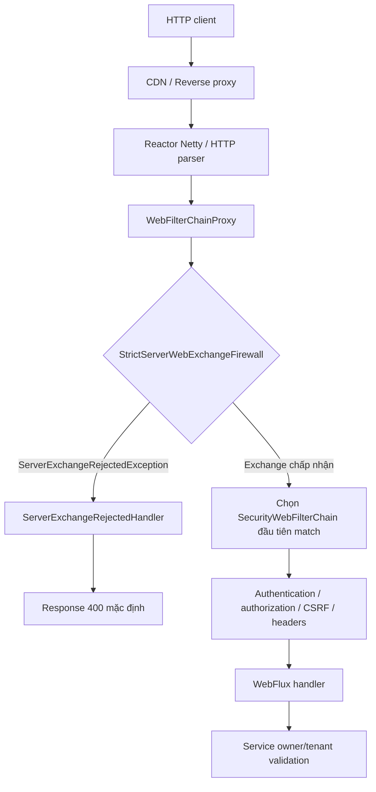

# Đánh giá cấu hình khi nâng cấp từ phiên bản chưa có firewall Reactive

## 1. Tình huống nâng cấp: vì sao một ứng dụng WebFlux đang chạy tốt bỗng trả 400?

Một hệ thống **Spring WebFlux** dùng Spring Security đã hoạt động nhiều năm sau reverse proxy. Ứng dụng có các nhóm endpoint:

- `/public/**`: tài nguyên công khai;
- `/api/**`: bearer token hoặc session theo kiến trúc;
- `/admin/**`: tài nguyên quản trị;
- `/files/{id}`: dữ liệu gắn với từng người dùng, tenant;
- `/legacy/**`: một vài client cũ còn gửi URL có semicolon hoặc encoded slash.

Nhóm vận hành dự định nâng cấp Spring Security và Spring Boot. Trước nâng cấp, request kiểu `GET /legacy;client=old/items` được reverse proxy và WebFlux handler xử lý theo cách riêng. Sau nâng cấp, một số request bất ngờ nhận **HTTP 400**, method `TRACE` bị từ chối sớm, vài header cũ không đi tới handler, và một WebFilter thay đổi header có thể gặp lỗi khi tương tác với request wrapper mới.

Phản ứng vội vàng thường là tìm cách “trả lại hành vi cũ”: thêm `setAllowSemicolon(true)`, `setAllowedHeaderValues(v -> true)` hoặc thậm chí thay firewall bằng `INSECURE_NOOP`. Làm vậy có thể khiến một API legacy hoạt động nhưng mở đường cho **bất đồng cách hiểu URL giữa gateway, security matcher và controller**.

**Mục tiêu của bài là đánh giá thay đổi bảo mật khi nâng cấp, giữ mặc định strict khi có thể, chẩn đoán chính xác breaking changes và chỉ đưa vào ngoại lệ tối thiểu khi đã có bằng chứng.**

Bài thuộc chương **Firewall trên Reactive** của mô-đun **SPRING_SECURITY_HTTP_PROTECTION**. Mô-đun hướng tới các lớp phòng vệ HTTP và trình duyệt trong Spring Security — CSRF, CORS, security headers, CSP, HSTS, HTTP firewall và session — cho cả Servlet và Reactive. Đề bài của tài liệu là **“Đánh giá cấu hình khi nâng cấp từ phiên bản chưa có firewall Reactive”**: đưa ra quy trình nâng cấp dựa trên **phiên bản thực tế, cấu hình security chain, request parsing, proxy, kiểm thử và vận hành**.

### Bạn sẽ học được gì?

Sau bài này, bạn có thể:

1. Phân biệt phiên bản **chưa có class firewall**, phiên bản **có class nhưng chưa được tích hợp hoặc chưa chọn Bean**, và phiên bản **đang thực thi strict firewall**.
2. Đọc đúng version từ dependency đã resolve và kiểm tra API `ServerWebExchangeFirewall`, `StrictServerWebExchangeFirewall`, `WebFilterChainProxy`, `ServerExchangeRejectedHandler`.
3. Phân tích rủi ro khi một bản nâng cấp thay đổi **điểm chặn request** hoặc **cách bao bọc header/path**, kể cả khi application code không đổi.
4. Đánh giá cấu hình hiện tại về methods, semicolon, URL encoding, hostname, headers, query parameters và security chain coverage.
5. Biên soạn ma trận regression cho client hợp lệ, request nguy hiểm, CORS/CSRF, session, object-level authorization và proxy normalization.
6. Kiểm tra Bean firewall/rejection handler **thực sự được Spring Security sử dụng** chứ không chỉ có trong ApplicationContext.
7. Xây chiến lược canary, cảnh báo, feature-compatibility, xử lý lỗi và rollback không vô hiệu hóa phòng vệ.
8. Nhận diện khác biệt Servlet/Reactive, Cloud Gateway tương tác với request wrapper và những yêu cầu bổ sung của migration.

## 2. Cảnh báo đầu tiên: lịch sử API không phải một đường thẳng “trước 6.4 là không có”

Javadoc của các API Reactive firewall ở nhánh Spring Security hiện đại thường ghi **Since: 6.4**. Ví dụ `StrictServerWebExchangeFirewall` và `ServerWebExchangeFirewall` được mô tả theo mốc đó trong tài liệu nhánh 6.4+/6.5. Tuy nhiên, các **nhánh bảo trì cũ có backport**: Javadoc nhánh 5.7.x ghi `StrictServerWebExchangeFirewall` từ **5.7.13**, trong khi tài liệu của 6.2.8 và 6.3.4 cũng đã liệt kê package Reactive firewall. Vì vậy, câu “Spring Security 6.3 không có firewall Reactive” là **không đủ chính xác**.

**Cách xác định đúng là kiểm tra bản artifact đang chạy và luồng runtime, không chỉ lấy mốc `@since` làm phép so sánh số phiên bản.**

| Tình huống gặp khi nâng cấp | Kết luận hợp lý | Hành động cần làm |
| --- | --- | --- |
| Jar đích không có `ServerWebExchangeFirewall` | API này chưa hiện diện trong artifact đó | Chọn đường migration phiên bản, không copy code API mới |
| Class có trong jar nhưng proxy không gọi | Có thể có backport/API nhưng thiếu wiring, hoặc app không dùng proxy dự kiến | Kiểm tra `WebFilterChainProxy` và test thực |
| Proxy có strict firewall mặc định | Request shape mới có thể bị từ chối sớm hơn | Đánh giá compatibility và negative tests |
| Expose Bean custom nhưng behavior không đổi | Bean có thể chưa được wiring trong version/config đó | Test bằng marker policy và xem issue/lịch sử patch |
| Đã có firewall nhưng nâng cấp tiếp | Vẫn có thể thay đổi wrapper/header/matcher behavior | Chạy regression, không coi là nâng cấp “không ảnh hưởng” |
| App có cả Spring MVC và WebFlux | Có thể chạy Servlet security thay vì Reactive | Xác nhận application type, bean/proxy đang dùng |

### 2.1. Bản kiểm tra bốn câu hỏi

Trước khi sửa cấu hình:

1. **Class có tồn tại?** Kiểm tra `spring-security-web` version thực tế.
2. **Proxy có thực thi firewall?** Xác minh `WebFilterChainProxy.filter(...)` đi qua `getFirewalledExchange(...)`.
3. **Bean custom có được proxy chọn?** Không chỉ assert `@Autowired ServerWebExchangeFirewall` là có.
4. **Request bị chặn ở tầng nào?** CDN/HTTP parser/firewall/authentication/controller có thể đều trả 400 hoặc 4xx.

Chỉ khi trả lời cả bốn câu mới biết đang nâng cấp **cơ chế bảo vệ mới** hay chỉ thay đổi cách thực thi cơ chế đã có.

### 2.2. Mốc lịch sử có ý nghĩa khi rà soát

- `WebFilterChainProxy` là thành phần Reactive có từ lâu (`@since 5.0`), nhưng **sự tồn tại của proxy không chứng minh mọi version đã kiểm tra strict HTTP firewall**.
- API Reactive firewall hiện hành có tài liệu 6.4+ rõ ràng.
- Một số patch nhánh cũ đã backport class/logic, nên có thể gặp `StrictServerWebExchangeFirewall` trong 5.7.x, 6.2.x hoặc 6.3.x.
- Tháng 10/2024, Spring Security từng ghi nhận các vấn đề **Bean `ServerWebExchangeFirewall` không được tự động dùng** (#15974) và **Bean `ServerExchangeRejectedHandler` không được dùng** (#15975); các issue đã được xử lý trong lịch sử dự án. Khi điều tra một phiên bản cũ, xem fix/patch thực tế và **kiểm thử wiring**, không sao chép workaround cũ thiếu kiểm soát.
- Các issue về header wrapper và Spring Cloud Gateway (`StrictFirewallHttpHeaders`, mutation và `HttpHeaders.writableHttpHeaders`) cho thấy nâng cấp có thể ảnh hưởng code **sửa request headers**, không chỉ URL bị reject.

Không khẳng định một issue ảnh hưởng **mọi** Spring Boot hay Spring Security release. Đối chiếu đúng patch, phần mềm dùng chung, BOM và integration test.

## 3. Đóng băng baseline trước khi đổi phiên bản

Một migration bảo mật không nên bắt đầu bằng việc thêm Bean. Trước hết ghi nhận **phiên bản, security configuration, request patterns và những hành vi đang tồn tại**.

### 3.1. Bảng baseline

| Hạng mục | Cần ghi nhận trước nâng cấp | Vì sao quan trọng |
| --- | --- | --- |
| Spring Boot/Framework/Security | Version chính xác của từng artifact | BOM có thể override và backport |
| Reactive runtime | Reactor Netty hoặc server adapter khác | HTTP parser có thể reject trước firewall |
| Application type | `REACTIVE` hay `SERVLET` | Xác định proxy/filters thực sự sử dụng |
| Proxy/CDN/WAF | Version, route rewrite, method policy, Host forwarding | Có thể normalize/trả 4xx trước origin |
| Security chains | Thứ tự, `securityMatcher`, `authorizeExchange`, fallback | URL không match chain có thể không được bảo vệ |
| Authentication | Bearer, session, Basic, OAuth2, mTLS | 401/403/session behavior có thể đổi |
| CORS/CSRF | Allowed origins/methods, token flow | Preflight và state-changing requests |
| URL patterns | Semicolon, double slash, encoded slash/percent, matrix variables | Những input strict có thể từ chối |
| HTTP methods | GET/HEAD/OPTIONS/POST/PUT/PATCH/DELETE và extensions | Tập strict default không phải “mọi method” |
| Header/parameter quirks | Legacy User-Agent, duplicate Authorization, repeated query keys | Character validation có thể gây 400 hoặc lỗi downstream |
| Response headers/cache | HSTS, CSP, nosniff, no-store, CDN cache | Rejection sớm có thể không chạy chain headers |
| Object authorization | Owner/tenant checks | Firewall không thay phân quyền dữ liệu |

### 3.2. Lệnh kiểm tra dependency dùng tại dự án của người học

Những ví dụ sau là **lệnh tham khảo** cho người triển khai trên môi trường của họ; bước viết bài này **không chạy build** hoặc thay đổi các file dự án khác.

Với Maven:

```bash
mvn dependency:tree -Dincludes=org.springframework.security

mvn dependency:tree -Dincludes=org.springframework:spring-webflux
```

Với Gradle:

```bash
./gradlew dependencyInsight \
  --dependency spring-security-web \
  --configuration runtimeClasspath

./gradlew dependencyInsight \
  --dependency spring-security-config \
  --configuration runtimeClasspath
```

Cần đối chiếu thêm `spring-web`, `spring-webflux`, Reactor Netty, Spring Cloud Gateway và phiên bản Java theo BOM. Một import compile thành công **không chứng minh** runtime không có jar cũ do dependency conflict ở packaging/container.

### 3.3. Phân biệt “test đang dùng phiên bản mới” và “production đang dùng phiên bản mới”

Khi có Docker/OCI images, staging cluster, deployment canary hoặc nhiều service instances, ghi rõ:

- version trong artifact được build;
- version tại runtime của từng instance đang phục vụ traffic;
- feature flags, profile và security Bean khác nhau theo môi trường;
- proxy/ingress policy của môi trường đó;
- request ID hoặc instance ID để liên hệ một phản hồi với đúng phiên bản.

Nếu log lỗi đến từ instance cũ nhưng nhóm đọc dependency của nhánh mới, chẩn đoán firewall sẽ sai.

## 4. Tư duy đúng: firewall mới bổ sung kiểm tra request trước security chain

### 4.1. Luồng phiên bản thiếu lớp firewall tích hợp

Trong một ứng dụng Reactive **thực sự chưa có hoặc chưa kích hoạt HTTP firewall tương ứng**, có thể hình dung:

```text
Client
  → Gateway / HTTP parser
  → WebFilterChainProxy
  → SecurityWebFilterChain (authentication/authorization/CSRF)
  → WebFlux router
  → Service
```

Không được suy rằng vì chưa có Reactive firewall thì **mọi** input hiểm đều được chấp nhận; gateway, Netty hoặc WebFlux parser vẫn có thể từ chối sớm. Thiếu lớp này chỉ có nghĩa không có cùng chiến lược kiểm tra strict ở vị trí tương đương.

### 4.2. Luồng phiên bản có strict firewall



`WebFilterChainProxy` sử dụng `ServerWebExchangeFirewall#getFirewalledExchange(exchange)`; nếu publisher phát `ServerExchangeRejectedException`, proxy gọi `ServerExchangeRejectedHandler`. Handler mặc định `HttpStatusExchangeRejectedHandler` gửi **HTTP 400**.

Điều đáng chú ý khi nâng cấp:

- Rejection có thể xuất hiện **trước khi controller, authn/authz và các WebFilters của chain chạy**.
- Một URL được firewall cho qua chưa chắc được người dùng phép truy cập.
- Một response 400 không luôn do firewall: Netty/proxy/validation cũng có thể trả 400.
- Nếu không `SecurityWebFilterChain` nào match, proxy có thể delegate xuống chain gốc không chạy security filters đã định. Cần coverage/default-deny.

### 4.3. Trách nhiệm của các tầng không đổi

| Tầng | Trách nhiệm | Không nên trông đợi |
| --- | --- | --- |
| Edge/CDN | TLS, WAF/rate limits, routing, parser policy, cache | Không thay method/resource authorization trong service |
| Netty/HTTP parser | Framing, HTTP syntax, header limits | Không hiểu toàn bộ nghiệp vụ tài liệu |
| Reactive firewall | Request-shape và URL/header/parameter checks | Không phân quyền người dùng theo ID |
| Security chains | Authentication, URL/method authorization, CSRF, CORS | Không bảo đảm owner/tenant nếu rule quá tổng quát |
| WebFlux handler/service | Validate business input và resource permissions | Không giải quyết parser differential phía trước |

**Mục tiêu nâng cấp là thêm lớp phòng vệ, không chuyển trách nhiệm của các lớp khác sang firewall.**

## 5. Những thay đổi hành vi cần chờ đợi

### 5.1. Tập HTTP methods mặc định

`StrictServerWebExchangeFirewall` mặc định cho phép:

```text
DELETE, GET, HEAD, OPTIONS, PATCH, POST, PUT
```

Các HTTP methods ngoài tập này, ví dụ `TRACE`, có thể bị reject. Nếu ứng dụng có giao thức mở rộng như WebDAV `PROPFIND`, phải đánh giá **từng method cụ thể** và thêm vào allowlist có chủ đích, không tắt validation toàn bộ.

**Ghi nhớ:** Cho method qua firewall chưa cho phép route/handler thực hiện và chưa cấp quyền truy cập dữ liệu.

### 5.2. Các dạng URL có thể thay đổi kết quả

| Input kiểm thử | Mối quan tâm | Cách xử lý ưu tiên |
| --- | --- | --- |
| `/api/../admin` | Dot segments và security matcher bypass | Chuẩn hóa ở tầng có chủ đích hoặc từ chối, test admin auth |
| `/api//private` | Double slash và route selection | Thiết kế URI đơn giản |
| `/catalog;year=2026/items` | Matrix variables/semicolon | Ưu tiên query parameters, chỉ nới sau threat model |
| `/files/team%2Ffinance` | Encoded slash | Opaque ID thay storage path |
| `/files/team%252Ffinance` | Double percent decode | Tránh decode lặp khác nhau |
| `/api%5Cprivate` | Backslash có thể được coi separator | Giữ default reject |
| `/path%00suffix` | Null/control characters | Giữ default reject |
| `/path%0D%0Asuffix` | CR/LF injection risk | Giữ default reject |

Strict firewall có các công tắc riêng như `setAllowSemicolon(boolean)`, `setAllowUrlEncodedSlash(boolean)`, `setAllowUrlEncodedPercent(boolean)`. Nhưng **không có cơ chế an toàn để tắt toàn bộ kiểm tra normalization**; Javadoc cảnh báo một số ràng buộc không cho vô hiệu hóa.

Một payload có thể bị HTTP server/proxy từ chối **trước** firewall. Test phải chỉ ra tầng nào xử lý thay vì đòi một status cố định cho mọi raw path.

### 5.3. Header names/values và parameter names

Một nâng cấp có thể làm lộ ra:

- Header name/value chứa code point không hợp lệ hoặc control characters.
- Legacy `User-Agent` bị giải mã khác tại proxy/HTTP server.
- Request bị wrap qua `StrictFirewallHttpHeaders` và filter downstream mutate header có tương tác khác trước.
- Query parameter names có ký tự không được phép.
- Các integration Cloud Gateway/TokenRelay giả định một `HttpHeaders` writable cụ thể.

Spring Security mặc định kiểm tra ký tự trong **header names, header values, parameter names**. `setAllowedParameterValues(Predicate<String>)` cũng tồn tại; **default predicate cho parameter values cho phép mọi giá trị**, không thay validation ở business layer.

### 5.4. Hostname và forwarded headers

`setAllowedHostnames(Predicate<String>)` cho phép áp host allowlist nếu cần; default predicate không buộc hostname giới hạn theo doanh nghiệp. Nhưng nếu origin sau gateway nhìn thấy Host nội bộ, một host allowlist triển khai sai có thể chặn mọi request.

Kiểm tra chính xác:

- Host header origin thấy;
- `Forwarded`/`X-Forwarded-Host` có được **trusted proxy** ghi đè/sanitize không;
- HTTPS termination/HSTS/redirect policy;
- `Host` không được dùng thay owner/tenant authorization.

## 6. Mốc khác biệt thường bị bỏ sót: Bean tồn tại nhưng chưa được proxy dùng

Từng có issue Spring Security [#15974](https://github.com/spring-projects/spring-security/issues/15974) nêu **`ServerWebExchangeFirewall` Bean được expose nhưng chưa được hạ tầng sử dụng**, và [#15975](https://github.com/spring-projects/spring-security/issues/15975) tương tự với `ServerExchangeRejectedHandler`. Các issue có lịch sử sửa đổi theo patch/branch; vì vậy **không nên suy “Bean trong ApplicationContext = behavior có tác dụng”**.

### 6.1. Những điều phải xác nhận

1. Chính bản Spring Security runtime có API `WebFilterChainProxy.setFirewall(...)` và handler setter tương ứng.
2. Spring Security WebFlux configuration đang được load vào đúng application context.
3. `WebFilterChainProxy` được đăng ký trong WebFilter chain thực, không có bản tùy biến/trùng lặp.
4. Bean `ServerWebExchangeFirewall` custom đã được proxy áp dụng theo cơ chế của đúng version.
5. Bean `ServerExchangeRejectedHandler` custom cũng được proxy áp dụng.
6. Integration test có **behavior khác với default** để chứng minh wiring.

### 6.2. Vì sao không nên sao chép workaround cũ?

Một số issue lịch sử minh họa `BeanPostProcessor` để tác động trực tiếp `WebFilterChainProxy`, đôi khi dùng `ServerWebExchangeFirewall.INSECURE_NOOP` nhằm xác định vấn đề wiring. **Đó không phải cấu hình khuyến nghị**: `INSECURE_NOOP` bỏ kiểm tra và có thể làm mất toàn bộ phòng vệ.

Giải pháp ưu tiên:

- Nâng tới patch release đã sửa lỗi wiring trong nhánh sử dụng, sau khi xác minh compatibility.
- Dùng Bean customization chính thức nếu version hỗ trợ.
- Nếu hạ tầng buộc phải giữ phiên bản cũ, xem xét phương án bảo trì có security review và test; **không dùng no-op**.
- Bất kỳ custom wiring nào cũng cần test cả request hợp lệ và request hiểm, tránh proxy trùng hoặc security chain bị bỏ qua.

### 6.3. Kế hoạch test xác nhận custom Bean

Một phương pháp là cấu hình **test-only policy** làm khác default: cho `GET, HEAD, POST, OPTIONS` nhưng **không cho PUT**. Default strict firewall có PUT, do đó một request PUT mà đến được Spring là tín hiệu kiểm tra custom policy.

Tuy nhiên:

- `PUT` mặc định có thể bị CSRF trả `403` hoặc handler trả `405`.
- `400` có thể do parser, nên phải kiểm tra rejected handler invocation hoặc marker header test-only.
- Nếu ứng dụng dùng route/chain khác nhau, phải chọn endpoint và authentication fixture đúng.
- Sau khi chứng minh Bean wiring, **không copy test-only restriction và marker headers sang production**.

## 7. Tùy chỉnh firewall bằng Bean đúng API khi phiên bản hỗ trợ

Với Spring Security Reactive 6.4+/6.5.x (kiểm tra Javadoc patch thực), Bean:

```java
import org.springframework.context.annotation.Bean;
import org.springframework.context.annotation.Configuration;
import org.springframework.security.web.server.firewall.StrictServerWebExchangeFirewall;

@Configuration
class ReactiveFirewallConfiguration {

    @Bean
    StrictServerWebExchangeFirewall serverWebExchangeFirewall() {
        return new StrictServerWebExchangeFirewall();
    }
}
```

Một Bean strict không có setter thường lặp lại behavior default; nếu ứng dụng không có nhu cầu custom, **không cần tạo Bean riêng**.

### 7.1. Chữ ký quan trọng khi di chuyển code cũ

Javadoc `StrictServerWebExchangeFirewall` nhánh 6.5.x có:

```java
void setAllowedHttpMethods(Collection<HttpMethod> allowedHttpMethods)
```

Ví dụ custom allowlist chỉ khi API thực sự chỉ dùng các methods này:

```java
import java.util.List;

import org.springframework.context.annotation.Bean;
import org.springframework.context.annotation.Configuration;
import org.springframework.http.HttpMethod;
import org.springframework.security.web.server.firewall.StrictServerWebExchangeFirewall;

@Configuration
class RestrictMethodsConfiguration {

    @Bean
    StrictServerWebExchangeFirewall serverWebExchangeFirewall() {
        var firewall = new StrictServerWebExchangeFirewall();

        firewall.setAllowedHttpMethods(List.of(
            HttpMethod.GET,
            HttpMethod.HEAD,
            HttpMethod.POST,
            HttpMethod.OPTIONS));

        return firewall;
    }
}
```

Không khai báo cùng lúc `ReactiveFirewallConfiguration` và `RestrictMethodsConfiguration` nếu cả hai tạo Bean cùng type trong một context. Chọn **một** policy đã được review.

**Khác Servlet:** `StrictHttpFirewall` bên Servlet dùng `Collection<String>`; đừng copy `List.of("GET", "POST")` vào Reactive khi Javadoc đòi `Collection<HttpMethod>`. Trang reference Reactive có thể còn ví dụ chuỗi theo version khác; ưu tiên chữ ký từ jar thật.

### 7.2. Giữ OPTIONS và HEAD

Một số nhóm “giảm bề mặt” thành GET/POST nhưng vô tình làm CORS preflight `OPTIONS` hoặc requests `HEAD` thất bại. Inventory phương thức thật trước khi chỉnh allowlist; **cho phép OPTIONS về mặt firewall vẫn chưa cấu hình CORS policy**.

### 7.3. Không bật công tắc nguy hiểm

```java
// KHÔNG sử dụng để chữa lỗi compatibility trên production:
firewall.setUnsafeAllowAnyHttpMethod(true);

// Cũng không thay bằng:
ServerWebExchangeFirewall.INSECURE_NOOP
```

Nới method validation như vậy có thể chấp nhận những methods mà controller/proxy/security policies chưa kiểm soát đồng nhất.

## 8. Kịch bản legacy: semicolon, encoded slash và redesign URL

### 8.1. Matrix variables / semicolon

Legacy client:

```text
GET /catalog;color=red/products;year=2026
```

Strict mặc định reject semicolon, nên request có thể từ 200/404 trước nâng cấp thành 400 sau nâng cấp.

**Phương án ưu tiên:**

```text
GET /catalog/products?color=red&year=2026
```

Handler validate `color/year` theo domain và service vẫn kiểm tra quyền/tenant nếu cần. Khi không thể nâng client ngay, có thể cân nhắc:

```java
firewall.setAllowSemicolon(true);
```

Nhưng setter tác động tới **toàn bộ request qua cùng WebFilterChainProxy**, không chỉ `/catalog/**`. Phải test `/admin;mode=public/users`, `/api;ignored=1/private` và proxy normalization trước khi duyệt ngoại lệ.

### 8.2. Encoded slash và storage keys

Legacy client có key `team/finance/report` gửi:

```text
GET /files/team%2Ffinance%2Freport
```

Thay vì nới `setAllowUrlEncodedSlash(true)`, dùng opaque ID:

```text
GET /files/5939f96a-6d96-4a21-94b6-bb1a955c1203
```

Service tra storage key nội bộ bằng ID rồi kiểm tra owner/tenant. Không nối raw path vào filesystem; không suy encoded slash cho phép thì security matcher/handler chắc cùng hiểu một route.

### 8.3. Nếu bắt buộc có ngoại lệ trong thời kỳ chuyển đổi

Ghi đầy đủ:

- client nào, tỷ lệ request, vì sao không thể sửa sớm;
- setter nào, tại sao chỉ setter đó;
- security chain coverage và service authorization sau khi nới;
- negative tests URL variants, method và tenant;
- behavior origin trực tiếp và qua CDN/proxy;
- hạn dùng ngoại lệ và điều kiện rollback/thu hồi.

Không bật semicolon, encoded slash, encoded percent, encoded period, backslash, null và CR/LF **cùng một lúc** để “làm test pass”.

## 9. SecurityWebFilterChain: migration có thể bộc lộ lỗ hổng đã tồn tại

Một firewall strict mới có thể reject vài URL mơ hồ trước security chain; tuy nhiên không nên coi nó là giải pháp thay cho cấu hình authorization.

### 9.1. Ví dụ security chain bao phủ mọi URL

```java
import org.springframework.context.annotation.Bean;
import org.springframework.context.annotation.Configuration;
import org.springframework.security.config.annotation.web.reactive.EnableWebFluxSecurity;
import org.springframework.security.config.web.server.ServerHttpSecurity;
import org.springframework.security.web.server.SecurityWebFilterChain;

@Configuration
@EnableWebFluxSecurity
class ReactiveSecurityConfig {

    @Bean
    SecurityWebFilterChain security(ServerHttpSecurity http) {
        return http.authorizeExchange(auth -> auth
                .pathMatchers("/public/**").permitAll()
                .pathMatchers("/admin/**").hasRole("ADMIN")
                .pathMatchers("/api/**").authenticated()
                .anyExchange().denyAll())
            .build();
    }
}
```

Đây chỉ là authorization fixture. Ứng dụng phải cấu hình đúng authentication mechanism, CORS/CSRF/security headers và method security theo use case.

### 9.2. Vấn đề chain coverage

Khi có nhiều `SecurityWebFilterChain`:

```text
Chain 1: /api/**  (Bearer auth)
Chain 2: /admin/** (ADMIN)
Chain 3: phần còn lại (public allowlist + denyAll)
```

Firewall chạy trước chọn chain. Nếu **không chain nào match** một exchange hợp lệ, `WebFilterChainProxy` có thể delegate đến WebFlux handler mà không chạy security filters của các chain dự kiến. Đừng nhầm “có strict firewall” với “mọi route đều đã có authn/authz”.

Đặc biệt test:

- `/api/v2/**` mới;
- `/admin;value=1/**` nếu bật semicolon;
- encoded path variants qua proxy;
- health/docs/static resources;
- các endpoint đặc thù từ actuator nếu được bật;
- rule sắp xếp `@Order` và `securityMatcher`.

### 9.3. Object-level authorization vẫn bắt buộc

Giả sử `GET /api/documents/42` yêu cầu authenticated. Alice và Bob đều authenticated nhưng chỉ Alice sở hữu tài liệu 42. Quyết định phải ở **service/method/repository**, không chỉ `.authenticated()`:

```text
HTTP method/path hợp lệ
  → Security chain chọn đúng
  → Xác thực principal
  → Service kiểm tra document.tenantId và ownerId
  → Chỉ sau đó mới đọc nội dung
```

Sau nâng cấp, một URL bất thường có thể được từ chối sớm hơn; điều đó không chứng minh tài liệu được bảo vệ nếu request dùng URL hoàn toàn hợp lệ.

## 10. Rejection handler và thay đổi cách trả lỗi

`StrictServerWebExchangeFirewall` phát `ServerExchangeRejectedException`. `WebFilterChainProxy` bắt loại exception này và dùng `ServerExchangeRejectedHandler`, mặc định `HttpStatusExchangeRejectedHandler` trả **HTTP 400**.

Nếu API contract yêu cầu status khác:

```java
import org.springframework.context.annotation.Bean;
import org.springframework.context.annotation.Configuration;
import org.springframework.http.HttpStatus;
import org.springframework.security.web.server.firewall.HttpStatusExchangeRejectedHandler;
import org.springframework.security.web.server.firewall.ServerExchangeRejectedHandler;

@Configuration
class RejectionPolicyConfig {

    @Bean
    ServerExchangeRejectedHandler rejectedHandler() {
        return new HttpStatusExchangeRejectedHandler(
            HttpStatus.NOT_FOUND);
    }
}
```

**Cấu hình trên thay response status, không làm request bị reject trở thành hợp lệ.** Đây là phương án thay thế default 400 và phải kiểm tra Bean wiring của đúng version.

### 10.1. Các status không cùng nghĩa

| Status | Nguồn điển hình | Đừng quy nhầm |
| --- | --- | --- |
| `400` | Firewall, HTTP parser, gateway, Bean Validation | Không tự chứng minh strict firewall reject |
| `401` | Authentication entry point | Không phải lỗi method/path shape mặc định |
| `403` | Authorization hoặc CSRF | Không phải mặc định `ServerExchangeRejectedException` |
| `404` | Router không tìm thấy hoặc custom rejection handler | Không tự suy endpoint không tồn tại |
| `405` | Handler không hỗ trợ HTTP method | Firewall có thể đã cho method qua |
| `415` | Unsupported Content-Type | Message reader, không hẳn firewall |
| `502`/`503` | Proxy/upstream | Có thể Spring chưa nhận request |

### 10.2. Không phản chiếu request nguy hiểm

Một custom rejected handler trả JSON nên dùng body cố định:

```json
{"error":"invalid_http_request"}
```

Không đưa `exception.getMessage()`, raw URI, query, cookie, `Authorization` hoặc stack trace vào response/log thông thường. Response 400 do firewall có thể được tạo **trước selected security chain thêm security headers**, vì vậy kiểm tra `Content-Type`, `Cache-Control`, `nosniff` và HSTS/CSP theo topology qua HTTPS/edge.

## 11. Hậu quả bất ngờ: request wrapper và mutation của header

Đây là phần migration thường bị bỏ sót. Reactive strict firewall không chỉ reject input; nó còn có thể **bọc `ServerWebExchange`/request/headers** để kiểm soát cách các WebFilters phía sau tiếp cận dữ liệu.

Các issue lịch sử như [#16002](https://github.com/spring-projects/spring-security/issues/16002) và [#16069](https://github.com/spring-projects/spring-security/issues/16069) ghi nhận tương tác giữa `StrictFirewallHttpHeaders`, `HttpHeaders.writableHttpHeaders` và các thao tác mutate request trong một số tổ hợp Spring Security, Spring Framework, Spring Cloud Gateway.

### 11.1. Triệu chứng

Một `WebFilter` hoặc Spring Cloud Gateway TokenRelay đọc wrapped headers rồi cố thay bearer token:

```text
ServerWebExchange
  → Strict firewall request wrapper
  → WebFilter/Gateway mutates headers
  → UnsupportedOperationException hoặc mất wrapper validation
```

Tùy version, lỗi có thể xuất hiện khi gọi `exchange.mutate()`, `request.mutate().headers(...)`, hoặc khi thư viện cố lấy writable headers từ một read-only view.

**Không khẳng định mọi patch đều gặp lỗi.** Đây là ví dụ vì sao chỉ test path rejection là chưa đủ khi nâng cấp hạ tầng WebFlux.

### 11.2. Một phép thử tích hợp an toàn

Trong test, tạo một WebFilter downstream chỉ thêm một **test header** trên request clone (không chạm credentials thật):

```java
import org.springframework.context.annotation.Bean;
import org.springframework.context.annotation.Configuration;
import org.springframework.web.server.WebFilter;
import reactor.core.publisher.Mono;

@Configuration
class RequestMutationCompatibilityTestConfig {

    @Bean
    WebFilter testRequestMutation() {
        return (exchange, chain) -> {
            var newRequest = exchange.getRequest().mutate()
                .header("X-Compatibility-Probe", "ok")
                .build();

            return chain.filter(exchange.mutate()
                .request(newRequest)
                .build());
        };
    }
}
```

**Chỉ dùng Bean này trong test configuration.** Nó kiểm tra API mutation không ném lỗi khi wrapper đã tồn tại, nhưng chưa chứng minh hoàn toàn header validation được duy trì sau mutation. Với case thực tế, cần test thêm rằng header không hợp lệ **vẫn không đi xuyên qua hạ tầng** và security chain được áp đúng. Lưu ý thứ tự WebFilter có thể ảnh hưởng việc probe chạy trước hay sau `WebFilterChainProxy`; kiểm tra vị trí thực thay vì giả định.

### 11.3. Nâng patch và thử integration trước khi áp workaround

Cách xử lý ưu tiên:

1. Ghi rõ phiên bản Spring Security, Spring Framework, Spring Cloud Gateway, Reactor Netty.
2. Tái hiện với cùng filter/mutation sequence.
3. Đối chiếu issue/fix/patch thực tế.
4. Nâng phiên bản tương thích rồi chạy unit + real-server + gateway tests.
5. Nếu cần custom wrapper/interceptor, review threat model để không vô tình bypass strict validation.
6. **Không sử dụng `INSECURE_NOOP`** chỉ để TokenRelay hoạt động.

## 12. Inventory đường HTTP thực và proxy trước nâng cấp

### 12.1. Những thứ thường khác nhau giữa dev và production

| Thành phần | Dev trực tiếp | Production qua proxy |
| --- | --- | --- |
| HTTP protocol | Thường HTTP/1.1 | Browser HTTP/2/3, upstream có thể HTTP/1.1 |
| Host | `localhost`/`127.0.0.1` | Public host hoặc internal host sau rewrite |
| Path | Raw target gần như client gửi | Có thể decode, normalize hoặc strip prefix |
| TLS | Có thể HTTP | TLS terminate ở edge/proxy |
| CORS | Same-origin giả lập | Cross-origin thực |
| Authentication | Test token/mocks | Cookies, bearer, OAuth2, mTLS |
| Headers | Ít middleware | WAF, TokenRelay, tracing, forwarded headers |
| Cache | Không có | CDN/reverse proxy caching |
| Error source | Origin/test client | Edge, parser, security, router |

Nếu chỉ test `MockServerWebExchange`, nhóm chưa kiểm tra HTTP server parser, proxy normalization hay header mutation thật.

### 12.2. NGINX là ví dụ điển hình

Trong NGINX, `$request_uri` đại diện original request URI (có thể gồm query), còn `$uri` là URI hiện tại được chuẩn hóa hoặc thay đổi bởi rewrite. `location` thường được match trên URI đã normalize, và `proxy_pass` có/không có phần URI có thể làm upstream nhận request-target khác.

Ví dụ `/api/../admin` có thể thành `/admin` trước Spring. Nếu request sau rewrite được định tuyến tới admin chain và thiếu role ADMIN, `403` là kết quả có thể an toàn; Spring firewall **chưa chắc từng thấy `..`**.

**Không disable normalization của proxy để “đảm bảo firewall nhìn payload gốc”.** Nếu edge chủ động reject payload, đó là một lớp phòng vệ; điều quan trọng là edge và origin không tạo đường bypass.

### 12.3. Ghi dữ liệu proxy an toàn

Log nên có request ID do hệ thống kiểm soát, timestamp, edge/upstream status, instance ID và thời gian. Tránh log `$request_uri`, `$args`, `Authorization`, cookie hoặc exception message chứa raw input.

Khi cần phân tích raw-vs-normalized path, chỉ thu trên staging cô lập với dữ liệu giả, thời hạn lưu ngắn và quyền truy cập hạn chế.

## 13. Lập bảng compatibility từ hành vi trước nâng cấp

Đừng xây test set chỉ gồm payload bị chặn. Phải ghi nhận **client hợp lệ** để phát hiện breaking changes.

| Use case | Request hợp lệ | Rủi ro sau bật strict | Kỳ vọng |
| --- | --- | --- | --- |
| Trình duyệt frontend | `OPTIONS` CORS preflight | Custom allowlist loại OPTIONS | Preflight vẫn qua policy đúng |
| Tải metadata | `HEAD /files/{id}` | Custom allowlist loại HEAD | Còn phục vụ đúng quyền |
| CRUD thông thường | GET/POST/PUT/PATCH/DELETE | Method allowlist quá hẹp | Methods được API support vẫn hoạt động |
| Legacy matrix variables | `/catalog;v=1/items` | Strict reject semicolon | Ưu tiên đổi URL, nếu nới có test |
| ID file có slash | `/files/a%2Fb` | Strict reject encoded slash | Dùng opaque ID hoặc lộ trình chuyển |
| Client WebDAV | `PROPFIND /dav/...` | Method ngoài default | Đánh giá từng extension method |
| OAuth2 callback | Query state/code và redirect | Header/param/quy trình callback | Không phá auth flow |
| Gateway TokenRelay | Header Authorization được mutate | Wrapped headers read-only behavior | TokenRelay hoạt động, validation vẫn có |
| Browser session | Cookie login/logout | CSRF, SameSite, redirect, cache | Session/CSRF vẫn bảo vệ |
| Frontend đọc 4xx JSON | CORS headers trên error | Rejection trước selected chain | API error contract theo policy |
| Admin URL | `/admin/**` | Proxy rewrite/chain matcher | Không lộ nội dung ngoài quyền |

Phân loại rõ:

- **Khác biệt được kỳ vọng và mong muốn:** TRACE bị reject, URL không chuẩn hóa bị chặn.
- **Khác biệt gây lỗi client hợp lệ:** extension method hợp pháp bị chặn hoặc header legacy bị parse sai.
- **Lỗi cấu hình/kiến trúc:** thiếu security chain, proxy tin forwarded headers không đúng, service thiếu owner check.
- **Lỗi tích hợp do nâng cấp:** Bean chưa được wiring hoặc wrapper/TokenRelay mutation sai.

## 14. Thiết kế test ở ba cấp: firewall, HTTP server và edge

### 14.1. Cấp A — test trực tiếp firewall

```java
import org.junit.jupiter.api.Test;
import org.springframework.http.HttpMethod;
import org.springframework.mock.http.server.reactive.MockServerHttpRequest;
import org.springframework.mock.web.server.MockServerWebExchange;
import org.springframework.security.web.server.firewall.ServerExchangeRejectedException;
import org.springframework.security.web.server.firewall.StrictServerWebExchangeFirewall;
import reactor.test.StepVerifier;

class StrictFirewallMigrationTest {

    private final StrictServerWebExchangeFirewall firewall =
        new StrictServerWebExchangeFirewall();

    @Test
    void normalGetIsAccepted() {
        var exchange = MockServerWebExchange.from(
            MockServerHttpRequest.get("/public/ping").build());

        StepVerifier.create(firewall.getFirewalledExchange(exchange))
            .expectNextCount(1)
            .verifyComplete();
    }

    @Test
    void traceIsRejected() {
        var exchange = MockServerWebExchange.from(
            MockServerHttpRequest
                .method(HttpMethod.TRACE, "/public/ping")
                .build());

        StepVerifier.create(firewall.getFirewalledExchange(exchange))
            .expectError(ServerExchangeRejectedException.class)
            .verify();
    }
}
```

Test này xác nhận **API/class behavior**; nó không chứng minh Bean được proxy dùng.

### 14.2. Cấp B — HTTP server thực

Dùng `@SpringBootTest(webEnvironment = RANDOM_PORT)` với `WebTestClient.bindToServer()` hoặc test HTTP client khác. Mục tiêu là đi qua Reactor Netty và Spring Security thực.

```java
import org.junit.jupiter.api.BeforeEach;
import org.junit.jupiter.api.Test;
import org.springframework.boot.test.context.SpringBootTest;
import org.springframework.boot.test.web.server.LocalServerPort;
import org.springframework.http.HttpMethod;
import org.springframework.test.web.reactive.server.WebTestClient;

@SpringBootTest(
    webEnvironment = SpringBootTest.WebEnvironment.RANDOM_PORT,
    properties = "spring.main.web-application-type=reactive")
class ReactiveFirewallUpgradeHttpTest {

    @LocalServerPort
    int port;

    WebTestClient client;

    @BeforeEach
    void setUp() {
        client = WebTestClient.bindToServer()
            .baseUrl("http://127.0.0.1:" + port)
            .build();
    }

    @Test
    void publicGetStillWorks() {
        client.get().uri("/public/ping")
            .exchange()
            .expectStatus().isOk();
    }

    @Test
    void traceIsNotAllowedInNormalDeployment() {
        client.method(HttpMethod.TRACE)
            .uri("/public/ping")
            .exchange()
            .expectStatus().isBadRequest();
    }
}
```

**Giả định:** Bài test dùng Spring Boot 3.5.x/Java 17+ cùng `GET /public/ping` controller fixture, strict firewall mặc định, handler mặc định 400 và server chuyển request TRACE tới Spring. Nếu Netty/edge reject TRACE trước, status có thể khác; phải phân loại nguồn. Với Spring Boot 4.x, kiểm tra lại package/import của test annotations.

### 14.3. Cấp C — end-to-end qua proxy

Trong staging được cấp phép:

```bash
# Cú pháp Bash, dùng curl.exe trên PowerShell nếu cần.
curl --http1.1 -i --path-as-is \
  'http://127.0.0.1:8080/public/ping'

curl --http1.1 -i --path-as-is \
  'http://127.0.0.1:8080/api/../admin/reports'

curl --http1.1 -i --path-as-is \
  'https://staging.example.test/api/../admin/reports'

curl --http1.1 -i --path-as-is \
  'https://staging.example.test/catalog;v=1/items'
```

Không dùng bearer token/cookie thật trong mẫu, không tắt TLS certificate validation bằng `--insecure`. `curl --path-as-is` hạn chế curl tự normalize dot segments; **proxy/server vẫn có thể xử lý khác**. So direct origin và edge với cùng test identity, request ID và version.

### 14.4. Không nhầm `bindToApplicationContext` với real server

`WebTestClient.bindToApplicationContext(context)` chạy xử lý WebFlux với mock request/response, có ích để test security configuration, nhưng không đi qua HTTP parser/socket. `bindToServer()` nối HTTP server thật. Một upgrade thay đổi Reactor Netty parser chỉ được quan sát đầy đủ ở test thật.

## 15. Test Bean có tác dụng: dùng “policy marker” trong profile thử nghiệm

Một test tốt không chỉ `@Autowired StrictServerWebExchangeFirewall firewall`, bởi Bean có thể chưa được `WebFilterChainProxy` chọn.

### 15.1. Dùng policy test-only khác default

Đặt **test-only** firewall allowlist:

```java
import java.util.List;

import org.springframework.boot.test.context.TestConfiguration;
import org.springframework.context.annotation.Bean;
import org.springframework.http.HttpMethod;
import org.springframework.security.web.server.firewall.StrictServerWebExchangeFirewall;

@TestConfiguration(proxyBeanMethods = false)
class FirewallMarkerTestConfig {

    @Bean
    StrictServerWebExchangeFirewall testFirewall() {
        var firewall = new StrictServerWebExchangeFirewall();

        // PUT nằm trong strict defaults, nhưng không nằm
        // trong allowlist test này.
        firewall.setAllowedHttpMethods(List.of(
            HttpMethod.GET,
            HttpMethod.HEAD,
            HttpMethod.POST,
            HttpMethod.OPTIONS));

        return firewall;
    }
}
```

Đăng ký bằng `@Import(FirewallMarkerTestConfig.class)` trong integration test có Spring WebFlux Security.

### 15.2. Marker rejected handler trong test

```java
import org.springframework.boot.test.context.TestConfiguration;
import org.springframework.context.annotation.Bean;
import org.springframework.http.HttpStatus;
import org.springframework.security.web.server.firewall.ServerExchangeRejectedHandler;

@TestConfiguration(proxyBeanMethods = false)
class RejectionMarkerTestConfig {

    @Bean
    ServerExchangeRejectedHandler rejectedHandler() {
        return (exchange, rejected) -> {
            var response = exchange.getResponse();
            response.setStatusCode(HttpStatus.BAD_REQUEST);
            response.getHeaders().set(
                "X-Test-Rejection-Source",
                "spring-security-firewall");
            return response.setComplete();
        };
    }
}
```

Đây là **test-only header**, không đưa sang production. Nếu request PUT bị custom firewall reject, test có thể assert:

```java
client.put().uri("/public/ping")
    .exchange()
    .expectStatus().isBadRequest()
    .expectHeader().valueEquals(
        "X-Test-Rejection-Source",
        "spring-security-firewall");
```

Kiểm tra đồng thời:

- Direct StepVerifier với Bean test cho PUT `ServerExchangeRejectedException`.
- ApplicationContext chỉ có một Bean policy dự kiến, không có Bean cạnh tranh.
- Rejected handler test nhận đúng exception.
- Integration test đi qua security proxy và thấy marker.
- HTTP client thật có thể không đi được raw URI mà mock test chấp nhận; chấp nhận giới hạn đó.

**Vì sao kết hợp hai marker?** Nếu handler được wiring nhưng Bean firewall custom **không được wiring**, strict default vẫn cho PUT đi sâu hơn vào CSRF/handler (có thể 403/405) và **không có marker**. Nếu Bean firewall được wiring nhưng handler không, PUT có thể 400 mà **không có marker**. Phép thử giúp phát hiện cả hai loại sai lệch mà chỉ `@Autowired` không thấy.

### 15.3. Không thử nghiệm no-op ở production

Một issue lịch sử có thể đề xuất `BeanPostProcessor` hoặc `INSECURE_NOOP` để minh họa việc đổi wiring, nhưng đừng đem workaround có tính phá bỏ firewall đó lên production để “xem lỗi có biến mất không”. Dùng test policy giới hạn mạnh hơn và marker header nội bộ như trên; nếu cần sửa wiring, nâng patch hoặc điều chỉnh cấu hình theo contract của version hiện tại.

## 16. Bổ sung regression cho header mutation và Gateway TokenRelay

Đây là nhóm lỗi vận hành có thể xảy ra **sau khi firewall bắt đầu wrap headers**:

| Test case | Input / hoạt động | Kỳ vọng |
| --- | --- | --- |
| H01 | Request hợp lệ, WebFilter đọc `HttpHeaders` | Không có exception |
| H02 | Downstream `request.mutate().header("X-Test", "ok")` | Không ném `UnsupportedOperationException` |
| H03 | Gateway TokenRelay thay bearer token theo quyền | Header được cập nhật đúng mà không lộ token |
| H04 | Header có control characters qua parser/Firewall | Vẫn bị reject an toàn |
| H05 | Request đã mutate quay lại chain | Không vô tình bỏ validation/authorization |
| H06 | Header `Authorization` bị lặp | Không chọn credential tùy ý theo first/last |
| H07 | Header `Accept` có list-values hợp lệ | Không chặn bừa các trường hợp chuẩn |
| H08 | Non-ASCII/legacy User-Agent có vấn đề encoding | Xác định parser/client/strict predicate và ngoại lệ hẹp |
| H09 | Host/Forwarded sau proxy | Không giả mạo nguồn tin cậy |
| H10 | Nâng patch Framework/Cloud Gateway | Toàn bộ cases trên được chạy lại |

Nếu tìm thấy lỗi tương tự issue #16002/#16069, cần **so chính xác bản framework** và sửa theo patch/security advisory có liên quan; không suy rằng `setAllowedHeaderValues(v -> true)` sẽ sửa được read-only header mutation. Hai vấn đề khác nhau.

## 17. CORS, CSRF và browser: nâng firewall không được làm vỡ chính sách cũ

### 17.1. OPTIONS và preflight

Browser frontend có thể gửi:

```http
OPTIONS /api/documents HTTP/1.1
Origin: https://ui.example.test
Access-Control-Request-Method: POST
Access-Control-Request-Headers: authorization,content-type
```

`OPTIONS` nằm trong default strict allowlist. Nếu custom allowlist loại OPTIONS, preflight có thể bị firewall chặn **trước khi CORS được xử lý**. Thêm OPTIONS chỉ cho phép method ở firewall; vẫn cần chính sách CORS allowed origins, methods, headers, credentials.

Không sửa bằng cách echo mọi Origin kèm credentials.

### 17.2. CSRF và credentials

Với cookie/session, POST/PUT/PATCH/DELETE thay đổi trạng thái thường cần CSRF token theo kiến trúc. Một POST hợp lệ về path/method nhưng thiếu token có thể bị `403` do `CsrfWebFilter`; đó không phải lỗi strict firewall.

Nếu API thực sự stateless bearer-only, nhóm cần đánh giá CSRF threat model riêng; **nâng firewall không phải lý do tự động tắt CSRF**.

### 17.3. Authentication và authorization

- `GET /api/me` không token: 401/login redirect theo entry point.
- `GET /admin/reports` với user không có ADMIN: 403.
- `GET /files/42` với Bob nhưng file thuộc Alice: service-level deny/404 theo policy.
- `TRACE /public/ping`: strict firewall hoặc parser/edge reject.

Các test này phải khác nhau về identity/permission, không chỉ path. Nếu sau nâng cấp một request đến route mới vì proxy normalization, **các bất biến quyền phải giữ nguyên**.

## 18. Browser security headers, HSTS/CSP và HTTP caching

Firewall rejection xảy ra trước khi selected `SecurityWebFilterChain` được chạy. Vì vậy không tự giả định response 400 do firewall có đủ security headers được cấu hình trong chain.

Kiểm tra response cuối:

| Header | Nhu cầu | Mức test |
| --- | --- | --- |
| `Cache-Control: no-store` | Dữ liệu người dùng và error body nhạy cảm không lưu | Origin và CDN |
| `Content-Type` | JSON/HTML/file types đúng | HTTP integration |
| `X-Content-Type-Options: nosniff` | Giảm MIME sniffing | Origin/edge |
| `Strict-Transport-Security` | HTTPS browser policy | TLS terminator/edge |
| `Content-Security-Policy` | Giới hạn script/content cho HTML | HTML/error page qua HTTPS |
| `Access-Control-Allow-Origin` | Browser đọc response hợp lệ theo CORS | Preflight và actual |
| `Vary: Origin` | Khi response phụ thuộc Origin | Cache/edge integration |

**Đặc biệt với custom rejected handler trả 404:** một CDN có thể cache negative responses theo policy. Nếu trả 404 thay 400, phải kiểm tra không cache nhầm error body hoặc route status. Không để raw request path/credential lọt vào error body.

Logout/session invalidation phải được kiểm tra riêng: strict firewall không xóa các bản dữ liệu cũ trong browser/CDN. `no-store` cho dữ liệu nhạy cảm, session lifecycle và authn phải tiếp tục hoạt động sau nâng cấp.

## 19. Ma trận regression theo tầng và phản hồi

| ID | Request / tình huống | Kỳ vọng trước và sau nâng cấp |
| --- | --- | --- |
| R01 | GET `/public/ping` | Thành công theo contract |
| R02 | TRACE `/public/ping` | Không đến handler; reject ở edge/server/firewall |
| R03 | GET `/api/me` anonymous | Không lộ dữ liệu |
| R04 | GET `/admin/reports` không ADMIN | Không lộ dữ liệu admin |
| R05 | GET file của tenant khác | Deny/404 theo service policy |
| R06 | `/api/../admin` | Không bypass admin matcher |
| R07 | `/api//private` | Không bypass private matcher |
| R08 | Semicolon path | Default reject hoặc ngoại lệ được test an toàn |
| R09 | Encoded slash `%2F` | Không bypass URI authz |
| R10 | Double encoded percent `%252F` | Không bypass qua decode lặp |
| R11 | Backslash, null, encoded CR/LF | Không đi sâu tới handler nhạy cảm |
| R12 | PUT với custom test firewall loại PUT | Bị firewall reject + test marker |
| R13 | OPTIONS CORS from allowed origin | Preflight theo policy |
| R14 | OPTIONS from untrusted origin | Không cho đọc response tùy ý |
| R15 | POST cookie/session thiếu CSRF | Bị CSRF theo policy |
| R16 | Request có legacy User-Agent | Được hỗ trợ theo contract hoặc reject có nguyên nhân |
| R17 | Downstream request mutation | Không `UnsupportedOperationException`, validation vẫn bảo đảm |
| R18 | Gateway TokenRelay | Không lộ credentials, logic vẫn chạy |
| R19 | Duplicate Authorization | Không chấp nhận credential mơ hồ |
| R20 | Repeated query scalar keys | Validation đúng; không suy là firewall |
| R21 | Host ngoài allowlist (nếu dùng) | Chặn theo topology |
| R22 | Forwarded host từ client không tin | Không ảnh hưởng tenant/auth/redirect |
| R23 | Không có chain match | Không bypass default-deny |
| R24 | Response rejection | Status/headers/log đúng, không lộ raw data |
| R25 | HTTP server direct vs proxy | Không xuất hiện 200 trái quyền qua proxy |
| R26 | Logout rồi truy cập dữ liệu cũ | Session/cache không lộ data |
| R27 | Nâng patch runtime | Tests A+B+C đều chạy lại |

Không đánh giá một migration chỉ bằng số lượng request `400` giảm. Có thể 400 giảm vì **firewall bị tắt** — đó là thất bại bảo mật, không phải cải thiện.

## 20. Quan sát trong canary: có thêm 400 là chưa đủ để rollback

Sau khi strict firewall thực thi, tỷ lệ 400 có thể tăng. Cần chia theo nguồn:

- 400/4xx do **edge/WAF**;
- HTTP parser/Netty từ chối trước `ServerWebExchange`;
- `ServerExchangeRejectedException` do Spring firewall;
- authentication/authorization/CSRF;
- validation/controller/business.

### 20.1. Cách làm metric có ích

Một `ServerExchangeRejectedHandler` custom có thể đếm sự kiện firewall rejection bằng metric có labels cố định (`service`, `environment`, `outcome`, `http_status`) và trả status theo contract. Không dùng raw URI, query, header values hoặc exception message làm metric label.

```java
import io.micrometer.core.instrument.MeterRegistry;

import org.springframework.context.annotation.Bean;
import org.springframework.context.annotation.Configuration;
import org.springframework.http.HttpStatus;
import org.springframework.security.web.server.firewall.ServerExchangeRejectedHandler;

@Configuration
class FirewallMetricsExample {

    @Bean
    ServerExchangeRejectedHandler rejectedHandler(
            MeterRegistry registry) {
        return (exchange, rejected) -> {
            registry.counter(
                "http.firewall.rejected",
                "source", "spring-security",
                "status", "400").increment();

            var response = exchange.getResponse();
            response.setStatusCode(HttpStatus.BAD_REQUEST);
            response.getHeaders().setCacheControl("no-store");
            return response.setComplete();
        };
    }
}
```

Đây là **một Bean thay thế** handler mặc định, cần có MeterRegistry trong context. Nếu version cũ có lỗi Bean-wiring, metric có thể không được tăng dù handler Bean tồn tại. **Không kết luận chỉ từ một counter bằng 0** khi chưa xác minh integration và metric export.

### 20.2. Chẩn đoán khi tăng 400

| Triệu chứng | Hướng xử lý |
| --- | --- |
| 400 tăng trên legacy semicolon routes | Inventory client, đổi URL hoặc ngoại lệ hẹp |
| 400 tăng nhưng handler metric không tăng | Edge/Netty có thể reject trước Spring, hoặc handler chưa wiring |
| CORS failures tăng sau custom method allowlist | OPTIONS có bị loại không, CORS config có đúng không |
| 401/403 tăng sau rewrite URL | Chain/authorization đã đổi, kiểm tra đúng identity |
| 404/405 tăng trong khi 400 giảm | Request đi sâu hơn tới router, không hẳn tốt hơn |
| Request mutation lỗi 500 | Kiểm tra `StrictFirewallHttpHeaders`/Cloud Gateway patch |
| 200 trên URL private qua CDN tăng | **Ưu tiên xử lý** cache/auth/route bypass, dừng rollout |
| Load tăng do rejection flood | Rate-limit/edge WAF, metric sampling, giảm log raw |

### 20.3. SLI/SLO không chỉ là số lượng lỗi

Các chỉ số có ích:

- Tỷ lệ thành công của **client hợp lệ** theo nhóm route.
- Tỷ lệ `ServerExchangeRejectedException` theo instance/phiên bản.
- Authn/authz/CSRF failures (phân loại riêng).
- Tỷ lệ cache hit/miss của dữ liệu nhạy cảm, không có shared-cache leak.
- Proxy upstream status mismatch.
- 5xx liên quan request header mutation/TokenRelay.
- Tần suất request bị reject theo route category **đã được chuẩn hóa** (không raw path).

## 21. Kế hoạch nâng cấp nhiều giai đoạn

### Giai đoạn A — Chuẩn bị

1. Lock versions/BOM và xem release notes của **nhánh cụ thể**.
2. Kiểm tra class/API có tồn tại không và wiring của `WebFilterChainProxy`.
3. Ghi baseline methods, paths, header quirks, proxy rewrites.
4. Đảm bảo security chain coverage và service authorization theo owner/tenant.
5. Xây ma trận positive/negative tests theo mục 19.
6. Xác định những client không tương thích cần sửa URL/giao thức.

### Giai đoạn B — Kiểm thử

1. Direct StepVerifier tests cho strict firewall và custom setters.
2. Proxy-level tests chứng minh handler nhận rejection.
3. Spring Boot `RANDOM_PORT` tests qua Reactor Netty và `WebTestClient.bindToServer()`.
4. Edge E2E tests qua CDN/NGINX/Ingress staging.
5. CORS/CSRF/authn/authz/session/logout/cache/security headers regression.
6. Gateway TokenRelay và request header mutation compatibility.
7. Đối chiếu behavior của version cũ và mới **theo các bất biến bảo mật**, không đòi status luôn giống nhau.

### Giai đoạn C — Canary

1. Triển khai một nhóm instance/cụm được quản lý với đúng phiên bản đã QA.
2. Quan sát metric rejection, 4xx/5xx, client hợp lệ và proxy status.
3. Kiểm tra authentication/user/tenant flows bằng synthetic transactions.
4. Nếu legacy traffic bị chặn, xác minh lớp reject trước khi nới policy.
5. Khi cần ngoại lệ, ghi owner, lý do, thời hạn và tests; áp trong một Bean firewall duy nhất.
6. So sánh canary với baseline cùng route, identity, upstream path và load.

### Giai đoạn D — Mở rộng triển khai

Chỉ tăng traffic khi:

- **Không** có truy cập trái quyền mới.
- Các client/giao thức quan trọng hoạt động hoặc có migration plan rõ.
- Firewall/rejected handler wiring được xác minh trên đúng version.
- Không có lỗi header mutation nghiêm trọng.
- Proxy normalization không tạo bypass.
- Browser security headers/cache/CORS/CSRF giữ đúng policy.
- Có quy trình rollback/revert rõ và kiểm thử lại sau revert.

### Giai đoạn E — Thu hồi ngoại lệ

Sau khi client cũ đổi protocol/URL, loại các setter nới lỏng tạm thời. Đừng để `setAllowSemicolon(true)` hay `setAllowUrlEncodedSlash(true)` tồn tại vô thời hạn chỉ vì “đã từng cần”.

## 22. Rollback có trách nhiệm: đừng biến rollback thành bỏ phòng vệ

Khi nâng cấp gây incompatibility:

1. **Khoanh vùng** client/route và tầng lỗi.
2. Tạm giảm canary traffic nếu chức năng quan trọng lỗi nặng.
3. Ưu tiên sửa client/proxy hoặc nâng patch fix integration.
4. Với ngoại lệ bắt buộc, chỉ nới setter cần thiết và kiểm tra negative tests.
5. Nếu rollback version, chọn **bản đã được đánh giá an toàn**; không mặc định quay về một phiên bản cũ có lỗ hổng hoặc không có firewall nếu có phương án vá.
6. Giữ authn/authz/CSRF, service owner checks và proxy WAF ngay cả khi rollback.
7. Sau rollback, test lại: public success, private deny, TRACE reject nếu tầng hiện tại có rule, HTTP URI ambiguity không bypass, cache/session không lộ data.

### 22.1. Kịch bản cần dừng rollout ngay

- Một user không có quyền nhận **200 + dữ liệu riêng** qua proxy mà origin direct deny.
- Một URL mơ hồ chọn nhầm public chain cho nội dung admin.
- TokenRelay làm lộ/chuyển sai bearer token giữa users.
- Header validation bị mất sau mutation tạo cách bypass.
- App bắt đầu ghi raw token/cookie vào logs hoặc error responses.
- CDN trả dữ liệu riêng của Alice cho Bob từ shared cache.
- Tắt `INSECURE_NOOP` là điều kiện duy nhất để hệ thống hoạt động sau deploy.

Các trường hợp này cần ưu tiên khôi phục security invariant, không chỉ tăng throughput hay giảm số lượng 400.

## 23. Mẫu báo cáo đánh giá nâng cấp

Mẫu nội dung dưới đây là **minh họa trong bài học**, không phải yêu cầu tạo thêm file:

```yaml
migration_id: SEC-REACTIVE-FIREWALL-2026
service: SPRING_SECURITY_HTTP_PROTECTION
application_type: reactive
owners:
  engineering: team-api
  security_review: team-appsec

source_runtime:
  spring_security: "xac_nhan_tu_runtime"
  firewall_class_present: "true|false|unknown"
  firewall_active: "true|false|unknown"
  custom_bean_wired: "true|false|unknown"

target_runtime:
  spring_security: "version-da-phe-duyet"
  strict_firewall_active: true
  rejected_handler: "default-400"

risk_inventory:
  - "legacy-semicolon-url"
  - "proxy-url-rewrite"
  - "cloud-gateway-header-mutation"
  - "cors-csrf-and-session"
  - "tenant-object-authorization"

regression:
  direct_firewall: "PASS|FAIL|NOT_RUN"
  real_http_server: "PASS|FAIL|NOT_RUN"
  proxy_end_to_end: "PASS|FAIL|NOT_RUN"
  security_chain_coverage: "PASS|FAIL|NOT_RUN"
  owner_tenant_access: "PASS|FAIL|NOT_RUN"
  browser_headers_cache: "PASS|FAIL|NOT_RUN"

exceptions:
  approved: []
  owner: "team-api"
  review_date: "duoc-xac-dinh-khi-trien-khai"

rollout:
  canary: "small-controlled-traffic"
  stop_condition: "unauthorized-access-or-sensitive-data-leak"
  rollback: "known-good-patched-version-or-reviewed-policy"
```

Điều quan trọng của hồ sơ là **bằng chứng**, không phải điền `PASS` tùy tiện. Nếu chưa kiểm tra proxy thật hoặc patch-specific Bean wiring, ghi `NOT_RUN`/`UNKNOWN`, không mặc định an toàn.

## 24. Bài thực hành: nâng từ hạ tầng cũ lên strict Reactive firewall

Một dịch vụ quản lý hồ sơ dùng Spring Security/WebFlux từ một nhánh cũ, chưa có bằng chứng về HTTP firewall ở runtime. Nó có:

- `GET /public/ping` công khai;
- `GET /api/profile` yêu cầu bearer token;
- `GET /api/documents/{id}` chỉ cho owner/tenant;
- `POST /api/documents` dùng cookie/session trong một flow trình duyệt;
- `/admin/**` chỉ role ADMIN;
- client legacy gửi `/catalog;locale=vi/items`;
- frontend gửi `OPTIONS` preflight;
- Spring Cloud Gateway có TokenRelay và filter sửa headers;
- CDN rewrite `/api/../admin` và có chính sách cache 404.

Sau nâng cấp, xuất hiện HTTP 400 mới ở legacy URL, một số requests trong gateway gây `UnsupportedOperationException`, các test chỉ kiểm tra `@Autowired StrictServerWebExchangeFirewall` và có một đề xuất dùng `INSECURE_NOOP` để tạm sửa.

### Yêu cầu

1. Vẽ hai luồng trước/sau nâng cấp, chỉ ra vị trí `StrictServerWebExchangeFirewall`.
2. Giải thích vì sao **không thể suy trực tiếp** class có/không chỉ từ “6.3” và Javadoc Since 6.4.
3. Xác định dependency runtime và `WebFilterChainProxy`, kiểm tra Bean wiring qua behavior.
4. Lập bảng inventory HTTP methods, URL encodings, header quirks và proxy normalization.
5. Viết test StepVerifier: GET hợp lệ, TRACE bị strict reject.
6. Viết một test-only method allowlist loại PUT để kiểm tra Bean được proxy sử dụng.
7. Viết test-only rejected handler marker để phân biệt firewall 400 với parser/CSRF/validation 400.
8. Viết `WebTestClient.bindToServer()` test dùng HTTP server thật và so với mock context.
9. Thiết kế NGINX/CDN E2E cases: `/api/../admin`, `/api%2Fprivate`, semicolon và method ngoài allowlist.
10. Phân biệt lỗi CORS OPTIONS, CSRF 403, authentication 401 và firewall 400.
11. Đối chiếu issue #15974/#15975 và header mutation #16002/#16069 với patch version đang dùng; không kết luận tất cả bản đều bị ảnh hưởng.
12. Đề xuất migration URL cho client semicolon: query parameters hoặc ngoại lệ hẹp có điều kiện thu hồi.
13. Kiểm tra Bob/tenant Blue không đọc được tài liệu Alice/tenant Red ngay cả khi proxy rewrite URL.
14. Kiểm tra response headers no-store/CSP/HSTS/nosniff và CDN không cache dữ liệu riêng.
15. Đưa ra kế hoạch canary, metric, cảnh báo, thời hạn ngoại lệ và rollback.
16. Giải thích vì sao `INSECURE_NOOP` hoặc accept-all header predicates là hướng sửa sai.

### Định hướng đáp án

- Xác minh class/API và runtime/proxy behavior, không chỉ mốc phiên bản.
- Một số nhánh cũ có backport; Bean integration từng có issue lịch sử, nên phải test **có hiệu lực**.
- Khi strict firewall bắt đầu hoạt động, một số request URL/method/header bất thường chuyển thành 400 là **expected security behavior**.
- Client hợp lệ cần sửa URI/giao thức hoặc ngoại lệ tối thiểu; không bỏ validation trên toàn ứng dụng.
- Header request wrapper/mutation cần test riêng với Gateway TokenRelay và đúng patch.
- Kiểm thử đủ ba tầng: firewall direct, HTTP server thật và edge-to-origin.
- Authn/authz/CSRF, object-level service checks, browser headers và cache vẫn bắt buộc.
- Canary chỉ được tiếp tục khi không có access control bypass và không rò dữ liệu.

## 25. Checklist nghiệm thu nâng cấp

- [ ] Đã khóa các phiên bản Spring Security/Framework/Boot/Netty/Gateway tại runtime.
- [ ] Đã xác minh ứng dụng thật sự chạy Reactive Security, không vô tình là Servlet.
- [ ] Đã xác định class Reactive firewall có trong artifact hay không.
- [ ] Đã chứng minh `WebFilterChainProxy` thực thi firewall.
- [ ] Nếu có Bean custom, đã chứng minh Bean đó được proxy chọn.
- [ ] Nếu có Bean rejected handler, đã chứng minh handler được gọi.
- [ ] Đã đọc issue/release notes phù hợp với patch, không sao chép workaround cũ.
- [ ] Default methods/URL rules được inventory; không mở `unsafeAllowAny`.
- [ ] Không dùng `ServerWebExchangeFirewall.INSECURE_NOOP`.
- [ ] Không nới semicolon/encoded slash/percent/CRLF/null hàng loạt.
- [ ] Client legacy có kế hoạch URI/protocol migration hoặc ngoại lệ có owner/timebox.
- [ ] Có negative tests cho TRACE, path traversal, double slash, encoding và Host.
- [ ] Có positive tests cho GET/HEAD/OPTIONS và các APIs hợp lệ.
- [ ] CORS preflight và actual request được kiểm tra riêng.
- [ ] CSRF được quyết định theo credential model, không tự tắt vì nâng firewall.
- [ ] Mọi security chain có coverage/default-deny cho URL nhạy cảm.
- [ ] Owner/tenant/object authorization vẫn được kiểm tra tại service.
- [ ] Cloud Gateway/TokenRelay/header mutation tương thích, validation không bị mất.
- [ ] Có StepVerifier, WebTestClient HTTP server thật và proxy E2E tests.
- [ ] Có telemetry phân biệt edge/parser/firewall/authn/authz/router.
- [ ] Log/metric không chứa token, cookie, raw URL hoặc exception message nguy hiểm.
- [ ] Browser security headers/cache/logout/session vẫn đúng qua HTTPS/edge.
- [ ] Có canary stop conditions khi dữ liệu riêng bị truy cập trái quyền.
- [ ] Rollback dùng phiên bản/policy an toàn được review, không vô hiệu firewall để duy trì dịch vụ.
- [ ] Phần nội dung học thuật sẽ được QA riêng sau bước viết, không coi test file/readback là QA bảo mật hoàn chỉnh.

## Tài liệu tham khảo

- [Spring Security — Reactive ServerWebExchangeFirewall](https://docs.spring.io/spring-security/reference/reactive/exploits/firewall.html): vai trò firewall, defaults, Bean customization và rejected handler.
- [Spring Security 6.5 — StrictServerWebExchangeFirewall Javadoc](https://docs.spring.io/spring-security/site/docs/6.5.x/api/org/springframework/security/web/server/firewall/StrictServerWebExchangeFirewall.html): URL/method rules, `Collection<HttpMethod>` và predicates.
- [Spring Security 6.4.0 — Reactive firewall package](https://docs.spring.io/spring-security/site/docs/6.4.0/api/org/springframework/security/web/server/firewall/package-summary.html): package API tại mốc 6.4.
- [Spring Security 5.7.x — StrictServerWebExchangeFirewall Javadoc](https://docs.spring.io/spring-security/site/docs/5.7.x/api/org/springframework/security/web/server/firewall/StrictServerWebExchangeFirewall.html): ví dụ backport, `Since 5.7.13`.
- [Spring Security 6.2.8 — Reactive firewall package](https://docs.spring.io/spring-security/site/docs/6.2.8/api/org/springframework/security/web/server/firewall/package-summary.html): kiểm chứng class ở nhánh bảo trì.
- [Spring Security — WebFilterChainProxy Javadoc](https://docs.spring.io/spring-security/reference/api/java/org/springframework/security/web/server/WebFilterChainProxy.html): firewall strategy, rejected handler và security chain.
- [Spring Security — WebFilterChainProxy source](https://github.com/spring-projects/spring-security/blob/main/web/src/main/java/org/springframework/security/web/server/WebFilterChainProxy.java): kiểm tra runtime flow.
- [Spring Security issue #15974 — Support ServerWebExchangeFirewall @Bean](https://github.com/spring-projects/spring-security/issues/15974): lịch sử vấn đề Bean wiring.
- [Spring Security issue #15975 — Support ServerExchangeRejectedHandler @Bean](https://github.com/spring-projects/spring-security/issues/15975): handler wiring lịch sử.
- [Spring Security issue #16002 — StrictFirewallHttpHeaders request mutation](https://github.com/spring-projects/spring-security/issues/16002): header wrapper và writable headers.
- [Spring Security issue #16069 — Mutation và header sanitization](https://github.com/spring-projects/spring-security/issues/16069): tương tác mutation với kiểm tra header.
- [Spring Security — Reactive Authorization](https://docs.spring.io/spring-security/reference/reactive/authorization/authorize-http-requests.html): chain matching, authorization/default deny.
- [Spring Security — Reactive CORS](https://docs.spring.io/spring-security/reference/reactive/integrations/cors.html): preflight và origin policy.
- [Spring Security — Reactive CSRF](https://docs.spring.io/spring-security/reference/reactive/exploits/csrf.html): CSRF bảo vệ session/cookie flows.
- [Spring Security — Reactive Method Security](https://docs.spring.io/spring-security/reference/reactive/authorization/method.html): quyền tại service/method.
- [Spring Boot — Testing Spring Boot Applications](https://docs.spring.io/spring-boot/reference/testing/spring-boot-applications.html): `RANDOM_PORT` và testing qua HTTP server.
- [Spring Framework — WebTestClient](https://docs.spring.io/spring-framework/reference/testing/webtestclient.html): mock/context/server modes.
- [NGINX — ngx_http_proxy_module](https://nginx.org/en/docs/http/ngx_http_proxy_module.html#proxy_pass): forwarding/rewrite semantics.
- [RFC 9110 — HTTP Semantics](https://www.rfc-editor.org/rfc/rfc9110.html): HTTP methods và status semantics.
- [RFC 9112 — HTTP/1.1](https://www.rfc-editor.org/rfc/rfc9112.html): message framing/parser differences.
- [RFC 3986 — URI Generic Syntax](https://www.rfc-editor.org/rfc/rfc3986.html): path normalization và percent-encoding.
- [OWASP — HTTP Verb Tampering](https://owasp.org/www-community/attacks/HTTP_Verb_Tampering): rủi ro mở HTTP methods.
- [OWASP — HTTP Request Smuggling](https://owasp.org/www-community/attacks/HTTP_Request_Smuggling): HTTP parser discrepancies.
- [OWASP — Path Traversal](https://owasp.org/www-community/attacks/Path_Traversal): các rủi ro URI normalization.
