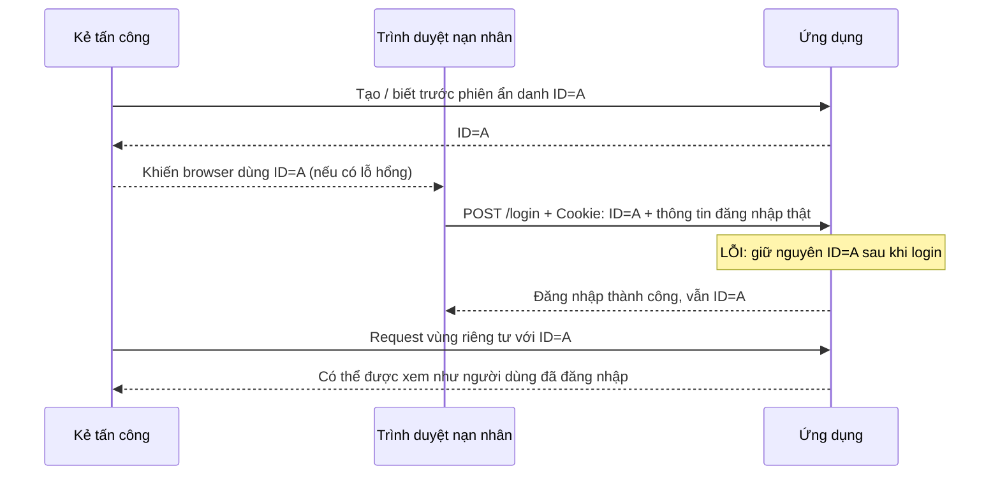
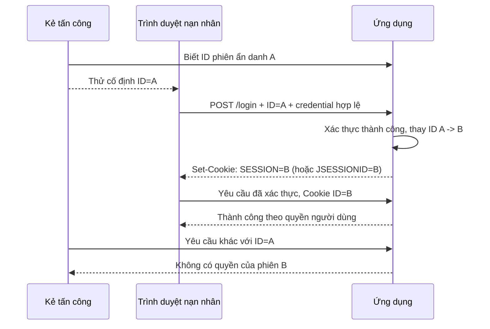

# Session fixation và yêu cầu thay định danh sau đăng nhập

> **Chương:** Session và cookie  
> **Mục tiêu:** Giải thích tấn công *session fixation*, lý do phải đổi định danh phiên khi nâng quyền từ khách sang người dùng đăng nhập, cơ chế mặc định của Spring Security trên **Servlet** và **Reactive WebFlux**, cấu hình an toàn và kiểm thử bằng HTTP request thực.

Trong module `SPRING_SECURITY_HTTP_PROTECTION`, người học áp dụng nhiều lớp phòng vệ HTTP và trình duyệt: CSRF, CORS, security headers, CSP, HSTS, HTTP firewall và bảo vệ session/cookie. Ngoài các ví dụ dành cho Servlet và Reactive, module đặt trọng tâm vào kiểm thử tình huống tấn công web và chẩn đoán sự cố bảo mật khi triển khai. Bài này tập trung vào một bất biến thiết yếu: **định danh session dùng khi chưa đăng nhập không được tiếp tục có quyền truy cập với danh tính đã xác thực nếu kẻ tấn công từng biết hoặc kiểm soát định danh đó**.

## 1. Session fixation là gì?

**Session fixation (cố định phiên)** là kiểu tấn công mà kẻ tấn công biết trước hoặc khiến trình duyệt nạn nhân dùng **một session ID xác định**, rồi chờ nạn nhân đăng nhập. Nếu ứng dụng *giữ nguyên ID đó sau khi xác thực*, kẻ tấn công có thể tái sử dụng ID đã biết để truy cập phiên đã có quyền của nạn nhân.

Khác với *session hijacking* theo nghĩa phổ biến — cố lấy trộm ID của một phiên đã đăng nhập — session fixation chủ yếu nhằm **kiểm soát/biết ID trước bước nâng quyền**. Một số điều kiện tấn công có thể là ứng dụng chấp nhận ID session do người gửi tự đặt, cookie bị ghi đè bởi cấu hình domain sai, URL chứa session ID, hoặc một lỗ hổng ứng dụng/triển khai cho phép áp đặt cookie.

### Mô phỏng luồng dễ bị tấn công



Tấn công chỉ thành công nếu có **đường áp đặt ID** và ứng dụng chấp nhận dùng ID đó sau khi người dùng xác thực. Không phải website bất kỳ có thể tùy ý đặt cookie của một website khác: phạm vi cookie, chính sách browser, HTTPS và nhiều yếu tố triển khai giới hạn khả năng đó. Dù vậy, **đổi session ID sau login** là biện pháp giảm thiểu bắt buộc vì không nên đặt toàn bộ an toàn vào giả định kẻ tấn công không thể biết ID trước xác thực.

### Luồng được bảo vệ đúng



**Bất biến cần kiểm thử:** sau khi đăng nhập thành công, **ID mới khác ID trước đăng nhập**; ID cũ **không được xem là credential hợp lệ cho phiên đã xác thực**. Với một triển khai session store thực, còn phải kiểm tra record/cookie cũ không được ánh xạ nhầm sang phiên đã nâng quyền.

## 2. Session ID, session state, CSRF token và cookie khác nhau thế nào?

| Đối tượng | Vai trò | Có phải bí mật xác thực không? |
| --- | --- | --- |
| **Session ID** | Chuỗi ngẫu nhiên định danh trạng thái server-side; browser thường gửi trong cookie. | **Có**, là bearer credential của phiên đang đăng nhập; phải bảo vệ. |
| **Session attributes** | Dữ liệu server-side như giỏ hàng, state của luồng form, `SecurityContext`, CSRF token. | Phụ thuộc dữ liệu; không nên tự động coi mọi attribute đều có thể sao chép an toàn. |
| **`SecurityContext`** | Thông tin `Authentication`/quyền truy cập của người dùng trong Spring Security. | Không được gắn với ID cũ theo cách khiến kẻ tấn công kế thừa quyền. |
| **CSRF token** | Token client phải chủ động gửi để chống giả mạo request dùng cookie. | Không thay thế session ID hoặc xác thực; có vòng đời riêng. |
| **Cookie phiên** | Phương tiện client mang session ID giữa các request, ví dụ `JSESSIONID` hoặc `SESSION`. | Cần `Secure`, `HttpOnly`, `SameSite`, `Path`, `Domain` phù hợp. |

Đổi session ID bằng API thích hợp có thể **giữ nguyên session attributes** của cùng phiên. Vì vậy **session ID đã thay không đồng nghĩa CSRF token cũng phải thay**. Ngược lại, tạo session mới sạch có thể làm mất state nghiệp vụ, giỏ hàng, CSRF token hoặc dữ liệu lưu trước đăng nhập. Khi thiết kế/kiểm thử, tách hai câu hỏi:

1. **Định danh phiên** đã được thay và ID cũ bị từ chối chưa?
2. **Những session attributes cần giữ hoặc cần xóa** đã được xử lý theo đúng chiến lược và quyền truy cập chưa?

Đừng đối chiếu raw CSRF token với token hiển thị trong HTML để đoán ID session đã đổi: handler XOR của Spring Security 6+ có thể tạo biểu diễn khác nhau dù raw token và session chưa đổi.

## 3. Khi nào phải đổi session ID?

Mốc điển hình là lúc **xác thực thành công**: từ người dùng ẩn danh thành tài khoản đã đăng nhập. OWASP cũng khuyến nghị làm mới định danh sau **thay đổi mức đặc quyền**, ví dụ kích hoạt tài khoản quản trị, nâng vai trò, chuyển tài khoản, hoặc hoàn tất cơ chế xác thực mạnh hơn trong một luồng nhạy cảm.

| Sự kiện | Có cần xem xét làm mới ID? | Ghi chú |
| --- | --- | --- |
| GET landing page trước login | Chưa có thay đổi quyền | Có thể chưa cần tạo session. |
| GET trang login, tạo session lưu CSRF token | Vẫn là session ẩn danh | ID lúc này **chưa được phép** trở thành ID authenticated bất biến. |
| **POST /login thành công** | **Có** | Ranh giới cố định phiên cốt lõi. |
| POST /login thất bại | Không nâng quyền | Không được cấp trạng thái authenticated; việc đổi ID nếu có là chính sách riêng, không thay điều kiện bắt buộc lúc thành công. |
| Nâng vai trò, xác thực lại cho hành động nhạy cảm | Nên đánh giá | Phụ thuộc đường nâng quyền và chính sách ứng dụng. |
| Logout | Phải thu hồi trạng thái xác thực/session thích hợp | Logout và session fixation là hai biện pháp liên quan nhưng không giống nhau. |
| Timeout/expiry | ID cũ không còn truy cập authenticated state | Bắt buộc kiểm thử chính sách session store. |

**Đổi ID không đồng nghĩa đổi mật khẩu, access token OAuth2, session timeout, hoặc CSRF token.** Một phiên có thể giữ cùng attributes sau khi thay ID, nhưng browser phải nhận và dùng **cookie ID mới**. Với đăng nhập theo JWT/bearer hoàn toàn stateless và không sử dụng session server-side để xác thực, bề mặt *session fixation của phiên cookie* không áp dụng y hệt; tuy nhiên vẫn có rủi ro lộ/chiếm đoạt bearer token và việc giữ state ngoài ý muốn.

### Luồng HTTP chuẩn để quan sát

```http
# Trước login (minh họa; không dùng ID này làm credential thật)
GET /login HTTP/1.1
Host: app.example.test

HTTP/1.1 200 OK
Set-Cookie: JSESSIONID=ANONYMOUS_A; Path=/; Secure; HttpOnly; SameSite=Lax

# Sau login thành công
POST /login HTTP/1.1
Cookie: JSESSIONID=ANONYMOUS_A
Content-Type: application/x-www-form-urlencoded

username=alice&password=***&_csrf=CSRF_TOKEN

HTTP/1.1 302 Found
Location: /
Set-Cookie: JSESSIONID=AUTHENTICATED_B; Path=/; Secure; HttpOnly; SameSite=Lax
```

Đây là **sơ đồ thông điệp** chứ không phải transcript mạng thực, và `ANONYMOUS_A`/`AUTHENTICATED_B` là placeholder. Với **WebFlux**, cookie mặc định thường là `SESSION` thay vì `JSESSIONID`; tên thực phụ thuộc `WebSessionIdResolver`, servlet container, Spring Session và cấu hình reverse proxy. Một response login có thể phát status/header khác; điều cần xác minh là **giá trị ID hiện hành được cập nhật sau login thành công**.

## 4. Spring Security Servlet: bảo vệ fixation mặc định

Trong stack **Servlet** dùng `HttpSecurity`, Spring Security có **session fixation protection** tích hợp. Với Servlet **3.1+**, chiến lược mặc định là `changeSessionId`: gọi `HttpServletRequest.changeSessionId()`, giữ đối tượng session và attributes, thay ID của session hiện tại.

Các lựa chọn của `SessionManagementConfigurer.SessionFixationConfigurer`:

| Chiến lược | Cách làm | Dữ liệu cũ sau login | Khuyến nghị |
| --- | --- | --- | --- |
| **`changeSessionId()`** | Container đổi ID của cùng `HttpSession`. | **Giữ nguyên** session attributes. | **Mặc định trên Servlet 3.1+**; nên giữ nếu không có yêu cầu đặc biệt. |
| `migrateSession()` | Tạo session mới và copy attributes từ session cũ. | Copy các attributes cũ. | Chỉ dùng khi hiểu chi phí và vòng đời đối tượng session; là mặc định trên container Servlet cũ. |
| `newSession()` | Tạo session mới, chủ yếu giữ attributes nội bộ cần cho Spring Security. | **Không** chuyển toàn bộ attributes ứng dụng. | Dùng khi cần state sau login sạch và đã xử lý luồng UI/state. |
| `none()` | Không thực hiện bảo vệ fixation bằng chiến lược này. | Giữ ID cũ nếu không có thành phần khác bảo vệ. | **Không nên dùng**: có thể làm ứng dụng dễ bị session fixation. |

`newSession()` không hứa session “hoàn toàn trống”: Spring Security vẫn chuyển một số thuộc tính nội bộ cần thiết. `migrateSession()` cũng có thể ảnh hưởng tới `HttpSessionBindingListener`, session-scoped bean và trạng thái gắn với vòng đời session cũ. Không chọn chiến lược theo cảm tính chỉ vì một giỏ hàng bị mất: cần test phiên ẩn danh → đăng nhập và những attributes được lưu.

### 4.1. Cấu hình Java Servlet

```java
import org.springframework.context.annotation.Bean;
import org.springframework.context.annotation.Configuration;
import org.springframework.security.config.Customizer;
import org.springframework.security.config.annotation.web.builders.HttpSecurity;
import org.springframework.security.web.SecurityFilterChain;

@Configuration
class ServletSessionSecurityConfig {

    @Bean
    SecurityFilterChain filterChain(HttpSecurity http) throws Exception {
        return http
            .authorizeHttpRequests(auth -> auth
                .requestMatchers("/login", "/public/**").permitAll()
                .anyRequest().authenticated())
            .formLogin(Customizer.withDefaults())
            .sessionManagement(session -> session
                .sessionFixation(fixation -> fixation.changeSessionId()))
            .build();
    }
}
```

Cấu hình `.sessionFixation(fixation -> fixation.changeSessionId())` là **khai báo tường minh hành vi mặc định** khi chạy trên Servlet 3.1+. Không cần thêm nếu đã dùng mặc định đúng. `formLogin` và các filter xác thực chuẩn sẽ phối hợp với session authentication strategy để áp dụng sau đăng nhập thành công.

Nếu nghiệp vụ đòi một session mới:

```java
// Trong cấu hình HttpSecurity Servlet, thay .sessionManagement(...) bằng:
.sessionManagement(session -> session
    .sessionFixation(fixation -> fixation.newSession()))
```

Đây là đoạn **thay thế** trong builder, không phải lệnh Java đứng độc lập. Kiểm thử giỏ hàng, locale, CSRF token, saved request, dữ liệu nghiệp vụ và session-scoped beans trước khi dùng `newSession()` hoặc `migrateSession()` trong production.

### 4.2. Khi tự viết flow đăng nhập

Nếu bạn tự xác thực bằng controller rồi chỉ gắn một `Authentication` vào `SecurityContextHolder`, **đừng mặc định toàn bộ session authentication strategy của form login sẽ tự chạy**. Theo phiên bản/configuration, có thể phải tự điều phối `SessionAuthenticationStrategy` **tại đúng điểm xác thực thành công**, đồng thời lưu `SecurityContext` theo mô hình persistence của Spring Security.

Sai lầm phổ biến là code “login thành công” nhưng không qua những thành phần security xử lý session fixation. Ưu tiên dùng các cơ chế đăng nhập chính thức; khi xây filter hoặc authentication flow tùy chỉnh, test yêu cầu ID đổi **trên HTTP thật**, không chỉ test `Authentication.isAuthenticated() == true`.

### 4.3. Event và khả năng quan sát

Khi bảo vệ fixation chạy trên Servlet, Spring Security phát `SessionFixationProtectionEvent`. Với `changeSessionId`, container còn có thể thông báo tới `HttpSessionIdListener`; nếu đăng ký cả hai, hãy tránh đếm trùng rotation hoặc lộ session ID trong log.

Không in `oldSessionId`/`newSessionId` ra log thường xuyên. Để giám sát, dùng event type, request/correlation ID, HTTP method và mã kết quả; nếu thật sự cần tương quan session, dùng mã tham chiếu đã được bảo vệ theo chính sách logging, **không lưu raw session ID**.

## 5. Spring Security Reactive: `WebSessionServerSecurityContextRepository`

WebFlux không dùng `HttpServletRequest` hoặc `HttpSession`. Nền tảng tương ứng là `ServerWebExchange` và `WebSession`, nơi có phương thức bất đồng bộ:

```java
Mono<Void> WebSession.changeSessionId();
```

API này tạo ID mới và cập nhật session store; khi publisher hoàn tất, `getId()` trả ID mới. Session attributes **không bị xóa chỉ vì gọi `changeSessionId()`**; để hủy session dùng `invalidate()`, là thao tác khác.

Trong Spring Security WebFlux, `WebSessionServerSecurityContextRepository` là repository mặc định của **form login** để lưu `SecurityContext`. Javadoc của class xác nhận: **khi `SecurityContext` được lưu, session ID được thay để chống session fixation**. Nó không sử dụng API `sessionManagement().sessionFixation().changeSessionId()` của Servlet.

### 5.1. Cấu hình WebFlux với form login

```java
import org.springframework.context.annotation.Bean;
import org.springframework.context.annotation.Configuration;
import org.springframework.security.config.Customizer;
import org.springframework.security.config.annotation.web.reactive.EnableWebFluxSecurity;
import org.springframework.security.config.web.server.ServerHttpSecurity;
import org.springframework.security.web.server.SecurityWebFilterChain;

@Configuration
@EnableWebFluxSecurity
class ReactiveSessionSecurityConfig {

    @Bean
    SecurityWebFilterChain securityWebFilterChain(ServerHttpSecurity http) {
        return http
            .authorizeExchange(exchanges -> exchanges
                .pathMatchers("/login", "/csrf", "/public/**").permitAll()
                .anyExchange().authenticated())
            .formLogin(Customizer.withDefaults())
            .csrf(Customizer.withDefaults())
            .build();
    }
}
```

CSRF cũng bật mặc định trong WebFlux; `csrf(Customizer.withDefaults())` chỉ làm rõ mục đích. Khi dùng form login cùng repository session, **POST /login cần CSRF token hợp lệ**; cookie phiên ban đầu có thể đã tồn tại vì GET login cấp token. Bước quan trọng là lúc xác thực thành công, security context được lưu và session ID thay đổi.

### 5.2. Nếu thay SecurityContext repository

`ServerHttpSecurity.formLogin(...).securityContextRepository(...)` quyết định nơi **ghi `Authentication`** sau form login, còn `ServerHttpSecurity.securityContextRepository(...)` liên quan đến việc **đọc context** qua `ReactorContextWebFilter`. Theo Javadoc, hai thiết lập **không tự được liên kết** với nhau khi tùy chỉnh.

Ví dụ buộc chúng dùng cùng repository mặc định để minh họa:

```java
import org.springframework.security.web.server.context.WebSessionServerSecurityContextRepository;

// Đoạn thay thế trong cấu hình ServerHttpSecurity WebFlux:
var contexts = new WebSessionServerSecurityContextRepository();
return http
    .securityContextRepository(contexts)                 // Đọc context.
    .authorizeExchange(ex -> ex
        .pathMatchers("/login", "/public/**").permitAll()
        .anyExchange().authenticated())
    .formLogin(login -> login.securityContextRepository(contexts)) // Ghi context.
    .csrf(Customizer.withDefaults())
    .build();
```

Các dòng ở trên được đặt **trong phương thức bean đã có biến `http`**, không phải một bean thứ hai độc lập. Trong ứng dụng thông thường, cứ để cấu hình mặc định hoạt động; chỉ tùy chỉnh khi có nhu cầu cụ thể. Nếu thay bằng `NoOpServerSecurityContextRepository` hoặc một repository custom **không duy trì session ID rotation**, không còn được suy ra bảo vệ fixation chỉ từ việc dùng `@EnableWebFluxSecurity`.

Một repository stateless không lưu phiên đăng nhập có mô hình threat khác. Không nên “sửa” lỗi session bằng cách tắt persistence trong khi ứng dụng vẫn dựa vào cookie đăng nhập; hãy chọn rõ kiến trúc session hay stateless và kiểm thử toàn bộ đường xác thực.

## 6. Cookie phiên: điều kiện hỗ trợ, không thay thế rotation

Một định danh session mới chỉ hữu ích khi browser nhận và dùng **cookie mới**. Session cookie cần được bảo vệ trong quá trình truyền, khi xử lý trên client và trong phạm vi domain/path.

| Thuộc tính / lựa chọn | Vai trò | Điều cần tránh |
| --- | --- | --- |
| **`Secure`** | Chỉ gửi cookie qua HTTPS (trong điều kiện browser áp dụng). | Để session cookie bị gửi qua HTTP; TLS termination và forwarded headers cấu hình sai. |
| **`HttpOnly`** | Ngăn JavaScript thông thường đọc session cookie qua `document.cookie`. | Cho ứng dụng JavaScript tự đọc và chuyển tiếp session ID. |
| **`SameSite=Lax` hoặc `Strict`** | Giảm một số dạng gửi cookie cross-site. | Nghĩ SameSite tự giải quyết mọi CSRF/session fixation; bỏ CSRF token vì đã bật SameSite. |
| **`SameSite=None; Secure`** | Có thể cần khi thực sự hỗ trợ cookie trong ngữ cảnh cross-site được browser cho phép. | Bật quá rộng khi không có nhu cầu; quên `Secure`. |
| **`Path`** | Xác định các đường dẫn nhận cookie. | Cookie không được gửi ở endpoint cần xác thực, hoặc có scope rộng ngoài ý muốn. |
| **`Domain`** | Xác định phạm vi host/subdomain. | Đặt parent domain tùy tiện làm tăng nguy cơ cookie shadowing/cookie tossing từ subdomain yếu hơn. |
| **`Max-Age`, session timeout** | Xác định thời gian tồn tại của cookie và session phía server. | Nghĩ cookie hết hạn đồng nghĩa server state đã bị hủy, hoặc ngược lại. |
| **Không truyền ID trong URL** | Giảm rò rỉ session ID qua history, logs, `Referer` và liên kết. | URL rewriting kiểu `;jsessionid=...` hoặc query chứa ID khi không cần. |

**Một cookie có `Secure`, `HttpOnly` và `SameSite` vẫn không sửa được ứng dụng giữ nguyên session ID sau khi login.** Những thuộc tính này giảm khả năng kẻ tấn công biết/áp đặt ID; **rotation ở ranh giới nâng quyền** là biện pháp riêng.

### 6.1. Servlet: cấu hình cookie qua Spring Boot

Trong Spring Boot với container Servlet, các thuộc tính phiên có thể cấu hình qua `server.servlet.session.cookie.*`:

```yaml
server:
  servlet:
    session:
      cookie:
        secure: true
        http-only: true
        same-site: lax
        path: /
```

Đây là ví dụ cho **production HTTPS**. Một số tùy chọn có thể được Spring Session hoặc container khác ghi đè; hãy kiểm tra **`Set-Cookie` thực tế** sau login. Đừng sao chép nguyên cấu hình production vào môi trường HTTP thuần rồi cho rằng cookie sẽ tự hoạt động. Cần dùng HTTPS end-to-end hoặc TLS termination được cấu hình đúng.

### 6.2. WebFlux: cấu hình CookieWebSessionIdResolver

WebFlux quản lý cookie session qua `WebSessionIdResolver`. Với `CookieWebSessionIdResolver`, có thể tùy chỉnh:

```java
import org.springframework.context.annotation.Bean;
import org.springframework.context.annotation.Configuration;
import org.springframework.web.server.session.CookieWebSessionIdResolver;
import org.springframework.web.server.session.WebSessionIdResolver;

@Configuration
class ReactiveSessionCookieConfig {
    @Bean
    WebSessionIdResolver webSessionIdResolver() {
        var resolver = new CookieWebSessionIdResolver();
        resolver.setCookieName("SESSION");
        resolver.addCookieInitializer(cookie -> cookie
            .secure(true)
            .httpOnly(true)
            .sameSite("Lax")
            .path("/"));
        return resolver;
    }
}
```

Ứng dụng thực tế có thể đặt một tên khác như `__Host-SESSION`, nhưng phải tuân thủ **Secure, Path=/ và không có Domain** để browser chấp nhận tiền tố `__Host-`. Không cấu hình hai resolver xung đột hoặc đồng thời để container/proxy phát thêm một cookie session tên tương tự.

Trong cả Servlet lẫn WebFlux, kiểm tra response sau login:

```http
HTTP/1.1 302 Found
Set-Cookie: SESSION=NEW_ID; Path=/; Secure; HttpOnly; SameSite=Lax
Location: /
```

Đây là biểu diễn giả định cho WebFlux; không nên gửi giá trị `NEW_ID` thật ra telemetry. Một số cấu hình có thể đặt cookie cũ hết hạn và cấp cookie mới trong cùng response. Quan trọng là **request tiếp theo gửi cookie mới và ID trước login không còn ánh xạ sang phiên đã đăng nhập**.

### 6.3. Reverse proxy, gateway và nhiều node

Với TLS termination ở load balancer, ứng dụng có thể nhận request nội bộ bằng HTTP dù browser dùng HTTPS. Cấu hình forwarded headers phải **tin cậy đúng proxy**; nếu không, các flag cookie/redirect có thể sai. Không cho client Internet tự giả mạo `X-Forwarded-*` để ứng dụng tin nhầm scheme/host.

Với Spring Session (ví dụ Redis), `changeSessionId` còn phải cập nhật mapping ở **session store**. Không đủ khi response phát cookie mới nhưng khóa chứa ID cũ vẫn còn ánh xạ đến trạng thái đã đăng nhập. Hãy kiểm tra phân phối session giữa nhiều node, TTL, phân quyền truy cập Redis và cơ chế vô hiệu hóa ID cũ sau chuyển đổi.

## 7. Unit test Servlet: login thành công phải đổi định danh

Kiểm thử dưới dùng **MockMvc** và Spring Security Test; giả sử ứng dụng đã cấu hình form login, có người dùng `alice` với mật khẩu test, và sử dụng chiến lược `changeSessionId()` mặc định/được khai báo ở mục 4.

```java
import jakarta.servlet.http.HttpSession;
import org.junit.jupiter.api.Test;
import org.springframework.beans.factory.annotation.Autowired;
import org.springframework.mock.web.MockHttpSession;
import org.springframework.test.web.servlet.MockMvc;
import org.springframework.test.web.servlet.MvcResult;

import static org.junit.jupiter.api.Assertions.*;
import static org.springframework.security.test.web.servlet.request.SecurityMockMvcRequestPostProcessors.csrf;
import static org.springframework.security.test.web.servlet.response.SecurityMockMvcResultMatchers.authenticated;
import static org.springframework.test.web.servlet.request.MockMvcRequestBuilders.post;

class ServletSessionFixationTest {
    @Autowired
    MockMvc mvc;

    @Test
    void loginChangesSessionIdButPreservesExistingAttributes()
            throws Exception {
        MockHttpSession anonymousSession = new MockHttpSession();
        anonymousSession.setAttribute("cartId", "cart-for-test");
        String oldId = anonymousSession.getId();

        MvcResult result = mvc.perform(post("/login")
                .session(anonymousSession)
                .with(csrf())
                .param("username", "alice")
                .param("password", "test-password"))
            .andExpect(authenticated())
            .andReturn();

        HttpSession current = result.getRequest().getSession(false);
        assertNotNull(current);
        assertTrue(!oldId.equals(current.getId()),
            "Session ID phải đổi sau login thành công");
        assertEquals("cart-for-test", current.getAttribute("cartId"));
    }
}
```

Bài test này cần chạy trong Spring Test context có cấu hình MockMvc/Spring Security; có thể dùng `@SpringBootTest` + `@AutoConfigureMockMvc` hoặc setup `MockMvcBuilders.webAppContextSetup(...).apply(springSecurity())`.

**Lưu ý:** `with(csrf())` là test post-processor giúp POST /login vượt CSRF; nó **không tự xác thực** người dùng và không tạo ID mới. Rotation được kích hoạt khi authentication thực sự thành công trong security chain. Nếu dùng `with(user("alice"))` để giả lập sẵn người đã đăng nhập, bạn có thể **bỏ qua bước login và session-fixation strategy**, nên không dùng làm chứng cứ đã chống fixation.

### Kiểm tra ID cũ cần integration test riêng

MockHttpSession/MockMvc dùng một đối tượng session có thể được đổi ID ngay trong bộ nhớ; test trên khẳng định session ID thay và attribute được giữ. Nó **chưa** chứng minh một cookie `oldId` từ client khác đã bị session store thật từ chối. Hãy viết thêm HTTP test qua container/session store thực:

1. Tạo session ẩn danh A qua GET trang login/endpoint tạo session.
2. Lưu **cookie A trong bộ nhớ test**, không đưa ra log.
3. Đăng nhập thật bằng cookie A, xác minh response cấp cookie B và `A != B`.
4. Truy cập trang chỉ dành cho authenticated user với **cookie B**: được phép.
5. Truy cập cùng endpoint bằng **cookie A** từ client độc lập: **không được authenticated**.

Status khi dùng cookie A có thể là `302` redirect đến login, `401` hoặc `403` tùy cấu hình; **điều bất biến là không được hưởng danh tính/quyền của B**. Đừng hardcode chỉ một status cho mọi ứng dụng rồi coi test sai nếu response khác.

## 8. Unit test WebFlux: context được lưu thì ID thay

Với WebFlux, cần kiểm tra riêng hợp đồng `WebSessionServerSecurityContextRepository`. Test này dùng `MockWebSession` và `MockServerWebExchange` để mô phỏng cùng session, không cần gửi HTTP cookie thật.

```java
import org.junit.jupiter.api.Test;
import org.springframework.mock.http.server.reactive.MockServerHttpRequest;
import org.springframework.mock.web.server.MockServerWebExchange;
import org.springframework.mock.web.server.MockWebSession;
import org.springframework.security.authentication.UsernamePasswordAuthenticationToken;
import org.springframework.security.core.authority.AuthorityUtils;
import org.springframework.security.core.context.SecurityContextImpl;
import org.springframework.security.web.server.context.WebSessionServerSecurityContextRepository;
import reactor.test.StepVerifier;

import static org.junit.jupiter.api.Assertions.*;

class ReactiveSessionFixationRepositoryTest {

    @Test
    void savingSecurityContextChangesSessionId() {
        var session = new MockWebSession();
        session.getAttributes().put("cartId", "cart-for-test");
        var exchange = MockServerWebExchange.builder(
                MockServerHttpRequest.get("/"))
            .session(session)
            .build();

        String before = session.getId();
        var authentication = UsernamePasswordAuthenticationToken.authenticated(
            "alice", "N/A", AuthorityUtils.createAuthorityList("ROLE_USER"));
        var securityContext = new SecurityContextImpl(authentication);

        var repository = new WebSessionServerSecurityContextRepository();
        StepVerifier.create(repository.save(exchange, securityContext))
            .verifyComplete();

        assertTrue(!before.equals(session.getId()),
            "Phải đổi session ID khi lưu SecurityContext");
        assertEquals("cart-for-test", session.getAttributes().get("cartId"));

        // Đọc context từ một exchange khác nhưng vẫn cùng WebSession.
        var nextExchange = MockServerWebExchange.builder(
                MockServerHttpRequest.get("/me"))
            .session(session)
            .build();

        StepVerifier.create(repository.load(nextExchange))
            .assertNext(loaded -> {
                assertNotNull(loaded.getAuthentication());
                assertEquals("alice",
                    loaded.getAuthentication().getName());
            })
            .verifyComplete();
    }
}
```

Test này khẳng định **cách repository Reactive triển khai bảo vệ fixation**: khi lưu `SecurityContext`, `WebSession.changeSessionId()` được thực thi, đồng thời các attributes trong cùng session không bị xóa chỉ vì ID thay. Test **không** cần gọi `WebSession.changeSessionId()` thủ công vì chính repository phải làm việc đó.

**Giới hạn test:** `MockWebSession` không tái hiện đầy đủ session ID resolver, response cookie, Redis, session TTL và các request đến từ browser khác. Để chứng minh ID cũ thực sự vô hiệu trong production topology, vẫn cần HTTP test với session store và cookie thật.

### Đừng giả định mọi lần gọi `changeSessionId()` làm sạch state

`WebSession.changeSessionId()` chỉ đổi ID. `WebSession.invalidate()` mới là hợp đồng xóa session storage. Nếu ứng dụng yêu cầu dọn cart hoặc dữ liệu nhạy cảm khi login/logout, phải đặt chính sách phù hợp **ngoài** thao tác đổi ID. Không tự chuyển mọi trường cũ sang một tài khoản khác khi dùng chức năng đăng nhập thay tài khoản trong cùng trình duyệt.

## 9. WebTestClient: kiểm thử login thật trên Reactive WebFlux

Unit test ở mục 8 chỉ chứng minh hành vi của repository. Mục tiêu HTTP test là xác minh cả chuỗi **GET cấp session ẩn danh → POST login thành công → Set-Cookie ID mới → phiên cũ không có quyền**.

Ví dụ ứng dụng test có endpoint GET `/csrf` để cấp token từ `CsrfWebFilter`:

```java
import org.springframework.http.ResponseEntity;
import org.springframework.security.web.server.csrf.CsrfToken;
import org.springframework.web.bind.annotation.GetMapping;
import org.springframework.web.bind.annotation.RestController;
import org.springframework.web.server.ServerWebExchange;
import reactor.core.publisher.Mono;

// Record package-private, dùng chung được trong controller và test cùng package.
record CsrfPayload(String headerName, String parameterName, String token) {}

@RestController
class TestCsrfEndpoint {

    @GetMapping("/csrf")
    Mono<ResponseEntity<CsrfPayload>> csrf(ServerWebExchange exchange) {
        Mono<CsrfToken> source =
            exchange.getAttribute(CsrfToken.class.getName());
        if (source == null) {
            return Mono.error(new IllegalStateException(
                "CSRF publisher không tồn tại trên exchange"));
        }
        return source.map(csrf -> ResponseEntity.ok(
            new CsrfPayload(
                csrf.getHeaderName(), csrf.getParameterName(), csrf.getToken())));
    }
}
```

Khi tích hợp với `WebSessionServerCsrfTokenRepository` mặc định, endpoint GET **consume** publisher và có thể khởi tạo session/cookie nếu chưa có. Phải đảm bảo `GET /csrf` được phép truy cập trước khi đăng nhập. Token ở response có thể được **XOR-masked**; client gửi nguyên token ấy trong form POST.

### 9.1. Test response cookie trước/sau login

Đoạn sau giả định `client` là `WebTestClient` đã gắn **Spring Security filters** (ví dụ bind application context và `.apply(springSecurity())`), có người dùng test `alice` và password `test-password`, cookie session tên `SESSION`.

```java
import org.junit.jupiter.api.Test;
import org.springframework.http.MediaType;
import org.springframework.http.ResponseCookie;
import org.springframework.test.web.reactive.server.EntityExchangeResult;
import org.springframework.web.reactive.function.BodyInserters;

import static org.junit.jupiter.api.Assertions.*;

// Đặt trong một class test có WebTestClient client và record CsrfPayload.
@Test
void loginRotatesWebSessionCookie() {
    EntityExchangeResult<CsrfPayload> beforeLogin =
        client.get().uri("/csrf")
            .exchange()
            .expectStatus().isOk()
            .expectBody(CsrfPayload.class)
            .returnResult();

    CsrfPayload csrf = beforeLogin.getResponseBody();
    ResponseCookie anonymousCookie =
        beforeLogin.getResponseCookies().getFirst("SESSION");

    assertNotNull(csrf);
    assertNotNull(anonymousCookie);

    var loginResponse = client.post().uri("/login")
        .cookie(anonymousCookie.getName(), anonymousCookie.getValue())
        .contentType(MediaType.APPLICATION_FORM_URLENCODED)
        .body(BodyInserters.fromFormData("username", "alice")
            .with("password", "test-password")
            .with(csrf.parameterName(), csrf.token()))
        .exchange()
        .expectStatus().is3xxRedirection()
        .expectBody()
        .returnResult();

    ResponseCookie authenticatedCookie =
        loginResponse.getResponseCookies().getFirst("SESSION");
    assertNotNull(authenticatedCookie);
    assertTrue(
        !anonymousCookie.getValue().equals(authenticatedCookie.getValue()),
        "Session cookie phải có ID khác sau login");
}
```

**Lưu ý bắt buộc để chạy ví dụ:** test phải có Spring context, người dùng/mật khẩu hợp lệ, cấu hình form login đúng path và endpoint `GET /csrf` được truy cập. Nếu ứng dụng đổi `WebSessionIdResolver` hoặc tên cookie, thay `SESSION` tương ứng. Test này không dùng `mockUser()` hoặc `csrf()` test mutator để “giả lập” đăng nhập; nó thực sự gọi `POST /login`.

### 9.2. Test cookie ID cũ bị từ chối, ID mới có quyền

Mở rộng sau login bằng endpoint `GET /me` yêu cầu `authenticated()`, trả 200 nếu người dùng đã đăng nhập:

```java
import java.security.Principal;
import org.springframework.web.bind.annotation.GetMapping;
import org.springframework.web.bind.annotation.RestController;
import reactor.core.publisher.Mono;

@RestController
class MeController {
    @GetMapping("/me")
    Mono<String> me(Mono<Principal> principal) {
        return principal.map(Principal::getName);
    }
}
```

Thêm vào cuối bài test login ở mục 9.1, sau khi đã lấy `authenticatedCookie`:

```java
client.get().uri("/me")
    .cookie(authenticatedCookie.getName(), authenticatedCookie.getValue())
    .exchange()
    .expectStatus().isOk()
    .expectBody(String.class).isEqualTo("alice");

// Không cho cookie ID cũ thừa hưởng danh tính vừa xác thực.
client.get().uri("/me")
    .cookie(anonymousCookie.getName(), anonymousCookie.getValue())
    .exchange()
    .expectStatus().is3xxRedirection(); // Form login mặc định redirect.
```

Kỳ vọng redirect là ví dụ cho **form login mặc định**; nếu security chain dùng `ServerAuthenticationEntryPoint` trả `401` hoặc một chính sách khác, thay assertion bằng yêu cầu **không trả 200 dưới danh tính alice**. Trong HTTP integration test với session store thật, nên kiểm tra cả việc ID cũ không còn ánh xạ đến trạng thái đã xác thực.

**Đừng chỉ assert chuỗi ID khác nhau.** Một triển khai sai có thể tạo ID B nhưng vẫn để A cùng trỏ đến session authenticated, do lỗi store/proxy/logic custom. Bộ test phải kiểm tra cả **đường truy cập bằng A không được hưởng quyền của B**.

## 10. Kịch bản thực tế khi có logout, remember-me và nhiều thiết bị

### 10.1. Logout

Đổi ID lúc login **không thay thế hủy trạng thái phiên khi logout**. Sau logout, browser không được dùng cookie trước logout để tiếp tục truy cập protected resource. Tùy stack và logout handler, có thể phải vô hiệu hóa session hoặc xóa security context/cookie; đừng chỉ cho frontend xóa cookie trên client mà quên state phía server.

Test nên thực hiện: đăng nhập thật → lấy cookie B → logout bằng request có CSRF token hợp lệ nếu dùng form/session → thử `GET /me` với B cũ → phải bị từ chối. Kiểm tra liệu session store còn record nào mang quyền hay không, kể cả trường hợp có request đồng thời.

### 10.2. Remember-me và đăng nhập qua OAuth2

Đăng nhập qua remember-me, OAuth2/OIDC hoặc authentication filter tùy chỉnh có thể có **điểm lưu SecurityContext khác** form login. Khi quyền chuyển từ ẩn danh sang xác thực, cần xác minh định danh session được thay và context được ghi đúng repository. Một cấu hình đi tắt security chain hoặc thay storage có thể làm mất phần bảo vệ tự động.

Với OAuth2/OIDC, cookie/session có thể lưu `state`, `nonce` hoặc request cache để hoàn tất callback; nếu chọn chiến lược tạo session mới hoặc tự hủy state không đúng lúc, có thể làm flow thất bại. **Bảo vệ fixation phải được triển khai đúng điểm sau khi xác thực thành công**, không xóa bừa session trước callback.

### 10.3. Nhiều tab và request đồng thời

Các tab trên cùng browser thường dùng chung session cookie. Khi một tab đăng nhập và nhận ID mới, những request song song đã được gửi với ID cũ có thể có kết quả khác nhau tùy thời điểm/session store. Đừng “sửa” bằng cách giữ ID cũ hợp lệ song song vô thời hạn: điều đó làm mất mục tiêu chống fixation.

Khi có load balancer hoặc nhiều node, kiểm tra session mapping cập nhật nhất quán; không để node A nhìn thấy ID B nhưng node B vẫn cho ID A truy cập quyền mới. Cần test cụ thể với session store của môi trường triển khai, không chỉ `MockMvc` hoặc `MockWebSession` trong bộ nhớ.

## 11. Ma trận kiểm thử hồi quy

| ID | Tình huống | Kết quả cần đạt |
| --- | --- | --- |
| SF-01 | User ẩn danh nhận cookie A trước login | Session A không có quyền truy cập dữ liệu authenticated. |
| SF-02 | POST login sai password với cookie A | Không được có phiên authenticated; ID mới nếu có cũng không được có quyền. |
| SF-03 | POST login đúng password với cookie A | **Session ID sau login khác A**. |
| SF-04 | GET protected resource dùng cookie ID mới B | Truy cập được theo quyền của user đã login. |
| SF-05 | GET protected resource dùng cookie ID cũ A | **Không** truy cập được dưới danh tính user đã login. |
| SF-06 | Servlet `changeSessionId()` | ID đổi, attributes cần thiết vẫn còn. |
| SF-07 | Servlet `newSession()` | ID đổi, không chuyển bừa toàn bộ application attributes. |
| SF-08 | WebFlux lưu `SecurityContext` bằng `WebSessionServerSecurityContextRepository` | `WebSession` đổi ID; repository tải lại được context của session hiện tại. |
| SF-09 | WebFlux thay custom `ServerSecurityContextRepository` | Test lại rotation và persistence, không giả định mặc định. |
| SF-10 | Login cần CSRF token | Thiếu/sai token bị chặn trước khi xác thực, dù login endpoint cho phép anonymous. |
| SF-11 | Logout với cookie B | B cũ không còn dùng để truy cập protected resource. |
| SF-12 | Session hết hạn do TTL | ID đã hết hạn không được map lại vào authenticated state. |
| SF-13 | Login thành công trong hai tab | Tab đang giữ ID cũ không làm hồi sinh session authenticated dưới ID đó. |
| SF-14 | Session store chia sẻ giữa nhiều node | ID B hợp lệ theo policy, A không có quyền ở mọi node. |
| SF-15 | Session cookie `Secure`/`HttpOnly`/`SameSite`, Path/Domain | Browser nhận/gửi cookie đúng, không lộ ra JavaScript hoặc HTTP không mã hóa. |
| SF-16 | User được nâng vai trò hoặc tái xác thực nhạy cảm | Chính sách làm mới định danh phù hợp ranh giới nâng quyền của ứng dụng. |

**Không dùng duy nhất `assertNotEquals(cookieA, cookieB)` làm kết luận cuối cùng**; cần xác minh session store, security context và protected endpoint. Đừng dùng `@WithMockUser`/`mockUser()` làm phép đo rotation vì chúng mô phỏng sẵn Authentication mà không chạy luồng login thật.

## 12. Chẩn đoán sự cố

| Triệu chứng | Nguyên nhân có thể | Cách điều tra |
| --- | --- | --- |
| Login thành công nhưng cookie ID không đổi | Custom login bypass session strategy, custom repository không rotate, config `none()` hoặc test chưa tạo session ẩn danh | Kiểm tra stack Servlet/Reactive, nơi lưu `SecurityContext` và request HTTP thực. |
| Trong Servlet dùng `changeSessionId()` nhưng vẫn mất cart | Một thành phần khác xóa/migrate attributes hoặc tạo session mới | Xác nhận strategy được dùng và log event an toàn, kiểm thử cart attribute riêng. |
| Sau login token CSRF cũ gây `403` | Session đã bị thay thật, token thu hồi hoặc cookie/token không đi cùng session mới | Lấy token mới từ GET/form; không suy ra chỉ từ session ID đổi. |
| WebFlux chỉ đổi ID khi lưu context trong unit test, login thật không đổi | Form login dùng custom `securityContextRepository`, hoặc HTTP client không gửi cookie | Kiểm tra `FormLoginSpec.securityContextRepository` và session cookie GET/POST. |
| `SessionFixationProtectionEvent` không thấy trên WebFlux | Event đó là cơ chế của Servlet strategy, không phải hợp đồng bắt buộc của WebFlux | Kiểm tra `WebSessionServerSecurityContextRepository.save`/HTTP rotation. |
| Cookie sau login mất `Secure` hoặc bị browser từ chối | Proxy/TLS, SameSite/Path/Domain hoặc nhiều cookie cùng tên | So `Set-Cookie` của GET/login, cấu hình forwarded headers và resolver. |
| Cookie ID mới xuất hiện nhưng ID cũ vẫn truy cập protected resource | Mapping session store sai, cache phân tán không đồng bộ, custom session persistence | Thử từ client độc lập với A/B trên từng node, kiểm tra invalidation của mapping cũ. |
| Test chỉ dùng `mockUser()` cho kết quả login hợp lệ | Không thực hiện authentication success và context save thật | Dùng POST login với credential test hợp lệ, theo dõi Set-Cookie và GET /me. |
| Logout rồi cookie cũ còn có quyền | Session/security context chưa bị thu hồi hoặc handler tùy chỉnh bỏ cleanup | Test với cookie đã logout và xem storage/session invalidation thật. |
| Mỗi request lại có session ID khác dù không login | Code gọi `save(SecurityContext)` lặp lại, session strategy/proxy làm mới ID hoặc cookie bị mất | Quan sát thời điểm save và Set-Cookie; xác định việc xoay ID có cần thiết. |
| Sau nâng Spring Security/Spring Session hành vi khác | Thay context repository, phiên bản Servlet/WebFlux hoặc session store | Khóa BOM phiên bản và chạy ma trận SF-01 đến SF-16. |

**Trình tự điều tra:** hệ Servlet hay Reactive → session cookie trước login → authentication thành công ở filter nào → strategy/repository lưu `SecurityContext` → session ID sau login → cookie mới có được gửi/nhận → protected route thử bằng A và B → session store trên các node → cookie policy và CSRF/CORS. Chỉ log loại sự kiện, route template, trạng thái và request ID; không log session ID hay mật khẩu.

## 13. Bài thực hành

1. Tạo một ứng dụng **Spring MVC + Spring Security Servlet** có form login. Cấp cookie session ẩn danh, đăng nhập thành công, dùng MockMvc kiểm tra ID thay đổi và cart attribute được giữ khi dùng `changeSessionId()`.
2. Viết HTTP integration test dùng hai client/cookie jars: cookie A trước login, cookie B sau login. Kiểm tra B có quyền, A không có quyền; không in ID/cookie vào log.
3. Chuyển chiến lược Servlet sang `newSession()` trong môi trường test. Kiểm tra cart, request cache và CSRF token; nêu vì sao không nên thay strategy mà không có regression tests.
4. Tạo một ứng dụng **Spring WebFlux** có form login và `GET /csrf`. Viết unit test với `WebSessionServerSecurityContextRepository` xác minh `save(SecurityContext)` làm ID đổi nhưng context vẫn tải được.
5. Dùng `WebTestClient` thực hiện GET cấp token/cookie → POST login có CSRF token → GET /me bằng cookie B → GET /me bằng cookie A. Chỉ coi hoàn thành khi ID cũ **không còn** mang quyền.
6. Kiểm tra cookie `Secure`, `HttpOnly`, `SameSite`, `Path`, `Domain` và triển khai sau reverse proxy; chạy thử khi logout, timeout và nhiều node nếu hệ thống dùng Spring Session.

**Câu hỏi tự kiểm tra:** Vì sao `HttpOnly` không thể thay thế session ID rotation? Tại sao `changeSessionId` có thể giữ nguyên cart và CSRF token? Vì sao “ID mới khác ID cũ” chưa đủ nếu ID cũ vẫn được session store công nhận? Trong WebFlux, thành phần nào đổi ID khi lưu `SecurityContext`? Vì sao `mockUser()` không đủ để test session fixation?

## 14. Tóm tắt

- **Session fixation** lợi dụng việc giữ một session ID đã bị kẻ tấn công biết/áp đặt từ trạng thái ẩn danh sang trạng thái đã đăng nhập.
- **Bảo vệ cốt lõi:** đổi session ID sau login thành công và bảo đảm **ID cũ không có quyền của phiên mới**. Xem xét tái cấp ID ở các ranh giới nâng quyền khác.
- **Servlet:** Spring Security có `sessionManagement().sessionFixation()`, mặc định `changeSessionId()` trên Servlet 3.1+, với `migrateSession()` và `newSession()` khi có nhu cầu đặc biệt.
- **Reactive WebFlux:** `WebSessionServerSecurityContextRepository` lưu `SecurityContext` vào `WebSession` và **đổi session ID lúc lưu**. Không sao chép DSL Servlet sang `ServerHttpSecurity`.
- **Cookie flags, CSRF, CORS và CSP bổ trợ cho nhau**; `Secure`/`HttpOnly`/`SameSite` không sửa được việc giữ nguyên ID sau login.
- **Test phải vượt qua mức mock:** đối chiếu cookie A/B và thử protected endpoint bằng **cả ID mới lẫn ID cũ** trên session store thực; đồng thời kiểm thử logout, TTL, proxy và nhiều node.

## Tài liệu tham khảo chính thức

- [Spring Security — Servlet: Authentication Persistence and Session Management, Session Fixation](https://docs.spring.io/spring-security/reference/servlet/authentication/session-management.html)
- [Spring Security — Servlet: SessionFixationConfigurer Javadoc](https://docs.spring.io/spring-security/reference/api/java/org/springframework/security/config/annotation/web/configurers/SessionManagementConfigurer.SessionFixationConfigurer.html)
- [Spring Security — WebFlux Security](https://docs.spring.io/spring-security/reference/reactive/configuration/webflux.html)
- [Spring Security — WebFlux: WebSessionServerSecurityContextRepository](https://docs.spring.io/spring-security/reference/api/java/org/springframework/security/web/server/context/WebSessionServerSecurityContextRepository.html)
- [Spring Security — WebFlux: FormLoginSpec](https://docs.spring.io/spring-security/reference/api/java/org/springframework/security/config/web/server/ServerHttpSecurity.FormLoginSpec.html)
- [Spring Framework — WebSession Javadoc](https://docs.spring.io/spring-framework/docs/current/javadoc-api/org/springframework/web/server/WebSession.html)
- [Spring Framework — CookieWebSessionIdResolver Javadoc](https://docs.spring.io/spring-framework/docs/current/javadoc-api/org/springframework/web/server/session/CookieWebSessionIdResolver.html)
- [Spring Security — MockMvc authentication testing](https://docs.spring.io/spring-security/reference/servlet/test/mockmvc/result-matchers.html)
- [Spring Security — Reactive authentication testing](https://docs.spring.io/spring-security/reference/reactive/test/web/authentication.html)
- [Spring Boot — Servlet Session Cookie properties](https://docs.spring.io/spring-boot/reference/web/servlet.html)
- [Spring Session — Common Configurations: CookieWebSessionIdResolver](https://docs.spring.io/spring-session/reference/configuration/common.html)
- [OWASP — Session Management Cheat Sheet](https://cheatsheetseries.owasp.org/cheatsheets/Session_Management_Cheat_Sheet.html)
- [OWASP — Web Security Testing Guide: Session Fixation](https://wstg.owasp.org/latest/10-Session_Management/03-Session_Fixation/)
