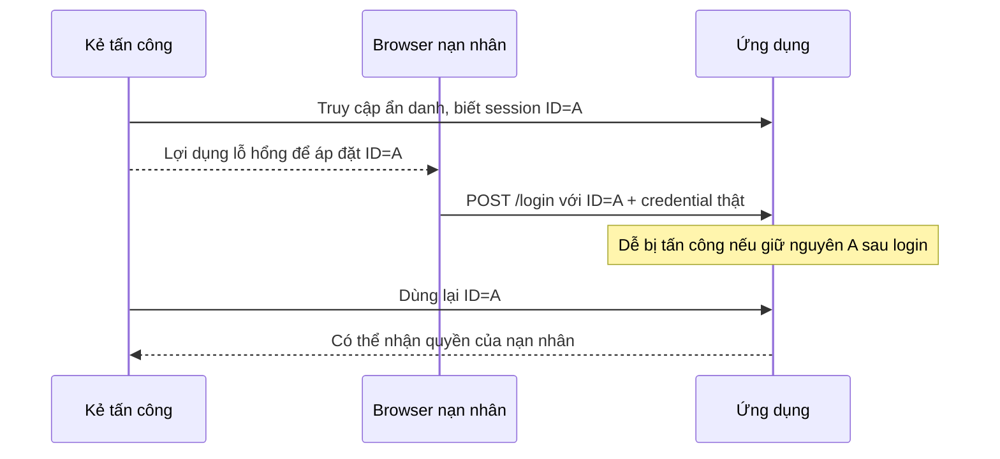
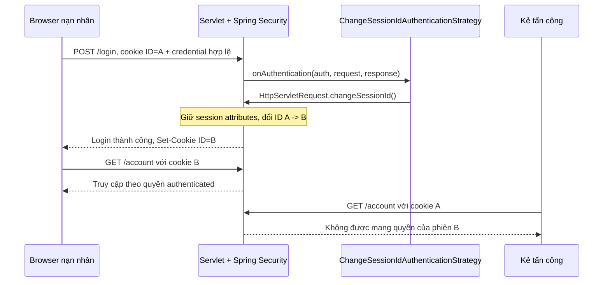
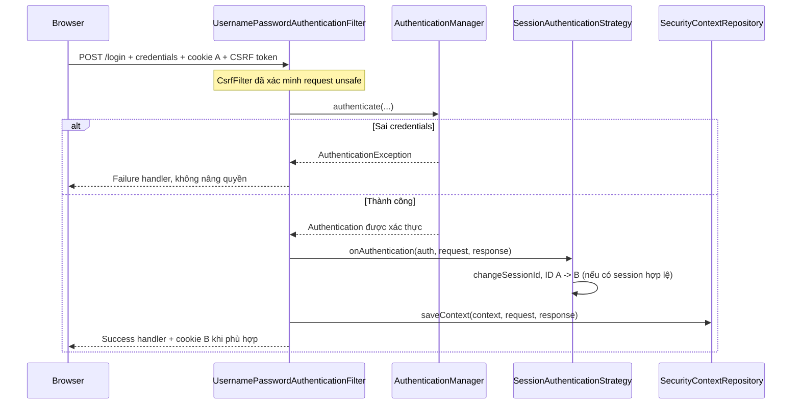

# ChangeSessionIdAuthenticationStrategy trong Servlet

> **Chương:** Session và cookie  
> **Trọng tâm:** `ChangeSessionIdAuthenticationStrategy` trong **Spring Security Servlet**: khi nào `onAuthentication(...)` gọi `HttpServletRequest.changeSessionId()`, điều gì được giữ lại trong `HttpSession`, cách cấu hình bằng `HttpSecurity`, xử lý luồng xác thực tùy chỉnh và kiểm thử chống session fixation.

Trong module `SPRING_SECURITY_HTTP_PROTECTION`, người học áp dụng các lớp bảo vệ HTTP và trình duyệt của Spring Security, từ CSRF, CORS, security headers, CSP, HSTS đến HTTP firewall và bảo vệ session. Module bao gồm cả Servlet và Reactive, đồng thời yêu cầu kiểm thử các tình huống tấn công web và chẩn đoán xung đột bảo mật. Bài này **đi sâu vào Servlet**, không dùng `ServerHttpSecurity`/`WebSession` của WebFlux.

Sau bài học, người học cần giải thích được:

- Tại sao phiên đã đăng nhập phải sử dụng một **session ID mới** thay cho ID có thể đã bị kẻ tấn công biết từ trước.
- `ChangeSessionIdAuthenticationStrategy` khác gì với `SessionFixationProtectionStrategy` và các lựa chọn `migrateSession()`, `newSession()`.
- Vì sao **không phải lần gọi `onAuthentication(...)` nào cũng đổi ID**, nhất là request không có session hợp lệ.
- Cách xác thực/kiểm thử **ID cũ không còn được dùng để hưởng quyền của phiên mới**, ngoài việc chỉ so hai chuỗi ID.

## 1. Vấn đề bảo mật: session fixation

**Session fixation** là kịch bản kẻ tấn công biết hoặc tác động để nạn nhân dùng một session ID trước khi đăng nhập. Nếu ứng dụng giữ nguyên ID sau xác thực, ID ấy có thể trở thành credential truy cập phiên của nạn nhân.

Ví dụ có một lỗ hổng cho phép áp đặt cookie session:



Phòng vệ:



Điều kiện thực tế để kẻ tấn công áp đặt/biết cookie không mặc nhiên tồn tại trên mọi website. Các yếu tố như `Domain`, `Path`, `Secure`, `HttpOnly`, HTTPS, reverse proxy và subdomain ảnh hưởng bề mặt tấn công. **Dù đã cấu hình cookie chặt chẽ, vẫn phải làm mới định danh tại ranh giới nâng quyền**, vì giảm khả năng lộ/áp đặt ID không thay thế việc vô hiệu hóa tác dụng của ID cũ.

## 2. Vai trò và API của `ChangeSessionIdAuthenticationStrategy`

Class chính:

```java
org.springframework.security.web.authentication.session
    .ChangeSessionIdAuthenticationStrategy
```

Đây là **`final class`** kế thừa `AbstractSessionFixationProtectionStrategy`, thực hiện `SessionAuthenticationStrategy`. Hợp đồng `SessionAuthenticationStrategy`:

```java
// Chữ ký giao diện, rút gọn.
void onAuthentication(
    Authentication authentication,
    HttpServletRequest request,
    HttpServletResponse response) throws SessionAuthenticationException;
```

Chỉ những thứ cần nhớ:

| Thành phần | Vai trò |
| --- | --- |
| `Authentication` | Danh tính vừa được xác thực thành công. Không phải session ID. |
| `HttpServletRequest` | Cung cấp `getSession(false)`, `getRequestedSessionId()`, `isRequestedSessionIdValid()` và `changeSessionId()`. |
| `HttpServletResponse` | Phản hồi HTTP tương ứng, nơi container có thể phát cookie ID mới. |
| `AbstractSessionFixationProtectionStrategy` | Điều phối điều kiện có session và sự kiện `SessionFixationProtectionEvent`. |
| `ChangeSessionIdAuthenticationStrategy` | Dùng **`HttpServletRequest.changeSessionId()`** thay vì tự hủy/copy session. |

Mô hình giản lược cách strategy hoạt động:

```java
// PSEUDOCODE, KHÔNG PHẢI copy source.
if (request.getSession(false) == null) {
    // Thông thường không phải đổi ID vì chưa có session.
    // setAlwaysCreateSession(true) cho phép tạo session nếu cần.
    return;
}
if (!request.isRequestedSessionIdValid()) {
    // Không thể coi ID client gửi là ID session hợp lệ cần rotate.
    return;
}
request.changeSessionId();
// Thông báo sự kiện thay ID nếu đã có publisher phù hợp.
```

**Chính xác hơn:** implementation thực tế còn xem ID mà client yêu cầu có tương ứng session hiện tại hay không, quản lý event và chính sách tạo session. Đoạn pseudocode chỉ mô tả các nhánh học tập, không phải đặc tả đầy đủ để tự viết lại framework.

### 2.1. `HttpServletRequest.changeSessionId()` làm những gì?

Đây là API Servlet **3.1+**:

```java
String newId = request.changeSessionId();
```

- Container đổi **định danh của session đang gắn với request** và trả về ID mới.
- **Không tạo một `HttpSession` khác bằng cách ứng dụng tự gọi `invalidate()` rồi `getSession()`.** Session hiện tại và các attributes được giữ lại.
- Container/session manager phải cập nhật việc nhận diện ID mới cho các request sau. Browser cần dùng cookie ID mới khi truy cập tiếp.
- Trong môi trường nhiều node/Spring Session, phải xác minh mapping của ID cũ **không còn dùng để truy cập phiên có quyền**.

Việc đổi ID **không đồng nghĩa xoay CSRF token**: nếu token CSRF nằm trong session attributes, nó có thể được giữ lại bởi `changeSessionId()`. Tuy nhiên một **strategy CSRF riêng trong authentication flow** có thể xóa token ở thời điểm đăng nhập; không suy ra vòng đời token chỉ từ hành vi của class này.

### 2.2. Điều kiện quan trọng: đã có session hợp lệ hay chưa?

| Trạng thái request lúc authentication thành công | Hành vi cần hiểu |
| --- | --- |
| Có session ẩn danh hợp lệ với ID A do client gửi | Strategy dùng container để đổi A thành B. |
| Không có `HttpSession` | Mặc định không có ID cũ để đổi; strategy không tự tạo session chỉ nhằm đổi ID. |
| Có session mới do server tạo nhưng client chưa từng gửi ID tương ứng | Không mặc định giả định session đó cần rotate theo đường fixation. |
| Client gửi ID không hợp lệ/hết hạn | Không nên coi đây là phiên ẩn danh hợp lệ để nâng quyền; strategy có thể không đổi ID. |
| Cấu hình `setAlwaysCreateSession(true)` | Có thể tạo session khi chưa có; **không làm cho một ID cũ không tồn tại trở thành ID cần rotate**. |

**Không kết luận lỗi chỉ từ việc ID “không đổi” nếu trước login không hề có session hợp lệ.** Test đúng cần tạo **session ẩn danh thực**, bảo đảm request login sử dụng ID đó, rồi quan sát ID sau login.

### 2.3. `setAlwaysCreateSession(true)` có nên dùng?

`AbstractSessionFixationProtectionStrategy` cung cấp:

```java
var fixation = new ChangeSessionIdAuthenticationStrategy();
fixation.setAlwaysCreateSession(true);
```

Tùy chọn này khiến strategy có thể **tạo session khi chưa có**, phục vụ nhu cầu stateful đặc biệt. Nó **không phải điều kiện** để bảo vệ một session ẩn danh đã tồn tại, và có thể tăng lượng session được khởi tạo trong hệ thống. Trong cấu hình tiêu chuẩn, **giữ mặc định** nếu không có yêu cầu cụ thể.

## 3. Vì sao đây là chiến lược mặc định trên Servlet 3.1+?

Theo Spring Security Servlet reference, `changeSessionId()` là lựa chọn mặc định khi container hỗ trợ Servlet 3.1 trở lên. Nó giảm việc hủy/tạo session và tránh phải sao chép toàn bộ attributes như các chiến lược cũ.

| Lựa chọn trong `HttpSecurity.sessionManagement` | Thao tác chính | Thuộc tính session sau login |
| --- | --- | --- |
| **`changeSessionId()`** | Container đổi ID của **cùng session**. | Giữ attributes hiện có. |
| `migrateSession()` | Hủy session cũ, tạo session mới và chuyển attributes. | Sao chép các attributes; có thể kích hoạt vòng đời binding. |
| `newSession()` | Tạo session mới, không chuyển phần lớn state ứng dụng. | Các thuộc tính nội bộ cần cho Spring Security vẫn có thể được giữ. |
| `none()` | Không thực hiện session fixation protection ở chiến lược này. | Có thể giữ ID cũ sau authentication; **nguy hiểm nếu không có phòng vệ thay thế**. |

Mặc định trên container Servlet cũ hơn 3.1 (trong các dòng Spring Security lịch sử) là `migrateSession()`. Trên môi trường dùng `jakarta.servlet.*` hiện đại, vẫn phải bảo đảm container triển khai API `changeSessionId()`.

### 3.1. Vì sao không dùng `newSession()` chỉ để “an toàn hơn”?

Mục tiêu tối thiểu chống fixation là **không dùng lại ID đã bị biết** sau nâng quyền. Tạo session mới sạch còn là một quyết định **di chuyển/xóa state ứng dụng**. Nó có thể làm mất giỏ hàng, redirect target, cài đặt tạm thời, form state hoặc session-scoped bean. Đôi khi đó là điều mong muốn, nhưng phải được kiểm thử riêng.

Với `changeSessionId()`, nếu giỏ hàng của phiên ẩn danh được giữ lại sau login, **đây là hành vi bình thường**. Trong một hệ thống có nguy cơ người dùng chuyển tài khoản trong cùng browser, việc giữ state có thể cần chính sách dọn dẹp bổ sung — class đổi ID **không tự kiểm định độ nhạy của từng attribute**.

### 3.2. Khác biệt với `SessionFixationProtectionStrategy`

`SessionFixationProtectionStrategy` thực hiện cách cũ qua **`HttpSession.invalidate()` rồi tạo session mới**. Trong quá trình chuyển attributes, các object thực hiện `HttpSessionBindingListener` hoặc session-scoped bean có thể nhận callback unbind/bind và gây tác dụng ngoài ý muốn.

`ChangeSessionIdAuthenticationStrategy` **không dựa vào việc migrate attributes** để giữ dữ liệu, do nó giữ chính session container đang quản lý. Đừng tự gọi `setMigrateSessionAttributes(...)` trên class này: API migration thuộc strategy khác.

## 4. Cấu hình đúng trong `HttpSecurity`

Với Spring Security Servlet, dùng `SecurityFilterChain` và `HttpSecurity`:

```java
import org.springframework.context.annotation.Bean;
import org.springframework.context.annotation.Configuration;
import org.springframework.security.config.Customizer;
import org.springframework.security.config.annotation.web.builders.HttpSecurity;
import org.springframework.security.web.SecurityFilterChain;

@Configuration
class ServletSecurityConfig {

    @Bean
    SecurityFilterChain securityFilterChain(HttpSecurity http)
            throws Exception {
        return http
            .authorizeHttpRequests(auth -> auth
                .requestMatchers("/login", "/public/**").permitAll()
                .anyRequest().authenticated())
            .formLogin(Customizer.withDefaults())
            .sessionManagement(session -> session
                .sessionFixation(fixation -> fixation.changeSessionId()))
            .build();
    }
}
```

Đoạn `sessionFixation(fixation -> fixation.changeSessionId())` thể hiện tường minh hành vi mặc định trên Servlet 3.1+. Cấu hình này **không đòi tự tạo bean `ChangeSessionIdAuthenticationStrategy`**, vì DSL Spring Security đã chọn/ghép strategy cần thiết vào authentication mechanism phù hợp.

**CSRF vẫn bật mặc định** với form login. Nếu GET trang login đã tạo session/CSRF token trước đó, **POST /login** cần gửi token hợp lệ; `permitAll()` chỉ liên quan tới phân quyền, không tự miễn CSRF.

Đổi chiến lược (cần đánh giá trước khi sử dụng):

```java
// Trích đoạn thay thế trong HttpSecurity builder:
.sessionManagement(session -> session
    .sessionFixation(fixation -> fixation.newSession()))

// KHÔNG KHUYẾN NGHỊ, trừ khi có phòng vệ fixation độc lập:
.sessionManagement(session -> session
    .sessionFixation(fixation -> fixation.none()))
```

Đây là các **phương án thay thế**, không đăng ký nhiều lựa chọn `sessionFixation` mâu thuẫn trong cùng chain.

## 5. Thời điểm strategy được gọi trong luồng đăng nhập

Tên `onAuthentication(...)` đôi khi gây nhầm lẫn: nó **không phải Servlet filter chạy trên mọi request**. Nó được authentication mechanism gọi vào thời điểm **xác thực mới thành công**.



`SessionAuthenticationStrategy` thường được kích hoạt **sau khi credentials đã được xác thực** và **trước khi lưu `SecurityContext`/hoàn tất success handler**. Với các cơ chế chuẩn, framework phối hợp việc này; mã tùy biến phải có cơ chế tương đương.

### 5.1. Điểm thay đổi quan trọng từ Spring Security 6

Trong Spring Security 5, `SessionManagementFilter` thường phát hiện xác thực mới và kích hoạt `SessionAuthenticationStrategy`. Từ **Spring Security 6**, cấu hình mặc định không dựa vào việc đọc session ở `SessionManagementFilter` trên mọi request: **chính authentication mechanism** có trách nhiệm gọi strategy.

Hệ quả:

- Form login chuẩn vẫn thực hiện bảo vệ session fixation theo cấu hình.
- Filter/controller xác thực tự viết **không được mặc định trông chờ `SessionManagementFilter` tự phát hiện và xoay ID**.
- Phương thức DSL `sessionManagement(...).sessionAuthenticationStrategy(...)` không phải cách cấu hình được khuyến nghị trong mô hình Spring Security 6+. Với custom mechanism, cài strategy **vào chính mechanism** hoặc gọi nó đúng một lần tại điểm xác thực thành công.
- Đừng tự gọi strategy mỗi khi request đã có `SecurityContext`; xoay ID liên tục làm cookie bất ổn và có thể gây race condition.

### 5.2. Thứ tự có ý nghĩa khi ghép nhiều session strategies

Một hệ thống giới hạn số phiên đồng thời có thể dùng `CompositeSessionAuthenticationStrategy`. Thứ tự thường gặp:

1. `ConcurrentSessionControlAuthenticationStrategy`: kiểm tra user còn được phép mở thêm session hay không.
2. **`ChangeSessionIdAuthenticationStrategy`**: đổi ID để bảo vệ fixation.
3. `RegisterSessionAuthenticationStrategy`: ghi nhận session mới vào registry.

Nếu đăng ký session vào registry **trước** khi xoay ID, registry có thể lưu ID cũ. Nếu xoay ID **trước** khi xác minh giới hạn concurrent session, có thể thay đổi session không cần thiết cho một authentication bị từ chối. Vì thế hãy dùng configuration/strategy của framework nếu không có lý do đặc biệt tự ghép.

Một composite minh họa (phải có `SessionRegistry` được cấu hình đúng):

```java
import java.util.List;
import org.springframework.security.core.session.SessionRegistry;
import org.springframework.security.web.authentication.session.ChangeSessionIdAuthenticationStrategy;
import org.springframework.security.web.authentication.session.CompositeSessionAuthenticationStrategy;
import org.springframework.security.web.authentication.session.ConcurrentSessionControlAuthenticationStrategy;
import org.springframework.security.web.authentication.session.RegisterSessionAuthenticationStrategy;
import org.springframework.security.web.authentication.session.SessionAuthenticationStrategy;

SessionAuthenticationStrategy buildStrategy(SessionRegistry registry) {
    return new CompositeSessionAuthenticationStrategy(List.of(
        new ConcurrentSessionControlAuthenticationStrategy(registry),
        new ChangeSessionIdAuthenticationStrategy(),
        new RegisterSessionAuthenticationStrategy(registry)
    ));
}
```

Đây là **phác thảo cho authentication mechanism tùy chỉnh**, không phải yêu cầu cấu hình thêm khi form login chuẩn đã có session management. `SessionRegistry` phải tương thích cách lưu và hết hạn session mà hệ thống sử dụng. Thêm cơ chế giới hạn phiên còn cần chiến lược quản lý expired session/sự kiện logout thích hợp; ba dòng trên không phải một cấu hình concurrency hoàn chỉnh.

## 6. Luồng xác thực tự viết: phải chủ động gọi strategy

Một ứng dụng dùng form login chuẩn thường không cần chạm vào class `ChangeSessionIdAuthenticationStrategy` trực tiếp. Nhưng nếu ứng dụng tạo endpoint đăng nhập riêng, authentication filter riêng hoặc đăng nhập qua cơ chế phi chuẩn, việc xác thực thành công **không tự đảm bảo** chiến lược session đã được gọi.

Mã dưới minh họa **trình tự** cho một endpoint Servlet tùy chỉnh:

```java
import jakarta.servlet.http.HttpServletRequest;
import jakarta.servlet.http.HttpServletResponse;
import org.springframework.http.ResponseEntity;
import org.springframework.security.authentication.AuthenticationManager;
import org.springframework.security.authentication.UsernamePasswordAuthenticationToken;
import org.springframework.security.core.Authentication;
import org.springframework.security.core.context.SecurityContext;
import org.springframework.security.core.context.SecurityContextHolder;
import org.springframework.security.web.authentication.session.SessionAuthenticationStrategy;
import org.springframework.security.web.context.SecurityContextRepository;
import org.springframework.web.bind.annotation.PostMapping;
import org.springframework.web.bind.annotation.RequestParam;
import org.springframework.web.bind.annotation.RestController;

@RestController
class CustomSessionLoginController {

    private final AuthenticationManager authenticationManager;
    private final SessionAuthenticationStrategy sessionStrategy;
    private final SecurityContextRepository contextRepository;

    CustomSessionLoginController(
            AuthenticationManager authenticationManager,
            SessionAuthenticationStrategy sessionStrategy,
            SecurityContextRepository contextRepository) {
        this.authenticationManager = authenticationManager;
        this.sessionStrategy = sessionStrategy;
        this.contextRepository = contextRepository;
    }

    @PostMapping("/auth/session")
    ResponseEntity<Void> signIn(
            @RequestParam String username,
            @RequestParam String password,
            HttpServletRequest request,
            HttpServletResponse response) {

        Authentication authentication = authenticationManager.authenticate(
            UsernamePasswordAuthenticationToken.unauthenticated(
                username, password));

        // Sau xác thực thành công và trước khi ghi SecurityContext.
        sessionStrategy.onAuthentication(authentication, request, response);

        SecurityContext context = SecurityContextHolder.createEmptyContext();
        context.setAuthentication(authentication);
        SecurityContextHolder.setContext(context);
        contextRepository.saveContext(context, request, response);

        return ResponseEntity.noContent().build();
    }
}
```

Đây là **mẫu học tập**, không phải cấu hình thay thế mọi cơ chế của `UsernamePasswordAuthenticationFilter`. Nếu dùng Spring Security 6+, việc lưu `SecurityContext` thường cần được gọi **tường minh** trong cơ chế tự viết. Cần thêm đầy đủ authentication failure handling, chống brute force, CSRF cho `POST /auth/session`, logging an toàn, session concurrency limits, security context lifecycle và kiểm thử end-to-end trước khi dùng production.

Ví dụ bean để những tham số của controller có thể được tiêm (mang tính minh họa; cần một `AuthenticationManager` phù hợp ứng dụng):

```java
import org.springframework.context.annotation.Bean;
import org.springframework.context.annotation.Configuration;
import org.springframework.security.web.authentication.session.ChangeSessionIdAuthenticationStrategy;
import org.springframework.security.web.authentication.session.SessionAuthenticationStrategy;
import org.springframework.security.web.context.HttpSessionSecurityContextRepository;
import org.springframework.security.web.context.SecurityContextRepository;

@Configuration
class CustomSessionLoginSupport {

    @Bean
    SessionAuthenticationStrategy customLoginSessionStrategy() {
        return new ChangeSessionIdAuthenticationStrategy();
    }

    @Bean
    SecurityContextRepository customLoginContextRepository() {
        return new HttpSessionSecurityContextRepository();
    }
}
```

Trong `HttpSecurity`, phải cho phép request chưa đăng nhập tới `/auth/session` **ở tầng authorization** (không bỏ CSRF):

```java
// Một phần trong authorizeHttpRequests(...):
.requestMatchers("/auth/session", "/login", "/public/**").permitAll()
```

**Giới hạn quan trọng:** `HttpSessionSecurityContextRepository` trong ví dụ lưu context cho những request sau; custom application có thể đã cấu hình `DelegatingSecurityContextRepository` hoặc security context repository khác. Phải phối hợp đúng repository **được security chain đọc**, tránh hiện tượng login response thành công nhưng request sau trở về anonymous. Nếu dùng composite session strategy, không chỉ tiêm một `ChangeSessionIdAuthenticationStrategy` rồi vô tình làm mất cơ chế giới hạn concurrent sessions hoặc dọn CSRF token của hệ thống.

### 6.1. Lỗi phổ biến khi gọi sai thứ tự

| Cách làm | Rủi ro |
| --- | --- |
| Gọi `onAuthentication` **trước** khi xác minh mật khẩu | Có thể xoay ID dù login thất bại; lẫn ranh giới xác thực. |
| Chỉ đặt `SecurityContextHolder.setContext(...)`, không lưu vào repository | Request sau không khôi phục authentication hoặc có lifecycle khác kỳ vọng. |
| Lưu `SecurityContext` nhưng quên gọi strategy trong custom login | Phiên được nâng quyền có thể giữ ID trước login, tạo nguy cơ fixation. |
| Gọi strategy hai lần, một lần trong controller và một lần trong filter | Xoay ID không cần thiết, có thể phá cookie/registry/request cache. |
| Gọi `request.changeSessionId()` mỗi request đã authenticated | Không còn là bảo vệ tại điểm nâng quyền; làm cookie thay liên tục và gây race condition. |
| Bỏ CSRF cho `POST /auth/session` để tránh `403` | Mở rủi ro login CSRF; cần xử lý form/CSRF token đúng. |

**Ưu tiên dùng authentication filter chuẩn của Spring Security.** Chỉ tự dựng controller/filter login khi có yêu cầu nghiệp vụ rõ ràng và đủ test bao phủ hành vi security context, session, CSRF, cookie và logout.

## 7. Unit test trực tiếp `ChangeSessionIdAuthenticationStrategy`

Muốn kiểm chứng hợp đồng class mà không cần server, có thể dùng `MockHttpServletRequest`, `MockHttpServletResponse` và `MockHttpSession` từ `spring-test`. **Phải mô phỏng ID mà client đã gửi và trạng thái hợp lệ của ID đó**; nếu chỉ gắn `MockHttpSession` nhưng không thiết lập requested session ID, test có thể không đi vào nhánh rotation.

Giả sử JUnit 5 + `spring-security-web` + `spring-test`:

```java
import org.junit.jupiter.api.Test;
import org.springframework.mock.web.MockHttpServletRequest;
import org.springframework.mock.web.MockHttpServletResponse;
import org.springframework.mock.web.MockHttpSession;
import org.springframework.security.authentication.UsernamePasswordAuthenticationToken;
import org.springframework.security.core.Authentication;
import org.springframework.security.core.authority.AuthorityUtils;
import org.springframework.security.web.authentication.session.ChangeSessionIdAuthenticationStrategy;

import static org.junit.jupiter.api.Assertions.*;

class ChangeSessionIdStrategyTest {

    private Authentication authenticatedUser() {
        return UsernamePasswordAuthenticationToken.authenticated(
            "alice", "N/A",
            AuthorityUtils.createAuthorityList("ROLE_USER"));
    }

    private MockHttpServletRequest requestWithExistingSession(
            MockHttpSession session) {
        var request = new MockHttpServletRequest("POST", "/login");
        request.setSession(session);
        request.setRequestedSessionId(session.getId());
        request.setRequestedSessionIdValid(true);
        request.setRequestedSessionIdFromCookie(true);
        return request;
    }

    @Test
    void rotatesIdButRetainsSessionAndAttributes() {
        var session = new MockHttpSession();
        session.setAttribute("cartId", "cart-42");
        var request = requestWithExistingSession(session);
        var response = new MockHttpServletResponse();
        String oldId = session.getId();

        var strategy = new ChangeSessionIdAuthenticationStrategy();
        strategy.onAuthentication(authenticatedUser(), request, response);

        assertNotEquals(oldId, session.getId());
        assertSame(session, request.getSession(false));
        assertEquals("cart-42", session.getAttribute("cartId"));
    }

    @Test
    void noExistingSessionDoesNotCreateOneByDefault() {
        var request = new MockHttpServletRequest("POST", "/login");
        var response = new MockHttpServletResponse();
        var strategy = new ChangeSessionIdAuthenticationStrategy();

        assertNull(request.getSession(false));
        strategy.onAuthentication(authenticatedUser(), request, response);
        assertNull(request.getSession(false));
    }

    @Test
    void invalidRequestedSessionIdIsNotTreatedAsExistingSession() {
        var session = new MockHttpSession();
        var request = requestWithExistingSession(session);
        request.setRequestedSessionIdValid(false);
        var response = new MockHttpServletResponse();
        String before = session.getId();

        new ChangeSessionIdAuthenticationStrategy()
            .onAuthentication(authenticatedUser(), request, response);

        assertEquals(before, session.getId());
    }
}
```

Test 1 kiểm tra đúng đặc điểm **đổi ID nhưng giữ attributes của cùng `HttpSession`**. Test 2 kiểm tra mặc định không tự tạo session. Test 3 minh họa nhánh ID client không hợp lệ; không dùng kết quả này để tuyên bố một login thực tế không an toàn vì một session **mới** được tạo sau đó vốn có ID do server cấp.

### 7.1. Test `setAlwaysCreateSession(true)`

Khi muốn hiểu rõ tùy chọn được kế thừa từ superclass:

```java
@Test
void alwaysCreateSessionCanCreateSessionIfAbsent() {
    var request = new MockHttpServletRequest("POST", "/login");
    var response = new MockHttpServletResponse();
    var strategy = new ChangeSessionIdAuthenticationStrategy();
    strategy.setAlwaysCreateSession(true);

    assertNull(request.getSession(false));
    strategy.onAuthentication(authenticatedUser(), request, response);

    assertNotNull(request.getSession(false));
}
```

Đặt phương thức này vào class `ChangeSessionIdStrategyTest` ở trên. Nó minh họa **tạo session khi chưa tồn tại**, không phải khẳng định có một session ID trước login đã được đổi. Từ góc nhìn chống fixation, điều quan trọng là không cho **ID cũ có thể bị tấn công** thừa hưởng trạng thái authenticated.

### 7.2. Giới hạn của unit test với MockHttpSession

`MockHttpServletRequest.changeSessionId()` gọi `MockHttpSession.changeSessionId()` khi dùng mock session. Nó giúp kiểm tra hành vi class, nhưng **không tạo HTTP Set-Cookie theo đúng container/session store thực**. Unit test này cũng không xác nhận rằng session ID cũ bị xóa khỏi kho lưu trữ của Tomcat/Jetty/Redis.

Muốn kết luận ứng dụng đã chống fixation trong production topology, vẫn cần test HTTP theo kiểu: **cookie A trước login → cookie B sau login → B có quyền nhưng A không có quyền**.

## 8. MockMvc: kiểm thử rotation trong Spring Security login

Khác unit test gọi strategy thủ công, **MockMvc** cho phép chạy Spring Security filter chain và `POST /login` thật với credential test. Ví dụ cho ứng dụng Spring Boot **3.x** + JUnit 5 + Spring Security Test; điều chỉnh package test annotation nếu dùng dòng Spring Boot khác.

```java
import jakarta.servlet.http.HttpSession;
import org.junit.jupiter.api.Test;
import org.springframework.beans.factory.annotation.Autowired;
import org.springframework.boot.test.autoconfigure.web.servlet.AutoConfigureMockMvc;
import org.springframework.boot.test.context.SpringBootTest;
import org.springframework.mock.web.MockHttpSession;
import org.springframework.test.web.servlet.MockMvc;
import org.springframework.test.web.servlet.MvcResult;

import static org.junit.jupiter.api.Assertions.*;
import static org.springframework.security.test.web.servlet.request.SecurityMockMvcRequestPostProcessors.csrf;
import static org.springframework.security.test.web.servlet.response.SecurityMockMvcResultMatchers.authenticated;
import static org.springframework.test.web.servlet.request.MockMvcRequestBuilders.post;

@SpringBootTest
@AutoConfigureMockMvc
class FormLoginFixationIntegrationTest {

    @Autowired
    MockMvc mvc;

    @Test
    void authenticationRotatesIdAndKeepsCart() throws Exception {
        var anonymous = new MockHttpSession();
        anonymous.setAttribute("cartId", "cart-42");
        String before = anonymous.getId();

        MvcResult result = mvc.perform(post("/login")
                .session(anonymous)
                .with(request -> {
                    // Mô phỏng ID phiên ẩn danh hợp lệ từ browser.
                    request.setRequestedSessionId(before);
                    request.setRequestedSessionIdValid(true);
                    return request;
                })
                .with(csrf())
                .param("username", "alice")
                .param("password", "test-password"))
            .andExpect(authenticated())
            .andReturn();

        HttpSession after = result.getRequest().getSession(false);
        assertNotNull(after);
        assertNotEquals(before, after.getId());
        assertEquals("cart-42", after.getAttribute("cartId"));
    }
}
```

**Điều kiện chạy:** application context phải có form login với đúng `/login`, một user `alice`/`test-password` trong nguồn xác thực test và không có custom security chain loại trừ path. `with(csrf())` cấp **token giả hợp lệ cho request kiểm thử**, không phải cơ chế tạo session ID mới. `.with(request -> ...)` mô phỏng một browser đã gửi session ID hợp lệ, tránh sai lệch do mock không tự cung cấp đầy đủ trạng thái cookie/session như một servlet container.

**Tránh `.with(user("alice"))` hoặc `@WithMockUser` cho bài test rotation.** Chúng tạo trước một authentication test context; chúng **không nhất thiết chạy bước đăng nhập thành công** và `SessionAuthenticationStrategy`. Một bài test kiểm tra người dùng đã authenticated không đồng nghĩa đã kiểm tra chống fixation.

### 8.1. Kiểm tra login thất bại

Nên có test song song `POST /login` với password sai, bảo đảm không có authenticated state. Không nhất thiết assert rằng mọi cơ chế đều giữ nguyên ID khi thất bại: một cấu hình có thể thay session vì mục đích khác. **Bất biến cần giữ là không nâng quyền khi xác thực thất bại**; rotation lúc thành công vẫn phải được kiểm chứng riêng.

### 8.2. Tại sao MockMvc chưa đủ?

MockMvc không bắt buộc sử dụng mapping session ID → state của Servlet container/Redis thực tế. Vì vậy test `assertNotEquals(before, after.getId())` chưa bảo đảm ID cũ đã vô hiệu ở toàn hệ thống. Một triển khai session store custom lỗi vẫn có thể phát ID mới nhưng **ID cũ tiếp tục trỏ đến state có quyền**.

Phải có integration test cấp cookie thật với container/session store đang dùng. Khi proxy, Spring Session hoặc cluster có tham gia, hãy đưa cùng luồng request qua các thành phần đó.

## 9. HTTP integration test: ID cũ bị loại khỏi phiên authenticated

Một bài test session fixation hoàn chỉnh cần hai góc nhìn:

1. **Browser hợp lệ**: đăng nhập bằng session ẩn danh A và nhận cookie mới B. Dùng B truy cập trang yêu cầu xác thực thành công.
2. **Client độc lập giữ ID cũ**: tiếp tục thử gọi trang authenticated bằng A. Server **không** được cho A quyền của B, kể cả nếu người dùng đã login thành công.

Ví dụ luồng HTTP (giá trị giả, không phải hướng dẫn lấy cắp session):

```http
# 1. Tạo session trước đăng nhập, chẳng hạn GET form và CSRF token.
GET /login HTTP/1.1
Host: app.example.test

HTTP/1.1 200 OK
Set-Cookie: JSESSIONID=ANONYMOUS_A; Path=/; Secure; HttpOnly

# 2. Client gửi lại A, kèm credential + CSRF token hợp lệ.
POST /login HTTP/1.1
Host: app.example.test
Cookie: JSESSIONID=ANONYMOUS_A
Content-Type: application/x-www-form-urlencoded

username=alice&password=example-only&_csrf=VALID_TOKEN

HTTP/1.1 302 Found
Set-Cookie: JSESSIONID=AUTHENTICATED_B; Path=/; Secure; HttpOnly
Location: /

# 3. Client hợp lệ dùng B.
GET /me HTTP/1.1
Cookie: JSESSIONID=AUTHENTICATED_B

HTTP/1.1 200 OK

# 4. Client khác thử dùng A cũ.
GET /me HTTP/1.1
Cookie: JSESSIONID=ANONYMOUS_A

HTTP/1.1 302 Found
Location: /login
```

`ANONYMOUS_A` và `AUTHENTICATED_B` là placeholder; `VALID_TOKEN` chỉ là token mẫu. Ví dụ dùng `JSESSIONID` — cookie mặc định phổ biến trong Servlet container — nhưng Spring Session/cấu hình có thể sử dụng tên khác. Response với ID cũ có thể là redirect `302`, `401` hoặc `403` tùy security chain: **bất biến là không trả nội dung đã xác thực dưới danh tính alice**.

### 9.1. Cách thiết kế test không làm rò session ID

Một test với `@SpringBootTest(webEnvironment = RANDOM_PORT)` có thể dùng HTTP client không tự merge cookie jar giữa hai browser giả. Tư duy:

```text
browserA = HTTP client có cookie jar riêng
browserB = HTTP client có cookie jar riêng

GET  /login            bằng browserA -> nhận cookie A + CSRF token
POST /login            bằng browserA với A + token -> thành công, nhận cookie B
GET  /me               bằng browserA với B -> đúng username alice
GET  /me               bằng browserB chỉ dùng A cũ -> không được authenticated
```

Đây là **kịch bản kiểm thử**, không phải các câu lệnh có thể chạy nguyên văn. Không ghi giá trị cookie A/B vào log, screenshot, assertion failure hoặc báo cáo test; chỉ assert **có/không có cookie**, **ID A khác B** và **kết quả truy cập**. Nếu logging framework có thể tự in header `Cookie`, hãy cấu hình che dữ liệu nhạy cảm.

Đặc biệt, `MockHttpSession` có thể tự đổi ID trong object nhưng không mô phỏng trọn vẹn việc container xóa mapping từ A. Vì vậy **kiểm thử bằng container thực** cần chạy sau unit/MockMvc tests, nhất là nếu ứng dụng sử dụng Spring Session (Redis/JDBC).

### 9.2. Khi nào test cần tạo session trước login?

Một GET landing page hoàn toàn không dùng session có thể không phát `JSESSIONID`. Khi đó không tồn tại ID A để xoay, và test “phải có cookie khác” trở nên sai tiền đề. Nên có **GET trang login có sử dụng session** (ví dụ để giữ CSRF token hoặc request cache), xác minh response thực sự tạo cookie A, rồi mới gọi POST login.

Nếu hệ thống thiết kế đăng nhập hoàn toàn stateless, phải kiểm thử rủi ro theo mô hình bearer token/OAuth2 thay vì áp đặt mô hình session fixation của cookie login. Tuy vậy, một số flow OAuth2/OIDC vẫn dùng session cho `state`/`nonce` nên cần đánh giá phần state này riêng.

## 10. Sự kiện `SessionFixationProtectionEvent` và `HttpSessionIdListener`

Khi rotation được Spring Security thực hiện, framework có thể phát sự kiện `SessionFixationProtectionEvent` qua application context. API sự kiện cung cấp `getOldSessionId()` và `getNewSessionId()`, nhưng **không nên ghi chúng vào log**. Nếu dùng `HttpServletRequest.changeSessionId()`, Servlet container còn thông báo cho `HttpSessionIdListener` (nếu đã đăng ký).

| Sự kiện | Nguồn | Cần lưu ý |
| --- | --- | --- |
| `SessionFixationProtectionEvent` | Chiến lược session fixation của Spring Security khi thay ID và có event publisher. | Dùng để đếm sự kiện; tránh log ID cũ/mới. |
| `HttpSessionIdListener.sessionIdChanged(...)` | Servlet container khi session ID được thay. | Có thể xảy ra **cùng rotation** với sự kiện Spring Security. |
| Authentication success event | Thành công của cơ chế authentication, tùy publisher. | Không phải mọi authentication success đều chứng minh session ID đã đổi. |
| Logout/session destroyed event | Cơ chế logout, session listener hoặc Spring Session store. | Không phải sự kiện rotation, kiểm chứng riêng vòng đời kết thúc. |

Ví dụ listener chỉ đếm số lần rotate (không tiết lộ ID):

```java
import java.util.concurrent.atomic.LongAdder;
import org.springframework.context.event.EventListener;
import org.springframework.security.web.authentication.session.SessionFixationProtectionEvent;
import org.springframework.stereotype.Component;

@Component
class SessionRotationMetrics {

    private final LongAdder rotations = new LongAdder();

    @EventListener
    public void onRotation(SessionFixationProtectionEvent event) {
        rotations.increment();
        // Không log event.getOldSessionId() hoặc getNewSessionId().
    }

    long count() {
        return rotations.sum();
    }
}
```

Đây là ví dụ khái niệm về quan sát; hệ thống production thường dùng metrics backend thay vì giữ bộ đếm in-memory. Sự kiện Spring Security chỉ được phát khi strategy được cấu hình với publisher tương ứng; **đừng giả định một strategy khởi tạo thủ công trong unit test luôn phát event**. Nếu dùng cả `SessionFixationProtectionEvent` lẫn `HttpSessionIdListener`, cần tránh đếm đôi cùng một lần đổi ID.

**Không tự subclass `ChangeSessionIdAuthenticationStrategy` để thêm event/behavior:** class là `final`. Muốn thay logic, ghép `SessionAuthenticationStrategy` khác hoặc quan sát bằng listener phù hợp, sau khi đánh giá ảnh hưởng đến toàn bộ authentication flow.

## 11. Phối hợp với cookie, CSRF, HTTPS và session store

`ChangeSessionIdAuthenticationStrategy` bảo vệ **thời điểm nâng quyền**. Nó không giải quyết mọi nguy cơ session/cookie khác; các cấu hình thuộc module `SPRING_SECURITY_HTTP_PROTECTION` vẫn cần hoạt động đồng thời.

### 11.1. Cookie cần được bảo vệ đúng

| Điều kiện | Tác dụng | Điều không được ngộ nhận |
| --- | --- | --- |
| `Secure` | Browser chỉ gửi cookie qua HTTPS theo quy tắc hỗ trợ của browser. | HTTPS không làm việc giữ ID cũ sau login trở nên an toàn. |
| `HttpOnly` | Giảm khả năng JavaScript cùng origin đọc session cookie. | Không ngăn mọi hình thức đánh cắp hoặc áp đặt ID. |
| `SameSite=Lax` / `Strict` | Giảm một số tình huống gửi cookie cross-site. | Không thay thế CSRF token hay rotation. |
| `Path` và `Domain` hẹp | Giới hạn scope cookie; giảm nguy cơ subdomain yếu hơn ghi cookie. | Cấu hình scope sai vẫn có thể gây cookie tossing/shadowing. |
| `Max-Age` và timeout server | Giới hạn thời gian session còn hữu dụng. | Không thay thế việc vô hiệu hóa ID cũ **ngay lúc login**. |
| HTTPS/HSTS | Bảo vệ truyền cookie; HSTS giảm downgrade ở browser hỗ trợ. | Cần proxy/forwarded headers đáng tin cậy để tránh scheme/cookie sai. |

Ví dụ cấu hình trên Spring Boot với Servlet container, phù hợp môi trường HTTPS:

```yaml
server:
  servlet:
    session:
      cookie:
        secure: true
        http-only: true
        same-site: lax
        path: /
```

Khi dùng Spring Session hay proxy, cấu hình cuối cùng có thể bị điều chỉnh. Kiểm tra **`Set-Cookie` thực tế** ở response trước/sau login, không dựa hoàn toàn vào YAML. Không cấu hình wildcard Domain khiến subdomain không tin cậy có thể đặt cookie cho origin đang sử dụng.

### 11.2. CSRF token có bắt buộc thay theo session ID?

**Không.** `changeSessionId()` giữ cùng `HttpSession` và attributes, do đó một raw CSRF token cũ có thể vẫn nằm trong session. Tuy nhiên Spring Security có `CsrfAuthenticationStrategy` để **xóa CSRF token khi authentication mới thành công** trong những luồng cấu hình có dùng strategy đó. Kết quả token có thể thay sau login **vì CSRF strategy**, không phải vì `ChangeSessionIdAuthenticationStrategy` tự hủy token.

Hành vi cần test:

1. GET form login → có CSRF token và cookie session A.
2. POST login gửi token đúng → Spring Security xác thực, xoay ID A → B.
3. Sau login, GET form/endpoint token mới theo phiên B → nhận token mà server công bố.
4. POST request ghi dữ liệu với cookie B + token hiện tại → qua CSRF.
5. Nếu token cũ bị xóa, form cũ phải được tải lại; không gửi raw token từ repository thay cho masked token của request handler.

Khi browser lưu cookie `XSRF-TOKEN` riêng, cũng phải kiểm tra chiến lược raw/masked ở client. Từ Spring Security 6, handler CSRF XOR có thể dùng token masked, nên việc token trong HTML khác raw token không chứng minh session ID bị đổi.

### 11.3. Session store phân tán và container

Khi sử dụng Spring Session (Redis/JDBC) hoặc cluster Servlet container:

- Xác nhận session ID mới B được dùng ở **mọi node** sau login.
- Xác nhận ID cũ A **không tiếp tục đọc được SecurityContext đã authenticated** từ bất kỳ node nào.
- Kiểm tra tình huống hai request đồng thời trong lúc cookie A → B; không giữ A hợp lệ vĩnh viễn để tránh lỗi tạm thời.
- Cấu hình TTL/expiry và logout rõ ràng; rotation chỉ thay ID, không tự quyết định tổng thời gian phiên tồn tại.
- Không tự ghi session ID vào URL, analytics, exception message hoặc truy vấn cơ sở dữ liệu ngoài phạm vi được bảo vệ.

Một hệ thống có thể “qua” unit test/mock và vẫn lỗi ở gateway/session store vì ID cũ còn alias. Đây là lý do HTTP integration test cần sử dụng **kiến trúc lưu session thực**.

## 12. Những tình huống khác: remember-me, OAuth2, logout và nâng quyền

| Tình huống | Đánh giá |
| --- | --- |
| **Form login chuẩn** | Spring Security xử lý session fixation theo cấu hình; kiểm thử ID cũ/mới. |
| **Custom authentication filter/controller** | Phải chủ động bảo đảm strategy được gọi đúng một lần khi xác thực mới thành công và context được lưu đúng. |
| **Remember-me tự đăng nhập lại** | Có thể thay đổi `Authentication` ở thời điểm khác form login; kiểm tra cơ chế nào kích hoạt session strategy. |
| **OAuth2/OIDC login** | Luồng callback và lưu security context có cơ chế riêng; kiểm thử ID trước/sau success và giữ state/nonce đúng. |
| **Nâng vai trò hoặc re-authentication** | Xem đây là ranh giới tăng quyền và đánh giá có cần rotate lại ID theo chính sách. |
| **Logout** | Phải thu hồi authenticated state và cookie/session phù hợp; rotation lúc login không thay việc vô hiệu hóa khi logout. |
| **API chỉ dùng bearer token và `SessionCreationPolicy.STATELESS`** | Không có phiên cookie xác thực theo cùng mô hình; không áp dụng bài test ID cookie một cách máy móc. |

Nếu authentication mới không dùng form login, đừng khẳng định Spring Security tự gọi `ChangeSessionIdAuthenticationStrategy` cho **mọi** mechanism. Tùy cơ chế, phải kiểm tra hoặc viết rõ lúc nào tạo/lưu context, lúc nào áp dụng session strategy và session store nào được dùng.

**Logout** nên là yêu cầu unsafe có CSRF token khi ứng dụng dùng session/cookie. Sau logout, thử cookie B cũ với protected resource và bảo đảm không còn truy cập được quyền user. Không chỉ xóa cookie ở frontend rồi để `SecurityContext` vẫn tồn tại trong session phía server.

## 13. Ma trận kiểm thử hồi quy

| ID | Kịch bản | Kết quả mong đợi |
| --- | --- | --- |
| F01 | Request xác thực mới có session A hợp lệ | Strategy đổi A thành B. |
| F02 | Giữ attribute `cartId` trước login | Sau `changeSessionId`, attribute vẫn tồn tại. |
| F03 | Không có session trước auth | Mặc định strategy không tự tạo session chỉ vì cần rotate. |
| F04 | `setAlwaysCreateSession(true)` | Có thể tạo session nếu ban đầu chưa có. |
| F05 | Client gửi requested session ID đã invalid | Không nâng quyền dựa vào ID không hợp lệ; không mặc định coi đó là session A cần rotate. |
| F06 | Form login đúng password và CSRF token | Security chain hoàn tất xác thực, ID mới B khác A. |
| F07 | Form login sai password | Không xuất hiện authenticated state. |
| F08 | GET protected resource với B | Truy cập theo quyền user đăng nhập. |
| F09 | GET protected resource với A cũ | Không truy cập dưới quyền user sau login. |
| F10 | `newSession()` thay cho `changeSessionId()` | Kiểm thử riêng attributes cần giữ/mất. |
| F11 | Custom login gọi strategy rồi lưu context | ID được rotate; request sau khôi phục authentication. |
| F12 | Custom login bỏ gọi strategy | Test phát hiện không đảm bảo ID đổi nếu A tồn tại. |
| F13 | Composite concurrent strategy | Kiểm tra giới hạn trước rotate; registry nhận ID mới. |
| F14 | Spring event + Servlet listener | Không đếm trùng và không log raw session ID. |
| F15 | Sau login token CSRF được thu hồi | Client lấy token mới, POST an toàn hoạt động. |
| F16 | Logout bằng session B | Cookie B cũ không còn quyền của user. |
| F17 | Reverse proxy + HTTPS | Cookie có flag đúng, browser dùng ID mới. |
| F18 | Spring Session/Redis nhiều node | A vô hiệu trên mọi node, B được chấp nhận theo policy. |
| F19 | Hai tab và request đồng thời | ID cũ không được phép tiếp tục đại diện phiên đã nâng quyền. |
| F20 | Session đã hết hạn rồi login | Session mới có ID an toàn; không tái sử dụng mapping hết hạn. |

Không chỉ assert `oldId != newId`. Với những request dùng cookie cũ, cần khẳng định **không còn được xác thực với danh tính mới** và không đọc được tài nguyên riêng tư. Với request thất bại, còn nên kiểm tra không có thay đổi dữ liệu nghiệp vụ ngoài ý muốn.

## 14. Chẩn đoán những lỗi thường gặp

| Triệu chứng | Nguyên nhân có thể | Hướng xử lý |
| --- | --- | --- |
| Login thành công nhưng ID phiên không đổi | Chưa có session ẩn danh hợp lệ, custom login không gọi strategy, hoặc `none()` được bật | Kiểm tra session A trước login, authentication mechanism và DSL `sessionFixation`. |
| Unit test `onAuthentication` không xoay ID | Mock request không đặt `requestedSessionId`/`requestedSessionIdValid`, nên không thỏa điều kiện | Thiết lập đúng ID client mô phỏng; test nhánh không có session riêng. |
| Có ID mới nhưng cookie A vẫn truy cập authenticated resource | Session store/proxy giữ alias từ A tới authenticated state | Chạy HTTP test với hai client A/B; kiểm tra cập nhật mapping và cache. |
| `cartId` mất sau login dùng `changeSessionId` | Một listener/handler khác đã xóa state, hoặc thực tế cấu hình `newSession()` | Xác nhận chiến lược đang chạy, theo dõi attributes theo cách không lộ bí mật. |
| Login vào được rồi request kế tiếp anonymous | Custom flow không `saveContext(...)` hoặc dùng repository khác với filter đọc context | Đồng bộ SecurityContextRepository trong cơ chế xác thực và security chain. |
| Cookie sau login không được browser gửi | `Secure`/HTTP, `SameSite`, `Path`/`Domain`, proxy forwarded headers hoặc cookie trùng tên | Xem response `Set-Cookie` và request `Cookie` mà không log giá trị bí mật. |
| Chỉ login qua OAuth2/custom filter không xoay ID | Authentication mechanism không invoke session strategy | Gắn strategy vào mechanism phù hợp, test login thật. |
| Session ID bị xoay liên tục | Strategy được gọi trên mọi request hoặc save context bị lặp | Chỉ invoke tại điểm authentication mới thành công; kiểm tra nguồn double invocation. |
| CSRF token cũ không hợp lệ sau login | `CsrfAuthenticationStrategy`/token repository thu hồi, hoặc client dùng sai session/raw/masked | Lấy token mới; không tắt CSRF để “sửa”. |
| Event không xuất hiện khi test new strategy trực tiếp | Không cài `ApplicationEventPublisher`, hoặc nhánh không đổi ID | Xem event publisher và điều kiện session, không giả định luôn có event. |
| Có event Spring và HttpSessionIdListener cùng báo rotation | Một lần thay ID tạo hai tín hiệu | Chuẩn hóa metrics để không đếm trùng. |
| Auth cơ bản/bearer token không có cookie rotation | Authentication stateless không gắn phiên như form login | Phân loại kiến trúc rồi đánh giá rủi ro bearer token, không buộc áp dụng session fixation test không phù hợp. |

**Trình tự phân tích:** Servlet container/version → có session ẩn danh A thực hay không → request login có mang A hợp lệ → credentials/CSRF thành công → mechanism nào gọi `SessionAuthenticationStrategy` → ID B được cấp → context được lưu → cookie/session store ánh xạ B → truy cập bằng B và A cũ → logout, timeout và các filter khác.

Không ghi raw session ID, authentication credentials, cookie hoặc CSRF token vào log. Đối với báo cáo vận hành, chỉ lưu request ID được quản lý an toàn, route template, thời điểm login thành công, loại strategy, kết quả rotate và HTTP status.

## 15. Bài thực hành và tổng kết

**Bài thực hành:** Dựng một ứng dụng Spring MVC với `HttpSecurity.formLogin`, CSRF bật mặc định và `sessionManagement(...).sessionFixation(...changeSessionId())`. Tạo session ẩn danh từ form login, sau đó:

1. Viết ba unit test cho `ChangeSessionIdAuthenticationStrategy`: session hợp lệ được rotate nhưng giữ `cartId`; không có session thì không tự tạo; requested session ID invalid không được coi là session có quyền.
2. Viết MockMvc test thực hiện `POST /login` với user test, CSRF và session A hợp lệ; khẳng định ID đổi thành B và `cartId` được giữ.
3. Viết HTTP integration test ở container/session store thật: cookie B được quyền, còn cookie A cũ không hưởng quyền của B.
4. Tạo custom login flow trong môi trường test, thử lần lượt **có** và **không** gọi `onAuthentication(...)` để thấy khác biệt; không đưa phiên bản thiếu bảo vệ vào production.
5. Bật `SessionFixationProtectionEvent` listener và `HttpSessionIdListener` theo nhu cầu, kiểm tra không đếm trùng và không xuất session ID ra log.
6. Chạy lại sau khi bật Spring Session/Redis, reverse proxy HTTPS và các thuộc tính `Secure`/`HttpOnly`/`SameSite`; đồng thời thử logout, CSRF token mới và hai tab.

**Câu hỏi tự kiểm tra:** Tại sao `ChangeSessionIdAuthenticationStrategy` không cần copy attributes? Vì sao một request không có session ẩn danh hợp lệ có thể không xoay ID? Tại sao `SecurityContextHolder.setContext(...)` một mình chưa đủ cho login tùy chỉnh? Vì sao `SessionFixationProtectionEvent` và `HttpSessionIdListener` có thể cùng xuất hiện? Vì sao hai ID khác nhau chưa chứng minh ID cũ đã bị vô hiệu trong Redis?

**Ghi nhớ:**

- `ChangeSessionIdAuthenticationStrategy` là **chiến lược session fixation mặc định cho Servlet 3.1+**, dùng `HttpServletRequest.changeSessionId()`.
- Nó đổi **ID của cùng `HttpSession`** và giữ attributes; không phải `invalidate()` + copy.
- Strategy được gọi **tại authentication mới thành công**, và không nhất thiết xoay ID nếu không có session hợp lệ đã tồn tại.
- **Spring Security 6+ yêu cầu authentication mechanism chủ động phối hợp `SessionAuthenticationStrategy`**; flow tùy chỉnh cần gọi strategy và lưu `SecurityContext` đúng cách.
- Kết luận bảo mật cần kiểm tra **ID mới B có quyền, ID cũ A không có quyền**, đặc biệt trên session store phân tán.
- CSRF, session/cookie policy, HTTPS/HSTS, CSP, CORS và authorization **bổ sung** cho rotation chứ không thay thế nhau trong `SPRING_SECURITY_HTTP_PROTECTION`.

## Tài liệu tham khảo chính thức

- [Spring Security — Authentication Persistence and Session Management (Servlet)](https://docs.spring.io/spring-security/reference/servlet/authentication/session-management.html)
- [Spring Security API — ChangeSessionIdAuthenticationStrategy](https://docs.spring.io/spring-security/reference/api/java/org/springframework/security/web/authentication/session/ChangeSessionIdAuthenticationStrategy.html)
- [Spring Security API — AbstractSessionFixationProtectionStrategy](https://docs.spring.io/spring-security/reference/api/java/org/springframework/security/web/authentication/session/AbstractSessionFixationProtectionStrategy.html)
- [Spring Security API — SessionAuthenticationStrategy](https://docs.spring.io/spring-security/reference/api/java/org/springframework/security/web/authentication/session/SessionAuthenticationStrategy.html)
- [Spring Security API — CompositeSessionAuthenticationStrategy](https://docs.spring.io/spring-security/reference/api/java/org/springframework/security/web/authentication/session/CompositeSessionAuthenticationStrategy.html)
- [Spring Security API — SessionManagementConfigurer.SessionFixationConfigurer](https://docs.spring.io/spring-security/reference/api/java/org/springframework/security/config/annotation/web/configurers/SessionManagementConfigurer.SessionFixationConfigurer.html)
- [Spring Security API — SessionFixationProtectionEvent](https://docs.spring.io/spring-security/reference/api/java/org/springframework/security/web/authentication/session/SessionFixationProtectionEvent.html)
- [Spring Framework — MockHttpServletRequest](https://docs.spring.io/spring-framework/docs/current/javadoc-api/org/springframework/mock/web/MockHttpServletRequest.html)
- [Spring Security — Servlet MockMvc testing](https://docs.spring.io/spring-security/reference/servlet/test/mockmvc/index.html)
- [Spring Security — CSRF on Servlet](https://docs.spring.io/spring-security/reference/servlet/exploits/csrf.html)
- [OWASP — Session Management Cheat Sheet](https://cheatsheetseries.owasp.org/cheatsheets/Session_Management_Cheat_Sheet.html)
- [OWASP — WSTG-SESS-03: Session Fixation](https://wstg.owasp.org/latest/10-Session_Management/03-Session_Fixation/)
