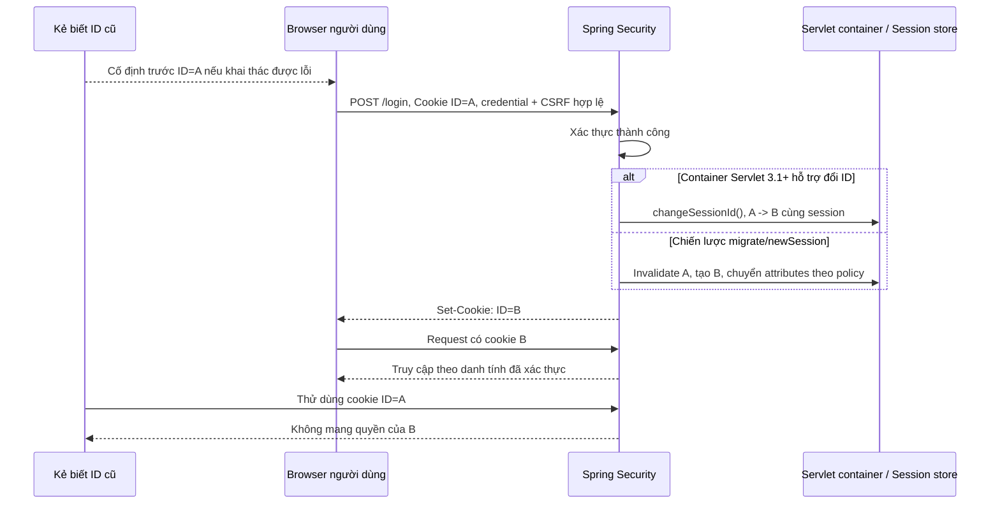
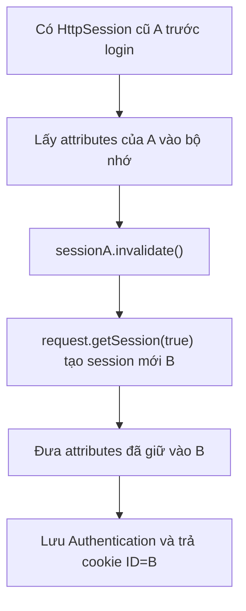

# Các chiến lược đổi session theo khả năng container

> **Chương:** Session và cookie  
> **Trọng tâm:** Chọn và kiểm thử `changeSessionId()`, `migrateSession()`, `newSession()`, `none()` trong **Spring Security Servlet**, dựa trên khả năng của Servlet container và yêu cầu giữ/xóa session attributes. Phân biệt cơ chế lịch sử của Servlet 3.0 với Servlet 3.1+, không áp dụng nhầm sang WebFlux.

Trong module `SPRING_SECURITY_HTTP_PROTECTION`, người học cấu hình nhiều lớp phòng vệ HTTP và trình duyệt của Spring Security: CSRF, CORS, security headers, CSP, HSTS, HTTP firewall và bảo vệ session. Module bao gồm cả **Servlet** và **Reactive**, yêu cầu kiểm thử những kịch bản tấn công web và chẩn đoán xung đột bảo mật khi triển khai. Bài này phân tích một quyết định quan trọng của **Servlet security**: *Khi người dùng đăng nhập, Spring Security nên đổi ID của phiên hiện có hay hủy phiên và tạo phiên mới; lựa chọn đó có phụ thuộc Servlet container không?*

## 1. Mục tiêu của mọi chiến lược: chặn session fixation

**Session fixation** là kiểu tấn công mà kẻ tấn công biết trước hoặc tác động để trình duyệt nạn nhân sử dụng một session ID trước lúc đăng nhập. Nếu ứng dụng sau đó gắn `Authentication` vào **chính ID cũ**, kẻ biết ID có thể thử dùng nó để truy cập phiên đã được nâng quyền.

Phòng vệ cốt lõi là **đổi định danh phiên tại ranh giới xác thực thành công**. Trên Servlet, Spring Security điều phối bước này bằng `SessionAuthenticationStrategy` và các implementation tương ứng. Mục tiêu bảo mật không chỉ là **ID A khác ID B**, mà còn là **ID A không thể dùng để hưởng quyền vừa được gắn vào ID B**.



Hai nhánh có **cùng mục tiêu đổi ID** nhưng khác cách quản lý `HttpSession` và dữ liệu phiên. Chọn sai có thể khiến giỏ hàng/flash message mất sau login, `HttpSessionBindingListener` bị gọi ngoài mong đợi, hoặc tệ hơn là ID cũ vẫn tiếp tục truy cập tài nguyên riêng tư.

**Cookie `Secure`, `HttpOnly`, `SameSite`, TLS/HSTS và CSRF không thay thế bước đổi ID.** Chúng giúp giảm những đường lộ/áp đặt cookie và chống request giả mạo, nhưng không làm an toàn một phiên đã nâng quyền mà vẫn giữ ID bị biết trước.

## 2. Quyết định đầu tiên: Servlet container hỗ trợ API nào?

Trên Servlet **3.1+**, API `HttpServletRequest.changeSessionId()` cho phép container thay ID **của cùng một `HttpSession`**. Trên Servlet **3.0 trở xuống**, API này chưa tồn tại, vì vậy các phiên bản Spring Security có hỗ trợ container đời cũ sử dụng cách hủy session và tạo session mới.

| Môi trường | Mặc định Spring Security tương ứng | Cơ chế đổi ID | Nhận xét |
| --- | --- | --- | --- |
| **Servlet 3.1+** (ví dụ container hiện đại đủ tương thích với phiên bản Spring đang chạy) | **`changeSessionId()`** | Container gọi `HttpServletRequest.changeSessionId()`, **giữ cùng session + attributes**. | Lựa chọn mặc định nên dùng trong ứng dụng hiện đại. |
| **Servlet 3.0 trở xuống**, với **các phiên bản Spring Security lịch sử còn hỗ trợ** | **`migrateSession()`** | Hủy A, tạo B, **sao chép attributes** từ A sang B. | Cách tương thích ngược; có chi phí migrate và callback session lifecycle. |
| Servlet 3.1+ nhưng nghiệp vụ muốn session sạch | Có thể **chủ động** chọn `newSession()` | Hủy A, tạo B, **không chuyển phần lớn attributes ứng dụng**. | Không phải phương án “tự động tốt hơn”; cần kiểm thử state. |
| Bất kỳ môi trường tương thích nào, ứng dụng tự tắt bảo vệ | `none()` nếu cố tình cấu hình | Không thực hiện session-fixation protection của Spring Security. | **Không khuyến nghị**, trừ khi đã có bảo vệ thay thế thực sự. |

**Quan trọng về phiên bản:** Bảng này mô tả hành vi và lựa chọn của Spring Security theo **thế hệ Servlet API**, không có nghĩa Spring Security mới nhất có thể chạy trên Servlet 3.0. Ví dụ Spring Framework/Spring Security đời mới với namespace `jakarta.servlet` yêu cầu container phù hợp phiên bản hiện hành; ứng dụng legacy `javax.servlet` phải dùng bộ thư viện/container tương thích, không trộn JAR của các thế hệ.

### Khi ép `changeSessionId()` lên container cũ

`changeSessionId()` **không có fallback bí mật** để đổi sang `migrateSession()` nếu container không hỗ trợ Servlet 3.1. Tài liệu Spring Security nêu rõ chọn nó trên Servlet 3.0 trở xuống sẽ gặp **exception**; không nên che lỗi này bằng `try/catch` rồi tiếp tục login mà bỏ rotation. Cách đúng là:

1. Ưu tiên **nâng cấp container** và các thư viện cùng một bộ phiên bản tương thích.
2. Nếu thực sự phải duy trì nền tảng legacy và phiên bản Spring Security đó còn hỗ trợ, chọn **`migrateSession()`** tường minh.
3. Kiểm thử sau nâng cấp cả **giữ attributes**, **cookie phiên** và **ID cũ không còn quyền**, vì đổi từ migration sang ID rotation thay đổi vòng đời session.

Không dựa vào tên sản phẩm “Tomcat”, “Jetty”, “Undertow” một mình để kết luận. Cần xác nhận **phiên bản container, Servlet API, Spring Framework/Security, namespace `javax`/`jakarta` và cấu hình session store**.

## 3. So sánh chi tiết bốn lựa chọn

```text
                 Authentication thành công
                            |
             Có session ẩn danh hợp lệ?
                      /            \
                   Không            Có
                    |                |
         Có thể không cần         Chọn policy:
         rotate ID cũ             |
                        +---------+---------+---------+
                        |         |         |         |
                 changeSessionId migrate   newSession none
                        |         |         |         |
                  Cùng session  Hủy A     Hủy A     Không đổi
                    ID A->B     Tạo B     Tạo B    (nguy hiểm)
                  Giữ attrs     Copy attrs  Giữ chủ yếu
                                           attrs nội bộ
```

| Tiêu chí | `changeSessionId()` | `migrateSession()` | `newSession()` | `none()` |
| --- | --- | --- | --- | --- |
| Cần Servlet 3.1+ | **Có** | Không, trong dòng legacy hỗ trợ | Không, trong dòng legacy hỗ trợ | Không |
| Tạo đối tượng `HttpSession` mới | **Không** | **Có** | **Có** | Không |
| Đổi ID cũ sang ID khác | Có | Có, nếu container tạo ID mới đúng hợp đồng | Có, nếu container tạo ID mới đúng hợp đồng | Không do strategy này |
| Attributes ứng dụng | **Giữ nguyên** | **Copy tất cả** | **Không copy phần lớn** | Giữ hiện tại |
| Attributes nội bộ Spring Security | Giữ nguyên | Copy | **Vẫn có thể được chuyển** | Giữ hiện tại |
| `HttpSessionBindingListener` của thuộc tính cũ | Thường không bị unbind/bind do invalidate | Có thể phát sinh unbind/bind | Có thể phát sinh unbind | Không do rotation |
| Session-scoped beans | Tránh đường hủy/copy session | Dễ cần kiểm tra callback/destroy | Có thể mất state | Không đổi bởi strategy |
| Event đổi ID | Spring `SessionFixationProtectionEvent`; có thể thêm `HttpSessionIdListener` từ container | Spring event (khi publisher có mặt) | Spring event (khi publisher có mặt) | Không có rotation event từ strategy |
| Phù hợp | **Mặc định hiện đại** | Tương thích legacy / yêu cầu migration cụ thể | Muốn loại bỏ state ứng dụng sau login | Chỉ khi có phòng vệ tương đương |

Hãy coi `migrateSession` và `newSession` là **chính sách di chuyển dữ liệu**, không chỉ là cách viết khác của `changeSessionId`. Việc copy một reference sang session mới không nhất thiết tạo **bản sao sâu** của object: nếu một attribute mutable được tham chiếu ở nhiều nơi, việc migration có thể tạo tác dụng ngoài ý muốn.

## 4. `changeSessionId()`: chiến lược của container hiện đại

Trong Servlet 3.1+, `ChangeSessionIdAuthenticationStrategy` gọi:

```java
String newId = request.changeSessionId();
```

Container chịu trách nhiệm đổi session identifier, cập nhật mapping phiên và bảo đảm client dùng ID mới. **`HttpSession` vẫn là cùng session hiện hành**, nên các attributes như `cartId` có thể được giữ nguyên. Điều này giúp tránh những tác động của `invalidate()` rồi copy attributes, đặc biệt với object có lifecycle listener.

Ví dụ cấu hình trong `HttpSecurity`:

```java
import org.springframework.context.annotation.Bean;
import org.springframework.context.annotation.Configuration;
import org.springframework.security.config.Customizer;
import org.springframework.security.config.annotation.web.builders.HttpSecurity;
import org.springframework.security.web.SecurityFilterChain;

@Configuration
class DefaultSessionRotationConfig {

    @Bean
    SecurityFilterChain securityFilterChain(HttpSecurity http)
            throws Exception {
        return http
            .authorizeHttpRequests(auth -> auth
                .requestMatchers("/login", "/public/**").permitAll()
                .anyRequest().authenticated())
            .formLogin(Customizer.withDefaults())
            .sessionManagement(session -> session
                .sessionFixation(fixation -> fixation.changeSessionId()))
            .build();
    }
}
```

**Lưu ý:** `sessionFixation(fixation -> fixation.changeSessionId())` viết tường minh để học cấu hình. Trên container Servlet 3.1+ đủ tương thích, **Spring Security đã dùng chiến lược này theo mặc định**, nên không cần thêm DSL nếu bạn muốn giữ chính sách mặc định.

### 4.1. Có session trước login mới có ID cần thay

Một số ứng dụng chưa tạo session cho khách truy cập lần đầu. Nếu request login **không mang một session ẩn danh hợp lệ đã tồn tại**, có thể không có ID trước đó để rotate. Không phải mọi response login đều phải có chuỗi cookie “A” so sánh với “B”.

`AbstractSessionFixationProtectionStrategy.onAuthentication(...)` kiểm tra session hiện tại và requested session ID của client. Nếu request không có session, strategy không tự tạo một phiên chỉ để đổi ID, trừ khi cấu hình `setAlwaysCreateSession(true)`. Nếu requested session ID không hợp lệ, strategy không coi đó là session hợp lệ cần rotate.

Vì vậy test chống fixation cần **chủ động tạo session ẩn danh A, đưa đúng cookie A vào POST login**, rồi xác minh response/phiên sau login. Không dùng một request login hoàn toàn mới, không cookie, để kết luận mechanism đã sai chỉ vì không quan sát thấy ID được thay.

### 4.2. Session attributes và CSRF token

`changeSessionId()` **không xóa attributes**, do đó raw CSRF token được lưu trong session có thể còn. Tuy vậy **`CsrfAuthenticationStrategy`** trong một luồng đăng nhập của Spring Security có thể **xóa CSRF token sau xác thực thành công**, khiến form cũ cần được tải lại. Không đồng nhất ba câu hỏi:

- `HttpSession.getId()` đã đổi chưa?
- Attribute `cartId` hoặc request cache đã được giữ chưa?
- CSRF token có bị **chiến lược khác** thu hồi hay không?

Đừng tự động tắt CSRF hoặc session fixation chỉ vì một form mở lâu bị `403` sau login. Hãy lấy token mới theo session hiện tại, giữ cookie đúng và kiểm tra riêng lifecycle của CSRF repository.

## 5. `migrateSession()`: phương án tương thích Servlet cũ

`SessionFixationProtectionStrategy` sử dụng `HttpSession.invalidate()` rồi tạo `HttpSession` mới, **trích và chuyển attributes** từ phiên cũ sang phiên mới. Tùy chọn DSL:

```java
// Thay phần .sessionManagement(...) trong HttpSecurity builder:
.sessionManagement(session -> session
    .sessionFixation(fixation -> fixation.migrateSession()))
```

Đoạn trên không phải một statement Java độc lập; đặt nó trong chuỗi cấu hình `HttpSecurity`. Với môi trường Servlet 3.0 trở xuống của những thế hệ Spring Security có hỗ trợ, **`migrateSession()` là mặc định**. Khi chạy Servlet mới, vẫn có thể chọn tường minh để giữ đặc tính migrate, nhưng cần lý do cụ thể.

### 5.1. Trình tự migration cần hiểu



Đây là sơ đồ khái niệm; framework còn điều phối sự kiện, session timeout và các attributes cần thiết. Hai yêu cầu kỹ thuật phải đúng:

1. **Container/session store phải cấp một ID mới** sau khi invalidation và tạo phiên khác; nếu tiếp tục reuse ID cũ thì không chống được fixation.
2. Những attributes được copy phải chịu được lifecycle `valueUnbound` và `valueBound`, việc khởi tạo session mới và phạm vi session-scoped bean.

### 5.2. Rủi ro `HttpSessionBindingListener` và session-scoped beans

Khi gọi `invalidate()`, container có thể phát callback `HttpSessionBindingListener.valueUnbound(...)` cho những object trong session. Nếu chuyển reference đó sang phiên B, `valueBound(...)` có thể được gọi lại. Các object gắn với session-scoped bean, `DisposableBean` hoặc resource holder có thể hiểu unbind là kết thúc vòng đời và **đóng tài nguyên** trước khi được tái sử dụng.

Ví dụ minh họa điều kiện cần lưu ý:

```java
import jakarta.servlet.http.HttpSessionBindingEvent;
import jakarta.servlet.http.HttpSessionBindingListener;

class CartHolder implements HttpSessionBindingListener {
    private boolean closed;

    @Override
    public void valueUnbound(HttpSessionBindingEvent event) {
        // Một ứng dụng có thể giải phóng tài nguyên ở đây.
        closed = true;
    }

    @Override
    public void valueBound(HttpSessionBindingEvent event) {
        // Không thể giả định chỉ cần bind lại là object trở về trạng thái ban đầu.
    }

    boolean isClosed() {
        return closed;
    }
}
```

Đây không phải mẫu implementation nên dùng cho giỏ hàng production; nó cho thấy **migration cùng object reference** không đảm bảo mọi internal state còn dùng được. Với ứng dụng chứa nhiều session-scoped objects, `changeSessionId()` trên Servlet 3.1+ thường tránh rắc rối này. Nếu bắt buộc migrate, thiết kế lại lifecycle hoặc custom `SessionAuthenticationStrategy` phù hợp.

## 6. `newSession()`: tạo phiên mới và chủ động bỏ state ứng dụng

Đôi khi doanh nghiệp muốn **không mang state ẩn danh sang phiên đã xác thực**. `newSession()` làm điều đó trong chiến lược Servlet: hủy phiên cũ, tạo phiên mới và **không chuyển phần lớn attributes ứng dụng**.

```java
// Thay phần session management trong HttpSecurity:
.sessionManagement(session -> session
    .sessionFixation(fixation -> fixation.newSession()))
```

**Không hiểu “new” là session rỗng tuyệt đối.** Tài liệu Spring Security ghi rõ một số attributes liên quan đến Spring Security **vẫn có thể được copy**, ví dụ state nội bộ phục vụ request cache. Chiến lược này tương ứng cách `SessionFixationProtectionStrategy` làm việc với `setMigrateSessionAttributes(false)`.

| Ví dụ state trước login | Với `changeSessionId()` | Với `migrateSession()` | Với `newSession()` |
| --- | --- | --- | --- |
| `cartId=cart-42` | Còn | Được chuyển | **Không mặc định được chuyển** |
| `preferredLocale=vi` | Còn | Được chuyển | Không mặc định được chuyển |
| `sessionScopedObject` | Cùng object, không invalidate | Có thể gặp callback unbind/bind | Không được chuyển như attribute ứng dụng |
| Spring Security request cache | Có thể giữ | Được chuyển | **Có thể vẫn được giữ** như attribute nội bộ |
| Session ID | Thay A → B | Thay A → B | Thay A → B |

`newSession()` có thể đúng khi dữ liệu phiên ẩn danh không được phép gắn với tài khoản khác, ví dụ quá trình **chuyển tài khoản** hoặc một ứng dụng có policy làm sạch state trước khi cấp quyền. Tuy nhiên nó không thay kiểm tra dữ liệu nhạy cảm: ứng dụng phải quyết định rõ **state nào nên xóa** thay vì dùng `newSession()` và giả định mọi thứ đều an toàn.

Nếu một giỏ hàng bị mất sau login, trước tiên xác minh ứng dụng có dùng `newSession()` hay không; đừng “sửa” bằng cách tắt session fixation protection. Có thể thiết kế lại lưu giỏ hàng ngoài session hoặc chuyển **dữ liệu đã kiểm soát** sang tài khoản sau xác thực.

## 7. `none()` và những nhầm lẫn khiến bảo vệ bị tắt

`none()` vô hiệu hóa session-fixation protection trong cấu hình Spring Security:

```java
// KHÔNG KHUYẾN NGHỊ trong ứng dụng dùng cookie-based login.
.sessionManagement(session -> session
    .sessionFixation(fixation -> fixation.none()))
```

Khi đó, **nếu không có cơ chế khác thay ID sau xác thực**, người dùng có thể tiếp tục dùng ID trước login. Đây chính là điều kiện dễ làm phát sinh session fixation. Chỉ đánh giá `none()` khi một lớp bảo vệ tương đương đã tồn tại và được **kiểm thử cả việc ID cũ không có quyền** (ví dụ session management ở container được tích hợp có bằng chứng). Đừng coi `Secure`, `HttpOnly` hoặc `SameSite` là cơ chế tương đương.

### Các nhầm lẫn cấu hình

| Cấu hình | Có ý nghĩa gì? | Vì sao không tương đương `none()`? |
| --- | --- | --- |
| `SessionCreationPolicy.IF_REQUIRED` | Security có thể tạo session khi cần. | Không quyết định có đổi ID lúc login hay không. |
| `SessionCreationPolicy.NEVER` | Spring Security không chủ động tạo session nhưng có thể dùng session có sẵn. | Session đã tồn tại vẫn phải được bảo vệ nếu được nâng quyền. |
| `SessionCreationPolicy.STATELESS` | Không dùng `HttpSession` để lưu/truy xuất `SecurityContext` trong mô hình stateless. | Threat model khác; không nên dùng để né lỗi form login stateful. |
| `csrf(csrf -> csrf.disable())` | Tắt bảo vệ CSRF cho request unsafe. | **Không** liên quan tới việc đổi session ID, chỉ làm mất thêm một lớp bảo vệ. |
| `sessionFixation(fixation -> fixation.none())` | Bỏ strategy đổi ID của Spring Security. | Có thể mở đường session fixation nếu container không thay. |

Một ứng dụng vừa dùng form login và cookie session, vừa bật `STATELESS` mà vẫn kỳ vọng giữ đăng nhập giữa các request là thiết kế mâu thuẫn. Hãy xác định kiến trúc dựa vào session hay bearer token trước khi chọn chính sách.

## 8. Các class, API và thời điểm gọi strategy

DSL `HttpSecurity.sessionManagement(...)` cấu hình **`SessionAuthenticationStrategy`**, còn authentication mechanism quyết định **khi nào vừa xác thực thành công** để thực thi strategy.

| API/Class (Servlet) | Nhiệm vụ |
| --- | --- |
| `SessionAuthenticationStrategy` | Hợp đồng `onAuthentication(Authentication, HttpServletRequest, HttpServletResponse)`. |
| `AbstractSessionFixationProtectionStrategy` | Kiểm tra session hiện hữu, requested ID và điều phối event khi session thay. |
| `ChangeSessionIdAuthenticationStrategy` | Gọi `HttpServletRequest.changeSessionId()` trên container hỗ trợ. |
| `SessionFixationProtectionStrategy` | `invalidate()` + tạo session mới, chọn chuyển nhiều hay ít attributes. |
| `CompositeSessionAuthenticationStrategy` | Gọi các strategy theo thứ tự, ví dụ kiểm soát concurrent session → rotate → register. |
| `CsrfAuthenticationStrategy` | Xóa CSRF token khi xác thực mới theo luồng được cấu hình; độc lập với ID rotation. |
| `SessionFixationProtectionEvent` | Sự kiện Spring Security báo đã thay session ID. |
| `HttpSessionIdListener` | Listener của container khi ID thay qua `changeSessionId()`. |

Chữ ký interface:

```java
import jakarta.servlet.http.HttpServletRequest;
import jakarta.servlet.http.HttpServletResponse;
import org.springframework.security.core.Authentication;
import org.springframework.security.web.authentication.session.SessionAuthenticationStrategy;

// Chữ ký quan trọng, không cần tự viết lại interface:
void onAuthentication(
    Authentication authentication,
    HttpServletRequest request,
    HttpServletResponse response);
```

Đây là **minh họa chữ ký**, không phải một file Java đầy đủ: method nằm trong interface `SessionAuthenticationStrategy` và có khai báo exception theo hợp đồng. Nên đọc Javadoc phiên bản đang chạy khi viết custom implementation.

### 8.1. Spring Security 5 và 6+ khác nhau ở chỗ nào?

Theo tài liệu Spring Security, trước đây `SessionManagementFilter` thường phát hiện authentication mới và gọi `SessionAuthenticationStrategy`. Từ **Spring Security 6**, cấu hình mặc định không còn dựa vào `SessionManagementFilter` để đọc session ở mọi request; **authentication mechanism** chịu trách nhiệm gọi strategy vào đúng thời điểm. Vì thế:

- Với **form login chuẩn**, cơ chế authentication tích hợp phối hợp session-fixation strategy đã cấu hình.
- Với **custom login filter/controller**, chỉ tự đặt `SecurityContextHolder.setContext(...)` không chứng minh ID đã thay; phải điều phối session strategy phù hợp và lưu `SecurityContext` vào repository tương thích.
- Tránh cấu hình một strategy tùy chỉnh ở nơi không được authentication mechanism sử dụng. Trong Spring Security 6+, `sessionManagement().sessionAuthenticationStrategy(...)` không phải cách thay thế chung cho mọi mechanism và có thể không được hỗ trợ theo mô hình mặc định.
- Không gọi `onAuthentication(...)` trên **mỗi** request đã authenticated. Rotation thuộc **sự kiện xác thực mới thành công**, không phải interceptor cho toàn bộ HTTP requests.

### 8.2. Có nhiều session strategies cùng lúc

Giới hạn số phiên đồng thời có thể dùng `CompositeSessionAuthenticationStrategy`. Thứ tự điển hình:

```text
ConcurrentSessionControlAuthenticationStrategy
             ↓
ChangeSessionIdAuthenticationStrategy
             ↓
RegisterSessionAuthenticationStrategy
```

Kiểm soát giới hạn trước, đổi ID sau, rồi mới ghi session **ID mới** vào registry. Đăng ký phiên trước khi đổi ID có thể ghi nhận sai ID; đổi ID trước khi từ chối authentication vì đã vượt giới hạn cũng có thể làm side effect không cần thiết. Nếu dùng concurrency configuration chính thức của Spring Security, ưu tiên framework ghép các strategy thay vì tự làm lại chỉ để “tối ưu”.

## 9. Cấu hình bốn lựa chọn trong một nơi

Chọn **một** chiến lược cho một `SecurityFilterChain`, không đăng ký cả bốn:

```java
import org.springframework.context.annotation.Bean;
import org.springframework.context.annotation.Configuration;
import org.springframework.security.config.Customizer;
import org.springframework.security.config.annotation.web.builders.HttpSecurity;
import org.springframework.security.web.SecurityFilterChain;

@Configuration
class FormLoginSessionSecurity {

    @Bean
    SecurityFilterChain securityFilterChain(HttpSecurity http) throws Exception {
        return http
            .authorizeHttpRequests(auth -> auth
                .requestMatchers("/login", "/public/**").permitAll()
                .anyRequest().authenticated())
            .formLogin(Customizer.withDefaults())
            .sessionManagement(session -> session
                .sessionFixation(fixation -> fixation.changeSessionId()))
            .build();
    }
}
```

Thay dòng `changeSessionId()` trong builder bằng **một** trong các dòng sau:

```java
// Giữ cùng session, container đổi ID (Servlet 3.1+):
fixation.changeSessionId();

// Tạo session mới, chuyển attributes (legacy):
fixation.migrateSession();

// Tạo session mới, bỏ phần lớn attributes ứng dụng:
fixation.newSession();

// TẮT BẢO VỆ — chỉ để nhận diện cấu hình nguy hiểm:
fixation.none();
```

Các dòng là **tùy chọn thay thế** bên trong lambda `sessionFixation(fixation -> ...)`, không phải một đoạn mã chạy bốn lệnh. Nếu không có lý do rõ ràng và đang dùng container hiện đại, **bỏ hẳn cấu hình `sessionManagement` này để giữ mặc định cũng đúng**.

### 9.1. Đừng chọn theo tên container mà quên phiên bản framework

Khi lên kế hoạch chuyển đổi:

| Câu hỏi | Tại sao cần biết? |
| --- | --- |
| Thực thi `jakarta.servlet` hay `javax.servlet`? | Phân biệt thế hệ API và các thư viện có thể chạy cùng nhau. |
| Container hỗ trợ Servlet 3.1+ không? | Quyết định có API `changeSessionId()` hay không. |
| Phiên bản Spring Security đang hỗ trợ Servlet nào? | Không thể chỉ hạ container rồi kỳ vọng framework mới tự tương thích. |
| Session ID do container hay Spring Session/Redis quản lý? | Phải xác minh cập nhật ID ở kho thực, không chỉ trong object mock. |
| Trước login có session A từ GET form/CSRF không? | Nếu không có A, test rotation có thể sai tiền đề. |
| Ứng dụng cần giữ state nào từ khách sang tài khoản? | Quyết định `changeSessionId/migrateSession` hay `newSession`. |
| Có authentication filter/controller tùy chỉnh không? | Có thể bỏ sót lời gọi session strategy trên Spring Security 6+. |

**Không dùng kiểm tra Servlet API rồi tự “fallback to none” ở runtime.** Nếu một deployment không hỗ trợ khả năng đã chọn, fail fast hoặc sử dụng profile/config đã được kiểm thử cho nền tảng đó. Một fallback âm thầm bỏ session fixation protection là rủi ro bảo mật.

## 10. Unit test so sánh ba chiến lược có bảo vệ

`MockHttpServletRequest`, `MockHttpServletResponse` và `MockHttpSession` giúp kiểm tra **hành vi của strategy**, không cần chạy server. Trong unit test phải mô phỏng **requested session ID hợp lệ**; chỉ tạo session object chưa đủ để chắc chắn logic rotation được kích hoạt.

Ví dụ JUnit 5 với Spring Test và Spring Security (namespace `jakarta.servlet` cho dự án hiện đại):

```java
import jakarta.servlet.http.HttpSession;
import org.junit.jupiter.api.Test;
import org.springframework.mock.web.MockHttpServletRequest;
import org.springframework.mock.web.MockHttpServletResponse;
import org.springframework.mock.web.MockHttpSession;
import org.springframework.security.authentication.UsernamePasswordAuthenticationToken;
import org.springframework.security.core.Authentication;
import org.springframework.security.core.authority.AuthorityUtils;
import org.springframework.security.web.authentication.session.ChangeSessionIdAuthenticationStrategy;
import org.springframework.security.web.authentication.session.SessionFixationProtectionStrategy;

import static org.junit.jupiter.api.Assertions.*;

class SessionStrategyComparisonTest {

    private Authentication alice() {
        return UsernamePasswordAuthenticationToken.authenticated(
            "alice", "N/A", AuthorityUtils.createAuthorityList("ROLE_USER"));
    }

    private MockHttpServletRequest requestFor(MockHttpSession session) {
        var request = new MockHttpServletRequest("POST", "/login");
        request.setSession(session);
        request.setRequestedSessionId(session.getId());
        request.setRequestedSessionIdValid(true);
        request.setRequestedSessionIdFromCookie(true);
        return request;
    }

    @Test
    void changeSessionIdKeepsSameSessionAndCart() {
        var old = new MockHttpSession();
        old.setAttribute("cartId", "cart-42");
        var request = requestFor(old);
        String idA = old.getId();

        new ChangeSessionIdAuthenticationStrategy().onAuthentication(
            alice(), request, new MockHttpServletResponse());

        HttpSession current = request.getSession(false);
        assertSame(old, current);
        assertNotEquals(idA, current.getId());
        assertEquals("cart-42", current.getAttribute("cartId"));
    }

    @Test
    void migrateSessionCreatesNewSessionAndCopiesCart() {
        var old = new MockHttpSession();
        old.setAttribute("cartId", "cart-42");
        var request = requestFor(old);
        String idA = old.getId();

        // migrateSession() tương ứng SessionFixationProtectionStrategy
        // với migrateSessionAttributes mặc định true.
        var strategy = new SessionFixationProtectionStrategy();
        strategy.onAuthentication(
            alice(), request, new MockHttpServletResponse());

        HttpSession current = request.getSession(false);
        assertNotNull(current);
        assertNotSame(old, current);
        assertNotEquals(idA, current.getId());
        assertEquals("cart-42", current.getAttribute("cartId"));
    }

    @Test
    void newSessionCreatesNewSessionWithoutApplicationCart() {
        var old = new MockHttpSession();
        old.setAttribute("cartId", "cart-42");
        var request = requestFor(old);
        String idA = old.getId();

        // newSession() dùng cùng strategy, nhưng không di chuyển
        // session attributes thông thường của ứng dụng.
        var strategy = new SessionFixationProtectionStrategy();
        strategy.setMigrateSessionAttributes(false);
        strategy.onAuthentication(
            alice(), request, new MockHttpServletResponse());

        HttpSession current = request.getSession(false);
        assertNotNull(current);
        assertNotSame(old, current);
        assertNotEquals(idA, current.getId());
        assertNull(current.getAttribute("cartId"));
    }
}
```

Các test này chỉ kiểm chứng **ID và state phiên trong mock container**. Chúng không chứng minh những attributes nội bộ của Spring Security luôn có tên/giá trị cụ thể trên mọi phiên bản, cũng không chứng minh cookie ID A cũ bị gỡ khỏi session store Redis/Tomcat. Với `newSession`, **không assert rằng session tuyệt đối không có attributes**: Spring Security có thể chuyển attributes nội bộ ngay cả khi tắt migrate application attributes.

### 10.1. Kiểm thử điều kiện session vắng mặt

Không có session ẩn danh A thì không có ID A cần thay. Test này phản ánh hợp đồng superclass, tránh kỳ vọng sai:

```java
@Test
void strategyDoesNotCreateSessionOnlyToRotateByDefault() {
    var request = new MockHttpServletRequest("POST", "/login");
    var response = new MockHttpServletResponse();
    var strategy = new ChangeSessionIdAuthenticationStrategy();

    assertNull(request.getSession(false));
    strategy.onAuthentication(alice(), request, response);
    assertNull(request.getSession(false));
}
```

Phương thức trên đặt **trong `SessionStrategyComparisonTest`** để dùng helper `alice()`. Nếu cấu hình `setAlwaysCreateSession(true)` trên strategy, việc tạo session khi chưa tồn tại là hành vi có chủ đích khác. **Không nên bật chỉ để một bài test luôn có cookie**; trước hết phải xác minh ứng dụng cần session hay có thể trì hoãn tạo session.

## 11. Kiểm thử login thật qua `MockMvc`

Gọi trực tiếp `onAuthentication(...)` cho ta biết chiến lược làm gì, nhưng không xác nhận **authentication mechanism** thực sự gọi nó sau login. Với Spring Security 6+, `SessionManagementFilter` không phải đường mặc định để phát hiện mọi lần authentication mới. Bài kiểm thử thứ hai phải thực hiện **POST login với credential thật trong test**, CSRF hợp lệ, rồi xem session ID và attributes.

```java
import jakarta.servlet.http.HttpSession;
import org.junit.jupiter.api.Test;
import org.springframework.beans.factory.annotation.Autowired;
import org.springframework.boot.test.autoconfigure.web.servlet.AutoConfigureMockMvc;
import org.springframework.boot.test.context.SpringBootTest;
import org.springframework.mock.web.MockHttpSession;
import org.springframework.test.web.servlet.MockMvc;
import org.springframework.test.web.servlet.MvcResult;

import static org.junit.jupiter.api.Assertions.*;
import static org.springframework.security.test.web.servlet.request.SecurityMockMvcRequestPostProcessors.csrf;
import static org.springframework.security.test.web.servlet.response.SecurityMockMvcResultMatchers.authenticated;
import static org.springframework.test.web.servlet.request.MockMvcRequestBuilders.post;

@SpringBootTest
@AutoConfigureMockMvc
class LoginSessionRotationMvcTest {
    @Autowired MockMvc mvc;

    @Test
    void loginWithPriorSessionRotatesId() throws Exception {
        MockHttpSession anonymous = new MockHttpSession();
        anonymous.setAttribute("cartId", "cart-42");
        String before = anonymous.getId();

        MvcResult result = mvc.perform(post("/login")
                .session(anonymous)
                .with(request -> {
                    request.setRequestedSessionId(before);
                    request.setRequestedSessionIdValid(true);
                    return request;
                })
                .with(csrf())
                .param("username", "alice")
                .param("password", "test-password"))
            .andExpect(authenticated())
            .andReturn();

        HttpSession after = result.getRequest().getSession(false);
        assertNotNull(after);
        assertNotEquals(before, after.getId());
        // Áp dụng khi test đang dùng changeSessionId hoặc migrateSession.
        assertEquals("cart-42", after.getAttribute("cartId"));
    }
}
```

Ví dụ giả định một **test application Spring Boot 3.x**, form login `POST /login`, user `alice` có mật khẩu `test-password` và cấu hình `changeSessionId()` hoặc `migrateSession()`. Nếu đang thử `newSession()`, đổi assertion cart thành `assertNull` theo chính sách. Nếu dùng Spring Boot mới hơn, kiểm tra lại vị trí import test auto-configuration theo phiên bản Boot.

`with(csrf())` là **test request post-processor** cung cấp CSRF token cho request login; nó không tự xoay session ID. **Đừng dùng `@WithMockUser` hoặc `with(user("alice"))` để kết luận login rotation**: các tiện ích đó đặt Authentication sẵn, có thể không kích hoạt `UsernamePasswordAuthenticationFilter` và session strategy.

### 11.1. Ma trận so sánh trong test context

Có thể cấu hình **mỗi chiến lược ở một test context riêng**, rồi xác nhận:

| Strategy trong test | ID sau login | `cartId` sau login | Cần thêm kiểm tra |
| --- | --- | --- | --- |
| `changeSessionId` | Khác A | Còn | **Cùng session object**, cookie B và ID A không còn quyền. |
| `migrateSession` | Khác A | Còn | **Session object mới**, callback binding và session store. |
| `newSession` | Khác A | Không còn | Session nội bộ cần thiết vẫn chạy, không mất dữ liệu bắt buộc. |
| `none` (chỉ negative test có kiểm soát) | Có thể giữ A | Có thể còn | Chứng minh thiếu rotation là nguy cơ; **không deploy**. |

Khi test chiến lược khác nhau, tránh để nhiều bean `SecurityFilterChain` áp dụng cùng request với thứ tự không rõ ràng. Mỗi test context phải cho thấy chính sách nào thật sự chạy; nếu thay đổi Spring profile, kiểm tra lại build/test property.

## 12. Kiểm thử bằng Servlet container và session store thật

Unit test và MockMvc dùng mock objects nên **chưa đủ để xác nhận một session ID cũ không còn truy cập được state đã nâng quyền**. Test end-to-end phải đi qua **container triển khai thực tế** cùng session store mà ứng dụng dùng trong production.

### 12.1. Trình tự với hai cookie jar độc lập

```text
1. Browser A: GET /login (hoặc GET trang tạo session)
   -> nhận cookie session ID=A và CSRF token phù hợp

2. Browser A: POST /login với ID=A, credential hợp lệ, CSRF token
   -> đăng nhập thành công; nhận cookie ID=B
   -> assert B khác A

3. Browser A: GET /me với cookie ID=B
   -> authenticated là đúng user vừa đăng nhập

4. Browser B độc lập: GET /me với cookie ID=A cũ
   -> không được authenticated với danh tính ở bước 3

5. Browser B: thử lại với ID=A từ node ứng dụng khác
   -> cũng không được authenticated nếu dùng session store phân tán
```

Kỳ vọng ở bước 4 **không bắt buộc là một HTTP status duy nhất**: với form login có thể redirect `302` về `/login`; với API có thể là `401`; với authorization policy đặc biệt có thể là `403`. Điều bất biến là **response không có nội dung riêng tư và `SecurityContext` của user vừa đăng nhập không được khôi phục từ ID A**.

Một ứng dụng dễ mắc lỗi “đã đổi cookie A → B nhưng A và B vẫn cùng trỏ tới authenticated state” nếu custom store/gateway giữ alias sai. Do đó chỉ assert `A != B` là **chưa đủ**. Trong test integration, bổ sung kiểm tra session store (nếu hệ thống cho phép) rằng ID A không còn ánh xạ đến phiên đã nâng quyền.

### 12.2. Kịch bản cho ba chiến lược

| Kịch bản | `changeSessionId` | `migrateSession` | `newSession` |
| --- | --- | --- | --- |
| Cookie A trước login → B sau login | B khác A | B khác A | B khác A |
| B đọc được `/me` đã xác thực | Có | Có | Có |
| A cũ đọc được `/me` đã xác thực | **Không** | **Không** | **Không** |
| Cart ẩn danh trong session | Giữ | Copy | Không mặc định giữ |
| Request cache / internal security state | Theo state session hiện hành | Có thể được chuyển | Có thể được chuyển, phụ thuộc chính sách Spring |
| Session-scoped object / binding listener | Tránh hủy/copy | Có thể bị unbind/bind | Có thể bị unbind và không bind lại |
| Event của `HttpSessionIdListener` | Có thể được phát khi container gọi `changeSessionId` | Không phải tác dụng của `changeSessionId` | Không phải tác dụng của `changeSessionId` |

Với migration, đảm bảo **container thật cấp ID mới** khi hủy A và tạo B. Với ID rotation do container, đảm bảo `changeSessionId` **cập nhật cả cookie và mapping store**. Với `newSession`, test thêm business state nào *phải* được lưu ngoài session trước khi chuyển trạng thái xác thực.

### 12.3. Cookie và reverse proxy

Quan sát `Set-Cookie` trên response đăng nhập và `Cookie` ở request tiếp theo. Tên mặc định phổ biến trong Servlet là `JSESSIONID`, nhưng Spring Session hoặc cấu hình ứng dụng có thể dùng tên khác. Đừng hardcode tên cookie nếu kiến trúc có `CookieSerializer`, namespace/path hoặc gateway rewrite.

```http
GET /login HTTP/1.1
Host: app.example.test

HTTP/1.1 200 OK
Set-Cookie: JSESSIONID=ANON_A; Path=/; Secure; HttpOnly; SameSite=Lax

POST /login HTTP/1.1
Host: app.example.test
Cookie: JSESSIONID=ANON_A
Content-Type: application/x-www-form-urlencoded

username=alice&password=example-only&_csrf=valid-test-token

HTTP/1.1 302 Found
Set-Cookie: JSESSIONID=AUTH_B; Path=/; Secure; HttpOnly; SameSite=Lax
Location: /
```

Đây là **transcript minh họa**, không phải giá trị cookie/password thực. Với `csrf` mặc định của Spring Security, `POST /login` cũng cần CSRF token hợp lệ. Không tắt CSRF để test session fixation; hãy tạo token bằng trang login/endpoint hợp lệ hoặc dùng `csrf()` trong unit/MockMvc test.

Cookie `Secure`, `HttpOnly`, `SameSite`, `Path` và `Domain` phải được kiểm tra qua **response thực**. Khi có TLS termination, cấu hình forwarded headers và proxy phải được tin cậy đúng cách; không cho client tự làm giả `X-Forwarded-*` để đổi scheme/host application. Cookie flags hạn chế lộ/áp đặt ID, nhưng **không chứng minh container đã rotate session**.

## 13. Event, listener và bảo toàn lifecycle

Theo Spring Security Servlet reference, khi có session fixation protection, Spring có thể phát `SessionFixationProtectionEvent`. Với `changeSessionId()`, container còn có `jakarta.servlet.http.HttpSessionIdListener`; nếu cả hai được lắng nghe, **một lần rotation có thể tạo hai tín hiệu khác nhau**.

| Tín hiệu | Nguồn | Ý nghĩa kiểm thử |
| --- | --- | --- |
| `SessionFixationProtectionEvent` | Spring Security strategy + event publisher | Cho biết strategy đã báo thay ID. |
| `HttpSessionIdListener.sessionIdChanged(...)` | Servlet container khi ID đổi | Cho biết container đã xử lý session ID change. |
| `HttpSessionListener.sessionDestroyed(...)` | Container khi session bị invalidated/destroyed | Có thể phát sinh với migrate/newSession; không phải event đổi ID của cùng session. |
| `HttpSessionBindingListener.valueUnbound(...)` | Container gỡ attribute từ session | Có thể ảnh hưởng object khi migrate/newSession. |
| Authentication success event | Authentication publisher | Chỉ xác nhận login thành công; **không thay** kiểm tra rotation. |

Mã event listener tối giản không ghi session ID:

```java
import java.util.concurrent.atomic.LongAdder;
import org.springframework.context.event.EventListener;
import org.springframework.security.web.authentication.session.SessionFixationProtectionEvent;
import org.springframework.stereotype.Component;

@Component
class SessionFixationMetrics {
    private final LongAdder rotations = new LongAdder();

    @EventListener
    public void rotated(SessionFixationProtectionEvent event) {
        rotations.increment();
        // Không log event.getOldSessionId()/getNewSessionId().
    }

    long total() {
        return rotations.sum();
    }
}
```

Nếu strategy được tạo thủ công trong unit test mà chưa được tiêm `ApplicationEventPublisher`, **không mặc định yêu cầu event phải xuất hiện**. Kiểm tra first-order behavior là ID rotation và request access; event chỉ bổ sung khả năng quan sát.

**Không ghi raw session ID vào log/metrics hoặc test report**: nó là bearer credential của phiên. Một số framework logging có thể tự ghi `Set-Cookie`, `Cookie`, query parameters hoặc header authentication; cấu hình redaction trước khi thu thập trace. Khi cần correlation, dùng request ID độc lập hoặc mã tham chiếu an toàn, không gửi session ID vào telemetry.

## 14. Không áp dụng nhầm DSL Servlet sang Reactive WebFlux

Phân loại stack trước khi cấu hình:

| Servlet | WebFlux |
| --- | --- |
| `HttpSecurity`, `SecurityFilterChain` | `ServerHttpSecurity`, `SecurityWebFilterChain` |
| `HttpServletRequest` / `HttpSession` | `ServerWebExchange` / `WebSession` |
| `HttpServletRequest.changeSessionId()` | `WebSession.changeSessionId()`, trả `Mono<Void>` |
| `SessionAuthenticationStrategy` và `SessionFixationConfigurer` | `ServerSecurityContextRepository` phối hợp reactive authentication |
| `ChangeSessionIdAuthenticationStrategy` / `SessionFixationProtectionStrategy` | `WebSessionServerSecurityContextRepository` có cơ chế đổi ID khi lưu security context |

Trong WebFlux, `WebSessionServerSecurityContextRepository` lưu `SecurityContext` vào `WebSession`; Javadoc nêu khi lưu context thì session ID được thay để phòng fixation. Không dùng `sessionManagement().sessionFixation()` của `HttpSecurity` trong `ServerHttpSecurity`. Nếu ứng dụng dùng custom `ServerSecurityContextRepository` hoặc stateless bearer-token authentication, phải đánh giá vòng đời session riêng.

**Lý do bài này tập trung Servlet:** Bốn lựa chọn `changeSessionId/migrateSession/newSession/none` là DSL của **Servlet `SessionManagementConfigurer.SessionFixationConfigurer`**, gắn với khả năng của Servlet container. Chúng không phải bộ tùy chọn áp dụng nguyên xi cho Reactive.

## 15. Chẩn đoán xung đột cấu hình và triển khai

| Triệu chứng | Nguyên nhân nên điều tra | Cách xác minh/sửa |
| --- | --- | --- |
| Chọn `changeSessionId()` trên container cũ bị exception | Servlet API không hỗ trợ `HttpServletRequest.changeSessionId()` | Xác minh Servlet version và dependency; nâng container hoặc dùng `migrateSession()` trên stack legacy tương thích. |
| ID sau login không đổi | Không có session ẩn danh A, custom login bỏ qua strategy hoặc bật `none()` | Tạo A trước login, gửi cookie A thật, kiểm tra mechanism được gọi lúc xác thực. |
| Login thành công nhưng cart mất | Đang dùng `newSession()` hoặc handler khác xóa attribute | Kiểm tra strategy thực chạy, test giữ/mất cart ở từng lựa chọn. |
| Cart còn nhưng session-scoped bean gặp lỗi | `migrateSession()` gây unbind/destroy rồi bind lại cùng object | Xem `HttpSessionBindingListener` và vòng đời bean; ưu tiên `changeSessionId()` khi có thể. |
| ID A cũ vẫn truy cập `/me` đã xác thực | Container/session store giữ alias, custom store/proxy sai | Test hai cookie jar A/B, kiểm tra mapping tại các node và invalidation. |
| Container đổi ID nhưng cookie B không tới browser | Cookie `Secure`/`SameSite`/`Domain`/`Path`, proxy, response commit | Kiểm tra `Set-Cookie` và `Cookie` thực, forwarded headers đáng tin cậy. |
| Custom authentication thành công nhưng chưa rotate | Spring Security 6+ yêu cầu auth mechanism gọi strategy | Đưa strategy vào luồng authentication mới thành công, lưu context đúng repository. |
| ID bị đổi trên mọi request | Strategy bị gọi lặp lại hoặc custom filter coi request authenticated là login mới | Chỉ gọi ở thời điểm vừa authenticate, không làm interceptor mỗi request. |
| CSRF token cũ trả `403` sau login | CSRF authentication strategy đã xóa token hoặc cookie/token không đồng bộ | Lấy token mới từ form/endpoint; không tắt CSRF và không coi riêng ID change là nguyên nhân. |
| `SessionFixationProtectionEvent` không có khi test | Strategy thiếu event publisher, chưa có session hoặc chưa chạy rotation | Kiểm tra điều kiện và publisher; assert hành vi ID trước khi assert event. |
| Thay version Spring Security và session strategy hoạt động khác | Thay Servlet API, cơ chế authentication hoặc session store | Khóa BOM phù hợp, đọc migration notes, chạy đủ ma trận hồi quy. |
| Tắt session fixation để giữ state | Hiểu nhầm `changeSessionId` sẽ mất cart | Chọn đúng chiến lược giữ attributes hoặc di chuyển state có kiểm soát, **không chọn `none()`**. |
| Lỗi chỉ ở Redis/multi-node | Rotation chưa đồng bộ với distributed store/serialization/TTL | Test request dùng A/B trên từng node và kiểm tra mapping phiên thật. |
| GET đã xác thực không có session mới trên API bearer token | Ứng dụng dùng stateless auth, không sử dụng session cookie | Kiểm thử token lifecycle theo kiến trúc stateless, không áp test session fixation thiếu tiền đề. |

**Thứ tự chẩn đoán nên dùng:** Container + Servlet API → namespace/phiên bản Spring → security chain → session ẩn danh A có tồn tại? → credential/CSRF thành công? → strategy nào thực thi? → ID B được cấp? → cart/security attrs được giữ hay xóa? → container/session store có xóa mapping A? → HTTP test B có quyền, A không có quyền? → cookie flags, proxy, logout và timeout.

## 16. Bài thực hành và ma trận hồi quy

Với một Spring MVC app có `POST /login`, `GET /me` và một thuộc tính session `cartId` trước login, hãy lần lượt chọn **một** strategy trong mỗi test context.

| ID | Điều kiện kiểm thử | Kỳ vọng |
| --- | --- | --- |
| C01 | Servlet 3.1+, mặc định không khai báo fixation DSL | `changeSessionId` được áp dụng khi có phiên A hợp lệ. |
| C02 | Servlet 3.1+, ép `changeSessionId()` | ID B khác A, **cùng session object**, cart còn. |
| C03 | Legacy stack trên Servlet 3.0 hoặc thấp hơn, không ép strategy | Mặc định lịch sử là `migrateSession`; B khác A. |
| C04 | Ép `changeSessionId()` trên container không hỗ trợ | **Exception**, không tiếp tục login với bảo vệ bị bỏ qua. |
| C05 | Dùng `migrateSession()` | Tạo `HttpSession` mới, cart được copy. |
| C06 | Dùng `migrateSession()` với binding listener | Quan sát callback unbind/bind và xác nhận object còn hợp lệ. |
| C07 | Dùng `newSession()` | Tạo `HttpSession` mới, cart không mặc định được copy. |
| C08 | Dùng `newSession()` và request cache | Kiểm tra attributes Spring Security thực sự cần vẫn hoạt động. |
| C09 | Dùng `none()` **chỉ trong test** | Xác nhận vì sao giữ ID A sau login là nguy cơ; không đưa cấu hình vào production. |
| C10 | Không có session A trước login | Không tự kết luận rotation thất bại; phải kiểm tra tiền đề. |
| C11 | POST login sai credential | Không xuất hiện phiên authenticated. |
| C12 | POST login đúng credential + CSRF, dùng cookie A | Nhận ID B mới, B có quyền. |
| C13 | GET `/me` với A từ browser độc lập | Không được có quyền của B. |
| C14 | Sau login, form cũ dùng CSRF token cũ | Xác minh token lifecycle độc lập với ID rotation. |
| C15 | Logout với B, dùng lại B cũ | Không còn authenticated state. |
| C16 | Proxy HTTPS / nhiều node / Spring Session | Cookie B và mapping phiên nhất quán, A không có quyền ở mọi node. |
| C17 | Dùng custom auth filter thay form login | Strategy được gọi một lần sau xác thực mới; context được lưu. |
| C18 | Có event + `HttpSessionIdListener` | Không đếm đôi cùng lần rotation, không log ID. |

Trong môi trường chỉ chạy Servlet hiện đại, **không cần cài container đời cũ chỉ để đủ bài tập**. Có thể giải thích nhánh legacy từ tài liệu và dùng test unit/mock để phân biệt migration. Nếu tổ chức thực sự còn triển khai legacy, thực hiện smoke/integration test trong **môi trường tương thích được kiểm soát** và có kế hoạch nâng cấp; không tự tạo một deployment cũ, thiếu vá lỗi chỉ để thử `migrateSession`.

**Câu hỏi tự kiểm tra:**

1. Tại sao `changeSessionId()` là mặc định trên Servlet 3.1+ nhưng `migrateSession()` từng là mặc định trên container cũ?
2. Vì sao `newSession()` không phải “tạo phiên trống tuyệt đối”?
3. Vì sao callback `HttpSessionBindingListener` là rủi ro khi migration?
4. Tại sao `A != B` vẫn chưa đủ nếu session store cho A đọc trạng thái của B?
5. Vì sao `permitAll()` ở `/login` không có nghĩa bỏ CSRF, và `STATELESS` không phải nút thay thế fixation protection?
6. Trên WebFlux, vì sao không sử dụng `SessionFixationConfigurer` của Servlet?

## 17. Tổng kết

- **Mục tiêu không đổi:** một session ID đã biết trước đăng nhập không được tiếp tục đại diện cho phiên đã xác thực.
- **Servlet 3.1+**: giữ `changeSessionId()` mặc định nếu không có lý do khác — ID đổi, **cùng `HttpSession`**, attributes giữ nguyên.
- **Servlet 3.0 trở xuống trong Spring Security lịch sử**: `migrateSession()` là mặc định — hủy A, tạo B, copy attributes; cần kiểm tra listener và session-scoped beans.
- **`newSession()`**: cũng tạo B nhưng **không copy phần lớn application attributes**, trong khi một số attributes nội bộ Spring Security vẫn có thể được giữ.
- **`none()`**: không có session-fixation protection từ Spring Security; tránh dùng nếu không có lớp bảo vệ tương đương, đã kiểm chứng.
- **Không ép `changeSessionId()` trên container không hỗ trợ**: cấu hình này lỗi thay vì tự động fallback. Kiểm tra tương thích Servlet API, Spring Security và namespace `javax/jakarta`.
- **Kiểm thử phân tầng:** strategy mock → login thật với MockMvc → HTTP hai cookie jar trên container/store thật. Phải xác minh **B có quyền và A không có quyền**.
- **Các lớp bổ trợ:** cookie policy, CSRF, CORS, CSP, HTTPS/HSTS, HTTP firewall và authorization vẫn cần cấu hình đúng trong `SPRING_SECURITY_HTTP_PROTECTION`.

## Tài liệu tham khảo chính thức

- [Spring Security — Servlet Authentication Persistence and Session Management](https://docs.spring.io/spring-security/reference/servlet/authentication/session-management.html)
- [Spring Security — SessionFixationConfigurer API](https://docs.spring.io/spring-security/reference/api/java/org/springframework/security/config/annotation/web/configurers/SessionManagementConfigurer.SessionFixationConfigurer.html)
- [Spring Security — ChangeSessionIdAuthenticationStrategy API](https://docs.spring.io/spring-security/reference/api/java/org/springframework/security/web/authentication/session/ChangeSessionIdAuthenticationStrategy.html)
- [Spring Security — SessionFixationProtectionStrategy API](https://docs.spring.io/spring-security/reference/api/java/org/springframework/security/web/authentication/session/SessionFixationProtectionStrategy.html)
- [Spring Security — AbstractSessionFixationProtectionStrategy API](https://docs.spring.io/spring-security/reference/api/java/org/springframework/security/web/authentication/session/AbstractSessionFixationProtectionStrategy.html)
- [Spring Security — CompositeSessionAuthenticationStrategy API](https://docs.spring.io/spring-security/reference/api/java/org/springframework/security/web/authentication/session/CompositeSessionAuthenticationStrategy.html)
- [Spring Security — SessionFixationProtectionEvent API](https://docs.spring.io/spring-security/reference/api/java/org/springframework/security/web/authentication/session/SessionFixationProtectionEvent.html)
- [Spring Security — Servlet Security Testing with MockMvc](https://docs.spring.io/spring-security/reference/servlet/test/mockmvc/index.html)
- [Spring Security — CSRF for Servlet](https://docs.spring.io/spring-security/reference/servlet/exploits/csrf.html)
- [Spring Security — WebFlux Security Configuration](https://docs.spring.io/spring-security/reference/reactive/configuration/webflux.html)
- [Spring Security — WebSessionServerSecurityContextRepository API](https://docs.spring.io/spring-security/reference/api/java/org/springframework/security/web/server/context/WebSessionServerSecurityContextRepository.html)
- [OWASP — Session Management Cheat Sheet](https://cheatsheetseries.owasp.org/cheatsheets/Session_Management_Cheat_Sheet.html)
- [OWASP — WSTG: Testing for Session Fixation](https://wstg.owasp.org/latest/10-Session_Management/03-Session_Fixation/)
