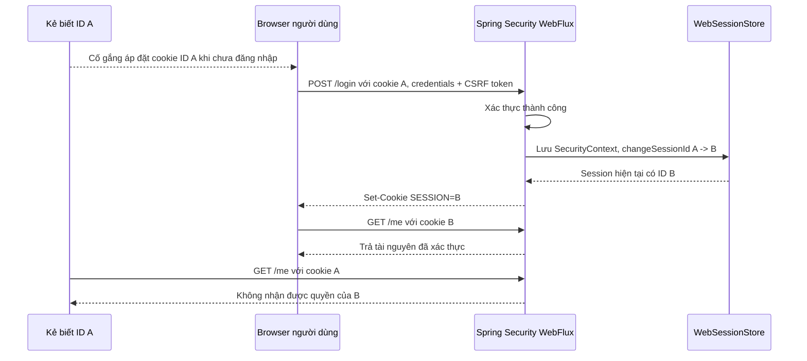
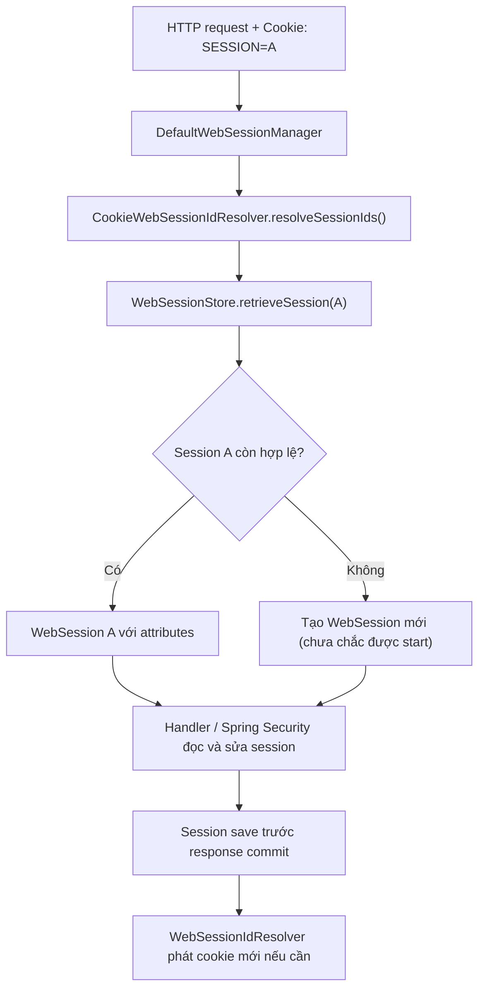
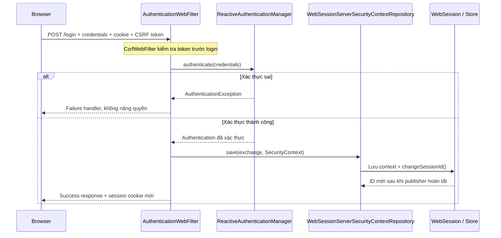

# WebSession và thay đổi định danh trong ứng dụng Reactive

> **Chương:** Session và cookie  
> **Phạm vi:** Spring Framework WebFlux và Spring Security Reactive, với `WebSession`, `WebSessionManager`, `WebSessionIdResolver`, `WebSessionStore`, `WebSessionServerSecurityContextRepository` và cơ chế đổi session ID.  
> **Mục tiêu:** Phân biệt session ID với trạng thái phiên và CSRF token; hiểu đúng `Mono<Void> changeSessionId()`; thiết lập cookie an toàn; kiểm thử việc đổi ID khi xác thực thành công, sự tồn tại của thuộc tính phiên và việc ID cũ không còn dùng để hưởng quyền.

Trong module `SPRING_SECURITY_HTTP_PROTECTION`, người học áp dụng các lớp phòng vệ HTTP và trình duyệt của Spring Security: CSRF, CORS, security headers, CSP, HSTS, HTTP firewall và bảo vệ session/cookie. Module bao quát cả Servlet lẫn Reactive, đồng thời nhấn mạnh kiểm thử tấn công web và chẩn đoán xung đột bảo mật trong triển khai thực tế. Bài này tập trung vào **ứng dụng Reactive dùng Spring WebFlux**. Không dùng `HttpSession`, `HttpServletRequest.changeSessionId()` hay `HttpSecurity` để cấu hình những ví dụ Reactive bên dưới.

## 1. Vấn đề: tại sao session phải thay định danh?

Một ứng dụng đăng nhập bằng cookie giữ trạng thái xác thực trên server, còn trình duyệt gửi **session ID** trong cookie để xác định trạng thái đó. Session ID lúc đã đăng nhập là một dạng **bearer credential**: ai dùng được ID hợp lệ trong điều kiện tương ứng có thể được ánh xạ đến cùng trạng thái phiên.

**Session fixation** xảy ra khi kẻ tấn công biết hoặc tìm cách áp đặt ID của một phiên **trước khi nạn nhân đăng nhập**. Nếu ứng dụng gắn danh tính đã xác thực vào chính ID bị biết trước, kẻ tấn công có thể dùng ID ấy để truy cập phiên đã nâng quyền. Việc browser có cho phép áp đặt cookie hay không phụ thuộc nhiều yếu tố, nhưng phòng vệ tại ranh giới xác thực vẫn cần thiết.

Biện pháp cốt lõi là **đổi session ID từ A thành B khi nâng trạng thái xác thực**, và bảo đảm A **không thể dùng để truy cập quyền của B**.



**Không chỉ assert `A != B`.** Một hệ session store/gateway viết sai có thể cấp ID B mà vẫn để A ánh xạ tới state đã xác thực. Kiểm thử hoàn chỉnh phải dùng **hai client/cookie jar** và xác minh ID cũ không thể khôi phục danh tính vừa đăng nhập.

## 2. Năm thành phần phải phân biệt

| Đối tượng | Vai trò | Ví dụ |
| --- | --- | --- |
| **`WebSession`** | Đại diện phiên của Spring WebFlux, giữ ID, attributes, thời gian truy cập và thao tác bất đồng bộ. | `exchange.getSession()` |
| **Session ID** | Định danh duy nhất của một phiên trong session store. | `session.getId()` |
| **Session cookie** | Cách browser gửi ID qua HTTP; tên mặc định của `CookieWebSessionIdResolver` là `SESSION`. | `Cookie: SESSION=...` |
| **`SecurityContext`** | Dữ liệu xác thực/`Authentication` được lưu trong phiên khi dùng session-based security. | `WebSessionServerSecurityContextRepository` |
| **CSRF token** | Token frontend phải chủ động gửi để bảo vệ request dùng cookie; có thể lưu trong `WebSession`. | Header `X-CSRF-TOKEN` hoặc form `_csrf` |

Đây là **năm thành phần có liên quan nhưng không đồng nhất**. Đổi session ID có thể **giữ nguyên attributes** của cùng `WebSession`, tức giỏ hàng và raw CSRF token vẫn có thể còn. Ngược lại, một CSRF request handler dùng XOR masking có thể tạo **chuỗi token xuất ra khác nhau trên hai GET** mà session ID không đổi.

### Thuộc tính và định danh khác nhau về vòng đời

`WebSession.changeSessionId()` không có nghĩa "xóa sạch phiên". Hợp đồng của Spring Framework là **tạo ID mới, cập nhật storage và làm `getId()` phản ánh ID mới sau khi publisher hoàn tất**. Trạng thái trong `getAttributes()` được giữ ở cùng session, trừ khi các thành phần khác chủ động thay hoặc xóa.

Ngược lại, `WebSession.invalidate()` **vô hiệu hóa session và xóa trạng thái lưu trữ**. Timeout do session store xử lý lại là một tình huống khác: client có thể vẫn gửi cookie cũ, nhưng server không còn tìm thấy state cũ.

## 3. Kiến trúc WebSession: từ cookie đến store

Spring WebFlux sử dụng các thành phần:

- `ServerWebExchange.getSession()` trả **`Mono<WebSession>`** cho request.
- `WebSessionManager` lấy hoặc tạo phiên tương ứng với exchange.
- `WebSessionIdResolver` đọc/gửi định danh phiên bằng cookie hoặc cách truyền phù hợp.
- `WebSessionStore` lưu, tìm, xóa và cập nhật phiên; mặc định Framework có in-memory store, còn Spring Session có thể nối Redis hoặc repository khác.
- `WebSession` là trạng thái phiên mà handler/filter thao tác.



**Nhận được `Mono<WebSession>` không có nghĩa đã gửi cookie `SESSION`.** WebFlux có thể tạo một đối tượng session chưa được start. Nếu session không được start và không có attributes mới, việc lưu một session chưa có state thường không khiến client nhận ID; điều này giúp tránh tạo phiên cho mọi GET chỉ đọc dữ liệu.

### Các phương thức `WebSession` cần biết

| API | Ý nghĩa | Lưu ý khi dùng |
| --- | --- | --- |
| `getId()` | Đọc ID hiện tại. | Giá trị sẽ đổi **sau khi `changeSessionId()` hoàn tất**. |
| `getAttributes()` | Truy cập map attributes của session. | Thêm attribute có thể làm session được start ngầm. |
| `getAttribute(name)` / `getRequiredAttribute(name)` | Lấy một attribute theo tên. | `getRequiredAttribute` báo lỗi nếu thiếu. |
| `start()` | Chủ động đánh dấu session được start. | Không phải cứ gọi `getSession()` là session đã start. |
| `isStarted()` | Có được start thủ công hoặc qua attributes hay chưa. | Hữu ích khi test phát session cookie. |
| `changeSessionId()` | Trả `Mono<Void>` để đổi ID và cập nhật storage. | Phải **đưa publisher vào pipeline**. |
| `invalidate()` | Trả `Mono<Void>` để hủy session và clear storage. | Không tương đương `changeSessionId()`. |
| `save()` | Trả `Mono<Void>` để lưu qua store. | Framework thường gọi **trước khi response commit**; application không nên tự gọi tùy tiện. |
| `setMaxIdleTime(Duration)` | Đặt thời gian nhàn rỗi tối đa. | Không tự làm store hết hạn ngay khi setter chạy. |
| `getLastAccessTime()`, `getCreationTime()` | Thời gian được quản lý bởi session. | Dùng cho chẩn đoán có kiểm soát, không đoán expiry từ cookie đơn lẻ. |

## 4. Reactive là bất đồng bộ: `changeSessionId()` cần được subscribe

Trên Servlet, `HttpServletRequest.changeSessionId()` thực thi đồng bộ và trả về ID mới. Trên WebFlux:

```java
Mono<Void> rotation = session.changeSessionId();
```

Đây là **publisher mô tả thao tác**, không phải thao tác đồng bộ có thể bỏ qua kết quả. Cách sử dụng đúng là ghép `Mono<Void>` vào chuỗi xử lý mà WebFlux sẽ subscribe.

### 4.1. Ví dụ đúng: ghép vào pipeline

```java
import org.springframework.web.server.ServerWebExchange;
import reactor.core.publisher.Mono;

final class SessionRotationService {

    Mono<Void> rotateAfterPrivilegeElevation(ServerWebExchange exchange) {
        return exchange.getSession()
            .flatMap(session -> session.changeSessionId());
    }
}
```

Tầng authentication/authorization phải gọi `rotateAfterPrivilegeElevation` **sau khi xác minh việc nâng quyền thành công**, và trả/chain publisher đó trước khi gửi response. **Đừng thêm endpoint rotate ID công khai chỉ vì có sẵn service này**: request đến từ browser cần authentication, authorization, CSRF và kiểm soát concurrency phù hợp.

### 4.2. Ví dụ có kiểm tra ID trước/sau

```java
import org.springframework.web.server.ServerWebExchange;
import reactor.core.publisher.Mono;

record SessionRotationObservation(boolean changed) {}

Mono<SessionRotationObservation> rotate(ServerWebExchange exchange) {
    return exchange.getSession().flatMap(session -> {
        String before = session.getId();
        return session.changeSessionId()
            .then(Mono.fromSupplier(() ->
                new SessionRotationObservation(
                    !before.equals(session.getId()))));
    });
}
```

Đọc `session.getId()` **sau** `then(...)` để chắc chắn thao tác đổi ID đã kết thúc. Trong ví dụ chỉ trả **boolean**, không xuất raw session ID vào log, metrics, JSON hay response. Với session store thật, nếu thao tác đổi ID lỗi, publisher phải phát lỗi; không dùng `onErrorResume` để lặng lẽ tiếp tục một login không được bảo vệ.

### 4.3. Những anti-pattern Reactive

```java
// SAI: gọi rồi bỏ publisher; thao tác chưa được nối vào response pipeline.
exchange.getSession().doOnNext(session -> session.changeSessionId());

// SAI: tạo subscription độc lập, dễ chạy sau khi response commit.
exchange.getSession().subscribe(session -> session.changeSessionId().subscribe());

// SAI: chặn event loop, gây BlockHound/IllegalStateException hoặc giảm throughput.
exchange.getSession().block().changeSessionId().block();

// ĐÚNG: flatMap + trả Mono cho pipeline xử lý.
return exchange.getSession().flatMap(session -> session.changeSessionId());
```

Đây là các **đoạn minh họa**, không phải một file Java độc lập. `doOnNext` ở ví dụ sai chỉ tạo một publisher bên trong mà không consume nó; `subscribe()` thủ công tách công việc khỏi vòng đời HTTP; `block()` không phù hợp với Netty event loop. Tương tự, nếu cần **invalidate session**, phải trả `exchange.getSession().flatMap(WebSession::invalidate)`.

## 5. Khi nào Spring Security Reactive tự đổi session ID?

Với form login mặc định sử dụng session-based authentication, Spring Security có class `org.springframework.security.web.server.context.WebSessionServerSecurityContextRepository`.

Đây là implementation của `ServerSecurityContextRepository`, lưu `SecurityContext` trong `WebSession`. **Javadoc xác nhận: khi lưu một `SecurityContext`, repository đổi session ID để bảo vệ chống session fixation.**

Hợp đồng repository:

```java
Mono<Void> save(ServerWebExchange exchange, SecurityContext context);
Mono<SecurityContext> load(ServerWebExchange exchange);
```

- `save(...)` tham gia vào việc lưu Authentication/`SecurityContext` và đổi ID theo implementation.
- `load(...)` đọc lại context; không có context thì trả `Mono.empty()`.
- Lưu context không tương đương với chỉ gọi `ReactiveSecurityContextHolder.withAuthentication(...)` trong một reactive chain. Nếu security context cần **tồn tại giữa các HTTP request**, phải được lưu vào repository đúng cách.
- `SecurityContext` và cookie session là các lớp khác nhau: request sau chỉ khôi phục được context nếu gửi ID đúng và session store tìm thấy state.

### 5.1. Luồng form login thông thường



Điểm trọng tâm: WebFlux **không sử dụng `SessionFixationConfigurer` của Servlet**. Không sao chép `http.sessionManagement(session -> session.sessionFixation(...))` từ `HttpSecurity` sang `ServerHttpSecurity`. Cơ chế chống fixation của form login Reactive gắn với **quá trình lưu security context vào `WebSession`**, không phải một Servlet `SessionAuthenticationStrategy` đồng bộ.

### 5.2. Có phải ID chỉ thay sau login?

**Không.** Theo hợp đồng của `WebSessionServerSecurityContextRepository`, **khi `SecurityContext` được lưu** thì ID được thay. Luồng form login chuẩn thông thường lưu context tại lúc xác thực mới thành công, nhưng nếu custom code gọi `save(...)` nhiều lần không cần thiết thì ID có thể thay lặp lại.

Ngoài ra, một thành phần **khác** cũng có thể đổi ID: `WebSessionServerCsrfTokenRepository` triển khai `saveToken(...)` bằng cách cập nhật attributes rồi gọi `session.changeSessionId()`. Vì vậy quan sát hai cookie `SESSION` khác nhau **không đủ để kết luận người dùng vừa đăng nhập**.

Các phép kiểm thử nên phân biệt:

1. **Đổi ID vì lưu security context**: unit test trực tiếp `WebSessionServerSecurityContextRepository.save(...)`.
2. **Đổi ID vì cấp/thu hồi CSRF token**: kiểm tra `WebSessionServerCsrfTokenRepository.saveToken(...)` khi dùng repository đó.
3. **Đổi ID thủ công**: ứng dụng gọi `WebSession.changeSessionId()` ở điểm nâng quyền riêng.
4. **Tạo session mới**: invalidate/timeout khiến client được ánh xạ sang một `WebSession` khác — không phải đổi ID của cùng session.

Đừng xây hệ thống audit dựa trên “cookie SESSION đổi = login”. Để nhận biết đăng nhập, dùng **event/hook xác thực** đáng tin cậy và chỉ log metadata không nhạy cảm.

## 6. Cấu hình `SecurityWebFilterChain` cho ứng dụng có session

Một ứng dụng WebFlux tối giản dùng form login, protected endpoint và CSRF:

```java
import org.springframework.context.annotation.Bean;
import org.springframework.context.annotation.Configuration;
import org.springframework.security.config.Customizer;
import org.springframework.security.config.annotation.web.reactive.EnableWebFluxSecurity;
import org.springframework.security.config.web.server.ServerHttpSecurity;
import org.springframework.security.web.server.SecurityWebFilterChain;

@Configuration
@EnableWebFluxSecurity
class ReactiveSessionSecurityConfig {

    @Bean
    SecurityWebFilterChain securityWebFilterChain(ServerHttpSecurity http) {
        return http
            .authorizeExchange(ex -> ex
                .pathMatchers("/login", "/csrf", "/assets/**").permitAll()
                .anyExchange().authenticated())
            .formLogin(Customizer.withDefaults())
            .csrf(Customizer.withDefaults())
            .build();
    }
}
```

`csrf(Customizer.withDefaults())` chỉ làm rõ chủ đích: CSRF **bật mặc định** với WebFlux. `permitAll()` cho `GET /csrf`/`GET /login` không miễn CSRF đối với `POST /login`. Với form login dùng cookie session, phải có CSRF token được cấp và gửi hợp lệ.

### 6.1. User test cho các ví dụ tiếp theo

Ví dụ có thể thêm user trong test configuration:

```java
import org.springframework.context.annotation.Bean;
import org.springframework.security.core.userdetails.User;
import org.springframework.security.core.userdetails.MapReactiveUserDetailsService;
import org.springframework.security.core.userdetails.ReactiveUserDetailsService;

// Trong class @Configuration dùng CHỈ ở test/dev:
@Bean
ReactiveUserDetailsService testUsers() {
    return new MapReactiveUserDetailsService(
        User.withUsername("alice")
            .password("{noop}test-password")
            .roles("USER")
            .build());
}
```

`{noop}` là **chỉ dành cho học/test**; không dùng mật khẩu plaintext trong production. Với hệ thống thật, dùng password encoder an toàn, secret management, chống brute force và chính sách xác thực thích hợp.

### 6.2. Custom `ServerSecurityContextRepository`: nguy cơ bỏ rotation

Khi tùy chỉnh xác thực, `ServerHttpSecurity.formLogin(...).securityContextRepository(...)` quyết định nơi form login **ghi context**; `ServerHttpSecurity.securityContextRepository(...)` liên quan đến nơi chain **đọc context**. Các thành phần này cần phối hợp.

```java
import org.springframework.security.web.server.context.WebSessionServerSecurityContextRepository;

// Đặt trong @Bean SecurityWebFilterChain có biến ServerHttpSecurity http:
var contexts = new WebSessionServerSecurityContextRepository();

return http
    .securityContextRepository(contexts)
    .authorizeExchange(ex -> ex
        .pathMatchers("/login", "/csrf").permitAll()
        .anyExchange().authenticated())
    .formLogin(login -> login.securityContextRepository(contexts))
    .csrf(Customizer.withDefaults())
    .build();
```

Đoạn mã là **một cách thay thế** cấu hình ở mục 6, không tạo hai bean `SecurityWebFilterChain` xung đột. Ứng dụng thông thường nên giữ default; chỉ tùy chỉnh nếu thật sự cần.

Nếu custom `ServerSecurityContextRepository` chỉ lưu `SecurityContext` mà **không thay session ID**, bạn không thể suy ra ứng dụng còn chống fixation theo mặc định. Nếu dùng `NoOpServerSecurityContextRepository` và ứng dụng hoàn toàn stateless, mô hình rủi ro là bearer-token authentication khác session cookie; không sử dụng cấu hình stateless như một cách tắt persistence cho ứng dụng vẫn cần form login stateful.

## 7. `WebSession` được start và persist lúc nào?

Đây là nguồn gốc của nhiều lỗi “GET đã lấy session mà không có cookie” trong WebFlux. Theo hợp đồng Spring Framework:

- `exchange.getSession()` tạo/lấy **một `Mono<WebSession>`**; có thể là phiên chưa start.
- `session.start()` đánh dấu phiên cần được duy trì; việc thêm thuộc tính vào `session.getAttributes()` cũng có thể tự start phiên.
- `session.isStarted()` báo trạng thái đó.
- `session.save()` được `WebSessionManager` dùng trước khi response commit; **ứng dụng không nên tự gọi `save()` tùy tiện** trong handler.
- Nếu session mới chưa từng start và không có attributes, `save()` có thể không lưu state hoặc cấp cookie cho browser.

### 7.1. Ví dụ chủ động start session (chỉ khi có nhu cầu)

```java
import org.springframework.web.server.ServerWebExchange;
import reactor.core.publisher.Mono;

Mono<Void> ensureSessionStarted(ServerWebExchange exchange) {
    return exchange.getSession().doOnNext(session -> session.start()).then();
}
```

Điều này chỉ cần khi ứng dụng **có chủ đích muốn tạo session**. Không gọi `start()` cho mọi request công khai: tạo session không cần thiết làm tăng cookie, dung lượng store và bề mặt quản lý session.

### 7.2. GET công bố CSRF token: session có thể được tạo từ repository

Với `WebSessionServerCsrfTokenRepository`, token được giữ trong attributes; khi cần sinh token và lưu, repo có thể start session ngầm và đổi session ID. Nếu một endpoint chỉ đọc `Mono<CsrfToken>` từ exchange nhưng **không consume publisher**, token chưa chắc được lưu hoặc cấp ra client.

Ví dụ endpoint cung cấp **token đã được request handler xử lý**:

```java
import org.springframework.http.CacheControl;
import org.springframework.http.ResponseEntity;
import org.springframework.security.web.server.csrf.CsrfToken;
import org.springframework.web.bind.annotation.GetMapping;
import org.springframework.web.bind.annotation.RestController;
import org.springframework.web.server.ServerWebExchange;
import reactor.core.publisher.Mono;

record CsrfView(String headerName, String parameterName, String token) {}

@RestController
class CsrfTokenApi {
    @GetMapping("/csrf")
    Mono<ResponseEntity<CsrfView>> csrf(ServerWebExchange exchange) {
        Mono<CsrfToken> source =
            exchange.getAttribute(CsrfToken.class.getName());

        if (source == null) {
            return Mono.error(new IllegalStateException(
                "CsrfWebFilter chưa cung cấp CSRF token publisher"));
        }

        return source.map(csrf -> ResponseEntity.ok()
            .cacheControl(CacheControl.noStore())
            .body(new CsrfView(
                csrf.getHeaderName(),
                csrf.getParameterName(),
                csrf.getToken())));
    }
}
```

`map(...)` bảo đảm việc tải/sinh/lưu token xảy ra trong pipeline response mà WebFlux subscribe. Spring Security 6+ có thể XOR-mask token trả về; frontend phải gửi **nguyên token đã được công bố**, không thay bằng raw token từ repository.

## 8. Cookie `SESSION` và `CookieWebSessionIdResolver`

WebFlux thường dùng `CookieWebSessionIdResolver` với tên cookie mặc định **`SESSION`**. Khi session ID thay, resolver giúp phản hồi gửi ID mới cho browser. Tên, scope và flags của cookie có thể tùy chỉnh; nếu dùng Spring Session hoặc gateway, cần xác nhận thực tế response `Set-Cookie` chứ không chỉ dựa vào code.

### 8.1. Ví dụ cấu hình cookie an toàn

```java
import org.springframework.context.annotation.Bean;
import org.springframework.context.annotation.Configuration;
import org.springframework.web.server.session.CookieWebSessionIdResolver;
import org.springframework.web.server.session.WebSessionIdResolver;

@Configuration
class ReactiveSessionCookieConfiguration {

    @Bean
    WebSessionIdResolver webSessionIdResolver() {
        var resolver = new CookieWebSessionIdResolver();
        resolver.setCookieName("SESSION");
        resolver.addCookieInitializer(cookie -> cookie
            .path("/")
            .httpOnly(true)
            .secure(true)
            .sameSite("Lax"));
        return resolver;
    }
}
```

**Điều kiện áp dụng:** Ví dụ này dành cho ứng dụng triển khai bằng **HTTPS**, nơi browser có thể gửi cookie `Secure`. Nếu app chỉ chạy HTTP trong môi trường test, cookie `Secure` có thể không được browser gửi lại. Với TLS termination, cần cấu hình proxy/forwarded headers đáng tin cậy và kiểm tra cookie thực tế trên trình duyệt.

### 8.2. Tác dụng và giới hạn của cookie flags

| Thuộc tính | Giảm rủi ro nào? | Không thay thế điều gì? |
| --- | --- | --- |
| `Secure` | Giảm khả năng gửi cookie phiên qua HTTP không mã hóa. | Không thực hiện đổi ID sau đăng nhập. |
| `HttpOnly` | Giảm khả năng JavaScript đọc session ID qua `document.cookie`. | Không ngăn mọi dạng session theft/cookie injection. |
| `SameSite=Lax/Strict` | Giảm một số request cross-site tự gửi cookie. | **Không thay CSRF token**, đặc biệt với luồng phức tạp hoặc browser policy khác nhau. |
| `Path=/` | Xác định phạm vi đường dẫn nhận cookie. | Không tự giới hạn quyền truy cập tài nguyên. |
| Không đặt `Domain` tùy tiện | Hạn chế scope cookie và nguy cơ subdomain gây cookie shadowing/tossing. | Không thay session ID rotation. |
| Session `Max-Age` | Giới hạn thời gian cookie tồn tại phía browser. | Không tự hủy state server nếu store/TTL quản lý khác. |

Nếu muốn dùng tên cookie tiền tố **`__Host-`**, browser yêu cầu `Secure`, `Path=/` và **không có `Domain`**. Ví dụ có thể đặt `resolver.setCookieName("__Host-SESSION")` khi thật sự triển khai HTTPS và thỏa các ràng buộc đó; cần thay tên cookie tương ứng trong frontend/test và loại bỏ cookie cũ khi chuyển đổi tên.

### 8.3. Tránh đồng thời nhiều cách truyền session ID

`CookieWebSessionIdResolver` định danh session bằng cookie. Spring Framework cũng hỗ trợ `HeaderWebSessionIdResolver` dùng header trong các thiết kế phù hợp. Khi hệ thống tích hợp SPA/browser và API client, đừng tùy tiện đọc session ID từ query string hay custom header do bất kỳ origin nào gửi mà không đánh giá kiến trúc và CORS.

**CSRF có mô hình rủi ro gắn với credential browser tự gửi.** Nếu một API chỉ dùng bearer token do client chủ động thêm vào `Authorization` và không sử dụng cookie để xác thực, rủi ro CSRF có thể khác. Nhưng không được dùng điều đó để bỏ bảo vệ các endpoint **vẫn** dựa vào session cookie trong cùng ứng dụng.

## 9. Login, logout và session timeout không phải một thao tác

### 9.1. Sau login thành công

Trong luồng form login WebFlux sử dụng `WebSessionServerSecurityContextRepository`:

1. Browser gửi `POST /login` với cookie hiện có và CSRF token hợp lệ.
2. `ReactiveAuthenticationManager` xác thực credential.
3. Authentication filter tạo/lưu `SecurityContext`.
4. Repository lưu context vào `WebSession` và đổi ID.
5. Response gửi session ID hiện hành; browser phải gửi **cookie mới** cho request sau.

**Không khẳng định ID chỉ có thể đổi ở bước 4.** Nếu GET form trước đó đã lưu CSRF token, repository CSRF cũng có thể đổi ID, nên cần snapshot cookie *ngay trước POST login* và so với cookie *sau login*.

### 9.2. Logout mặc định trên WebFlux

Theo tài liệu Spring Security Reactive, endpoint logout mặc định xóa dữ liệu trong `ServerCsrfTokenRepository` và `ServerSecurityContextRepository`, rồi chuyển về trang đăng nhập. Việc **invalidate toàn bộ `WebSession`** là một lựa chọn bổ sung cần cấu hình nếu ứng dụng mong muốn.

Ví dụ kết hợp logout handler:

```java
import org.springframework.security.web.server.authentication.logout.DelegatingServerLogoutHandler;
import org.springframework.security.web.server.authentication.logout.SecurityContextServerLogoutHandler;
import org.springframework.security.web.server.authentication.logout.WebSessionServerLogoutHandler;

// Trong cấu hình @Bean SecurityWebFilterChain, trước return http...:
var logoutHandlers = new DelegatingServerLogoutHandler(
    new SecurityContextServerLogoutHandler(),
    new WebSessionServerLogoutHandler());

// Trong ServerHttpSecurity builder:
.logout(logout -> logout.logoutHandler(logoutHandlers))
```

`SecurityContextServerLogoutHandler` xử lý security context, còn `WebSessionServerLogoutHandler` gọi invalidation cho `WebSession` hiện hành. Nếu thay logout handler mặc định bằng custom handlers, phải kiểm tra cơ chế **CSRF cleanup** còn phù hợp; việc invalidate session có thể làm mất mọi attributes của session, không chỉ authentication.

Đây là **trích đoạn cấu hình** thay cho default logout, không phải file Java độc lập. Trên một request `POST /logout`, CSRF protection vẫn phải hoạt động. Không biến logout thành GET có side effect chỉ để tránh truyền token.

### 9.3. Invalidate và đổi ID giải quyết hai việc khác nhau

| API/hành động | ID hiện hành | Attributes | Session state sau request |
| --- | --- | --- | --- |
| `changeSessionId()` | Tạo ID mới cho **cùng session**. | **Giữ** attributes. | Tiếp tục phiên với định danh mới. |
| `invalidate()` | ID cũ bị vô hiệu. | **Clear** attributes. | Phiên cũ không còn sử dụng; client cần session mới nếu tiếp tục. |
| Timeout `maxIdleTime` tại store | ID cũ không được dùng sau expiry. | Store không còn phục vụ state đó. | Yêu cầu tiếp theo có thể được cấp phiên mới. |
| Xóa `SecurityContext` | ID/session có thể vẫn tồn tại. | Context bị xóa, attributes khác có thể còn. | Không còn Authentication cũ trong context. |
| Xóa CSRF token | ID có thể đổi tùy repository. | Chỉ token CSRF bị xóa. | Cần cấp token mới khi frontend thực hiện unsafe request. |

**Không mặc định mọi login đều xóa toàn bộ session; cũng không mặc định logout luôn invalidate session.** Test chính sách thực tế theo handler/repository đã đăng ký.

### 9.4. Timeout và Spring Session

`WebSession.setMaxIdleTime(Duration)` cấu hình thời gian idle tối đa cho session; việc timeout được quyết định bởi **session store và thời gian truy cập**, không phải chỉ đọc một cookie đã lâu. Với Spring Session/Redis, TTL, persistence, serialization, nhiều node và session cleanup có thể ảnh hưởng kết quả.

Trong integration test, để xác minh expiry:

- Tạo session A, cấp cookie A và lưu context thử nghiệm.
- Làm session A thực sự hết hạn trong store (test clock hoặc TTL phù hợp).
- Gửi cookie A cũ đến protected endpoint; **không được** khôi phục quyền từ session cũ.
- Tạo session B và đăng nhập lại; bảo đảm các token/cookie mới hoạt động bình thường.

Đừng thay kiểm thử TTL thật bằng `Thread.sleep(...)` quá dài trong CI nếu có thể dùng clock/store điều khiển được. `MockWebSession.setMaxIdleTime(...)` đơn lẻ **không chứng minh** manager/store thực đã gỡ phiên hết hạn.

## 10. Unit test `WebSession.changeSessionId()` với StepVerifier

`MockWebSession` từ `spring-test` cho phép kiểm tra hợp đồng session trong bộ nhớ. Các test sau **không thực thi HTTP filter**, chỉ xác minh hành vi object.

### 10.1. Đổi ID nhưng giữ attributes

```java
import org.junit.jupiter.api.Test;
import org.springframework.mock.web.server.MockWebSession;
import reactor.test.StepVerifier;

import static org.junit.jupiter.api.Assertions.*;

class WebSessionIdentityTest {

    @Test
    void changeSessionIdKeepsAttributes() {
        var session = new MockWebSession();
        session.getAttributes().put("cartId", "cart-42");
        String idBefore = session.getId();

        StepVerifier.create(session.changeSessionId())
            .verifyComplete();

        assertNotEquals(idBefore, session.getId());
        assertEquals("cart-42", session.getAttribute("cartId"));
    }

    @Test
    void invalidateClearsSessionAttributes() {
        var session = new MockWebSession();
        session.getAttributes().put("cartId", "cart-42");

        StepVerifier.create(session.invalidate())
            .verifyComplete();

        assertTrue(session.getAttributes().isEmpty());
    }

    @Test
    void explicitStartMarksNewSessionStarted() {
        var session = new MockWebSession();
        assertFalse(session.isStarted());

        session.start();
        assertTrue(session.isStarted());
    }
}
```

**Ý nghĩa test:** `getId()` đổi sau khi subscribe `changeSessionId()`; `cartId` không bị xóa chỉ vì đổi ID. `invalidate()` lại xóa attrs. Test `isStarted()` xác nhận vì sao một session có thể tồn tại như object nhưng chưa làm browser nhận cookie.

### 10.2. Dùng `MockServerWebExchange` để giữ cùng session qua hai request

```java
import org.springframework.mock.http.server.reactive.MockServerHttpRequest;
import org.springframework.mock.web.server.MockServerWebExchange;
import org.springframework.mock.web.server.MockWebSession;

static MockServerWebExchange exchangeFor(MockWebSession session, String path) {
    return MockServerWebExchange.builder(
            MockServerHttpRequest.get(path))
        .session(session)
        .build();
}
```

Đây là **helper** đặt trong class test, không phải class Java độc lập. `MockServerWebExchange.from(request)` tạo nhanh một exchange nhưng **không tự chứng minh** hai exchange được dựng ở các dòng khác nhau dùng cùng session. `builder(request).session(session)` làm rõ rằng ta đang mô phỏng **cùng đối tượng `MockWebSession`** qua các request.

## 11. Unit test `WebSessionServerSecurityContextRepository`

Test quan trọng của chủ đề này là **việc lưu context đổi ID**, không phải chỉ gọi `changeSessionId()` thủ công. Với `spring-security-web`, `spring-test`, `reactor-test` và JUnit 5:

```java
import org.junit.jupiter.api.Test;
import org.springframework.mock.http.server.reactive.MockServerHttpRequest;
import org.springframework.mock.web.server.MockServerWebExchange;
import org.springframework.mock.web.server.MockWebSession;
import org.springframework.security.authentication.UsernamePasswordAuthenticationToken;
import org.springframework.security.core.authority.AuthorityUtils;
import org.springframework.security.core.context.SecurityContextImpl;
import org.springframework.security.web.server.context.WebSessionServerSecurityContextRepository;
import reactor.test.StepVerifier;

import static org.junit.jupiter.api.Assertions.*;

class WebSessionSecurityContextRotationTest {

    @Test
    void savingContextRotatesIdAndPreservesBusinessAttributes() {
        var session = new MockWebSession();
        session.getAttributes().put("cartId", "cart-42");
        var beforeLogin = MockServerWebExchange.builder(
                MockServerHttpRequest.get("/before-login"))
            .session(session)
            .build();
        String oldId = session.getId();

        var auth = UsernamePasswordAuthenticationToken.authenticated(
            "alice", "N/A",
            AuthorityUtils.createAuthorityList("ROLE_USER"));
        var context = new SecurityContextImpl(auth);

        var repository = new WebSessionServerSecurityContextRepository();
        StepVerifier.create(repository.save(beforeLogin, context))
            .verifyComplete();

        assertNotEquals(oldId, session.getId());
        assertEquals("cart-42", session.getAttribute("cartId"));

        // Exchange khác, nhưng cùng WebSession được truyền tường minh.
        var afterLogin = MockServerWebExchange.builder(
                MockServerHttpRequest.get("/me"))
            .session(session)
            .build();

        StepVerifier.create(repository.load(afterLogin))
            .assertNext(loaded -> {
                assertNotNull(loaded.getAuthentication());
                assertEquals("alice",
                    loaded.getAuthentication().getName());
            })
            .verifyComplete();
    }
}
```

Test chứng minh ba điều: (1) `repository.save(...)` được subscribe và ID đổi; (2) attributes của cùng session vẫn còn; (3) `repository.load(...)` lấy được `Authentication` ở request mới **dùng cùng session**. Nó chưa chứng minh cookie/session store phân tán thực sự loại bỏ mapping ID cũ — cần HTTP integration test.

### 11.1. Vì sao không test bằng `mockUser()`?

`SecurityMockServerConfigurers.mockUser()` đưa một danh tính test vào security context của request; nó **không nhất thiết chạy luồng POST login thật và save repository của form login**. Vì vậy:

- Dùng `mockUser()` để test authorization hoặc CSRF trong request riêng.
- Dùng test trực tiếp `WebSessionServerSecurityContextRepository.save(...)` để kiểm tra hợp đồng repository.
- Dùng **POST /login với credential test thật** để xác minh ứng dụng có đổi session cookie khi xác thực thành công.

Nếu thay repository mặc định bằng repository custom, cả ba loại test cần được duy trì; một custom implementation lưu context thành công nhưng không đổi ID là nguy cơ session fixation với cookie auth.

## 12. Unit test: lưu CSRF token cũng có thể đổi session ID

Một bẫy trong ứng dụng Reactive là suy luận “session ID đổi thì người dùng vừa đăng nhập”. Mã nguồn `WebSessionServerCsrfTokenRepository` của Spring Security thực hiện `saveToken(...)` bằng cách cập nhật token attribute và **gọi `session.changeSessionId()`**.

Test độc lập:

```java
import org.junit.jupiter.api.Test;
import org.springframework.mock.http.server.reactive.MockServerHttpRequest;
import org.springframework.mock.web.server.MockServerWebExchange;
import org.springframework.mock.web.server.MockWebSession;
import org.springframework.security.web.server.csrf.WebSessionServerCsrfTokenRepository;
import reactor.test.StepVerifier;

import static org.junit.jupiter.api.Assertions.*;

class WebSessionCsrfIdRotationTest {

    @Test
    void savingCsrfTokenMayRotateSessionId() {
        var session = new MockWebSession();
        session.getAttributes().put("cartId", "cart-42");
        var exchange = MockServerWebExchange.builder(
                MockServerHttpRequest.get("/csrf"))
            .session(session)
            .build();
        String idBefore = session.getId();

        var repository = new WebSessionServerCsrfTokenRepository();
        StepVerifier.create(repository.generateToken(exchange)
                .flatMap(token -> repository.saveToken(exchange, token)))
            .verifyComplete();

        // Phản ánh implementation Spring Security đang được kiểm thử;
        // xác nhận lại khi nâng cấp phiên bản.
        assertNotEquals(idBefore, session.getId());
        assertEquals("cart-42", session.getAttribute("cartId"));
    }
}
```

**Hệ quả:** Nếu GET tạo CSRF token và POST login đều làm đổi cookie session, đó là hai thao tác có **nguyên nhân riêng**. Test phải so ID/cookie ở đúng thời điểm, đồng thời kiểm tra session store. Đừng xóa `WebSessionServerCsrfTokenRepository` hoặc tắt CSRF để làm session ID “ổn định hơn”.

## 13. HTTP integration test với `WebTestClient`: ID A → B sau login

Unit test dùng `MockWebSession` không mô phỏng đầy đủ việc client nhận `Set-Cookie` và store tìm session từ cookie. Bài kiểm thử end-to-end cần:

1. Gọi `GET /csrf` để server cấp token và session cookie **A**.
2. Gửi `POST /login` với cookie A, credential hợp lệ và CSRF token vừa nhận.
3. Xác nhận response login cấp cookie **B** và **`A != B`**.
4. Dùng B gọi endpoint authenticated `GET /me`; phải lấy được đúng danh tính.
5. Dùng **A cũ từ một client khác** gọi `GET /me`; không được hưởng quyền đã xác thực của B.

### 13.1. Endpoint nhận diện người dùng

```java
import java.security.Principal;
import org.springframework.web.bind.annotation.GetMapping;
import org.springframework.web.bind.annotation.RestController;
import reactor.core.publisher.Mono;

@RestController
class IdentityEndpoint {
    @GetMapping("/me")
    Mono<String> me(Mono<Principal> principal) {
        return principal.map(Principal::getName);
    }
}
```

Trong `SecurityWebFilterChain` ở mục 6, `GET /me` thuộc `anyExchange().authenticated()`. Browser chưa đăng nhập phải được redirect tới login hoặc nhận `401` tùy cấu hình; user đã đăng nhập phải đọc được tên mình.

### 13.2. Tạo WebTestClient gắn security filter chain

Đoạn sau giả định test khởi tạo Spring application context có bean security, controller, user test và JSON serialization:

```java
import org.junit.jupiter.api.BeforeEach;
import org.springframework.beans.factory.annotation.Autowired;
import org.springframework.context.ApplicationContext;
import org.springframework.test.web.reactive.server.WebTestClient;

import static org.springframework.security.test.web.reactive.server.SecurityMockServerConfigurers.springSecurity;

class ReactiveLoginCookieTest {
    @Autowired
    ApplicationContext context;

    private WebTestClient client;

    @BeforeEach
    void setUp() {
        client = WebTestClient.bindToApplicationContext(context)
            .apply(springSecurity())
            .configureClient()
            .build();
    }
}
```

Đây là **khung class test**; có thể thêm `@SpringBootTest` và các cấu hình/annotation test tương ứng để chạy. Nếu dùng `@AutoConfigureWebTestClient`, cũng có thể nhận client do Spring Boot cung cấp. Khi làm test **container/network/session store thật**, nên dùng `WebTestClient.bindToServer()` hoặc client được cấp cổng từ `@SpringBootTest(webEnvironment = RANDOM_PORT)`.

### 13.3. Kiểm tra GET cấp cookie A, login cấp B

Thêm test sau vào `ReactiveLoginCookieTest`, dùng record `CsrfView` từ mục 7 và user `alice` ở mục 6:

```java
import org.junit.jupiter.api.Test;
import org.springframework.http.MediaType;
import org.springframework.http.ResponseCookie;
import org.springframework.test.web.reactive.server.EntityExchangeResult;
import org.springframework.web.reactive.function.BodyInserters;

import static org.junit.jupiter.api.Assertions.*;

@Test
void loginReplacesSessionIdentifierAndOldIdLosesAccess() {
    EntityExchangeResult<CsrfView> get = client
        .get().uri("/csrf")
        .exchange()
        .expectStatus().isOk()
        .expectBody(CsrfView.class)
        .returnResult();

    CsrfView csrf = get.getResponseBody();
    ResponseCookie cookieA = get.getResponseCookies().getFirst("SESSION");
    assertNotNull(csrf);
    assertNotNull(cookieA);

    var login = client.post().uri("/login")
        .cookie(cookieA.getName(), cookieA.getValue())
        .contentType(MediaType.APPLICATION_FORM_URLENCODED)
        .body(BodyInserters.fromFormData("username", "alice")
            .with("password", "test-password")
            .with(csrf.parameterName(), csrf.token()))
        .exchange()
        .expectStatus().is3xxRedirection()
        .expectBody()
        .returnResult();

    ResponseCookie cookieB = login.getResponseCookies().getFirst("SESSION");
    assertNotNull(cookieB);
    assertNotEquals(cookieA.getValue(), cookieB.getValue());

    client.get().uri("/me")
        .cookie(cookieB.getName(), cookieB.getValue())
        .exchange()
        .expectStatus().isOk()
        .expectBody(String.class).isEqualTo("alice");

    // Client cố tình giữ ID A cũ, không dùng cookie jar đã tự đổi sang B.
    client.get().uri("/me")
        .cookie(cookieA.getName(), cookieA.getValue())
        .exchange()
        .expectStatus().is3xxRedirection(); // Form login mặc định.
}
```

**Điều kiện trước khi chạy:** cần app có `GET /csrf`, `GET /me`, form login cùng user test, CSRF và session cookie tên `SESSION`. Nếu resolver đổi cookie name, thay chuỗi `SESSION` ở test. Dùng đúng token từ `GET /csrf`: token đó có thể đã XOR-masked, nhưng `POST /login` sẽ gửi nguyên giá trị từ response. Không dùng `mockUser()` hoặc `csrf()` test mutator cho test này, vì mục tiêu là xác minh **luồng tạo token/cookie và authentication thật**.

**Giới hạn assertion cuối:** Trên form login mặc định, anonymous request thường redirect; với API trả `401`, kiểm tra unauthenticated tương ứng. **Không bắt mọi ứng dụng phải trả 302**. Bất biến thực là **cookie A không được làm `/me` trả “alice”**.

### 13.4. Tại sao cần test container/session store thật?

Một `WebTestClient.bindToApplicationContext(...)` chạy filter bằng mock exchange và session manager của test; nó kiểm tra rất tốt phần code/security chain. Nhưng với Redis/Spring Session và load balancer, vẫn cần một integration test kết nối thật:

```text
Client A: GET /csrf             -> token A + session cookie A
Client A: POST /login           -> session cookie B
Client A: GET /me với B         -> alice
Client B: GET /me với A cũ      -> unauthenticated
Client B: thử A trên node khác  -> unauthenticated
```

Kiểm thử bằng **hai cookie jars độc lập** và session store giống topology production. Một hệ thống có thể tạo cookie mới B nhưng **vẫn để A ánh xạ đến `SecurityContext` của B do lỗi store/proxy**, vì vậy chỉ assert `cookieA != cookieB` là chưa đủ.

## 14. Các tình huống khó khi session ID thay đổi

### 14.1. Hai tab cùng một browser

Hai tab thường chia sẻ cookie `SESSION`. Tab A đang mở form với CSRF token cũ; tab B vừa đăng nhập hoặc logout, khiến session ID/token thay đổi. Tab A có thể gửi request với cookie mới và token của trạng thái cũ.

Kết quả phụ thuộc session repository và CSRF lifecycle:

- **Chỉ đổi ID của cùng session:** raw CSRF token trong attributes có thể vẫn được giữ.
- **CSRF token bị xóa/thu hồi riêng:** tab A dùng token cũ có thể bị `403`.
- **Invalidate session khi logout:** tab A không còn session xác thực; cần tải lại form/token và có thể phải đăng nhập lại.
- **XOR masking:** hai lần GET có token hiển thị khác nhau **không chứng minh** token kỳ vọng hoặc session đã đổi.

Đừng sửa một lỗi `403` sau login bằng cách tắt CSRF hoặc bỏ session ID rotation. Cần xác định **cookie thuộc phiên nào, expected token nằm ở đâu và token do client gửi được request handler hiểu ở dạng raw/masked nào**.

### 14.2. Request đồng thời khi cookie A đổi sang B

Trong HTTP thực, request R1 dùng cookie A có thể đang chạy khi response R2 phát cookie B. Một browser có thể đã gửi request khác với A **trước khi nhận B**. Kiểm thử concurrency cần tránh giả định thứ tự tuyệt đối trên mạng.

Mục tiêu an ninh là **không để A tiếp tục được chấp nhận như ID authenticated sau khi quá trình nâng quyền đã hoàn tất**. Hệ thống cần chính sách rõ ràng cho những request đã bắt đầu trước rotation, các thao tác ghi dữ liệu và các node đang xử lý cùng session.

Nếu ứng dụng tự gọi `changeSessionId()` nhiều lần chỉ vì mỗi lần lưu context, cookie có thể đổi liên tục. Kiểm tra thời điểm `WebSessionServerSecurityContextRepository.save(...)` được gọi thay vì cố giữ alias A hợp lệ để tránh lỗi UI.

### 14.3. Session fixation và session hijacking không giống nhau

| Vấn đề | Thời điểm kẻ tấn công biết/kiểm soát ID | Phòng vệ chính |
| --- | --- | --- |
| **Session fixation** | **Trước khi nạn nhân xác thực/nâng quyền** | Thay ID sau authentication, loại bỏ quyền của ID cũ. |
| **Session hijacking** | Đánh cắp/tái sử dụng ID **đang có quyền** | HTTPS, cookie flags, giảm XSS, timeout, phát hiện bất thường, revoke session, v.v. |
| **CSRF** | Browser tự gửi credential đến server theo một request giả mạo | CSRF token trong header/form, cookie policy, origin checks thích hợp. |

Đổi ID sau login **không thể ngăn mọi cuộc tấn công chiếm đoạt ID B về sau**. Nó giải quyết cửa sổ nâng quyền từ A → B. Kết hợp với các lớp phòng vệ HTTP/trình duyệt khác trong `SPRING_SECURITY_HTTP_PROTECTION`.

### 14.4. Không dùng ID làm dữ liệu của ứng dụng

Một số hệ thống có thói quen ghi `session.getId()` vào business record hoặc dùng nó làm correlation ID. Cách này vừa **lộ credential nhạy cảm**, vừa sai khi ID được đổi hợp lệ. Nên dùng correlation/request ID độc lập và có vòng đời phù hợp; nếu cần liên kết phiên cho audit, dùng mã tham chiếu được bảo vệ riêng, không lưu/hiển thị raw session ID.

## 15. Ma trận kiểm thử hồi quy

| ID | Tiền đề | Thao tác | Kỳ vọng |
| --- | --- | --- | --- |
| R01 | WebSession mới chưa được start | Chỉ gọi `exchange.getSession()` | Không mặc định yêu cầu cookie session được phát. |
| R02 | WebSession chưa start | Gọi `session.start()` rồi hoàn tất response | Session được quản lý như phiên đã start. |
| R03 | Session có `cartId` | Subscribe `changeSessionId()` | ID đổi, `cartId` còn. |
| R04 | Session có attributes | Subscribe `invalidate()` | Attributes bị xóa; phiên cũ mất hiệu lực. |
| R05 | Session có ID A | Gọi `changeSessionId()` nhưng bỏ publisher | Test phải phát hiện không được dựa vào công việc chưa subscribe. |
| R06 | Session có ID A | `WebSessionServerSecurityContextRepository.save(context)` | ID đổi; `SecurityContext` đọc lại được. |
| R07 | Session A đã lưu context | Exchange mới dùng **cùng session A đã đổi ID** | `load(...)` trả Authentication đúng. |
| R08 | Custom context repository | Save/load thành công nhưng không rotate | Test phải phát hiện thiếu chống fixation nếu dùng cookie auth. |
| R09 | `GET /csrf` chưa có token | Consume `Mono<CsrfToken>` | Token được sinh/lưu, cookie/ID theo repository. |
| R10 | `WebSessionServerCsrfTokenRepository.saveToken` | Lưu token | Quan sát được khả năng đổi ID theo implementation. |
| R11 | Browser có cookie A/token từ GET | POST login credential đúng, CSRF hợp lệ | Login thành công, cookie B thuộc session authenticated. |
| R12 | Browser có cookie B | GET `/me` | Trả đúng user đã đăng nhập. |
| R13 | Browser độc lập chỉ giữ A cũ | GET `/me` sau login | **Không** khôi phục Authentication của B. |
| R14 | Sai password | POST /login | Không tạo authenticated state; không suy luận rotation từ thất bại. |
| R15 | POST login thiếu CSRF token | Gửi cookie nhưng không gửi token | Bị CSRF bảo vệ từ chối, trừ ngoại lệ được thiết kế rõ. |
| R16 | Đăng nhập xong | Mở form ở tab cũ | Kiểm tra raw/masked token và session/cookie, không tắt CSRF. |
| R17 | Đã có Authentication | Logout mặc định | Security context/CSRF token được dọn theo handler; kiểm tra policy session. |
| R18 | Có `WebSessionServerLogoutHandler` | POST logout hợp lệ | Session bị invalidate, cookie B cũ không còn quyền. |
| R19 | Session A hết idle timeout | Gửi lại A | Không khôi phục context cũ; session manager/store xử lý expiry. |
| R20 | Redis/session store nhiều node | Login trên node 1, thử cookie A trên node 2 | A không có quyền, B được nhận diện đúng theo chính sách. |
| R21 | Cookie `Secure`/`HttpOnly`/`SameSite` | GET và login qua HTTPS | Flags và scope đúng trên `Set-Cookie` thực. |
| R22 | Custom logout thay default | Kiểm tra cleanup | Không bỏ sót xóa context, CSRF token hoặc invalidate theo chính sách. |
| R23 | Client gọi JSON API khác origin | Gửi credential + CSRF header | CORS, cookie `SameSite` và request handler đều đúng. |
| R24 | Hai request đồng thời lúc rotation | Gửi cookie A/B theo thứ tự kiểm soát | Không duy trì alias A → authenticated state ngoài policy an toàn. |

**Thứ tự chạy hợp lý:** test `WebSession` riêng → repository unit test → security chain qua `WebTestClient` → browser E2E → session store/container thật. Mỗi tầng kiểm tra một hợp đồng khác nhau; mock exchange **không thể thay** kiểm thử Redis, proxy và cookie persistence thực tế.

### Gợi ý assertion không làm lộ session ID

```java
assertNotEquals(beforeId, afterId);
assertEquals("cart-42", session.getAttribute("cartId"));

// Không:
// System.out.println("Session token is " + session.getId());
// log.info("Cookie: {}", response.getHeaders().getFirst("Set-Cookie"));
```

Nếu assertion thất bại, framework test có thể tự in giá trị chuỗi; với ID phiên thực, nên dùng assertion có message tĩnh hoặc so sánh boolean rồi thông báo **“session ID was not rotated”** thay vì làm rò hai giá trị ra CI log. Các ví dụ unit test dùng mock ID, nhưng production integration test phải có chính sách redaction.

## 16. Chẩn đoán xung đột cấu hình WebSession

| Triệu chứng | Nguyên nhân có thể | Cách kiểm tra |
| --- | --- | --- |
| GET nhận `Mono<WebSession>` nhưng không thấy cookie | Session chưa `start()` và không có attributes | Kiểm tra `isStarted()`/state khi response commit; không tạo session cho GET vô ích. |
| Đã gọi `changeSessionId()` mà ID vẫn như cũ | Publisher không được subscribe; gọi trong `doOnNext` mà không chain | Trả `Mono<Void>` từ `flatMap`, xác minh bằng `StepVerifier`. |
| Sau login cookie ID không đổi | Form login dùng repository tùy chỉnh không rotate, hoặc test chưa có session A hợp lệ | Xác định nơi `SecurityContext` được save, xem request/response thật. |
| Cookie ID thay ngay từ `GET /csrf` | CSRF repository khi lưu token có thể gọi `changeSessionId()` | Test `WebSessionServerCsrfTokenRepository.saveToken` riêng; không kết luận login xảy ra. |
| Session ID bị đổi ở mọi request | Custom code gọi `save(SecurityContext)` hoặc `changeSessionId()` lặp lại | Theo dõi call site và thời điểm authentication success; không giữ alias cũ để chữa. |
| Login trả success nhưng request sau anonymous | Security context không được lưu hoặc form login dùng khác repository với chain đọc | Kiểm tra `formLogin.securityContextRepository` và `securityContextRepository`. |
| Cookie B không được browser gửi | HTTPS/`Secure`/`SameSite`/`Path`/`Domain` hoặc reverse proxy cấu hình sai | Kiểm tra `Set-Cookie` ở login, `Cookie` ở GET sau và proxy headers đáng tin cậy. |
| Session mới làm mất cart | Ứng dụng tự invalidate/thay session hoặc cleanup business state | Phân biệt ID rotation của cùng session với tạo session mới. |
| Form ở tab khác bị `403` sau login/logout | CSRF token cũ, session khác, raw/masked token sai | Lấy token theo session hiện tại; kiểm tra header/form và CSRF request handler. |
| Token CSRF trả ra khác token lưu raw | XOR masking từ Spring Security 6+ | Không so chuỗi trực tiếp; gửi nguyên token handler công bố. |
| Logout xong attributes vẫn còn | Logout mặc định không nhất thiết invalidate toàn bộ WebSession | Thêm `WebSessionServerLogoutHandler` nếu chính sách cần hủy session. |
| Spring Session/Redis cho A cũ đọc được context B | Store giữ mapping cũ hoặc race khi đổi ID | Test hai cookie jar trên các node, xác minh invalidation/alias. |
| `WebTestClient` pass nhưng browser fail | Cookie jar, CORS/credentials, TLS, redirect hoặc store thực khác mock | Test qua HTTP browser/network và production-like proxy/store. |
| `setMaxIdleTime` đã gọi nhưng session chưa hết hạn | Timeout do session store theo thời gian, không phải setter tức thì | Điều khiển TTL/clock test, xác minh store đã loại A. |
| Người dùng không có cookie nhưng có Authentication trong unit test | Dùng `mockUser()`/context mock, bỏ qua persistence | Test login thật và `ServerSecurityContextRepository`. |

**Trình tự điều tra:** request đến chain nào → cookie có được resolver đọc không → session store trả phiên nào → `isStarted`/attributes → auth filter có lưu context không → repository có đổi ID không → response có cookie ID hiện hành không → request sau dùng cookie gì → CSRF/authorization có từ chối không → logout/timeout có cleanup không. Không ghi raw cookie/session ID, `Authorization` hoặc CSRF token vào log để chẩn đoán.

### Tránh nhầm `403` CSRF với `401/403` do quyền

Sau khi session thay đổi, một `POST` thiếu CSRF token có thể bị trả `403` **trước controller**, trong khi `GET /me` với ID cũ thường bị xử lý như request **chưa xác thực**. Hai biểu hiện khác nhau không chứng minh session management mâu thuẫn:

- Nếu `GET /me` bằng ID A cũ bị redirect tới login/`401`: đó là tín hiệu ID cũ không có Authentication.
- Nếu `POST /profile` bằng ID B + token sai bị `403`: đó là lỗi CSRF, dù ID B đã được xác thực.
- Nếu `GET /admin` bằng B có Authentication nhưng thiếu quyền bị `403`: đó là authorization denied.

Hãy test ba đường đi riêng. Không tắt CSRF hoặc authorization để làm “cookie rotation test” trông đơn giản hơn.

## 17. Bài thực hành và tự kiểm tra

**Bài thực hành theo thứ tự:**

1. Tạo ứng dụng WebFlux có form login, `GET /csrf`, `GET /me` và user test `alice`. Giữ cấu hình repository/context và CSRF mặc định.
2. Viết `StepVerifier` cho `WebSession.changeSessionId()`: từ ID A đổi thành B, `cartId` vẫn còn; sau `invalidate()` attrs bị xóa.
3. Viết test `WebSessionServerSecurityContextRepository.save/load`: lưu Authentication làm ID đổi; dùng exchange mới với cùng `MockWebSession` để load lại.
4. Thử `WebSessionServerCsrfTokenRepository.saveToken(...)` và ghi nhận ID có thể đổi ngay khi cấp token; phân biệt với login success.
5. Dùng `WebTestClient`: `GET /csrf` lấy cookie A và token → `POST /login` → cookie B → `GET /me` bằng B thành công, bằng A cũ không được authenticated.
6. Thêm logout (với hoặc không có `WebSessionServerLogoutHandler`), session timeout, hai tab và Spring Session/Redis; xác minh không còn state authenticated ngoài policy.
7. Kiểm tra `Secure`, `HttpOnly`, `SameSite`, `Path`, `Domain` và hành vi sau reverse proxy HTTPS. Bảo đảm CSRF token trong request body/header được gửi đúng.

**Câu hỏi tự đánh giá:**

1. Vì sao chỉ gọi `exchange.getSession()` không bảo đảm browser nhận cookie?
2. Vì sao `changeSessionId()` trả `Mono<Void>`, và lỗi gì xảy ra nếu gọi `subscribe()` thủ công hoặc bỏ publisher?
3. Vì sao `WebSession.changeSessionId()` khác `WebSession.invalidate()`?
4. Vì sao Spring Security WebFlux có thể đổi ID khi `WebSessionServerSecurityContextRepository.save(...)`, và vì sao không được suy ra “cookie đổi = login”?
5. Nếu `GET /csrf` và POST login đều có thể tác động đến ID, nên chụp cookie A ở thời điểm nào?
6. Vì sao ID A và B khác nhau **vẫn chưa chứng minh** chống session fixation nếu store còn cho A đọc Authentication?
7. Vì sao không thể sao chép `HttpSecurity.sessionManagement().sessionFixation()` từ Servlet sang Reactive?

## 18. Tổng kết

- **`WebSession` là abstraction phiên Reactive** của Spring WebFlux; `ServerWebExchange.getSession()` trả `Mono<WebSession>` và session chỉ được persist/cấp cookie khi phù hợp vòng đời start/attributes/save.
- **`WebSession.changeSessionId()` trả `Mono<Void>`**, tạo định danh mới cho **cùng session** và cập nhật storage. Phải ghép vào reactive pipeline; không `block()`/`subscribe()` thủ công.
- **Lưu `SecurityContext` bằng `WebSessionServerSecurityContextRepository` làm đổi session ID** để giảm nguy cơ fixation, đặc biệt trong form login mặc định.
- **Lưu CSRF token qua `WebSessionServerCsrfTokenRepository` cũng có thể đổi ID**; việc quan sát ID đổi không phải bằng chứng độc lập đã xảy ra login.
- **Invalidate/timeout khác rotation**: invalidate xóa session, còn đổi ID giữ attributes. Logout WebFlux mặc định xử lý context/CSRF; muốn invalidate toàn bộ session phải cấu hình phù hợp.
- **Bảo vệ thực sự phải được kiểm thử qua cookie A/B và session store**: B mang quyền của user mới xác thực, còn A không được mang quyền đó.
- **Không bỏ quên các lớp phòng vệ còn lại** trong `SPRING_SECURITY_HTTP_PROTECTION`: CSRF, CORS, CSP, HTTPS/HSTS, security headers, cookie flags và authorization cùng bảo vệ phiên.

## Tài liệu tham khảo chính thức

- [Spring Framework — WebSession API](https://docs.spring.io/spring-framework/docs/current/javadoc-api/org/springframework/web/server/WebSession.html)
- [Spring Framework — DefaultWebSessionManager API](https://docs.spring.io/spring-framework/docs/current/javadoc-api/org/springframework/web/server/session/DefaultWebSessionManager.html)
- [Spring Framework — WebSessionIdResolver API](https://docs.spring.io/spring-framework/docs/current/javadoc-api/org/springframework/web/server/session/WebSessionIdResolver.html)
- [Spring Framework — CookieWebSessionIdResolver API](https://docs.spring.io/spring-framework/docs/current/javadoc-api/org/springframework/web/server/session/CookieWebSessionIdResolver.html)
- [Spring Framework — MockWebSession API](https://docs.spring.io/spring-framework/docs/current/javadoc-api/org/springframework/mock/web/server/MockWebSession.html)
- [Spring Framework — MockServerWebExchange.Builder API](https://docs.spring.io/spring-framework/docs/current/javadoc-api/org/springframework/mock/web/server/MockServerWebExchange.Builder.html)
- [Spring Security — WebSessionServerSecurityContextRepository API](https://docs.spring.io/spring-security/reference/api/java/org/springframework/security/web/server/context/WebSessionServerSecurityContextRepository.html)
- [Spring Security — WebSessionServerCsrfTokenRepository API](https://docs.spring.io/spring-security/reference/api/java/org/springframework/security/web/server/csrf/WebSessionServerCsrfTokenRepository.html)
- [Spring Security — ServerSecurityContextRepository API](https://docs.spring.io/spring-security/reference/api/java/org/springframework/security/web/server/context/ServerSecurityContextRepository.html)
- [Spring Security — WebFlux Security Configuration](https://docs.spring.io/spring-security/reference/reactive/configuration/webflux.html)
- [Spring Security — Reactive CSRF](https://docs.spring.io/spring-security/reference/reactive/exploits/csrf.html)
- [Spring Security — Reactive Logout](https://docs.spring.io/spring-security/reference/reactive/authentication/logout.html)
- [Spring Security — WebSessionServerLogoutHandler API](https://docs.spring.io/spring-security/reference/api/java/org/springframework/security/web/server/authentication/logout/WebSessionServerLogoutHandler.html)
- [Spring Security — Reactive Web Test Authentication](https://docs.spring.io/spring-security/reference/reactive/test/web/authentication.html)
- [Spring Session — WebFlux Custom Cookie](https://docs.spring.io/spring-session/reference/guides/boot-webflux-custom-cookie.html)
- [OWASP — Session Management Cheat Sheet](https://cheatsheetseries.owasp.org/cheatsheets/Session_Management_Cheat_Sheet.html)
- [OWASP — Testing for Session Fixation](https://wstg.owasp.org/latest/10-Session_Management/03-Session_Fixation/)
