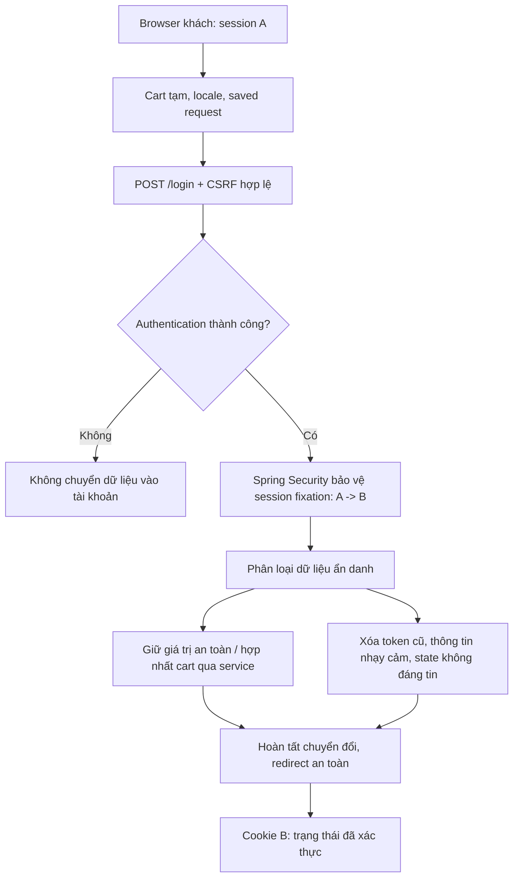
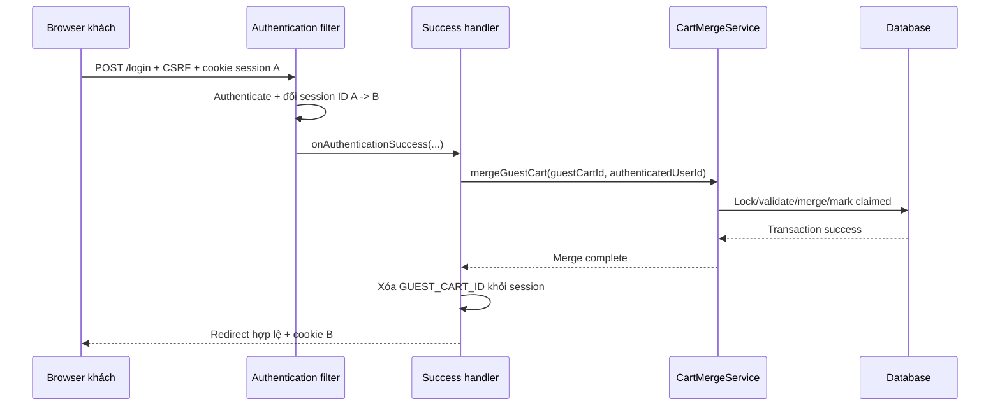
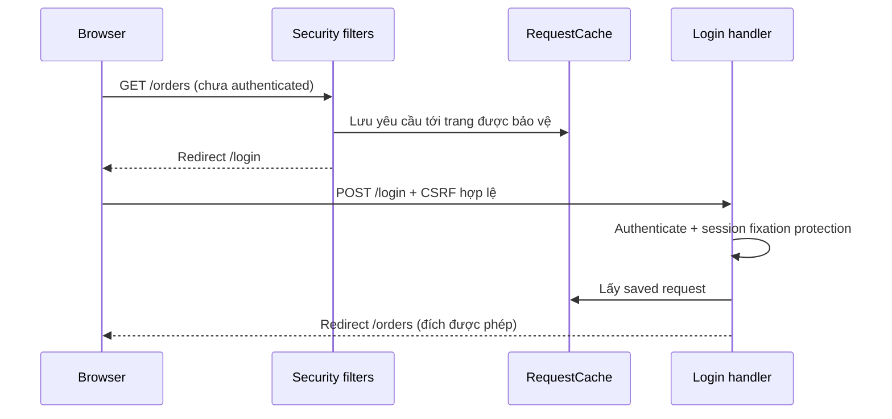

# Giữ dữ liệu cần thiết khi chuyển từ phiên chưa đăng nhập

> **Chương:** Session và cookie  
> **Trọng tâm:** Thiết kế việc **chuyển tiếp dữ liệu phiên ẩn danh sang trạng thái đã xác thực** trong Spring Security, trên cả **Servlet** và **Reactive WebFlux**. Giữ giỏ hàng, ngôn ngữ và yêu cầu điều hướng cần thiết mà không giữ nhầm quyền, dữ liệu nhạy cảm, CSRF token cũ hay một session ID có thể bị cố định từ trước.

Trong module `SPRING_SECURITY_HTTP_PROTECTION`, người học áp dụng các lớp phòng vệ HTTP và trình duyệt của Spring Security — CSRF, CORS, security headers, CSP, HSTS, HTTP firewall và bảo vệ session/cookie — cho cả Servlet lẫn Reactive. Bài này giải quyết một vấn đề thực tế: **người dùng duyệt web như khách, chọn sản phẩm, đặt tùy chọn giao diện, sau đó đăng nhập; dữ liệu nào nên được giữ và giữ bằng cơ chế nào để không mở lỗ hổng session fixation hoặc gắn nhầm dữ liệu của người khác?**

## 1. Mục tiêu không phải là giữ nguyên toàn bộ phiên

Người dùng thường mong đợi trải nghiệm liền mạch:

- Giỏ hàng tạo khi chưa đăng nhập vẫn có thể được chuyển vào tài khoản sau login.
- Ngôn ngữ, timezone hoặc tùy chọn hiển thị hợp lệ có thể tiếp tục sử dụng.
- Nếu vừa cố mở một **trang được bảo vệ**, người dùng có thể trở về trang đó sau khi đăng nhập.
- Những dữ liệu tạm có giá trị nghiệp vụ có thể được xác nhận và lưu theo **người dùng đã xác thực**.

Nhưng một phiên ẩn danh cũng có thể chứa **input không đáng tin**, token một lần, dữ liệu liên quan tài khoản trước, bước của giao dịch chưa hoàn tất hoặc địa chỉ điều hướng bị sửa. **Sao chép toàn bộ session attributes sang phiên mới không phải chính sách bảo mật mặc định phù hợp cho mọi hệ thống.**

Phải tách ba thao tác:

1. **Đổi định danh phiên:** Ngăn *session fixation* bằng cách bảo đảm ID cũ trước login không tiếp tục mang quyền mới.
2. **Giữ dữ liệu ứng dụng có chọn lọc:** Quyết định từng attribute nào được giữ, xóa, tái xác minh hoặc hợp nhất.
3. **Gắn dữ liệu với tài khoản:** Chuyển đối tượng nghiệp vụ từ phạm vi khách sang tài khoản đã xác thực bằng **quy tắc quyền sở hữu và giao dịch rõ ràng**, không chỉ copy một chuỗi ID.



**Bất biến cần kiểm thử:** ID phiên sau login không dùng lại ID có thể đã bị tấn công trước đó, và **ID cũ không thể lấy được `SecurityContext` của người đăng nhập**. Giữ giỏ hàng không bao giờ được đánh đổi bằng cách tắt `session fixation protection`.

## 2. Đánh giá từng nhóm dữ liệu trước khi chuyển

Phân loại rõ theo nghiệp vụ; *session attribute* không tự động trở thành dữ liệu đáng tin chỉ vì nó nằm ở server. Giá trị có thể bắt nguồn từ query/form/header trước khi được lưu vào session.

| Dữ liệu trước login | Có thể giữ? | Chính sách an toàn đề xuất |
| --- | --- | --- |
| **Mã giỏ hàng ẩn danh** | **Có, có điều kiện** | Chỉ giữ một tham chiếu opaque; service phải kiểm tra cart còn là guest/unclaimed, chưa hết hạn, không thuộc người khác; merge sau authentication theo giao dịch/idempotency. |
| **Locale / đơn vị tiền / timezone** | Thường có | Chỉ cho phép giá trị trong tập hợp được hỗ trợ; dùng lựa chọn tài khoản nếu policy ưu tiên profile. |
| **Saved request tới trang cần đăng nhập** | Có điều kiện | Dùng `RequestCache` của framework; giới hạn đích điều hướng cùng ứng dụng, tránh open redirect hoặc replay POST nhạy cảm. |
| **Dữ liệu form chưa gửi** | Tùy nghiệp vụ | Chỉ giữ phần tối thiểu, đặt TTL/size limit; revalidate sau login; không coi bước form trước login là đã được ủy quyền. |
| **Mã ưu đãi/coupon** | Có điều kiện | Xác minh lại thời hạn, tài khoản, sản phẩm, hạn mức trước khi áp dụng. |
| **Bước quy trình thanh toán** | Không chuyển nguyên xi | Khởi tạo lại bước nhạy cảm, kiểm tra giá, địa chỉ, chủ sở hữu, quyền và ý định người dùng. |
| **Dữ liệu `Authentication` / roles / `SecurityContext` cũ** | **Không tự copy** | Do Spring Security quản lý; không mang thông tin quyền của tài khoản trước sang tài khoản mới. |
| **Mật khẩu, OTP, reset token, MFA challenge** | **Không** | Không để trong session lâu hơn nhu cầu; xóa/rotate theo flow và tái xác minh khi cần. |
| **Session ID, auth cookie, bearer token** | **Không** | Không chuyển như attribute nghiệp vụ, không đưa vào URL/log; session ID phải được thay ở ranh giới nâng quyền. |
| **CSRF token thô hoặc masked** | Không tự copy/thay bằng tay | Để repository và authentication strategy xử lý; khi bị thu hồi, cấp token mới cho client. |
| **User ID lấy từ query trước login** | **Không tin cậy** | Danh tính đích phải lấy từ `Authentication` sau login, không lấy từ client/guest session. |
| **Đường dẫn `returnUrl` do client cung cấp** | Chỉ sau kiểm tra | Ưu tiên request cache chuẩn; giới hạn đường dẫn nội bộ được phép, loại bỏ URL ngoài và scheme nguy hiểm. |

**Nguyên tắc:** lưu tối thiểu, xác minh ở thời điểm chuyển, chuyển **dữ liệu** chứ không chuyển **quyền**, xóa bản sao không còn cần thiết, và kiểm tra mọi bước trong nhiều tab/concurrent requests.

### Ranh giới tin cậy: ai là chủ của dữ liệu?

Một cart có `guestCartId` không phải tài khoản đã đăng nhập. Nếu chỉ làm:

```java
// SAI: tin trực tiếp giá trị trong session như một quyết định sở hữu.
account.setCartId((String) session.getAttribute("GUEST_CART_ID"));
```

thì ứng dụng có thể bị **gắn nhầm dữ liệu** giữa khách và tài khoản, đặc biệt nếu ID guest cart bị đoán/khai báo từ client hoặc được tái sử dụng. Cần service có quy tắc: cart tồn tại, đang ở trạng thái guest, có proof/association hợp lệ với session hiện hành, không bị claim bởi account khác, chưa hết hạn, và chỉ được claim/hợp nhất **một lần**.

## 3. Session fixation và ba chiến lược của Spring Security Servlet

Trên Servlet, session fixation là nguy cơ giữ ID đã biết từ trạng thái ẩn danh sang phiên authenticated. Spring Security có ba lựa chọn bảo vệ:

| Strategy | Cơ chế | Dữ liệu ứng dụng cũ | Thích hợp khi nào? |
| --- | --- | --- | --- |
| **`changeSessionId()`** | Container Servlet 3.1+ đổi ID **của cùng `HttpSession`**. | **Được giữ nguyên** vì vẫn là cùng session. | **Mặc định hiện đại**; phù hợp nếu state ẩn danh đã được kiểm soát. |
| `migrateSession()` | Hủy session A, tạo B, **copy attributes**. | **Được chuyển**; có thể phát sinh callback session lifecycle. | Legacy tương thích hoặc nhu cầu migration được kiểm chứng. |
| `newSession()` | Hủy A, tạo B, **không copy phần lớn attributes của ứng dụng**. | **Không tự giữ** giỏ hàng/locale; Spring Security attributes nội bộ vẫn có thể được chuyển. | Muốn bắt đầu sạch, chủ động hợp nhất chỉ state cần thiết. |

`none()` là lựa chọn **tắt bảo vệ fixation**, không phải chiến lược giữ dữ liệu an toàn; tránh dùng để “chữa” mất cart. Trên Servlet 3.1+ Spring Security mặc định dùng `changeSessionId()`, còn trong các thế hệ Spring Security từng hỗ trợ Servlet 3.0 trở xuống, mặc định là `migrateSession()`. Không suy diễn rằng Spring Security hiện đại hỗ trợ mọi container cũ.

Tham khảo chính thức của Spring Security xác nhận: khi `newSession()` không chuyển application attributes, **các attributes nội bộ Spring Security vẫn có thể được copy** (chẳng hạn request cache). Vì vậy `newSession()` **không có nghĩa session hoàn toàn trống**.

### 3.1. Cấu hình cơ bản Servlet

```java
import org.springframework.context.annotation.Bean;
import org.springframework.context.annotation.Configuration;
import org.springframework.security.config.Customizer;
import org.springframework.security.config.annotation.web.builders.HttpSecurity;
import org.springframework.security.web.SecurityFilterChain;

@Configuration
class SessionTransitionServletSecurity {

    @Bean
    SecurityFilterChain securityFilterChain(HttpSecurity http) throws Exception {
        return http
            .authorizeHttpRequests(authorize -> authorize
                .requestMatchers("/login", "/cart/guest", "/public/**")
                    .permitAll()
                .anyRequest().authenticated())
            .formLogin(Customizer.withDefaults())
            .sessionManagement(session -> session
                .sessionFixation(fixation -> fixation.changeSessionId()))
            .build();
    }
}
```

Đoạn cấu hình này diễn giải rõ **mặc định Servlet hiện đại**, không cần khai báo `changeSessionId()` khi chính sách mặc định đã đáp ứng. `permitAll()` cho route của khách **không tắt CSRF** ở các request POST: đăng nhập và thay đổi giỏ hàng dùng cookie vẫn cần token hợp lệ theo matcher CSRF.

Nếu cần `newSession()`, thay duy nhất:

```java
// Thay expression sessionFixation(...) trong HttpSecurity builder:
.sessionManagement(session -> session
    .sessionFixation(fixation -> fixation.newSession()))
```

Không cấu hình hai strategy khác nhau cho cùng `SecurityFilterChain` rồi mong Spring tự kết hợp. Để **giữ một dữ liệu chọn lọc** với `newSession()` cần thêm chiến lược di chuyển phù hợp (mục 7) hoặc tốt hơn là lưu state tạm theo token nghiệp vụ có giới hạn và xử lý ở success handler.

### 3.2. Lưu ý session-scoped beans và binding listeners

Với `migrateSession()` hoặc `newSession()`, việc `HttpSession.invalidate()` có thể gọi `HttpSessionBindingListener.valueUnbound(...)`. Một bean scoped theo session có thể bị destroy khi tách khỏi session A, rồi việc copy cùng reference sang B khiến đối tượng đã bị dọn vẫn được tái sử dụng. `changeSessionId()` tránh đường hủy/copy đó vì vẫn là **cùng session**.

Vì vậy trước khi đổi strategy, phải test giỏ hàng, request cache, session-scoped beans, callback bind/unbind và cơ chế serialization của Spring Session. **Không sửa bằng cách tắt rotation.**

## 4. Thiết kế dữ liệu phiên ẩn danh: nhỏ, tường minh, có TTL

Thay vì đặt toàn bộ object lớn, mutable hoặc thông tin thanh toán vào `HttpSession`/`WebSession`, nên lưu **tham chiếu** và metadata tối thiểu:

```text
Guest session attributes:
  GUEST_CART_ID = "guest-cart-opaque-id"
  UI_LOCALE = "vi"
  LOGIN_FLOW_STARTED_AT = timestamp (nếu thực sự cần)

Cart store:
  guestCartId, status=GUEST, createdAt, expiresAt
  lineItems, quantities, business validation data

Authenticated state:
  SecurityContext do Spring Security quản lý
  cart/account relationship do service transactional quản lý
```

ID hiển thị chỉ là minh họa; không lưu ID thực vào log. **Cart store phải xác minh association với phiên khách**; một chuỗi `GUEST_CART_ID` trong session không đủ để chứng minh người dùng có quyền với cart nếu có đường cho attacker chèn giá trị ấy.

### Quy tắc hợp nhất giỏ hàng sau login

Giả sử user `alice` đã có cart tài khoản, còn session khách chứa cart tạm. Khi login thành công:

1. Xác định **tài khoản đã xác thực** từ `Authentication` (nên dùng user ID bất biến thay vì display name).
2. Đọc mã guest cart từ session hiện hành; chỉ hỗ trợ ID **được server cấp** và gắn với phiên khách.
3. Trong service, kiểm tra guest cart chưa bị claim, chưa hết hạn, được phép gắn vào tài khoản đó.
4. Hợp nhất các dòng hàng theo chính sách minh bạch: duplicate SKU, tồn kho, max quantity, coupon, giá bán, availability. **Không lấy giá hoặc quyền sở hữu từ guest session**.
5. Commit transaction hoặc đảm bảo thao tác có thể retry an toàn; đánh dấu cart đã claim/hợp nhất.
6. Xóa `GUEST_CART_ID` trong session sau khi merge thành công, hoặc đánh dấu đã tiêu thụ để tránh thực hiện hai lần.



**Idempotency là bắt buộc đối với business action dễ retry**: double-click login, retry từ client hoặc nhiều request/tab có thể kích hoạt merge lặp lại. Nên có unique constraint/claim marker hoặc khóa giao dịch ở tầng lưu trữ; chỉ xóa session attribute sau khi service báo hoàn tất.

## 5. Servlet: tạo dữ liệu guest có giới hạn

Đoạn dưới minh họa một controller ghi **chỉ tham chiếu cart** vào session. Thực tế, hệ thống phải tạo cart mới bằng service ở phía server, đặt TTL và kiểm tra CSRF/authorization phù hợp.

```java
import jakarta.servlet.http.HttpServletRequest;
import jakarta.servlet.http.HttpSession;
import org.springframework.http.ResponseEntity;
import org.springframework.web.bind.annotation.PostMapping;
import org.springframework.web.bind.annotation.RestController;

@RestController
class GuestCartController {

    private final GuestCartService guestCarts;

    GuestCartController(GuestCartService guestCarts) {
        this.guestCarts = guestCarts;
    }

    @PostMapping("/cart/guest")
    ResponseEntity<Void> createGuestCart(HttpServletRequest request) {
        HttpSession session = request.getSession(true);

        // Service tạo mã guest cart opaque, ngẫu nhiên, có TTL và
        // trạng thái chưa claim; không dùng session ID làm business key.
        String guestCartId = guestCarts.createGuestCart();
        session.setAttribute("GUEST_CART_ID", guestCartId);

        return ResponseEntity.noContent().build();
    }
}

// Hợp đồng domain minh họa; cần implementation có persistence/TTL.
interface GuestCartService {
    String createGuestCart();
}
```

**Không dùng session ID làm khóa nghiệp vụ:** Nếu một bản ghi guest cart liên kết với chuỗi `session.getId()` trước login, phép so với ID sau login **có thể thất bại vì rotation hợp lệ**. Dùng mã guest cart opaque có TTL do server tạo; chỉ lưu marker này trong `HttpSession` và để service kiểm tra trạng thái chưa claim, tính hợp lệ và khả năng hợp nhất. Nếu business đòi ràng buộc riêng với phiên khách, dùng một **nonce nội bộ được quản lý độc lập với session ID** rồi kiểm tra ở service; không đưa session ID thật vào business record/log.

Mã guest cart phải đủ khó đoán và không được client tùy ý thay trong session; service xác minh record tương ứng dưới transaction. Giá trị này **không thay thế session ID** và cũng không trở thành credential cho những API khác. Hãy coi nó là một **capability nhạy cảm**: không in vào log hoặc chia sẻ giữa các tài khoản.

## 6. Servlet: xử lý chuyển dữ liệu sau authentication thành công

Với `UsernamePasswordAuthenticationFilter` chuẩn, Spring Security gọi session authentication strategy **sau khi xác thực**, rồi mới gọi `AuthenticationSuccessHandler`. Vì vậy handler có thể truy cập session hiện hành đã được đổi ID (khi dùng `changeSessionId()`) hoặc session B đã được migration.

### 6.1. Một success handler có delegate redirect chuẩn

```java
import java.io.IOException;
import jakarta.servlet.ServletException;
import jakarta.servlet.http.HttpServletRequest;
import jakarta.servlet.http.HttpServletResponse;
import jakarta.servlet.http.HttpSession;
import org.springframework.security.core.Authentication;
import org.springframework.security.web.authentication.AuthenticationSuccessHandler;
import org.springframework.security.web.authentication.SavedRequestAwareAuthenticationSuccessHandler;

final class MergeGuestCartSuccessHandler
        implements AuthenticationSuccessHandler {

    private final CartMergeService cartMergeService;
    private final SavedRequestAwareAuthenticationSuccessHandler redirect =
        new SavedRequestAwareAuthenticationSuccessHandler();

    MergeGuestCartSuccessHandler(CartMergeService cartMergeService) {
        this.cartMergeService = cartMergeService;
    }

    @Override
    public void onAuthenticationSuccess(
            HttpServletRequest request,
            HttpServletResponse response,
            Authentication authentication)
            throws IOException, ServletException {

        HttpSession session = request.getSession(false);
        if (session != null) {
            Object candidate = session.getAttribute("GUEST_CART_ID");
            if (candidate instanceof String guestCartId) {
                // Trong ứng dụng thật, lấy immutable user ID từ principal.
                // merge phải xác minh guest-cart association, TTL,
                // ownership, transaction và idempotency.
                cartMergeService.mergeForAuthenticatedUser(
                    guestCartId, authentication.getName());

                // Chỉ xóa sau khi merge đã commit thành công.
                session.removeAttribute("GUEST_CART_ID");
            }
        }
        redirect.onAuthenticationSuccess(request, response, authentication);
    }
}

interface CartMergeService {
    void mergeForAuthenticatedUser(String guestCartId, String userId);
}
```

Đây là **mẫu tích hợp**, không phải service nghiệp vụ hoàn chỉnh. Dùng `authentication.getName()` chỉ để minh họa; trong production nên chuyển sang **immutable account ID** của principal đã xác thực, không dùng user ID do form/query/session ẩn danh cung cấp.

**Lưu ý về lỗi merge:** Nếu merge thất bại, handler không nên xóa marker hay trả redirect thành công giả. Nhưng authentication **có thể đã được lưu** trước success handler, nên đừng giả định ném exception sẽ rollback luôn việc đăng nhập. Có thể thiết kế UX “đã đăng nhập, đang chờ đồng bộ giỏ hàng”, hàng đợi retry có idempotency, hoặc một workflow kiểm soát được khi nghiệp vụ yêu cầu.

### 6.2. Gắn handler vào `HttpSecurity.formLogin`

```java
import org.springframework.context.annotation.Bean;
import org.springframework.context.annotation.Configuration;
import org.springframework.security.config.annotation.web.builders.HttpSecurity;
import org.springframework.security.web.SecurityFilterChain;

@Configuration
class GuestCartLoginConfiguration {

    @Bean
    SecurityFilterChain guestCartChain(
            HttpSecurity http,
            CartMergeService cartMergeService) throws Exception {

        var mergeOnSuccess =
            new MergeGuestCartSuccessHandler(cartMergeService);

        return http
            .authorizeHttpRequests(auth -> auth
                .requestMatchers("/login", "/cart/guest", "/public/**")
                    .permitAll()
                .anyRequest().authenticated())
            .formLogin(login -> login
                .successHandler(mergeOnSuccess))
            .sessionManagement(session -> session
                .sessionFixation(fixation -> fixation.changeSessionId()))
            .build();
    }
}
```

Đây là **cấu hình thay thế** cho bean `SecurityFilterChain` của mục 3, không tạo hai chain bao phủ cùng request mà thiếu matcher/order. `SavedRequestAwareAuthenticationSuccessHandler` giữ hành vi chuyển hướng theo saved request mặc định thay vì cố ý thay bằng một `returnUrl` tùy ý do client truyền.

### 6.3. Nếu chọn `newSession()` thay vì `changeSessionId()`?

Với `newSession()`, Spring Security không copy phần lớn application attributes. Bởi vậy `GUEST_CART_ID` ở session A **có thể không có trong session B khi success handler chạy**. Không nên viết một handler thất bại rồi “sửa” bằng cách dùng `none()`.

Có hai cách thiết kế:

1. **Ưu tiên:** chuyển guest cart theo một workflow riêng, giữ một token nghiệp vụ có TTL và ràng buộc tốt, xử lý trong service ngay tại ranh giới authenticated; không phụ thuộc copy mọi session attribute.
2. **Nâng cao:** tùy chỉnh `SessionFixationProtectionStrategy.extractAttributes(HttpSession)` để chỉ chuyển whitelist như `GUEST_CART_ID`/`UI_LOCALE` cùng các attributes nội bộ Spring Security. Việc ghép custom strategy vào **authentication mechanism thực tế** phải kiểm thử cẩn thận (mục 7).

Không mang các đối tượng `SecurityContext` cũ, transaction state, payment details hoặc access token từ session ẩn danh vào account chỉ để làm nghiệp vụ tiện hơn.

## 7. Servlet nâng cao: whitelist khi tạo session mới

`SessionFixationProtectionStrategy` là implementation dùng `HttpSession.invalidate()` rồi tạo session mới. Khi cấu hình `migrateSessionAttributes(false)`, implementation vẫn giữ một số **attributes nội bộ Spring Security** phục vụ authentication/request cache; application attributes thông thường không được copy. Từ API `extractAttributes(HttpSession)`, có thể xây subclass để thêm **chỉ những attributes đã duyệt**.

### 7.1. Ví dụ strategy chọn lọc

```java
import java.util.HashMap;
import java.util.Map;
import java.util.Set;
import jakarta.servlet.http.HttpSession;
import org.springframework.security.web.authentication.session.SessionFixationProtectionStrategy;

final class AllowlistedSessionMigrationStrategy
        extends SessionFixationProtectionStrategy {

    private static final Set<String> SUPPORTED_LOCALES = Set.of("vi", "en");

    AllowlistedSessionMigrationStrategy() {
        // Superclass chỉ giữ các thuộc tính nội bộ Spring Security.
        setMigrateSessionAttributes(false);
    }

    @Override
    protected Map<String, Object> extractAttributes(HttpSession previous) {
        // Giữ những internal attrs do Spring Security quyết định.
        Map<String, Object> selected =
            new HashMap<>(super.extractAttributes(previous));

        Object locale = previous.getAttribute("UI_LOCALE");
        if (locale instanceof String language
                && SUPPORTED_LOCALES.contains(language)) {
            selected.put("UI_LOCALE", language);
        }

        Object cart = previous.getAttribute("GUEST_CART_ID");
        if (cart instanceof String cartId
                && cartId.length() >= 16
                && cartId.length() <= 128) {
            // Đây chỉ là kiểm tra cấu trúc; service phải xác minh
            // cart chưa bị claim, liên kết guest/session, TTL, ownership.
            selected.put("GUEST_CART_ID", cartId);
        }

        return selected;
    }
}
```

**Đây là ví dụ API để nghiên cứu**, không nên hiểu rằng chỉ cần `length()` là cart token đã hợp lệ: độ dài không chứng minh nguồn gốc, tính ngẫu nhiên, quyền sở hữu hoặc trạng thái chưa dùng. Xác minh thực phải nằm trong `CartMergeService`, sau khi có `Authentication` mới.

**Điểm tích hợp:** Trong Spring Security 6+, authentication mechanism có trách nhiệm gọi `SessionAuthenticationStrategy` khi xác thực thành công. Đừng giả định việc tạo bean `AllowlistedSessionMigrationStrategy` hoặc đặt ở một DSL không được mechanism dùng sẽ tự thay chiến lược cho mọi form/OAuth2 login. Nếu cần customize sâu, tích hợp strategy **vào đúng authentication mechanism**, giữ concurrency/session registry và logout hooks, rồi test login end-to-end.

### 7.2. Vì sao không copy toàn bộ attribute map?

Ví dụ “copy mọi thứ” có thể giữ nhầm:

- `PENDING_PAYMENT_ID` thuộc phiên/tài khoản trước.
- `PREVIOUS_USER_ID` hoặc role cache không còn phù hợp.
- Authorization result/scope cache của user khác.
- Dữ liệu OTP/reset password một lần.
- Object lớn hoặc không serializable, có nguy cơ lỗi ở Redis/Spring Session.
- Bean `HttpSessionBindingListener` bị `valueUnbound` khi invalidate và không còn trạng thái hợp lệ sau khi bind lại.

**Whitelisting là cần nhưng chưa đủ**: ngay cả một attribute thuộc allowlist phải được đánh giá tại thời điểm chuyển. Nếu một giỏ hàng đã bị claim trong request song song, handler không thể chỉ dựa vào attribute còn trong session rồi claim tiếp.

## 8. Saved request và điều hướng trở lại trang đang xem

Một trải nghiệm hay gặp là khách mở `GET /orders`, bị redirect đến login và sau khi login quay lại `/orders`. Đây là trách nhiệm của **request cache**, không phải lý do để ứng dụng lưu mọi request body hoặc URL do client kiểm soát vào session.

Trong Servlet, Spring Security sử dụng:

- `ExceptionTranslationFilter`: khi request thiếu authentication, có thể lưu request gốc trước khi chuyển người dùng tới login.
- `HttpSessionRequestCache`: lưu `SavedRequest` trong `HttpSession` theo cấu hình.
- `SavedRequestAwareAuthenticationSuccessHandler`: sau authentication, cân nhắc request đã lưu để redirect đúng đích.

Trong WebFlux có `WebSessionServerRequestCache` và `RedirectServerAuthenticationSuccessHandler` làm nhiệm vụ tương ứng.



### Cảnh báo open redirect và request replay

Không tự lấy `returnUrl` từ query param rồi phát:

```java
// KHÔNG AN TOÀN nếu returnUrl do client gửi:
response.sendRedirect(request.getParameter("returnUrl"));
```

Điều này có thể mở **open redirect**, đưa người dùng đến website giả danh sau khi đăng nhập. Khi cần đích tùy chỉnh, giới hạn **relative paths** nội bộ, kiểm tra canonicalization/encoding, loại bỏ `//external.example`, scheme `https:` tùy ý và ký tự điều khiển. Ưu tiên cơ chế request cache/redirect của Spring Security.

Không tự động **phát lại POST thanh toán, chuyển tiền, xóa dữ liệu** chỉ vì trước login có request đó. Saved request thường được dùng để quay lại tài nguyên; mọi thao tác nhạy cảm phải được người dùng chủ động thực hiện lại sau khi xác thực, có CSRF token mới và idempotency key theo nghiệp vụ.

### Khi dùng `newSession()`

Tài liệu Spring Security xác nhận một số **thuộc tính nội bộ liên quan saved request** vẫn có thể được chuyển khi `newSession()`. Tuy nhiên hành vi cụ thể còn phụ thuộc phiên bản, security chain và request cache đã tùy chỉnh. Kiểm thử cả trường hợp:

1. Khách muốn vào `GET /orders`, login thành công → quay lại đúng `/orders`.
2. Không có saved request → chuyển tới landing page an toàn.
3. User cố đặt `returnUrl=https://attacker.example` → không redirect ra ngoài.
4. Redirect không được giữ dữ liệu của user cũ hoặc tài khoản khác.

## 9. Reactive: WebSession giữ attributes khi đổi ID

Trong Spring WebFlux, `WebSession` thay cho `HttpSession` và có API Reactive:

```java
Mono<Void> WebSession.changeSessionId();
Mono<Void> WebSession.invalidate();
```

`changeSessionId()` đổi **ID của cùng WebSession** và cập nhật storage; attributes thường giữ nguyên. `invalidate()` xóa phiên và state; hai API không tương đương.

Khi form login WebFlux dùng `WebSessionServerSecurityContextRepository`, Javadoc Spring Security xác nhận **lưu `SecurityContext` sẽ thay session ID để phòng session fixation**. Do đó dữ liệu guest nằm trong session attributes có thể tiếp tục tồn tại qua rotation, nhưng **không tự trở thành dữ liệu của account**.

### 9.1. Cấu hình WebFlux chuẩn

```java
import org.springframework.context.annotation.Bean;
import org.springframework.context.annotation.Configuration;
import org.springframework.security.config.Customizer;
import org.springframework.security.config.annotation.web.reactive.EnableWebFluxSecurity;
import org.springframework.security.config.web.server.ServerHttpSecurity;
import org.springframework.security.web.server.SecurityWebFilterChain;

@Configuration
@EnableWebFluxSecurity
class ReactiveSessionTransitionSecurity {

    @Bean
    SecurityWebFilterChain webFluxChain(ServerHttpSecurity http) {
        return http
            .authorizeExchange(auth -> auth
                .pathMatchers("/login", "/csrf", "/cart/guest", "/public/**")
                    .permitAll()
                .anyExchange().authenticated())
            .formLogin(Customizer.withDefaults())
            .csrf(Customizer.withDefaults())
            .build();
    }
}
```

`csrf(Customizer.withDefaults())` chỉ ghi rõ hành vi vốn được bật mặc định. Không dùng DSL `sessionManagement().sessionFixation()` của Servlet cho `ServerHttpSecurity`; điểm liên quan đến rotation trong WebFlux nằm tại `ServerSecurityContextRepository` và các thành phần quản lý `WebSession`.

### 9.2. Truy cập dữ liệu guest trước khi login

`ServerWebExchange.getSession()` trả `Mono<WebSession>`. Không dùng `block()` để đọc state trên Reactor Netty event loop:

```java
import org.springframework.web.server.ServerWebExchange;
import reactor.core.publisher.Mono;

Mono<String> guestCartId(ServerWebExchange exchange) {
    return exchange.getSession()
        .flatMap(session -> {
            Object value = session.getAttribute("GUEST_CART_ID");
            if (value instanceof String guestId) {
                return Mono.just(guestId);
            }
            return Mono.empty();
        });
}
```

Publisher chỉ chạy khi được subscribe trong pipeline HTTP. Nếu tạo một `Mono` rồi bỏ đi, chưa chắc công việc đọc/ghi state có xảy ra. Không `subscribe()` thủ công và trả HTTP response trước khi service merge hoàn tất.

### 9.3. Reactive success handler hợp nhất dữ liệu guest

`ServerAuthenticationSuccessHandler` nhận `WebFilterExchange` và `Authentication`, trả `Mono<Void>`. Một handler có thể xử lý cart **sau authentication** và sau đó delegate tới handler redirect mặc định:

```java
import org.springframework.security.core.Authentication;
import org.springframework.security.web.server.WebFilterExchange;
import org.springframework.security.web.server.authentication.RedirectServerAuthenticationSuccessHandler;
import org.springframework.security.web.server.authentication.ServerAuthenticationSuccessHandler;
import reactor.core.publisher.Mono;

final class ReactiveCartMergeSuccessHandler
        implements ServerAuthenticationSuccessHandler {

    private final ReactiveCartMergeService cartService;
    private final ServerAuthenticationSuccessHandler redirect =
        new RedirectServerAuthenticationSuccessHandler();

    ReactiveCartMergeSuccessHandler(ReactiveCartMergeService cartService) {
        this.cartService = cartService;
    }

    @Override
    public Mono<Void> onAuthenticationSuccess(
            WebFilterExchange webFilterExchange,
            Authentication authentication) {

        return webFilterExchange.getExchange().getSession()
            .flatMap(session -> {
                Object candidate = session.getAttribute("GUEST_CART_ID");
                if (!(candidate instanceof String guestCartId)) {
                    return Mono.empty();
                }

                // Service non-blocking xác minh ownership/TTL, idempotency,
                // rồi hợp nhất vào tài khoản theo immutable user ID.
                return cartService.mergeForAuthenticatedUser(
                        guestCartId, authentication.getName())
                    .then(Mono.fromRunnable(() ->
                        session.getAttributes().remove("GUEST_CART_ID")));
            })
            .then(redirect.onAuthenticationSuccess(
                webFilterExchange, authentication));
    }
}

interface ReactiveCartMergeService {
    Mono<Void> mergeForAuthenticatedUser(String guestCartId, String userId);
}
```

Với cách này, **cả merge, xóa attribute và redirect đều là cùng một Reactor pipeline**. Nếu merge thất bại, publisher chuyển lỗi thay vì redirect thành công giả hoặc xóa cart trước khi commit. Một ứng dụng production cần error policy rõ ràng: authentication có thể đã thành công/lưu context trước success handler, và lỗi merge không tự động rollback login. Với service dùng database quan hệ blocking, phải đưa thao tác sang tầng execution phù hợp hoặc dùng reactive driver; **không chạy JDBC blocking trực tiếp trên Netty event loop**.

### 9.4. Gắn handler vào form login WebFlux

```java
// Trong bean SecurityWebFilterChain có biến ServerHttpSecurity http
// và bean ReactiveCartMergeService cartService:
return http
    .authorizeExchange(auth -> auth
        .pathMatchers("/login", "/csrf", "/cart/guest").permitAll()
        .anyExchange().authenticated())
    .formLogin(login -> login.authenticationSuccessHandler(
        new ReactiveCartMergeSuccessHandler(cartService)))
    .csrf(Customizer.withDefaults())
    .build();
```

Đây là **trích đoạn thay thế** `SecurityWebFilterChain` ở mục 9.1, không phải thêm bean thứ hai với matcher trùng lặp. Ghi đè `authenticationSuccessHandler(...)` có thể thay một số handler mặc định đã đăng ký trong chain tùy phiên bản/cấu hình; cần xác nhận saved-request redirect, concurrency handling và các chính sách custom khác vẫn hoạt động. `RedirectServerAuthenticationSuccessHandler` giữ cơ chế redirect/request cache thường dùng, nhưng không tự khôi phục những handler bảo mật khác mà custom code vô tình bỏ.

### 9.5. Điều gì xảy ra khi WebSession bị invalidate?

Nếu ứng dụng **invalidate session A và tạo session B mới** thay vì chỉ đổi ID, `GUEST_CART_ID` ở attributes của A **sẽ mất**. Khi cần giữ dữ liệu qua sự kiện hủy phiên có chủ đích, không giả định có thể đọc lại object A sau invalidate. Dùng một **workflow migration riêng** đã xác minh token nghiệp vụ, TTL và sự cho phép của người dùng. Không để trình duyệt tự cung cấp một ID guest cart tùy ý để “phục hồi” tài sản của người khác.

## 10. Những trạng thái phải xóa hoặc tái xác minh sau login

**Giữ dữ liệu cần thiết không có nghĩa giữ quyền và quyết định bảo mật cũ.**

| Trạng thái có trong phiên | Xử lý đề xuất | Lý do |
| --- | --- | --- |
| `SecurityContext`/`Authentication` của user trước | Dùng cơ chế Spring Security để xác thực/lưu context mới; clear đúng khi logout/switch user | Tránh privilege confusion. |
| CSRF token đã cấp trước login | Để `CsrfAuthenticationStrategy`/CSRF repository xử lý theo stack; lấy token mới nếu bị thu hồi | Token cũ có thể không còn hợp lệ sau authentication. |
| MFA challenge, recovery/OTP, password-reset state | Xóa/thu hồi theo flow, không sao chép vào account không liên quan | Chống reuse/step skipping. |
| Id của transaction chưa xác thực | Không gán trực tiếp vào account; service kiểm tra trạng thái/quyền và yêu cầu xác nhận lại | Tránh transaction hijack và confused deputy. |
| Tính toán giá/chiết khấu trong guest session | Tính lại từ nguồn tin cậy sau login | Ngăn dùng giá/ưu đãi không còn hợp lệ. |
| Saved redirect hoặc OAuth2 request state | Để framework quản lý và validate `state`/`nonce`, allowlist đích | Không copy/replay tùy tiện; tránh open redirect. |
| Chọn locale và theme | Chỉ giữ giá trị hợp lệ, đồng bộ với profile nếu có | Tránh XSS/format injection và xung đột tùy chọn. |

**Chuyển tài khoản trên cùng browser** cần chú ý đặc biệt: nếu user A logout nhưng guest/session attributes mang dữ liệu A, rồi user B login, việc copy mặc định có thể làm B thấy dữ liệu A. Với account switch phải có policy dọn dữ liệu theo danh tính, không chỉ rotate ID.

### CSRF ở ranh giới chuyển phiên

`POST /login` dùng cookie session nên vẫn cần CSRF token theo matcher mặc định; `permitAll()` không phải miễn CSRF. Sau login, trình duyệt phải gửi token đúng với session hiện tại:

- **Servlet:** `CsrfAuthenticationStrategy` có thể xóa token cũ khi Authentication mới thành công, yêu cầu lấy token mới.
- **Reactive:** repository CSRF/session và request handler quyết định lifecycle; `WebSessionServerCsrfTokenRepository` còn có thể đổi session ID khi lưu/xóa token, do đó cookie thay không tự chứng minh login.
- Khi dùng XOR masking, token được render lần sau có thể khác chuỗi cũ dù raw token không đổi. Không so token theo text đơn thuần để suy ra session mất state.
- Không tắt CSRF để giữ form ẩn danh hoạt động. Nên lấy lại token từ view/endpoint trước request unsafe tiếp theo.

### Cookie chính xác phải đi cùng state

`Secure`, `HttpOnly`, `SameSite`, `Path` và `Domain` giúp kiểm soát phạm vi sử dụng session cookie. Khi session ID đổi A → B, browser phải nhận cookie B; nếu vẫn gửi cookie A, server có thể cấp session mới không có dữ liệu guest. Điều này **khác** với lỗi service merge.

Với HTTPS qua reverse proxy, kiểm tra forwarded headers đáng tin cậy và `Set-Cookie` thực; tránh duplicate cookie tên giống nhau ở path/domain khác. Không in cookie/session ID vào log để tìm lỗi.

## 11. Transaction, idempotency và nhiều tab khi chuyển giỏ hàng

Đây là phần dễ sai nhất khi dùng một chuỗi `GUEST_CART_ID` trong session. Dù handler chỉ thực hiện một lần trong một HTTP request, những request **khác nhau** có thể xảy ra đồng thời:

- Người dùng nhấn login hai lần.
- Hai tab dùng chung session A rồi cùng gửi POST login.
- Client retry do timeout dù request đầu đã commit merge.
- Một tác vụ async và một request đồng bộ cùng claim guest cart.
- Một ứng dụng nhiều node với session store/cache không đồng bộ tức thì.

**Xóa attribute khỏi session không phải cơ chế khóa phân tán hoặc đảm bảo exactly-once.** Hai request có thể đã đọc cùng ID trước khi bất kỳ request nào xóa nó.

### 11.1. Thiết kế service theo hợp đồng giao dịch

Ví dụ giao diện nghiệp vụ:

```java
interface CartMergeService {
    // Nếu guest cart đã được merge hợp lệ bởi CHÍNH tài khoản này,
    // trả thành công/idempotent; nếu thuộc tài khoản khác, từ chối.
    void mergeForAuthenticatedUser(String guestCartId, String userId);
}
```

Logic service cần có:

1. **Đối tượng mục tiêu đáng tin:** `userId` phải lấy từ principal đã được xác thực.
2. **Nguồn đáng tin:** `guestCartId` được lấy từ server-side session hoặc một guest proof đã được xác minh; không lấy nguyên query input như quyết định quyền sở hữu.
3. **Atomic claim:** Từ `GUEST` sang `CLAIMED`, dùng transaction/optimistic locking/unique constraint, không cho hai account cùng claim.
4. **Idempotency:** Cùng cart/user thực hiện lại phải cho cùng kết quả, không nhân đôi số lượng sản phẩm hoặc áp coupon hai lần.
5. **Kiểm tra lại nghiệp vụ:** Giá, tồn kho, shipping options, coupon, giới hạn mua và sản phẩm bị ngừng bán phải được tính lại sau login.
6. **Xử lý thất bại:** Nếu merge thất bại, không xóa marker tạm trước khi service xác nhận commit; có retry an toàn hoặc UX thông báo rõ.

Pseudocode transaction (không phải SQL chạy nguyên văn trên mọi DB):

```text
BEGIN TRANSACTION

guest = SELECT guest_cart WHERE id = guestCartId FOR UPDATE
ASSERT guest exists AND guest.status == GUEST
ASSERT guest.expiresAt > now()
ASSERT guest proof/association is valid

if guest already claimed by this account and merge completed:
    return success (idempotent)
if guest claimed by another account:
    reject

revalidate line items, product price, availability, coupon rules
merge into authenticated cart with a unique merge operation key
mark guest.status = CLAIMED, guest.claimedBy = authenticatedUserId

COMMIT
```

Trong implementation thật, thứ tự "already claimed" phải được xử lý **trước** assertion `status == GUEST` để cho phép idempotent retry theo thiết kế, hoặc đặt trạng thái/operation table phù hợp. Khi copy pseudocode, đừng vô tình trả lỗi ở lần retry hợp lệ chỉ vì trạng thái đã thành `CLAIMED`.

### 11.2. Trường hợp account switch

Giả sử người A đã đăng nhập, logout, browser vẫn còn các application attributes, rồi người B đăng nhập:

```text
Session còn dữ liệu A -> logout -> B login

NGUY HIỂM:  cart hoặc draft có chủ A bị copy vào account B
ĐÚNG:       phân loại dữ liệu theo owner, xóa hoặc từ chối carry-over
             khi tài khoản đích không trùng owner
```

Một `GUEST_CART_ID` hợp lệ chỉ dành cho **trạng thái khách** chưa claim. Sau khi đã gắn với account A, nó không còn là guest cart để chuyển vào B. Khi logout, xóa state liên quan A theo logout policy và không giữ một "guest pointer" có thể bị claim lại. Các dữ liệu nhạy cảm (đơn hàng, hóa đơn, phương thức thanh toán, địa chỉ giao hàng) luôn phải được truy xuất theo quyền của **user hiện tại**, không lấy quyền từ session A.

## 12. Kiểm thử Servlet: whitelist và handler chuyển cart

Để test API session strategy, dùng `MockHttpServletRequest`, `MockHttpServletResponse` và `MockHttpSession`. Để test redirect/merge, dùng success handler thật với fake service; không cần khởi động server.

### 12.1. Unit test chỉ chuyển attributes được phép

Đặt test này cùng package với class `AllowlistedSessionMigrationStrategy` ở mục 7.

```java
import org.junit.jupiter.api.Test;
import org.springframework.mock.web.MockHttpServletRequest;
import org.springframework.mock.web.MockHttpServletResponse;
import org.springframework.mock.web.MockHttpSession;
import org.springframework.security.authentication.UsernamePasswordAuthenticationToken;
import org.springframework.security.core.authority.AuthorityUtils;

import static org.junit.jupiter.api.Assertions.*;

class AllowlistedSessionMigrationStrategyTest {

    @Test
    void migratesOnlyAllowlistedApplicationState() {
        var sessionA = new MockHttpSession();
        sessionA.setAttribute("GUEST_CART_ID", "guest-cart-token-12345678");
        sessionA.setAttribute("UI_LOCALE", "vi");
        sessionA.setAttribute("PENDING_PAYMENT_ID", "sensitive-old-data");
        sessionA.setAttribute("UNTRUSTED_RETURN_URL", "//external.example");

        var request = new MockHttpServletRequest("POST", "/login");
        request.setSession(sessionA);
        request.setRequestedSessionId(sessionA.getId());
        request.setRequestedSessionIdValid(true);
        var response = new MockHttpServletResponse();
        String oldId = sessionA.getId();

        var authenticated = UsernamePasswordAuthenticationToken.authenticated(
            "alice", "N/A",
            AuthorityUtils.createAuthorityList("ROLE_USER"));

        new AllowlistedSessionMigrationStrategy()
            .onAuthentication(authenticated, request, response);

        var sessionB = request.getSession(false);
        assertNotNull(sessionB);
        assertNotSame(sessionA, sessionB);
        assertNotEquals(oldId, sessionB.getId());
        assertEquals("vi", sessionB.getAttribute("UI_LOCALE"));
        assertEquals("guest-cart-token-12345678",
            sessionB.getAttribute("GUEST_CART_ID"));
        assertNull(sessionB.getAttribute("PENDING_PAYMENT_ID"));
        assertNull(sessionB.getAttribute("UNTRUSTED_RETURN_URL"));
    }
}
```

Đây là unit test của **migration policy**, không chứng minh bean strategy đã được gọi trong form login thực. Cần MockMvc login test và session store test sau đó. Nó cũng không kiểm tra quyền sở hữu guest cart; việc đó thuộc service.

### 12.2. Unit test success handler chỉ xóa marker sau khi merge

```java
import java.util.ArrayList;
import java.util.List;
import org.junit.jupiter.api.Test;
import org.springframework.mock.web.MockHttpServletRequest;
import org.springframework.mock.web.MockHttpServletResponse;
import org.springframework.mock.web.MockHttpSession;
import org.springframework.security.authentication.UsernamePasswordAuthenticationToken;
import org.springframework.security.core.authority.AuthorityUtils;

import static org.junit.jupiter.api.Assertions.*;

class MergeGuestCartSuccessHandlerTest {

    @Test
    void mergesThenClearsGuestCartMarker() throws Exception {
        var merges = new ArrayList<String>();
        CartMergeService service = (cartId, userId) ->
            merges.add(cartId + ":" + userId);

        var request = new MockHttpServletRequest("POST", "/login");
        var session = new MockHttpSession();
        session.setAttribute("GUEST_CART_ID", "guest-cart-token-12345678");
        request.setSession(session);
        var response = new MockHttpServletResponse();
        var auth = UsernamePasswordAuthenticationToken.authenticated(
            "alice", "N/A",
            AuthorityUtils.createAuthorityList("ROLE_USER"));

        new MergeGuestCartSuccessHandler(service)
            .onAuthenticationSuccess(request, response, auth);

        assertEquals(
            List.of("guest-cart-token-12345678:alice"), merges);
        assertNull(session.getAttribute("GUEST_CART_ID"));
        assertTrue(response.getStatus() >= 300 && response.getStatus() < 400);
    }

    @Test
    void mergeFailureKeepsGuestMarkerForSafeRecovery() {
        CartMergeService failing = (cartId, userId) -> {
            throw new IllegalStateException("test merge unavailable");
        };
        var request = new MockHttpServletRequest("POST", "/login");
        var session = new MockHttpSession();
        session.setAttribute("GUEST_CART_ID", "guest-cart-token-12345678");
        request.setSession(session);
        var auth = UsernamePasswordAuthenticationToken.authenticated(
            "alice", "N/A",
            AuthorityUtils.createAuthorityList("ROLE_USER"));

        assertThrows(IllegalStateException.class, () ->
            new MergeGuestCartSuccessHandler(failing)
                .onAuthenticationSuccess(
                    request, new MockHttpServletResponse(), auth));

        assertEquals("guest-cart-token-12345678",
            session.getAttribute("GUEST_CART_ID"));
    }
}
```

Test thứ hai chỉ cho thấy marker chưa bị xóa khi service ném lỗi. **Nó không có nghĩa authentication đã được rollback**: trong Spring Security, strategy/session/context thường được cập nhật trước khi success handler chạy. Hãy thêm integration test xử lý lỗi merge theo chính sách ứng dụng để tránh mất cart hoặc phát response không phù hợp.

### 12.3. Kiểm thử login thật bằng MockMvc

Với Spring Security Servlet và nguồn người dùng test, cần thêm bài test **thực hiện form login**, không chỉ gọi handler:

```java
// Trích thân test (Spring Boot 3.x, @SpringBootTest + @AutoConfigureMockMvc).
// Đã có MockMvc mvc và CartMergeService test double cấu hình trong context.
// Import static: csrf(), post(), authenticated().

var anonymous = new MockHttpSession();
anonymous.setAttribute("GUEST_CART_ID", "guest-cart-token-12345678");
String idA = anonymous.getId();

var result = mvc.perform(post("/login")
        .session(anonymous)
        .with(request -> {
            request.setRequestedSessionId(idA);
            request.setRequestedSessionIdValid(true);
            return request;
        })
        .with(csrf())
        .param("username", "alice")
        .param("password", "test-password"))
    .andExpect(authenticated())
    .andReturn();

var sessionB = result.getRequest().getSession(false);
assertNotNull(sessionB);
assertNotEquals(idA, sessionB.getId());

// Kiểm tra thêm merge service được gọi với đúng cart và user,
// guest marker đã được dọn sau khi merge thành công,
// và saved request không bị thay bằng redirect bên ngoài.
```

Khi dùng `changeSessionId()`, cùng `HttpSession` có thể giữ attribute qua rotation trước khi success handler tiêu thụ nó. Khi dùng `newSession()`, muốn test handler thấy `GUEST_CART_ID` thì phải có **cơ chế migration chọn lọc** hoặc workflow token riêng. `with(csrf())` là test post-processor cung cấp token hợp lệ; `@WithMockUser` hoặc `with(user("alice"))` **không thay thế login thật** nếu mục tiêu là xác minh fixation protection và success handler.

## 13. Kiểm thử Reactive bằng StepVerifier

Spring WebFlux dùng `MockWebSession`, `MockServerWebExchange` và `WebFilterExchange`. Mục tiêu test là: **cùng session giữ guest marker sau đổi ID; reactive merge hoàn thành trước khi xóa marker và redirect**.

### 13.1. `WebSession.changeSessionId()` giữ attribute

```java
import org.junit.jupiter.api.Test;
import org.springframework.mock.web.server.MockWebSession;
import reactor.test.StepVerifier;

import static org.junit.jupiter.api.Assertions.*;

class WebSessionGuestTransitionTest {
    @Test
    void rotatingIdKeepsGuestDataInSameWebSession() {
        var session = new MockWebSession();
        session.getAttributes().put(
            "GUEST_CART_ID", "guest-cart-token-12345678");
        String before = session.getId();

        StepVerifier.create(session.changeSessionId())
            .verifyComplete();

        assertNotEquals(before, session.getId());
        assertEquals("guest-cart-token-12345678",
            session.getAttribute("GUEST_CART_ID"));
    }
}
```

Test này xác nhận hợp đồng của `WebSession`, **không** chứng minh ID cũ đã bị session store phân tán loại bỏ. Để xác minh authentication rotation, cần thêm test `WebSessionServerSecurityContextRepository.save(...)` và HTTP login.

### 13.2. Unit test Reactive success handler

```java
import java.util.concurrent.atomic.AtomicInteger;
import org.junit.jupiter.api.Test;
import org.springframework.mock.http.server.reactive.MockServerHttpRequest;
import org.springframework.mock.web.server.MockServerWebExchange;
import org.springframework.mock.web.server.MockWebSession;
import org.springframework.security.authentication.UsernamePasswordAuthenticationToken;
import org.springframework.security.core.authority.AuthorityUtils;
import org.springframework.security.web.server.WebFilterExchange;
import reactor.core.publisher.Mono;
import reactor.test.StepVerifier;

import static org.junit.jupiter.api.Assertions.*;

class ReactiveCartMergeSuccessHandlerTest {

    @Test
    void mergeCompletesBeforeRemovingGuestMarker() {
        var session = new MockWebSession();
        session.getAttributes().put(
            "GUEST_CART_ID", "guest-cart-token-12345678");

        var exchange = MockServerWebExchange.builder(
                MockServerHttpRequest.post("/login"))
            .session(session)
            .build();
        var webFilterExchange = new WebFilterExchange(
            exchange, current -> Mono.empty());

        var merged = new AtomicInteger();
        ReactiveCartMergeService service = (cart, user) ->
            Mono.fromRunnable(() -> {
                assertEquals("guest-cart-token-12345678", cart);
                assertEquals("alice", user);
                merged.incrementAndGet();
            });

        var auth = UsernamePasswordAuthenticationToken.authenticated(
            "alice", "N/A",
            AuthorityUtils.createAuthorityList("ROLE_USER"));

        StepVerifier.create(
                new ReactiveCartMergeSuccessHandler(service)
                    .onAuthenticationSuccess(webFilterExchange, auth))
            .verifyComplete();

        assertEquals(1, merged.get());
        assertNull(session.getAttribute("GUEST_CART_ID"));
        assertNotNull(exchange.getResponse().getStatusCode());
        assertTrue(
            exchange.getResponse().getStatusCode().is3xxRedirection());
    }
}
```

Ví dụ xác minh **publisher merge chạy trước xóa attribute và redirect**. Test nên mở rộng thêm case `Mono.error(...)`: handler phải phát lỗi, guest marker còn, và không commit redirect “đã merge”. Nếu service thực có database transaction, cần integration test riêng cho rollback/idempotency.

## 14. HTTP end-to-end: giỏ hàng khách → login → giỏ hàng tài khoản

Unit test chỉ đọc object session chưa chứng minh cookie A/B, CSRF hoặc session store. Bộ kiểm thử HTTP phải tạo dữ liệu guest **trước login**, xác thực thật rồi truy vấn dữ liệu đã được gắn với người dùng.

### 14.1. Ma trận request

```text
Client A / cookie jar A:
  GET  /csrf           -> CSRF token + SESSION=A
  POST /cart/guest     -> tạo guestCartId trong session A
  POST /login          -> credential đúng + CSRF; nhận SESSION=B
  GET  /cart/me        -> cart guest đã hợp nhất vào account hiện tại

Client B / chỉ dùng cookie A CŨ:
  GET  /cart/me        -> không được authenticated như user A

Client C / account khác:
  POST /login          -> account khác đăng nhập
  GET  /cart/me        -> không được nhìn thấy cart không thuộc mình
```

Ở thời điểm `POST /cart/guest`, browser phải gửi token CSRF hiện hành vì route là unsafe. Nếu server có phát cookie mới trong quá trình cập nhật phiên, **lấy cookie mới nhất** từ response và dùng cho request tiếp theo. Sau login có thể có token CSRF mới; hãy lấy lại token trước POST nghiệp vụ tiếp theo thay vì tái dùng mù quáng token trước login.

### 14.2. Những assertion tối thiểu

| Bước | Điều phải chứng minh |
| --- | --- |
| Tạo guest cart | Session chỉ giữ một ID/marker tối thiểu; cart server-side có trạng thái `GUEST`. |
| Login thành công | Bảo vệ fixation vẫn bật: ID mới B khác A nếu có session A hợp lệ. |
| Success handler | Merge service thực thi với **account ID đã xác thực**, không lấy từ query. |
| Sau merge | `GUEST_CART_ID` được xóa; account cart đúng, không trùng dòng hàng do retry. |
| Cookie B gọi trang private | Truy cập theo đúng user mới đăng nhập. |
| Cookie A cũ gọi trang private | **Không** mang quyền của B. |
| Login sai mật khẩu | Không merge guest cart vào bất kỳ account nào. |
| Login của user khác | Không chiếm được guest cart đã claim hoặc cart thuộc tài khoản khác. |
| Dùng saved request | Redirect đến trang hợp lệ; không open redirect/replay POST. |
| Logout rồi switch user | Không còn dữ liệu nhạy cảm hoặc cart có owner của user trước. |

### 14.3. Endpoint GET cấp CSRF token cho bài kiểm thử

Trong WebFlux, `CsrfWebFilter` công bố `Mono<CsrfToken>` qua attribute có key `CsrfToken.class.getName()`. Để client nhận token đã được handler xử lý (có thể XOR-masked trên Spring Security 6+), tạo controller sau:

```java
import org.springframework.http.CacheControl;
import org.springframework.http.ResponseEntity;
import org.springframework.security.web.server.csrf.CsrfToken;
import org.springframework.web.bind.annotation.GetMapping;
import org.springframework.web.bind.annotation.RestController;
import org.springframework.web.server.ServerWebExchange;
import reactor.core.publisher.Mono;

record CsrfView(String headerName, String parameterName, String token) {}

@RestController
class CsrfViewController {
    @GetMapping("/csrf")
    Mono<ResponseEntity<CsrfView>> token(ServerWebExchange exchange) {
        Mono<CsrfToken> publisher =
            exchange.getAttribute(CsrfToken.class.getName());
        if (publisher == null) {
            return Mono.error(new IllegalStateException(
                "CSRF token publisher chưa được filter công bố"));
        }
        return publisher.map(token -> ResponseEntity.ok()
            .cacheControl(CacheControl.noStore())
            .body(new CsrfView(
                token.getHeaderName(),
                token.getParameterName(),
                token.getToken())));
    }
}
```

`Mono` phải được **consume trong HTTP pipeline** để repository có thể sinh/lưu token và cấp session cookie phù hợp. Không tự gọi `subscribe()` trong controller rồi trả response trước khi lưu hoàn tất. `GET /csrf` cần được cho phép trước đăng nhập; response nên dùng `Cache-Control: no-store` và không chứa thông tin xác thực ngoài token cần thiết.

### 14.4. Một khung WebTestClient cho Reactive

Ví dụ Spring Security Test với `WebTestClient` đã bind vào application context và áp dụng `springSecurity()`; cần controller `GET /csrf` ở mục 14.3 và service/cart API ở trên:

```java
// Trích thân bài test tích hợp; phụ thuộc application test context.
// Client không tự duy trì cookie jar: truyền cookie tường minh.
// Spring Security Test: .apply(springSecurity()) trong setup.

var getToken = client.get().uri("/csrf")
    .exchange()
    .expectStatus().isOk()
    .expectBody(CsrfView.class)
    .returnResult();

CsrfView csrf = getToken.getResponseBody();
var cookieA = getToken.getResponseCookies().getFirst("SESSION");
assertNotNull(csrf);
assertNotNull(cookieA);

// Gọi API tạo guest cart có header token; tiếp tục dùng cookie mới
// nếu server phát lại Set-Cookie sau POST này.
var created = client.post().uri("/cart/guest")
    .cookie(cookieA.getName(), cookieA.getValue())
    .header(csrf.headerName(), csrf.token())
    .exchange()
    .expectStatus().isNoContent()
    .expectBody()
    .returnResult();

var currentCookie =
    created.getResponseCookies().getFirst(cookieA.getName());
if (currentCookie == null) currentCookie = cookieA;

var login = client.post().uri("/login")
    .cookie(currentCookie.getName(), currentCookie.getValue())
    .contentType(MediaType.APPLICATION_FORM_URLENCODED)
    .body(BodyInserters.fromFormData("username", "alice")
        .with("password", "test-password")
        .with(csrf.parameterName(), csrf.token()))
    .exchange()
    .expectStatus().is3xxRedirection()
    .expectBody()
    .returnResult();

var cookieB = login.getResponseCookies().getFirst("SESSION");
assertNotNull(cookieB);
assertNotEquals(currentCookie.getValue(), cookieB.getValue());

// Tiếp tục: GET /cart/me với cookieB phải có dữ liệu sau merge,
// GET với cookieA từ client khác không được là authenticated alice.
```

Đoạn này là **khung kiểm thử**, không phải test class độc lập: cần import `MediaType`, `BodyInserters`, các model và `assert*`; test context phải cấu hình `ReactiveCartMergeService` có persistence test và user `alice`. Đừng dùng `mockUser()` để thay POST login thật, vì cần xác minh **session rotation và success handler**. Đối với test session store thật/Redis, chạy HTTP qua container thực, hai cookie jar độc lập và kiểm tra alias ID cũ trên nhiều node.

## 15. Ma trận hồi quy cho chuyển dữ liệu guest → authenticated

| ID | Tình huống | Kỳ vọng |
| --- | --- | --- |
| T01 | Session guest có cart và locale hợp lệ, dùng Servlet `changeSessionId` | ID đổi, thuộc tính được giữ; handler merge cart đúng. |
| T02 | Session guest có cart, dùng Servlet `migrateSession` | Session object mới, các attrs được copy theo policy. |
| T03 | Dùng Servlet `newSession` không có migration riêng | Application attrs cũ không tự xuất hiện trong session mới. |
| T04 | `AllowlistedSessionMigrationStrategy` | Locale và cart marker hợp lệ còn, payment/returnUrl độc hại bị loại. |
| T05 | Session guest rỗng | Login bình thường, không tạo cart giả. |
| T06 | Guest cart hết hạn hoặc bị claim | Merge bị từ chối theo policy, không gắn nhầm tài khoản. |
| T07 | Login sai mật khẩu | Không merge, không cấp quyền authenticated. |
| T08 | Login đúng password, có CSRF token | Bảo vệ fixation và merge đều hoạt động. |
| T09 | POST login không CSRF token | Bị CSRF từ chối, không chạy merge. |
| T10 | Guest cart thuộc user/account khác | Không được claim vào người mới. |
| T11 | Hai tab login cùng lúc | Merge một lần theo unique operation/idempotency. |
| T12 | Client retry sau timeout | Không tạo double quantities/coupon. |
| T13 | Merge service lỗi trước commit | Không xóa marker rồi báo thành công; có phương án phục hồi. |
| T14 | Merge commit thành công nhưng response timeout | Retry vẫn không nhân đôi cart. |
| T15 | User logout rồi user khác login | Dữ liệu có owner trước không chuyển nhầm. |
| T16 | Saved request GET nội bộ | Redirect đúng trang an toàn sau login. |
| T17 | `returnUrl` chỉ định site bên ngoài | Không open redirect. |
| T18 | Chỉ có request POST giao dịch đang chờ | Không tự replay POST nhạy cảm sau login. |
| T19 | WebFlux `changeSessionId()` trong pipeline | ID đổi, attributes giữ; không `block()`/`subscribe()` thủ công. |
| T20 | WebFlux custom auth success handler | Merge `Mono` hoàn tất rồi mới xóa marker và redirect. |
| T21 | WebFlux login đổi cookie A → B | B được xác thực, A cũ không có quyền của B. |
| T22 | CSRF token cũ sau login | Client lấy token mới nếu repository thu hồi. |
| T23 | Nhiều node với Spring Session | Cùng cart/claim policy, A cũ không ánh xạ state authenticated. |
| T24 | Locale đầu vào không thuộc allowlist | Dùng giá trị mặc định/profile, không copy input lạ. |
| T25 | Cart chứa SKU, giá, coupon stale | Tái kiểm tra nghiệp vụ trước khi hợp nhất. |

**Phân tầng test:** unit test attribute whitelist/strategy → fake service + success handler → MockMvc/WebTestClient login thật → integration database/transaction → HTTP test cookie và session store phân tán. Một test chỉ thấy `GUEST_CART_ID` còn trong session **chưa chứng minh cart đã được gắn hợp lệ với tài khoản**.

## 16. Chẩn đoán khi dữ liệu khách bị mất hoặc gắn nhầm

| Triệu chứng | Nguyên nhân cần kiểm tra | Hướng xử lý |
| --- | --- | --- |
| Cart mất ngay sau login trên Servlet | Dùng `newSession()` nhưng không có bước chuyển guest marker; hoặc handler xóa attr sớm | Xác minh session strategy, migration policy và thứ tự success handler. |
| Cart còn nhưng nội dung sai | Merge copy giá/số lượng/coupon từ guest state mà không revalidate | Hợp nhất qua domain service có validation, không chỉ copy session object. |
| Cart của tài khoản A xuất hiện ở B | Logout/switch account không dọn state có owner; hoặc service không kiểm tra ownership | Tách guest state khỏi account state, chặn re-claim và test chuyển account. |
| Login sai mật khẩu nhưng cart đã được claim | Merge chạy trước authentication thành công | Chỉ thực hiện ở success flow và dùng principal đã xác thực. |
| Cart bị nhân đôi khi login hai tab | Chỉ xóa session attribute, không có atomic claim/idempotency | Transaction/unique key/locking ở database, test concurrent requests. |
| Redirect sau login đến website khác | Tin `returnUrl` do user gửi mà không validate | Dùng `RequestCache` mặc định hoặc allowlist relative paths. |
| Đăng nhập thành công nhưng không quay lại trang trước | Custom success handler bỏ `SavedRequestAwareAuthenticationSuccessHandler` hoặc request cache bị xóa | Delegate đúng handler, test saved request và redirect fallback. |
| `migrateSession()` làm session-scoped bean lỗi | `invalidate()` phát callback unbind/destroy và copy reference | Đánh giá listener lifecycle, ưu tiên `changeSessionId()` trên Servlet hiện đại. |
| `newSession()` vẫn có vài Spring Security attrs | Hành vi nội bộ của `SessionFixationProtectionStrategy` | Không giả định session hoàn toàn trống; test chỉ attrs ứng dụng được phép. |
| WebFlux thành công nhưng guest marker vẫn còn | Tạo `Mono` merge rồi bỏ publisher, hoặc `subscribe()` thủ công | Dùng `flatMap`/`then` và trả một `Mono<Void>` trong success handler. |
| WebFlux login không phục hồi được authentication | Custom `ServerSecurityContextRepository` đọc/ghi không thống nhất | Kiểm tra repository của form login và security chain. |
| Cookie phiên thay trong GET lấy CSRF token | `WebSessionServerCsrfTokenRepository` có thể đổi ID khi lưu token | So cookie ở đúng mốc request, đừng suy luận cookie đổi là login. |
| POST kế tiếp bị `403` | CSRF token cũ, session/cookie mới hoặc raw/masked token sai | Phân biệt CSRF denied với authorization; lấy token mới đúng repository. |
| Browser không gửi cookie sau login | `Secure`/HTTP, `SameSite`, `Domain`/`Path`, CORS, proxy | Kiểm tra `Set-Cookie`/`Cookie` trên HTTPS bằng công cụ dev, không log giá trị. |
| ID cũ A vẫn xem trang riêng tư | Session fixation protection thiếu hoặc session store giữ alias A | Kiểm thử A/B qua hai client thật, sửa strategy/store; không tắt bảo vệ. |
| Cart không được merge dù marker hợp lệ | Bị TTL/ownership/claim constraint, DB outage hoặc ID liên kết session cũ | Chẩn đoán quy tắc domain; thiết kế nonce riêng bền qua rotation. |
| Thay Spring Security/Spring Session thì hành vi khác | Thay session strategy, request cache, auth success handler, cookie resolver | Khóa BOM phiên bản, đọc migration notes và chạy lại ma trận T01–T25. |

**Thứ tự điều tra:** HTTP method và security chain → session A có thật không → CSRF và authentication có thành công không → strategy đổi ID A→B → có dữ liệu guest trước/sau rotation không → success handler có chạy không → domain merge/transaction kết quả ra sao → marker đã xóa khi nào → cookie của request sau → kiểm tra owner/account hiện tại và session store.

### Logging không tiết lộ credential

Không đưa raw session ID, `GUEST_CART_ID` có khả năng đóng vai trò bearer proof, access token, cookie, password, CSRF token hoặc thông điệp exception chứa bí mật vào log/test report. Một số assertion test có thể tự in giá trị cookie khi thất bại, nên ở HTTP integration test production-like có thể so boolean và dùng thông báo tĩnh thay vì in cả hai chuỗi ID.

Ví dụ structured event an toàn:

```text
event=guest_cart_merge
method=POST
route=/login
result=SUCCESS
cart_claimed=true
session_rotated=true
request_id=<correlation-id-synthetic>
```

ID giả trong ví dụ chỉ minh họa cách tách correlation ID khỏi session ID. Nếu cần chẩn đoán một cart cụ thể, dùng mã tham chiếu nội bộ đã được kiểm soát quyền truy cập và retention; không chuyển token bí mật sang telemetry.

## 17. Bài thực hành

Xây một ứng dụng Spring Security gồm `POST /cart/guest`, `GET /csrf` (cho WebFlux), `POST /login`, `GET /cart/me` và `POST /logout`, với account `alice` trong test. Cần đáp ứng:

1. **Phân loại dữ liệu:** Tạo allowlist cho `GUEST_CART_ID` và `UI_LOCALE`; loại bỏ `PENDING_PAYMENT_ID`, untrusted URL và user ID do client gửi.
2. **Servlet mặc định:** Dùng `changeSessionId()`. Tạo cart khi guest, POST login có CSRF hợp lệ, assert ID A khác B và cart chuyển đúng cho user mới.
3. **Servlet `newSession()`:** Chứng minh guest attribute không còn mặc định; triển khai migration có kiểm soát hoặc workflow token riêng, không tắt session fixation.
4. **Reactive WebFlux:** Dùng `WebSession` và `ReactiveCartMergeSuccessHandler` trả `Mono<Void>`; test StepVerifier rằng merge hoàn thành trước khi xóa marker.
5. **Dữ liệu nghiệp vụ:** Tạo DB transaction idempotent, mô phỏng hai tab/cùng guest cart, timeout sau commit và retry; cuối cùng cart không bị nhân đôi.
6. **Điều hướng:** Test saved request GET nội bộ và input `returnUrl` chỉ đến website ngoài; không tự replay POST giao dịch nhạy cảm.
7. **An ninh phiên:** Login sai không merge; cookie A cũ không mang Authentication mới; logout/switch user không làm lộ dữ liệu của account trước.
8. **Triển khai:** Bật cookie flags phù hợp HTTPS, kiểm tra CSRF mới sau login, chạy với Spring Session/Redis nếu production sử dụng session store phân tán.

**Câu hỏi tự kiểm tra:**

- Tại sao `changeSessionId()` giữ thuộc tính giỏ hàng nhưng vẫn chống session fixation?
- Vì sao `newSession()` không copy application attributes, song vẫn có thể giữ request cache nội bộ?
- Vì sao một `GUEST_CART_ID` trong server-side session **chưa phải bằng chứng tuyệt đối** rằng account hiện tại sở hữu cart?
- Vì sao merge service phải idempotent dù success handler xóa attribute sau khi merge?
- Tại sao không dùng `@WithMockUser`/`mockUser()` để thay hoàn toàn POST login trong test rotation?
- Vì sao browser có thể thấy CSRF token đổi sau login, ngay cả khi cart attribute đã được giữ đúng?
- Khi dùng WebFlux, tại sao `merge().then(removeMarker)` đúng hơn gọi `subscribe()` trong handler?

## 18. Tổng kết

- **Giữ dữ liệu cần thiết** là một **chính sách chọn lọc**, không phải sao chép toàn bộ session ẩn danh sau login.
- **Session fixation protection luôn phải còn hiệu lực**: đổi ID A→B và bảo đảm A cũ không thể dùng để hưởng quyền của B.
- **Servlet `changeSessionId()` giữ attributes** của cùng session; `migrateSession()` copy attributes sang session mới; `newSession()` không mặc định mang application attributes, dù một số Spring Security attributes nội bộ có thể còn.
- **Giỏ hàng và dữ liệu nghiệp vụ phải được xác minh ở domain service**: nguồn guest đáng tin, account ID từ Authentication, TTL, ownership, transaction, idempotency, revalidation và cleanup sau commit.
- **Saved request dùng framework request cache**, không redirect tới URL tùy ý do client khai và không replay POST nhạy cảm sau login.
- **WebFlux giữ attrs khi `WebSession.changeSessionId()`**, nhưng reactive handler phải trả publisher hoàn chỉnh; không `block()` hay `subscribe()` thủ công.
- **CSRF, cookie flags, HTTPS/HSTS, CORS, CSP, session timeout và authorization** tiếp tục phối hợp trong `SPRING_SECURITY_HTTP_PROTECTION`. Không tắt một lớp chỉ để “giữ dữ liệu khách”.

## Tài liệu tham khảo chính thức

- [Spring Security — Servlet Authentication Persistence and Session Management](https://docs.spring.io/spring-security/reference/servlet/authentication/session-management.html)
- [Spring Security API — SessionFixationProtectionStrategy](https://docs.spring.io/spring-security/reference/api/java/org/springframework/security/web/authentication/session/SessionFixationProtectionStrategy.html)
- [Spring Security API — ChangeSessionIdAuthenticationStrategy](https://docs.spring.io/spring-security/reference/api/java/org/springframework/security/web/authentication/session/ChangeSessionIdAuthenticationStrategy.html)
- [Spring Security API — SessionManagementConfigurer.SessionFixationConfigurer](https://docs.spring.io/spring-security/reference/api/java/org/springframework/security/config/annotation/web/configurers/SessionManagementConfigurer.SessionFixationConfigurer.html)
- [Spring Security API — SavedRequestAwareAuthenticationSuccessHandler](https://docs.spring.io/spring-security/reference/api/java/org/springframework/security/web/authentication/SavedRequestAwareAuthenticationSuccessHandler.html)
- [Spring Security API — HttpSessionRequestCache](https://docs.spring.io/spring-security/reference/api/java/org/springframework/security/web/savedrequest/HttpSessionRequestCache.html)
- [Spring Security — Servlet RequestCache](https://docs.spring.io/spring-security/reference/servlet/architecture.html)
- [Spring Security — Servlet CSRF Protection](https://docs.spring.io/spring-security/reference/servlet/exploits/csrf.html)
- [Spring Security — Reactive WebFlux Configuration](https://docs.spring.io/spring-security/reference/reactive/configuration/webflux.html)
- [Spring Security API — WebSessionServerSecurityContextRepository](https://docs.spring.io/spring-security/reference/api/java/org/springframework/security/web/server/context/WebSessionServerSecurityContextRepository.html)
- [Spring Security API — ServerAuthenticationSuccessHandler](https://docs.spring.io/spring-security/reference/api/java/org/springframework/security/web/server/authentication/ServerAuthenticationSuccessHandler.html)
- [Spring Security API — RedirectServerAuthenticationSuccessHandler](https://docs.spring.io/spring-security/reference/api/java/org/springframework/security/web/server/authentication/RedirectServerAuthenticationSuccessHandler.html)
- [Spring Security API — ServerHttpSecurity.FormLoginSpec](https://docs.spring.io/spring-security/reference/api/java/org/springframework/security/config/web/server/ServerHttpSecurity.FormLoginSpec.html)
- [Spring Security API — WebSessionServerRequestCache](https://docs.spring.io/spring-security/reference/api/java/org/springframework/security/web/server/savedrequest/WebSessionServerRequestCache.html)
- [Spring Framework — WebSession](https://docs.spring.io/spring-framework/docs/current/javadoc-api/org/springframework/web/server/WebSession.html)
- [Spring Security — Reactive CSRF Protection](https://docs.spring.io/spring-security/reference/reactive/exploits/csrf.html)
- [OWASP — Session Management Cheat Sheet](https://cheatsheetseries.owasp.org/cheatsheets/Session_Management_Cheat_Sheet.html)
- [OWASP — Web Security Testing Guide: Session Fixation](https://wstg.owasp.org/latest/10-Session_Management/03-Session_Fixation/)
