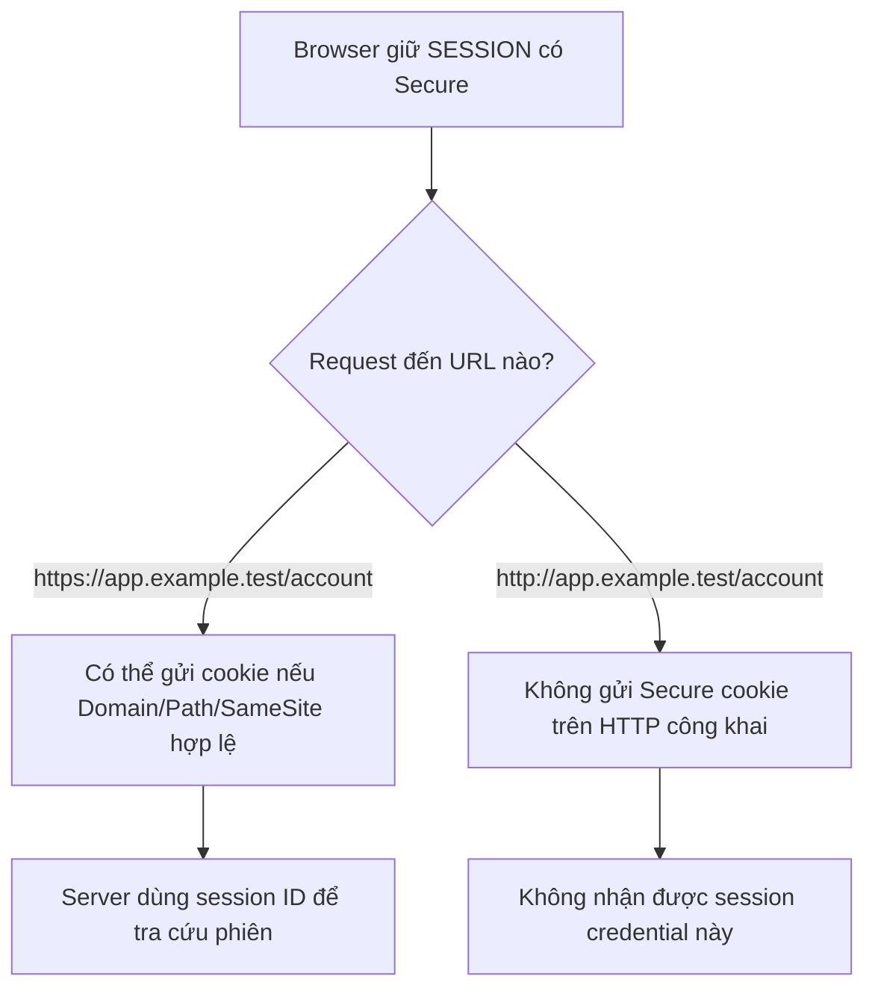
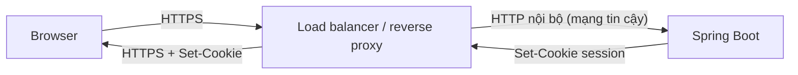
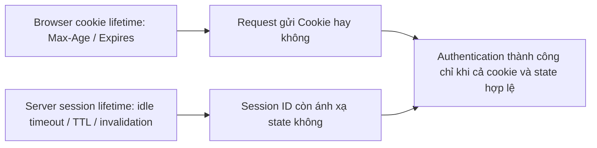
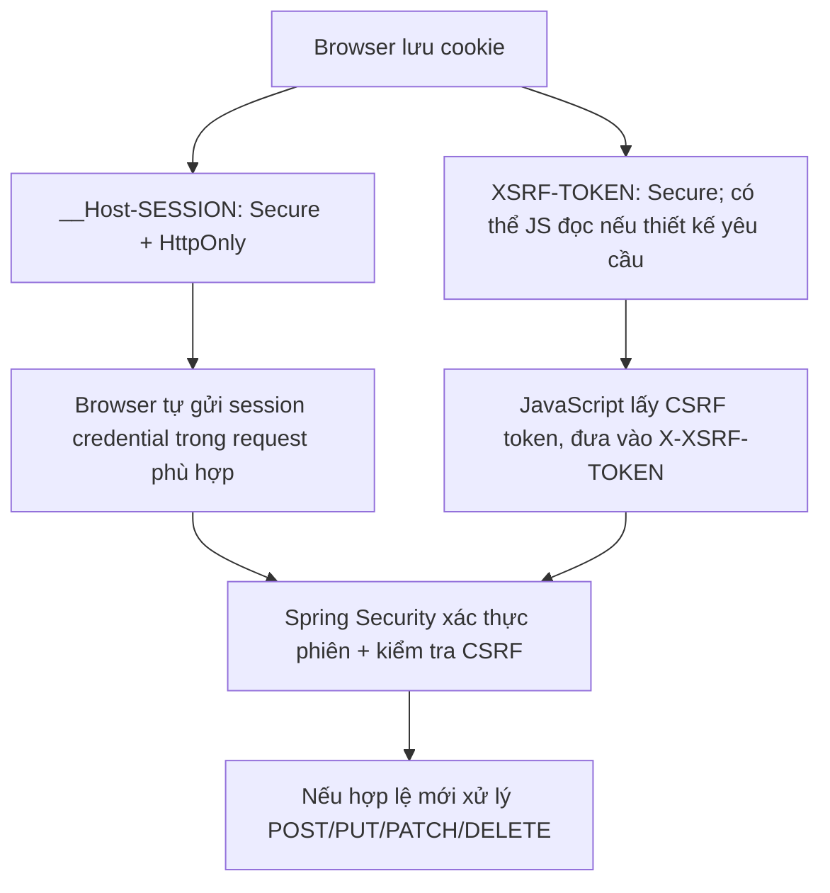

# Secure, HttpOnly và trách nhiệm của từng thuộc tính cookie

> **Chương:** Session và cookie  
> **Phạm vi:** Cookie phiên và cookie CSRF trong ứng dụng Spring Security **Servlet** và **Reactive WebFlux**, triển khai qua HTTPS/reverse proxy.  
> **Mục tiêu:** Hiểu chính xác `Secure` và `HttpOnly` bảo vệ điều gì; chọn `SameSite`, `Domain`, `Path`, thời hạn và prefix phù hợp; cấu hình trong Spring Boot/Spring Session/WebFlux; kiểm thử cookie qua response HTTP và chẩn đoán lỗi đăng nhập, CSRF, cross-origin.

Trong module `SPRING_SECURITY_HTTP_PROTECTION`, người học áp dụng các lớp phòng vệ HTTP và trình duyệt từ CSRF, CORS, security headers, CSP, HSTS đến HTTP firewall và bảo vệ session. Module hướng tới cả Servlet và Reactive, yêu cầu cấu hình thực tế, kiểm thử kịch bản tấn công web và chẩn đoán xung đột khi triển khai. Bài này đặt câu hỏi nền tảng: **cookie phiên có `Secure; HttpOnly` là đủ an toàn chưa?** Câu trả lời là **chưa** — hai thuộc tính đó giải quyết *hai vấn đề cụ thể*, còn cách browser chọn request gửi cookie, phạm vi host/path, thời điểm hết hạn, thu hồi session và bảo vệ request giả mạo đều cần chính sách riêng.

## 1. Cookie là gì? Browser nhận và gửi chúng ra sao?

Cookie là cặp `name=value` được browser lưu theo các quy tắc do server truyền trong **response header `Set-Cookie`**. Ở những request phù hợp, browser gửi trở lại **request header `Cookie`**, thường **không kèm các thuộc tính** như `Secure`, `HttpOnly` hay `SameSite`.

```http
# Server đặt cookie session sau khi tạo/đổi phiên.
HTTP/1.1 200 OK
Set-Cookie: __Host-SESSION=opaque-demo-id; Path=/; Secure; HttpOnly; SameSite=Lax
Cache-Control: no-store

# Browser gửi cookie tương ứng tới host/scheme/path hợp lệ:
GET /account HTTP/1.1
Host: app.example.test
Cookie: __Host-SESSION=opaque-demo-id
```

`opaque-demo-id` là giá trị giả. Session ID thật là **bearer credential** — không in ra log, URL, analytics hoặc ví dụ trực tuyến. Server dựa vào ID để tra cứu `HttpSession` (Servlet) hoặc `WebSession` (Reactive), rồi xác định danh tính và dữ liệu phiên theo cơ chế xác thực.

Sự phân biệt quan trọng:

| Header/đối tượng | Ai tạo, ai sử dụng? | Ý nghĩa |
| --- | --- | --- |
| Response `Set-Cookie` | Server tạo; browser phân tích và lưu. | Định nghĩa giá trị + phạm vi + thời hạn + flags. |
| Request `Cookie` | Browser tự chọn cookie phù hợp rồi gửi. | Thông thường chỉ gửi `name=value`; **không gửi lại các flags**. |
| `HttpSession`/`WebSession` | Server/container/session store quản lý. | Chứa session state; có thể tồn tại/hết hạn độc lập với thời hạn cookie trên browser. |
| `document.cookie` | JavaScript trên trang, bị giới hạn bởi cookie policy. | Không thấy cookie có `HttpOnly`; **không phải** toàn bộ cookie jar của browser. |
| Cookie lưu CSRF token | Có thể cần JavaScript đọc để thêm header. | **Không phải** cookie session xác thực, có policy `HttpOnly` khác nếu thiết kế SPA đòi hỏi. |

**Điều gì là “HTTP-only cookie”?** Đây là cookie được server phát với thuộc tính **`HttpOnly`**; không có nghĩa cookie chỉ được gửi qua HTTP không mã hóa. `HttpOnly` và `Secure` có thể, và với session cookie **nên**, được sử dụng cùng nhau.

## 2. `Secure`: hạn chế đường truyền của cookie

`Secure` yêu cầu browser chỉ gửi cookie qua **kết nối bảo mật**, thông thường là **HTTPS**. Nhờ đó, cookie session không bị gắn vào những request HTTP thuần ngoài ý muốn. Một số browser có ngoại lệ cho `localhost` trong môi trường phát triển; **không dựa vào ngoại lệ đó cho domain thật**.

```http
Set-Cookie: SESSION=opaque-demo-id; Path=/; Secure; HttpOnly; SameSite=Lax
```

### 2.1. Khi có và khi không có `Secure`



**Giới hạn của `Secure`:**

- `Secure` **không mã hóa riêng nội dung cookie**; việc bảo mật đường truyền được thực hiện bởi TLS/HTTPS.
- Nó **không ngăn JavaScript đọc cookie** nếu không có `HttpOnly`.
- Nó **không ngăn XSS** thao tác trên giao diện hoặc gửi request hợp lệ khi nạn nhân đang đăng nhập.
- Nó **không ngăn CSRF**: browser vẫn có thể tự gửi cookie tới ứng dụng trong những tình huống policy cho phép.
- Nó **không tự thay session ID sau login**; session fixation protection cần cơ chế riêng.
- Nó không bảo đảm application/proxy luôn phát cookie đúng: phải kiểm tra `Set-Cookie` trên response **sau TLS termination**.

### 2.2. Vì sao HTTPS và HSTS vẫn cần thiết?

Cookie `Secure` giúp tránh mang credential session qua HTTP, nhưng bản thân trang web cũng cần được phục vụ an toàn. **HTTPS** bảo vệ request/response; **HSTS** hướng các browser hỗ trợ không thử downgrade xuống HTTP sau khi đã biết chính sách (và có thể được preload theo điều kiện). Cần triển khai HTTPS/HSTS trên đúng host, proxy và certificate.

Không thay `Secure` bằng HSTS, hoặc ngược lại. Một browser lần đầu truy cập một host chưa có chính sách HSTS có thể vẫn bắt đầu bằng HTTP; session cookie có `Secure` sẽ hạn chế bị gửi trên kênh đó. Ngược lại, một request HTML/mã JavaScript tải qua HTTP có thể đã có vấn đề bảo mật dù session cookie không được gửi.

### 2.3. TLS termination ở reverse proxy

Mô hình thường gặp:



Nếu ứng dụng tự suy đoán `request.isSecure()` từ kết nối proxy → app bằng HTTP, cookie có thể **thiếu `Secure`** dù browser truy cập HTTPS. Ngược lại, ép `Secure` trong môi trường browser chỉ truy cập HTTP sẽ khiến session cookie không được gửi lại, gây hiện tượng “đăng nhập rồi mất phiên”.

Đối với production, ưu tiên **cấu hình `Secure=true` tường minh cho session cookie** và xử lý forwarded headers từ **proxy được tin cậy**. Không chấp nhận tùy tiện `X-Forwarded-Proto` do Internet client tự gửi để đánh lừa application. Kiểm tra response thực tại browser; cấu hình YAML đúng chưa đủ nếu proxy ghi đè `Set-Cookie`.

## 3. `HttpOnly`: hạn chế JavaScript đọc hoặc sửa cookie

`HttpOnly` chặn các API JavaScript thông thường như `document.cookie` và Cookie Store API truy cập cookie đó. Mục tiêu là giảm khả năng **đánh cắp trực tiếp session ID qua XSS**.

```http
Set-Cookie: __Host-SESSION=opaque-demo-id; Path=/; Secure; HttpOnly; SameSite=Lax
```

### 3.1. Điểm thường bị hiểu nhầm

**`HttpOnly` không chặn browser gửi cookie trong request do JavaScript tạo.** Nếu code trên trang chạy:

```javascript
// Same-origin request: browser có thể gửi session cookie HttpOnly.
const response = await fetch("/account", {
  credentials: "same-origin"
});
```

thì cookie phù hợp vẫn được browser gắn vào request. JavaScript **không đọc được giá trị cookie**, nhưng vẫn có thể thực hiện request **với quyền của browser**. Đây là lý do `HttpOnly` không làm cho XSS trở nên vô hại: mã độc chạy trong origin hợp lệ vẫn có thể đọc nội dung trang/response mà CORS và authorization cho phép, gửi thay đổi dữ liệu, hoặc phát request có session credential tự kèm.

| Tình huống | `HttpOnly` giúp gì? | Phòng vệ cần bổ sung |
| --- | --- | --- |
| Script XSS gọi `document.cookie` để lấy session ID | Cookie có `HttpOnly` không xuất hiện trong API này. | Chống XSS: output encoding, CSP, template escape, hạn chế third-party scripts. |
| Script XSS gọi `fetch("/transfer", ... )` | **Không** chặn cookie được gửi theo browser policy. | Validation, authorization, CSRF token, CSP; giảm điểm chèn script. |
| Người dùng gửi request qua HTTPS | `HttpOnly` không điều khiển scheme. | `Secure` và HTTPS/HSTS. |
| Người dùng nhấn liên kết tới website khác | `HttpOnly` không điều khiển cross-site cookie. | `SameSite`, CSRF protection, Origin/Referer checks khi phù hợp. |
| Subdomain khác có thể đặt cookie parent domain | `HttpOnly` không tự giới hạn Domain. | Host-only cookie, `__Host-`, giảm subdomain trust. |
| Server log `Cookie` header | `HttpOnly` không ngăn backend/proxy/log thấy cookie. | Logging redaction, access controls, secret retention. |

### 3.2. Vì sao session cookie nên luôn `HttpOnly`?

Session ID không cần được frontend đọc; trình duyệt tự gửi nó trong request. Cho JavaScript đọc session ID **không giúp việc xác thực hoạt động tốt hơn**, chỉ mở thêm đường bị lấy cắp khi có XSS hoặc third-party script độc hại.

Với cả Servlet `JSESSIONID` và WebFlux `SESSION`, nên cấu hình **`Secure; HttpOnly`** trên cookie mang session ID. Nếu SPA cần CSRF token để gửi header, frontend có thể nhận token qua endpoint JSON/meta tag hoặc qua một **cookie CSRF riêng**, không cần tắt `HttpOnly` của session cookie.

### 3.3. Quan sát trong DevTools

Một cookie `HttpOnly` vẫn xuất hiện trong **Application/Storage → Cookies** hoặc Network devtools của browser đối với người có quyền truy cập trình duyệt. Điều đó không có nghĩa JavaScript thông thường có thể đọc nó. `document.cookie` không hiển thị cookie `HttpOnly`, nhưng Developer Tools vẫn cung cấp công cụ chẩn đoán.

Ngoài ra, `Set-Cookie` là **forbidden response header** đối với các API frontend thông thường; `fetch(...).headers.get("Set-Cookie")` không giúp SPA đọc session ID. Hãy dùng browser DevTools hoặc HTTP integration test trên phía server để kiểm tra thuộc tính, **không gửi session ID vào JSON chỉ để debug**.

## 4. `Secure` và `HttpOnly` giải quyết hai bài toán khác nhau

| Cookie có | Request HTTPS | Request HTTP công khai | JavaScript `document.cookie` |
| --- | --- | --- | --- |
| Không `Secure`, không `HttpOnly` | Có thể gửi khi scope khớp | Có thể gửi khi scope khớp | Có thể đọc nếu scope khớp |
| Chỉ `Secure` | Có thể gửi | **Không gửi** | **Có thể đọc** trên origin/scope phù hợp |
| Chỉ `HttpOnly` | Có thể gửi | **Vẫn có thể gửi** | **Không đọc được** |
| **`Secure; HttpOnly`** | Có thể gửi | **Không gửi** | **Không đọc được** |

Các điều kiện khác như `SameSite`, `Domain`, `Path`, expiry và browser privacy settings vẫn phải được đáp ứng. Bảng chỉ cô lập vai trò của hai flags để tránh kết luận quá mức.

**Một ví dụ sai:** Developer thấy frontend không đọc được `SESSION` rồi sửa `HttpOnly=false` để “sửa login”. Thực tế browser **không cần JavaScript đọc cookie** để giữ session; nguyên nhân có thể là `Secure` trên HTTP, `SameSite`, CORS credentials, `Path`/`Domain`, cookie đã hết hạn, hoặc backend/session store không lưu state.

## 5. `SameSite`: khi nào browser gửi cookie theo ngữ cảnh site?

`SameSite` giúp giới hạn một số request **cross-site** có đính kèm cookie. Nó không quyết định JavaScript có đọc cookie hay không, và không thay thế `Secure`. Browser hiện đại thường xử lý **site** dựa trên scheme và registrable domain (*schemeful same-site*); **same-site khác với same-origin**.

Ví dụ:

- `https://app.example.test` → `https://api.example.test`: khác **origin** vì hostname khác, nhưng thông thường là **same-site**.
- `https://app.example.test` → `http://app.example.test`: khác scheme, có thể bị xem là **cross-site** trong chính sách schemeful.
- `https://shop.example.test` → `https://payments.other.test`: **cross-site**.

| Giá trị | Browser gửi cookie khi nào? | Đánh đổi |
| --- | --- | --- |
| `Strict` | Chỉ khi request được coi là **same-site**. | Chặt; có thể khiến người dùng nhấn liên kết từ trang ngoài phải đăng nhập lại hoặc mất bối cảnh phiên ở lần điều hướng đầu. |
| `Lax` | Same-site, và một số **top-level navigation cross-site với phương thức an toàn** như GET. | Cân bằng trải nghiệm và giảm rủi ro CSRF; thường phù hợp nhiều ứng dụng. |
| `None` | Cho phép cookie trong ngữ cảnh **cross-site** nếu các điều kiện khác hợp lệ; **phải có `Secure`**. | Cần cho một số trường hợp nhúng/SSO/cross-site, nhưng bị tác động bởi third-party cookie policy và tăng bề mặt CSRF. |
| Không ghi `SameSite` | Tùy browser; nhiều browser mặc định gần `Lax`. | **Không nên dựa vào mặc định** vì khác trình duyệt/phiên bản. |

```http
# Các mẫu (không dùng cả ba cho cùng một cookie):
Set-Cookie: SESSION=a; Path=/; Secure; HttpOnly; SameSite=Strict
Set-Cookie: SESSION=b; Path=/; Secure; HttpOnly; SameSite=Lax
Set-Cookie: SESSION=c; Path=/; Secure; HttpOnly; SameSite=None
```

**Lưu ý `Lax`:** Lax thông thường **không** gửi cookie trong POST cross-site. Nhưng khi cookie không khai báo `SameSite` và browser áp dụng chế độ **Lax-by-default**, một số browser có ngoại lệ tạm thời cho POST ngay sau khi cookie mới được đặt (ví dụ trong khoảng hai phút). Đừng dựa vào đó như một hợp đồng bảo mật hoặc cho rằng mọi browser xử lý giống nhau. **Khai báo `SameSite` tường minh**, đồng thời giữ CSRF token trên những request unsafe dựa vào session cookie.

### 5.1. Vì sao SameSite không thay thế CSRF?

SameSite là chính sách **browser** có những giới hạn:

- Request **same-site nhưng khác origin** có thể vẫn mang cookie (ví dụ subdomain không tin cậy).
- Một số cross-site **top-level GET** vẫn gửi cookie với `Lax`, nên endpoint **GET có side effect** là lỗi thiết kế.
- Browser khác nhau/ứng dụng nhúng/SSO và các trường hợp thừa kế cookie có thể có hành vi khác nhau.
- Nếu ứng dụng cần `SameSite=None`, cookie vẫn được gửi trong nhiều tình huống cross-site.
- XSS chạy trên origin hợp lệ không bị SameSite chặn như một request cross-site.

Đối với ứng dụng Spring Security dùng cookie xác thực, **giữ CSRF protection cho POST/PUT/PATCH/DELETE** trừ khi có cơ sở kiến trúc cụ thể, và bảo đảm frontend phát token hợp lệ qua header/form. Đừng tắt CSRF vì đã bật `SameSite=Lax`.

### 5.2. SPA khác origin và CORS

Một SPA ở `https://app.example.test` gọi API `https://api.example.test` là **cross-origin** nhưng thông thường vẫn **same-site**. CORS kiểm soát JavaScript có được phép đọc response hay không; `SameSite` và cookie scope lại quyết định browser có gửi cookie hay không. Hai cơ chế giải quyết các câu hỏi khác nhau.

```javascript
// Fetch tới một origin khác; browser còn kiểm tra CORS, cookie scope,
// SameSite, Secure và chính sách third-party cookie hiện hành.
const response = await fetch("https://api.example.test/account", {
  credentials: "include"
});
```

Nếu API trả cookie và cho phép cross-origin credentials, CORS thường cần `Access-Control-Allow-Credentials: true` và `Access-Control-Allow-Origin` là origin được phép **cụ thể**, không phải `*`; các trường hợp preflight/header cần được xử lý đúng. **CORS không tự đặt `SameSite=None`**, và `SameSite=None` không làm CORS tự pass. Ngay cả với CORS đúng, browser privacy settings có thể chặn third-party cookies.

## 6. `Domain`: cookie dành cho host nào?

Nếu **không có `Domain`**, cookie là **host-only cookie**, browser chỉ gửi đến đúng hostname đã đặt cookie (không tự dùng cho subdomain khác). Nếu ghi `Domain=example.test`, cookie có thể được gửi đến `example.test` **và các subdomain** như `app.example.test`, `api.example.test`, tùy chính sách browser.

```http
# Host-only: chỉ host đã đặt cookie, ví dụ app.example.test.
Set-Cookie: SESSION=a; Path=/; Secure; HttpOnly; SameSite=Lax

# Chia sẻ tới parent domain và các subdomain:
Set-Cookie: SESSION=b; Domain=example.test; Path=/; Secure; HttpOnly; SameSite=Lax
```

**Không tự đặt Domain rộng “cho tiện SSO”.** Nếu một subdomain yếu/bị chiếm quyền có khả năng đặt cookie cho parent domain, nguy cơ **cookie tossing/shadowing/session fixation** tăng. Đăng nhập chung giữa nhiều ứng dụng nên sử dụng SSO/OIDC đúng cách, không mặc định mở rộng scope của cookie phiên tới toàn bộ tổ chức.

Quy tắc browser:

- Server chỉ được đặt `Domain` là chính host hoặc parent domain được phép, không phải domain không liên quan.
- Không thể đặt `Domain` ở **public suffix** như `com` hoặc `co.uk`.
- Dấu chấm đứng đầu `.example.test` trong một số cú pháp cũ không còn là biện pháp tạo scope đặc biệt; đừng dựa vào nó.
- `Domain=example.test` **không** có nghĩa chỉ gửi tới `example.test`: subdomain cũng nằm trong scope.
- `Secure` và `HttpOnly` **không thu hẹp `Domain`**. Host-only cookie hoặc prefix `__Host-` là lựa chọn chặt hơn khi không cần chia sẻ phiên.

## 7. `Path`: gửi cookie tới những đường dẫn nào?

`Path=/` khiến browser có thể gửi cookie đến các đường dẫn trong host tương ứng. `Path=/admin` thông thường chỉ gửi tới `/admin` và các nhánh con như `/admin/users`, không gửi tới `/profile`.

```http
Set-Cookie: SESSION=opaque-demo-id; Path=/; Secure; HttpOnly; SameSite=Lax
```

**`Path` không phải hàng rào phân quyền hoặc bảo mật giữa các ứng dụng chung origin.** Một ứng dụng ở path khác có thể dùng script/endpoint theo cùng-origin policy để tương tác với những tài nguyên khác; server vẫn phải thực thi authentication và authorization. Không đặt cookie session `Path=/admin` rồi nghĩ route `/admin` đã an toàn hơn.

Các lỗi thường gặp:

1. Cookie có `Path=/app` nhưng API cần gọi ở `/api` → browser không gửi cookie, request trở thành anonymous.
2. Logout trả cookie hết hạn với `Path=/`, trong khi cookie cũ có `Path=/app` → cookie cũ **chưa được xóa**.
3. Nhiều cookie **cùng tên** nhưng khác `Path`/`Domain` cùng tồn tại → request mang nhiều cặp name/value; server/proxy có thể chọn sai.
4. Dùng Path rộng trong hệ có nhiều ứng dụng cùng host → tăng phạm vi gửi credential.

**Quy tắc:** chọn Path theo kiến trúc, thống nhất giữa login/API/logout, và tránh cookie cùng tên nhưng khác scope. Đối với `__Host-`, `Path=/` là yêu cầu bắt buộc của prefix.

## 8. `Max-Age` và `Expires`: cookie tồn tại bao lâu?

`Max-Age` (số giây) và `Expires` (thời điểm tuyệt đối) điều khiển thời hạn cookie trong browser. Đây **không phải** cấu hình duy nhất quyết định phiên ở server còn hiệu lực.

```http
# Cookie tồn tại một giờ trên browser:
Set-Cookie: REMEMBER_CHOICE=vi; Max-Age=3600; Path=/; Secure; SameSite=Lax

# Cookie hết hạn ngay theo đúng name + Domain/Path:
Set-Cookie: SESSION=; Max-Age=0; Path=/; Secure; HttpOnly; SameSite=Lax

# Session cookie (không ghi Max-Age/Expires):
Set-Cookie: SESSION=opaque-demo-id; Path=/; Secure; HttpOnly; SameSite=Lax
```

| Thuộc tính/tình huống | Browser làm gì? | Giới hạn cần hiểu |
| --- | --- | --- |
| `Max-Age=3600` | Dự kiến hết hạn sau 3.600 giây từ lúc được lưu. | Không bảo đảm session server còn sống tới lúc đó. |
| `Expires=<HTTP-date>` | Dự kiến hết hạn vào thời điểm cho trước. | Clock skew có thể ảnh hưởng; `Max-Age` thường dễ kiểm soát hơn. |
| Có cả `Max-Age` và `Expires` | **`Max-Age` có ưu tiên**. | Đừng đặt hai giá trị mâu thuẫn. |
| Không có cả hai | Thường là **session cookie**. | Browser có tính năng khôi phục phiên, nên cookie có thể tồn tại qua restart trong một số trường hợp. |
| Raw header `Max-Age=0` hoặc âm | Browser xem cookie là hết hạn. | Để xóa cookie cũ phải phát cookie xóa **đúng tên và scope**; không tự hủy session store. |
| Hết hạn session ở Redis/Servlet container | Server không còn nhận session state cũ. | Browser có thể vẫn gửi cookie chưa hết hạn, nhưng server phải coi ID đó vô hiệu. |

**Phân biệt API Spring với raw header:** `ResponseCookie.ResponseCookieBuilder.maxAge(Duration)` của Spring Framework diễn giải **giá trị âm** là **không phát thuộc tính `Max-Age`**, còn `Max-Age=-1` được ghi *trực tiếp trong raw `Set-Cookie`* thường được browser xem là đã hết hạn. Vì thế khi xóa cookie bằng Spring builder, dùng `maxAge(Duration.ZERO)` thay vì tưởng rằng mọi giá trị âm đều tạo cookie xóa.

### 8.1. Hai chiếc đồng hồ khác nhau



Ví dụ: Cookie có `Max-Age=7d` nhưng `HttpSession` trên server timeout sau 30 phút không hoạt động. Sau 30 phút, browser vẫn có thể gửi ID cũ nhưng server **không nên khôi phục authentication**. Ngược lại, browser xóa cookie **không nhất thiết hủy ngay record session phía server**; cần logout handler/session invalidation theo chính sách.

Đừng đặt session cookie tồn tại rất lâu chỉ để tránh người dùng phải đăng nhập lại. Nếu hệ thống có tính năng “remember me”, cần cơ chế riêng với token rotation/revocation, hạn dùng và khả năng phát hiện abuse; không kéo dài `JSESSIONID` vô hạn.

### 8.2. Logout cần xóa cả cookie và state đúng cách

Khi logout bằng cookie/session:

1. Security layer **xóa/thu hồi `SecurityContext`**, invalidate session hoặc thực hiện logout handler đúng architecture.
2. Response yêu cầu browser hết hạn cookie theo **name, Path và Domain phù hợp cookie gốc**.
3. Browser dùng cookie cũ từ client khác **không được truy cập** authenticated resource.
4. Nếu có nhiều cookie cùng tên khác scope hoặc cookie session của nhiều ứng dụng, kiểm tra không xóa nhầm cookie không liên quan và không bỏ sót cookie cũ.

`Clear-Site-Data: "cookies"` có thể hỗ trợ dọn cookie trên phạm vi site theo browser hỗ trợ, nhưng **có tác động rộng** đến các ứng dụng liên quan. Không tùy tiện thêm header này vào mọi logout nếu hệ thống chia sẻ domain với dịch vụ khác.

## 9. Cookie name prefixes: `__Secure-`, `__Host-` và biến thể `Http`

Một số trình duyệt kiểm tra **prefix của cookie name** như một hợp đồng về flags và scope. Prefix là **một phần của tên cookie thực**, không bị browser tự loại bỏ trước khi gửi `Cookie` cho server.

| Tên bắt đầu bằng | Thuộc tính bắt buộc trong browser hỗ trợ | Dùng khi nào? |
| --- | --- | --- |
| `__Secure-` | Cookie được đặt từ HTTPS và có `Secure`. | Cookie cần giới hạn kênh truyền, có thể vẫn cần `Domain`. |
| **`__Host-`** | HTTPS + `Secure` + **`Path=/`** + **không có `Domain`**. | Cookie session của **một host cụ thể**, ưu tiên khi không cần share cookie xuống subdomain. |
| `__Http-` | HTTPS + `Secure` + **`HttpOnly`**. | Muốn yêu cầu cookie chỉ được đặt bằng `Set-Cookie` thay vì JavaScript trong browser hỗ trợ. |
| `__Host-Http-` | Tổng hợp **`__Host-`** và **`__Http-`**. | Bảo vệ host scope và yêu cầu cookie do HTTP response đặt trong browser hỗ trợ. |

Ví dụ:

```http
# HỢP LỆ trong browser hỗ trợ __Host-:
Set-Cookie: __Host-SESSION=opaque-id; Path=/; Secure; HttpOnly; SameSite=Lax

# BỊ TỪ CHỐI: __Host- nhưng có Domain.
Set-Cookie: __Host-SESSION=opaque-id; Domain=example.test; Path=/; Secure; HttpOnly

# BỊ TỪ CHỐI: __Host- nhưng Path không phải /.
Set-Cookie: __Host-SESSION=opaque-id; Path=/app; Secure; HttpOnly

# HỢP LỆ khi browser hỗ trợ __Host-Http-:
Set-Cookie: __Host-Http-SESSION=opaque-id; Path=/; Secure; HttpOnly; SameSite=Lax
```

**Giá trị prefix không tự bảo vệ server:** ứng dụng vẫn phải cấu hình flags/scope chuẩn và **kiểm tra support của browser mục tiêu**; browser không nhận biết prefix có thể lưu cookie mà không áp điều kiện đặc biệt. Prefix `__Host-` không thay session fixation protection, không khóa JavaScript khỏi thực hiện request và không làm CSRF tự biến mất.

### 9.1. Nên đổi cookie session sang `__Host-SESSION`?

Khi ứng dụng chỉ cần cookie session ở **một host** và chạy HTTPS, `__Host-SESSION` thường là lựa chọn tốt để giảm nguy cơ cookie được đặt từ subdomain yếu hơn. Cần đảm bảo:

- `Secure=true` và HTTPS thực trên browser.
- `Path=/`, **không thêm `Domain`**.
- Backend/session resolver **đọc đúng tên đầy đủ** `__Host-SESSION`.
- Dọn cookie cũ `SESSION`/`JSESSIONID` theo scope cũ trong giai đoạn chuyển đổi; không để nhiều cookie session cạnh tranh.
- Kiểm thử browser hỗ trợ và đường logout/session fixation, proxy, SPA/API.

Nếu phải chia sẻ cookie giữa các subdomain, `__Host-` **không phù hợp** do yêu cầu host-only. Cân nhắc điều chỉnh kiến trúc SSO thay vì hạ mức bảo vệ phạm vi cookie chỉ để đăng nhập dùng chung.

## 10. `Partitioned` (CHIPS): phân vùng cookie theo top-level site

Cookie `Partitioned` được lưu theo cơ chế **partitioned storage**, với khóa phân vùng gắn với ngữ cảnh top-level site. Nó chủ yếu phục vụ một số **trường hợp nhúng/third-party** (widget, ứng dụng trong iframe) cần tách phiên theo website đang nhúng. Thuộc tính `Partitioned` **yêu cầu `Secure`**.

```http
# Ví dụ widget được nhúng bởi nhiều website; không phải cookie
# session mặc định đề xuất cho một web app first-party thông thường.
Set-Cookie: __Host-widget=opaque-demo; Path=/; Secure; HttpOnly; SameSite=None; Partitioned
```

| Câu hỏi | Cách hiểu |
| --- | --- |
| `Partitioned` có tự bật HTTPS? | Không; **cookie phải có `Secure`** và được đặt trong ngữ cảnh được browser chấp nhận. |
| `Partitioned` thay CSRF? | Không. Request vẫn cần được xác thực, phân quyền và bảo vệ CSRF phù hợp. |
| Cùng widget nhúng ở hai top-level sites có dùng chung cookie? | Trong browser hỗ trợ partitioning, **không dùng chung theo cách cookie third-party truyền thống**. |
| Có nên bật cho session first-party mặc định? | Thường **không cần**; bật không đúng có thể làm luồng login/cookie phức tạp. |
| Có kết hợp `__Host-` không? | Thường được khuyến nghị để giữ cookie ở host scope rõ ràng. |

Theo Spring Framework, `ResponseCookie.ResponseCookieBuilder.partitioned(boolean)` có từ **Spring Framework 6.2**; ở dự án phiên bản cũ, đừng sao chép mã gọi phương thức này mà không kiểm tra API. Hỗ trợ và chính sách third-party cookie vẫn phụ thuộc browser/triển khai, nên cần kiểm thử end-to-end nếu ứng dụng thực sự dùng iframe/cross-site embedding.

## 11. Chọn flags theo loại cookie, không áp cùng một mẫu mù quáng

| Loại cookie | `Secure` | `HttpOnly` | `SameSite` / scope | Lưu ý |
| --- | --- | --- | --- | --- |
| **Session cookie** `JSESSIONID`/`SESSION` | **Bật trên production HTTPS** | **Bật** | `Lax` hoặc `Strict` theo luồng; host-only/`__Host-` nếu phù hợp | ID là credential; cần rotation khi login, timeout và invalidation khi logout. |
| **Remember-me cookie** | **Bật** | **Bật** | Thường `Lax`/`Strict`; thời hạn có chủ đích | Token dài hạn cần rotation/revocation phía server, không phải một session ID bất tử. |
| **CSRF cookie cần JavaScript đọc** `XSRF-TOKEN` | **Bật** | **Có thể tắt chỉ cho cookie này** | Scope hẹp; chọn SameSite theo ứng dụng | JS đọc token để đưa vào header; **không tắt HttpOnly của session**. |
| CSRF token cấp qua HTML/meta/JSON, không cần JS đọc cookie | **Bật** nếu có cookie | Có thể **giữ bật** | Theo request handler/repository | Ưu tiên giảm cookie exposure; không lộ token trong log hoặc cache. |
| Cookie ưu tiên UI không nhạy cảm | Khuyến nghị bật | Có thể không cần nếu JS phải đọc | Scope và `Max-Age` hạn chế | Không dùng chứa credential hoặc dữ liệu riêng tư nhạy cảm. |
| Cookie của widget cross-site | **Bật** | Tùy JS có cần đọc | `SameSite=None`; có thể `Partitioned` | Đánh giá third-party cookie policy và CORS/CSRF. |

### 11.1. Vì sao CSRF cookie có thể cần `HttpOnly=false`?

Một SPA có thể thực hiện mẫu **double-submit cookie** hoặc dùng Spring Security `CookieCsrfTokenRepository`: backend cấp cookie `XSRF-TOKEN`, JavaScript đọc rồi thêm giá trị vào header `X-XSRF-TOKEN` cho POST/PUT/PATCH/DELETE. Trong trường hợp này **chỉ riêng cookie chứa CSRF token** cần JavaScript đọc.

```http
# Session credential KHÔNG để JavaScript đọc:
Set-Cookie: __Host-SESSION=opaque-session; Path=/; Secure; HttpOnly; SameSite=Lax

# CSRF token có thể cho JavaScript đọc khi thiết kế SPA yêu cầu:
Set-Cookie: XSRF-TOKEN=opaque-csrf; Path=/; Secure; SameSite=Lax
```

Điều này **không có nghĩa mọi cookie CSRF bắt buộc thiếu `HttpOnly`**. Nếu client lấy token qua response JSON/meta tag thay vì đọc cookie, có thể giữ CSRF cookie `HttpOnly` nếu repository/handler hỗ trợ. Với Spring Security 6+ còn có **deferred CSRF token** và **XOR masking/BREACH protection**; raw token đọc từ cookie không phải lúc nào cũng tương thích ngay với request handler mặc định. Cấu hình cần theo hướng dẫn SPA của phiên bản Spring Security đang dùng.

### 11.2. HTTP-only session cookie không cản SPA hoạt động

```javascript
// Browser vẫn đính kèm session cookie HttpOnly vào request
// nếu HTTPS, Domain, Path, SameSite, CORS và credentials cho phép.
await fetch("/api/profile", {
  method: "POST",
  credentials: "same-origin",
  headers: {
    "Content-Type": "application/json",
    "X-CSRF-TOKEN": csrfTokenFromSupportedEndpoint
  },
  body: JSON.stringify({ displayName: "An" })
});
```

Biến `csrfTokenFromSupportedEndpoint` tượng trưng cho token lấy từ cơ chế được backend cấp, **không phải session ID**. Nếu frontend phải mở `HttpOnly=false` cho `SESSION` để gửi được request, thường là đã nhầm cơ chế browser tự đính kèm cookie với cơ chế JavaScript tự quản lý token.

## 12. Cấu hình Spring Boot Servlet: session cookie

Với Spring Boot **Servlet stack** (Spring MVC/Tomcat/Jetty với khả năng tương thích tương ứng), ví dụ cấu hình trong `application.yml`:

```yaml
server:
  servlet:
    session:
      cookie:
        name: __Host-SESSION
        path: /
        secure: true
        http-only: true
        same-site: lax
      timeout: 30m
```

Giải thích từng dòng:

- `name: __Host-SESSION`: chọn prefix host-only; bắt buộc triển khai HTTPS, `Path=/`, **không có `Domain`. Cần đảm bảo container/version chấp nhận tên và cấu hình session cookie này.
- `secure: true`: trình duyệt không mang cookie này qua HTTP công khai.
- `http-only: true`: ngăn JavaScript đọc session cookie.
- `same-site: lax`: giảm nhiều request cross-site có kèm cookie, nhưng **không thay CSRF**.
- `timeout: 30m`: chính sách phiên phía server, **không đồng nghĩa `Max-Age=1800`** trên cookie; phải xem riêng `server.servlet.session.cookie.max-age` nếu muốn cookie persistent.

**Không thêm `domain: example.test`** nếu muốn giữ chuẩn `__Host-`. Nếu có yêu cầu chia sẻ cookie giữa nhiều subdomain, chọn tên/scope khác và đánh giá SSO cùng nguy cơ cookie shadowing thay vì cố phá quy tắc prefix.

Thuộc tính `server.servlet.session.cookie.same-site` được Spring Boot hỗ trợ trong cấu hình tương ứng và có thể áp dụng qua Spring Session Servlet. **Không coi cùng một YAML là phổ quát cho mọi container/phiên bản**: kiểm tra dependency Spring Boot, cách container phát cookie và các bean `CookieSerializer` có ghi đè không.

### 12.1. Cấu hình Spring Security Servlet không thay thế cấu hình cookie

`HttpSecurity` quản lý authentication, CSRF, authorization và session fixation; nó **không đồng nghĩa** đã phát cookie `Secure; HttpOnly`. Ví dụ:

```java
import org.springframework.context.annotation.Bean;
import org.springframework.context.annotation.Configuration;
import org.springframework.security.config.Customizer;
import org.springframework.security.config.annotation.web.builders.HttpSecurity;
import org.springframework.security.web.SecurityFilterChain;

@Configuration
class ServletSecurityConfig {

    @Bean
    SecurityFilterChain securityFilterChain(HttpSecurity http)
            throws Exception {
        return http
            .authorizeHttpRequests(auth -> auth
                .requestMatchers("/login", "/assets/**").permitAll()
                .anyRequest().authenticated())
            .formLogin(Customizer.withDefaults())
            .sessionManagement(session -> session
                .sessionFixation(fixation -> fixation.changeSessionId()))
            .csrf(Customizer.withDefaults())
            .build();
    }
}
```

Với Servlet **3.1+**, `changeSessionId()` là chiến lược mặc định của Spring Security khi đăng nhập qua cơ chế chuẩn và có session hợp lệ trước login. Nó giúp bảo vệ **session fixation**, độc lập với flags trên cookie. `csrf(Customizer.withDefaults())` ghi rõ rằng CSRF bật (vốn là mặc định), nên `POST /login` cần token phù hợp.

**Chọn đúng lớp cấu hình:** `server.servlet.session.cookie.*` thuộc Spring Boot/container; `HttpSecurity` là security filter; `DefaultCookieSerializer` của Spring Session có thể thay cách phát session cookie nếu Spring Session thay thế session management của container. Đừng cố “sửa” `HttpOnly` bằng cách sửa `CsrfConfigurer` hoặc ngược lại.

### 12.2. Logout và cookie tên tùy chỉnh

Nếu đổi `JSESSIONID` thành `__Host-SESSION`, hãy kiểm tra toàn bộ logout/cookie deletion logic. Cấu hình gọi `deleteCookies("JSESSIONID")` có thể **không xóa cookie mới**. Nhưng xóa cookie trình duyệt **không thay thế invalidation phía server**; cookie cũ có thể vẫn là bearer credential hợp lệ nếu session store không thu hồi.

Nên có test: đăng nhập, nhận cookie B → logout bằng request CSRF hợp lệ → thử cookie B cũ từ client riêng → không còn quyền. Sau logout, browser không còn cookie session theo chính sách và không còn **cookie tên cũ** cạnh tranh do migration.

## 13. Spring Session Servlet: khi `DefaultCookieSerializer` điều khiển cookie

Nếu ứng dụng dùng **Spring Session** (ví dụ Redis/JDBC) thay cho session store của Servlet container, Spring Session có `DefaultCookieSerializer` cho cookie phiên. Trong trường hợp cần customize tường minh, cấu hình bean:

```java
import org.springframework.context.annotation.Bean;
import org.springframework.context.annotation.Configuration;
import org.springframework.session.web.http.CookieSerializer;
import org.springframework.session.web.http.DefaultCookieSerializer;

@Configuration
class SessionCookieSerializerConfig {

    @Bean
    CookieSerializer cookieSerializer() {
        var serializer = new DefaultCookieSerializer();
        serializer.setCookieName("__Host-SESSION");
        serializer.setCookiePath("/");
        serializer.setUseSecureCookie(true);
        serializer.setUseHttpOnlyCookie(true);
        serializer.setSameSite("Lax");

        // Không setDomainName(...): __Host- đòi host-only.
        // Cookie session browser mặc định không cần Max-Age dài hạn.
        return serializer;
    }
}
```

Khi tồn tại bean này, đừng đồng thời dùng một lớp custom/proxy khác cố ghi cookie phiên **cùng tên nhưng flags khác nhau**. Một số Spring Boot auto-configuration cũng hỗ trợ `server.servlet.session.cookie.*` cho Spring Session: cần kiểm tra **bean nào thực sự có hiệu lực**, không giả định mọi nguồn config được tự merge theo thứ tự mong muốn.

**Lưu ý:** `DefaultCookieSerializer` chỉ điều khiển **cookie được phát/đọc**, không tự quyết định session timeout, authorization, CSRF hay session fixation. Redis/JDBC/session store phải thu hồi session khi logout/expiry; client có thể giữ cookie sau khi server state hết hạn và ngược lại.

Nếu application dùng `CookieSerializer.setDomainName(...)` hoặc `setDomainNamePattern(...)` để chia sẻ cookie qua subdomain, **không dùng prefix `__Host-`** vì nó cấm `Domain`. Domain pattern phải được kiểm soát đầu vào và tránh phản chiếu host bất thường vào header (HTTP response splitting/cookie injection). Ưu tiên cookie host-only và SSO đúng cách.

## 14. Spring Boot Reactive: cookie `WebSession`

Spring WebFlux sử dụng `WebSession` thay vì `HttpSession`. Theo Spring Framework, `CookieWebSessionIdResolver` mặc định dùng tên cookie **`SESSION`**; muốn đổi tên/flags có thể dùng `WebSessionIdResolver` bean.

### 14.1. Cấu hình bằng `application.yml` ở Spring Boot hỗ trợ properties

Với dòng Spring Boot hỗ trợ `server.reactive.session.cookie.*` (kiểm tra property metadata của phiên bản đang dùng):

```yaml
server:
  reactive:
    session:
      cookie:
        name: __Host-SESSION
        path: /
        secure: true
        http-only: true
        same-site: lax
      timeout: 30m
```

Đây là cấu hình cho HTTPS production. Đừng trộn property `server.servlet.session.cookie.*` vào ứng dụng **chỉ** dùng WebFlux rồi mong Servlet session settings tự áp dụng. Nếu vừa có WebFlux và MVC trên classpath, cần kiểm tra **loại web application thực tế** và bean/resolver đang được Spring Boot khởi tạo.

### 14.2. Cấu hình qua `CookieWebSessionIdResolver`

Khi cần kiểm soát trực tiếp, đặc biệt với Spring Session WebFlux:

```java
import org.springframework.context.annotation.Bean;
import org.springframework.context.annotation.Configuration;
import org.springframework.web.server.session.CookieWebSessionIdResolver;
import org.springframework.web.server.session.WebSessionIdResolver;

@Configuration
class ReactiveSessionCookieConfig {

    @Bean
    WebSessionIdResolver webSessionIdResolver() {
        var resolver = new CookieWebSessionIdResolver();
        resolver.setCookieName("__Host-SESSION");
        resolver.addCookieInitializer(builder -> builder
            .path("/")
            .secure(true)
            .httpOnly(true)
            .sameSite("Lax"));
        return resolver;
    }
}
```

**Chọn một cơ chế cấu hình chính**: properties tự động hoặc bean resolver tùy chỉnh theo phiên bản/framework. Đảm bảo tên cookie và flags xuất ra thống nhất, nhất là khi Spring Session thay `WebSessionManager`. Không thêm `.domain("example.test")` trong initializer khi tên có `__Host-`.

`ResponseCookie.ResponseCookieBuilder` còn hỗ trợ `maxAge(Duration)`, `domain(...)` và trong Spring Framework **6.2+** có `partitioned(boolean)`. Chỉ bật `partitioned(true)` khi có thiết kế cần partitioned cookie và đã kiểm thử chính sách browser; không bật trên session first-party mặc định chỉ vì API có sẵn.

### 14.3. Reactive SecurityWebFilterChain vẫn cần CSRF và session protection

```java
import org.springframework.context.annotation.Bean;
import org.springframework.context.annotation.Configuration;
import org.springframework.security.config.Customizer;
import org.springframework.security.config.annotation.web.reactive.EnableWebFluxSecurity;
import org.springframework.security.config.web.server.ServerHttpSecurity;
import org.springframework.security.web.server.SecurityWebFilterChain;

@Configuration
@EnableWebFluxSecurity
class ReactiveSecurityConfig {

    @Bean
    SecurityWebFilterChain securityWebFilterChain(ServerHttpSecurity http) {
        return http
            .authorizeExchange(ex -> ex
                .pathMatchers("/login", "/assets/**").permitAll()
                .anyExchange().authenticated())
            .formLogin(Customizer.withDefaults())
            .csrf(Customizer.withDefaults())
            .build();
    }
}
```

WebFlux không sử dụng `HttpSecurity.sessionManagement().sessionFixation()` của Servlet. Với form login và `WebSessionServerSecurityContextRepository` mặc định, Spring Security bảo vệ fixation bằng cách đổi `WebSession` ID lúc lưu `SecurityContext`. Cookie `Secure; HttpOnly` bảo vệ cách ID được **gửi/lưu ở browser**, nhưng vẫn cần đảm bảo **ID cũ sau login không có quyền của phiên mới**.

Nếu tùy chỉnh `ServerSecurityContextRepository`, đừng mặc định chức năng session fixation protection còn nguyên. Kiểm thử POST login thật, cookie cũ/mới và request đã xác thực qua store.

## 15. Cookie CSRF: đặt đúng ranh giới với session cookie

Một nguyên nhân hay gặp của cấu hình sai là nhóm phát triển dùng cùng một thuộc tính cho tất cả cookie, rồi bỏ `HttpOnly` trên **session cookie** vì SPA cần đọc CSRF token.

### 15.1. Cookie session và cookie CSRF phải tách vai trò



Spring Security **Servlet `CookieCsrfTokenRepository`** mặc định dùng `XSRF-TOKEN` và đọc actual token từ `X-XSRF-TOKEN` hoặc `_csrf`. Phương thức `withHttpOnlyFalse()` hỗ trợ kiểu SPA cần JavaScript đọc token; đó là **quyết định riêng cho cookie CSRF**, không phải yêu cầu đổi session cookie thành non-HttpOnly.

```java
import org.springframework.security.web.csrf.CookieCsrfTokenRepository;

// Trích đoạn trong HttpSecurity Servlet:
.csrf(csrf -> csrf
    .csrfTokenRepository(CookieCsrfTokenRepository.withHttpOnlyFalse()))
```

**Không dùng đoạn trên cho mọi ứng dụng theo phản xạ.** Nếu không cần JS đọc cookie, giữ `HttpOnly` cho CSRF cookie sẽ giảm bề mặt đọc token. Spring Security 6+ có deferred token/XOR protection; nếu SPA đọc raw cookie rồi gửi header, cần request handler đúng phiên bản (đặc biệt ở `csrf.spa()` khi được hỗ trợ hoặc cấu hình tương đương). Tránh tự tắt BREACH protection/CSRF mà không hiểu trade-off.

### 15.2. SPA lấy token từ endpoint, không cần đọc cookie phiên

Một lựa chọn khác là `GET /csrf` do server cấp token/`headerName` đúng cho client, dùng `Cache-Control: no-store` và gắn token với phiên hiện hành. JavaScript gửi token qua header; **session cookie luôn `HttpOnly`**. Khi login/logout làm token bị thu hồi hoặc session đổi, frontend lấy token mới trước unsafe request tiếp theo.

```javascript
async function updateProfile(data) {
  const r = await fetch("/csrf", {
    credentials: "same-origin",
    cache: "no-store"
  });
  if (!r.ok) throw new Error("Không lấy được CSRF token");

  const csrf = await r.json(); // { headerName, token }
  const response = await fetch("/profile", {
    method: "POST",
    credentials: "same-origin",
    headers: {
      "Content-Type": "application/json",
      [csrf.headerName]: csrf.token
    },
    body: JSON.stringify(data)
  });
  if (!response.ok) throw new Error("Request không thành công");
}
```

Endpoint `/csrf` là **hợp đồng ứng dụng cần triển khai**, không tự tồn tại chỉ nhờ có Spring Security. Cần cho GET truy cập theo chính sách phù hợp, consume publisher trong WebFlux, chống cache và không công bố session ID trong JSON.

### 15.3. Khi `SameSite=None` thực sự cần thiết

Ví dụ SPA và backend nằm ở hai **sites khác nhau**, dùng cookie xác thực và frontend gửi `fetch(..., { credentials: "include" })`. Lúc đó `SameSite=Lax` có thể ngăn session cookie được gửi trong XHR cross-site; phải đánh giá `SameSite=None; Secure`, CORS credentials với allowlist origin chặt, CSRF token/Origin checks, cookie third-party restrictions và phương án thay thế kiến trúc nếu browser chặn cookie.

**Không tự chuyển tất cả session cookies sang `SameSite=None`** chỉ để “sửa CORS”. CORS và SameSite là hai cơ chế độc lập; đổi SameSite có thể làm request cross-site tự đính kèm session nhiều hơn và tăng nhu cầu bảo vệ CSRF.

## 16. Kiểm thử flags ở mức đơn vị: `ResponseCookie`

Spring Framework có `ResponseCookie` và builder cho `Secure`, `HttpOnly`, `SameSite`, `Domain`, `Path`, `Max-Age`. Test nhanh cấu hình cookie do code application tạo:

```java
import org.junit.jupiter.api.Test;
import org.springframework.http.ResponseCookie;

import static org.junit.jupiter.api.Assertions.*;

class SessionCookiePolicyTest {

    @Test
    void hostSessionCookieHasSecureAndHttpOnly() {
        ResponseCookie cookie = ResponseCookie
            .from("__Host-SESSION", "opaque-test-value")
            .path("/")
            .secure(true)
            .httpOnly(true)
            .sameSite("Lax")
            .build();

        assertEquals("__Host-SESSION", cookie.getName());
        assertTrue(cookie.isSecure());
        assertTrue(cookie.isHttpOnly());
        assertEquals("/", cookie.getPath());
        assertNull(cookie.getDomain());
        assertEquals("Lax", cookie.getSameSite());

        String wire = cookie.toString();
        assertTrue(wire.contains("Secure"));
        assertTrue(wire.contains("HttpOnly"));
        assertTrue(wire.contains("SameSite=Lax"));
        assertFalse(wire.contains("Domain="));
    }
}
```

Test này kiểm tra **builder do application trực tiếp dùng**. Nó **không chứng minh** container Servlet/Spring Session/WebSession resolver của ứng dụng đã phát chính cookie ấy. Để kiểm tra end-to-end, phải quan sát `Set-Cookie` tại response có tạo/đổi phiên thực sự.

### 16.1. Kiểm thử trực tiếp resolver WebFlux

`CookieWebSessionIdResolver` có thể được kiểm thử bằng `MockServerWebExchange`:

```java
import org.junit.jupiter.api.Test;
import org.springframework.http.ResponseCookie;
import org.springframework.mock.http.server.reactive.MockServerHttpRequest;
import org.springframework.mock.web.server.MockServerWebExchange;
import org.springframework.web.server.session.CookieWebSessionIdResolver;

import static org.junit.jupiter.api.Assertions.*;

class CookieWebSessionIdResolverTest {

    @Test
    void resolverWritesHostOnlySecureHttpOnlyCookie() {
        var resolver = new CookieWebSessionIdResolver();
        resolver.setCookieName("__Host-SESSION");
        resolver.addCookieInitializer(builder -> builder
            .secure(true)
            .httpOnly(true)
            .path("/")
            .sameSite("Lax"));

        var exchange = MockServerWebExchange.from(
            MockServerHttpRequest.get("https://app.example.test/account"));

        resolver.setSessionId(exchange, "opaque-test-id");

        ResponseCookie cookie = exchange.getResponse()
            .getCookies().getFirst("__Host-SESSION");

        assertNotNull(cookie);
        assertTrue(cookie.isSecure());
        assertTrue(cookie.isHttpOnly());
        assertEquals("/", cookie.getPath());
        assertNull(cookie.getDomain());
        assertEquals("Lax", cookie.getSameSite());
    }
}
```

Test này khẳng định resolver **đặt thuộc tính phù hợp**, nhưng vẫn chưa chứng minh browser chấp nhận cookie hoặc Redis session thực còn hợp lệ. Test thực tế cần chạy qua HTTPS và kiểm tra cookie trong browser/HTTP client.

### 16.2. Test `Partitioned` chỉ khi phiên bản hỗ trợ

Nếu dùng Spring Framework **6.2+**, có thể kiểm tra bằng:

```java
ResponseCookie widgetCookie = ResponseCookie
    .from("__Host-widget", "opaque-test-id")
    .path("/")
    .secure(true)
    .httpOnly(true)
    .sameSite("None")
    .partitioned(true)
    .build();

assertTrue(widgetCookie.toString().contains("Partitioned"));
```

Đây là **đoạn thêm vào một test method** có imports/assertions tương ứng, không phải class độc lập. Không dùng `partitioned(true)` trên dự án có Spring Framework trước 6.2. Kiểm tra browser thực về hành vi phân vùng; việc header có `Partitioned` chưa chắc client nhận đúng theo UX mong muốn.

## 17. Kiểm thử HTTP thực: `Set-Cookie` mới là kết quả cuối cùng

Configuration/unit test đúng chưa chắc browser nhận cookie đúng. Có thể có nhiều lớp viết hoặc sửa cookie: Spring Boot, Servlet container, Spring Session, WebFlux resolver, gateway, CDN và reverse proxy. **Mọi thay đổi cookie policy nên có HTTP integration test trên đúng topology triển khai**.

### 17.1. Endpoint kích hoạt session trong WebFlux test

Một `GET` không dùng state có thể **không phát cookie phiên**, vì `WebSession` chưa được start. Để có response test chủ động phát session cookie, tạo endpoint chỉ dùng ở **test environment**:

```java
import org.springframework.http.ResponseEntity;
import org.springframework.web.bind.annotation.GetMapping;
import org.springframework.web.bind.annotation.RestController;
import org.springframework.web.server.ServerWebExchange;
import org.springframework.web.server.WebSession;
import reactor.core.publisher.Mono;

@RestController
class SessionCookieProbeController {

    @GetMapping("/session/bootstrap")
    Mono<ResponseEntity<Void>> bootstrap(ServerWebExchange exchange) {
        return exchange.getSession()
            .doOnNext(WebSession::start)
            .thenReturn(ResponseEntity.noContent().build());
    }
}
```

Trong security chain **chỉ dành cho integration test**, cho phép `GET /session/bootstrap` từ anonymous. **Không triển khai một endpoint vô điều kiện tạo session ở production** nếu không có nhu cầu và rate limiting phù hợp; những endpoint này có thể gây tạo session/store load không cần thiết.

### 17.2. Dùng `WebTestClient` đọc response cookie

Với `WebTestClient client` được cấu hình **qua HTTP thật** đến app có bean resolver ở mục 14, hoặc bind vào application context khi chỉ test security chain:

```java
import java.util.List;
import org.junit.jupiter.api.Test;
import org.springframework.http.HttpHeaders;
import org.springframework.test.web.reactive.server.WebTestClient;

import static org.junit.jupiter.api.Assertions.*;

// Trích thân test trong class có WebTestClient client.
@Test
void bootstrapEmitsSecureHttpOnlyHostCookie() {
    var result = client.get().uri("/session/bootstrap")
        .exchange()
        .expectStatus().isNoContent()
        .expectBody()
        .returnResult();

    List<String> headers =
        result.getResponseHeaders().getOrEmpty(HttpHeaders.SET_COOKIE);

    String sessionHeader = headers.stream()
        .filter(v -> v.startsWith("__Host-SESSION="))
        .findFirst()
        .orElseThrow();

    assertTrue(sessionHeader.contains("Secure"));
    assertTrue(sessionHeader.contains("HttpOnly"));
    assertTrue(sessionHeader.contains("SameSite=Lax"));
    assertTrue(sessionHeader.contains("Path=/"));
    assertFalse(sessionHeader.contains("Domain="));
}
```

Đoạn này có `import WebTestClient` để xác định loại client; không yêu cầu test chạy độc lập nếu chưa cấu hình test context, endpoint và HTTPS. Với test có session thật qua network, nên sử dụng **`@SpringBootTest(webEnvironment = RANDOM_PORT)`** hoặc server test tương đương, và cung cấp URI/SSL phù hợp. Test bind application context **không chứng minh browser sẽ nhận cookie** hoặc proxy đã xử lý đúng.

**Không log `sessionHeader` hoặc in toàn bộ header khi assertion thất bại**: chuỗi `Set-Cookie` có chứa session ID. Đoạn test dùng kiểm tra boolean; trong môi trường CI thực, nên cung cấp message tĩnh để hạn chế assertion library tự hiển thị chuỗi nhạy cảm.

### 17.3. Servlet: kiểm tra trên embedded container thật

Với Servlet, `MockMvc` rất hữu ích để test authentication và session fixation, nhưng nó **không thay thế hoàn toàn việc container thật phát `JSESSIONID`/`SESSION` với cookie flags**. Một HTTP test có thể:

1. Gọi `GET /login` hoặc endpoint cần session để nhận `Set-Cookie`.
2. Parse cookie theo **tên** và kiểm tra `Secure`, `HttpOnly`, `SameSite`, `Path`, thiếu `Domain` nếu dùng `__Host-`.
3. POST login với cookie ẩn danh A, credential test và CSRF token hợp lệ.
4. Kiểm tra cookie sau login có ID mới B nếu trước đó có session A hợp lệ.
5. Thử protected endpoint bằng **B** thành công, bằng **A** cũ không được quyền.
6. Logout với B, test cookie bị expire đúng scope và B cũ không còn quyền trong server store.

Đây là cách kiểm tra cả **cookie transport policy lẫn session fixation protection**. Session ID mới không có `Secure/HttpOnly` vẫn là một lỗi; cookie flags đúng nhưng server vẫn cho ID A cũ hưởng quyền của B cũng là một lỗi riêng.

### 17.4. DevTools và browser E2E

Kiểm tra trong browser thật:

- Tab Network: response login có `Set-Cookie` tương ứng, không bị browser đánh dấu blocked/rejected.
- Storage/Application: cookie session có `Secure`, `HttpOnly`, `SameSite`, host/path và expiry đúng.
- JavaScript console: `document.cookie` **không lộ** cookie session `HttpOnly`.
- Network request: `GET /account` trên HTTPS có cookie khi scope phù hợp; `fetch` same-origin vẫn hoạt động dù cookie `HttpOnly`.
- HTTP công khai: browser không gửi `Secure` cookie (không dùng ngoại lệ `localhost` để kết luận production).
- Cross-site/same-site scenarios: kiểm tra request nào có hoặc không mang cookie theo `SameSite`/CORS/third-party-cookie policy.
- Logout/session timeout: client không còn authenticated state, dù browser còn cookie cũ do cache/expiry bất đồng bộ.

Với Playwright/Selenium hoặc công cụ E2E khác, **không chụp screenshot hiển thị giá trị cookie thật**, không lưu raw `Set-Cookie` trong CI artifacts. Có thể assert flag/scope/status mà không giữ secret trong log.

## 18. Ma trận kịch bản: “bật flag nào để chống vấn đề nào?”

| ID | Kịch bản | Cookie policy / lớp bảo vệ cần thiết | Test kỳ vọng |
| --- | --- | --- | --- |
| K01 | Browser truy cập HTTP công khai | `Secure` + HTTPS/HSTS | Cookie session không bị gửi qua HTTP. |
| K02 | Script XSS thử `document.cookie` | `HttpOnly` | Không đọc được session ID bằng API đó. |
| K03 | Script XSS gửi `fetch` cùng origin | Chống XSS + CSRF + authorization | `HttpOnly` **không** ngăn browser gắn cookie. |
| K04 | Link từ site ngoài mở trang bằng GET | `SameSite=Lax`/`Strict` | Lax có thể gửi trong top-level GET, Strict thường không. |
| K05 | Form POST cross-site | `SameSite` + CSRF token | Bị từ chối nếu CSRF token không hợp lệ, không chỉ dựa vào SameSite. |
| K06 | SPA khác origin cùng site gọi API | CORS + credentials + cookie Path/Domain/SameSite | Browser gửi cookie khi đúng policy; response phải qua CORS. |
| K07 | SPA cross-site gọi API với cookie | `SameSite=None; Secure` nếu thực sự cần, CORS/CSRF | Hoạt động trong browser hỗ trợ, có thể bị third-party policy chặn. |
| K08 | App chạy HTTP local với cookie `Secure` | HTTPS test hoặc profile dev rõ ràng | Không suy đoán production từ ngoại lệ localhost. |
| K09 | Subdomain yếu thử đặt cookie cho parent domain | Host-only, `__Host-`, kiểm soát DNS/subdomain | Cookie host-only không bị chia sẻ theo `Domain` rộng. |
| K10 | Cookie `__Host-` có `Domain` | Quy tắc prefix | Browser hỗ trợ phải **từ chối cookie**. |
| K11 | Cookie `__Host-` có `Path=/api` | Quy tắc prefix | Browser hỗ trợ phải từ chối cookie. |
| K12 | Cookie session có `Path=/app` nhưng API ở `/api` | Thiết kế Path nhất quán | Cookie không tự gửi đến path ngoài scope; sửa scope/kiến trúc. |
| K13 | Có hai cookie `SESSION` khác Domain/Path | Tránh cookie trùng tên; migration có cleanup | Server không chọn nhầm session ID. |
| K14 | `Max-Age` cookie dài hơn Redis TTL | Expiry server + browser riêng | Cookie còn nhưng session cũ không được authenticated. |
| K15 | Browser đóng/mở lại với session cookie | Chính sách browser/session restore | Không dựa hoàn toàn vào “đóng trình duyệt” để thu hồi quyền. |
| K16 | Logout chỉ xóa browser cookie | Invalidate server session/token | ID cũ không còn quyền dù bị replay. |
| K17 | Login thành công với session ID A trước đó | Session fixation protection | ID B khác A, và A không còn quyền của B. |
| K18 | Cookie CSRF cần JS đọc | Non-HttpOnly **chỉ cho CSRF cookie** khi được yêu cầu | Session cookie vẫn `HttpOnly`. |
| K19 | Token raw từ cookie không khớp XOR handler | CSRF request handler/version tương thích | Client gửi token đúng hình thức; không tắt CSRF. |
| K20 | Widget nhúng cross-site | `Partitioned; Secure` nếu hỗ trợ và thật sự cần | Phân vùng cookie theo top-level site, không dùng chung ngoài ý muốn. |
| K21 | Proxy sửa `Set-Cookie` | Forwarded-header trust + kiểm tra tại edge | Cookie final tại browser có đúng flags. |
| K22 | Spring Session thay container serializer | `DefaultCookieSerializer`/Boot config hiệu lực | Chỉ một cookie name/scope nhất quán được phát. |
| K23 | WebFlux GET không phát cookie dù gọi `getSession()` | `WebSession.start()` hoặc thêm state hợp lệ | Chỉ tạo session khi có lý do; đừng xem mọi GET là phải có cookie. |
| K24 | CORS preflight thất bại dù SameSite đúng | CORS trước authentication và allowlist headers | Sửa CORS, không dùng `SameSite=None` như cách chữa thay thế. |

## 19. Chẩn đoán lỗi cookie trong Spring Security

| Triệu chứng | Khả năng cao | Hướng xử lý |
| --- | --- | --- |
| Login thành công rồi mỗi request lại anonymous | `Secure` cookie không gửi trên HTTP; Path/Domain sai; cookie bị browser chặn; session store không lưu | Quan sát `Set-Cookie` và request `Cookie` thực, xác minh HTTPS và session state. |
| Không thấy `SESSION` qua `document.cookie` | `HttpOnly` đang hoạt động đúng | Không bỏ `HttpOnly`; debug bằng DevTools hoặc response test có quyền. |
| SPA bị `401` dù CORS headers có vẻ đúng | `credentials`, cookie SameSite/Scope, third-party policy hoặc Authentication chưa lưu | Kiểm tra request có cookie không và security context có được phục hồi không. |
| SPA bị `403` chỉ trên POST | Thiếu/sai CSRF token hoặc thiếu quyền | Xác định CSRF denied handler, token repository, session/cookie và authorization. |
| Thêm `SameSite=None` nhưng browser từ chối cookie | Thiếu `Secure`, origin không HTTPS hoặc browser block third-party | Dùng HTTPS/`Secure` và kiểm tra browser privacy restrictions. |
| `__Host-SESSION` không xuất hiện | Có `Domain`, sai `Path`, thiếu `Secure` hoặc HTTP | Tuân thủ prefix: Secure + Path=/ + no Domain + HTTPS. |
| Cookie vẫn còn sau logout | Cookie xóa sai Path/Domain, hoặc có nhiều cookie cùng tên | Expire đúng scope, xem nhiều `Set-Cookie`, xác minh server invalidate. |
| Cookie mất ngay khi đi từ `/app` sang `/api` | `Path` hạn chế request | Đặt Path theo kiến trúc hoặc tách auth/cookie rõ ràng. |
| Same-origin fetch vẫn chạy dù `HttpOnly` | Đây là hành vi browser **đúng** | Hiểu rằng HttpOnly chặn JS đọc, không chặn gửi credential. |
| Cookie phiên còn sau khi session hết hạn | Max-Age browser khác idle timeout server | Gửi cookie cũ phải được xem là unauthenticated, không khôi phục session. |
| Cookie session bị gửi sang subdomain không mong muốn | Có `Domain=example.test` | Dùng host-only cookie, `__Host-` khi phù hợp. |
| Spring Boot YAML đúng nhưng flags response sai | Bean `CookieSerializer`/`WebSessionIdResolver` tùy chỉnh hoặc proxy ghi đè | Xác định nguồn ghi `Set-Cookie`, bỏ cấu hình chồng chéo. |
| Localhost test pass, production HTTPS fail | Ngoại lệ localhost, TLS termination, cookie domain/prefix | Test trên HTTPS domain tương tự production và kiểm tra edge. |
| Dùng `fetch.headers.get("Set-Cookie")` thấy null | Browser không cho frontend đọc forbidden response header | Dùng DevTools/server-side test; không đưa ID vào JSON. |
| Cookie bị thay liên tục sau mỗi request Reactive | Custom code gọi `SecurityContextRepository.save`/`changeSessionId` nhiều lần, hoặc CSRF repository lưu token mới | Xác định điểm save/rotation, không giữ alias ID cũ để “sửa”. |
| Session ID cũ vẫn dùng được sau login | Session fixation protection bị tắt hoặc store giữ mapping cũ | Kiểm tra strategy/repository và replay ID A từ client độc lập. |

**Quy trình điều tra có hệ thống:** HTTP/HTTPS ngoài browser → response `Set-Cookie` → browser có chấp nhận cookie không → Domain/Path/SameSite/Max-Age → request `Cookie` → backend có tìm được session không → SecurityContext/authentication → CSRF/authorization → session rotation/logout/TTL → proxy/Spring Session. Không chỉ đọc YAML và đoán.

### Logging, tracing và secrets

Cookie session là credential. Không ghi `Cookie`, `Set-Cookie`, session ID, raw CSRF token, access token hoặc OTP vào log/trace/APM mặc định; **`HttpOnly` không che cookie khỏi server log hay reverse proxy**. Dùng request ID độc lập, loại lỗi, route template, HTTP method và trạng thái bảo mật để chẩn đoán.

Nếu test assertion hay HTTP client dump header khi lỗi, cần redaction. Một lỗi test “cookie không có Secure” **không cần** in cookie value: chỉ báo tên cookie, thiếu thuộc tính và route.

## 20. Bài thực hành

Thiết kế hai ứng dụng học tập: một Spring MVC/Servlet, một Spring WebFlux/Reactive, đều có form login và CSRF bật mặc định. Áp chính sách session cookie **`Secure; HttpOnly; SameSite=Lax`**, host-only với `Path=/` nếu kiến trúc cho phép.

1. **Quan sát giao thức:** Gọi endpoint tạo session và đọc `Set-Cookie`; xác nhận request `Cookie` sau đó chỉ mang name/value, không mang flags.
2. **Đổi `Secure`:** Thử trên HTTPS test domain và HTTP dev domain. Giải thích vì sao browser từ chối hoặc không gửi cookie trong từng trường hợp; không dùng hành vi đặc biệt của localhost làm chuẩn.
3. **Đổi `HttpOnly`:** Thử `document.cookie` trước và sau khi bật. Xác minh `fetch("/account")` vẫn gửi session cookie khi request hợp lệ.
4. **Thay `SameSite`:** So sánh `Strict`, `Lax` và `None` qua top-level navigation, cross-site form POST và cross-origin fetch; kiểm tra third-party cookie policy.
5. **Đổi `Domain`/`Path`:** Dùng hai subdomains/path khác nhau, quan sát cookie scope; thử `__Host-SESSION` với/không có Domain để thấy browser từ chối cookie sai prefix.
6. **CSRF với SPA:** Giữ session cookie `HttpOnly`; cấp CSRF token qua endpoint hoặc cookie `XSRF-TOKEN` riêng khi framework cần đọc, gửi token bằng header. Thử POST thiếu/sai token, xác minh `403`.
7. **Time-to-live:** Đặt cookie `Max-Age` khác server idle timeout, kiểm tra khi hết hạn phía server browser còn cookie thì vẫn không authenticated.
8. **Login/logout:** Dùng cookie A trước login, B sau login; xác minh A cũ không có quyền B, logout thu hồi server state và xóa cookie đúng scope.
9. **WebFlux:** Viết unit test `CookieWebSessionIdResolver` với `MockServerWebExchange`; kiểm tra resolver thực qua response sau khi `WebSession.start()`.
10. **Reverse proxy:** Chạy cấu hình HTTPS tại edge, đối chiếu `Set-Cookie` thực và các forwarded headers đáng tin cậy, không in token/session ID.

**Câu hỏi tự đánh giá:**

- Vì sao cookie có `HttpOnly` vẫn được gửi trong `fetch`?
- Vì sao cookie chỉ có `HttpOnly` nhưng không có `Secure` vẫn có nguy cơ bị gửi qua HTTP?
- SameSite khác CORS ở điểm nào? Vì sao một request same-site nhưng khác origin vẫn có thể mang cookie?
- Vì sao `Path=/admin` không phải cơ chế phân quyền?
- Khi nào cần `SameSite=None; Secure`? Nó có bảo đảm cookie third-party sẽ được browser chấp nhận không?
- Vì sao `__Host-SESSION` không được có `Domain`? Nếu bắt buộc share cookie giữa subdomains, phải đổi thiết kế ra sao?
- Vì sao xóa cookie browser không thay thế invalidate session server?
- Vì sao SPA cần đọc `XSRF-TOKEN` không có nghĩa phải tắt `HttpOnly` trên `SESSION`?

## 21. Tổng kết: các lớp bảo vệ phải phối hợp

- **`Secure` bảo vệ đường gửi cookie**: browser không đính kèm cookie đó vào HTTP công khai; cần HTTPS/TLS và thường HSTS.
- **`HttpOnly` bảo vệ khỏi JavaScript đọc/sửa cookie** bằng API thông thường; browser vẫn tự gửi cookie trong request phù hợp, nên XSS còn nguy hiểm.
- **`SameSite` giới hạn ngữ cảnh cross-site**, nhưng khác CORS, không phải biện pháp CSRF duy nhất; `None` yêu cầu `Secure`.
- **`Domain` chọn host/subdomains**; bỏ Domain để có cookie host-only khi có thể. **`Path` chọn request paths**, không phải authorization boundary.
- **`Max-Age`/`Expires` điều khiển tuổi thọ cookie trên browser**, còn timeout/invalidation của session store là vấn đề độc lập.
- **`__Host-` và prefix khác** có thể kiểm tra flags/scope trong browser hỗ trợ; `Partitioned` phục vụ trường hợp nhúng cụ thể, không cần cho mọi session.
- **Session cookie giữ `Secure; HttpOnly`**. Nếu SPA cần đọc CSRF token, hãy dùng một cơ chế **CSRF token riêng**, không hạ bảo vệ session ID.
- **Spring Security bảo vệ authentication, CSRF và session fixation; Spring Boot/container/Session/WebFlux resolver quyết định cookie được ghi ra sao.** Kiểm thử phải nhìn **`Set-Cookie` thực tế** qua proxy/browser và xác nhận ID cũ không còn quyền.
- Cookie policy chỉ là **một lớp** của `SPRING_SECURITY_HTTP_PROTECTION`; CSP, chống XSS, HSTS, CORS, HTTP firewall, rate limiting, authorization và lifecycle của session vẫn cần vận hành đúng.

## Tài liệu tham khảo chính thức

- [MDN — Set-Cookie header: Secure, HttpOnly, Domain, Path, SameSite, Partitioned và prefixes](https://developer.mozilla.org/en-US/docs/Web/HTTP/Reference/Headers/Set-Cookie)
- [MDN — Using HTTP cookies](https://developer.mozilla.org/en-US/docs/Web/HTTP/Guides/Cookies)
- [MDN — Secure cookie configuration](https://developer.mozilla.org/en-US/docs/Web/Security/Practical_implementation_guides/Cookies)
- [Spring Boot — Common Application Properties: Servlet/Reactive Session Cookies](https://docs.spring.io/spring-boot/appendix/application-properties/index.html)
- [Spring Boot — Servlet Web Applications, SameSite Cookies](https://docs.spring.io/spring-boot/reference/web/servlet.html)
- [Spring Framework — CookieWebSessionIdResolver API](https://docs.spring.io/spring-framework/docs/current/javadoc-api/org/springframework/web/server/session/CookieWebSessionIdResolver.html)
- [Spring Framework — ResponseCookie.ResponseCookieBuilder API](https://docs.spring.io/spring-framework/docs/current/javadoc-api/org/springframework/http/ResponseCookie.ResponseCookieBuilder.html)
- [Spring Framework — WebSession API](https://docs.spring.io/spring-framework/docs/current/javadoc-api/org/springframework/web/server/WebSession.html)
- [Spring Session — Common Configurations / Servlet và WebFlux cookie](https://docs.spring.io/spring-session/reference/configuration/common.html)
- [Spring Session — DefaultCookieSerializer API](https://docs.spring.io/spring-session/reference/api/java/org/springframework/session/web/http/DefaultCookieSerializer.html)
- [Spring Security — Servlet CSRF Protection / SPA integration](https://docs.spring.io/spring-security/reference/servlet/exploits/csrf.html)
- [Spring Security — Reactive CSRF Protection](https://docs.spring.io/spring-security/reference/reactive/exploits/csrf.html)
- [Spring Security — Servlet Session Management and Session Fixation](https://docs.spring.io/spring-security/reference/servlet/authentication/session-management.html)
- [Spring Security — WebFlux Configuration](https://docs.spring.io/spring-security/reference/reactive/configuration/webflux.html)
- [OWASP — Session Management Cheat Sheet](https://cheatsheetseries.owasp.org/cheatsheets/Session_Management_Cheat_Sheet.html)
- [OWASP — Cross-Site Request Forgery Prevention Cheat Sheet](https://cheatsheetseries.owasp.org/cheatsheets/Cross-Site_Request_Forgery_Prevention_Cheat_Sheet.html)
