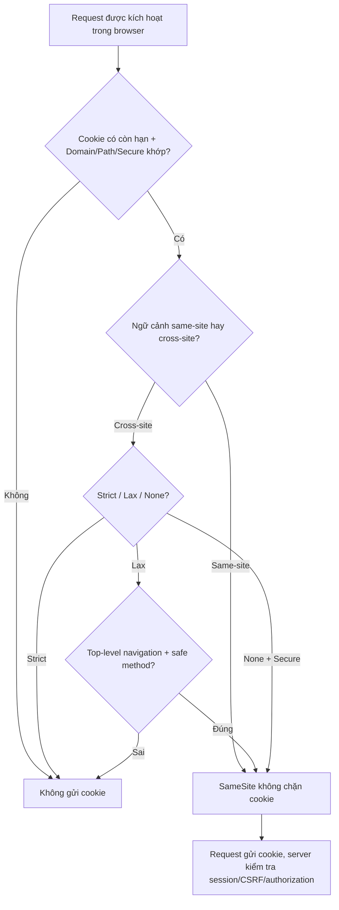
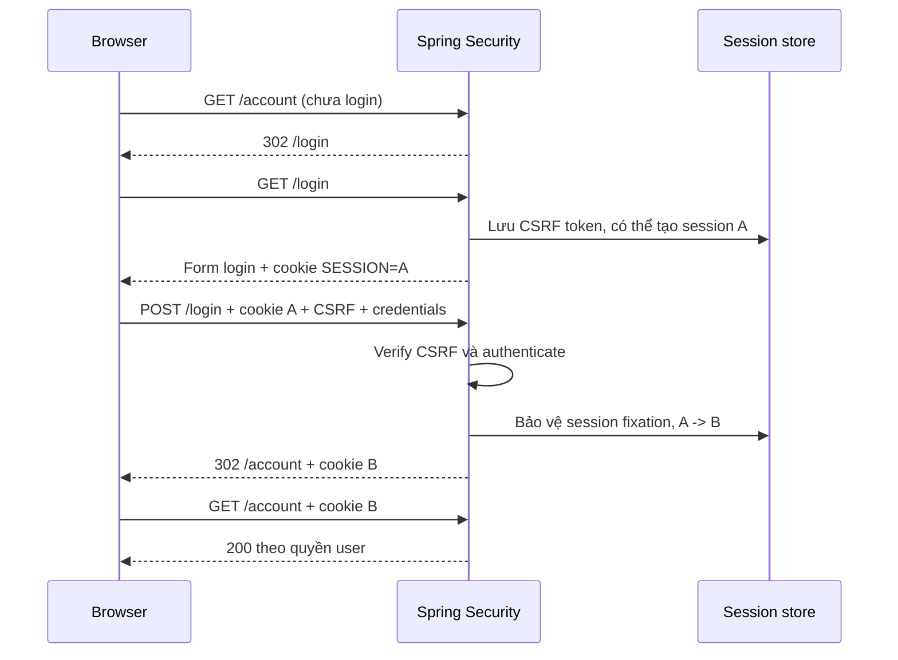
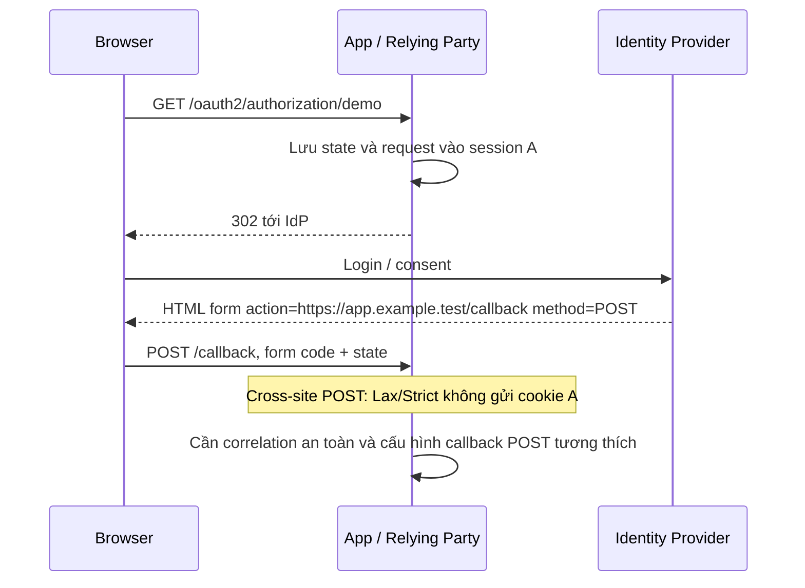

# SameSite Strict, Lax, None và hành trình đăng nhập

> **Chương:** Session và cookie  
> **Trọng tâm:** Chọn và kiểm chứng `SameSite=Strict`, `SameSite=Lax`, `SameSite=None` cho **cookie phiên xác thực** trong hành trình mở trang đăng nhập, đăng nhập bằng form, chuyển hướng OAuth2/OIDC, quay về từ Identity Provider (IdP), SPA gọi API và logout.  
> **Phạm vi kỹ thuật:** Spring Security Servlet (`HttpSecurity`/`HttpSession`), Reactive WebFlux (`ServerHttpSecurity`/`WebSession`), Spring Boot/Spring Session, browser, CORS, CSRF và HTTPS.

Trong module `SPRING_SECURITY_HTTP_PROTECTION`, người học cấu hình các lớp phòng vệ HTTP và trình duyệt: CSRF, CORS, security headers, CSP, HSTS, HTTP firewall và bảo vệ session. Module xem xét cả Servlet lẫn Reactive, nhấn mạnh kiểm thử tấn công web và chẩn đoán xung đột bảo mật khi triển khai. Bài học giải đáp câu hỏi thực tế: **vì sao bật `SameSite=Strict` có thể khiến người dùng đăng nhập OAuth2 rồi “mất session”, còn `SameSite=None` có thể làm luồng hoạt động nhưng mở rộng bề mặt CSRF?**

Mục tiêu là chọn cookie policy **theo request thật và đường đi của browser**, không chọn một giá trị “chặt nhất” trên lý thuyết rồi bỏ qua hành trình đăng nhập.

## 1. SameSite là chính sách browser gửi cookie, không phải quyền của session

Khi backend gửi:

```http
HTTP/1.1 200 OK
Set-Cookie: __Host-SESSION=opaque-demo-a; Path=/; Secure; HttpOnly; SameSite=Lax
```

browser lưu cookie kèm **scope** và **policy**. Khi một request phát sinh, browser quyết định có gửi `Cookie: __Host-SESSION=...` hay không. Server **không nhận lại chuỗi `SameSite=Lax` trong request header**.



Sơ đồ là **mô hình chính**, không diễn tả mọi chính sách chống theo dõi hoặc ngoại lệ browser. Kể cả khi SameSite cho phép gửi, cookie vẫn có thể không được gửi do `Domain`/`Path`, `Secure`, hết hạn, browser privacy settings, hạn chế third-party cookies hoặc người dùng xóa cookie.

### 1.1. Bốn lớp không được đánh đồng

| Lớp | Câu hỏi nó giải quyết | Không giải quyết |
| --- | --- | --- |
| **SameSite** | Trong ngữ cảnh site của browser, cookie có được đính kèm request hay không? | Không xác thực người dùng, không bảo đảm origin đáng tin, không thay token CSRF. |
| **CORS** | JavaScript ở **origin khác** có được đọc response và thực hiện request được cấp quyền hay không? | Không quyết định mọi việc browser có gửi cookie, không thay session management. |
| **CSRF protection** | Request gây thay đổi trạng thái có được chứng minh xuất phát từ luồng hợp lệ không? | Không thay Authentication/Authorization; không sửa cookie scope sai. |
| **Spring Security session** | ID cookie ánh xạ đến `SecurityContext` nào, session còn hạn và đủ quyền không? | Không tự điều khiển policy `SameSite` mà container/resolver phát. |

`Secure` chỉ cho cookie được gửi qua kết nối bảo mật theo browser policy, `HttpOnly` hạn chế JavaScript đọc cookie, và session fixation protection **đổi session ID sau login**. Chúng hỗ trợ SameSite nhưng là các biện pháp độc lập.

## 2. Trước tiên phải phân biệt same-site và same-origin

**Origin** gồm **scheme + hostname + port**. Ví dụ `https://app.example.test` và `https://api.example.test` là **khác origin** dù cùng công ty; `https://app.example.test:8443` cũng khác origin với cùng host port mặc định.

**Site** trong cookie SameSite hiện đại thường được tính bằng **scheme + registrable domain (eTLD+1)** theo Public Suffix List. Port thường không làm hai URL thành cross-site; trong khi **scheme khác nhau** có thể tạo *schemeful cross-site*.

| Trang đang mở | Đích request | Cùng origin? | Cùng site? (thông thường) |
| --- | --- | --- | --- |
| `https://shop.example.test` | `https://shop.example.test/cart` | Có | Có |
| `https://shop.example.test` | `https://api.example.test/me` | **Không** | **Có** |
| `https://shop.example.test:443` | `https://shop.example.test:8443/me` | Không | Có |
| `https://shop.example.test` | `http://shop.example.test/me` | Không | **Không**, do schemeful site |
| `https://shop.example.test` | `https://login.identity.test/callback` | Không | Không |
| `https://idp.identity.test` | `https://shop.example.test/login/oauth2/code/demo` | Không | Không |

Các tên domain là **ví dụ**; khi thử với `localhost`, IP, public suffix riêng hoặc browser cũ, cách tính site có thể khác. Đừng coi **mọi subdomain đều an toàn** chỉ vì là same-site: nếu `blog.example.test` bị xâm nhập, nó có thể kích hoạt các request **same-site, cross-origin** tới `shop.example.test` mà SameSite không chặn.

### 2.1. Ba tình huống dễ nhầm

1. SPA `app.example.test` gọi API `api.example.test`: **cross-origin** nên vẫn cần cấu hình CORS/`fetch credentials`, nhưng **same-site** nên `SameSite=Lax` hoặc `Strict` không tự chặn cookie chỉ vì khác hostname.
2. IdP `login.identity.test` chuyển browser về `shop.example.test`: **cross-site** dù đó là redirect hợp pháp trong OAuth2/OIDC.
3. Browser ở `https://shop.example.test` chuyển sang `http://shop.example.test`: hostname không đổi, nhưng **schemeful same-site** có thể coi đây là cross-site; `Secure` còn ngăn session cookie bị gửi trên HTTP.

**SameSite không phải danh sách origin được tin cậy.** Nếu cần kiểm tra origin của request nhạy cảm, áp dụng CSRF token, xác minh `Origin`/`Referer` hoặc `Sec-Fetch-Site` phù hợp chính sách, và authorization phía server.

## 3. Bảng hành vi Strict, Lax, None

| Request browser từ site khác | `Strict` | `Lax` **tường minh** | `None; Secure` |
| --- | --- | --- | --- |
| Người dùng nhấn liên kết, **điều hướng top-level GET** tới app | **Không gửi** | **Gửi** nếu scope khớp | **Có thể gửi** |
| IdP redirect trình duyệt bằng **top-level GET** về callback app | **Không gửi** | **Gửi** nếu scope khớp | **Có thể gửi** |
| IdP trả HTML form tự submit, **top-level POST** về callback | **Không gửi** | **Không gửi** thông thường | **Có thể gửi** |
| Website khác tự submit **top-level POST** tới app | **Không gửi** | **Không gửi** thông thường | **Có thể gửi** |
| Website khác nhúng app trong **iframe** | **Không gửi** | **Không gửi** | **Có thể gửi**, tùy third-party policy |
| Website khác gọi app bằng `fetch`/XHR | **Không gửi** | **Không gửi** | **Có thể gửi**, còn phụ thuộc credentials/CORS/browser policy |
| Request same-site thông thường, cookie đúng scope | Gửi | Gửi | Gửi |

**“Có thể gửi” không phải “chắc chắn gửi”.** `SameSite=None` cần `Secure` và HTTPS; policy chặn third-party cookie, phân vùng cookie, browser hoặc extension vẫn có thể chặn. `HttpOnly` không ảnh hưởng việc browser tự gửi cookie.

### 3.1. Strict — chặt nhưng có tác động lên hành trình từ bên ngoài

`SameSite=Strict` chỉ cho cookie được gửi trong ngữ cảnh same-site. Người dùng đang đăng nhập, nhấn liên kết ở một website khác tới `/orders`: **request GET đầu tiên có thể không gửi session cookie**. Ứng dụng coi họ chưa đăng nhập, redirect login; UX có thể gây hiểu nhầm là session mất dù browser vẫn còn cookie.

Đặc biệt, **OAuth2/OIDC quay về từ IdP khác site bằng GET** cũng có thể bị mất cookie session mà framework dùng để đối chiếu authorization request/`state`. Bởi vậy Strict không phải lựa chọn mặc định hợp lý cho **mọi cookie phục vụ redirect login cross-site**.

### 3.2. Lax — cho phép nhiều luồng redirect đăng nhập bình thường

`SameSite=Lax` gửi cookie trong request same-site và **top-level navigation cross-site dùng phương thức an toàn**, thường là GET. Vì vậy nó hỗ trợ:

- Người dùng nhấn link ở email hoặc website khác để mở ứng dụng bằng GET.
- IdP chuyển browser về ứng dụng bằng **GET callback** khi đăng nhập OAuth2 authorization code flow thông thường.
- Form login gửi POST từ chính trang login **same-site** của ứng dụng.

Lax **không** cho cookie vào một form POST cross-site thông thường hoặc iframe cross-site. Nó cũng **không bảo vệ những GET có side effects**: nếu `GET /delete?id=...` làm thay đổi dữ liệu, link cross-site có thể kích hoạt request có cookie. **GET phải an toàn/không tạo side effect**; giữ CSRF protection cho các phương thức unsafe.

### 3.3. None — cần cho một số hành trình nhúng hoặc POST cross-site

`SameSite=None` cho cookie trong cả ngữ cảnh same-site/cross-site **theo browser policy**. Nó **phải đi cùng `Secure`**; một cookie `SameSite=None` mà thiếu `Secure` sẽ bị nhiều browser hiện đại từ chối.

Những trường hợp có thể cần cân nhắc None:

- IdP trả callback **`response_mode=form_post`** bằng form POST **cross-site** và RP phải đọc session cũ tại callback.
- Ứng dụng nhúng trong iframe của website thuộc **site khác** nếu authentication thực sự dựa vào cookie trong iframe.
- SPA và backend **khác site** dùng cookie xác thực và `fetch(..., {credentials:"include"})`.

Không chuyển tất cả session cookies sang None chỉ để tránh lỗi CORS hoặc “login loop”: mở rộng phạm vi gửi cookie cũng có thể tăng bề mặt CSRF. Ưu tiên **top-level OAuth2 redirect GET hoặc kiến trúc first-party** khi đáp ứng yêu cầu thay vì bắt mọi browser chấp nhận cookie third-party.

### 3.4. Không khai báo SameSite không đồng nghĩa Lax tường minh

Một số browser áp `Lax` mặc định khi header **không ghi `SameSite`**. Một số còn có chế độ “Lax-allowing-unsafe” tạm thời: cookie mới đặt **không quá khoảng hai phút** có thể được gửi trong **top-level cross-site POST**. **Ngoại lệ đó không áp dụng cho cookie `SameSite=Lax` tường minh theo quy tắc chuẩn**.

Không dựa vào ngoại lệ thời gian để xây OAuth `form_post`, SSO hoặc CSRF policy. Nó không nhất quán giữa browser/phiên bản và có thể thay đổi. Ghi `SameSite` **tường minh**, rồi kiểm thử hành trình thật.

## 4. Hành trình A — form login cùng site của ứng dụng

Hãy xét một web app dùng session cookie `__Host-SESSION` và Spring Security form login:



`POST /login` thường là **same-site** vì form được tải từ trang login thuộc ứng dụng. **Cả Strict, Lax, None** đều có thể cho cookie trong POST same-site, nếu cookie scope/HTTPS hợp lệ; khác biệt chính xuất hiện khi browser **đến từ site khác**.

**Không nhầm `permitAll()` với bỏ CSRF.** Spring Security có thể cho anonymous truy cập `/login` nhưng vẫn yêu cầu CSRF token hợp lệ với POST login. Đây là lớp chống **login CSRF**, trong đó kẻ tấn công cố khiến nạn nhân đăng nhập vào tài khoản mà attacker kiểm soát.

### 4.1. Khi link từ email, blog hoặc app ngoài dẫn vào `/account`

Với `Strict`, GET đầu từ trang khác có thể không kèm cookie dù người dùng đã đăng nhập. Với `Lax`, top-level GET được phép dùng cookie và trang có thể nhận ra người dùng ngay.

**Không tự sửa UX bằng cách chuyển GET thành POST**: Lax sẽ không gửi cookie trong cross-site POST, và GET không được gây side effects. Tốt hơn là giữ `Lax` cho cookie phục vụ hành trình điều hướng thông thường hoặc thiết kế một trang đích công khai, sau đó yêu cầu một tương tác same-site rõ ràng trước khi vào trang nhạy cảm.

### 4.2. Ví dụ raw HTTP theo hành trình

```http
# 1. Browser đã nhận cookie qua GET /login.
HTTP/1.1 200 OK
Set-Cookie: __Host-SESSION=guest-a; Path=/; Secure; HttpOnly; SameSite=Lax

# 2. Form ở cùng site gửi cookie và token.
POST /login HTTP/1.1
Host: app.example.test
Cookie: __Host-SESSION=guest-a
Content-Type: application/x-www-form-urlencoded

username=alice&password=example-only&_csrf=csrf-token-placeholder

# 3. Login thành công, session ID được thay.
HTTP/1.1 302 Found
Set-Cookie: __Host-SESSION=auth-b; Path=/; Secure; HttpOnly; SameSite=Lax
Location: /account
```

Đây là **minh họa**, không phải giá trị session/mật khẩu/CSRF thật. Form response, cookie name và redirect phụ thuộc cấu hình. Test quan trọng: **ID cũ A không còn mang Authentication của B** khi thử bằng một client độc lập. `SameSite` không thực thi rotation; Spring Security và session store phải làm việc đó.

## 5. Hành trình B — OAuth2/OIDC authorization code và callback GET

Với `oauth2Login`, ứng dụng chuyển browser tới Identity Provider khác site. Trong cấu hình thường gặp, **authorization request/`state`** được lưu vào session (ví dụ `HttpSessionOAuth2AuthorizationRequestRepository` trên Servlet hoặc `WebSessionOAuth2ServerAuthorizationRequestRepository` trên Reactive). Khi IdP chuyển browser về callback, Spring Security phải tìm lại request tương ứng để kiểm tra `state` và hoàn tất đổi code.

```mermaid
sequenceDiagram
    participant B as Browser
    participant RP as Relying Party: app.example.test
    participant IdP as Identity Provider: login.identity.test
    B->>RP: GET /oauth2/authorization/demo
    RP->>RP: Tạo state + lưu authorization request vào session A
    RP-->>B: 302 https://login.identity.test/authorize?...state=...
    B->>IdP: GET /authorize (trang IdP)
    IdP-->>B: Login/consent rồi 302 callback RP
    B->>RP: GET /login/oauth2/code/demo?code=...&state=...
    Note over RP: Cross-site top-level GET; Lax thường gửi cookie A
    RP->>RP: Load stored auth request + kiểm tra state/PKCE/nonce
    RP->>RP: Authenticate + bảo vệ session fixation
    RP-->>B: Redirect tới trang đã đăng nhập, cookie session mới B
```

**Đường dẫn mặc định trên Spring Security** khi dùng client registration kiểu thông thường:

- Servlet: khởi động qua `/oauth2/authorization/{registrationId}`, callback `/login/oauth2/code/{registrationId}`.
- Reactive: quy ước tương tự với `ServerHttpSecurity.oauth2Login`, tùy cấu hình authorization request resolver và authentication matcher.

Trong cả hai stack, **đừng giả định đích redirect tùy chỉnh tự khớp với `ClientRegistration.redirectUri`**. Thay đổi callback path phải đổi cả cấu hình Spring Security và redirect URI đã đăng ký ở IdP.

### 5.1. Strict có thể làm mất authorization request

Khi browser rời IdP để truy cập **GET callback cross-site** tới RP:

- `SameSite=Strict`: cookie phiên RP **không được gửi trên request callback** theo chính sách Strict thông thường.
- Nếu authorization request được lưu trong `HttpSession`/`WebSession` ở RP, server có thể **không tìm được session A hoặc `state` tương ứng**.
- Spring Security có thể kết thúc luồng với `authorization_request_not_found`, `invalid_state`, redirect login hoặc một lỗi OAuth2 khác tùy phiên bản/configuration.

**Không “sửa” bằng cách bỏ kiểm tra `state`/`nonce` hoặc PKCE.** Đây là phần chống login CSRF, code injection và correlation attacks. Cần chọn chính sách cookie **phù hợp callback** hoặc thiết kế một cơ chế lưu/correlate state an toàn đã được kiểm chứng.

### 5.2. Lax hoạt động với callback GET trong điều kiện nào?

Trong một **top-level browser navigation** từ IdP về RP qua GET, `SameSite=Lax` tường minh cho phép gửi cookie session RP. Điều này khiến Lax là lựa chọn thực dụng cho nhiều ứng dụng dùng OAuth2/OIDC authorization code flow mặc định.

Tuy nhiên cần kiểm tra:

- Callback có thực sự là **GET top-level** không, hay IdP dùng `response_mode=form_post`?
- Browser đang trong **iframe/popup** hay tab top-level? Iframe cross-site **không** nhận cookie Lax theo cùng quy tắc.
- `Domain`/`Path` của cookie có bao phủ callback path không?
- Browser có nhận `Set-Cookie` ở bước đầu `/oauth2/authorization/*` không?
- HTTPS/TLS proxy có phát cookie `Secure` và callback URL đúng scheme/host không?
- Session store có giữ authorization request đủ lâu, và cluster có cùng state không?

**Không cần mặc định `SameSite=None` chỉ để dùng `oauth2Login`** nếu hành trình callback thật là GET top-level và cookie Lax đáp ứng.

## 6. Hành trình C — `response_mode=form_post` và callback POST cross-site

OAuth 2.0 Form Post Response Mode quy định IdP trả một trang HTML chứa form tự động submit **HTTP POST** đến `redirect_uri` của ứng dụng. Đây là **request cross-site POST** nếu IdP và RP thuộc các sites khác nhau.



| Cookie session trước khi đi IdP | Cookie có tới RP ở callback POST? | Nguy cơ/tác động |
| --- | --- | --- |
| `SameSite=Strict` | **Không**, nếu cross-site. | Session A vắng mặt; khó khôi phục state/request lưu trong phiên. |
| `SameSite=Lax` tường minh | **Không**, nếu cross-site POST thông thường. | Session A vắng mặt; authentication correlation có thể thất bại. |
| `SameSite=None; Secure` | **Có thể**, nếu browser/policy/scope cho phép. | Có thể khôi phục request/state; bề mặt CSRF phải được kiểm soát. |
| Không ghi `SameSite` | **Không dự đoán được** giữa browser/tuổi cookie. | Không được dùng ngoại lệ Lax-by-default “mới đặt” làm nền tảng SSO. |

### 6.1. SameSite là điều kiện cần, chưa đủ cho `form_post`

Ngay cả khi dùng `None; Secure` và browser gửi session A, **Spring Security phải thực sự hỗ trợ xử lý callback POST** theo cấu hình đang triển khai:

1. Authentication processing URL/matcher phải chấp nhận **HTTP POST** và nội dung `application/x-www-form-urlencoded`.
2. Lớp CSRF của ứng dụng thường chặn POST không có **CSRF token của RP**; callback của IdP có `state` nhưng không nhất thiết có token `_csrf` theo cơ chế form CSRF thông thường. Cần policy **chỉ cho endpoint callback giao thức xác thực** đã được thiết kế, không tắt CSRF toàn ứng dụng.
3. Bảo vệ ở cấp OAuth2/OIDC vẫn phải kiểm tra **`state`, nonce (nếu OIDC yêu cầu), PKCE, redirect URI, issuer/audience và token signature** theo giao thức.
4. Đường xử lý phải được thử với IdP thật, browser thật, gateway và session store.

**Không coi việc cấu hình `SameSite=None` là một bản vá hoàn chỉnh cho `response_mode=form_post`.** Spring Security `oauth2Login` mặc định thường được thử nghiệm chủ yếu với authorization code callback **GET**; nếu triển khai form_post, cần kiểm tra phiên bản, filter/request matcher và CSRF integration cụ thể. Không chỉ đổi method callback mà bỏ các kiểm tra chống giả mạo.

### 6.2. Phương án kiến trúc khi IdP bắt buộc POST

- Kiểm tra IdP có hỗ trợ **top-level GET query callback** cho authorization code flow hay không; nếu có, `Lax` thường đơn giản hơn.
- Nếu bắt buộc `form_post`, cân nhắc `SameSite=None; Secure` **chỉ đối với cookie/session thật sự cần cho correlation**, và giữ các lớp xác thực/CSRF khác. Không tạo một cookie “state” dễ đoán chỉ để tránh POST.
- Nếu phải xây **correlation storage không phụ thuộc session cookie**, dùng state/nonce đủ ngẫu nhiên, ràng buộc browser/request đúng cách, TTL ngắn, one-time consumption và threat review. `state` là giá trị chống giả mạo, không phải phép miễn mọi quy tắc bảo mật.
- Xem xét chính sách chặn third-party cookies và những giới hạn browser đối với iframe, thay vì cho rằng `None` luôn giải quyết.

### 6.3. SAML2 POST Binding có một số vấn đề tương tự

Trong ứng dụng Spring Security SAML2, Identity Provider có thể trả **SAMLResponse** về assertion consumer service bằng **cross-site form POST**. Cookie `Strict`/`Lax` của session RP có thể không được gửi vào POST này. Hãy kiểm tra SAML request correlation, `InResponseTo`, chữ ký, thời gian, audience, recipient và cơ chế CSRF đặc thù **do thư viện hỗ trợ**, không chuyển sang tắt CSRF rộng rãi hoặc chấp nhận assertion không xác minh.

Đây là lý do mọi hệ SSO cần **vẽ đúng HTTP method của callback**, không chỉ nói chung “IdP redirect về app”.

## 7. Hành trình D — người dùng vào từ link ngoài rồi login, quay về saved request

Một website phổ biến có tình huống:

```text
Email / search engine / website đối tác
    -> GET https://app.example.test/orders/123
    -> (nếu cần) GET /login
    -> POST /login
    -> 302 về /orders/123
```

### 7.1. Khi dùng Strict

Nếu người dùng đã có session B, **GET đầu tiên từ site ngoài** thường thiếu cookie `Strict`. Spring Security có thể coi request là anonymous, lưu **một saved request mới** hoặc tạo một session ẩn danh khác, rồi redirect login. Hệ quả có thể là:

- Người dùng **bị yêu cầu đăng nhập lại dù session cũ vẫn còn trong browser**.
- Tạo nhiều session/cookie với redirect không ổn định nếu cấu hình path/host sai.
- Saved request hoặc cart/locale ở phiên cũ không được load đúng ở lần đầu.
- Chuỗi redirect phụ thuộc browser và nơi bắt đầu navigation; không được giả định rằng redirect nội bộ sau một cross-site navigation ngay lập tức biến mọi cookie Strict thành được gửi.

Giải pháp không nhất thiết là hạ toàn bộ cookie xuống None. Với ứng dụng thường xuyên nhận link từ bên ngoài, **`Lax` là điểm khởi đầu thực dụng**. Nếu chính sách yêu cầu Strict cho một cookie rất nhạy cảm, thiết kế riêng bước truy cập same-site sau landing, thử UX/browser thật và tuyệt đối không sử dụng GET gây tác dụng phụ.

### 7.2. Saved request và open redirect

Spring Security Servlet dùng `HttpSessionRequestCache`/`SavedRequestAwareAuthenticationSuccessHandler`; Reactive có `WebSessionServerRequestCache` và các success handlers tương ứng. Chúng giúp trả về tài nguyên hợp lệ sau khi xác thực.

**Không tự đọc `returnUrl` từ query rồi trả `302 Location` ra URL bất kỳ**. Đó là nguy cơ open redirect. Saved request cũng không phải lý do phát lại **POST đặt hàng/chuyển tiền** tự động sau login: các thao tác nhạy cảm phải được người dùng thực hiện sau khi có session và token CSRF hợp lệ.

### 7.3. Đừng lẫn chuyện “cookie không gửi” với “cookie đã bị xóa”

Browser vẫn có thể lưu cookie `Strict` nhưng **không gắn nó vào một request cross-site cụ thể**. Nếu thấy request callback không có session, chưa thể kết luận logout/TTL đã xóa session. Kiểm tra:

1. Cookie còn trong browser storage không?
2. Request đang là GET top-level, POST, iframe hay XHR?
3. `SameSite`/`Secure`/`Domain`/`Path` có khớp?
4. Session store có state đúng ID hay không?

Phân biệt này giúp tránh “sửa” cookie problem bằng cách vô hiệu session fixation protection hoặc tăng TTL vô hạn.

## 8. Hành trình E — SPA, API và iframe

### 8.1. SPA và API cùng site nhưng khác origin

Giả sử SPA ở `https://app.example.test` gọi API `https://api.example.test`. Chúng khác **origin**, nhưng thường vẫn là **same-site**. `SameSite=Lax` và `Strict` đều không tự chặn cookie vì yếu tố cross-origin này.

```javascript
const response = await fetch("https://api.example.test/account", {
  credentials: "include",
  headers: { "Accept": "application/json" }
});
if (!response.ok) throw new Error("Request bị từ chối");
```

Vẫn cần:

- Cookie phải được **đặt bởi API hoặc có scope `Domain`/`Path` phù hợp** với `api.example.test`. Cookie host-only do `app.example.test` phát **không** được gửi cho `api.example.test`.
- `credentials: "include"` khi fetch **cross-origin**, và server CORS chỉ cho các origins đã tin cậy, ví dụ `https://app.example.test`.
- `Access-Control-Allow-Credentials: true`, `Access-Control-Allow-Origin` trả đúng origin, không dùng `*` với credential requests.
- Preflight `OPTIONS` cần được xử lý trước khi yêu cầu authentication, khi applicable.
- POST JSON/PUT/PATCH/DELETE dùng cookie xác thực vẫn cần **CSRF token**, theo repo/handler tương ứng.

**Không kết luận “CORS lỗi nên bật SameSite=None”.** CORS kiểm soát chia sẻ response cross-origin, còn SameSite kiểm soát việc đính kèm cookie theo site.

### 8.2. SPA và API khác site

Giả sử SPA ở `https://portal.other.test` gọi `https://api.example.test`. Đây là **cross-site XHR/fetch**, không phải top-level navigation. `SameSite=Strict/Lax` không gửi session cookie cho lời gọi này. Muốn cookie auth hoạt động có thể cần `SameSite=None; Secure` cùng CORS/CSRF và chính sách browser cho phép third-party cookies.

Tuy nhiên nhiều browser chặn cookie third-party ở một số chế độ, nên `None` **không bảo đảm** kết quả. Các phương án đáng cân nhắc: host frontend/API dưới cùng site, reverse proxy/BFF giữ session first-party, hoặc kiến trúc OAuth2/OIDC có token lifecycle phù hợp. Không lưu refresh token vào JS-accessible storage một cách tùy tiện chỉ để tránh cookies.

### 8.3. Ứng dụng nhúng trong iframe site khác

Nếu `https://app.example.test` được nhúng vào `https://partner.other.test`, navigation trong iframe thường **không phải top-level navigation**. Cookie `Lax` không được gửi như top-level GET callback; `None; Secure` có thể cần, nhưng third-party cookie blocking vẫn là một rào cản.

Cookie `Partitioned`/CHIPS có thể hỗ trợ **một số** trường hợp nhúng trong browser hỗ trợ, nhưng session được phân vùng theo top-level site, không tự dùng chung giữa các website nhúng. `Partitioned` **không thay `SameSite=None` hoặc CSRF**, và không phù hợp với mọi workflow SSO.

Nếu app không cần iframe, thay vì mở rộng cookie policy, dùng `Content-Security-Policy: frame-ancestors` để giới hạn những origin được phép nhúng. Browser policy và CSP giải quyết các lớp tấn công khác nhau.

## 9. SameSite là phòng vệ bổ sung cho CSRF, không phải cơ chế thay thế

**CSRF** lạm dụng việc browser tự gửi cookie vào request. SameSite giảm những request cross-site đính kèm cookie, nhưng không thay token hoặc authorization.

| Kịch bản | Vì sao SameSite một mình không đủ? | Lớp bảo vệ bổ sung |
| --- | --- | --- |
| Cross-site **GET** gây thay đổi dữ liệu | `Lax` có thể gửi cookie trong top-level GET. | GET phải không có side effect; xác nhận thao tác qua POST + CSRF. |
| Subdomain không tin cậy trong cùng site | Request là **same-site** dù khác origin, có thể mang cookie. | CSRF token, Origin/Fetch Metadata checks, host isolation, authorization. |
| App dùng `SameSite=None` cho callback/iframe | Browser có thể gửi cookie trong cross-site POST. | Bắt buộc bảo vệ các unsafe request, ngoại lệ protocol callback phải rất hẹp. |
| Login CSRF | Kẻ tấn công có thể cố tạo phiên mới/đăng nhập vào tài khoản khác. | CSRF trên `POST /login` và proper session fixation/redirect flow. |
| XSS same-origin | Mã độc được chạy ở origin hợp lệ, SameSite không chặn. | Output encoding, CSP, bảo vệ frontend và hạn chế script. |
| Browser cũ hoặc chế độ Lax-by-default permissive | Hành vi cookie có thể khác `Lax` tường minh. | CSRF token/Origin policy độc lập browser. |

Trong Spring Security Servlet và Reactive, **CSRF bật mặc định** cho request unsafe. Đăng nhập form với cookie vẫn cần token hợp lệ. Không dùng `csrf().disable()` chỉ để làm `form_post`, CORS hoặc OAuth2 callback “hoạt động”.

### 9.1. Origin, Referer và Fetch Metadata

Có thể bổ sung kiểm tra:

- `Origin`: nếu có, so với allowlist origins tin cậy cho các request unsafe.
- `Referer`: fallback có giới hạn, tránh log giá trị nhạy cảm trong URL.
- `Sec-Fetch-Site`: browser hiện đại có thể gửi `same-origin`, `same-site`, `cross-site` hoặc `none`. Đây là **tín hiệu phòng vệ bổ sung**, không phải header mà mọi client đều gửi.
- `Sec-Fetch-Mode`, `Sec-Fetch-Dest` và phương thức HTTP: hỗ trợ phân loại top-level navigation/iframe/XHR.

Đừng chặn mù quáng **mọi** request `Sec-Fetch-Site: cross-site`: OAuth2/OIDC callback GET, SAML POST hoặc một webhook/API server-to-server có policy riêng. Chặn mặc định với **các state-changing endpoints thông thường**, rồi mở ngoại lệ theo giao thức đã kiểm chứng với kiểm tra state/signature phù hợp.

### 9.2. Không dùng SameSite để quyết định quyền truy cập

Server không nhận lại thuộc tính `SameSite` trong header `Cookie`. Hơn nữa attacker có thể dùng HTTP client không phải browser và tự gửi `Cookie`. Do đó:

- Spring Security **luôn phải xác thực session ID và authorize request**.
- Với request unsafe dựa vào cookie, **CSRF** vẫn phải được kiểm tra ở endpoint phù hợp.
- Session ID phải được rotate khi login nếu trước đó có session ẩn danh hợp lệ; ID cũ không được hưởng quyền mới.
- Logout phải thu hồi `SecurityContext`/session server-side theo policy; xóa cookie browser thôi chưa đủ.

## 10. Bảng quyết định theo hành trình đăng nhập

| Hành trình cần hỗ trợ | Giá trị khởi đầu cho session cookie | Điều kiện và test không được bỏ |
| --- | --- | --- |
| Form login thông thường cùng site, link từ email/search | **`Lax`** | GET ngoài site vào được phiên; POST login cùng site có CSRF; rotation A→B. |
| Ứng dụng rất nhạy cảm, không cần mở link từ site khác với credential | `Strict` **có cân nhắc** | Kiểm tra deep link, điều hướng đầu tiên, logout/login UX, OAuth callbacks. |
| OAuth2/OIDC code flow, **top-level GET callback** | Thường **`Lax`** | `state`/nonce/PKCE, request session state, callback HTTPS, browser thật. |
| OAuth2/OIDC `form_post` **cross-site POST callback** | Có thể cần **`None; Secure`** | POST processing + correlation, CSRF exception hẹp, IdP browser E2E. |
| SAML2 POST Binding callback cross-site | Có thể cần **`None; Secure`** | SAML validation/signature, relay state, ACS matcher, CSRF protocol integration. |
| SPA + API khác **origin** nhưng cùng **site** | `Lax` hoặc `Strict` có thể đủ | CORS credentials, cookie host/scope, CSRF, preflight. |
| SPA + API khác **site** với cookie auth | Thường cần `None; Secure` nếu chọn mô hình này | CORS + CSRF, browser third-party cookie restrictions, BFF thay thế. |
| App chạy trong iframe site khác | Có thể cần `None; Secure`/`Partitioned` tùy thiết kế | CSP frame-ancestors, third-party cookie policy, auth/CSRF. |
| JSON API chỉ dùng bearer token `Authorization`, không cookie auth | SameSite **không phải cơ chế chính** | Token storage/lifecycle, CORS, XSS, resource authorization. |

**Không có “giá trị tốt nhất” cho mọi cookie.** Nên chọn giá trị chặt nhất **vẫn hỗ trợ các luồng đăng nhập thực sự cần**, và kiểm thử cả thành công, thất bại và rủi ro CSRF. Mỗi cookie có mục đích riêng: session cookie, CSRF cookie, OAuth state/correlation cookie, remember-me cookie có thể cần policy khác nhau, nhưng không nên mở phạm vi của session credential rộng hơn mức cần thiết.

## 11. Cấu hình Servlet với Spring Boot và `HttpSecurity`

Với ứng dụng Spring MVC dùng **Servlet stack**, Spring Boot hỗ trợ thuộc tính `server.servlet.session.cookie.same-site` để cấu hình SameSite trên **session cookie** do container/session infrastructure phù hợp phát.

### 11.1. Bắt đầu với `Lax` cho form login và OAuth2 GET

```yaml
# application.yml — ví dụ cho production HTTPS.
server:
  servlet:
    session:
      cookie:
        name: __Host-SESSION
        path: /
        secure: true
        http-only: true
        same-site: lax
      timeout: 30m
```

**Giải thích:**

- `same-site: lax`: giữ cookie trên top-level GET từ ngoài, bao gồm callback OAuth2/OIDC GET thông thường.
- `secure: true`: browser không gửi session cookie qua HTTP công khai; cần HTTPS cho web app thật.
- `http-only: true`: JavaScript không đọc session ID; browser vẫn tự gửi cookie.
- `name: __Host-SESSION` + `path: /`: prefix `__Host-` yêu cầu HTTPS, `Secure`, `Path=/` và **không có `Domain`**. Nếu cần Domain cho hệ thống nhiều subdomain, đổi thiết kế/tên cookie; không đặt Domain với `__Host-`.
- `timeout: 30m` là **session idle timeout phía server**, không phải `Max-Age` của cookie.

Với cấu hình này, cookie session phù hợp với luồng browser:

```http
HTTP/1.1 302 Found
Set-Cookie: __Host-SESSION=opaque-id; Path=/; Secure; HttpOnly; SameSite=Lax
Location: /login
```

**Không dự đoán máy móc header từ YAML:** Servlet container, Spring Session, gateway hoặc reverse proxy có thể thay cách phát cookie; Spring Boot phiên bản khác nhau có tập container được hỗ trợ khác nhau. Hãy kiểm tra **`Set-Cookie` thực sự tới browser**.

### 11.2. Cấu hình SecurityFilterChain Servlet

```java
import org.springframework.context.annotation.Bean;
import org.springframework.context.annotation.Configuration;
import org.springframework.security.config.Customizer;
import org.springframework.security.config.annotation.web.builders.HttpSecurity;
import org.springframework.security.web.SecurityFilterChain;

@Configuration
class ServletLoginSecurityConfig {

    @Bean
    SecurityFilterChain securityFilterChain(HttpSecurity http)
            throws Exception {
        return http
            .authorizeHttpRequests(auth -> auth
                .requestMatchers("/login", "/assets/**").permitAll()
                .anyRequest().authenticated())
            .formLogin(Customizer.withDefaults())
            .oauth2Login(Customizer.withDefaults())
            .sessionManagement(session -> session
                .sessionFixation(fixation -> fixation.changeSessionId()))
            .csrf(Customizer.withDefaults())
            .build();
    }
}
```

Đây là **ví dụ tích hợp** hai hình thức login. Muốn chạy `oauth2Login` phải có `ClientRegistrationRepository`, client registration/redirect URI, dependencies OAuth2 Client và IdP thực/test phù hợp; riêng đoạn SecurityFilterChain không cấu hình được toàn bộ giao thức. Nếu ứng dụng chỉ dùng form login, bỏ `oauth2Login(...)`.

**Phân công trách nhiệm:**

- `HttpSecurity.formLogin`/`oauth2Login`: điều phối authentication.
- `sessionManagement().sessionFixation()`: đổi ID session khi có session A hợp lệ trước login. Trên Servlet 3.1+ mặc định thường là `changeSessionId()`.
- `csrf(...)`: bảo vệ request unsafe, gồm form login POST theo matcher.
- `server.servlet.session.cookie.*` hoặc cookie serializer: **cookie policy** được trình duyệt thấy.

Không tìm thuộc tính `SameSite` trong `HttpSecurity.sessionManagement().sessionFixation()` vì đây là **hai tầng khác nhau**.

### 11.3. Nếu callback cần `SameSite=None`

Nếu IdP bắt buộc **cross-site POST form_post**, sau khi xác minh framework thực sự xử lý callback POST và CSRF/state integration an toàn, cookie session có thể cần:

```yaml
# Ví dụ thay thế CHỈ khi kiến trúc yêu cầu callback cross-site POST.
server:
  servlet:
    session:
      cookie:
        name: __Host-SESSION
        path: /
        secure: true
        http-only: true
        same-site: "none"
```

Đây là **policy cho session cookie nói chung**, không tự giới hạn `None` chỉ ở endpoint callback. Điều đó làm session cookie có thể được gửi trong các tình huống cross-site khác, nên phải kiểm thử CSRF, Origin/Fetch Metadata và khả năng chặn third-party cookies. Nếu chỉ một loại cookie phục vụ SSO cần None, cân nhắc tách thiết kế session/correlation cookie ở tầng giao thức, không giả định một YAML tự chia policy theo path.

### 11.4. Cookie khác session: `CookieSameSiteSupplier`

Spring Boot Servlet cung cấp `CookieSameSiteSupplier` cho một số **cookie khác** do ứng dụng phát qua `HttpServletResponse`. Ví dụ chỉ áp Lax cho cookie app tên `UI_PREF` mà không vô tình đổi cookie `XSRF-TOKEN` hoặc session:

```java
import org.springframework.boot.web.server.servlet.CookieSameSiteSupplier;
import org.springframework.context.annotation.Bean;
import org.springframework.context.annotation.Configuration;

@Configuration(proxyBeanMethods = false)
class OtherCookieSameSiteConfig {

    @Bean
    CookieSameSiteSupplier uiPreferenceCookieSameSite() {
        return CookieSameSiteSupplier.ofLax()
            .whenHasNameMatching("UI_PREF");
    }
}
```

**Lưu ý phiên bản:** API/package của `CookieSameSiteSupplier` có thể thay đổi theo Spring Boot major version; ví dụ trên dựa trên Spring Boot reference hiện hành. Kiểm tra Javadoc/BOM ứng dụng trước khi sao chép. Nó không thay thế cơ chế cấu hình **session cookie** ở `server.servlet.session.cookie.same-site` hoặc Spring Session serializer.

## 12. Spring Session Servlet: `DefaultCookieSerializer`

Nếu dùng Spring Session Redis/JDBC, session cookie có thể được phát bằng `DefaultCookieSerializer` thay vì cơ chế container Servlet thông thường. Ví dụ bean để chủ động kiểm soát SameSite và các flags:

```java
import org.springframework.context.annotation.Bean;
import org.springframework.context.annotation.Configuration;
import org.springframework.session.web.http.CookieSerializer;
import org.springframework.session.web.http.DefaultCookieSerializer;

@Configuration
class ServletSessionCookieConfig {

    @Bean
    CookieSerializer cookieSerializer() {
        var cookie = new DefaultCookieSerializer();
        cookie.setCookieName("__Host-SESSION");
        cookie.setCookiePath("/");
        cookie.setUseSecureCookie(true);
        cookie.setUseHttpOnlyCookie(true);
        cookie.setSameSite("Lax");
        // Không đặt cookie.setDomainName(...): __Host- phải host-only.
        return cookie;
    }
}
```

Nếu hệ thống thực sự dùng `form_post`, có thể đánh giá `cookie.setSameSite("None")` trong môi trường HTTPS, **nhưng không sửa bằng cách cho phép mọi callback POST không kiểm tra `state`**. Đối với một `DefaultCookieSerializer` custom, hãy xem nó có ghi đè properties Spring Boot không, tránh hai cơ chế phát cookie trùng tên nhưng khác scope.

### 12.1. Không nhầm cookie policy với session repository

`DefaultCookieSerializer` quyết định cách ghi/đọc cookie; `SessionRepository`/Redis quyết định state, TTL và ánh xạ ID. Khi login, ID thường được đổi để chống fixation; **ID cũ không được có quyền của phiên mới**. `SameSite` đúng không có nghĩa logout/invalidation/Redis mapping cũng đúng.

Nếu app chạy nhiều node, test login callback qua load balancer và session store. Một request callback **có gửi cookie** mà server không tìm được `state` có thể do session replication/TTL, không phải SameSite. Đừng đổi Lax → None chỉ vì thấy “authorization_request_not_found” nếu cookie thực đã được gửi.

## 13. Cấu hình Reactive WebFlux: `WebSessionIdResolver`

Ứng dụng WebFlux dùng `WebSession` và `ServerHttpSecurity`, không dùng `HttpSession`/`HttpSecurity` của Servlet. Cookie của WebSession được xử lý bởi `WebSessionIdResolver`; `CookieWebSessionIdResolver` là triển khai dùng cookie.

### 13.1. Spring Boot Reactive properties

Với dòng Spring Boot có hỗ trợ `server.reactive.session.cookie.*`:

```yaml
server:
  reactive:
    session:
      cookie:
        name: __Host-SESSION
        path: /
        secure: true
        http-only: true
        same-site: lax
      timeout: 30m
```

Đây là cấu hình **Reactive**, không phải `server.servlet.session.cookie.*`. Kiểm tra Spring Boot version/property metadata, `WebSessionIdResolver` và các bean được đăng ký. Nếu application có MVC lẫn WebFlux trên classpath, xác minh web application type thực chạy.

### 13.2. Cấu hình `CookieWebSessionIdResolver` bằng Java

```java
import org.springframework.context.annotation.Bean;
import org.springframework.context.annotation.Configuration;
import org.springframework.web.server.session.CookieWebSessionIdResolver;
import org.springframework.web.server.session.WebSessionIdResolver;

@Configuration
class ReactiveSessionCookieConfig {

    @Bean
    WebSessionIdResolver webSessionIdResolver() {
        var resolver = new CookieWebSessionIdResolver();
        resolver.setCookieName("__Host-SESSION");
        resolver.addCookieInitializer(builder -> builder
            .path("/")
            .secure(true)
            .httpOnly(true)
            .sameSite("Lax"));
        return resolver;
    }
}
```

Tùy chính sách, thay riêng `.sameSite("Lax")` bằng `.sameSite("Strict")` hoặc `.sameSite("None")`, **nhưng chỉ khi sơ đồ request cho thấy lý do**. Không dùng `None` trên HTTP: cookie phải có `Secure` và được browser gửi qua HTTPS.

Chọn **một nguồn cấu hình chính** (Boot properties hoặc resolver bean custom), kiểm tra khi Spring Session Reactive cũng can thiệp. Tên `__Host-SESSION` là một phần của cookie name; phải giữ `Path=/`, `Secure` và **không đặt `Domain`**.

### 13.3. Reactive SecurityWebFilterChain

```java
import org.springframework.context.annotation.Bean;
import org.springframework.context.annotation.Configuration;
import org.springframework.security.config.Customizer;
import org.springframework.security.config.annotation.web.reactive.EnableWebFluxSecurity;
import org.springframework.security.config.web.server.ServerHttpSecurity;
import org.springframework.security.web.server.SecurityWebFilterChain;

@Configuration
@EnableWebFluxSecurity
class ReactiveLoginSecurityConfig {

    @Bean
    SecurityWebFilterChain securityWebFilterChain(ServerHttpSecurity http) {
        return http
            .authorizeExchange(auth -> auth
                .pathMatchers("/login", "/assets/**").permitAll()
                .anyExchange().authenticated())
            .formLogin(Customizer.withDefaults())
            .oauth2Login(Customizer.withDefaults())
            .csrf(Customizer.withDefaults())
            .build();
    }
}
```

Tương tự Servlet, `oauth2Login` cần client registration và IdP; khi không dùng OAuth2, bỏ phần đó. `ServerHttpSecurity` không có DSL Servlet `sessionManagement().sessionFixation()`. Nếu form login lưu context vào `WebSessionServerSecurityContextRepository`, repository có cơ chế đổi ID khi lưu `SecurityContext`; tùy chỉnh `ServerSecurityContextRepository` cần test lại session fixation.

**SameSite vẫn do browser thực thi**: unit test/WebTestClient có thể xem cookie header, nhưng không tự mô phỏng policy browser theo top-level navigation và cross-site POST. Không coi `WebTestClient` gửi cookie thành công là bằng chứng cookie Lax được browser gửi trong OAuth2 `form_post`.

## 14. Lỗi của `SameSite=None` khi cookie hoặc proxy không đúng

### 14.1. None thiếu Secure

```http
# BỊ nhiều browser hiện đại TỪ CHỐI:
Set-Cookie: SESSION=a; Path=/; HttpOnly; SameSite=None

# ĐIỀU KIỆN CẦN (chưa đủ nếu browser chặn third-party):
Set-Cookie: SESSION=b; Path=/; Secure; HttpOnly; SameSite=None
```

Nếu app đứng sau proxy HTTPS nhưng backend chỉ biết HTTP, cookie có thể thiếu `Secure` nếu không cấu hình. Nên đặt `Secure=true` tường minh trên production, đồng thời thiết lập forwarded headers đáng tin cậy. Không tin mù quáng `X-Forwarded-Proto` của client Internet.

### 14.2. Cookie có Domain/Path không phủ callback

Ngay cả khi `Lax` cho phép top-level callback GET, browser sẽ **không gửi** một cookie `Path=/app` đến callback `/login/oauth2/code/demo`. Cookie host-only do `auth.example.test` phát cũng không tới `app.example.test`. Muốn đổi callback host/path phải rà soát cookie scope, `ClientRegistration.redirectUri` và reverse proxy.

Nếu chọn prefix `__Host-`, browser chỉ nhận cookie có `Secure`, `Path=/`, **không có `Domain`; ưu điểm là giảm rủi ro subdomain ghi đè cookie xác thực**. Không tự đặt `Domain=example.test` cho `__Host-SESSION` vì cần SSO “chung subdomain”.

### 14.3. Cookie có trong response nhưng browser không lưu/gửi

Kiểm tra trong Developer Tools:

- Response `Set-Cookie` có `SameSite=None; Secure`, hostname/path đúng không?
- Browser có cảnh báo **blocked/rejected cookie** do missing Secure, prefix, third-party policy hoặc privacy setting không?
- Callback là GET top-level hay POST/iframe? Có redirect trung gian gì không?
- Có cookie cùng tên khác `Path`/`Domain` gây nhầm ID không?
- Server có `SecurityContext` và session store record sau khi browser gửi cookie không?

**Một lỗi 403 ở callback POST** có thể là CSRF filter; **một lỗi missing authorization request** có thể là cookie không gửi, không lưu đúng session hoặc TTL. Cần phân biệt bằng headers/filter logs **đã redaction** trước khi thay SameSite policy.

## 15. Logout, timeout và hành trình thoát khỏi IdP

**Logout** không phải thao tác ngược đơn giản của login. Có thể có ba loại:

1. **Local logout:** browser gửi request tới ứng dụng để hủy `SecurityContext`/session.
2. **Front-channel SSO logout:** IdP điều hướng hoặc nhúng trình duyệt gọi endpoint logout của RP.
3. **Back-channel logout:** IdP gửi thông điệp trực tiếp từ server đến RP, không dựa vào browser session cookie.

### 15.1. Local logout và CSRF

Với form login trên Spring Security, **`POST /logout`** thường yêu cầu CSRF token phù hợp. Browser đang ở ứng dụng nên request cùng site có thể gửi cookie `Strict`, `Lax` hoặc `None` khi scope khớp.

Sau logout, cần kiểm tra **session state phía server đã bị thu hồi**. Cookie hết hạn trong browser không bảo đảm ID bị lộ từ trước đã bị vô hiệu ở Redis/container. Để xóa cookie, dùng cùng **name + Domain/Path** như cookie gốc; thay SameSite không làm thay đổi phạm vi xóa cookie.

Không mở `GET /logout` gây side effect để “đơn giản hóa SSO”: top-level cross-site GET có thể mang cookie Lax và bị người khác kích hoạt. Nếu giao thức SSO yêu cầu một endpoint front-channel riêng, thiết kế và xác minh thông điệp theo đặc tả, tránh dùng cơ chế local logout tùy tiện.

### 15.2. Front-channel logout trong iframe

Một IdP có thể thông báo logout qua **iframe cross-site**. `SameSite=Lax`/`Strict` của session RP thường **không gửi** trong iframe đó; `None; Secure` có thể gửi nhưng bị chặn bởi third-party cookie policy. Do vậy một “logout iframe” không chắc mang session cần hủy.

**Không mặc định mở toàn bộ session cookie thành None chỉ vì logout iframe.** Cân nhắc back-channel logout với thông điệp được xác thực, quản lý session/token phía server và chính sách phiên ràng buộc vào IdP; phải xác minh chống giả mạo logout.

### 15.3. Session timeout khác SameSite

Cookie `Lax` được gửi **không có nghĩa** session store còn dữ liệu. Nếu `HttpSession`/`WebSession` đã hết idle timeout, browser gửi cookie cũ nhưng Spring Security không khôi phục được Authentication. Đừng chẩn đoán một **401 do TTL** thành lỗi SameSite khi request thực tế **có header Cookie**.

## 16. Test đơn vị: tạo cookie đúng policy

`SameSite` được browser thực thi. Test Java chỉ có thể xác minh server **phát thuộc tính đúng**; nó không chứng minh cookie sẽ được gửi vào callback cross-site ở browser thật.

### 16.1. Kiểm tra `ResponseCookie` của Spring Framework

```java
import org.junit.jupiter.api.Test;
import org.springframework.http.ResponseCookie;

import static org.junit.jupiter.api.Assertions.*;

class SessionSameSiteCookieTest {

    private ResponseCookie sessionCookie(String sameSite) {
        return ResponseCookie.from("__Host-SESSION", "opaque-test-value")
            .path("/")
            .secure(true)
            .httpOnly(true)
            .sameSite(sameSite)
            .build();
    }

    @Test
    void laxPolicyIsExplicitAndHostOnly() {
        ResponseCookie cookie = sessionCookie("Lax");
        assertTrue(cookie.isSecure());
        assertTrue(cookie.isHttpOnly());
        assertEquals("Lax", cookie.getSameSite());
        assertEquals("/", cookie.getPath());
        assertNull(cookie.getDomain());
        assertTrue(cookie.toString().contains("SameSite=Lax"));
    }

    @Test
    void noneMustBePairedWithSecureInApplicationPolicy() {
        ResponseCookie cookie = sessionCookie("None");
        assertTrue(cookie.isSecure());
        assertEquals("None", cookie.getSameSite());
        assertTrue(cookie.toString().contains("SameSite=None"));
    }

    @Test
    void strictIsDifferentFromLax() {
        assertEquals("Strict", sessionCookie("Strict").getSameSite());
        assertNotEquals("Strict", sessionCookie("Lax").getSameSite());
    }
}
```

**Giới hạn:** `ResponseCookie` builder không phải browser. Nó có thể biểu diễn một header `SameSite=None` **thiếu `Secure`** nếu code lập trình sai; browser mới là nơi có thể từ chối cookie. Test phải assert rõ **None đi với Secure**, và integration test phải kiểm tra header phát từ **cookie infrastructure thật**, không chỉ builder demo.

### 16.2. Test `CookieWebSessionIdResolver` của WebFlux

```java
import org.junit.jupiter.api.Test;
import org.springframework.http.ResponseCookie;
import org.springframework.mock.http.server.reactive.MockServerHttpRequest;
import org.springframework.mock.web.server.MockServerWebExchange;
import org.springframework.web.server.session.CookieWebSessionIdResolver;

import static org.junit.jupiter.api.Assertions.*;

class ReactiveSameSiteResolverTest {

    @Test
    void resolverEmitsLaxSecureHttpOnlyCookie() {
        var resolver = new CookieWebSessionIdResolver();
        resolver.setCookieName("__Host-SESSION");
        resolver.addCookieInitializer(cookie -> cookie
            .path("/")
            .secure(true)
            .httpOnly(true)
            .sameSite("Lax"));

        var exchange = MockServerWebExchange.from(
            MockServerHttpRequest.get("https://app.example.test/account"));

        resolver.setSessionId(exchange, "opaque-test-value");

        ResponseCookie cookie = exchange.getResponse()
            .getCookies().getFirst("__Host-SESSION");

        assertNotNull(cookie);
        assertEquals("Lax", cookie.getSameSite());
        assertTrue(cookie.isSecure());
        assertTrue(cookie.isHttpOnly());
        assertEquals("/", cookie.getPath());
        assertNull(cookie.getDomain());
    }
}
```

Đây là **unit test resolver**, không phải `WebTestClient` login thật. Nếu project dùng `server.reactive.session.cookie.*` nhưng đồng thời có `WebSessionIdResolver` bean custom, test riêng bean **được application context inject** để biết cấu hình nào có hiệu lực.

## 17. Integration test HTTP: kiểm tra `Set-Cookie` chứ không chỉ YAML

Một session cookie thường chỉ được phát khi session **được tạo/start hoặc đổi ID**. Một GET trang public stateless có thể trả 200 mà không có `Set-Cookie`; điều đó không chứng minh cấu hình hỏng.

### 17.1. Endpoint test tạo WebSession (chỉ trong test profile)

```java
import org.springframework.http.ResponseEntity;
import org.springframework.web.bind.annotation.GetMapping;
import org.springframework.web.bind.annotation.RestController;
import org.springframework.web.server.ServerWebExchange;
import org.springframework.web.server.WebSession;
import reactor.core.publisher.Mono;

@RestController
class TestSessionBootstrapEndpoint {

    @GetMapping("/test/session-bootstrap")
    Mono<ResponseEntity<Void>> createSession(ServerWebExchange exchange) {
        return exchange.getSession()
            .doOnNext(WebSession::start)
            .thenReturn(ResponseEntity.noContent().build());
    }
}
```

**Chỉ tạo endpoint này trong integration test configuration**, không để public ở production. Cần cho anonymous test client truy cập `GET /test/session-bootstrap` trong security chain của test; tạo session trên mọi request không có nhu cầu có thể gây tăng tải session store.

### 17.2. WebTestClient xem header thực từ app

```java
import java.util.List;
import org.junit.jupiter.api.Test;
import org.springframework.http.HttpHeaders;
import org.springframework.test.web.reactive.server.WebTestClient;

import static org.junit.jupiter.api.Assertions.*;

// Bên trong test class có WebTestClient client đã nối vào app.
@Test
void sessionResponseHasLaxSecureHttpOnly() {
    var response = client.get()
        .uri("/test/session-bootstrap")
        .exchange()
        .expectStatus().isNoContent()
        .expectBody()
        .returnResult();

    List<String> setCookie =
        response.getResponseHeaders().getOrEmpty(HttpHeaders.SET_COOKIE);

    String sessionHeader = setCookie.stream()
        .filter(value -> value.startsWith("__Host-SESSION="))
        .findFirst().orElseThrow();

    assertTrue(sessionHeader.contains("SameSite=Lax"));
    assertTrue(sessionHeader.contains("Secure"));
    assertTrue(sessionHeader.contains("HttpOnly"));
    assertTrue(sessionHeader.contains("Path=/"));
    assertFalse(sessionHeader.contains("Domain="));
}
```

**Trường hợp muốn test real network/proxy:** dùng `WebTestClient.bindToServer()` hoặc test chạy với `@SpringBootTest(webEnvironment = RANDOM_PORT)` có HTTP client nối đến server; test `bindToApplicationContext` chỉ kiểm tra WebFlux chain trong bộ nhớ, không xác minh reverse proxy và browser.

Không log `sessionHeader`, vì header chứa session ID thật. Nếu assertion thất bại, sử dụng thông báo không chứa giá trị cookie và kiểm tra redaction trong HTTP client/CI. Test cùng một chức năng với `SameSite=Strict` hoặc `None` bằng test profiles riêng; **đừng tạo ba cookie có cùng tên trong một response**.

### 17.3. Servlet: phải có embedded container hoặc HTTP server thực

Với Servlet, `MockMvc` có thể kiểm tra form login và CSRF rất tốt nhưng **không nhất thiết mô phỏng đúng `Set-Cookie` do Tomcat/Jetty/Spring Session phát**. Test session cookie flags bằng HTTP call tới embedded container thực (`@SpringBootTest(webEnvironment = RANDOM_PORT)` và client test phù hợp), hoặc môi trường staging sau proxy.

Trình tự:

```text
1. GET /login hoặc endpoint tạo session A (có thể cần CSRF token).
2. Từ Set-Cookie kiểm tra name, SameSite, Secure, HttpOnly, Path, Domain.
3. POST /login với cookie A, credential hợp lệ và CSRF token.
4. Nhận cookie B sau login; xác minh B != A nếu đã có session A hợp lệ.
5. GET /account với B: đã authenticated đúng user.
6. GET /account với A cũ, từ client độc lập: không có quyền của B.
7. Logout bằng POST + CSRF token; thử B cũ: không còn quyền.
```

Đây là **test session lifecycle**, không phải test quyết định browser gửi cookie nào trong một callback cross-site. HTTP test clients/curl thường có thể **tự đính kèm cookie bất kể SameSite**, vì chúng không thực thi đầy đủ browser cookie policy. Muốn xác nhận Strict/Lax/None trong OAuth2 callback cần browser E2E.

## 18. Browser E2E: phải tái hiện thật origin, site và method

Không thể dùng duy nhất `MockMvc`, `WebTestClient` hoặc `curl -b SESSION=...` để kết luận `SameSite=Lax` sẽ cho cookie vào callback. **Browser** quyết định có gửi cookie hay không. Hãy chạy E2E bằng Chromium/Firefox/WebKit (ví dụ Playwright/Selenium) trên **hai sites HTTPS khác registrable domain**.

### 18.1. Môi trường thử có thể tái lập

```text
https://app.example.test      — Spring app, session cookie SameSite=Lax
https://login.identity.test   — mock IdP trên site KHÁC
https://api.example.test      — API khác origin nhưng cùng site với app
https://partner.other.test    — site khác, trang chứa link/form/iframe

Tất cả: HTTPS với chứng chỉ hợp lệ đối với browser test.
DNS/dev host mapping phù hợp và không phát raw session ID ra log.
```

Đặt test domains vào DNS của môi trường kiểm thử hoặc sử dụng những hostname bạn quản lý; đừng giả định `*.test` mặc nhiên resolve trên máy của mọi người. Tránh thử trên riêng `localhost` vì browser có ngoại lệ đối với `Secure` và cách tính site/localhost khác production.

### 18.2. Playwright: top-level GET từ site khác với Lax

Ví dụ **TypeScript E2E** dưới đây giả định ứng dụng test có một form login với labels `Username`/`Password`, một liên kết `Back to app` ở mock partner và trang `/account` hiển thị principal ở `[data-testid=principal]`:

```typescript
import { test, expect } from "@playwright/test";

test("Lax session survives external top-level GET", async ({ browser }) => {
  const context = await browser.newContext();
  const page = await context.newPage();

  // Form login thật; server giữ CSRF trong form và cookie HttpOnly.
  await page.goto("https://app.example.test/login");
  await page.getByLabel("Username").fill("alice");
  await page.getByLabel("Password").fill("test-password");
  await page.getByRole("button", { name: "Sign in" }).click();
  await expect(page.locator("[data-testid=principal]")).toHaveText("alice");

  // Chuyển sang website KHÁC site rồi click link GET quay về app.
  await page.goto("https://partner.other.test/outbound");
  await page.getByRole("link", { name: "Back to app" }).click();

  await expect(page).toHaveURL("https://app.example.test/account");
  await expect(page.locator("[data-testid=principal]")).toHaveText("alice");
  await context.close();
});
```

Test chứng minh UX **trong một browser context cụ thể** khi `Lax` đúng, không phải mọi browser/IdP. Nếu chạy với `Strict`, request GET đầu từ partner có thể không có cookie và bị redirect login; test cần assert đúng **đường đi mong đợi** thay vì chỉ assert “browser có cookie trong storage”.

Không tạo endpoint `GET /test/login-as-admin` công khai chỉ để đơn giản hóa test; thực hiện login qua form hoặc fixture an toàn trong test environment. Nếu mock IdP có callback form_post, test bằng **POST thật do browser submit** và xác minh state/PKCE/nonce, không giả lập chỉ bằng `page.goto(callbackUrl)`.

### 18.3. Tại sao không đọc raw cookie trong test?

Playwright/DevTools có thể truy cập cookie jar kể cả cookie `HttpOnly` bằng quyền test runner. **Không in session ID, Set-Cookie hoặc OAuth code/state ra CI logs hoặc screenshots**. Để xác minh SameSite, assert **kết quả Authentication/HTTP status và cờ cookie**, không dựa vào việc hiển thị giá trị bí mật.

Nếu cần network diagnostics, chỉ ghi request method, path template, origin/site classification và boolean "cookie present", không ghi cookie value; bảo đảm trace/screenshot bị hạn chế quyền truy cập và thời hạn lưu.

## 19. Ma trận kiểm thử hồi quy SameSite theo hành trình đăng nhập

| ID | Hành trình / request | Chính sách thử | Kết quả cần xác minh |
| --- | --- | --- | --- |
| S01 | Tải form login cùng site | `Strict` | Browser gửi session cookie nếu còn hạn và scope khớp. |
| S02 | POST /login từ form cùng site, CSRF đúng | `Lax` | Xác thực thành công; session ID được thay theo security chain. |
| S03 | POST /login từ form cùng site, CSRF sai | `Lax` | Bị từ chối; không nâng quyền. |
| S04 | Link email khác site → top-level GET /account | `Lax` | Browser có thể gửi cookie; user đã login được nhận diện. |
| S05 | Link email khác site → top-level GET /account | `Strict` | Request cross-site đầu không gửi cookie Strict, UX được xử lý rõ. |
| S06 | Cross-site top-level GET gây side effect (negative test) | `Lax` | Test phát hiện endpoint vi phạm safe-method semantics; sửa endpoint. |
| S07 | IdP khác site → GET OAuth2 callback | `Lax` | Session/authorization request được khôi phục; `state` xác minh đúng. |
| S08 | IdP khác site → GET OAuth2 callback | `Strict` | Kiểm tra lỗi thiếu session/state; không bỏ `state` validation để bypass. |
| S09 | IdP khác site → POST `form_post` callback | `Lax` tường minh | Cookie session không đi theo cross-site POST, nếu RP cần nó thì login fail closed. |
| S10 | IdP khác site → POST `form_post` callback | `None; Secure` | Browser có thể gửi cookie; framework xử lý POST + CSRF/state đúng. |
| S11 | `form_post` với `SameSite` không khai báo | Browser Lax-by-default | Không phụ thuộc ngoại lệ cookie mới được đặt, kiểm tra khác biệt browser. |
| S12 | Callback OAuth2 với `state` không khớp | Bất kỳ | Bị từ chối dù cookie có được gửi. |
| S13 | Callback OAuth2 hết TTL authorization request | Bất kỳ | Login fail closed, không tái tạo state từ input không tin cậy. |
| S14 | Callback OAuth2 redirect URI sai host/path | `Lax` | Điều tra scope/cấu hình IdP; không tự mở Domain rộng. |
| S15 | SAML2 POST Binding cross-site | `None; Secure` nếu cần | SAML signature/`InResponseTo`/audience và cookie correlation đúng. |
| S16 | App/site khác nhúng trang trong iframe | `Lax` | Cookie không gửi như top-level navigation, không giả định iframe login hoạt động. |
| S17 | Iframe cross-site có `None; Secure` | Browser hỗ trợ | Kết quả phụ thuộc third-party cookie policy; kiểm tra alternative UX. |
| S18 | SPA `app.example.test` → API `api.example.test` | `Lax` | Same-site cookie không bị SameSite chặn; CORS/scope/credentials phải đúng. |
| S19 | SPA `portal.other.test` → `api.example.test` | `Lax` | Cross-site fetch không kèm cookie Lax. |
| S20 | SPA khác site → API có cookie auth | `None; Secure` | Có thể gửi credential, server vẫn phải qua CORS/CSRF/authorization. |
| S21 | CORS response đặt `Access-Control-Allow-Origin: *` với credentials | Bất kỳ | Browser từ chối chia sẻ credential response, sửa allowlist origin. |
| S22 | POST từ subdomain không tin cậy cùng site | `Strict`/`Lax` | SameSite không thay CSRF token; request bị kiểm tra đầy đủ. |
| S23 | Browser thử nhận `SameSite=None` thiếu `Secure` | `None` | Browser hiện đại từ chối cookie không đúng. |
| S24 | Callback chạy HTTP dù cookie `Secure` | Mọi chế độ | Cookie session không đi qua HTTP công khai; sửa HTTPS/proxy. |
| S25 | Cookie `__Host-SESSION` có `Domain` hoặc `Path` sai | Mọi chế độ | Browser hỗ trợ từ chối cookie; sửa prefix/scope. |
| S26 | Cookie `Path=/app` nhưng callback ở `/login/oauth2/code/...` | `Lax` | Cookie không được gửi vì Path, dù SameSite cho phép GET. |
| S27 | Login thành công với cookie A → B | `Lax` | B có quyền và A cũ **không** có quyền của B. |
| S28 | Logout local POST với CSRF hợp lệ | `Lax`/`Strict` | Context/session bị thu hồi; cookie cũ không còn authenticated. |
| S29 | Front-channel logout trong iframe từ IdP | `Lax` | Không giả định browser gửi session cookie; đánh giá back-channel. |
| S30 | Redis/session store đa node, OAuth callback qua LB | `Lax` | Callback cookie có gửi thì server tìm đúng authorization request. |
| S31 | URL scheme https→http cùng host | Schemeful same-site | Cookie `Secure` không gửi qua HTTP; phân loại site đúng. |
| S32 | Cookie đã hết hạn phía server, còn ở browser | Bất kỳ | Server không khôi phục Authentication từ ID cũ. |

### 19.1. Phân tầng test để tránh kết luận sai

| Tầng | Có thể khẳng định | Không thể khẳng định |
| --- | --- | --- |
| Unit test cookie builder | `SameSite`/`Secure`/`HttpOnly` được đặt trên cookie do code tạo. | Browser có gửi trong callback GET/POST không. |
| `MockMvc` / `MockWebSession` | Authentication, CSRF, session strategy/repository ở test chain. | Cookie policy thực của browser, proxy và session store phân tán. |
| HTTP integration (server/container thật) | Response `Set-Cookie`, security chain, state store, cookie A/B. | Hành vi SameSite khi client HTTP tự đặt header Cookie. |
| Browser E2E với hai sites HTTPS | Browser thực có gửi cookie trong GET/POST/iframe không, UX OAuth login. | Mọi browser/phiên bản khác chưa được chạy test. |
| Staging với IdP + reverse proxy + store thật | Tương tác sản phẩm gần production, các chính sách thực. | Không thay monitoring sau deploy hoặc threat modeling. |

Không cần ghi **giá trị session ID** vào logs để assert A khác B: ở test phía server so sánh booleans/strings trong bộ nhớ, còn báo cáo chỉ cần “rotated=true/false” và kết quả authorization.

## 20. Chẩn đoán sự cố theo HTTP method và nơi bắt đầu request

| Biểu hiện | Nguyên nhân đáng kiểm tra | Hướng xử lý |
| --- | --- | --- |
| Form login nội bộ chạy, OAuth2 login quay về rồi báo mất state | Cookie `Strict` vắng trên GET callback cross-site; hoặc Path/TTL/session store | Xem browser cookie trong request callback; dùng Lax nếu là top-level GET và đúng policy. |
| OAuth2 GET callback chạy, `form_post` callback lỗi | Lax không gửi cookie trong cross-site POST hoặc filter/CSRF chưa hỗ trợ POST | Phân biệt cookie absent/CSRF 403/filter matcher/state; thiết kế POST integration đầy đủ. |
| `SameSite=None` đã bật nhưng callback vẫn không có cookie | Thiếu `Secure`, HTTP, browser privacy, scope, prefix sai | Kiểm tra `Set-Cookie` và thông báo blocked cookie, HTTPS, Domain/Path. |
| Lỗi `authorization_request_not_found` dù request có cookie | Session store TTL hết, cluster không đồng bộ, Spring repository khác hoặc state đã tiêu thụ | Kiểm tra request repository và storage; không tiếp tục đổi SameSite vô căn cứ. |
| Bật Strict, người dùng đi từ email tới app bị yêu cầu login lại | Cross-site top-level GET không mang cookie Strict | Đánh giá Lax cho cookie điều hướng hoặc thiết kế landing/same-site transition. |
| SPA cùng site khác subdomain bị 401 | Cookie host-only đặt ở host khác; thiếu `credentials: include`, CORS hoặc session không lưu | Kiểm tra actual Cookie header, host đặt cookie, resolver và CORS. |
| SPA khác site bị 401 | Lax/Strict chặn cross-site fetch; third-party cookie policy | Xác định kiến trúc, cân nhắc BFF/first-party hoặc None; Secure với CSRF. |
| SPA nhận lỗi CORS preflight | Origin/header/method không allow, preflight bị authentication block | Cấu hình CORS đúng; không tự hạ SameSite như một sửa lỗi. |
| Cross-site POST bất ngờ vẫn có cookie khi SameSite không khai báo | Browser áp chế độ mặc định permissive cho cookie mới | Khai báo Lax tường minh và giữ CSRF token. |
| `GET /delete` bị CSRF qua link ngoài | Thiết kế GET có side effect; Lax cho cookie GET | Đổi sang unsafe method có CSRF và xác nhận nghiệp vụ. |
| POST từ subdomain xấu vẫn có cookie Strict/Lax | Subdomain cùng registrable site, khác origin | CSRF/Origin/Fetch Metadata, cô lập subdomain và authorization. |
| Cookie được gửi nhưng server vẫn redirect login | Session đã hết hạn, logout, cookie ID không ánh xạ context, ID rotation | Kiểm tra storage/security context, không đổ lỗi SameSite. |
| Logout từ iframe IdP không hủy session | Lax/Strict không gửi cookie iframe; browser chặn third-party | Chọn protocol logout có xác minh, cân nhắc back-channel. |
| Đăng nhập xong cookie đổi liên tục | Security context repository được lưu quá nhiều, CSRF repo tạo token, custom filter rotate | Xác định call sites trước khi đổi policy. |
| Browser từ chối `__Host-SESSION` | `Domain` được đặt, thiếu Secure, Path khác "/" | Sửa prefix/flags; không tự thay tên mà quên logout/migration. |
| Server chạy sau proxy trả callback `http://...` | Forwarded scheme/host sai hoặc proxy không tin cậy | Cấu hình trusted proxy, HTTPS/redirect URI chính xác. |
| Test curl thành công nhưng browser OAuth fail | curl gửi cookie thủ công và không mô phỏng SameSite | Dùng browser E2E hai sites và method GET/POST thật. |
| Chỉ Chrome pass nhưng Firefox/WebKit fail | Browser khác privacy policy, third-party cookie hoặc default khác | Chạy đa browser; loại bỏ dựa vào Lax-by-default POST exception. |

### 20.1. Một quy trình debug ngắn, không lộ bí mật

1. **Phân loại request:** URL và site phát request → site đích → top-level GET/POST/iframe/fetch? Method và `Sec-Fetch-Site` (nếu có) là gì?
2. **Kiểm tra cookie đã đặt:** `Set-Cookie` trong response trước callback có `SameSite`/`Secure`/`HttpOnly`/`Domain`/`Path` đúng không? Browser có chặn nó không?
3. **Kiểm tra cookie đã gửi:** request callback có **cookie name** không? **Không log value**.
4. **Xác định filter xử lý:** OAuth callback matcher có chạy không? Nếu POST, `CsrfWebFilter`/`CsrfFilter` có chặn `403` không?
5. **Kiểm tra protocol correlation:** `state`, nonce/PKCE, request repo và token validation có pass không?
6. **Kiểm tra session lifecycle:** cookie A ánh xạ state hợp lệ, login có rotate sang B, A cũ không có quyền B, logout/expiry thu hồi đúng.
7. **Kiểm tra môi trường:** reverse proxy, forwarded headers, cookie serializer, Spring Session/Redis, multi-node, browser third-party policy.

Chỉ cần ghi `requestId` độc lập với session ID, route template, method, cookiePresent=true/false, SameSite policy name, response status và loại lỗi đã redaction. **Không ghi raw `Cookie`/`Set-Cookie`, OAuth code/`state`, access token hay CSRF token vào log**.

## 21. Bài thực hành

Hãy dựng một Spring Security **Servlet** app (form login + OAuth2 client mock) và một **WebFlux** app có cấu hình session cookie, HTTPS test hosts và endpoint cần xác thực như `GET /account`.

1. **Vẽ sơ đồ hai sites:** `app.example.test`, `login.identity.test` và một site `partner.other.test` có link tới app. Phân biệt same-origin/same-site của từng request.
2. **So sánh Strict và Lax:** Sau form login thật, điều hướng từ partner vào `GET /account`. Quan sát khác biệt ở request đầu. Không test bằng curl.
3. **Thử OAuth code callback GET:** Cấu hình `/oauth2/authorization/demo`, trả `GET /login/oauth2/code/demo` ở mock IdP và kiểm tra session `state` tương quan. So sánh Strict/Lax.
4. **Thử `response_mode=form_post`:** Dùng mock IdP trả HTML form POST thật, kiểm tra Lax bị loại cookie và None có thể gửi; giải quyết POST callback matcher và CSRF/state an toàn, không tắt CSRF toàn ứng dụng.
5. **SPA khác origin cùng site:** Dùng `fetch(..., {credentials:"include"})`, CORS allowlist, cookie scope và CSRF header. Giải thích vì sao Lax không tự chặn request same-site.
6. **SPA khác site/iframe:** Kiểm tra `None; Secure`, third-party cookie restrictions và UX fallback. Không suy ra mọi browser chấp nhận cookie third-party.
7. **Cấu hình Servlet/WebFlux:** Dùng Boot properties hoặc bean cookie serializer/resolver, assert `SameSite` và `Secure` trên `Set-Cookie` thực. Không cho các sources phát cookie mâu thuẫn.
8. **Session fixation và logout:** Tạo session A trước login, sau login nhận B, A cũ không có quyền của B; POST logout với CSRF và xác minh B cũ không còn quyền.
9. **Chạy đa browser:** Chromium, Firefox và WebKit, trên HTTPS test hosts có chứng chỉ đúng; đối chiếu lỗi cookie blocked trong DevTools/network trace đã redact.
10. **Bổ sung negative tests:** OAuth `state` sai/bị replay, session timeout, callback Path sai, SameSite=None thiếu Secure, subdomain cùng site gửi POST độc hại, GET có side effect.

**Câu hỏi tự đánh giá:**

- Vì sao `https://app.example.test` và `https://api.example.test` có thể same-site nhưng vẫn cross-origin?
- Vì sao `SameSite=Strict` khiến browser thiếu session khi IdP redirect GET về RP?
- Vì sao `SameSite=Lax` thường hợp với OAuth callback GET nhưng không hợp với `response_mode=form_post` cross-site POST?
- Vì sao không khai báo SameSite và khai báo Lax tường minh có thể có khác biệt ở browser?
- Vì sao `SameSite=None; Secure` vẫn có thể bị chặn trong iframe?
- Nếu callback đã mang cookie mà bị `authorization_request_not_found`, bước điều tra tiếp theo là gì?
- Vì sao `SameSite=Lax` không thay thế token CSRF khi một subdomain không tin cậy cùng site?
- Vì sao chỉ nhìn `Set-Cookie` từ WebTestClient không chứng minh browser sẽ gửi cookie trong OAuth callback?

## 22. Tổng kết

- **`Strict`:** browser không gửi cookie trong request cross-site, kể cả top-level GET quay về từ link ngoài hoặc IdP; an toàn về phạm vi gửi nhưng dễ gây xung đột login UX/SSO.
- **`Lax`:** cho cookie trên same-site request và **cross-site top-level safe navigation** như GET; thường là lựa chọn cân bằng cho form login cùng site và OAuth2/OIDC callback GET.
- **`None; Secure`:** cho phép cookie trong ngữ cảnh cross-site khi browser chấp nhận; cần cho một số POST callback/iframe/API khác site, nhưng không bảo đảm third-party cookies hoạt động và làm CSRF protection quan trọng hơn.
- **Không ghi SameSite ≠ Lax tường minh:** browser có thể áp mặc định với ngoại lệ POST ngắn hạn; không xây giao thức trên hành vi ấy.
- **Site khác origin:** SameSite kiểm soát site (scheme + registrable domain), CORS kiểm soát origin. SPA cross-origin cùng site có thể dùng Lax nhưng vẫn cần CORS, credentials và cookie scope đúng.
- **Luồng SSO cần biết method:** OAuth GET callback thường hợp với Lax; `form_post`/SAML POST cross-site là bài toán khác, cần cả browser cookie policy và validation giao thức.
- **Session cookie không chỉ có SameSite:** vẫn cần `Secure`, `HttpOnly`, scope hẹp, HTTPS/HSTS, rotation sau login, timeout/invalidation và không để lộ giá trị.
- **Spring Security và cookie configuration thuộc hai tầng:** auth/CSRF/session fixation do security chain, `SameSite` do Boot/container/Spring Session/WebSession resolver phát.
- **Kiểm thử phân tầng:** unit cookie flags → HTTP `Set-Cookie` → browser E2E GET/POST/iframe → session store và IdP thực. Không dùng curl để thay browser SameSite policy.

## Tài liệu tham khảo chính thức

- [MDN — Set-Cookie: SameSite Strict, Lax, None, Secure và mặc định của trình duyệt](https://developer.mozilla.org/en-US/docs/Web/HTTP/Reference/Headers/Set-Cookie)
- [MDN — Using HTTP cookies: SameSite và cookie scope](https://developer.mozilla.org/en-US/docs/Web/HTTP/Guides/Cookies)
- [MDN — Cross-site request forgery (CSRF)](https://developer.mozilla.org/en-US/docs/Web/Security/Attacks/CSRF)
- [MDN — Third-party cookies and browser privacy controls](https://developer.mozilla.org/en-US/docs/Web/Privacy/Guides/Third-party_cookies)
- [Spring Boot — Servlet Web Applications: SameSite Cookies](https://docs.spring.io/spring-boot/reference/web/servlet.html)
- [Spring Boot — Common Application Properties](https://docs.spring.io/spring-boot/appendix/application-properties/index.html)
- [Spring Session — Common Configurations: DefaultCookieSerializer và WebFlux Cookies](https://docs.spring.io/spring-session/reference/configuration/common.html)
- [Spring Framework — CookieWebSessionIdResolver API](https://docs.spring.io/spring-framework/docs/current/javadoc-api/org/springframework/web/server/session/CookieWebSessionIdResolver.html)
- [Spring Framework — ResponseCookie.ResponseCookieBuilder API](https://docs.spring.io/spring-framework/docs/current/javadoc-api/org/springframework/http/ResponseCookie.ResponseCookieBuilder.html)
- [Spring Security — OAuth2 Login: Servlet Advanced Configuration](https://docs.spring.io/spring-security/reference/servlet/oauth2/login/advanced.html)
- [Spring Security — OAuth2 Login: Reactive Advanced Configuration](https://docs.spring.io/spring-security/reference/reactive/oauth2/login/advanced.html)
- [Spring Security — Servlet: CSRF Protection](https://docs.spring.io/spring-security/reference/servlet/exploits/csrf.html)
- [Spring Security — Reactive: CSRF Protection](https://docs.spring.io/spring-security/reference/reactive/exploits/csrf.html)
- [Spring Security — Servlet Session Management and Session Fixation](https://docs.spring.io/spring-security/reference/servlet/authentication/session-management.html)
- [OpenID Foundation — OAuth 2.0 Form Post Response Mode Specification](https://openid.net/specs/oauth-v2-form-post-response-mode-1_0.html)
- [OWASP — SameSite Cookies and CSRF Prevention Cheat Sheet](https://cheatsheetseries.owasp.org/cheatsheets/Cross-Site_Request_Forgery_Prevention_Cheat_Sheet.html)
- [OWASP — Session Management Cheat Sheet](https://cheatsheetseries.owasp.org/cheatsheets/Session_Management_Cheat_Sheet.html)
