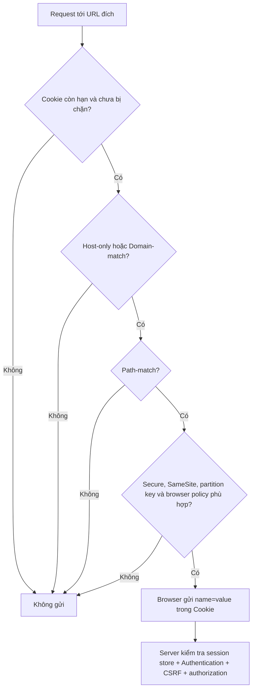
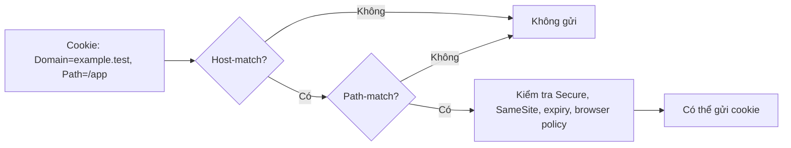
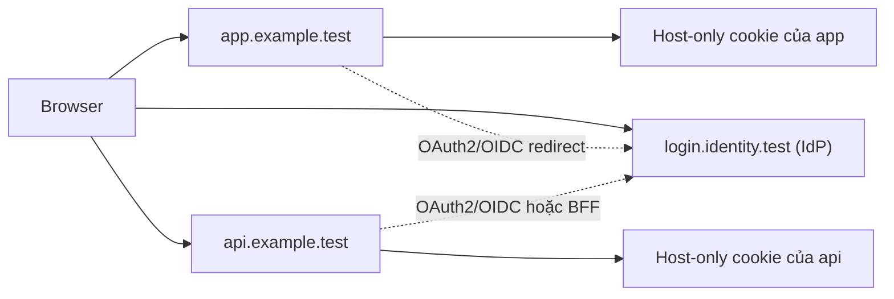

# Domain, Path và phạm vi cookie được trình duyệt gửi

> **Chương:** Session và cookie  
> **Phạm vi:** Cookie phiên và CSRF trong Spring Security **Servlet** và **Reactive WebFlux**, các ứng dụng khác subdomain/context path, Spring Boot, Spring Session, browser và reverse proxy.  
> **Mục tiêu:** Xác định browser gửi cookie tới host/path nào; phân biệt host-only với `Domain=...`, hiểu đúng path matching, cookie trùng tên, xóa cookie, prefix `__Host-`; cấu hình và kiểm thử session cookie mà không nhầm phạm vi cookie với quyền truy cập.

Trong module `SPRING_SECURITY_HTTP_PROTECTION`, người học bảo vệ HTTP và trình duyệt bằng CSRF, CORS, security headers, CSP, HSTS, HTTP firewall và quản lý session/cookie. Bài này nối kiến thức Servlet và Reactive với một câu hỏi triển khai thường xuyên gây lỗi: **vì sao đăng nhập thành công tại `app.example.test` nhưng gọi `api.example.test` lại bị coi là chưa xác thực, hoặc logout xong browser vẫn gửi một cookie `SESSION` cũ?**

Nguyên nhân có thể nằm ở **`Domain`/`Path`**, không phải mật khẩu, `AuthenticationManager` hay token CSRF. Tuy nhiên mở rộng phạm vi cookie không đúng cách sẽ làm session credential bị gửi tới nhiều ứng dụng hơn và tăng nguy cơ *cookie tossing*, *cookie shadowing* và *session fixation*. Cần hiểu quy tắc browser trước khi thay cấu hình.

## 1. Cookie đi qua hai chiều HTTP như thế nào?

Server đặt cookie bằng header phản hồi `Set-Cookie`:

```http
HTTP/1.1 200 OK
Set-Cookie: __Host-SESSION=opaque-demo-id; Path=/; Secure; HttpOnly; SameSite=Lax
Cache-Control: no-store
```

Ở request tiếp theo thỏa các điều kiện, browser gửi:

```http
GET /account HTTP/1.1
Host: app.example.test
Cookie: __Host-SESSION=opaque-demo-id
```

**Request `Cookie` không đính kèm lại `Domain`/`Path`/`Secure`/`HttpOnly`/`SameSite`.** Browser đã sử dụng các thuộc tính ấy để lọc cookie **trước khi gửi**. Vì vậy khi server nhận `Cookie: SESSION=A; SESSION=B`, chỉ nhìn request không thể khẳng định A được đặt ở Path hay Domain nào.

Session ID là **bearer credential**. Những giá trị ID trong ví dụ là giả; không ghi session ID thật vào log, URL, analytics, screenshot hay lỗi assertion. `Domain`/`Path` quy định *đường gửi*, không phải *danh tính*; Spring Security vẫn phải xác thực session và kiểm tra quyền mỗi request.

### 1.1. Thứ tự các điều kiện browser xem xét



Đây là mô hình khái niệm, không mô phỏng mọi thuật toán lưu và sắp xếp cookie của từng browser. **Mọi điều kiện phải cùng thỏa**. Ví dụ `Path=/api` đúng nhưng host không khớp thì cookie vẫn không được gửi; `Domain` đúng nhưng `Secure` không cho HTTP công khai thì cũng không gửi.

## 2. `Domain`: cookie host-only khác cookie chia sẻ subdomain

Một cookie **không khai báo `Domain`** là **host-only cookie**. Browser chỉ gửi nó tới hostname đã tạo cookie. Nếu `app.example.test` phát:

```http
Set-Cookie: SESSION=A; Path=/; Secure; HttpOnly; SameSite=Lax
```

thì request tới `https://app.example.test/cart` có thể mang cookie, còn `https://api.example.test/cart` thì không, cho dù hai hostname cùng một công ty, cùng registrable domain hoặc cùng Kubernetes cluster.

Ngược lại, một cookie có **`Domain=example.test`** được dùng cho chính `example.test` và những **subdomain** của nó, nếu host gửi `Set-Cookie` có quyền đặt parent domain đó:

```http
Set-Cookie: SESSION=B; Domain=example.test; Path=/; Secure; HttpOnly; SameSite=Lax
```

Browser có thể gửi B tới `example.test`, `app.example.test`, `api.example.test` hoặc `x.y.example.test` khi các điều kiện khác hợp lệ.

### 2.1. Domain-matching theo ví dụ

Giả sử cookie được đặt bởi response từ `https://app.example.test/login`:

| `Set-Cookie` | Browser có chấp nhận? | Host có thể nhận cookie |
| --- | --- | --- |
| Không có `Domain` | Có, host-only | **Chỉ `app.example.test`** |
| `Domain=app.example.test` | Có | `app.example.test` **và subdomain của nó** như `a.app.example.test` |
| `Domain=example.test` | Có | `example.test` và các subdomain, bao gồm `app`, `api` |
| `Domain=.example.test` | Về phạm vi, dấu chấm đầu được bỏ qua ở browser hiện đại | Tương đương `Domain=example.test`; **không** thành host-only |
| `Domain=api.example.test` | **Không**, host `app.example.test` không được đặt cookie cho sibling `api` | Không có cookie hợp lệ |
| `Domain=other.test` | **Không**, khác domain | Không có cookie hợp lệ |
| `Domain=com` hoặc public suffix như `co.uk` | **Không** trong browser thực thi Public Suffix List | Không có cookie hợp lệ |

**Một chi tiết dễ bỏ qua:** ghi `Domain=app.example.test` **không giống** bỏ `Domain`, vì trường hợp có Domain có thể đến cả `sub.app.example.test`. Nếu mục tiêu là cookie chỉ cho app host hiện tại, **để trống/không phát Domain**.

### 2.2. Public Suffix List không chỉ gồm `com`

Browser sử dụng **Public Suffix List (PSL)** để tránh website chiếm cookie của một phạm vi công cộng mà nhiều tổ chức sử dụng. `com`, `co.uk` là ví dụ; một số dịch vụ hosting có suffix công cộng/quy tắc riêng như `github.io`. Một website có host `team.github.io` không thể tùy ý đặt cookie `Domain=github.io` để chia session với khách thuê khác.

**Không tự xây “parent domain” bằng cách cắt hai nhãn cuối hostname.** Cách đó sai với `example.co.uk` và nhiều suffix đặc biệt. Nếu thật sự cần cookie Domain, đưa domain được phép vào cấu hình **tĩnh theo deployment** và kiểm thử trên hostname thực; không sinh từ input `Host` chưa tin cậy.

### 2.3. Domain không có cổng (port)

Cookie scope **không được cô lập theo port**. Ví dụ `https://app.example.test:8443` và `https://app.example.test:9443` là **hai origins khác nhau**, nhưng một host-only cookie hợp lệ có thể được gửi tới **cả hai** nếu các điều kiện khác thỏa. Đừng triển khai dịch vụ yếu ở cổng khác cùng hostname rồi tin rằng nó không thể nhận cookie session của ứng dụng chính.

| Cặp URL | Cùng origin? | Có thể chia host-only cookie? |
| --- | --- | --- |
| `https://app.example.test` / `https://app.example.test:8443` | Không (port khác) | **Có** nếu cùng host và Path/Secure/SameSite phù hợp |
| `https://app.example.test` / `https://api.example.test` | Không (host khác) | **Không**, nếu cookie do `app` phát và không có Domain |
| `https://app.example.test` / `http://app.example.test` | Không (scheme khác) | Cookie **không có Secure** có thể bị gửi trên HTTP; cookie `Secure` không nên gửi trên HTTP công khai |

Không thay host isolation bằng đổi cổng hay bằng `Path`. Nếu cần ranh giới tin cậy giữa hai dịch vụ độc lập, dùng **hostname khác, cookie host-only và authorization riêng**.

## 3. `Path`: phạm vi đường dẫn khi browser gửi cookie

`Path` lọc theo đường dẫn request, **không** theo tên controller Spring, không theo method và không theo quyền người dùng.

```http
Set-Cookie: CART_SESSION=opaque-demo; Path=/shop; Secure; HttpOnly; SameSite=Lax
```

Với cookie có `Path=/shop`:

| Đường dẫn request | Browser có thể gửi cookie? | Lý do |
| --- | --- | --- |
| `/shop` | **Có** | Khớp chính xác |
| `/shop/` | **Có** | Nhánh con bắt đầu bằng `/` |
| `/shop/cart` | **Có** | Thuộc phạm vi `/shop/` |
| `/shop/cart/checkout` | **Có** | Đường dẫn nhánh sâu hơn |
| `/shopping` | **Không** | `/shop` không phải prefix theo ranh giới dấu `/` |
| `/shopper` | **Không** | Khác segment |
| `/api/cart` | **Không** | Ngoài scope |
| `/` | **Không** | Ngoài scope |

### 3.1. Quy tắc path-match chính xác

Theo mô hình RFC 6265, request-path khớp cookie-path khi:

1. Hai chuỗi **bằng nhau**, hoặc
2. cookie-path là tiền tố của request-path **và kết thúc bằng `/`**, hoặc
3. cookie-path là tiền tố của request-path và **ký tự đầu tiên còn lại ở request-path là `/`**.

Do đó `Path=/docs` khớp `/docs` và `/docs/guide` nhưng **không** khớp `/docset`. `Path=/docs/` khớp `/docs/guide` nhưng **không** khớp chính `/docs`, vì thiếu dấu `/` cuối.

```text
Cookie: Path=/docs
  /docs          MATCH
  /docs/         MATCH
  /docs/guide    MATCH
  /docset        NO MATCH
  /guide         NO MATCH

Cookie: Path=/docs/
  /docs          NO MATCH
  /docs/         MATCH
  /docs/guide    MATCH
```

**Không dùng `String.startsWith("/docs")` để mô phỏng cookie-path:** phép kiểm đó sai với `/docset`. Cũng không dùng path matching để thực hiện kiểm soát quyền: server phải giữ SecurityFilterChain/authorization đúng cho mọi route.

### 3.2. Nếu không đặt `Path`, browser chọn gì?

Theo thuật toán default-path, browser suy ra **đường dẫn thư mục của URL đặt cookie**. Ví dụ response cho `https://app.example.test/shop/login` không có `Path` thường làm cookie có phạm vi thư mục `/shop`, **không phải toàn site `/`**.

```http
# Browser nhận tại /shop/login:
HTTP/1.1 200 OK
Set-Cookie: SESSION=A; Secure; HttpOnly; SameSite=Lax

# Request /shop/cart có thể mang SESSION.
# Request /api/me có thể KHÔNG mang SESSION.
```

Chính sách thật phụ thuộc URL response đã đặt cookie và browser; trong Servlet container/Spring Session, framework có thể **chủ động đặt Path theo context root**, nên không suy từ controller URL một cách máy móc. Để ứng dụng có login ở `/login` và API ở `/api` **cùng sử dụng một session**, thường chọn `Path=/` nếu cả hai thuộc cùng host và security boundary.

### 3.3. Query, fragment và HTTP method không mở rộng Path

`/shop/cart?coupon=A` vẫn có request-path `/shop/cart`; query không quyết định cookie-path match. Fragment `#section` **không được gửi đến server** trong HTTP request thông thường. `GET /shop` và `POST /shop` đều có thể nhận cookie theo cùng `Path`; CSRF và authorization mới quyết định POST có được thực hiện.

Đừng “giấu credential” trong query hoặc URL fragment và giả định `Path` sẽ bảo vệ chúng. Session ID phải ở cookie có các flags phù hợp và được rotate/invalidate theo chính sách.

## 4. `Domain` và `Path` lọc độc lập

Một cookie có `Domain=example.test; Path=/app` được xem xét gửi tới **những host thuộc example.test** và **những request paths khớp /app**. Phải thỏa **cả hai** điều kiện.



| URL đích | Host match? | Path match? | Kết luận nếu điều kiện còn lại hợp lệ |
| --- | --- | --- | --- |
| `https://app.example.test/app` | Có | Có | Có thể gửi |
| `https://api.example.test/app/users` | Có | Có | Có thể gửi |
| `https://example.test/app` | Có | Có | Có thể gửi |
| `https://api.example.test/api` | Có | **Không** | Không gửi |
| `https://evil.other.test/app` | **Không** | Có | Không gửi |
| `https://api.example.test/application` | Có | **Không** | Không gửi |

Vì vậy **sửa Domain không tự sửa lỗi Path**, và ngược lại. Khi Spring Security thấy người dùng anonymous sau redirect tới callback, hãy kiểm tra **host + path thực của callback**, trước khi đổi chiến lược authentication.

## 5. `Domain` và `Path` không phải ranh giới bảo mật đủ mạnh

### 5.1. Path không tách quyền giữa hai ứng dụng cùng origin

Giả sử hai ứng dụng được host ở `https://portal.example.test/app-a` và `https://portal.example.test/app-b`. Cookie của A đặt `Path=/app-a`; trên request bình thường tới B, browser có thể không gửi cookie A. Nhưng **`Path` không tạo origin mới**: JavaScript chạy ở cùng origin có thể tương tác với tài nguyên cùng origin và đôi khi khai thác DOM/API để đọc cookie không `HttpOnly` ở path khác.

Nếu ứng dụng B không đáng tin, chỉ `Path=/app-a` **không đủ để bảo vệ A**. Nên tách sang **hostname khác**, dùng cookie host-only trên host đó, `HttpOnly`, CSP, server-side authorization và isolation phù hợp.

### 5.2. Domain rộng tăng bề mặt nhận session credential

Nếu session cookie có `Domain=example.test`, browser có thể gửi credential tới **mọi subdomain phù hợp** khi path/scheme thỏa. Một dịch vụ `static.example.test`, `legacy.example.test` hoặc nhà cung cấp thuê ngoài được gắn subdomain có thể **nhận** cookie này trong request. Dù `HttpOnly` chặn script đọc qua `document.cookie`, server ở subdomain đó vẫn có thể thấy header `Cookie`.

Điều này tạo nguy cơ lộ ID qua reverse proxy/log, subdomain takeover và nhập nhằng cookie. **Không chia sẻ một session cookie cho mọi subdomain chỉ để đạt “SSO một lần đăng nhập”**. SSO/OIDC thường là lựa chọn tốt hơn: mỗi app có **cookie host-only riêng**, IdP quản lý đăng nhập chung qua flow xác thực.

### 5.3. Same-site không đồng nghĩa cùng quyền

`https://blog.example.test` và `https://bank.example.test` thường là **same-site** trong ngữ cảnh SameSite, nhưng là **khác origin** và không mặc định tin cậy nhau. `SameSite=Strict` không ngăn mọi request xuất phát từ subdomain không tin cậy cùng site. Vẫn cần CSRF token, origin checks khi phù hợp, authorization và server-side ownership validation.

**Không chọn `Domain=example.test` vì tưởng SameSite sẽ giữ các subdomain ở cùng “vùng an toàn”.** Domain chỉ quyết định browser có thể gửi credential tới những host nào; SameSite chỉ là một điều kiện bổ sung.

## 6. Cookie trùng tên: cookie tossing và cookie shadowing

Browser có thể lưu **nhiều cookie cùng tên** nếu thuộc các scope khác nhau, ví dụ khác `Path` hoặc `Domain`:

```http
# Response 1, host app.example.test:
Set-Cookie: SESSION=wide; Domain=example.test; Path=/; Secure; HttpOnly

# Response 2, host app.example.test:
Set-Cookie: SESSION=narrow; Path=/admin; Secure; HttpOnly

# Request phù hợp cả hai scope:
GET /admin/overview HTTP/1.1
Host: app.example.test
Cookie: SESSION=narrow; SESSION=wide
```

**Request `Cookie` không cho biết value nào có `Domain`/`Path` nào.** Header có thể gồm hai cặp `SESSION`; backend hoặc library parse cookie theo cách khác nhau, đôi khi chọn **đầu tiên** hoặc **cuối cùng**. Không dựa vào thứ tự như một hợp đồng bảo mật, đặc biệt khi proxy/framework có thể thay thứ tự.

### 6.1. Các cơ chế tấn công

- **Cookie tossing:** subdomain yếu như `legacy.example.test` đặt cookie có `Domain=example.test` để browser cũng gửi nó tới `app.example.test`. Nếu app chọn nhầm cookie cùng tên, attacker có thể gây nhầm session, logout sai hoặc ảnh hưởng cơ chế fixation.
- **Cookie shadowing:** cookie cùng tên nhưng `Path`/`Domain` khác nhau “che” giá trị cookie chính trong cách backend parse. Browser có thể gửi cả hai, còn server chỉ dùng một.
- **Session fixation:** kẻ tấn công cố khiến browser dùng session ID đã biết trước login. Ngay cả khi prefix/path giảm cookie injection, Spring Security vẫn cần **đổi ID lúc xác thực mới thành công** và vô hiệu quyền của ID cũ.
- **Subdomain takeover:** nếu một DNS/subdomain bị trỏ tới hạ tầng không kiểm soát, một bên khác có thể phục vụ HTTP response từ host đó và đặt cookie cho parent domain trong phạm vi được browser chấp nhận.

**Không gọi đây là “đánh cắp cookie bằng JavaScript” đơn thuần.** Cookie `HttpOnly` hạn chế JS đọc, nhưng server ở một subdomain thuộc scope Domain có thể **nhận header Cookie** trực tiếp; một subdomain có thể ghi cookie Domain qua `Set-Cookie`.

### 6.2. Cách tránh

1. Dùng **một tên session cookie rõ ràng** cho từng ứng dụng và host; tránh nhiều hệ thống cùng dùng `SESSION`/`JSESSIONID` trên parent domain.
2. Ưu tiên **host-only cookie** (không có `Domain`).
3. Dùng prefix **`__Host-`** khi app chạy HTTPS, `Path=/` và không cần chia sẻ cookie tới subdomains.
4. Nếu phải đặt cookie Domain rộng, **kiểm soát tất cả subdomain** có thể đặt cookie, không cấp quyền cho subdomain ít tin cậy hoặc bên thứ ba.
5. Không dựa vào thứ tự nhiều cookie trong backend; thiết kế để **không xuất hiện trùng tên nguy hiểm**, kiểm thử parser thực và chuẩn hóa migration.
6. Bật `Secure`, `HttpOnly`, `SameSite` phù hợp, CSRF và session fixation protection.

## 7. Prefix `__Host-` và giới hạn phạm vi ở cấp browser

Browser hỗ trợ cookie prefixes có thể từ chối cookie không đáp ứng điều kiện của prefix. Với cookie tên bắt đầu bằng **`__Host-`**:

- Được đặt từ **HTTPS**.
- Có thuộc tính **`Secure`**.
- Có **`Path=/`**.
- **Không có `Domain`**.

```http
# Hợp lệ trên HTTPS:
Set-Cookie: __Host-SESSION=opaque; Path=/; Secure; HttpOnly; SameSite=Lax

# Sai vì có Domain:
Set-Cookie: __Host-SESSION=opaque; Domain=example.test; Path=/; Secure; HttpOnly

# Sai vì Path không phải /:
Set-Cookie: __Host-SESSION=opaque; Path=/app; Secure; HttpOnly

# Sai vì thiếu Secure:
Set-Cookie: __Host-SESSION=opaque; Path=/; HttpOnly
```

**Prefix là một phần của tên cookie.** Server phải đọc `__Host-SESSION`, không phải `SESSION`. Browser hỗ trợ sẽ từ chối ba ví dụ sai; browser cũ hoặc client HTTP không áp dụng prefix checks có thể xử lý khác, nên server vẫn phải tự bảo vệ session ID.

### 7.1. So sánh các prefix phổ biến

| Prefix | Điều kiện ở browser hỗ trợ | Cần lưu ý |
| --- | --- | --- |
| `__Secure-` | Được đặt từ HTTPS và có `Secure` | **Vẫn có thể có Domain**; không thay host-only. |
| **`__Host-`** | HTTPS, `Secure`, `Path=/`, không `Domain` | Hợp cho session cookie của một host cụ thể. |
| `__Http-` | HTTPS, `Secure`, `HttpOnly` | Cho biết cookie phải được đặt qua `Set-Cookie` trong browser hỗ trợ; không bắt buộc host-only. |
| `__Host-Http-` | Kết hợp ràng buộc `__Host-` và `__Http-` | Hữu ích khi browser hỗ trợ; phải kiểm tra compatibility. |

Không có prefix nào làm CSRF, XSS hoặc session hijacking biến mất. `__Host-SESSION` vẫn là credential có thể bị lạm dụng nếu kẻ tấn công có ID hợp lệ hoặc code backend bỏ qua kiểm tra session/authorization.

### 7.2. Tại sao `__Host-` đòi Path=/ nhưng Path=/ lại rộng?

`Path=/` khiến cookie dùng được ở **mọi route cùng host**. Với `__Host-`, mục đích là làm cookie **gắn chắc vào một host**, giảm khả năng app/path/subdomain khác tạo cookie có cùng tên nhưng scope chồng chéo. Đây là lựa chọn hợp lý khi **toàn host thuộc cùng ranh giới tin cậy**.

Nếu `/app-a` và `/app-b` do hai đội không tin cậy nhau vận hành trên cùng hostname, `__Host-` không tạo isolation giữa họ: cookie được gửi tới cả hai đường dẫn. Cần tách hostname, gateway policy và security infrastructure thay vì dùng prefix để thay origin boundary.

## 8. Cách browser xác định một cookie và cách xóa đúng cookie

Để **thay hoặc xóa** một cookie, thường phải dùng **đúng name, Domain/host-only scope và Path**; cookie có cùng tên nhưng scope khác là cookie khác. Trong hệ có **Partitioned** cookies, partition key/top-level site còn ảnh hưởng nơi lưu và xóa.

Ví dụ session cookie host-only tại `app.example.test` với `Path=/app`:

```http
# Ban đầu:
Set-Cookie: SESSION=opaque-id; Path=/app; Secure; HttpOnly; SameSite=Lax

# Xóa ĐÚNG Path (trên chính host app.example.test):
Set-Cookie: SESSION=; Path=/app; Max-Age=0; Secure; HttpOnly; SameSite=Lax

# Xóa SAI Path: / không nhất thiết xóa cookie /app.
Set-Cookie: SESSION=; Path=/; Max-Age=0; Secure; HttpOnly; SameSite=Lax
```

Với cookie `Domain=example.test; Path=/`, response xóa cần phát **`Domain=example.test; Path=/`**. Với cookie host-only, **không thêm `Domain`** trong header xóa. Đừng cho rằng `Max-Age=0` trên một cookie tên `SESSION` có thể xóa **mọi** cookie `SESSION` đang tồn tại.

### 8.1. Xóa cookie browser khác hủy session server

Browser xóa cookie thì thường không gửi ID đó nữa, nhưng **server-side session store có thể vẫn giữ state** cho tới khi invalidate/expire. Khi người dùng logout:

1. Spring Security phải dọn `SecurityContext`/session theo cấu hình; với cookie session stateful nên invalidate server session khi policy yêu cầu.
2. Response hết hạn cookie đúng name/scope.
3. Thử gọi tài nguyên riêng tư bằng **ID cũ từ client test riêng**; server không được khôi phục quyền.
4. Nếu đang migration cookie name/Domain/Path, chủ động expire **từng cookie legacy** tương ứng trong giai đoạn chuyển đổi, tránh cookie shadowing.

`Secure`/`HttpOnly`/`SameSite` là các flags nên duy trì nhất quán, nhưng **name/Domain/Path** mới là trọng tâm khi nhắm đúng cookie cần xóa. Không dùng `deleteCookies("JSESSIONID")` và giả định nó sẽ xóa `__Host-SESSION` mà app mới đang dùng.

### 8.2. Sai lầm khi thay Path hoặc Domain mà không có migration

Một deployment ban đầu có `SESSION` host-only `Path=/app`. Phiên bản mới chuyển thành `SESSION` `Domain=example.test; Path=/` mà không dọn cookie cũ. Browser có thể gửi **hai `SESSION`** tới một số route. Backend chọn nhầm ID khiến:

- Đăng nhập rồi lại bị coi là anonymous.
- Logout “không thành công” vì chỉ xóa một scope.
- API A và API B nhìn thấy hai session khác nhau.
- Auth request OAuth2/OIDC hoặc CSRF token bị lưu ở session khác session client dùng trên callback.

**Kế hoạch chuyển đổi:** chụp cấu hình cũ → cập nhật serializer/resolver → phát cookie mới → **expire chính xác cookie cũ** → kiểm thử login, CSRF, logout, deep link và nhiều subdomains. Tránh ghi giá trị ID thật vào log.

## 9. Hai kiến trúc cùng có login: chọn Host-only hay Domain rộng?

### 9.1. Kiến trúc A — ứng dụng tự quản lý phiên trên từng host (ưu tiên)



Mỗi ứng dụng phát **cookie phiên riêng**, host-only và có session store/CSRF/authorization của chính nó. IdP chia sẻ **trải nghiệm đăng nhập**, không bắt hai backend chấp nhận cùng một ID session. Cách này giảm phạm vi credential và nguy cơ ảnh hưởng qua subdomain.

Nếu một SPA ở `app.example.test` dùng API ở `api.example.test`, API có thể **phát cookie host-only cho chính `api.example.test`**; browser sẽ gửi cookie đó tới API trong request tiếp theo nếu CORS, credentials, SameSite và cookie policy phù hợp. **Không cần mặc định `Domain=example.test` chỉ vì SPA và API khác hostname.**

### 9.2. Kiến trúc B — hai ứng dụng chia một cookie Domain

```http
# Chỉ khi cả hai hệ thống thuộc cùng trust boundary và có chung
# cơ chế session store/định dạng context:
Set-Cookie: SESSION=opaque; Domain=example.test; Path=/; Secure; HttpOnly; SameSite=Lax
```

Browser có thể gửi cookie tới nhiều subdomains. Nhưng điều này **chưa tạo Single Sign-On**: backend phải hiểu cùng ID, có session store tương thích, security context serialization phù hợp và chính sách logout/CSRF/account rõ ràng. Một ứng dụng đọc được ID nhưng không có session record tương ứng vẫn coi client là anonymous.

**Rủi ro lớn:** mọi subdomain trong scope có thể **nhận** cookie, và những subdomain đủ quyền có thể **đặt** cookie Domain cùng parent, gây va chạm. Chỉ chọn khi tất cả nơi nhận/đặt cookie nằm trong cùng ranh giới tin cậy và có đánh giá bảo mật cụ thể. Với nhiều ứng dụng độc lập, **SSO/OIDC + host-only session** thường phù hợp hơn.

### 9.3. Shared cookie không đồng nghĩa shared CSRF token

Giả sử frontend `app.example.test` gửi POST tới `api.example.test`:

- Cookie session được browser gắn theo scope Domain/Path, `Secure`, SameSite và privacy policy.
- JavaScript **cross-origin** vẫn cần CORS và `credentials:"include"` để API chia response cho frontend.
- `CsrfFilter` (Servlet) hoặc `CsrfWebFilter` (Reactive) kiểm tra CSRF token của **session/repository tương ứng**.
- Header `X-CSRF-TOKEN`/`X-XSRF-TOKEN` phải có token đúng; một cookie session chung không khiến hai app tự có cùng CSRF repository.
- Authorization phải kiểm tra danh tính/quyền trên server của tài nguyên đích, không dựa vào tên cookie.

Cookie Domain rộng làm credential dễ được gửi hơn, **không** chứng minh request an toàn hoặc người dùng được phép thao tác.

## 10. Hành trình form login, OAuth2 callback và context path

Cookie Path cần bao phủ **đường dẫn thực của request trước và sau login**. Một ứng dụng chạy ở context root `/app` có thể có:

```text
GET  /app/login
POST /app/login
GET  /app/account
GET  /app/oauth2/authorization/demo
GET  /app/login/oauth2/code/demo
POST /app/logout
```

Nếu cookie có `Path=/app`, tất cả các request trên khớp. Nhưng nếu proxy route callback OAuth2 tới `/login/oauth2/code/demo` **ở root** mà cookie chỉ có `Path=/app`, browser không gửi session trước login tới callback đó. Spring Security có thể mất authorization request/`state` tương ứng và báo lỗi.

### 10.1. Phân biệt URL browser nhìn thấy với URL backend xử lý

```mermaid
sequenceDiagram
    participant B as Browser
    participant P as Reverse proxy
    participant S as Spring app
    B->>P: GET https://public.example.test/portal/login
    P->>S: GET http://internal:8080/login
    S-->>P: Set-Cookie SESSION=A; Path=/ (ví dụ)
    P-->>B: Response có Set-Cookie
    Note over B: Browser quyết định Path theo URL PUBLIC
    B->>P: GET /portal/account + cookie nếu Path khớp
    P->>S: GET /account sau rewrite
```

Nếu gateway **bỏ prefix `/portal`** trước khi chuyển request, backend có thể nghĩ context path là `/`. Điều đó có thể dẫn đến cookie `Path=/` dù policy public muốn `/portal`, hoặc ngược lại khiến backend phát `Path=/portal` sai với API thực. **Chọn phạm vi theo URL bên ngoài browser sử dụng**, rồi phối hợp reverse proxy, context path, forwarded prefix và session infrastructure.

**Không tin header `X-Forwarded-Prefix`/`X-Forwarded-Host` từ Internet client một cách mù quáng.** Chỉ xử lý forwarded headers từ proxy được tin cậy, tránh host/header injection và phát cookie/redirect URI theo giá trị do attacker kiểm soát.

### 10.2. Deep links và saved request

Một người dùng mở `GET /portal/orders/42`, bị chuyển tới `/portal/login`, sau đó cần quay lại đơn hàng. Nếu cookie có `Path=/login` vì đặt thiếu Path ở response login, browser **không** gửi nó khi quay về `/portal/orders/42`. App coi người dùng anonymous dù login thành công.

Nên kiểm tra:

1. Login form và CSRF token có dùng **cùng cookie session** không?
2. Redirect `Location` từ Spring Security dùng đúng public host/path không?
3. Cookie có được gửi đến saved request target sau login không?
4. POST logout có cùng path scope không?
5. Cookie có `Secure; HttpOnly; SameSite` phù hợp, và session ID A có được rotate sang B khi xác thực thành công?

### 10.3. OAuth2/OIDC: Domain/Path phải phủ đúng callback

Khi `oauth2Login` lưu authorization request vào `HttpSession` hoặc `WebSession`, callback cần dùng đúng session chứa `state`. `SameSite=Lax` cho phép cookie ở top-level GET cross-site thông thường, **nhưng Domain/Path vẫn có thể khiến browser không gửi cookie**.

Ví dụ frontend `https://auth.example.test` khởi động OAuth2 nhưng callback tới `https://app.example.test/login/oauth2/code/demo`: nếu auth host đặt cookie **host-only**, cookie **không** tự đến app host. Không vội đổi `Domain=example.test`; trước hết xem thiết kế OAuth2 registration có thể **khởi động và nhận callback cùng một host** hay không.

Với `response_mode=form_post` (cross-site POST), kể cả Domain/Path đúng, `SameSite=Lax` tường minh vẫn có thể chặn cookie; giải pháp cần đánh giá toàn bộ callback POST matcher, cookie `SameSite=None; Secure` nếu cần, CSRF integration và `state`/PKCE/nonce. **Domain/Path là một điều kiện trong hành trình, không phải bản sửa cho mọi lỗi SSO.**

## 11. Spring Boot Servlet: cấu hình cookie phiên host-only

Đối với Spring Boot **Servlet stack** (Spring MVC và Servlet container tương thích), sử dụng `server.servlet.session.cookie.*`.

```yaml
# application.yml — production HTTPS, app sở hữu toàn host.
server:
  servlet:
    session:
      cookie:
        name: __Host-SESSION
        path: /
        secure: true
        http-only: true
        same-site: lax
      timeout: 30m
```

**Chú ý không có `domain`.** `__Host-SESSION` chỉ hợp lệ ở browser hỗ trợ prefix khi `Secure`, `Path=/`, không `Domain` và response từ HTTPS. Tên là `__Host-SESSION` trong cả `Set-Cookie` và request `Cookie`; Spring Security không tự bỏ tiền tố.

### 11.1. Nếu application chỉ cần cookie ở context path

Một app `https://portal.example.test/app` độc lập với dịch vụ khác cùng host có thể cấu hình:

```yaml
server:
  servlet:
    context-path: /app
    session:
      cookie:
        name: APP_SESSION
        path: /app
        secure: true
        http-only: true
        same-site: lax
```

**Không dùng tên `__Host-...` với `Path=/app`**, vì prefix yêu cầu `Path=/`. Đồng thời phải hiểu: cookie Path hẹp **không cô lập quyền giữa các ứng dụng cùng origin**. Nếu `/app` chứa dữ liệu nhạy cảm mà các path khác cùng hostname không đáng tin, nên tách hostname.

Phần `server.servlet.context-path` ảnh hưởng route Servlet, còn `cookie.path` quyết định browser gửi cookie ở đâu. Các giá trị phải khớp **public URL sau proxy**, không chỉ đường dẫn nội bộ container.

### 11.2. Khi thật sự cần cookie Domain cho nhiều subdomains

```yaml
# PHƯƠNG ÁN NGOẠI LỆ: tất cả subdomains trong cùng trust boundary.
server:
  servlet:
    session:
      cookie:
        name: SHARED_SESSION
        domain: example.test
        path: /
        secure: true
        http-only: true
        same-site: lax
```

Không dùng `__Host-SESSION` với `domain: example.test`. Đánh giá subdomain takeover, CSRF, liệu hai ứng dụng thực sự dùng **cùng session store/serializer**, và kế hoạch thu hồi cookie cũ. Cookie Domain rộng không làm các `SecurityFilterChain` tự chấp nhận cùng `Authentication`.

### 11.3. SecurityFilterChain vẫn phải có authorization/CSRF

```java
import org.springframework.context.annotation.Bean;
import org.springframework.context.annotation.Configuration;
import org.springframework.security.config.Customizer;
import org.springframework.security.config.annotation.web.builders.HttpSecurity;
import org.springframework.security.web.SecurityFilterChain;

@Configuration
class ServletCookieScopeSecurity {

    @Bean
    SecurityFilterChain securityFilterChain(HttpSecurity http)
            throws Exception {
        return http
            .authorizeHttpRequests(auth -> auth
                .requestMatchers("/login", "/public/**").permitAll()
                .anyRequest().authenticated())
            .formLogin(Customizer.withDefaults())
            .csrf(Customizer.withDefaults())
            .sessionManagement(session -> session
                .sessionFixation(fixation -> fixation.changeSessionId()))
            .build();
    }
}
```

Trên Servlet 3.1+ tương thích, `changeSessionId()` thường đã là mặc định khi xác thực mới với session hợp lệ; ví dụ ghi rõ để nhắc **Domain/Path không thay session fixation protection**. `POST /login` vẫn cần CSRF token theo cấu hình mặc định. Nếu app dùng context path `/app`, matcher ứng dụng thường được đánh giá sau khi Servlet container xử lý context path; kiểm tra route thực thay vì đưa tùy tiện `/app` vào mọi matcher.

**Ba tầng phải phối hợp:**

- `HttpSecurity`: ai được truy cập, CSRF và session fixation.
- Spring Boot/Servlet container: cookie name, Domain, Path, Secure, HttpOnly, SameSite.
- Spring Session (nếu có): serializer, ID → state mapping, TTL và cookie lifecycle.

Thay `cookie.domain` không phải cách cấu hình authorization hay CORS.

## 12. Spring Session Servlet: `DefaultCookieSerializer`

Với Spring Session Redis/JDBC, cookie phiên có thể do `DefaultCookieSerializer` phát thay vì Servlet container. Tài liệu Spring Session cho phép chỉnh `cookieName`, `cookiePath`, `domainName`/`domainNamePattern` và flags:

```java
import org.springframework.context.annotation.Bean;
import org.springframework.context.annotation.Configuration;
import org.springframework.session.web.http.CookieSerializer;
import org.springframework.session.web.http.DefaultCookieSerializer;

@Configuration
class SpringSessionCookieScopeConfig {

    @Bean
    CookieSerializer cookieSerializer() {
        var cookie = new DefaultCookieSerializer();
        cookie.setCookieName("__Host-SESSION");
        cookie.setCookiePath("/");
        cookie.setUseSecureCookie(true);
        cookie.setUseHttpOnlyCookie(true);
        cookie.setSameSite("Lax");
        // Không setDomainName/setDomainNamePattern với __Host-.
        return cookie;
    }
}
```

**Không đồng thời cấu hình Spring Boot/container và custom serializer theo những policy mâu thuẫn.** Một bean `CookieSerializer` custom có thể là nguồn quyết định cookie thật. Kiểm tra response `Set-Cookie` ở edge thay vì đoán thứ tự ghi đè giữa các thành phần.

### 12.1. Vì sao `setDomainNamePattern(...)` cần thận trọng?

`DefaultCookieSerializer.setDomainNamePattern(...)` nhận regex, lấy nhóm bắt từ server name để quyết định Domain. Tài liệu Spring Session cảnh báo phải giới hạn **ký tự domain hợp lệ**, vì Domain có thể được phản chiếu vào response header; pattern rộng có nguy cơ **HTTP response splitting/header injection** nếu Host/forwarded host bị kiểm soát.

Không dùng:

```java
// TRÁNH: lấy một nhóm tùy ý từ Host header rồi đặt Domain,
// không có allowlist deployment.
cookie.setDomainNamePattern("(.+)");
```

Thay vào đó, nếu có nhu cầu chia parent domain đã đánh giá bảo mật, dùng cấu hình tĩnh theo môi trường:

```java
// Chỉ trong thiết kế CHỦ ĐỘNG chia sẻ cookie trên subdomains
// và đổi tên khỏi __Host-:
cookie.setCookieName("SHARED_SESSION");
cookie.setDomainName("example.test");
cookie.setCookiePath("/");
```

Đây là **trích đoạn thay thế**, không đặt cùng với bean host-only `__Host-SESSION` trong ví dụ trước. Nếu ứng dụng có nhiều tenants/domains, không được suy Domain từ `Host` không tin cậy; phải có **allowlist tenant domains** và threat review.

### 12.2. Spring Session không tự tạo “SSO giữa mọi host”

Ngay cả khi hai ứng dụng dùng cùng Redis, cần thống nhất session repository, namespace, serialization/version của `SecurityContext`, session policy và authorization. Các ứng dụng dùng chung cookie nhưng không chia được context có thể xuất hiện như “session mất” hoặc lỗi serialize. Shared session store có thể tạo **coupling** và mở rộng blast radius; đánh giá kiến trúc SSO riêng trước khi chọn.

## 13. WebFlux Reactive: `CookieWebSessionIdResolver`

Spring WebFlux dùng `WebSession` và `ServerHttpSecurity`. `CookieWebSessionIdResolver` quyết định **tên cookie và thuộc tính được phát**; mặc định thường là cookie `SESSION`.

### 13.1. Spring Boot Reactive properties

```yaml
server:
  reactive:
    session:
      cookie:
        name: __Host-SESSION
        path: /
        secure: true
        http-only: true
        same-site: lax
      timeout: 30m
```

Không gán `server.servlet.session.cookie.*` cho ứng dụng **chỉ** chạy WebFlux rồi cho rằng properties sẽ áp dụng. Kiểm tra phiên bản Boot (property metadata) và bean `WebSessionIdResolver` thực tế; khi app có cả MVC/WebFlux trên classpath, xác định loại web application đang chạy.

### 13.2. Cấu hình qua bean resolver

```java
import org.springframework.context.annotation.Bean;
import org.springframework.context.annotation.Configuration;
import org.springframework.web.server.session.CookieWebSessionIdResolver;
import org.springframework.web.server.session.WebSessionIdResolver;

@Configuration
class ReactiveWebSessionCookieScopeConfig {

    @Bean
    WebSessionIdResolver webSessionIdResolver() {
        var resolver = new CookieWebSessionIdResolver();
        resolver.setCookieName("__Host-SESSION");
        resolver.addCookieInitializer(builder -> builder
            .path("/")
            .secure(true)
            .httpOnly(true)
            .sameSite("Lax"));
        return resolver;
    }
}
```

Khi cần `Path=/app`, đổi tên cookie **không có `__Host-`**:

```java
// Thay một lần trong cùng bean, KHÔNG áp cùng __Host- prefix.
resolver.setCookieName("APP_SESSION");
resolver.addCookieInitializer(builder -> builder
    .path("/app")
    .secure(true)
    .httpOnly(true)
    .sameSite("Lax"));
```

Nếu cần Domain rộng, builder có `domain("example.test")`, nhưng chỉ dùng khi subdomain sharing đã được đánh giá. Cookie `__Host-` **không được kết hợp** với `domain(...)`.

**Chỉ chọn một nguồn cấu hình policy**: Spring Boot reactive cookie properties hoặc custom resolver bean tương thích Spring Session Reactive. Nếu cả hai tồn tại, cần kiểm tra bean nào thực được chọn; không dựa vào kỳ vọng các giá trị luôn tự merge.

### 13.3. Reactive security chain

```java
import org.springframework.context.annotation.Bean;
import org.springframework.context.annotation.Configuration;
import org.springframework.security.config.Customizer;
import org.springframework.security.config.annotation.web.reactive.EnableWebFluxSecurity;
import org.springframework.security.config.web.server.ServerHttpSecurity;
import org.springframework.security.web.server.SecurityWebFilterChain;

@Configuration
@EnableWebFluxSecurity
class ReactiveCookieScopeSecurity {

    @Bean
    SecurityWebFilterChain securityWebFilterChain(ServerHttpSecurity http) {
        return http
            .authorizeExchange(auth -> auth
                .pathMatchers("/login", "/public/**").permitAll()
                .anyExchange().authenticated())
            .formLogin(Customizer.withDefaults())
            .csrf(Customizer.withDefaults())
            .build();
    }
}
```

Đây là **Reactive**, không dùng `HttpSession` hoặc `HttpSecurity.sessionManagement()`. Với form login mặc định và `WebSessionServerSecurityContextRepository`, việc lưu `SecurityContext` có cơ chế thay ID để chống fixation. Nếu custom repository, cần test riêng ID cũ không còn quyền.

### 13.4. Khi nào WebSession phát cookie?

Chỉ gọi `exchange.getSession()` có thể tạo một đối tượng `WebSession` chưa được start. Nếu không có attributes và chưa `start()`, browser có thể **không nhận cookie** trên GET. Không dùng một endpoint public chỉ đọc rồi kết luận Path/Domain sai vì không thấy `Set-Cookie`.

Tạo phiên có chủ đích trong test:

```java
import org.springframework.http.ResponseEntity;
import org.springframework.web.bind.annotation.GetMapping;
import org.springframework.web.bind.annotation.RestController;
import org.springframework.web.server.ServerWebExchange;
import org.springframework.web.server.WebSession;
import reactor.core.publisher.Mono;

@RestController
class SessionBootstrapForTest {

    @GetMapping("/test/bootstrap-session")
    Mono<ResponseEntity<Void>> bootstrap(ServerWebExchange exchange) {
        return exchange.getSession()
            .doOnNext(WebSession::start)
            .thenReturn(ResponseEntity.noContent().build());
    }
}
```

**Chỉ đưa endpoint này vào test profile** và cho phép anonymous ở test security chain. Không triển khai endpoint tạo session vô điều kiện trong production nếu không có nhu cầu, vì làm tăng tải store. Backend quyết định ID và cookie; browser sau đó lọc Domain/Path trên các request thật.

## 14. CORS, SameSite, Secure và CSRF vẫn là các điều kiện độc lập

Một SPA ở `https://app.example.test` muốn gọi `https://api.example.test/account` có thể cần:

```javascript
// Cross-origin, nhưng cùng site trong ngữ cảnh schemeful same-site.
const response = await fetch("https://api.example.test/account", {
  method: "GET",
  credentials: "include"
});
if (!response.ok) throw new Error("API không trả response thành công");
```

**CORS** quyết định browser có cho JavaScript ở origin của SPA truy cập response API không. Cookie Domain/Path lại quyết định browser có gửi credential tới **host/path API** không. `SameSite=Lax` hoặc `Strict` thông thường không chặn request **same-site** này chỉ vì khác origin. Nếu API cookie do chính `api.example.test` đặt và host-only, browser vẫn có thể gửi nó **tới API**, không cần mở rộng `Domain`.

| Câu hỏi | Thành phần quyết định |
| --- | --- |
| Cookie từ `app.example.test` có gửi tới `api.example.test` không? | **Domain/host-only** của cookie; `Path` và các flags còn lại. |
| Cookie ở `api.example.test` có gửi tới `/api/me` không? | **Path** và các điều kiện cookie khác. |
| JavaScript tại `app.example.test` có đọc response `api.example.test` không? | **CORS**, `Access-Control-Allow-Origin` và `Access-Control-Allow-Credentials`. |
| Browser có gửi cookie trong request khác site không? | **SameSite**, `Secure`, browser privacy policy, partitioning. |
| POST có hợp lệ khi browser tự gửi cookie không? | **CSRF protection**, kèm session/authentication/authorization. |
| User có quyền truy cập dữ liệu của tài khoản khác không? | **Authorization** phía server, không phải Domain/Path. |

Nếu API chấp nhận credential cross-origin, CORS cần explicit allowlist origin tin cậy, `Access-Control-Allow-Credentials: true` và xử lý preflight theo phương thức/headers được phép; không dùng `Access-Control-Allow-Origin: *` cùng credentials. Spring Security cần áp CORS trước khi preflight bị chặn vì thiếu authentication.

### 14.1. Cookie CSRF không nhất thiết có cùng Domain/Path với cookie session

Một SPA có thể cần đọc CSRF token để gửi `X-CSRF-TOKEN` hoặc `X-XSRF-TOKEN`. Điều này **không có nghĩa** phải cho JavaScript đọc session cookie:

- **Session cookie:** nên `Secure; HttpOnly`, host-only nếu có thể; browser tự đính kèm khi phạm vi khớp.
- **CSRF token:** có thể qua view/endpoint JSON hoặc cookie riêng `XSRF-TOKEN` nếu request handler/repository hỗ trợ SPA. Cookie CSRF có thể cần `HttpOnly=false` **chỉ khi JS thực sự cần đọc nó**.
- Nếu token được phát ở `api.example.test` với host-only cookie, JavaScript tại `app.example.test` **không thể trực tiếp đọc cookie đó qua `document.cookie`**; nên cân nhắc endpoint CSRF của API được phép CORS phù hợp hoặc thiết kế BFF.
- Đặt `Domain=example.test` cho CSRF cookie chỉ để JS ở app đọc token mở rộng phạm vi và cần đánh giá XSS/subdomain trust. Không dùng Domain rộng thay thế thiết kế token exchange an toàn.

Sau login/logout, token CSRF có thể bị thu hồi và cần cấp lại; lỗi `403` trên POST có thể là **CSRF**, khác lỗi `401` do cookie không được gửi. Phân loại lỗi trước khi sửa Domain/Path.

### 14.2. Không dùng domain cookie để tạo “hàng rào phòng CSRF”

`Domain` chủ yếu là **quy tắc gửi**, không phải cơ chế chống request giả mạo. Nếu cookie chỉ có host-only scope của `api.example.test`, một request cross-site tới API vẫn có thể mang cookie khi SameSite/browser policy cho phép và request thật tới host đó. Cần CSRF token và Origin/Fetch Metadata policy cho unsafe requests, không chỉ host-only.

## 15. Unit test cookie attributes bằng `ResponseCookie`

Spring Framework có `ResponseCookie` để tạo và kiểm tra header `Set-Cookie`. Unit test sau kiểm chứng **cấu hình cookie do code tạo**, chưa mô phỏng browser path/domain matching.

```java
import org.junit.jupiter.api.Test;
import org.springframework.http.ResponseCookie;

import static org.junit.jupiter.api.Assertions.*;

class CookieScopePolicyTest {

    @Test
    void hostOnlySessionCookieHasNoDomainAndRootPath() {
        var cookie = ResponseCookie
            .from("__Host-SESSION", "opaque-test-id")
            .path("/")
            .secure(true)
            .httpOnly(true)
            .sameSite("Lax")
            .build();

        assertEquals("__Host-SESSION", cookie.getName());
        assertNull(cookie.getDomain());
        assertEquals("/", cookie.getPath());
        assertTrue(cookie.isSecure());
        assertTrue(cookie.isHttpOnly());
        assertEquals("Lax", cookie.getSameSite());
        assertFalse(cookie.toString().contains("Domain="));
    }

    @Test
    void explicitlySharedCookieHasExpectedDomainAndPath() {
        var cookie = ResponseCookie
            .from("SHARED_SESSION", "opaque-test-id")
            .domain("example.test")
            .path("/app")
            .secure(true)
            .httpOnly(true)
            .sameSite("Lax")
            .build();

        assertEquals("example.test", cookie.getDomain());
        assertEquals("/app", cookie.getPath());
        assertTrue(cookie.toString().contains("Domain=example.test"));
        assertTrue(cookie.toString().contains("Path=/app"));
    }
}
```

**Đừng dùng unit test này để kết luận browser đã chấp nhận cookie.** `ResponseCookie` có thể biểu diễn header không phù hợp `__Host-` (ví dụ thêm Domain) dù browser hỗ trợ sẽ từ chối. Java builder và server không thay browser policy.

### 15.1. Test tạo header để xóa cookie đúng scope

```java
import java.time.Duration;
import org.junit.jupiter.api.Test;
import org.springframework.http.ResponseCookie;

import static org.junit.jupiter.api.Assertions.*;

class CookieScopeDeletionTest {

    @Test
    void deletingSharedCookieRepeatsDomainAndPath() {
        var deletion = ResponseCookie.from("SHARED_SESSION", "")
            .domain("example.test")
            .path("/app")
            .maxAge(Duration.ZERO)
            .secure(true)
            .httpOnly(true)
            .sameSite("Lax")
            .build();

        String header = deletion.toString();
        assertTrue(header.contains("Max-Age=0"));
        assertTrue(header.contains("Domain=example.test"));
        assertTrue(header.contains("Path=/app"));
    }
}
```

`Duration.ZERO` tạo `Max-Age=0` theo builder. Một số builder/framework diễn giải **negative maxAge** là “không phát thuộc tính”, vì vậy **không dùng số âm làm cách xóa mặc định**. Test thực với browser vẫn cần xác nhận cookie đã biến mất khỏi đúng scope; builder không thực hiện deletion trong browser.

## 16. Unit test `CookieWebSessionIdResolver` của WebFlux

Kiểm tra bean resolver phát cookie đúng name/domain/path. Với Spring Test:

```java
import org.junit.jupiter.api.Test;
import org.springframework.http.ResponseCookie;
import org.springframework.mock.http.server.reactive.MockServerHttpRequest;
import org.springframework.mock.web.server.MockServerWebExchange;
import org.springframework.web.server.session.CookieWebSessionIdResolver;

import static org.junit.jupiter.api.Assertions.*;

class ReactiveCookieScopeResolverTest {

    @Test
    void hostOnlyResolverEmitsExpectedScope() {
        var resolver = new CookieWebSessionIdResolver();
        resolver.setCookieName("__Host-SESSION");
        resolver.addCookieInitializer(cookie -> cookie
            .path("/")
            .secure(true)
            .httpOnly(true)
            .sameSite("Lax"));

        var exchange = MockServerWebExchange.from(
            MockServerHttpRequest.get("https://api.example.test/me"));

        resolver.setSessionId(exchange, "opaque-test-id");

        ResponseCookie emitted = exchange.getResponse()
            .getCookies().getFirst("__Host-SESSION");

        assertNotNull(emitted);
        assertNull(emitted.getDomain());
        assertEquals("/", emitted.getPath());
        assertTrue(emitted.isSecure());
        assertTrue(emitted.isHttpOnly());
        assertEquals("Lax", emitted.getSameSite());
    }

    @Test
    void sharedResolverExplicitlySetsDomainAndPath() {
        var resolver = new CookieWebSessionIdResolver();
        resolver.setCookieName("SHARED_SESSION");
        resolver.addCookieInitializer(cookie -> cookie
            .domain("example.test")
            .path("/api")
            .secure(true)
            .httpOnly(true)
            .sameSite("Lax"));

        var exchange = MockServerWebExchange.from(
            MockServerHttpRequest.get("https://api.example.test/api/me"));

        resolver.setSessionId(exchange, "opaque-test-id");

        ResponseCookie emitted = exchange.getResponse()
            .getCookies().getFirst("SHARED_SESSION");

        assertNotNull(emitted);
        assertEquals("example.test", emitted.getDomain());
        assertEquals("/api", emitted.getPath());
    }
}
```

Đây là test **resolver**, không phải browser. `MockServerWebExchange` không tự mô phỏng việc một browser loại cookie sai Domain/Path trong các request khác. Nếu bạn tự đưa `Cookie` vào mock request, test sẽ đi qua Spring code nhưng **không chứng minh browser thật sẽ gửi cookie đó**.

### 16.1. Spring Session/Boot customizations có thể thay bean thực

Nếu dùng Spring Session Reactive và `WebSessionIdResolver` custom, hãy lấy **bean từ application context thật** trong integration test thay vì tự `new CookieWebSessionIdResolver()` rồi kết luận config production đúng. Tương tự, một `DefaultCookieSerializer` custom có thể ghi đè policy Boot Servlet.

Test cần gắn với **chính SecurityFilterChain/WebSessionManager/SessionRepository đang chạy**, chứ không chỉ một helper độc lập.

## 17. HTTP integration test kiểm tra `Set-Cookie` thực

`MockMvc` thường không mô phỏng chính xác container Servlet phát `JSESSIONID` và cookie attributes; `MockWebSession` không thực hiện cookie-jar selection như browser. Để xác nhận cấu hình:

1. Khởi động ứng dụng với **embedded container** hoặc HTTP server, session store phù hợp.
2. Gọi endpoint thực sự **tạo hoặc start session**; public GET stateless có thể không phát cookie.
3. Kiểm tra **tất cả** `Set-Cookie` response headers; chọn đúng cookie session theo tên.
4. Assert không có `Domain` trong host-only policy; `Path=/`, `Secure`, `HttpOnly`, `SameSite` tương ứng.
5. Kiểm tra cùng session qua GET protected endpoint, login rotation/logout/CSRF.
6. Đưa traffic qua **proxy/gateway** nếu production rewrite host/path.

### 17.1. WebTestClient: ví dụ kiểm tra cookie phát thật

Giả sử ứng dụng WebFlux có endpoint `GET /test/bootstrap-session` **chỉ trong test profile** ở mục 13:

```java
import java.util.List;
import org.junit.jupiter.api.Test;
import org.springframework.http.HttpHeaders;
import org.springframework.test.web.reactive.server.WebTestClient;

import static org.junit.jupiter.api.Assertions.*;

// Thân test bên trong class đã có WebTestClient client gắn vào app.
@Test
void bootstrapEmitsHostOnlyCookie() {
    var result = client.get().uri("/test/bootstrap-session")
        .exchange()
        .expectStatus().isNoContent()
        .expectBody()
        .returnResult();

    List<String> headers = result.getResponseHeaders()
        .getOrEmpty(HttpHeaders.SET_COOKIE);

    String sessionHeader = headers.stream()
        .filter(v -> v.startsWith("__Host-SESSION="))
        .findFirst()
        .orElseThrow();

    assertTrue(sessionHeader.contains("Path=/"));
    assertTrue(sessionHeader.contains("Secure"));
    assertTrue(sessionHeader.contains("HttpOnly"));
    assertTrue(sessionHeader.contains("SameSite=Lax"));
    assertFalse(sessionHeader.contains("Domain="));
}
```

Đây là **trích thân test**: cần cấu hình `WebTestClient` cùng application context hoặc qua server thật, có security rule cho phép `/test/bootstrap-session` trong test. `WebTestClient.bindToApplicationContext` kiểm tra response chain nhưng **không thay** browser/edge test. Để kiểm tra `Set-Cookie` sau proxy dùng client nối tới **public HTTPS URL**.

**Không in `sessionHeader`** khi debug; nó chứa session ID. Assertion chỉ báo flag/scope thiếu, không xuất credential ra CI logs.

### 17.2. Servlet: kiểm tra cookie do container hoặc Spring Session phát

Một HTTP integration test có thể:

```text
GET  /login                    -> tạo session A (nếu login dùng session)
POST /login  + cookie A + CSRF -> nhận session B sau xác thực
GET  /account + cookie B       -> authenticated
GET  /account + cookie A cũ    -> KHÔNG authenticated
POST /logout + cookie B + CSRF -> session B bị vô hiệu theo policy
GET  /account + cookie B cũ    -> KHÔNG authenticated
```

Nếu trước login **chưa có session A**, không yêu cầu “A phải khác B” khi A chưa tồn tại. Hãy tạo session ẩn danh thực (ví dụ qua CSRF token form) trước khi test session fixation.

Trên đường đi này, kiểm tra Domain/Path của session B giống policy, và logout phát cookie xóa đúng scope. Nếu hai `Set-Cookie` có cùng tên khác scope, đánh dấu nguy cơ cookie shadowing và kiểm tra việc migration.

## 18. Browser E2E: kiểm tra cookie có thực sự được gửi?

`curl`, `WebTestClient` và `MockMvc` có thể **gửi header `Cookie` thủ công**. Chúng không tự thực thi đầy đủ chính sách browser khi chọn cookie theo Domain/Path/Secure/SameSite. Muốn chứng minh host-only cookie **không** đến sibling subdomain, cần browser thật hoặc automation (Playwright/Selenium) với các hostname thực sự resolve được.

### 18.1. Mô hình môi trường test

```text
https://app.example.test
    /test/issue-session      -> Set-Cookie session test
    /test/cookie-present     -> trả "present" nếu request có cookie đúng tên
    /shop/cart

https://api.example.test
    /test/cookie-present     -> trả "present" hoặc "absent"
    /api/me

https://legacy.example.test
    /test/cookie-present     -> trả "present" hoặc "absent"

Tất cả test hosts phải có HTTPS, DNS/dev mapping và chứng chỉ
được browser automation chấp nhận.
```

Hai endpoints chỉ là **fixture cho môi trường test**. Không làm endpoint public production phản hồi raw cookie value hay Authentication. Khi viết `cookie-present`, chỉ trả một boolean/chuỗi trạng thái mà test có quyền sử dụng; backend không bao giờ trả session ID ra response JSON.

### 18.2. Playwright test host-only cookie

Giả sử fixture `/test/issue-session` trên `app.example.test` đặt `APP_SESSION` host-only, `Path=/`, và các `cookie-present` đều trả `present/absent` tùy request mang `APP_SESSION`:

```typescript
import { test, expect } from "@playwright/test";

test("host-only cookie is not sent to sibling subdomain", async ({ browser }) => {
  const context = await browser.newContext();
  const page = await context.newPage();

  await page.goto("https://app.example.test/test/issue-session");
  await page.goto("https://app.example.test/test/cookie-present");
  await expect(page.locator("body")).toContainText("present");

  await page.goto("https://api.example.test/test/cookie-present");
  await expect(page.locator("body")).toContainText("absent");

  await context.close();
});
```

Test so hành vi **cùng một browser context** trên hai hosts; không giả định hai `context` độc lập chia cookie. Nếu server API có đặt cookie riêng **cùng tên** trước khi test, phải tạo browser context sạch và kiểm soát fixtures để không có cookie cạnh tranh.

### 18.3. Browser E2E cho `Path=/shop`

Giả sử fixture đặt cookie `CART_SESSION` với `Path=/shop`:

```typescript
test("path scope includes shop but excludes shopping and api", async ({ browser }) => {
  const context = await browser.newContext();
  const page = await context.newPage();

  await page.goto("https://app.example.test/shop/issue-session");
  await page.goto("https://app.example.test/shop/cookie-present");
  await expect(page.locator("body")).toContainText("present");

  await page.goto("https://app.example.test/shopping/cookie-present");
  await expect(page.locator("body")).toContainText("absent");

  await page.goto("https://app.example.test/api/cookie-present");
  await expect(page.locator("body")).toContainText("absent");

  await context.close();
});
```

Endpoints phải kiểm tra **đúng cookie name `CART_SESSION`**, không trả `present` chỉ vì browser có *bất kỳ* cookie nào. Đây là **test layout minh họa**, cần fixture cụ thể do người học xây. Không tự ghi session ID vào page chỉ để chạy test.

### 18.4. Domain cookie và test âm tính

Trong test profile khác, đặt `SHARED_SESSION` bằng `Domain=example.test; Path=/`. Browser có thể gửi tới cả `app.example.test` và `api.example.test`. Đồng thời test:

- Một response từ `app.example.test` đặt `Domain=other.test` → browser từ chối.
- Một response đặt `Domain=com` hoặc public suffix → browser từ chối.
- Một cookie tên `__Host-SESSION` nhưng có `Domain=example.test` → browser hỗ trợ prefix từ chối.
- Cookie `Path=/shop` không gửi tới `/shopping`.
- Cookie `Secure` không gửi trên HTTP công khai (không dựa vào ngoại lệ localhost).

**Không coi một test chạy trên browser duy nhất là bảo đảm cho mọi browser.** Hãy chạy Chromium, Firefox, WebKit với TLS test hosts. Kiểm tra browser DevTools phần cookie blocked reasons và request headers **mà không in giá trị credential**.

## 19. Ma trận kiểm thử hồi quy Domain/Path

| ID | Tình huống | Kết quả mong đợi |
| --- | --- | --- |
| D01 | App đặt cookie **không có Domain** | Browser chỉ gửi về hostname đã đặt, khi scope khác hợp lệ. |
| D02 | `app.example.test` đặt `Domain=example.test` | Browser có thể gửi đến root domain và các subdomain. |
| D03 | App đặt `Domain=app.example.test` | Cookie còn có thể đến **sub.app.example.test**, không phải host-only. |
| D04 | App cố đặt `Domain=api.example.test` từ sibling host | Browser không chấp nhận cookie. |
| D05 | App cố đặt `Domain=other.test` | Browser không chấp nhận cookie. |
| D06 | App cố đặt `Domain=com`/public suffix | Browser thực thi PSL từ chối. |
| D07 | Dùng `Domain=.example.test` | Leading dot không làm nó khác Domain parent thường. |
| D08 | Hai dịch vụ cùng hostname khác ports | Host-only cookie có thể áp dụng cả hai ports, nếu flags/path khớp. |
| D09 | `Path=/shop`, request `/shop` | Cookie được gửi nếu các điều kiện khác hợp lệ. |
| D10 | `Path=/shop`, request `/shop/cart` | Cookie được gửi. |
| D11 | `Path=/shop`, request `/shopping` | Cookie **không** được gửi. |
| D12 | `Path=/shop/`, request `/shop` | Cookie không được gửi vì path không khớp. |
| D13 | Không phát Path khi đặt cookie ở `/shop/login` | Kiểm tra default-path của browser không tự bao trùm mọi route. |
| D14 | `Domain=example.test; Path=/app` đến `api.example.test/api` | Không gửi vì path sai, dù domain khớp. |
| D15 | Host-only cookie của app tới sibling api | Không gửi, kể cả hai host same-site. |
| D16 | API tự phát host-only cookie cho api, SPA gọi api | Browser có thể gửi tới API nếu CORS/credentials/SameSite đúng. |
| D17 | `__Host-SESSION`, `Secure; Path=/`, không Domain | Browser hỗ trợ chấp nhận. |
| D18 | `__Host-SESSION` có Domain | Browser hỗ trợ từ chối. |
| D19 | `__Host-SESSION` có Path khác `/` | Browser hỗ trợ từ chối. |
| D20 | Có hai `SESSION` cùng tên khác paths | Request khớp cả hai có thể gửi hai giá trị; server không được chọn nhầm. |
| D21 | Subdomain không tin cậy đặt cookie parent domain | Kiểm tra rủi ro cookie tossing; không ảnh hưởng host-only `__Host-` cookie. |
| D22 | Xóa `SESSION` `Path=/app` bằng `Path=/` | Cookie `/app` cũ có thể còn; test phát hiện xóa sai scope. |
| D23 | Xóa `Domain=example.test` bằng host-only deletion | Cookie Domain cũ có thể còn; phải xóa đúng scope. |
| D24 | Đổi tên từ `JSESSIONID` sang `__Host-SESSION` | Cookie cũ được dọn hoặc xử lý migration, không có session ambiguity. |
| D25 | Servlet `context-path=/app`, cookie `Path=/app` | Login, POST CSRF, OAuth callback và saved request đều nhận cookie đúng path. |
| D26 | Proxy rewrite `/portal` → `/` | Public cookie Path, callback/redirect URI vẫn khớp URL browser. |
| D27 | Spring Session custom serializer | `Set-Cookie` thực dùng đúng Domain/Path sau bean override. |
| D28 | WebFlux custom resolver | Unit test `ResponseCookie` và HTTP test xác nhận flags/scope. |
| D29 | GET public không tạo WebSession | Không đòi cookie phải phát khi chưa start session. |
| D30 | Servlet login có session A hợp lệ trước login | ID B mới, A cũ không có quyền của B. |
| D31 | Logout bằng B và thử lại cookie B cũ | Server không khôi phục Authentication từ ID cũ. |
| D32 | Cookie Domain/Path đúng nhưng API trả 403 | Kiểm tra CSRF/authorization riêng, không đổi cookie scope vô căn cứ. |
| D33 | SPA khác origin cùng site gọi API | CORS/credentials đúng; không cần mặc định chia Domain rộng. |
| D34 | Spring Session Redis ở nhiều node | ID B ánh xạ đúng state, A cũ không còn quyền trên mọi node. |
| D35 | Cookie có `Secure`, request qua HTTP | Cookie không gửi trên HTTP công khai; HTTPS/proxy đúng. |
| D36 | Browser xóa cookie cũ nhưng store chưa invalidated | Test chứng minh ID cũ từ client riêng vẫn bị server từ chối sau logout. |

**Ba nhóm assertion không thay thế nhau:** (1) cookie header có Domain/Path phù hợp, (2) **browser thực sự gửi đúng cookie** cho URL đích, (3) **server xác thực/authorize đúng với ID ấy**. Một test chỉ kiểm tra `Set-Cookie` không thể chứng minh cả ba nhóm.

## 20. Chẩn đoán lỗi theo cây quyết định

| Triệu chứng | Nguyên nhân đáng kiểm tra | Hướng xử lý |
| --- | --- | --- |
| Đăng nhập ở `app`, API `api` trả 401 | Cookie host-only của `app` không tới `api`; API chưa đặt cookie riêng; CORS/credentials sai | Kiểm tra scope tại host API và session architecture, không tự đặt Domain rộng. |
| Gọi `/shop` được nhưng `/api` anonymous | Cookie có `Path=/shop` | Đổi Path theo ranh giới thật hoặc tách session, test browser. |
| `/shopping` không gửi cookie `Path=/shop` | Browser path-matching đúng | Không thay bằng prefix test tùy tiện; cân nhắc Path theo route. |
| App cùng hostname cổng khác cũng nhận cookie | Cookie không tách theo port | Tách hostname nếu khác trust boundary, đừng coi port là isolation. |
| Subdomain phụ nhận session cookie của app | Cookie có `Domain=example.test` | Dùng host-only/`__Host-`, kiểm tra những subdomain được tin cậy. |
| Browser từ chối `__Host-SESSION` | Có Domain, thiếu Secure, Path không bằng / hoặc không HTTPS | Tuân thủ prefix rule; kiểm tra bị chặn trong DevTools. |
| Logout xong vẫn có `SESSION` | Cookie xóa không đúng Path/Domain; nhiều cookie cùng tên | Xóa đúng từng scope, kiểm tra cả server session invalidation. |
| Có hai `SESSION` trên request | Cookie shadowing từ paths/domains khác | Dùng tên riêng, cleanup migration, không dựa thứ tự parser. |
| Cookie header có đúng tên nhưng server anonymous | Session store không tìm thấy ID, timeout, security context sai repository | Phân biệt cookie transmission với authentication persistence. |
| OAuth2 callback báo thiếu `state` | Callback Path/host không nhận session cookie, hoặc request repo/TTL sai | Kiểm tra callback public URL, cookies present và session store; không bỏ state check. |
| CORS bị từ chối dù cookie được gửi | Origin không allow, credentials/preflight bị chặn | Sửa CORS security config, không coi Domain là giải pháp. |
| POST bị `403` còn GET thành công | CSRF token thiếu/sai hoặc user thiếu quyền | Kiểm tra CSRF repository/request handler và authorization. |
| Localhost chạy nhưng production fail | Domain/host name, `Secure`, prefix, proxy hoặc TLS khác | Dùng test host HTTPS giống production, kiểm tra edge. |
| Boot YAML đúng nhưng `Set-Cookie` khác | Spring Session `DefaultCookieSerializer` hoặc WebFlux resolver/proxy ghi đè | Xác định writer có hiệu lực, giảm cấu hình chồng chéo. |
| Cookie bị đặt Path không mong muốn sau deploy | Context path, `X-Forwarded-Prefix`, proxy path rewriting hoặc cookie default-path | Test URL public/browser thật, xác minh trusted forwarded headers. |
| Chỉ Chrome chạy nhưng browser khác fail | Khác biệt cookie policy, prefix/PSL/third-party behavior | Test Chromium/Firefox/WebKit, không dựa ngoại lệ localhost. |
| SSO chia cookie Domain nhưng app B không authenticated | Không có shared SecurityContext/session store tương thích | Dùng proper SSO/OIDC hoặc thiết kế shared session có threat review. |

### 20.1. Trình tự debug có hệ thống

1. **Xác định public URL đích:** scheme, host, port, path; request đến qua navigation, redirect, fetch hay iframe?
2. **Kiểm tra response đặt cookie:** từ host nào, `Set-Cookie` có name/Domain/Path/Secure/SameSite/Max-Age thế nào?
3. **Kiểm tra browser storage:** cookie có được chấp nhận hay bị blocked? Có cookie cùng tên khác scope không?
4. **Kiểm tra request thực:** browser có gửi **cookie name** đến endpoint không? Nếu không, thử từng điều kiện Domain/Path/Secure/SameSite/expiry.
5. **Nếu đã gửi cookie:** session store có ID không, còn TTL không, `SecurityContext` có được load không?
6. **Nếu đã authenticated:** CSRF/authorization/HTTP firewall có từ chối không?
7. **Kiểm tra vòng đời:** session fixation rotation khi login, cookie migration khi thay name/scope, invalidation khi logout, proxy/callback paths.

Không ghi raw cookie value, session ID, OAuth code/state hoặc CSRF token vào log. Dùng request ID độc lập, route template, boolean `cookiePresent`, `domainMatched`/`pathMatched` khi công cụ chẩn đoán hỗ trợ và status code. `HttpOnly` **không che session cookie khỏi backend/proxy logs**; redaction là trách nhiệm riêng.

## 21. Bài thực hành

Xây một ứng dụng Spring Security Servlet và một WebFlux app nhỏ, cùng một bộ host test HTTPS. Tạo các endpoint test **chỉ trong test profile**, giữ CSRF và authorization hoạt động đúng.

1. **Host-only:** từ `app.example.test` đặt cookie không có Domain. Điều hướng browser tới `app` và `api.example.test`; xác nhận cookie chỉ gửi tới app.
2. **Parent Domain:** đặt `Domain=example.test` và thử `app`, `api`, `legacy`; ghi rõ vì sao điều này làm lộ credential cho nhiều hosts hơn.
3. **Public suffix:** thử cookie `Domain=com` hoặc domain không liên quan; quan sát browser từ chối, không thay bằng regex tự đoán parent domain.
4. **Port:** chạy hai apps khác ports trên cùng hostname, kiểm tra cookie được dùng chung khi policy khớp, giải thích khác biệt với same-origin.
5. **Path:** đặt `Path=/shop`, thử `/shop`, `/shop/cart`, `/shopping`, `/api`; so sánh với `Path=/shop/`.
6. **Default Path:** phát cookie ở `/shop/login` mà không ghi Path; xem browser chọn scope nào.
7. **Cookie tossing:** trên môi trường kiểm soát, tạo hai cookies cùng tên nhưng khác Path/Domain; quan sát request có thể gửi cả hai, không in giá trị bí mật.
8. **`__Host-`:** thử header hợp lệ và ba header sai (Domain, Path, thiếu Secure), xác minh browser từ chối mẫu sai.
9. **Servlet Boot:** cấu hình host-only `__Host-SESSION` và một profile `APP_SESSION; Path=/app`; kiểm tra login, logout, CSRF và saved request.
10. **Spring Session:** thử `DefaultCookieSerializer` host-only và shared Domain riêng trong test; không chạy hai bean mâu thuẫn.
11. **WebFlux:** test `CookieWebSessionIdResolver`, sau đó `WebTestClient`/browser E2E với endpoint start `WebSession`.
12. **Reverse proxy:** rewrite `/portal` tới backend root, kiểm tra browser cookie Path và redirect callback theo **public URL**.
13. **Logout/migration:** đổi cookie name/scope, expire cookie cũ chính xác, rồi test lại session ID cũ không có quyền.
14. **CSRF/Authorization:** thử POST thiếu token và truy cập tài nguyên ngoài quyền; cookie được gửi không được biến chúng thành hành động hợp lệ.

**Câu hỏi tự kiểm tra:**

- Vì sao bỏ `Domain` khác với `Domain=app.example.test`?
- Vì sao `Domain=.example.test` không phải cách tạo host-only cookie?
- Vì sao browser không chấp nhận `Domain=co.uk`, và vì sao không được lấy parent bằng cách cắt hai nhãn cuối host?
- Vì sao `Path=/shop` không khớp `/shopping`?
- Vì sao hai dịch vụ khác ports cùng hostname có thể nhận một cookie host-only?
- Vì sao `Cookie: SESSION=A; SESSION=B` không cho backend biết Domain/Path của A và B?
- Vì sao `__Host-SESSION` phải `Path=/` nhưng vẫn không thay authentication/authorization?
- Vì sao `Domain=example.test` không tự cung cấp SSO cho Spring Security?
- Vì sao một cookie đúng scope nhưng POST vẫn bị `403`?
- Vì sao xóa cookie bằng `Path=/` không nhất thiết xóa cookie `Path=/app`?
- Test `ResponseCookie`, test HTTP `Set-Cookie` và browser E2E chứng minh ba điều gì khác nhau?

## 22. Tổng kết

- **Không ghi `Domain` → host-only**: browser gửi cookie tới **đúng hostname đặt cookie**, không tự chia cho sibling subdomains.
- **Ghi `Domain=example.test` → cookie được gửi tới parent domain và subdomains**, làm tăng phạm vi nhận credential; chỉ dùng khi đã đánh giá trust boundary.
- **`Path` chọn các đường dẫn request**, với ranh giới segment theo dấu `/`; `/shop` không khớp `/shopping`. Nếu bỏ Path, browser có thể suy theo thư mục URL đặt cookie.
- **Domain và Path là bộ lọc gửi độc lập**, không phải authorization boundary. Cookie không tách theo port, và Path không bảo vệ ứng dụng khác cùng origin.
- **Cookie trùng tên nhưng khác scope có thể cùng được gửi**, server không nhận lại metadata scope. Dùng tên riêng/host-only/`__Host-` để giảm cookie tossing/shadowing.
- **`__Host-` yêu cầu HTTPS, `Secure`, `Path=/` và không Domain**; nó giảm khả năng cookie parent/subdomain/path ghi đè, nhưng không thay session fixation protection.
- **Xóa cookie phải đúng name + scope**, còn logout phải thu hồi session/authentication phía server theo policy.
- **Servlet, Spring Session và WebFlux có những điểm cấu hình cookie khác nhau**: Boot Servlet properties, `DefaultCookieSerializer` hoặc `CookieWebSessionIdResolver`; kiểm tra writer thật, đặc biệt qua proxy.
- **CORS/CSRF/SameSite/Secure/HttpOnly/session fixation/authorization là các lớp bổ sung** trong `SPRING_SECURITY_HTTP_PROTECTION`. Cookie được gửi chỉ có nghĩa trình duyệt gửi credential; server vẫn phải quyết định request có hợp lệ và đủ quyền.
- **Kiểm thử đủ ba tầng:** Java test builder/resolver → HTTP `Set-Cookie`/session store → browser E2E với nhiều host và path. Không dùng curl tự gắn Cookie thay cho browser policy.

## Tài liệu tham khảo chính thức

- [MDN — Set-Cookie: Domain, Path, Secure, HttpOnly, SameSite và cookie prefixes](https://developer.mozilla.org/en-US/docs/Web/HTTP/Reference/Headers/Set-Cookie)
- [MDN — Using HTTP Cookies: Scope of cookies](https://developer.mozilla.org/en-US/docs/Web/HTTP/Guides/Cookies)
- [MDN — Cookie request header: Multiple cookies with same name](https://developer.mozilla.org/en-US/docs/Web/HTTP/Reference/Headers/Cookie)
- [MDN — Document.cookie: Path is not a security boundary](https://developer.mozilla.org/en-US/docs/Web/API/Document/cookie)
- [MDN — Secure Cookie Configuration](https://developer.mozilla.org/en-US/docs/Web/Security/Practical_implementation_guides/Cookies)
- [RFC 6265 — HTTP State Management Mechanism: Domain/Path Matching and Security](https://www.rfc-editor.org/rfc/rfc6265.html)
- [Public Suffix List](https://publicsuffix.org/)
- [Spring Boot — Common Application Properties: Servlet/Reactive Session Cookies](https://docs.spring.io/spring-boot/appendix/application-properties/index.html)
- [Spring Boot — Servlet Web Application Configuration](https://docs.spring.io/spring-boot/reference/web/servlet.html)
- [Spring Session — Common Configurations: DefaultCookieSerializer, CookieWebSessionIdResolver](https://docs.spring.io/spring-session/reference/configuration/common.html)
- [Spring Framework — CookieWebSessionIdResolver API](https://docs.spring.io/spring-framework/docs/current/javadoc-api/org/springframework/web/server/session/CookieWebSessionIdResolver.html)
- [Spring Framework — ResponseCookie.ResponseCookieBuilder API](https://docs.spring.io/spring-framework/docs/current/javadoc-api/org/springframework/http/ResponseCookie.ResponseCookieBuilder.html)
- [Spring Framework — WebSession API](https://docs.spring.io/spring-framework/docs/current/javadoc-api/org/springframework/web/server/WebSession.html)
- [Spring Security — Servlet Session Management / Fixation Protection](https://docs.spring.io/spring-security/reference/servlet/authentication/session-management.html)
- [Spring Security — Servlet CSRF Protection](https://docs.spring.io/spring-security/reference/servlet/exploits/csrf.html)
- [Spring Security — Reactive CSRF Protection](https://docs.spring.io/spring-security/reference/reactive/exploits/csrf.html)
- [Spring Security — WebFlux Security Configuration](https://docs.spring.io/spring-security/reference/reactive/configuration/webflux.html)
- [OWASP — Session Management Cheat Sheet](https://cheatsheetseries.owasp.org/cheatsheets/Session_Management_Cheat_Sheet.html)
- [OWASP — Cross-Site Request Forgery Prevention Cheat Sheet](https://cheatsheetseries.owasp.org/cheatsheets/Cross-Site_Request_Forgery_Prevention_Cheat_Sheet.html)
