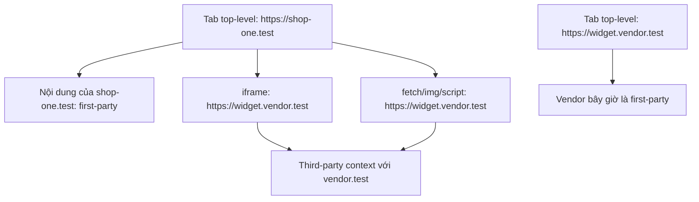
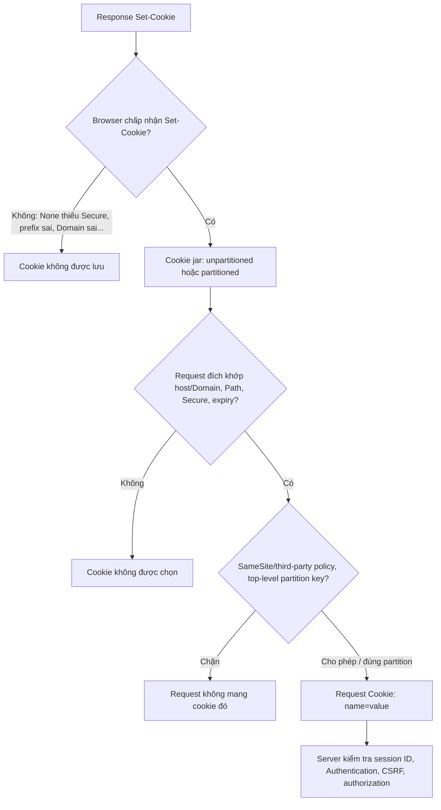
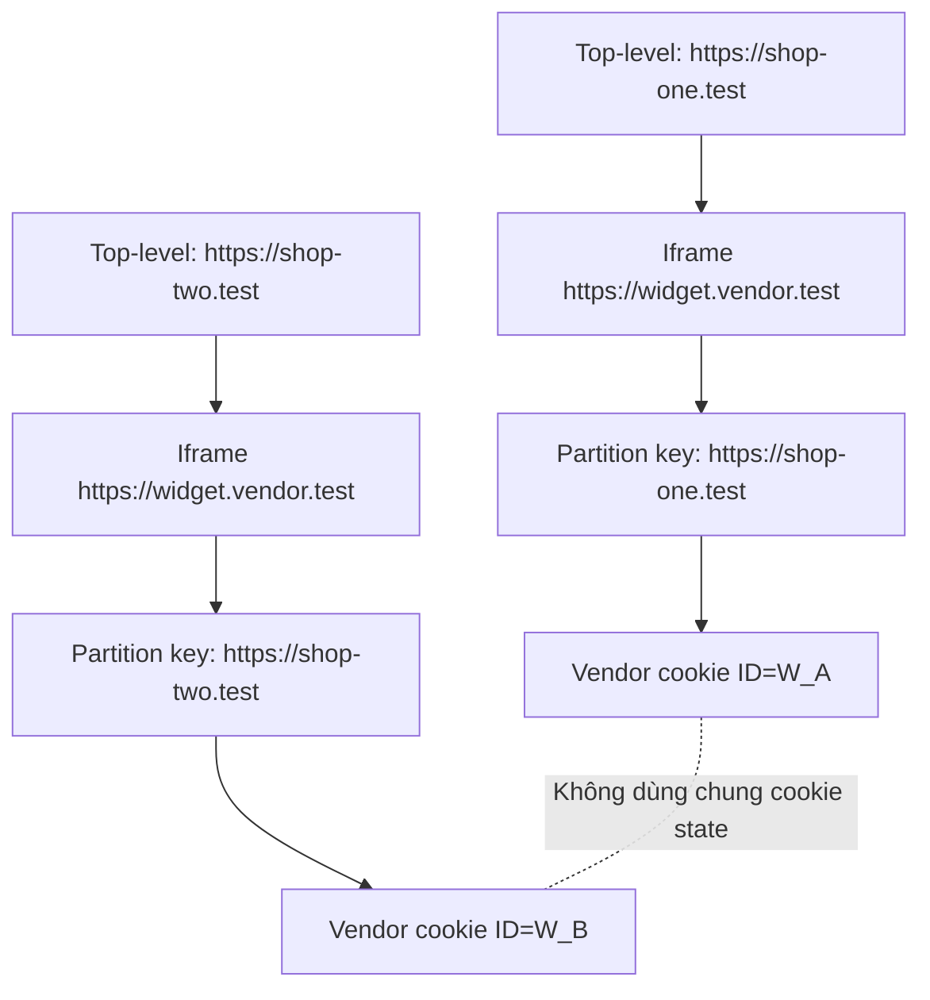
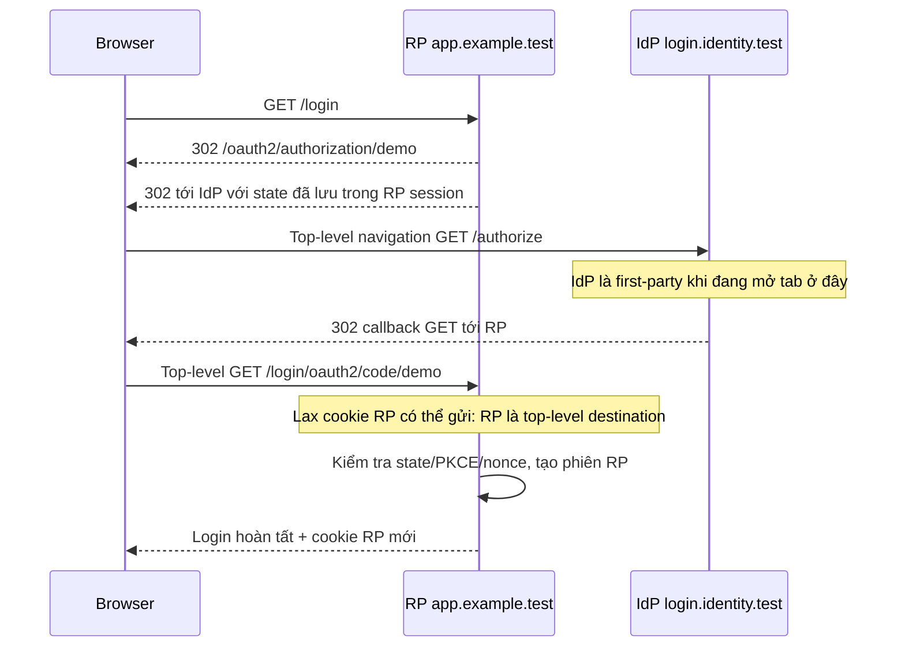

# Chính sách cookie bên thứ ba và kiểm thử khả năng gửi cookie

> **Chương:** Session và cookie  
> **Phạm vi:** Cookie xác thực và CSRF trong Spring Security **Servlet** và **Reactive WebFlux**; hành trình SSO/OIDC, iframe, widget nhúng, SPA gọi API khác site và những hạn chế riêng của Chromium, Firefox, Safari.  
> **Mục tiêu:** Giải thích vì sao `SameSite=None; Secure` vẫn không bảo đảm cookie được gửi; phân biệt *first-party*, *third-party*, cookie bị chặn và *partitioned cookies*; đánh giá `Partitioned`/CHIPS, Storage Access API và phương án không cần cookie bên thứ ba; viết kiểm thử HTTP lẫn browser E2E để chứng minh request thực **có hoặc không có cookie**, không làm lộ session ID.

Module `SPRING_SECURITY_HTTP_PROTECTION` hướng tới việc áp dụng các lớp phòng vệ HTTP và trình duyệt của Spring Security: CSRF, CORS, security headers, CSP, HSTS, HTTP firewall và session/cookie cho cả Servlet lẫn Reactive. Bài này nối cấu hình Spring với **hành vi thực tế của browser**: ứng dụng có thể phát cookie hoàn toàn hợp lệ nhưng iframe hoặc request cross-site **vẫn không nhận được phiên**, vì chính sách chống theo dõi và phân vùng lưu trữ.

**Thông điệp trọng tâm:** `Set-Cookie` hợp lệ **không chứng minh** cookie được lưu; cookie đã lưu **không chứng minh** nó sẽ được gửi trong request đang xét; cookie đã được gửi **không chứng minh** request đã authenticated hoặc được phép thực hiện hành động.

## 1. Bối cảnh: first-party, third-party và cross-site

**First-party context** là khi người dùng đang trực tiếp truy cập một website ở tab/top-level page, ví dụ `https://shop-one.test`. **Third-party context** là khi website ấy tải tài nguyên/trang từ một site khác, chẳng hạn iframe `https://widget.vendor.test` bên trong `shop-one.test`.



Một dịch vụ có thể là **first-party khi được mở trực tiếp** nhưng là **third-party khi bị nhúng**. Điều này là quan trọng với login:

- Khi người dùng **đang ở `widget.vendor.test` dưới dạng tab**, cookie vendor có thể hoạt động như cookie first-party.
- Cũng cookie đó khi vendor được nhúng dưới `shop-one.test` có thể bị **chặn** hoặc **phân vùng**.
- Chuyển hướng OAuth2/OIDC bằng **top-level navigation** từ IdP về ứng dụng là một **cross-site navigation**, nhưng ứng dụng callback trở thành **top-level site**, **không** phải iframe third-party. Vấn đề `SameSite=Lax/Strict` của cookie ở callback **khác** với chính sách chặn cookie trong iframe.

### 1.1. Site khác origin

**Origin** là scheme + hostname + port. **Site** theo cách tính hiện đại thường là scheme + registrable domain (dựa vào Public Suffix List). Do đó:

| Trang đang mở | Đích request | Cross-origin? | Cross-site? |
| --- | --- | --- | --- |
| `https://app.example.test` | `https://app.example.test/api` | Không | Không |
| `https://app.example.test` | `https://api.example.test/me` | **Có** | Thường **không** |
| `https://app.example.test` | `http://app.example.test/me` | **Có** | Có thể **có**, vì schemeful same-site |
| `https://shop-one.test` | `https://widget.vendor.test/frame` | **Có** | **Có** |
| `https://shop-two.test` | `https://widget.vendor.test/frame` | **Có** | **Có** |

Một SPA gọi API ở **subdomain khác nhưng cùng site** không tự trở thành “third-party cookie” trong cùng nghĩa với iframe thuộc site không liên quan. CORS vẫn cần cho cross-origin, nhưng đừng tự chuyển sang `SameSite=None` chỉ vì hai hostname khác nhau.

### 1.2. Header cơ bản

```http
# Response của widget.vendor.test khi được nhúng dưới shop-one.test:
HTTP/1.1 200 OK
Set-Cookie: __Host-widget_session=opaque-test; Path=/; Secure; HttpOnly; SameSite=None

# Một browser cho phép cookie third-party có thể gửi:
GET /frame HTTP/1.1
Host: widget.vendor.test
Cookie: __Host-widget_session=opaque-test

# Một browser CHẶN third-party cookie có thể gửi cùng request
# nhưng KHÔNG có header Cookie chứa widget_session.
```

`SameSite=None` chỉ yêu cầu **không chặn do quy tắc SameSite** trong ngữ cảnh cross-site; nó **không vượt qua** chính sách browser chặn cookie bên thứ ba. `Secure` yêu cầu HTTPS; `HttpOnly` hạn chế JavaScript đọc cookie nhưng browser vẫn có thể tự gửi khi mọi điều kiện cho phép.

## 2. Mô hình ra quyết định: vì sao cookie không được gửi?

Browser kiểm tra nhiều lớp:



**Phải phân biệt bốn trạng thái để chẩn đoán:**

1. **Bị từ chối khi đặt** (*rejected Set-Cookie*): ví dụ `SameSite=None` không `Secure`, `__Host-` có `Domain`, đặt cookie trên public suffix hoặc từ hostname không được phép.
2. **Được lưu nhưng bị chặn khi gửi** (*blocked sending*): browser đang chặn third-party cookies, `SameSite=Lax` gặp iframe cross-site, sai Path/Domain, hoặc request đi qua HTTP với cookie `Secure`.
3. **Được lưu trong partition khác** (*partition mismatch*): cookie của vendor dưới `shop-one.test` không phải cùng phiên với cookie của vendor dưới `shop-two.test`.
4. **Đã gửi nhưng không đăng nhập**: session ID hết hạn ở Redis/container, Spring Security không load được `SecurityContext` hoặc request bị CSRF/authorization từ chối.

Chẩn đoán sai trạng thái dẫn đến những “bản sửa” nguy hiểm: tắt CSRF để xử lý một cookie bị chặn, mở rộng `Domain` toàn tổ chức khi thực ra đang gặp partitioning, hoặc bật `SameSite=None` trong khi browser chặn third-party cookies.

## 3. SameSite và third-party blocking là hai bộ lọc khác nhau

| Cookie policy | Same-site request | Cross-site top-level GET | Cross-site iframe/fetch | Nếu browser chặn unpartitioned third-party cookies |
| --- | --- | --- | --- | --- |
| `SameSite=Strict` | Có thể gửi | Không gửi | Không gửi | Vẫn không gửi trong third-party context |
| `SameSite=Lax` tường minh | Có thể gửi | **Có thể gửi** trong top-level safe navigation | Không gửi | Vẫn không gửi trong third-party context |
| `SameSite=None; Secure` | Có thể gửi | Có thể gửi | **Có thể gửi** | **Vẫn có thể bị chặn** nếu cookie unpartitioned |
| `SameSite=None; Secure; Partitioned` | Có thể gửi trong partition phù hợp | Theo partition hiện hành | **Có thể gửi trong partition của top-level site** | Có thể được phép dưới chính sách hỗ trợ partitioned cookies |

Giá trị "có thể gửi" vẫn phụ thuộc `Domain`, `Path`, HTTPS, tuổi cookie, chính sách privacy, cấu hình người dùng và browser/version.

**Lax-by-default ≠ Lax tường minh.** Khi không khai báo `SameSite`, một số browser áp Lax nhưng có ngoại lệ ngắn cho top-level cross-site POST với cookie mới được đặt (ví dụ khoảng hai phút). Không xây hành trình SSO/callback dựa trên ngoại lệ này; ghi SameSite tường minh và kiểm thử method thật.

### 3.1. Phân biệt GET redirect của OAuth2 với iframe

```text
A. GET top-level callback:
   User tab: IdP -> HTTP 302 -> https://app.example.test/login/oauth2/code/demo
   Cookie RP Lax có thể gửi trong cross-site top-level GET.
   Đây KHÔNG phải iframe third-party của app ở trang IdP.

B. Third-party iframe:
   Top-level: https://shop-one.test
   Iframe:    https://idp.identity.test/silent-check
   Cookie IdP dù None;Secure có thể bị chặn hoặc phân vùng.

C. Cross-site form_post:
   Top-level navigation từ IdP POST tới RP callback.
   Cookie RP Lax thông thường KHÔNG gửi trong cross-site POST.
   Đây là vấn đề SameSite + callback method, không đồng nghĩa
   browser đã bật chặn cookie bên thứ ba trong iframe.
```

**Khi làm SSO:** Đừng nói "Chrome/Safari chặn third-party cookies nên OAuth2 GET redirect không chạy" nếu chưa xem request. Với OAuth2 authorization code redirect GET, nguyên nhân có thể là `SameSite=Strict`, cookie `Path`/`Domain`, lỗi `state`, callback URL, proxy hoặc session store; third-party cookie blocking chủ yếu làm hỏng các thiết kế **silent auth trong iframe, embedded IdP, front-channel logout**.

## 4. Chính sách của các browser: không được cố định một kết luận cho tất cả

Những chính sách này thay đổi theo phiên bản, cài đặt, chế độ riêng tư, profile doanh nghiệp và extensions. Bảng dưới đây nêu **xu hướng/chính sách theo tài liệu được kiểm tra vào tháng 11/2026**, không phải lời cam kết cho mọi user-agent:

| Browser/gia đình | Chính sách cần biết | Cách kiểm tra khi chạy test |
| --- | --- | --- |
| **Safari/WebKit** | Intelligent Tracking Prevention (ITP) chặn **unpartitioned third-party cookies mặc định**; Storage Access API cho một số trường hợp được cấp quyền; có thêm cơ chế chống tracking/bounce. | Test Safari/WebKit thật với "Prevent Cross-Site Tracking" ở cấu hình mục tiêu; kiểm tra storage access + request cookie. |
| **Firefox** | Enhanced Tracking Protection/Total Cookie Protection mặc định **phân vùng cookie/state theo top-level site** và chặn một số trackers; ngoại lệ/Storage Access API có điều kiện. | Test Firefox normal/private và policy ETP; kiểm tra partition jar trong DevTools. |
| **Chrome/Chromium** | Ở chế độ thông thường, chính sách **phụ thuộc cài đặt lựa chọn của người dùng và enterprise policy**; Incognito mặc định chặn third-party cookies. Google không áp dụng một lộ trình chặn đồng loạt như các kế hoạch phaseout cũ. | Test profile sạch **cho phép** và **chặn** third-party cookies, thêm Incognito; xác nhận trạng thái thật trong Settings/DevTools. |
| **Edge, Brave và trình duyệt khác** | Có tracking prevention/blocklist/strict settings riêng; không mặc nhiên giống Chrome Chromium. | Kiểm tra browser, version và policy thực; chạy bộ test âm tính/khôi phục. |

Tham khảo [MDN — Third-party cookies](https://developer.mozilla.org/en-US/docs/Web/Privacy/Guides/Third-party_cookies), [Mozilla — Total Cookie Protection](https://support.mozilla.org/en-US/kb/total-cookie-protection-and-website-breakage-faq), [WebKit — Tracking Prevention](https://webkit.org/tracking-prevention/) và [Chrome — kế hoạch tiếp theo cho Privacy Sandbox](https://privacysandbox.google.com/blog/privacy-sandbox-next-steps).

### 4.1. Không khẳng định "Chrome đã chặn toàn bộ cookie bên thứ ba"

Trong tháng 4/2025, Google thông báo **duy trì cách tiếp cận hiện hành về lựa chọn cookie bên thứ ba trong Chrome**, không đưa ra một prompt độc lập mới cho tất cả người dùng. Vì thế **không nên viết policy production dựa trên câu "đến năm X mọi Chrome đều chặn"**; kiểm tra behavior thực trong profile người dùng, Incognito và enterprise policy.

Ngược lại, **không** giả định vì Chrome normal profile của bạn vẫn gửi unpartitioned cookie thì khách dùng Safari/Firefox cũng như vậy. Chiến lược bền vững là **không phụ thuộc third-party unpartitioned cookie cho các chức năng bắt buộc**.

### 4.2. Chặn khác phân vùng

- **Blocked:** Không có session cookie được gửi/đọc trong third-party context đó theo chính sách; request tới widget có thể trở thành anonymous.
- **Partitioned:** Browser giữ **những phiên cookie riêng** cho cùng vendor dưới những top-level sites khác nhau. Widget có thể hoạt động ở mỗi site nhưng không dùng một ID để theo dõi người dùng xuyên site.
- **Unpartitioned access granted:** Một embed được cấp quyền dùng cookie không phân vùng qua cơ chế cụ thể như Storage Access API; grant có phạm vi/thời hạn và không phải mặc định.

Không dùng việc cookie "có trong DevTools Storage" để kết luận đã gửi. Một partition có thể hiện ra dưới site A nhưng không dùng được dưới site B; cần đo **request thực** ở từng ngữ cảnh.

## 5. CHIPS: cookie `Partitioned` hoạt động thế nào?

**CHIPS** (*Cookies Having Independent Partitioned State*) cho phép server yêu cầu lưu cookie trong **partition theo top-level site**, bằng attribute `Partitioned`. Đây là một cách cung cấp state cho widget nhúng mà không cho cùng một cookie ID được dùng chung để theo dõi người dùng xuyên các website độc lập.

```http
# Cookie partitioned của widget, đặt khi ở iframe cross-site:
Set-Cookie: __Host-widget_session=opaque-demo; Path=/; Secure; HttpOnly; SameSite=None; Partitioned
```

Yêu cầu quan trọng:

- `Partitioned` **phải có `Secure`**, cần HTTPS trên môi trường thật.
- Trong third-party iframe/fetch, `SameSite=None` thường cần để cookie có thể đi qua quy tắc SameSite.
- Prefix `__Host-` được khuyến nghị nếu chỉ cần cookie của chính host: **`Secure; Path=/; không Domain`**.
- **Browser phải hỗ trợ** Partitioned cookies; không phải mọi trình duyệt phiên bản cũ hay mọi chế độ riêng tư đều xử lý giống nhau.
- **Không nên cho rằng session partitioned sẽ tiếp tục được dùng như một session unpartitioned trong top-level tab.**

Theo [MDN — CHIPS](https://developer.mozilla.org/en-US/docs/Web/Privacy/Guides/Third-party_cookies/Partitioned_cookies), partition key dựa trên **site bao gồm scheme của top-level URL**, phối hợp với phạm vi cookie của site phát nó.

### 5.1. Hai shop, một widget, hai phiên khác nhau



| Ngữ cảnh | Cookie partitioned của vendor |
| --- | --- |
| Widget vendor dưới `shop-one.test` | Dùng phiên `W_A` thuộc partition site A. |
| Widget vendor dưới `shop-two.test` | Dùng phiên `W_B` thuộc partition site B. |
| Người dùng mở `widget.vendor.test` ở tab riêng | Ngữ cảnh top-level khác; **không mặc định kế thừa `W_A` hay `W_B`**. |
| Hai page/path của cùng `shop-one.test` cùng nhúng widget | Có thể dùng cùng partition `W_A` nếu các điều kiện còn lại đúng. |
| `http://shop-one.test` thay cho `https://shop-one.test` | Schemeful site có thể tạo **partition khác**, và cookie `Secure` không đi qua HTTP công khai. |

**Đừng triển khai CHIPS cho mục tiêu “đăng nhập widget trên mọi website bằng cùng một cookie”.** CHIPS cố tình giảm khả năng chia state giữa các site; SSO xuyên site nên dùng giao thức xác thực với top-level redirects/FedCM phù hợp, hoặc Storage Access API khi đáp ứng điều kiện, thay vì tái sử dụng partitioned ID.

### 5.2. Cookie partitioned khác cookie bị phân vùng mặc định

**`Partitioned`/CHIPS** là opt-in do server đặt trong `Set-Cookie`. **Total Cookie Protection** của Firefox có thể tự phân vùng third-party state theo policy browser, **ngay cả khi cookie không mang `Partitioned`**. Safari ITP lại thường **chặn** unpartitioned third-party cookie và quản lý storage theo cách riêng.

Vì vậy DevTools thấy "partitioned" **không tự chứng minh ứng dụng đã phát attribute `Partitioned`**. Cần kiểm tra:

1. Response `Set-Cookie` có thực sự ghi `Partitioned` không?
2. Browser đang chạy chính sách phân vùng mặc định hay CHIPS?
3. Top-level partition key được gắn theo site nào?
4. Request widget trong **cùng** và **khác** top-level site có gửi cookie không?

### 5.3. `Partitioned` không làm session an toàn một cách tự động

Phân vùng hạn chế tracking/cross-site state sharing nhưng **không thay thế**:

- Authentication và authorization: một cookie partitioned vẫn là bearer credential trong partition đó.
- CSRF: iframe/widget có các state-changing requests cần được bảo vệ theo mô hình cookie auth.
- `HttpOnly` và `Secure`: giảm rò session ID qua JavaScript/HTTP.
- Session fixation protection: khi đăng nhập/nâng quyền trong widget, session ID cũ không được tiếp tục mang quyền mới.
- Session store isolation: một ID thuộc partition site A **không được tự ý gắn vào tài khoản/tenant site B**.
- CSP `frame-ancestors` và kiểm tra origin của `postMessage`: bảo vệ việc nhúng/giao tiếp giữa page và widget.

## 6. Storage Access API: xin quyền dùng cookie không phân vùng

Khi một iframe cross-site thực sự cần đọc **cookie unpartitioned** đã tồn tại từ lúc user mở site của widget/IdP trực tiếp, browser có thể hỗ trợ **Storage Access API**.

Hai phương thức chính trên tài liệu:

```javascript
// Chạy BÊN TRONG iframe cross-site, trong secure context.
const hasAccess = await document.hasStorageAccess();

if (!hasAccess) {
  // requestStorageAccess() thường cần user activation, chính sách
  // browser/permission và điều kiện first-party interaction.
  await document.requestStorageAccess();
}

// Sau khi được cấp quyền, tài nguyên trong iframe mới có thể dùng
// unpartitioned cookies khi browser cho phép.
```

**Đừng gọi `requestStorageAccess()` vô điều kiện trong `DOMContentLoaded` rồi kỳ vọng trình duyệt tự cho phép.** Phương thức có thể từ chối; nhiều browser yêu cầu người dùng **tương tác** với nội dung nhúng, đã từng truy cập site đó như first-party, chính sách `Permissions-Policy` phù hợp và không bị sandbox chặn.

### 6.1. Ví dụ nút yêu cầu quyền trong iframe

```html
<!-- Widget page ở https://widget.vendor.test/embed -->
<button id="connect-account">Kết nối tài khoản widget</button>
<p id="access-message" role="status"></p>
<script>
  document.querySelector("#connect-account")
    .addEventListener("click", async () => {
      const message = document.querySelector("#access-message");
      if (!("requestStorageAccess" in document)) {
        message.textContent = "Trình duyệt chưa hỗ trợ cơ chế này.";
        return;
      }
      try {
        if (!(await document.hasStorageAccess())) {
          await document.requestStorageAccess();
        }
        message.textContent = "Đã cấp quyền; đang cập nhật phiên.";
        // Có thể cần reload/re-fetch để các request tiếp theo mang cookie.
        location.reload();
      } catch {
        message.textContent =
          "Không được cấp quyền. Hãy mở trang đăng nhập trực tiếp.";
      }
    });
</script>
```

Đây là **minh họa luồng UI**, không phải cơ chế bắt buộc mọi browser đều cho phép. Một số điều kiện/grants chỉ áp dụng cho embed đang gọi API hoặc cần **activate lại** trên các iframe/tab khác. **Không yêu cầu user tắt toàn bộ chống theo dõi** như cách đăng nhập bắt buộc; cung cấp fallback an toàn.

### 6.2. Khi iframe có `sandbox`

Đối với iframe có sandbox, để các script và Storage Access API hoạt động, có thể cần các token tương ứng:

```html
<!-- Trang host chỉ sử dụng khi có trust review với widget cross-origin. -->
<iframe
  src="https://widget.vendor.test/embed"
  sandbox="allow-scripts allow-same-origin allow-storage-access-by-user-activation"
  title="Widget tài khoản">
</iframe>
```

**Cảnh báo:** Với iframe **same-origin** không đáng tin, kết hợp `allow-scripts` và `allow-same-origin` có thể làm sandbox kém hiệu quả; ví dụ trên dựa trên widget **cross-origin**, cần đánh giá CSP `frame-ancestors`, `Permissions-Policy` và origin messaging. Không thêm tất cả sandbox tokens một cách mù quáng.

### 6.3. Storage Access API không phải bypass CSRF hoặc browser privacy

Nếu embed được cấp unpartitioned access, request của nó có thể mang cookie credential có quyền. Server vẫn phải:

1. Xác thực session/token và kiểm tra authorization.
2. Bảo vệ unsafe requests với CSRF token hoặc cơ chế chống giả mạo phù hợp.
3. Kiểm tra origin/tenant của dữ liệu nhạy cảm, không coi mọi host nhúng là được phép.
4. Giới hạn hành động sau user gesture; không lạm dụng quyền storage access để tracking.
5. Có cách thu hồi session và xử lý logout/expiry.

Nếu người dùng từ chối API, **không hạ chính sách bảo mật** bằng cách chuyển session ID sang URL/query/localStorage hoặc đặt wildcard CORS; dùng đường đi first-party đáng tin cậy thay thế.

## 7. Chọn kiến trúc ít phụ thuộc cookie bên thứ ba

| Nhu cầu | Phương án khuyến nghị | Khi nào cần API đặc biệt? |
| --- | --- | --- |
| Web app có form login thông thường | Session cookie **first-party** `Secure; HttpOnly; SameSite=Lax` (hoặc Strict khi UX cho phép). | Thường **không cần third-party cookies**. |
| OAuth2/OIDC authorization code flow với IdP khác site | **Top-level redirect** về RP, lưu session RP/correlation đúng, kiểm tra `state`/PKCE/nonce. | Lax thường đủ cho callback GET; `form_post` cross-site POST cần chính sách/handler riêng. |
| SPA cùng site, API khác origin | API cookie **host-only của API**, CORS credentials allowlist và CSRF. | Không cần mở cookie Domain toàn công ty chỉ vì cross-origin. |
| SPA khác **site** cần session | **Backend-for-Frontend (BFF)** hoặc reverse proxy để browser chỉ dùng first-party cookie, IdP login top-level. | Nếu thật sự cross-site cookie auth, None;Secure + browser restrictions + CSRF, có fallback. |
| Widget nhúng phải lưu **state riêng cho từng top-level site** | `Partitioned`/CHIPS trong browser hỗ trợ. | Kiểm tra partition key, scope, hỗ trợ browser/version. |
| Widget nhúng cần **phiên IdP unpartitioned đã có sẵn** | Storage Access API theo user gesture và permission, cùng fallback top-level login. | Chỉ khi browser cho phép, không cam kết tự cấp quyền. |
| Widget không cần session liên tục | API token scoped ngắn hạn **do backend host cấp cho widget** qua handshake bảo mật, không mang session cookie host. | Threat model token delivery, `postMessage` targetOrigin, replay, expiry. |
| IdP muốn cơ chế liên kết danh tính có browser hỗ trợ | Xem xét **FedCM** khi IdP và browser phù hợp. | Còn giới hạn tương thích; không coi là thay thế OIDC chung cho mọi browser. |
| SSO front-channel logout qua iframe IdP | Cân nhắc **back-channel logout** có chữ ký hoặc cơ chế server-side revocation. | Iframe có thể thiếu cookie do privacy policy. |

**BFF** là mẫu thực dụng: browser chỉ giữ cookie phiên `app.example.test`, backend app thực hiện giao tiếp OAuth2/API tới những services khác qua server-to-server request (không phải third-party iframe cookie). Điều này giảm phụ thuộc third-party cookies, nhưng **BFF vẫn phải bảo vệ CSRF/XSS/authorization và quản lý token phía server**.

### 7.1. FedCM không phải một flag của Spring Security

**Federated Credential Management API (FedCM)** cho browser làm trung gian trong một số luồng federated login mà không dựa vào third-party cookies truyền thống. Nó **không phải** một thuộc tính `Set-Cookie`, không tự hoạt động khi thêm `oauth2Login()` vào Spring Security và không có hỗ trợ ngang nhau ở mọi browser.

Nếu IdP hỗ trợ FedCM, đánh giá kỹ browser compatibility, RP/IdP integration, `Permissions-Policy`, fallback OIDC, hành vi logout/revocation và threat model trước khi áp dụng. Xem [MDN — FedCM API](https://developer.mozilla.org/en-US/docs/Web/API/FedCM_API).

## 8. Hành trình đăng nhập: điều nào hỏng vì cookie third-party?



**Đừng nhầm** các luồng:

- **Top-level OAuth2 code redirect GET:** thường không cần IdP cookie được gửi trong iframe third-party; IdP được truy cập trực tiếp trong tab để xác thực. Cookie RP `Lax` có thể được gửi khi callback GET, nhưng phải kiểm tra `state` và session store.
- **`response_mode=form_post`:** cross-site **top-level POST** về RP có thể không gửi cookie `Lax` (dù không có iframe). Cần thiết kế callback POST với `SameSite=None; Secure` khi cần và mọi validation giao thức; không tắt CSRF toàn hệ thống.
- **Silent auth qua hidden iframe IdP:** một iframe cross-site có thể không nhận cookie IdP vì third-party policy; không có cookie → không thể biết user đang có phiên IdP. Đây là tình huống điển hình cần thay kiến trúc.
- **SAML2 POST Binding/front-channel logout iframe:** chịu cả quy tắc method/SameSite và third-party/embedded contexts; kiểm tra giao thức chứ không hạ bảo mật một cách tổng quát.

Không dùng `SameSite=None` trên tất cả session cookies chỉ vì một cơ chế silent-auth bị chặn. Nếu browser **chặn unpartitioned third-party cookie**, đổi Lax sang None vẫn không khôi phục được. Muốn xử lý phải xem CHIPS (state từng site), Storage Access API, FedCM hoặc chuyển sang top-level/BFF tùy mục tiêu.

## 9. Spring Boot Servlet: giữ session cookie first-party theo mặc định

Một website Spring MVC dùng form login/OIDC redirect GET thông thường nên **bắt đầu với first-party session cookie** không cần Domain rộng:

```yaml
# application.yml — ví dụ cho Spring Boot Servlet production HTTPS.
server:
  servlet:
    session:
      cookie:
        name: __Host-SESSION
        path: /
        secure: true
        http-only: true
        same-site: lax
      timeout: 30m
```

**Vì sao không đặt None ngay?** Session cookie này phục vụ trang top-level của chính app; với OAuth2 code GET callback, `Lax` thường đủ để browser gửi cookie RP. `None` mở rộng phạm vi gửi cookie trong third-party contexts mà không bảo đảm browser chấp nhận.

`__Host-SESSION` hợp lệ khi được đặt trên HTTPS với `Secure`, `Path=/` và **không có `Domain`. Prefix không thay quyền kiểm tra session hay CSRF. Nếu application dùng context path/host khác, cần kiểm tra toàn bộ login, callback và logout URL thực của browser.

### 9.1. SecurityFilterChain cho Servlet

```java
import org.springframework.context.annotation.Bean;
import org.springframework.context.annotation.Configuration;
import org.springframework.security.config.Customizer;
import org.springframework.security.config.annotation.web.builders.HttpSecurity;
import org.springframework.security.web.SecurityFilterChain;

@Configuration
class ServletCookieProtection {

    @Bean
    SecurityFilterChain securityFilterChain(HttpSecurity http)
            throws Exception {
        return http
            .authorizeHttpRequests(auth -> auth
                .requestMatchers("/login", "/assets/**").permitAll()
                .anyRequest().authenticated())
            .formLogin(Customizer.withDefaults())
            .oauth2Login(Customizer.withDefaults())
            .csrf(Customizer.withDefaults())
            .sessionManagement(session -> session
                .sessionFixation(fixation -> fixation.changeSessionId()))
            .build();
    }
}
```

Ứng dụng phải có client registration/IdP và dependency thích hợp để `oauth2Login()` chạy; nếu chỉ dùng form login, bỏ phần OAuth2. Trên Servlet stack hiện đại, session fixation protection thường đã dùng `changeSessionId()` mặc định. Khi đăng nhập, ID phiên có thể đổi A→B để ID ẩn danh bị biết trước không mang quyền đã xác thực.

**Không cấu hình SameSite bằng `HttpSecurity.sessionManagement()`:** đây là hai tầng độc lập. Security filters thực hiện authentication/authorization/CSRF, còn Servlet container hoặc Spring Session serializer phát cookie policy.

### 9.2. Khi nào dùng `same-site: none` ở Servlet?

```yaml
# Chỉ là phương án thay thế sau khi đã đánh giá callback/iframe.
server:
  servlet:
    session:
      cookie:
        name: __Host-SESSION
        path: /
        secure: true
        http-only: true
        same-site: "none"
```

Chọn nếu có **use case cụ thể** đòi cookie đó trong cross-site context, hiểu rõ third-party blocking/CHIPS/Storage Access API, và vẫn bảo vệ CSRF. **Nó không tự vượt chính sách Safari/Firefox/Chrome chặn hoặc phân vùng cookie.**

Một OIDC `response_mode=form_post` cross-site POST có thể cần cookie RP `None; Secure` để tìm lại authorization request; đồng thời authentication callback matcher, `state`/PKCE/nonce và CSRF exception **đúng một endpoint giao thức** phải được tích hợp an toàn. Không đơn giản gọi `csrf.disable()` toàn application để sửa POST callback.

## 10. Spring Session Servlet: cookie serializer có thể ghi đè Boot policy

Nếu dùng Spring Session Redis/JDBC, cookie có thể do `DefaultCookieSerializer` quản lý. Ví dụ **first-party**:

```java
import org.springframework.context.annotation.Bean;
import org.springframework.context.annotation.Configuration;
import org.springframework.session.web.http.CookieSerializer;
import org.springframework.session.web.http.DefaultCookieSerializer;

@Configuration
class SessionCookieSerializerConfig {

    @Bean
    CookieSerializer cookieSerializer() {
        var serializer = new DefaultCookieSerializer();
        serializer.setCookieName("__Host-SESSION");
        serializer.setCookiePath("/");
        serializer.setUseSecureCookie(true);
        serializer.setUseHttpOnlyCookie(true);
        serializer.setSameSite("Lax");
        // Không Domain: __Host- yêu cầu host-only.
        return serializer;
    }
}
```

Nếu ứng dụng đã định nghĩa `CookieSerializer`, **đừng giả định Spring Boot properties sẽ tự ghi đè**. Đọc `Set-Cookie` cuối cùng ở browser/edge.

### 10.1. `Partitioned` trên Servlet không chỉ là đổi SameSite

Trong Servlet container/Spring Session, việc phát **`Partitioned` cho session cookie thật** phụ thuộc **Servlet container, cookie processor và phiên bản Spring Session**. Không giả định `DefaultCookieSerializer.setSameSite("None")` tự phát `Partitioned`; đó là **hai attributes khác nhau**.

Nếu custom session infrastructure **không hỗ trợ** Partitioned, **không** phát thêm một header `Set-Cookie` cùng tên/session ID một cách tùy tiện tại application filter: có thể tạo cookie trùng tên khác scope, ghi đè policy hoặc phá logout. Nên dùng API cookie/session của phiên bản container tương thích, cấu hình writer duy nhất và kiểm thử actual response/browser.

### 10.2. Không mở rộng `Domain` chỉ vì có Redis dùng chung

Nếu website A và B cùng dùng Redis không có nghĩa browser nên mang **một session cookie** tới mọi subdomain. Cookie `Domain=example.test` mở rộng phạm vi credential; backend khác còn phải hiểu cùng session namespace/serializer và security context. Với các ứng dụng độc lập, **mỗi host có cookie riêng + SSO/OIDC** thường an toàn và dễ vận hành hơn.

## 11. Reactive WebFlux: `CookieWebSessionIdResolver`

Spring WebFlux dùng `WebSession`; Spring Security Reactive dùng `ServerHttpSecurity` và `SecurityWebFilterChain`. Cookie session được quản lý qua `WebSessionIdResolver`, không phải Servlet `HttpSession`.

### 11.1. Cấu hình first-party qua Spring Boot

```yaml
# application.yml — cho Spring Boot Reactive hỗ trợ properties này.
server:
  reactive:
    session:
      cookie:
        name: __Host-SESSION
        path: /
        secure: true
        http-only: true
        same-site: lax
      timeout: 30m
```

Chỉ dùng nhóm `server.reactive.session.cookie.*` với reactive stack hỗ trợ; không dùng `server.servlet.session.cookie.*` rồi mong ảnh hưởng WebFlux. Spring Session Reactive có thể custom manager/resolver; test bean thực được chọn.

### 11.2. Cấu hình bằng Java

```java
import org.springframework.context.annotation.Bean;
import org.springframework.context.annotation.Configuration;
import org.springframework.web.server.session.CookieWebSessionIdResolver;
import org.springframework.web.server.session.WebSessionIdResolver;

@Configuration
class ReactiveFirstPartyCookieConfig {

    @Bean
    WebSessionIdResolver webSessionIdResolver() {
        var resolver = new CookieWebSessionIdResolver();
        resolver.setCookieName("__Host-SESSION");
        resolver.addCookieInitializer(cookie -> cookie
            .path("/")
            .secure(true)
            .httpOnly(true)
            .sameSite("Lax"));
        return resolver;
    }
}
```

Đây là **phương án thay thế** properties khi cần custom trực tiếp. Không tạo hai bean resolver cạnh tranh. `CookieWebSessionIdResolver` mặc định dùng `SESSION` nếu không đổi tên; cần thống nhất cookie name khi login/logout/test.

### 11.3. Cookie partitioned cho widget WebFlux (Spring Framework 6.2+)

Nếu widget nhúng **cần state riêng cho từng top-level site** và phiên bản hỗ trợ, `ResponseCookie.ResponseCookieBuilder.partitioned(boolean)` có từ **Spring Framework 6.2**:

```java
import org.springframework.context.annotation.Bean;
import org.springframework.context.annotation.Configuration;
import org.springframework.web.server.session.CookieWebSessionIdResolver;
import org.springframework.web.server.session.WebSessionIdResolver;

@Configuration
class ReactiveWidgetCookieConfig {

    @Bean
    WebSessionIdResolver widgetWebSessionIdResolver() {
        var resolver = new CookieWebSessionIdResolver();
        resolver.setCookieName("__Host-WIDGET_SESSION");
        resolver.addCookieInitializer(cookie -> cookie
            .path("/")
            .secure(true)
            .httpOnly(true)
            .sameSite("None")
            .partitioned(true)); // Chỉ có ở Spring Framework 6.2+.
        return resolver;
    }
}
```

**Không đăng ký đồng thời** `ReactiveFirstPartyCookieConfig` và `ReactiveWidgetCookieConfig` cho cùng một WebFlux app rồi hy vọng mỗi request có resolver khác; đây là **hai phương án triển khai độc lập**. Chỉ dùng widget configuration khi có use case thực và test browser supports CHIPS.

`__Host-WIDGET_SESSION` cần HTTPS + `Secure` + `Path=/` + không `Domain`. Browser hỗ trợ sẽ lưu phiên theo top-level site partition key, **không** làm một cookie SSO liên site. Backend vẫn cần session isolation theo tenant, CSRF, authorization, TTL và bảo vệ session fixation.

Nếu phiên bản thấp hơn Spring Framework 6.2, **không gọi `partitioned(true)`**. Nâng phiên bản/BOM hoặc sử dụng cơ chế session-cookie writer có hỗ trợ theo kiến trúc và kiểm thử, không tự append bừa `Set-Cookie` trùng tên.

### 11.4. Reactive SecurityWebFilterChain

```java
import org.springframework.context.annotation.Bean;
import org.springframework.context.annotation.Configuration;
import org.springframework.security.config.Customizer;
import org.springframework.security.config.annotation.web.reactive.EnableWebFluxSecurity;
import org.springframework.security.config.web.server.ServerHttpSecurity;
import org.springframework.security.web.server.SecurityWebFilterChain;

@Configuration
@EnableWebFluxSecurity
class ReactiveCookieProtection {

    @Bean
    SecurityWebFilterChain securityWebFilterChain(ServerHttpSecurity http) {
        return http
            .authorizeExchange(auth -> auth
                .pathMatchers("/login", "/public/**").permitAll()
                .anyExchange().authenticated())
            .formLogin(Customizer.withDefaults())
            .csrf(Customizer.withDefaults())
            .build();
    }
}
```

**Không dùng `HttpSecurity.sessionManagement().sessionFixation()` trong WebFlux.** Với `WebSessionServerSecurityContextRepository`, lưu `SecurityContext` có cơ chế đổi session ID để giảm fixation. Nếu custom `ServerSecurityContextRepository`, phải test việc ID cũ không tiếp tục mang Authentication sau login.

### 11.5. Khi nào `WebSession` thực sự phát cookie?

Gọi `exchange.getSession()` có thể tạo `Mono<WebSession>` cho phiên **chưa start**. Nếu không thêm attributes/chủ động start, server có thể **không gửi Set-Cookie** trên GET công khai. Test cần kích hoạt phiên thật bằng `session.start()` trong **test-only endpoint**, hoặc tiêu thụ token CSRF khiến repository tạo session; không kết luận cookie bị browser chặn khi response chưa từng đặt cookie.

## 12. CORS, CSRF và third-party cookies: phép thử phải độc lập

Giả sử trang `https://shop-one.test` gọi JavaScript tới `https://widget.vendor.test/api/checkout` bằng cookie:

```javascript
const response = await fetch("https://widget.vendor.test/api/checkout", {
  method: "POST",
  credentials: "include",
  headers: {
    "Content-Type": "application/json",
    "X-CSRF-TOKEN": csrfTokenFromSupportedFlow
  },
  body: JSON.stringify({ sku: "DEMO-01", quantity: 1 })
});
```

Có ba câu hỏi **khác nhau**:

1. **Cookie:** Browser có đang gửi credential trong third-party context không? `credentials:"include"` chỉ **cho phép** fetch gửi credential phù hợp; nó **không vượt qua** SameSite, 3PC blocking, partition key, expiry hay cookie scope.
2. **CORS:** Browser có cho JavaScript của `shop-one.test` **đọc response** không? API phải dùng allowlist origin cụ thể cùng `Access-Control-Allow-Credentials: true` nếu credentialed cross-origin. `Access-Control-Allow-Origin: *` không dùng được với credentials.
3. **CSRF/authorization:** Nếu cookie được gửi, API phải xác minh CSRF token/Origin và quyền theo session/tenant. Một request bị CORS chặn khi JS đọc response **không có nghĩa server chưa thực thi side effect** với một request simple không preflight.

**Đừng tắt CSRF** vì client đang nhúng trong iframe, vì có CORS allowlist hoặc vì cookie được Partitioned. Tất cả những điều ấy là các lớp riêng.

### 12.1. Preflight không phải credential login

Browser gửi `OPTIONS` preflight khi cần, ví dụ có custom header `X-CSRF-TOKEN` hoặc JSON content type. Preflight theo chính sách CORS thường **không mang session cookie như request thực**; Spring Security phải xử lý CORS trước khi security yêu cầu authentication cho OPTIONS.

Nếu thấy preflight `401`/`403`, đừng gắn session cookie vào OPTIONS thủ công để “sửa”. Hãy cấu hình CORS đúng cho allowed origins/methods/headers và cho preflight đi qua cơ chế tương thích.

### 12.2. `SameSite=None` mở rộng bề mặt request có credential

Khi browser **cho phép** cookie third-party unpartitioned, `SameSite=None` khiến cookie có thể đi cùng cross-site requests. Các endpoint `POST/PUT/PATCH/DELETE` cần CSRF protection theo repository/handler phù hợp.

Nếu browser **chặn** cookie, request có thể bị anonymous; đừng coi điều đó là "đã chống CSRF". Attacker có thể khai thác trong browser khác/policy khác hoặc trên request same-site nơi cookie vẫn được gửi. **Server-side CSRF/authorization phải độc lập với browser privacy settings.**

## 13. Bộ test fixture: ba HTTPS sites và cookie probe không lộ bí mật

Muốn kiểm tra việc browser **có gửi cookie hay không**, dùng ít nhất ba HTTPS sites với registrable domains khác nhau:

```text
https://shop-one.test           (top-level site A)
https://shop-two.test           (top-level site B)
https://widget.vendor.test      (embedded third-party site)

shop-one.test/with-widget, shop-two.test/with-widget:
  Nhúng iframe src=https://widget.vendor.test/test/widget

widget.vendor.test/test/widget:
  Nhận cookie probe nếu browser gửi.
  Nếu chưa có, tạo cookie probe ngẫu nhiên trong Set-Cookie.
  Trả HTML trạng thái NEW hoặc RETURNING, KHÔNG trả raw cookie ID.
```

`*.test` là tên ví dụ, **không tự resolve** nếu chưa cấu hình DNS/hosts và chứng chỉ HTTPS tương ứng. Dùng browser test thật với certificate hợp lệ. Tránh `localhost` để không bị ngoại lệ `Secure` làm sai kết luận.

Chạy hai **profiles độc lập**, cùng tên cookie nhưng không phát trùng trong một response:

| Profile | `Set-Cookie` từ widget | Điều cần đo |
| --- | --- | --- |
| Unpartitioned | `__Host-widget_session=...; Path=/; Secure; HttpOnly; SameSite=None` | Browser cho phép/chặn unpartitioned third-party cookie? |
| CHIPS | `__Host-widget_session=...; Path=/; Secure; HttpOnly; SameSite=None; Partitioned` | Browser có lưu state riêng cho A và B không? |

### 13.1. Servlet test-only endpoint

```java
import jakarta.servlet.http.Cookie;
import jakarta.servlet.http.HttpServletRequest;
import jakarta.servlet.http.HttpServletResponse;
import java.security.SecureRandom;
import java.util.Base64;
import org.springframework.http.MediaType;
import org.springframework.web.bind.annotation.GetMapping;
import org.springframework.web.bind.annotation.RestController;

// Chỉ đăng ký controller trong môi trường test có kiểm soát.
@RestController
class ThirdPartyCookieProbeServlet {
    private static final SecureRandom RNG = new SecureRandom();
    private static final String NAME = "__Host-widget_session";

    @GetMapping(value = "/test/widget", produces = MediaType.TEXT_HTML_VALUE)
    String widget(HttpServletRequest request, HttpServletResponse response) {
        boolean present = false;
        if (request.getCookies() != null) {
            for (Cookie cookie : request.getCookies()) {
                if (NAME.equals(cookie.getName())) present = true;
            }
        }
        if (!present) {
            byte[] bytes = new byte[32];
            RNG.nextBytes(bytes);
            String value = Base64.getUrlEncoder()
                .withoutPadding().encodeToString(bytes);

            // Profile UNPARTITIONED; với CHIPS cần cookie writer
            // tương thích để phát attribute Partitioned.
            response.addHeader("Set-Cookie", NAME + "=" + value
                + "; Path=/; Secure; HttpOnly; SameSite=None");
        }
        response.setHeader("Cache-Control", "no-store");
        return "<!doctype html><html><body>"
            + "<span data-testid='visit-status'>"
            + (present ? "RETURNING" : "NEW")
            + "</span></body></html>";
    }
}
```

Đây là **cookie probe giả lập**, không phải session credential production; endpoint không trả giá trị cookie ra HTML. Chỉ triển khai trong test profile, giới hạn truy cập fixture và không dùng lại tên cookie phiên của ứng dụng thật. Để kiểm thử CHIPS trên Servlet, cấu hình **một** session/cookie writer hỗ trợ `Partitioned` theo phiên bản container, không tự phát hai `Set-Cookie` cùng tên rồi gây shadowing.

### 13.2. WebFlux fixture không phụ thuộc Authentication

```java
import java.security.SecureRandom;
import java.util.Base64;
import org.springframework.http.CacheControl;
import org.springframework.http.MediaType;
import org.springframework.http.ResponseCookie;
import org.springframework.http.ResponseEntity;
import org.springframework.web.bind.annotation.GetMapping;
import org.springframework.web.bind.annotation.RestController;
import org.springframework.web.server.ServerWebExchange;
import reactor.core.publisher.Mono;

@RestController
class ThirdPartyCookieProbeReactive {
    private static final SecureRandom RNG = new SecureRandom();
    private static final String NAME = "__Host-widget_session";

    @GetMapping(value = "/test/widget", produces = MediaType.TEXT_HTML_VALUE)
    Mono<ResponseEntity<String>> widget(ServerWebExchange exchange) {
        boolean present =
            exchange.getRequest().getCookies().containsKey(NAME);
        if (!present) {
            byte[] bytes = new byte[32];
            RNG.nextBytes(bytes);
            String value = Base64.getUrlEncoder()
                .withoutPadding().encodeToString(bytes);

            ResponseCookie cookie = ResponseCookie.from(NAME, value)
                .path("/")
                .secure(true)
                .httpOnly(true)
                .sameSite("None")
                .build(); // UNPARTITIONED.
            exchange.getResponse().addCookie(cookie);
        }
        String html = "<!doctype html><html><body>"
            + "<span data-testid='visit-status'>"
            + (present ? "RETURNING" : "NEW")
            + "</span></body></html>";

        return Mono.just(ResponseEntity.ok()
            .cacheControl(CacheControl.noStore())
            .contentType(MediaType.TEXT_HTML)
            .body(html));
    }
}
```

Ở **profile CHIPS dùng Spring Framework 6.2+**, thay `.sameSite("None").build()` bằng `.sameSite("None").partitioned(true).build()`. Không dùng `partitioned(true)` với Spring Framework cũ hơn 6.2. Fixture không dùng `WebSession` thật; test session/security phải được thực hiện độc lập.

### 13.3. Trang host nhúng widget

```html
<!-- Phát bởi shop-one.test/with-widget hoặc shop-two.test/with-widget -->
<!doctype html>
<html lang="vi">
<body>
  <h1>Trang nhúng widget</h1>
  <iframe
    data-testid="widget"
    title="Cookie test widget"
    src="https://widget.vendor.test/test/widget"></iframe>
</body>
</html>
```

Một iframe có thể tải **không cần CORS** theo cùng cách `fetch` cross-origin; JavaScript của trang host **không được tự đọc DOM** trong iframe do same-origin policy. Playwright có `frameLocator` để test fixture. Khi cần giao tiếp production bằng `postMessage`, dùng exact `targetOrigin` và kiểm tra `event.origin`, không gửi session ID trong message.

## 14. Kiểm thử unit và HTTP headers trước khi dùng browser

### 14.1. Unit test `ResponseCookie` cho CHIPS (Spring Framework 6.2+)

```java
import org.junit.jupiter.api.Test;
import org.springframework.http.ResponseCookie;

import static org.junit.jupiter.api.Assertions.*;

class PartitionedCookieHeaderTest {

    @Test
    void partitionedCookieIsSecureNoneAndHostOnly() {
        ResponseCookie cookie = ResponseCookie
            .from("__Host-widget_session", "opaque-test-value")
            .path("/")
            .secure(true)
            .httpOnly(true)
            .sameSite("None")
            .partitioned(true)
            .build();

        assertTrue(cookie.isSecure());
        assertTrue(cookie.isHttpOnly());
        assertTrue(cookie.isPartitioned());
        assertEquals("None", cookie.getSameSite());
        assertEquals("/", cookie.getPath());
        assertNull(cookie.getDomain());
        assertTrue(cookie.toString().contains("Partitioned"));
    }
}
```

`partitioned(boolean)` và `isPartitioned()` có từ Spring Framework 6.2. Builder tạo đúng header **không** chứng minh browser chấp nhận cookie hay partition key hoạt động.

### 14.2. Test `CookieWebSessionIdResolver` phát cookie CHIPS

```java
import org.junit.jupiter.api.Test;
import org.springframework.http.ResponseCookie;
import org.springframework.mock.http.server.reactive.MockServerHttpRequest;
import org.springframework.mock.web.server.MockServerWebExchange;
import org.springframework.web.server.session.CookieWebSessionIdResolver;

import static org.junit.jupiter.api.Assertions.*;

class PartitionedWebSessionResolverTest {

    @Test
    void emitsPartitionedSessionCookie() {
        var resolver = new CookieWebSessionIdResolver();
        resolver.setCookieName("__Host-WIDGET_SESSION");
        resolver.addCookieInitializer(builder -> builder
            .path("/")
            .secure(true)
            .httpOnly(true)
            .sameSite("None")
            .partitioned(true));

        var exchange = MockServerWebExchange.from(
            MockServerHttpRequest.get(
                "https://widget.vendor.test/test/widget"));

        resolver.setSessionId(exchange, "opaque-test-value");

        ResponseCookie emitted = exchange.getResponse().getCookies()
            .getFirst("__Host-WIDGET_SESSION");

        assertNotNull(emitted);
        assertTrue(emitted.isPartitioned());
        assertTrue(emitted.isSecure());
        assertTrue(emitted.isHttpOnly());
        assertEquals("None", emitted.getSameSite());
        assertEquals("/", emitted.getPath());
        assertNull(emitted.getDomain());
    }
}
```

Test này chỉ xác minh **response cookie writer**, không mô phỏng browser. Trong project có `WebSessionIdResolver` bean custom hoặc Spring Session Reactive, phải kiểm tra chính bean thực được chọn bởi application context, không chỉ đối tượng mới tự tạo trong test.

### 14.3. `WebTestClient` kiểm tra `Set-Cookie` của fixture

```java
import org.junit.jupiter.api.Test;
import org.springframework.http.HttpHeaders;

import static org.junit.jupiter.api.Assertions.*;

// Thân test trong class có WebTestClient client gắn vào app.
@Test
void widgetResponseDeclaresPartitionedCookie() {
    var result = client.get().uri("/test/widget")
        .exchange()
        .expectStatus().isOk()
        .expectBody()
        .returnResult();

    String header = result.getResponseHeaders()
        .getOrEmpty(HttpHeaders.SET_COOKIE)
        .stream()
        .filter(s -> s.startsWith("__Host-widget_session="))
        .findFirst().orElseThrow();

    assertTrue(header.contains("Secure"));
    assertTrue(header.contains("HttpOnly"));
    assertTrue(header.contains("SameSite=None"));
    assertTrue(header.contains("Path=/"));
    assertTrue(header.contains("Partitioned"));
    assertFalse(header.contains("Domain="));
}
```

Test này **chỉ chạy với fixture CHIPS** đã thay `.partitioned(true)`; profile unpartitioned phải assert không có `Partitioned`. Đừng log nguyên `Set-Cookie`: nó chứa credential/probe ID. Kể cả HTTP test pass, **không suy ra browser sẽ gửi cookie trong iframe**.

## 15. Playwright E2E: phân vùng theo hai top-level sites

**Đây mới là kiểm thử chính** cho khả năng browser gửi cookie. Với fixture `/test/widget` và hai trang `/with-widget` của mục 13, chạy trên browser **đã xác nhận hỗ trợ CHIPS**:

```typescript
import { test, expect } from "@playwright/test";

test("CHIPS separates widget sessions by top-level site",
  async ({ browser }) => {
    const context = await browser.newContext();
    const page = await context.newPage();
    const status = page.frameLocator('iframe[data-testid="widget"]')
      .getByTestId("visit-status");

    // Partition A: request đầu không có cookie; request sau có cookie.
    await page.goto("https://shop-one.test/with-widget");
    await expect(status).toHaveText("NEW");
    await page.reload();
    await expect(status).toHaveText("RETURNING");

    // Partition B độc lập, không dùng cookie A.
    await page.goto("https://shop-two.test/with-widget");
    await expect(status).toHaveText("NEW");
    await page.reload();
    await expect(status).toHaveText("RETURNING");

    // Trở lại A vẫn dùng được partition của A.
    await page.goto("https://shop-one.test/with-widget");
    await expect(status).toHaveText("RETURNING");
    await context.close();
  }
);
```

**Điều kiện:** Profile widget phải phát cookie có `Partitioned`, ba hosts đều resolve và dùng HTTPS certificate hợp lệ, không có cookies cũ trong browser context. Test này không bảo đảm CHIPS có mặt ở mọi browser phiên bản cũ; hãy kiểm tra compatibility và đánh dấu *unsupported* thay vì báo ứng dụng "bug" nếu browser mục tiêu chưa hỗ trợ.

### 15.1. Cách đọc kết quả

| Quan sát | Khả năng có thể xảy ra | Bước xác nhận tiếp |
| --- | --- | --- |
| A `NEW → RETURNING`, B `NEW → RETURNING` | CHIPS/partitioning hoạt động theo top-level site. | Kiểm tra `Partitioned` trong Set-Cookie và partition key. |
| A luôn `NEW` | Cookie bị từ chối, blocked, không được lưu, hết hạn hoặc fixture lỗi. | DevTools blocked reasons, `Set-Cookie`, Path/Domain/HTTPS. |
| B lần đầu `RETURNING` | Browser gửi **unpartitioned** cookie hoặc fixture đang ở profile sai. | Kiểm tra Partitioned header, browser support/profile/context sạch. |
| A lần đầu đã `RETURNING` | Context không sạch, cookie có sẵn hoặc server fixture không reset. | Tạo context mới và dọn test data. |
| Iframe không tải | CSP `frame-ancestors`/`X-Frame-Options`, TLS, DNS, authentication, server. | Kiểm tra navigation và console/network **trước** khi xét cookie. |

### 15.2. Test unpartitioned cookie dưới chế độ browser chặn

Với fixture **unpartitioned** (không có `Partitioned`) và browser **đã bật chính sách block third-party cookies**, một test negative có thể là:

```typescript
test("blocked unpartitioned third-party cookie does not persist",
  async ({ browser }) => {
    const context = await browser.newContext();
    const page = await context.newPage();
    const status = page.frameLocator('iframe[data-testid="widget"]')
      .getByTestId("visit-status");

    await page.goto("https://shop-one.test/with-widget");
    await expect(status).toHaveText("NEW");
    await page.reload();
    await expect(status).toHaveText("NEW");
    await context.close();
  }
);
```

**Không chạy test này như assertion chung trên Firefox**: Total Cookie Protection có thể **phân vùng mặc định** và cho `RETURNING` trong cùng site A, dù không có `Partitioned`. Không chạy trên Chrome normal profile mà chưa chứng minh blocking đã bật. `browser.newContext()` chỉ tạo cookie jar độc lập, **không tự áp chính sách block third-party cookie**.

### 15.3. Browser policy test matrix

| Browser/profile được cấu hình | Unpartitioned cookie, iframe A lần hai | Unpartitioned cookie, iframe B sau A | `Partitioned` CHIPS |
| --- | --- | --- | --- |
| Browser **allow** third-party unpartitioned | Có thể `RETURNING` | Có thể cùng state `RETURNING` | Kỳ vọng state riêng A/B nếu CHIPS hỗ trợ. |
| Browser **block** third-party unpartitioned | Có thể luôn `NEW` | Thường không chia state | Có thể hoạt động nếu policy hỗ trợ CHIPS. |
| Firefox với Total Cookie Protection | Có thể `RETURNING` **trong partition A** | B có thể `NEW` do partition khác | Đối chiếu với native partitioning; không suy từ một header. |
| Safari ITP mặc định | Unpartitioned cookie có thể bị chặn | Không chia state theo cookie unpartitioned | Kiểm tra thực tế tính tương thích của CHIPS/browser/version. |
| Chrome Incognito | Third-party cookie bị chặn mặc định theo Chrome policy thông thường | Không giả định share state | CHIPS có thể là ngoại lệ hợp lệ nếu browser support. |

**Ghi phiên bản và chính sách browser** trong report. Google Chrome Help và MDN được cập nhật theo thời gian; mọi kết luận phải đi kèm browser name/build, normal/private, policy/extension, top-level site và việc cookie đã được browser chấp nhận.

### 15.4. Đừng dùng `curl -b` để “chứng minh SameSite”

```text
curl https://widget.vendor.test/test/widget \
  -H "Cookie: __Host-widget_session=opaque-test-value"
```

HTTP client ở trên **tự gắn cookie** và không biết partition key của browser đang ở `shop-one.test` hay `shop-two.test`. Nó chỉ có ích để kiểm tra backend **khi header có/không có cookie**. Để kết luận trình duyệt có gửi, cần **browser E2E**.

## 16. Dùng DevTools để xác định cookie bị chặn ở bước nào

Trong một trình duyệt thực, khi iframe không authenticated:

1. **Network → request tải iframe/widget:** xem request URL, method, top-level site và request headers; xác nhận có **cookie name** hay không. Không copy raw cookie value.
2. **Response headers:** server có phát `Set-Cookie` không? Có `SameSite=None; Secure` và `Partitioned` nếu profile yêu cầu không?
3. **Issues / Cookies / Storage:** browser có báo blocked/rejected vì thiếu Secure, 3PC policy, SameSite, prefix, Path/Domain, partition mismatch hay không?
4. **Storage theo top-level site/partition:** cookie vendor có nằm trong partition đúng của shop A hay không? Đổi sang shop B thì có partition khác không?
5. **Request thứ hai:** reload iframe rồi xem cookie **thực sự được đính kèm** chưa; `Set-Cookie` trên request trước không chứng minh request này có cookie.
6. **Server authentication:** nếu cookie có gửi, session store có load được `SecurityContext` không, đã hết hạn hoặc logout chưa? Có lỗi `403` CSRF/authorization riêng không?

**Đừng kiểm tra duy nhất `document.cookie`**. Với `HttpOnly`, JavaScript không thấy cookie dù browser gửi đúng. Ngoài ra, `fetch(...).headers.get("Set-Cookie")` từ JavaScript thông thường cũng không truy cập được header phản hồi bị cấm (forbidden response header). DevTools hoặc server-side HTTP test mới là chỗ xem policy.

### 16.1. Khi không có cookie trong request, trả lời năm câu hỏi

| Câu hỏi | Nếu sai thì sửa gì? |
| --- | --- |
| Server **có phát cookie** ở response tạo session chưa? | Tạo/start `HttpSession`/`WebSession` đúng lúc; consume reactive publisher, xác minh Set-Cookie. |
| Browser **có nhận cookie** chưa? | Sửa HTTPS/`Secure`, `SameSite=None`, prefix `__Host-`, `Domain`/`Path`. |
| Request **same-site hay third-party**? | Kiểm tra top-level site, method GET/POST, iframe/fetch; đừng nhầm với CORS. |
| Browser đang **block, partition, hay cho phép**? | Chọn kiến trúc first-party/BFF/CHIPS/Storage Access API phù hợp; đừng chỉ đổi SameSite. |
| Cookie đúng nhưng server vẫn anonymous? | Kiểm tra session ID rotation, Redis/Servlet/WebSession store, `SecurityContextRepository`, timeout/logout. |

### 16.2. Logging và privacy

Session cookie và OAuth tokens là credentials. Không ghi `Cookie`/`Set-Cookie`, raw session ID, CSRF token, Authorization header hoặc `state`/authorization code vào log/APM/CI. Chỉ giữ:

```text
route=/test/widget
requestMethod=GET
topLevelSite=shop-one.test
thirdPartyContext=true
cookieName=__Host-widget_session
cookiePresent=false
cookiePolicy=Partitioned
responseStatus=200
requestId=non-secret-correlation-id
```

Đây là ví dụ log **không chứa giá trị cookie**. Nếu top-level site là dữ liệu nhạy cảm về lịch sử duyệt web hoặc tenant, vẫn phải áp data minimization và retention policy; không biến telemetry cookie-debug thành hệ thống theo dõi người dùng.

## 17. Kiểm thử đăng nhập và logout thật, không chỉ cookie probe

Cookie probe giúp đo **transport**, nhưng không chứng minh session authenticated hoặc quyền truy cập. Một Spring Security app có thể nhận cookie nhưng vẫn trả `401` do Redis TTL hết, context repository không đồng bộ hoặc login đã logout.

### 17.1. Ma trận HTTP session lifecycle

```text
Client A / first-party tab của app:
  GET /login hoặc /csrf
      -> tạo session chưa login A và CSRF token.

  POST /login (cookie A + credential hợp lệ + CSRF)
      -> authentication thành công; session ID mới B.

  GET /me (cookie B)
      -> 200 đúng danh tính.

Client B / cookie jar độc lập cố giữ ID A:
  GET /me (cookie A cũ)
      -> unauthenticated (401 hoặc 302 login, tùy app).

Client A:
  POST /logout (cookie B + CSRF hợp lệ)
      -> security context/session bị thu hồi theo policy.

Client C / replay B cũ:
  GET /me (cookie B cũ)
      -> không còn authenticated.
```

**ID khác nhau chưa đủ**: kiểm tra B có quyền và A **không** có quyền của B, kể cả qua các node session store. Test này cần **session-based form login thật**, không chỉ `mockUser()`/`@WithMockUser`. `Secure`/`HttpOnly`/`SameSite`/`Partitioned` không thay authentication lifecycle.

### 17.2. Cross-site iframe có auth: kết quả cần tách ba tầng

| Tầng | Một assertion mẫu | Không được kết luận |
| --- | --- | --- |
| Cookie transport | Request iframe có/không có tên cookie session. | Cookie có gửi nghĩa user authenticated. |
| Security context | `GET /me` trong iframe nhận đúng user khi session hợp lệ. | User có quyền với mọi tenant/site nhúng. |
| Authorization/CSRF | POST nhạy cảm cần CSRF token hợp lệ và quyền đúng. | SameSite/Partitioned tự bảo vệ CSRF. |

Trong CHIPS, session ở partition A phải được xét như **một phiên riêng**. Widget không được dựa vào cùng một cookie unpartitioned của site B để “khôi phục” tenant B. Nếu cho người dùng liên kết cùng tài khoản ở nhiều site, dùng **giao thức có đồng ý/ủy quyền rõ ràng**, không tự nối các partition bằng ID lấy từ query.

### 17.3. OIDC silent refresh và logout qua iframe

Hai chức năng thường phụ thuộc cookie IdP trong iframe:

- **Silent auth/session refresh:** RP nhúng trang IdP, trông đợi IdP nhận cookie cũ để cấp mã/token mới. Khi browser chặn third-party cookies, IdP có thể coi request là anonymous. Cần giải pháp top-level login/refresh token rotation theo kiến trúc BFF/OIDC được hỗ trợ, FedCM khi phù hợp, hoặc UX reauthentication.
- **Front-channel logout:** IdP dùng iframe gọi RP để thông báo logout. Nếu iframe không mang cookie RP, RP không biết session nào cần xóa. Cân nhắc back-channel logout dựa trên thông điệp được xác minh và session/token revocation phía server.

**Không chấp nhận một callback/iframe request chỉ dựa trên URL hoặc cookie truyền tay**. Với OIDC/OAuth2, giữ `state`, nonce/PKCE, issuer, redirect URI và token validation theo thư viện. Với back-channel logout, xác minh thông điệp logout, audience/issuer/signature và chống replay theo đặc tả.

## 18. Ma trận 32 ca hồi quy: gửi/chặn/phân vùng cookie

| ID | Điều kiện kiểm thử | Kỳ vọng / điều cần chứng minh |
| --- | --- | --- |
| T01 | Cookie `SameSite=Strict`, iframe khác site | Không gửi do SameSite; phân biệt với 3PC policy. |
| T02 | Cookie `SameSite=Lax` tường minh, iframe khác site | Không gửi như top-level GET. |
| T03 | Cookie `SameSite=None` nhưng thiếu `Secure` | Browser hiện đại từ chối cookie. |
| T04 | Cookie `SameSite=None; Secure` trong Chrome allow profile | Có thể gửi unpartitioned nếu browser policy/flags/scope cho phép. |
| T05 | Cookie `SameSite=None; Secure` trong profile block | Không phụ thuộc 3PC unpartitioned; xác nhận blocked reason. |
| T06 | Firefox Total Cookie Protection mặc định | Có thể có state trong partition top-level A, không share với B. |
| T07 | Safari ITP mặc định | Test unpartitioned third-party cookie bị hạn chế; đối chiếu Storage Access API. |
| T08 | Chrome Incognito | Không dựa vào 3PC unpartitioned; kiểm tra chính sách thực. |
| T09 | Browser enterprise/user exceptions | Policy có thể khác profile chuẩn; test độc lập. |
| T10 | Cookie `Partitioned` thiếu `Secure` | Không được chấp nhận theo yêu cầu CHIPS. |
| T11 | CHIPS `SameSite=None; Secure; Partitioned`, site A lần đầu | `NEW` trong partition A. |
| T12 | CHIPS cùng site A lần hai | `RETURNING` nếu lưu/gửi trong A thành công. |
| T13 | CHIPS lần đầu dưới site B | `NEW`, không dùng cookie partition A. |
| T14 | CHIPS site B lần hai | `RETURNING` trong partition B. |
| T15 | Quay lại site A sau B | State partition A vẫn độc lập và hoạt động. |
| T16 | Mở widget vendor ở tab first-party | Không mặc định dùng cùng cookie partition A/B. |
| T17 | Browser không hỗ trợ Partitioned | Test báo giới hạn compatibility, không suy ra state cross-site an toàn. |
| T18 | Storage Access API chưa có user activation | Permission có thể bị từ chối; cung cấp fallback. |
| T19 | Storage Access API được cấp trên embed hợp lệ | Test kích hoạt quyền, reload và đo request cookie thực; không bỏ CSRF. |
| T20 | Iframe sandbox thiếu quyền phù hợp | API có thể fail; kiểm tra sandbox/Permissions-Policy. |
| T21 | Top-level OAuth2 code flow callback GET | Không nhầm với iframe third-party; kiểm tra session RP/`state`. |
| T22 | OIDC callback `form_post` cross-site POST dùng Lax | RP cookie Lax thường không gửi; fail closed nếu state không khôi phục. |
| T23 | Silent auth IdP trong iframe | Kiểm tra behavior khi cookie IdP không được gửi. |
| T24 | Front-channel logout iframe | Kiểm tra fail khi không có session RP, cân nhắc back-channel. |
| T25 | Cross-origin nhưng same-site API call | Không coi tự động là 3PC; CORS/credentials/CSRF vẫn đúng. |
| T26 | Cross-site fetch dùng `credentials:"include"` | Không bypass 3PC block hoặc SameSite; API CORS riêng. |
| T27 | CORS allow-origin wildcard + credential | Không được browser chia sẻ response credential như policy hợp lệ. |
| T28 | Request POST có cookie nhưng thiếu CSRF token | Spring Security từ chối dù cookie được Partitioned/None. |
| T29 | Session A trước login → B sau login | A cũ không hưởng quyền của B; kiểm tra store và rotation. |
| T30 | B sau logout/timeout | B cũ không còn authenticated dù browser vẫn có cookie. |
| T31 | Cookie `Domain`/`Path` không khớp | Browser không gửi dù SameSite=None hoặc Partitioned. |
| T32 | `Set-Cookie` đã phát nhưng iframe không nhận | Điều tra rejected/blocked/partition mismatch trước khi sửa server auth. |

### 18.1. Cần giữ các điều kiện kiểm thử cố định

Khi so các browser/profiles, phải ghi:

- Browser family, **version/build**, normal/private, anti-tracking/user/enterprise settings.
- Đúng **top-level URL** và **third-party URL**, scheme, host, path, port.
- Server response `Set-Cookie` với flags **không chứa giá trị**.
- Kiểu request: top-level GET, top-level POST, iframe, img, `fetch`, preflight.
- Mỗi test dùng context/profile sạch, cookie name không đụng session cookie production.
- Kết quả "header đặt", "browser lưu", "request gửi" và "server authenticated" **ở các cột riêng**.

Không trộn hai test profiles unpartitioned/CHIPS trong cùng browser context nếu tên cookie trùng nhau; dọn cookie/partition trước test và xác nhận fixture config. Điều này tránh test “B đã RETURNING” giả do còn cookie unpartitioned từ vòng trước.

## 19. Troubleshooting khi widget không đăng nhập hoặc API báo 401/403

| Triệu chứng | Nguyên nhân cần phân biệt | Cách xử lý |
| --- | --- | --- |
| `Set-Cookie` có trong response nhưng browser không lưu | `SameSite=None` thiếu Secure, prefix sai, Domain/Path không hợp lệ, third-party policy. | Xem blocked reason/DevTools, HTTPS, flags; không log ID. |
| Cookie xuất hiện trong Storage nhưng request iframe thiếu | Cookie ở partition khác, SameSite, browser 3PC block, Path/Domain hoặc expiry. | Đối chiếu top-level partition key và request thực. |
| Widget dưới shop A chạy nhưng shop B anonymous | **CHIPS hoặc Total Cookie Protection có thể đang hoạt động đúng.** | Thiết kế từng site login/consent, không tự share ID. |
| Cookie unpartitioned chạy Chrome thường nhưng Safari không | Khác chính sách browser, ITP chặn mặc định. | First-party/BFF, Storage Access API có điều kiện; test Safari thực. |
| Firefox iframe vẫn giữ state trong cùng site dù “third-party protection” bật | Total Cookie Protection **partition**, không block tất cả. | Kiểm tra khác top-level site có state riêng không. |
| Chrome Incognito không gửi nhưng normal mode có | Default block trong Incognito hoặc settings khác. | Test hai profiles, không bỏ security checks để chữa. |
| `Partitioned` có trên header nhưng widget luôn `NEW` | Browser thiếu support, cookie bị reject, HTTPS/Scope sai, profile test lỗi. | Kiểm tra compatibility, TLS, DevTools issues và writer thực. |
| B first visit đã `RETURNING` dù cần partition | Header không có Partitioned, unpartitioned legacy cookie hoặc context không sạch. | Đổi fixture profile, xóa cookie cũ, test clean browser. |
| Storage Access API `requestStorageAccess()` reject | Chưa có user gesture, first-party interaction, sandbox/permissions, user denial. | UX cấp quyền rõ ràng, fallback login top-level, không spam prompt. |
| OAuth callback GET lỗi `state` | `SameSite=Strict`, callback Path/Domain, state store/TTL/PKCE, proxy. | Test top-level GET và session RP; không đổ cho iframe 3PC vô căn cứ. |
| OIDC `form_post` lỗi còn GET callback chạy | `SameSite=Lax` không gửi cross-site POST, filter/CSRF matcher chưa hỗ trợ. | Thiết kế callback POST an toàn, xem None/Secure khi cần, giữ state validation. |
| API `401` nhưng cookie hiện diện trong request | Session ID không còn state, security context repository không load, logout/timeout. | Kiểm tra Redis/WebSession/HttpSession, rotation, auth filter. |
| API `403` nhưng cookie hiện diện | CSRF token thiếu/sai hoặc user thiếu quyền. | Test CSRF/authorization độc lập, không tự đổi SameSite. |
| CORS error trước khi POST chạy | Preflight/header/origin không allow, OPTIONS bị auth chặn. | Cấu hình CORS trước security, allowlist origins; không bypass 3PC. |
| Front-channel logout iframe không revoke | Cookie RP không gửi do third-party policy/SameSite. | Back-channel logout được xác minh, server-side revocation. |
| Widget bị chặn tải iframe | `frame-ancestors`/`X-Frame-Options`, CSP, TLS/DNS hoặc sandbox. | Giải quyết embedding policy trước cookie. |
| Session ID đổi liên tục | SecurityContext repository save lặp, CSRF repository rotation hoặc custom code. | Xác định call site; không giữ alias cũ để chữa UX. |

### 19.1. Checklist chẩn đoán nhanh

1. **Top-level site nào?** Widget có thực sự là third-party ở request này hay đây chỉ là cross-origin cùng site?
2. **Server có đặt cookie?** Nếu không có `Set-Cookie`, kiểm tra session chưa start/không lưu hoặc code chưa được subscribe trên WebFlux.
3. **Browser có chấp nhận?** Nếu không, xác định chính xác reason trong DevTools.
4. **Cookie thuộc unpartitioned jar hay partition nào?** Test dưới top-level site A và B.
5. **Request có gửi cookie name?** Nếu không, kiểm tra SameSite, 3PC policy, partition, Secure, Domain, Path, expiry.
6. **Có cookie nhưng không có Authentication?** Kiểm tra server session store/timeout, context repository và login/logout.
7. **Có Authentication nhưng POST bị chặn?** Kiểm tra CSRF, Origin, CORS preflight và authorization.
8. **Có SSO?** Phân biệt top-level GET, POST form_post, silent iframe và logout iframe; không coi chúng cùng một loại.

**Không giải quyết bằng cách:** bật `SameSite=None` trên mọi cookie, đặt `Domain` toàn tổ chức, tắt CSRF, gửi session ID trong query/localStorage hoặc ép người dùng tắt toàn bộ browser privacy protections. Những cách đó hoặc không khắc phục partitioning/blocking, hoặc tạo rủi ro bảo mật mới.

## 20. Bài thực hành có thứ tự

**Bài 1 — Quan sát cookie trên hai website.** Tạo `shop-one.test` và `shop-two.test` cùng nhúng `widget.vendor.test`. Bắt đầu với `SameSite=None; Secure; HttpOnly` **không Partitioned** và một test-only widget trả `NEW/RETURNING`. Chạy trên Chromium normal profile, Incognito và Firefox/Safari; ghi rõ policy mỗi lần. Phân biệt "blocked" và "partitioned".

**Bài 2 — Đổi sang CHIPS.** Dùng `Set-Cookie: __Host-widget_session=...; Path=/; Secure; HttpOnly; SameSite=None; Partitioned` trong profile riêng (nếu browser hỗ trợ). Chứng minh:

- Site A lần đầu `NEW`, lần hai `RETURNING`.
- Site B lần đầu `NEW` chứ không dùng cookie A, lần hai `RETURNING`.
- Trở lại A không mất partition A.
- Không ghi/hiển thị raw ID trong HTML hoặc CI logs.

**Bài 3 — WebFlux.** Cấu hình bean `CookieWebSessionIdResolver` với `partitioned(true)` trên Spring Framework 6.2+, rồi viết `PartitionedWebSessionResolverTest` và `WebTestClient` kiểm tra response `Set-Cookie`. Giải thích vì sao hai test này vẫn chưa thay browser E2E.

**Bài 4 — Servlet và Spring Session.** Cấu hình session first-party `Secure; HttpOnly; SameSite=Lax`. Nếu dùng Spring Session `DefaultCookieSerializer`, xác nhận cookie writer thực. Không tự append `Partitioned` vào session cookie nếu container/serializer không hỗ trợ; phải có kiểm thử qua browser trên một phiên bản phù hợp.

**Bài 5 — Storage Access API.** Nhúng widget có nút "Kết nối tài khoản", gọi `document.hasStorageAccess()`/`requestStorageAccess()` từ user gesture. Thử cả trường hợp được cấp quyền và bị từ chối, iframe sandbox thiếu permission, user chưa từng tương tác first-party. Giữ fallback mở widget/IdP ở tab top-level; không sử dụng `window.postMessage("*")` cho token.

**Bài 6 — SSO.** Thử OAuth2 authorization code top-level GET callback với cookie RP `Lax`; sau đó giả lập silent auth trong iframe IdP và ghi nhận cookie behavior khác nhau. Nếu test `form_post`, phải dùng POST thực và đầy đủ `state`/CSRF protocol controls, không thay bằng GET chỉ để test cho qua.

**Bài 7 — Cross-origin fetch.** Từ shop gọi API vendor có cookie `SameSite=None` và `credentials:"include"`. Tách ba phép assert: cookie có gửi, CORS response có được chia cho JS, POST có bị CSRF/authorization từ chối khi token sai không.

**Bài 8 — Session fixation và logout.** Với login session cookie thật, tạo session ẩn danh A và token CSRF, POST login với credential test hợp lệ, quan sát session ID B mới. GET resource riêng với B thành công, với A cũ không có quyền. POST logout với B + CSRF, thử lại B cũ không còn quyền. Lặp lại trên session store nhiều node nếu production dùng Redis.

**Bài 9 — Privacy regression.** Chạy Chromium, Firefox, WebKit/Safari với chính sách thực. Báo cáo không chỉ PASS/FAIL mà kèm loại browser policy, có/không cookie, partition key, security context và nguyên nhân blocked; không lưu credential.

**Bài 10 — Threat modeling.** Liệt kê ai có thể nhúng iframe, ai có thể đặt cookie, ai được gửi `postMessage`, ai có thể xem response API và ai được claim dữ liệu tenant. Hãy đề xuất kiến trúc BFF hoặc top-level OIDC khi ứng dụng bắt buộc phải hỗ trợ browser chặn unpartitioned third-party cookies.

### Câu hỏi tự đánh giá

1. Vì sao `SameSite=None; Secure` là **điều kiện cần** cho nhiều cookie cross-site nhưng **không đủ** khi browser chặn third-party cookies?
2. Vì sao OAuth2 **top-level GET callback** không đồng nghĩa third-party iframe, dù browser đến từ IdP khác site?
3. Khi Firefox trả `RETURNING` dưới shop A nhưng `NEW` dưới shop B, đó có nhất thiết là lỗi không?
4. CHIPS `Partitioned` giải quyết việc duy trì state nào? Vì sao nó không tạo một session SSO chung cho mọi top-level sites?
5. Tại sao `document.requestStorageAccess()` không nên gọi tự động khi page load? Cần fallback nào?
6. `fetch(credentials:"include")` khác `Access-Control-Allow-Credentials` và `SameSite` ở điểm nào?
7. Vì sao có `Set-Cookie` trong response và có cookie trong DevTools vẫn chưa chứng minh request iframe sau đó sẽ mang cookie?
8. Tại sao không thể dùng `curl -H "Cookie: ..."` để xác minh browser third-party cookie policy?
9. Khi cookie được gửi mà API trả `403`, nên kiểm tra CSRF hay chính sách Partitioned trước?
10. Vì sao không được ghi raw cookie value/`Authorization`/OAuth `state` trong log kết quả kiểm thử?

## 21. Tổng kết

- **Third-party context** là cách một site được nhúng/tải trong top-level site khác; không đồng nghĩa mọi cross-origin request đều là third-party. Cùng site nhưng khác origin vẫn cần CORS.
- **`SameSite=None; Secure` không vượt được browser tracking prevention**. Nó chỉ mở đường qua quy tắc SameSite cho request cross-site; browser còn có thể chặn/partition cookie.
- **Safari ITP, Firefox Total Cookie Protection và Chrome với các cài đặt bình thường/Incognito/enterprise có chính sách khác nhau.** Kết luận phải gắn với version/profile thực, không dựa vào một dự báo phaseout lịch sử.
- **`Partitioned`/CHIPS giữ cookie riêng theo top-level site**, giúp widget duy trì state cục bộ mà hạn chế chia sẻ xuyên site. Nó không thay Authentication, CSRF hay session fixation protection.
- **Storage Access API** là cách embed xin quyền truy cập unpartitioned storage trong những điều kiện browser cho phép, thường gắn user activation và permission. Không được giả định quyền luôn được cấp.
- **Kiến trúc first-party/BFF và top-level OAuth2/OIDC** thường bền vững hơn việc coi cookie third-party là bắt buộc. FedCM có thể phù hợp với IdP/browser hỗ trợ nhưng không phải một flag cấu hình chung của Spring Security.
- **Spring Boot Servlet, Spring Session và WebFlux có cookie writers khác nhau**: Servlet properties, `DefaultCookieSerializer` hoặc `CookieWebSessionIdResolver`. Spring Framework 6.2+ hỗ trợ `ResponseCookieBuilder.partitioned(...)`; không tự sao chép API sang phiên bản cũ.
- **CORS, CSRF, CSP, HTTPS/HSTS, cookie flags, session rotation, TTL và authorization vẫn phải đúng**. Browser có gửi cookie không chỉ là tầng đầu; backend còn phải kiểm tra quyền và token.
- **Kiểm thử đủ bốn tầng:** unit test header → HTTP `Set-Cookie` → browser E2E với hai top-level sites → session store và Authentication thật. Chỉ browser E2E mới có thể trực tiếp xác nhận chính sách gửi cookie trong third-party context.

## Tài liệu tham khảo chính thức

- [MDN — Third-party cookies: browser blocking và partitioning](https://developer.mozilla.org/en-US/docs/Web/Privacy/Guides/Third-party_cookies)
- [MDN — Cookies Having Independent Partitioned State (CHIPS)](https://developer.mozilla.org/en-US/docs/Web/Privacy/Guides/Third-party_cookies/Partitioned_cookies)
- [MDN — Set-Cookie: SameSite, Secure, HttpOnly, Partitioned và prefixes](https://developer.mozilla.org/en-US/docs/Web/HTTP/Reference/Headers/Set-Cookie)
- [MDN — Storage Access API](https://developer.mozilla.org/en-US/docs/Web/API/Storage_Access_API)
- [MDN — Using the Storage Access API](https://developer.mozilla.org/en-US/docs/Web/API/Storage_Access_API/Using)
- [MDN — Document.requestStorageAccess()](https://developer.mozilla.org/en-US/docs/Web/API/Document/requestStorageAccess)
- [MDN — Federated Credential Management (FedCM) API](https://developer.mozilla.org/en-US/docs/Web/API/FedCM_API)
- [Mozilla Support — Total Cookie Protection and Website Breakage](https://support.mozilla.org/en-US/kb/total-cookie-protection-and-website-breakage-faq)
- [WebKit — Tracking Prevention and Intelligent Tracking Prevention](https://webkit.org/tracking-prevention/)
- [WebKit — Full Third-Party Cookie Blocking and More](https://webkit.org/blog/10218/full-third-party-cookie-blocking-and-more/)
- [Google Privacy Sandbox — Next steps for cookie choice in Chrome](https://privacysandbox.google.com/blog/privacy-sandbox-next-steps)
- [Google Chrome Help — Manage third-party cookies](https://support.google.com/chrome/answer/95647)
- [Chromium — Third-Party Cookie Testing and Debugging](https://www.chromium.org/Home/chromium-privacy/privacy-sandbox/third-party-cookie-phaseout/)
- [Spring Framework — ResponseCookie.ResponseCookieBuilder API](https://docs.spring.io/spring-framework/docs/current/javadoc-api/org/springframework/http/ResponseCookie.ResponseCookieBuilder.html)
- [Spring Framework — CookieWebSessionIdResolver API](https://docs.spring.io/spring-framework/docs/current/javadoc-api/org/springframework/web/server/session/CookieWebSessionIdResolver.html)
- [Spring Session — Common Configuration: Session Cookie and WebFlux](https://docs.spring.io/spring-session/reference/configuration/common.html)
- [Spring Boot — Common Application Properties](https://docs.spring.io/spring-boot/appendix/application-properties/index.html)
- [Spring Security — Servlet Session Management and Fixation Protection](https://docs.spring.io/spring-security/reference/servlet/authentication/session-management.html)
- [Spring Security — Servlet CSRF Protection](https://docs.spring.io/spring-security/reference/servlet/exploits/csrf.html)
- [Spring Security — Reactive CSRF Protection](https://docs.spring.io/spring-security/reference/reactive/exploits/csrf.html)
- [Spring Security — Reactive WebFlux Security](https://docs.spring.io/spring-security/reference/reactive/configuration/webflux.html)
- [OpenID Foundation — OAuth 2.0 Form Post Response Mode](https://openid.net/specs/oauth-v2-form-post-response-mode-1_0.html)
- [OWASP — Session Management Cheat Sheet](https://cheatsheetseries.owasp.org/cheatsheets/Session_Management_Cheat_Sheet.html)
- [OWASP — Cross-Site Request Forgery Prevention Cheat Sheet](https://cheatsheetseries.owasp.org/cheatsheets/Cross-Site_Request_Forgery_Prevention_Cheat_Sheet.html)
