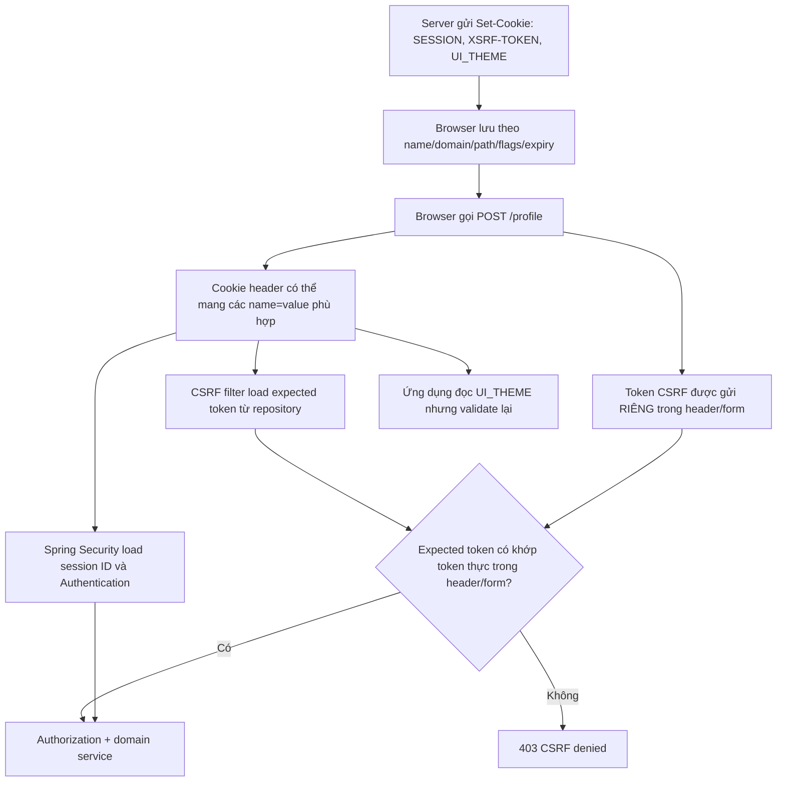
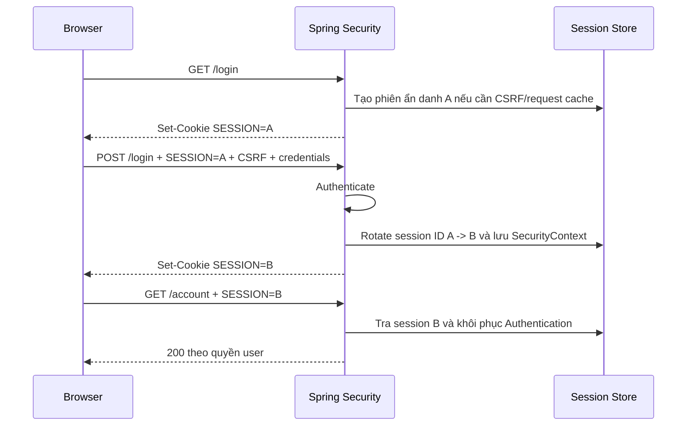
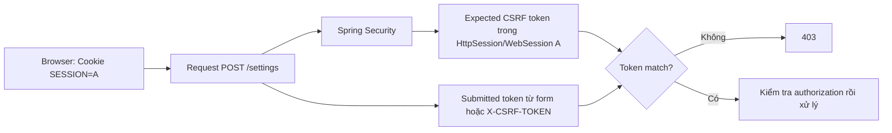
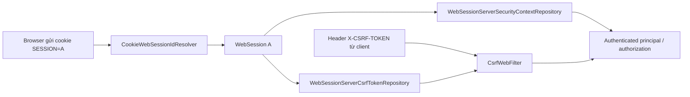
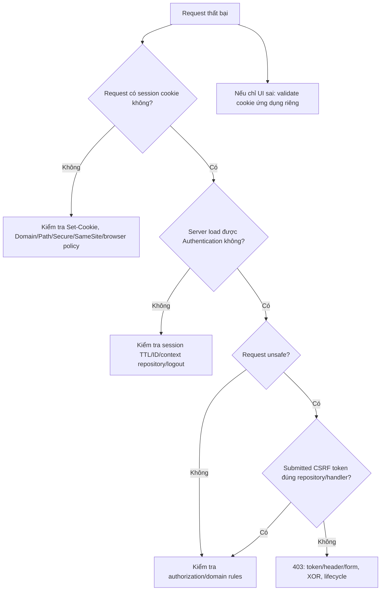

# Phân biệt cookie phiên, cookie CSRF và cookie ứng dụng

> **Chương:** Session và cookie  
> **Module:** `SPRING_SECURITY_HTTP_PROTECTION` — áp dụng các lớp phòng vệ HTTP/trình duyệt của Spring Security, từ CSRF, CORS, security headers, CSP, HSTS tới HTTP firewall và bảo vệ session.  
> **Phạm vi:** Spring Security **Servlet** và **Reactive WebFlux**, Spring Boot/Spring Session, trình duyệt, SPA và ứng dụng server-rendered.  
> **Mục tiêu:** Phân biệt **cookie phiên**, **cookie CSRF** và **cookie ứng dụng** theo chức năng, giá trị chứa bên trong, cách Spring quản lý, flags, vòng đời và hậu quả khi bị lộ/giả mạo; cấu hình, kiểm thử và chẩn đoán độc lập từng loại.

Một response có thể chứa đồng thời:

```http
HTTP/1.1 200 OK
Set-Cookie: __Host-SESSION=opaque-session-id; Path=/; Secure; HttpOnly; SameSite=Lax
Set-Cookie: XSRF-TOKEN=opaque-csrf-token; Path=/; Secure; SameSite=Lax
Set-Cookie: UI_THEME=dark; Path=/; Secure; SameSite=Lax; Max-Age=2592000
Cache-Control: no-store
```

Ba cookie trên **có vai trò hoàn toàn khác nhau**. Không được nhầm **session ID** (credential để server tìm trạng thái xác thực), **CSRF token** (bằng chứng chống request giả mạo theo cơ chế repository/request handler) và **dữ liệu ứng dụng** (ví dụ chọn giao diện).

Đặc biệt, đoạn header này chỉ là **một cấu hình mẫu**. Với cấu hình mặc định của Spring Security, CSRF token thường được lưu **bên trong session**, nên browser **không nhất thiết** nhận một cookie `XSRF-TOKEN`. Chỉ khi chọn repository dùng cookie hoặc có một cơ chế cookie CSRF khác thì cookie ấy mới xuất hiện.

## 1. Ba loại cookie: bảng phân biệt nhanh

| Tiêu chí | **Cookie phiên** | **Cookie CSRF** | **Cookie ứng dụng** |
| --- | --- | --- | --- |
| Mục đích | Cho server tra cứu phiên, bao gồm `SecurityContext`/Authentication khi đã login. | Hỗ trợ chứng minh một unsafe request có CSRF token hợp lệ. | Ghi nhớ tùy chọn UI, thông báo consent, giỏ hàng guest marker... tùy nghiệp vụ. |
| Tên thường gặp | `JSESSIONID` (Servlet container), `SESSION` (Spring Session/WebFlux), tên custom `__Host-SESSION`. | `XSRF-TOKEN` nếu dùng cookie CSRF; **không có cookie riêng** nếu lưu token trong session. | `UI_THEME`, `LOCALE`, `CONSENT_CHOICE` hoặc tên ứng dụng tự đặt. |
| Giá trị thường chứa | **Opaque, khó đoán** session identifier; không phải password, role hay bản ghi user ở dạng plaintext. | Token ngẫu nhiên do CSRF repository cấp; không phải session ID. | Giá trị thuộc allowlist (ví dụ `dark`/`light`), hoặc reference an toàn; tránh PII/secret. |
| Hệ thống quản lý | Servlet container/Spring Session/`WebSessionIdResolver` + session store. | `CsrfTokenRepository` hoặc `ServerCsrfTokenRepository` + request handler/filter. | Controller/domain service và cookie writer riêng, theo quy tắc nghiệp vụ. |
| Có tự chứng minh đăng nhập? | **Không**: server còn phải load phiên và Authentication hợp lệ. | **Không**: token không phải credential user. | **Không**: tùy chọn/cookie app không cấp quyền. |
| `Secure` trên HTTPS | **Bắt buộc trong chính sách production**. | Bật nếu có cookie CSRF. | Khuyến nghị bật, nhất là nếu có ảnh hưởng đến security/consent. |
| `HttpOnly` | **Bật**: JavaScript không cần đọc ID. | Bật nếu JS không cần đọc; **chỉ tắt cho cookie CSRF** khi pattern SPA yêu cầu. | Tùy việc JS cần đọc; dữ liệu nhạy cảm không nên đưa vào JS-readable cookie. |
| `SameSite` | `Lax`/`Strict` theo login UX; `None; Secure` chỉ khi cần cross-site. | Phải phù hợp cùng hành trình gửi token/cookie, không thay CSRF checking. | Chọn theo nhu cầu scope và browser; không tự mở rộng toàn hệ thống. |
| Vòng đời | Có thể rotate khi login, expire/invalidate khi logout, timeout server. | Có thể được clear/tạo lại khi login/logout và sau khi session đổi; cần client refresh. | Theo thời hạn nghiệp vụ/consent, được overwrite/delete độc lập. |
| Khi bị lộ | **Nguy cơ session hijacking** nếu server vẫn công nhận ID. | Có thể làm yếu CSRF protection trong một số điều kiện, đặc biệt khi attacker kết hợp XSS/cookie injection. | Rò sở thích hoặc dữ liệu cá nhân; có thể gây sửa logic nếu backend tin giá trị. |

**Quy tắc quan trọng:** tên cookie không quyết định vai trò. Cookie tên `SESSION` không tự được Spring Security công nhận nếu hệ thống dùng `JSESSIONID`; cookie tên `XSRF-TOKEN` không tự bảo vệ POST nếu **CSRF filter/repository/handler không được tích hợp**; cookie `ROLE=ADMIN` chỉ là dữ liệu do client gửi, **không thể** được coi là quyền của người dùng.

## 2. Browser lưu cookie, server quyết định ý nghĩa

Server phát **response header `Set-Cookie`**; browser chọn khi nào đính cookie vào request theo `Domain`/`Path`, `Secure`, `SameSite`, thời hạn, partitioning và chính sách browser:



Ở request, browser thường chỉ gửi:

```http
POST /profile HTTP/1.1
Host: app.example.test
Cookie: __Host-SESSION=opaque-session-id; XSRF-TOKEN=opaque-csrf-token; UI_THEME=dark
X-XSRF-TOKEN: opaque-csrf-token
Content-Type: application/json

{"displayName":"An"}
```

**Phần `Cookie` và phần `X-XSRF-TOKEN` là hai vị trí khác nhau** dù trong một pattern double-submit chúng có thể có giá trị trùng nhau. Browser **tự** gắn cookie theo policy, nhưng **không tự sinh header CSRF** từ cookie. JavaScript của SPA hoặc HTML form phải cung cấp token đúng cách. Đó là cơ sở phân biệt CSRF token với session credential.

Không log nguyên request trong môi trường có dữ liệu thật: `Cookie` và `X-XSRF-TOKEN` đều có thể chứa thông tin nhạy cảm. Giá trị trong ví dụ chỉ là placeholder.

### 2.1. `Set-Cookie` không phải dữ liệu JavaScript được phép đọc

`Set-Cookie` là **forbidden response header** đối với JavaScript frontend thông thường: `fetch(...).headers.get("Set-Cookie")` không được dùng để lấy session cookie. `document.cookie` cũng **không thấy cookie có `HttpOnly`**, nhưng browser **vẫn tự gửi** cookie `HttpOnly` khi request phù hợp.

Đừng tắt `HttpOnly` trên session cookie chỉ để React/Vue/Angular "giữ đăng nhập": cách đúng là cấu hình cookie scope, CSRF token, `credentials` cho fetch và CORS khi khác origin.

### 2.2. Same-site không đồng nghĩa same-origin

`https://app.example.test` và `https://api.example.test` là **cross-origin** nhưng thường **same-site**. Cookie host-only do `app.example.test` đặt **không** gửi tới sibling `api.example.test`; API có thể tự đặt session cookie host-only của chính nó. `Domain=example.test` mở rộng credential tới các subdomain và không tự tạo SSO.

`SameSite=Lax` giúp hạn chế nhiều request cross-site, nhưng **không** thay token CSRF; cookie có `SameSite=None; Secure` có thể vẫn bị browser chặn vì third-party policy. CORS và Domain/Path là các điều kiện riêng. Điều này áp dụng cho **cả ba loại cookie**.

## 3. Cookie phiên: một khóa tra cứu, không phải hồ sơ người dùng

Trong ứng dụng stateful Spring Security, cookie phiên thường mang **một ID opaque**. Server sử dụng ID để tìm session trong bộ nhớ container, Redis/JDBC hoặc một `WebSession` store; `SecurityContext` có thể được lưu và khôi phục từ đó theo security chain.



Nếu GET đầu không cần session và CSRF token deferred chưa được consume, **có thể chưa tồn tại A**, khi đó không bắt buộc phải thấy cookie trước login. Không giả định mọi GET tự tạo session.

### 3.1. Servlet: `JSESSIONID`, `SESSION` và Spring Session

- **Servlet container mặc định** thường dùng `JSESSIONID` trong Spring MVC/Servlet.
- Khi dùng **Spring Session** thay thế session management của container (Redis/JDBC), `DefaultCookieSerializer` mặc định dùng tên `SESSION`, trừ khi cấu hình khác.
- Người phát cookie thường là **Servlet container hoặc Spring Session writer**, không phải `CsrfFilter`.
- `HttpSession` chứa application attributes cùng các state nội bộ; session ID chỉ là khóa để truy cập theo các cơ chế kiểm tra.
- `ChangeSessionIdAuthenticationStrategy`/chiến lược session fixation của Spring Security bảo vệ ID khi login theo authentication mechanism. Không tắt chỉ vì app cần giữ giỏ hàng khách.

**Không coi mặc định Spring Security đã bật Spring Session.** Nếu app không cài Spring Session, thêm bean `DefaultCookieSerializer` độc lập không chắc có ai sử dụng nó để phát `JSESSIONID`.

### 3.2. Reactive: `WebSession` và cookie `SESSION`

Trong WebFlux, `WebSession` thay cho `HttpSession`. `CookieWebSessionIdResolver` thường dùng cookie tên `SESSION` theo mặc định; cấu hình `WebSessionIdResolver` có thể thay tên và flags.

Với `WebSessionServerSecurityContextRepository`, việc lưu `SecurityContext` có cơ chế đổi ID của `WebSession` để chống fixation; không thay cơ chế đó bằng các thao tác blocking hay giả định API Servlet tương đương. `WebSession.changeSessionId()` đổi ID của cùng session, **không xóa application attributes**.

Một `Mono<WebSession>` chỉ thực thi khi được subscribe trong **reactive pipeline**; không `block()` trên Reactor Netty event loop và không `subscribe()` thủ công trong controller.

### 3.3. Session ID không phải JWT và không phải user ID

```text
SESSION=3f...         -> chỉ là khóa opaque, server cần tra cứu.
userId=alice          -> định danh nghiệp vụ, không nên dùng làm session ID.
JWT=eyJ...            -> token có cấu trúc được xác minh theo chữ ký/claims.
```

Session cookie **có thể** được dùng để mang một token khác trong kiến trúc tùy chỉnh, nhưng ba ví dụ trên không tự biến đổi vai trò lẫn nhau. Trong **mẫu stateful Spring Security chuẩn**, session ID không phải JWT chứa role. Đừng lưu password, quyền `ROLE_ADMIN`, access token bên thứ ba hoặc dữ liệu khách hàng plaintext trong cookie session.

### 3.4. Bốn biện pháp không thể thiếu

1. **`Secure` + HTTPS/HSTS**: cookie session không được gửi qua HTTP công khai. Với reverse proxy TLS termination, kiểm tra `Set-Cookie` thực ở edge.
2. **`HttpOnly`**: JavaScript không đọc session ID bằng API thông thường; XSS vẫn nguy hiểm vì script có thể **gửi request cùng phiên**.
3. **`SameSite` và scope hẹp**: chọn `Lax`/`Strict` theo login UX; `Domain` host-only khi có thể; `Path` nhất quán. `__Host-SESSION` cần HTTPS, `Secure`, `Path=/` và **không `Domain`**.
4. **Server lifecycle**: thay session ID khi login, giới hạn idle/absolute timeout, hủy state khi logout, không cấp quyền cho ID cũ.

`Max-Age` trên cookie browser không phải server session timeout. Browser có thể giữ cookie cũ sau khi session trong Redis hết TTL: server phải coi ID ấy là **không authenticated**.

## 4. CSRF token có thể nằm trong session mà không có cookie CSRF

**CSRF protection bật mặc định** cho các unsafe HTTP methods trong Spring Security Servlet và Reactive. Nhưng vị trí lưu **expected CSRF token** phụ thuộc repository:

| Stack | Repository mặc định | Expected token được lưu ở đâu? | Browser bắt buộc có `XSRF-TOKEN` cookie? |
| --- | --- | --- | --- |
| **Servlet** | `HttpSessionCsrfTokenRepository` | `HttpSession` (cùng state với session, không cùng một token với ID). | **Không** |
| **Reactive WebFlux** | `WebSessionServerCsrfTokenRepository` | `WebSession`. | **Không** |
| Servlet tùy chọn | `CookieCsrfTokenRepository` | Cookie `XSRF-TOKEN`. | **Có**, khi token đã được load/sinh/lưu |
| Reactive tùy chọn | `CookieServerCsrfTokenRepository` | Cookie `XSRF-TOKEN`. | **Có**, khi token đã được load/sinh/lưu |
| Tùy chỉnh | `CsrfTokenRepository`/`ServerCsrfTokenRepository` custom | Phụ thuộc triển khai; cần threat model. | Không thể suy từ tên config |

Ví dụ **mặc định**:



Ở mô hình này **browser chỉ cần cookie phiên để server tìm expected token**, còn client phải lấy và nộp CSRF token qua form/header. Không có lý do giả định có một `XSRF-TOKEN` cookie độc lập.

### 4.1. Expected token khác actual/submitted token

Spring Security CSRF filter xác nhận một unsafe request bằng cách:

1. Tạo/load **expected token** qua repository.
2. Đọc **submitted token** từ header hoặc tham số form nhờ `CsrfTokenRequestHandler`/`ServerCsrfTokenRequestHandler`.
3. So sánh theo đúng cơ chế handler (có thể giải mã XOR-masked token).
4. Không hợp lệ hoặc không có token → trả lỗi (thường `403 Forbidden`).

**Chỉ có cookie `XSRF-TOKEN` được browser tự gửi là chưa đủ.** Một CSRF attack cũng dựa vào việc browser **tự gửi cookie**. Mục tiêu là yêu cầu client gửi một token **ở vị trí khác** mà request cross-site giả mạo không thể tùy ý cung cấp/đọc theo same-origin policy.

### 4.2. Hai mẫu phát và nộp token

**Mẫu A — Synchronizer token, lưu trong session:**

```text
Server: expected token T trong HttpSession/WebSession A.
Browser: gửi SESSION=A tới backend.
Trang server-rendered hoặc GET /csrf: cho client token để gửi.
POST /profile: Cookie SESSION=A + header X-CSRF-TOKEN:T.
Server: so với expected T trong session A.
```

**Mẫu B — Cookie CSRF (kiểu double-submit được repository hỗ trợ):**

```text
Server: Set-Cookie XSRF-TOKEN=T (khác session cookie).
Browser: gửi XSRF-TOKEN=T theo scope; SPA đọc nếu cookie cho JS đọc.
SPA: tự thêm header X-XSRF-TOKEN:T vào unsafe request.
Server: repository lấy expected T từ cookie và handler lấy actual T từ header.
Server: xác minh sự phù hợp qua Spring Security CSRF filter.
```

Mẫu B cần đánh giá **cookie injection từ subdomain, XSS, origin scope và cách ràng buộc token với phiên**. Với các triển khai double-submit tự xây, OWASP khuyến nghị **signed double-submit token ràng buộc với session** thay cho so sánh naïve đơn thuần; không tự viết lại repository nếu chưa threat model. `CookieCsrfTokenRepository`/`CookieServerCsrfTokenRepository` phải được dùng theo hành vi API và giới hạn cụ thể của phiên bản Spring.

## 5. CSRF token không phải cookie xác thực

Một CSRF token hợp lệ **không có nghĩa** người gửi đã đăng nhập hoặc có quyền. Ví dụ:

```http
POST /admin/delete-user HTTP/1.1
Cookie: XSRF-TOKEN=opaque-csrf-token
X-XSRF-TOKEN: opaque-csrf-token

id=42
```

Request này **không trở thành admin** chỉ vì CSRF token match. Spring Security còn cần **Authentication** và **Authorization** đối với endpoint. CSRF giúp chống *request forgery*, không thay việc xác minh identity/roles.

Ngược lại, session hợp lệ của admin **không miễn kiểm tra CSRF** nếu request dựa vào cookie và có thể bị browser tự đính kèm trong một kịch bản giả mạo.

### 5.1. Ví dụ login CSRF

Attacker có thể tìm cách khiến browser của nạn nhân **đăng nhập vào tài khoản do attacker kiểm soát**, gây nhầm lẫn lịch sử mua sắm hoặc rò thông tin nạn nhân nhập sau đó. Đây là **login CSRF**, dù nạn nhân chưa có session authenticated trước POST.

Vì thế `POST /login` vẫn thường được CSRF bảo vệ, dù `GET /login` được khai `permitAll()`. **`permitAll()` không đồng nghĩa bỏ `CsrfFilter` hoặc `CsrfWebFilter`**.

### 5.2. Thời gian sống CSRF token

Token CSRF có thể:

- Được tạo **lazily/deferred** khi view/endpoint đọc token lần đầu; không phải mọi GET đều phát cookie/khởi tạo session.
- Bị **clear/rotate** trong một số sự kiện authentication/login/logout (đặc biệt Servlet `CsrfAuthenticationStrategy`/`CsrfLogoutHandler`).
- Bị mất khi session store hết hạn nếu repository lưu token trong `HttpSession`/`WebSession`.
- Khác chuỗi render mỗi request do **XOR masking/BREACH protection** dù raw expected token chưa đổi.

Nếu SPA giữ token cũ trước login rồi POST ngay sau login, có thể nhận `403`. **Không tắt CSRF để giải quyết**; cung cấp cách lấy token mới theo repository/request handler của phiên bản ứng dụng.

## 6. Cookie ứng dụng: dữ liệu tiện ích, không phải nguồn sự thật bảo mật

Cookie ứng dụng có thể lưu:

| Cookie giả định | Ví dụ giá trị | Có nên dùng để quyết định quyền/giá trị kinh tế? | Gợi ý |
| --- | --- | --- | --- |
| `UI_THEME` | `dark` hoặc `light` | **Không** | Allowlist, JS có thể đọc khi UI cần. |
| `UI_LOCALE` | `vi`, `en` | **Không** | Allowlist và giới hạn độ dài. |
| `COOKIE_CONSENT` | Mã phiên bản consent/choices | **Không dùng làm bằng chứng pháp lý duy nhất** | Xác minh yêu cầu consent và policy phiên bản. |
| `EXPERIMENT_GROUP` | `A`/`B` | **Không** | Không dùng để bypass authorization; có thể ảnh hưởng tracking/privacy. |
| `LAST_VIEWED_CATEGORY` | `books` | **Không** | Không chứa PII nhạy cảm, cân nhắc retention. |
| `GUEST_CART_ID` | Opaque reference | **Không coi input như quyền sở hữu** | Nếu là bearer capability, bảo vệ như credential hoặc giữ ở server-side session. |
| `DISCOUNT_PERCENT` | `90` | **Tuyệt đối không** | Tính giá/discount từ database và business rules. |
| `ROLE` / `IS_ADMIN` | `true` | **Tuyệt đối không** | Server lấy quyền từ Authentication/authorization store. |

**Browser/client có quyền sửa cookie ứng dụng** bằng DevTools, extension hoặc request HTTP tự tạo. Kể cả cookie `HttpOnly`, người dùng kiểm soát HTTP client hay một subdomain có scope phù hợp vẫn có thể gửi giá trị tùy ý. Do đó: **dữ liệu đến từ cookie là input không tin cậy**.

### 6.1. Cookie ứng dụng không phải database

Không dùng cookie để lưu:

- Mật khẩu, API key, refresh token từ provider, OTP, recovery code, OAuth `state` dưới dạng dễ đọc hoặc identifier nhạy cảm.
- Địa chỉ, thông tin thanh toán, hồ sơ sức khỏe, nội dung riêng tư mà JavaScript/browser có thể lộ.
- Quyền truy cập/chiết khấu/giá tiền mà server không xác minh lại.
- Object serialization không giới hạn, JSON không được validate, dữ liệu vô thời hạn.

Cookie có kích thước hữu hạn (thường chỉ khoảng vài KiB mỗi cookie), được gửi lặp lại trên **mỗi request phù hợp**, gây tăng header/bandwidth và có thể chạm giới hạn request header của proxy/server. Lưu dữ liệu lớn ở backend hoặc storage thích hợp, không “nén JSON” vào cookie phiên.

### 6.2. Hợp lệ hóa cookie ứng dụng

Một policy đơn giản:

```text
UI_THEME:
  allowed = {"light", "dark", "system"}
  default = "system"
  max-age = 30 days
  Secure = true trên HTTPS production
  SameSite = Lax
  HttpOnly = false chỉ nếu JavaScript thực sự phải đọc
  Domain = không có (host-only)
  Path = /
```

Nếu cookie mang **một quyết định bảo mật hoặc dữ liệu cần chống sửa**, hãy lưu quyết định đó **phía server** hoặc dùng token **được ký/xác thực tính toàn vẹn** theo threat model và khóa rotation; **ký cookie không thay authorization**, không mã hóa dữ liệu (HMAC signature chỉ chống sửa, không che nội dung).

## 7. Chọn `Secure`, `HttpOnly`, `SameSite`, `Domain`, `Path` cho từng loại

Một chính sách cookie phải dựa vào **mục đích và cách sử dụng**, không phải quy tắc “đặt tất cả cookie giống nhau”:

| Thuộc tính | Cookie phiên | Cookie CSRF | Cookie ứng dụng |
| --- | --- | --- | --- |
| `Secure` | **Bật** khi dùng HTTPS; HSTS bổ trợ. | **Bật** nếu được phát trong cookie. | Nên bật trên HTTPS; bắt buộc nếu có dữ liệu đáng bảo vệ. |
| `HttpOnly` | **Bật**. | **Bật** khi JS không cần đọc; **tắt riêng** khi SPA phải đọc `XSRF-TOKEN` để gửi header. | Bật nếu JS không cần đọc, tắt nếu nhu cầu UI chính đáng; không lưu secret/role. |
| `SameSite` | `Lax` thường cân bằng form login/OIDC GET; `Strict`/`None` theo luồng thực. | `Lax`/`Strict` hoặc `None; Secure` theo SPA/cross-site, vẫn cần token validation. | `Lax` thường đủ; chỉ `None` khi có use case nhúng/cross-site đã kiểm thử. |
| `Domain` | Ưu tiên **bỏ trống → host-only**. | Phạm vi đủ cho frontend lấy/gửi; tránh Domain rộng nếu không có threat review. | Host-only; không cho tùy chọn/consent lan sang subdomains vô cớ. |
| `Path` | Đủ cho login, protected API, logout, callback; thường `/` trên một host ứng dụng. | Đủ để JS nhận token và POST endpoint gửi cookie; cùng cơ chế xóa đúng scope. | Hẹp theo chức năng hoặc `/` khi cần UI toàn site. |
| `Max-Age`/`Expires` | Phân biệt browser cookie lifetime với server session TTL; thường session cookie ngắn hạn. | Theo token lifecycle, thường liên quan session/login/logout; không cố định dài hơn policy. | Thời hạn theo lựa chọn user/consent, có thu hồi và retention. |
| Prefix | `__Host-SESSION` khi root path/host-only/HTTPS phù hợp. | Chỉ dùng `__Host-` nếu đã bảo đảm `Path=/` và không `Domain`; `XSRF-TOKEN` mặc định không có prefix. | Đặt tên duy nhất, có thể dùng prefix khi phù hợp nhưng không thay validate. |

### 7.1. Cookie `__Host-` không dùng cho mọi Path

`__Host-` yêu cầu **HTTPS, `Secure`, `Path=/` và không `Domain`** ở browser hỗ trợ. Một cookie ứng dụng chỉ dùng tại `Path=/admin` **không thể** có prefix `__Host-` và vẫn giữ `Path=/admin`. Đừng phá prefix để tiện context path; chọn tên/scope đúng theo architecture.

### 7.2. CORS không phải cookie scope

Một SPA `https://app.example.test` gọi API `https://api.example.test`:

- CORS kiểm soát **JavaScript đọc response cross-origin**.
- Browser scope quyết định cookie **có gửi tới API hostname/path** không.
- `fetch(..., {credentials: "include"})` cho phép gửi credentials phù hợp trong cross-origin fetch, **không** vượt `SameSite`/third-party blocking.
- CSRF token từ repo vẫn phải hợp lệ trên unsafe request.
- Cookie UI do `app` đặt host-only không tự đến `api`; đôi khi điều này **là điều mong muốn**.

Không đặt `Domain=example.test` lên cookie phiên chỉ để “sửa CORS”. Mở rộng Domain nghĩa là những subdomain khác cũng có thể nhận credential khi request phù hợp.

## 8. Chọn kiến trúc theo loại ứng dụng

| Kiến trúc | Cookie phiên | CSRF token | Cookie ứng dụng | Gợi ý |
| --- | --- | --- | --- | --- |
| Spring MVC server-rendered forms | `JSESSIONID`/`SESSION` với `HttpOnly`. | Mặc định lưu trong `HttpSession`; form gửi field `_csrf`. | Theme/locale do app đặt riêng. | Giữ defaults, tránh tạo thêm cookie XSRF nếu không cần. |
| SPA cùng origin, session auth | Cookie session `HttpOnly`. | Có thể lấy qua endpoint `GET /csrf` hoặc cookie `XSRF-TOKEN` nếu đã cấu hình đúng repo/handler. | UI cookie JS-readable nếu cần. | Cần refresh token khi login/logout. |
| SPA cross-origin cùng site | Cookie session do API phát tới host API, `HttpOnly`. | Endpoint/token cho frontend qua CORS credentials đã allowlist. | Cookie của app và API có scopes độc lập. | Không bắt buộc chia cookie session cho mọi subdomain. |
| BFF với OAuth2/OIDC | Browser chỉ dùng **cookie phiên first-party BFF**. | BFF xác minh CSRF token trên unsafe requests. | Preference cookie phục vụ UI. | Backend giữ token OAuth của downstream; không đưa refresh token vào cookie UI. |
| Widget cross-site/iframe | Có thể cần `SameSite=None; Secure` hoặc cookie `Partitioned` theo browser. | CSRF theo cookie auth của widget. | Cookie widget có thể theo từng partition. | Không giả định third-party cookies luôn được gửi. |
| Pure token API không nhận cookie auth | Không bắt buộc session cookie. | Quyết định CSRF dựa trên threat model/credential transmission, không chỉ nhãn “REST”. | Không được tạo quyền từ UI cookie. | Kiểm tra client có tự động gửi credential nào khác không. |

**Lưu ý:** một API JSON vẫn có rủi ro CSRF nếu browser **tự gửi session cookie xác thực**. Việc “không dùng HTML form” không đủ để tắt CSRF. Ngược lại, với API chỉ nhận bearer token do client tự đặt vào `Authorization` và **không sử dụng cookie hay credentials tự gửi**, CSRF threat model có thể khác; vẫn cần chống XSS, replay, authorization và token handling.

## 9. Spring Boot Servlet: cấu hình cookie phiên đúng tầng

Đối với Spring MVC/Servlet container, Spring Boot hỗ trợ `server.servlet.session.cookie.*`:

```yaml
# application.yml — production HTTPS, một host sở hữu toàn ứng dụng.
server:
  servlet:
    session:
      cookie:
        name: __Host-SESSION
        path: /
        secure: true
        http-only: true
        same-site: lax
      timeout: 30m
```

Ý nghĩa:

1. Session cookie `__Host-SESSION` có `Secure; HttpOnly`; không có `Domain`; `Path=/`.
2. `SameSite=Lax` hỗ trợ những hành trình form login và top-level OAuth2 GET callback thường gặp, nhưng không thay CSRF.
3. `timeout: 30m` là **server session timeout**, **không tự đặt `Max-Age=1800`** cho cookie. Browser vẫn có thể giữ ID sau khi server state hết hạn.
4. Nếu ứng dụng dùng `Spring Session`, custom `CookieSerializer` có thể là cookie writer thực. Kiểm tra `Set-Cookie` sau reverse proxy.

Nếu container/version chưa hỗ trợ một flag mong muốn, chọn cơ chế writer tương thích và kiểm thử header **thực tế**, không giả định YAML đã đủ. Trên localhost chạy HTTP, cookie `Secure` có thể không được gửi; dùng HTTPS test host thay vì tắt `Secure` trong production để chạy demo.

### 9.1. SecurityFilterChain giữ session và CSRF mặc định

```java
import org.springframework.context.annotation.Bean;
import org.springframework.context.annotation.Configuration;
import org.springframework.security.config.Customizer;
import org.springframework.security.config.annotation.web.builders.HttpSecurity;
import org.springframework.security.web.SecurityFilterChain;

@Configuration
class ServletSessionAndCsrfSecurity {

    @Bean
    SecurityFilterChain securityFilterChain(HttpSecurity http)
            throws Exception {
        return http
            .authorizeHttpRequests(auth -> auth
                .requestMatchers("/login", "/csrf", "/public/**")
                    .permitAll()
                .requestMatchers("/admin/**").hasRole("ADMIN")
                .anyRequest().authenticated())
            .formLogin(Customizer.withDefaults())
            .csrf(Customizer.withDefaults())
            .sessionManagement(session -> session
                .sessionFixation(fixation -> fixation.changeSessionId()))
            .build();
    }
}
```

**Quan trọng:** Ví dụ này **không** khai `CookieCsrfTokenRepository`. Với Servlet mặc định, expected CSRF token được lưu **trong `HttpSession`**. `CsrfFilter` bảo vệ POST/PUT/PATCH/DELETE và các unsafe methods theo matcher; không có `XSRF-TOKEN` cookie riêng nếu app không phát.

`permitAll("/csrf")` chỉ cho phép frontend lấy token trước login; nó **không** loại route `POST /login` hoặc `POST /logout` khỏi CSRF protection. `changeSessionId()` là bảo vệ session fixation, không phải CSRF setting.

### 9.2. Controller trả CSRF token cho JavaScript (Servlet)

Với mặc định `HttpSessionCsrfTokenRepository`, một ứng dụng có thể cung cấp endpoint **GET** cấp token:

```java
import jakarta.servlet.http.HttpServletRequest;
import org.springframework.http.CacheControl;
import org.springframework.http.ResponseEntity;
import org.springframework.security.web.csrf.CsrfToken;
import org.springframework.web.bind.annotation.GetMapping;
import org.springframework.web.bind.annotation.RestController;

record CsrfView(String headerName, String parameterName, String token) {}

@RestController
class ServletCsrfViewController {

    @GetMapping("/csrf")
    ResponseEntity<CsrfView> csrf(HttpServletRequest request) {
        CsrfToken token = (CsrfToken) request.getAttribute(
            CsrfToken.class.getName());
        if (token == null) {
            throw new IllegalStateException(
                "CSRF token chưa được filter công bố");
        }
        // Gọi getToken() để consume token được lazy/deferred cung cấp.
        return ResponseEntity.ok()
            .cacheControl(CacheControl.noStore())
            .body(new CsrfView(token.getHeaderName(),
                token.getParameterName(), token.getToken()));
    }
}
```

Endpoint này chỉ xuất **CSRF token**, **không** trả session ID. Nó nên được phục vụ qua HTTPS, không cache token, có CORS policy nếu SPA ở origin khác; token phải gắn với repository đang dùng. Nếu frontend ở site khác, **không đặt wildcard CORS kèm credentials** để làm token bị đọc bởi mọi origin.

Với Spring Security phiên bản dùng XOR masking, `token.getToken()` được cung cấp từ request handler có thể là **giá trị dùng để submit ở form/header**, còn raw repository token có thể khác. Client không tự “giải XOR” hoặc lưu token vô thời hạn; gửi lại đúng token do handler cho phép và refresh khi authentication/session lifecycle thay đổi.

### 9.3. Form server-rendered không cần cookie CSRF riêng

Một form sử dụng Spring Security CSRF token đã công bố trong request:

```html
<!-- Ví dụ JSP/Thymeleaf-like pseudo template, tùy view engine. -->
<form action="/profile" method="post">
  <input type="hidden"
         name="${_csrf.parameterName}"
         value="${_csrf.token}">
  <button type="submit">Lưu hồ sơ</button>
</form>
```

**Đây là minh họa biến template**, không phải HTML tĩnh có thể chạy mà không render: dùng cú pháp view engine thực tế (ví dụ JSP EL `${...}`, Thymeleaf `th:action` với integration Spring) để điền token; escape đúng. Browser gửi session cookie tự động, còn field `_csrf` là **submitted token**. Với SSR, thường không cần `CookieCsrfTokenRepository` chỉ để “có token”.

### 9.4. Tại sao GET /csrf phải có `no-store`?

Nếu một token/response chứa thông tin thuộc phiên người dùng bị cache dùng chung, có thể làm lộ token hoặc khiến frontend nhận token của phiên khác. Response token nên:

- Có `Cache-Control: no-store`.
- Không chứa session ID/credential khác trong body.
- Không được fetch từ origin không tin cậy qua CORS wildcard.
- Không bị service worker/CDN cache chung giữa người dùng.
- Hết giá trị khi session/token lifecycle thay đổi, để frontend lấy lại.

## 10. Servlet SPA: khi dùng `CookieCsrfTokenRepository`

Spring Security có `CookieCsrfTokenRepository` cho client kiểu SPA:

```java
import org.springframework.security.web.csrf.CookieCsrfTokenRepository;

// ĐOẠN CẤU HÌNH PHẦN CSRF, tích hợp trong HttpSecurity:
.csrf(csrf -> csrf
    .csrfTokenRepository(CookieCsrfTokenRepository.withHttpOnlyFalse()))
```

Repository mặc định phát cookie `XSRF-TOKEN` và đọc actual token từ `X-XSRF-TOKEN` hoặc form parameter `_csrf`. `withHttpOnlyFalse()` chỉ đổi **CSRF cookie** thành JS-readable cho pattern Angular/SPA; session cookie **vẫn `HttpOnly`**.

### 10.1. Cấu hình cookie CSRF flags/scope có chủ đích

Trong phiên bản Spring Security Servlet hỗ trợ `setCookieCustomizer(...)`:

```java
import org.springframework.security.web.csrf.CookieCsrfTokenRepository;

CookieCsrfTokenRepository csrfRepo =
    CookieCsrfTokenRepository.withHttpOnlyFalse();

csrfRepo.setCookieCustomizer(builder -> builder
    .path("/")
    .secure(true)
    .sameSite("Lax"));

// Đưa csrfRepo vào HttpSecurity:
// .csrf(csrf -> csrf.csrfTokenRepository(csrfRepo))
```

**Không đặt `HttpOnly=false` trên `__Host-SESSION`**. Việc `XSRF-TOKEN` cần JS đọc không làm session ID có thể được lộ cho JavaScript. Nếu frontend cùng origin không cần đọc cookie, có thể giữ `HttpOnly` cho CSRF cookie và cấp token qua HTML/endpoint.

### 10.2. Cảnh báo Spring Security 6+: raw cookie và XOR handler

Từ Spring Security 6, request handler CSRF mặc định thường có **XOR/BREACH protection** và token được **defer** cho đến khi dùng. Nếu SPA đọc **raw token từ cookie `XSRF-TOKEN`** rồi gửi header, mà handler mặc định kỳ vọng **masked token** ở vị trí ấy, request có thể bị `403`.

**Không kết luận chỉ cần `withHttpOnlyFalse()` là mọi SPA tự hoạt động.** Cần cấu hình `CsrfTokenRequestHandler` phù hợp với raw header + masked form, và bảo đảm token mới được materialize sau authentication/logout. Tài liệu Spring Security phiên bản mới có hỗ trợ cấu hình chuyên biệt `csrf.spa()` ở những bản hỗ trợ API; với các bản cũ, tham khảo mẫu `SpaCsrfTokenRequestHandler` chính thức thay vì disable CSRF hay BREACH protection vô điều kiện.

```java
// Đoạn chỉ dùng khi VERSION SPRING SECURITY của dự án
// đã có API CsrfConfigurer.spa(), kiểm tra Javadoc trước:
// http.csrf(csrf -> csrf.spa());

// Không ghép mù quáng hai ví dụ cấu hình repository/handler khác nhau.
```

**Lỗi login/logout phổ biến:** `CsrfAuthenticationStrategy` và `CsrfLogoutHandler` có thể clear CSRF token cũ; do deferred loading, cookie mới **không tự xuất hiện ngay** nếu token chưa được access. SPA phải có flow làm mới token và gửi đúng header cho unsafe request kế tiếp.

### 10.3. JavaScript mẫu chỉ đọc cookie CSRF, không đọc session

```javascript
function readCookie(name) {
  const prefix = name + "=";
  const part = document.cookie.split("; ")
    .find(value => value.startsWith(prefix));
  return part ? decodeURIComponent(part.slice(prefix.length)) : null;
}

async function saveProfile(profile) {
  // Chỉ hoạt động nếu JS nhìn thấy XSRF-TOKEN theo domain/path,
  // cookie HttpOnly=false và Spring request handler chấp nhận raw header.
  const csrf = readCookie("XSRF-TOKEN");
  if (!csrf) throw new Error("Thiếu CSRF token, cần lấy token mới");

  const response = await fetch("/profile", {
    method: "POST",
    credentials: "same-origin",
    headers: {
      "Content-Type": "application/json",
      "X-XSRF-TOKEN": csrf
    },
    body: JSON.stringify(profile)
  });
  if (!response.ok) throw new Error("Request thất bại");
}
```

**Điều kiện tiên quyết:** code trên là ví dụ cho **cookie-based CSRF repo và handler raw-header tương thích**, không dùng nguyên xi với `HttpSessionCsrfTokenRepository` mặc định nếu không có cookie `XSRF-TOKEN`. Không tự viết CSRF cookie `document.cookie = ...`: token phải được server repository phát và xác minh. JavaScript trên origin bị XSS kiểm soát cũng có thể đọc cookie CSRF JS-readable, nên cần chống XSS/CSP.

## 11. Cookie ứng dụng trên Servlet: tạo và xác thực bằng allowlist

Ví dụ `UI_THEME` chỉ ghi nhớ một lựa chọn hiển thị. Dùng `ResponseCookie` của Spring Framework, **không** biến cookie thành nguồn role hay pricing:

```java
import java.time.Duration;
import java.util.Set;
import org.springframework.http.CacheControl;
import org.springframework.http.HttpHeaders;
import org.springframework.http.HttpStatus;
import org.springframework.http.ResponseCookie;
import org.springframework.http.ResponseEntity;
import org.springframework.web.bind.annotation.CookieValue;
import org.springframework.web.bind.annotation.GetMapping;
import org.springframework.web.bind.annotation.PostMapping;
import org.springframework.web.bind.annotation.RequestParam;
import org.springframework.web.bind.annotation.RestController;

@RestController
class ThemePreferenceController {
    private static final Set<String> ALLOWED =
        Set.of("light", "dark", "system");

    @PostMapping("/preferences/theme")
    ResponseEntity<Void> saveTheme(@RequestParam String theme) {
        if (!ALLOWED.contains(theme)) {
            return ResponseEntity.badRequest().build();
        }
        var cookie = ResponseCookie.from("UI_THEME", theme)
            .path("/")
            .secure(true)
            .httpOnly(false) // Chỉ nếu frontend JS cần đọc theme.
            .sameSite("Lax")
            .maxAge(Duration.ofDays(30))
            .build();

        return ResponseEntity.noContent()
            .header(HttpHeaders.SET_COOKIE, cookie.toString())
            .build();
    }

    @GetMapping("/preferences/theme")
    ResponseEntity<String> readTheme(
            @CookieValue(name = "UI_THEME", required = false)
            String candidate) {
        String theme = candidate != null && ALLOWED.contains(candidate)
            ? candidate : "system";
        return ResponseEntity.ok()
            .cacheControl(CacheControl.noStore())
            .body(theme);
    }
}
```

`POST /preferences/theme` **vẫn phải qua CSRF filter** nếu ứng dụng có session cookie authentication; `permitAll` (nếu cho guest đổi giao diện) không miễn CSRF. Để chạy qua HTTP localhost không có HTTPS, cần profile test riêng; production phải bảo đảm cookie `Secure`.

Trong đoạn code, import `CacheControl` giúp response preference không bị shared cache; không có `Authorization` nào dựa trên `UI_THEME`. Khi đổi user/account, preference cookie có thể tiếp tục tồn tại nếu domain policy cho phép, nhưng không được dùng làm data ownership token.

### 11.1. Nếu cookie ứng dụng cần được đọc trên JavaScript

Một cookie `HttpOnly=false` có thể được JS đọc bằng `document.cookie`, nhưng cũng dễ lộ hơn khi có XSS. Hãy chỉ dùng cho **low-sensitivity UI state** và luôn giới hạn giá trị. Consent có yêu cầu pháp lý/lưu dấu riêng, không đơn giản là một boolean tùy ý từ client.

### 11.2. Xóa cookie ứng dụng đúng scope

```java
ResponseCookie expired = ResponseCookie.from("UI_THEME", "")
    .path("/")
    .secure(true)
    .sameSite("Lax")
    .maxAge(Duration.ZERO)
    .build();

// Thêm expired.toString() vào response Set-Cookie.
```

Xóa phải đúng **name, Domain/host-only và Path**; xóa `Path=/` không nhất thiết xóa cookie cũ ở `Path=/app`. Không dùng việc xóa preference cookie như thao tác logout session.

## 12. Spring Session Servlet: một cookie writer cho session, không cho CSRF/app

Khi Spring Session thay `HttpSession` container (ví dụ qua Redis), `DefaultCookieSerializer` quyết định cách **session cookie** được phát:

```java
import org.springframework.context.annotation.Bean;
import org.springframework.context.annotation.Configuration;
import org.springframework.session.web.http.CookieSerializer;
import org.springframework.session.web.http.DefaultCookieSerializer;

@Configuration
class SpringSessionCookieConfig {

    @Bean
    CookieSerializer cookieSerializer() {
        var serializer = new DefaultCookieSerializer();
        serializer.setCookieName("__Host-SESSION");
        serializer.setCookiePath("/");
        serializer.setUseSecureCookie(true);
        serializer.setUseHttpOnlyCookie(true);
        serializer.setSameSite("Lax");
        // Không setDomainName nếu tên có prefix __Host-.
        return serializer;
    }
}
```

Bean này **chỉ** cấu hình session cookie của Spring Session. Nó không tự sửa `XSRF-TOKEN` do `CookieCsrfTokenRepository` phát, và không tự sửa `UI_THEME` mà controller tự phát. Nếu ứng dụng có cả Spring Session serializer, Spring Boot Servlet session properties và proxy sửa cookie, hãy xác định **writer cuối cùng** qua `Set-Cookie` thực, tránh cùng tên nhưng flags/Path khác nhau.

**Đừng set `setDomainNamePattern("(.+)")`** để phản chiếu host chưa tin cậy thành Domain: Spring Session cảnh báo phải giới hạn pattern vào ký tự domain hợp lệ để tránh HTTP response splitting/header injection. Chia Domain rộng cho session cookie cần threat model subdomain và SSO rõ ràng.

## 13. Reactive WebFlux: `WebSession` và CSRF token là hai lớp riêng

Với WebFlux, session cookie được phát qua `CookieWebSessionIdResolver`/`WebSessionManager`. Mặc định CSRF được bảo vệ bởi `CsrfWebFilter` và expected token được lưu trong `WebSessionServerCsrfTokenRepository`. Đây là hai thành phần **khác nhau**:



Ứng dụng dùng `ServerHttpSecurity` chứ không phải Servlet `HttpSecurity`. Đừng nhập `CookieCsrfTokenRepository` của Servlet vào cấu hình WebFlux; counterpart là `CookieServerCsrfTokenRepository`.

### 13.1. Spring Boot Reactive session cookie

```yaml
# application.yml — production HTTPS cho Reactive WebFlux.
server:
  reactive:
    session:
      cookie:
        name: __Host-SESSION
        path: /
        secure: true
        http-only: true
        same-site: lax
      timeout: 30m
```

`server.reactive.session.cookie.*` áp dụng khi Spring Boot phiên bản đang dùng hỗ trợ và web app thực sự chạy Reactive stack. Không gán `server.servlet.session.cookie.*` cho WebFlux rồi giả định nó có hiệu lực; nếu đồng thời có Spring MVC/WebFlux trên classpath, kiểm tra loại web application.

### 13.2. Config với `CookieWebSessionIdResolver`

```java
import org.springframework.context.annotation.Bean;
import org.springframework.context.annotation.Configuration;
import org.springframework.web.server.session.CookieWebSessionIdResolver;
import org.springframework.web.server.session.WebSessionIdResolver;

@Configuration
class ReactiveSessionCookieConfig {

    @Bean
    WebSessionIdResolver webSessionIdResolver() {
        var resolver = new CookieWebSessionIdResolver();
        resolver.setCookieName("__Host-SESSION");
        resolver.addCookieInitializer(cookie -> cookie
            .path("/")
            .secure(true)
            .httpOnly(true)
            .sameSite("Lax"));
        return resolver;
    }
}
```

Đây là **phương án thay thế** Boot properties khi cần customize. Không tạo hai `WebSessionIdResolver` bean cạnh tranh; xác minh writer thực từ `Set-Cookie`. Nó **chỉ quản lý session cookie** — không tự thay flags của cookie CSRF hoặc `UI_THEME`.

### 13.3. SecurityWebFilterChain với WebSession CSRF mặc định

```java
import org.springframework.context.annotation.Bean;
import org.springframework.context.annotation.Configuration;
import org.springframework.security.config.Customizer;
import org.springframework.security.config.annotation.web.reactive.EnableWebFluxSecurity;
import org.springframework.security.config.web.server.ServerHttpSecurity;
import org.springframework.security.web.server.SecurityWebFilterChain;

@Configuration
@EnableWebFluxSecurity
class ReactiveSessionAndCsrfSecurity {

    @Bean
    SecurityWebFilterChain securityWebFilterChain(ServerHttpSecurity http) {
        return http
            .authorizeExchange(auth -> auth
                .pathMatchers("/login", "/csrf", "/public/**")
                    .permitAll()
                .pathMatchers("/admin/**").hasRole("ADMIN")
                .anyExchange().authenticated())
            .formLogin(Customizer.withDefaults())
            .csrf(Customizer.withDefaults())
            .build();
    }
}
```

**Mặc định:** `WebSessionServerCsrfTokenRepository`; chưa có cookie `XSRF-TOKEN` độc lập. `permitAll("/csrf")` cho phép frontend đọc token kể cả chưa login, nhưng unsafe request vẫn cần token. `formLogin` xử lý authentication, còn `WebSessionServerSecurityContextRepository` mặc định lưu context/đổi session ID khi xác thực. Nếu custom security context repository, cần kiểm thử fixation protection riêng.

### 13.4. Reactive endpoint `GET /csrf` cần consume `Mono<CsrfToken>`

Trong WebFlux, `CsrfWebFilter` đưa **`Mono<CsrfToken>`** vào `ServerWebExchange` attribute theo key `CsrfToken.class.getName()`. Cần trả publisher trong HTTP pipeline:

```java
import org.springframework.http.CacheControl;
import org.springframework.http.ResponseEntity;
import org.springframework.security.web.server.csrf.CsrfToken;
import org.springframework.web.bind.annotation.GetMapping;
import org.springframework.web.bind.annotation.RestController;
import org.springframework.web.server.ServerWebExchange;
import reactor.core.publisher.Mono;

record ReactiveCsrfView(
    String headerName, String parameterName, String token) {}

@RestController
class ReactiveCsrfViewController {

    @GetMapping("/csrf")
    Mono<ResponseEntity<ReactiveCsrfView>> csrf(
            ServerWebExchange exchange) {

        Mono<CsrfToken> tokenPublisher =
            exchange.getAttribute(CsrfToken.class.getName());

        if (tokenPublisher == null) {
            return Mono.error(new IllegalStateException(
                "CSRF publisher chưa được filter công bố"));
        }

        return tokenPublisher.map(token -> ResponseEntity.ok()
            .cacheControl(CacheControl.noStore())
            .body(new ReactiveCsrfView(
                token.getHeaderName(),
                token.getParameterName(),
                token.getToken())));
    }
}
```

**Không `block()`, không `subscribe()` thủ công.** Việc consume publisher giúp token/repository được thực thi trong reactive pipeline; nếu chỉ lấy `Mono` rồi bỏ đi, code chưa chắc đã load/lưu expected token, và cookie session có thể không được phát.

Với `XorServerCsrfTokenRequestAttributeHandler` từ Spring Security 6+, token được render có thể mang XOR masking để chống BREACH. Frontend dùng giá trị token đã được handler cung cấp; không tự giả định token trong cookie khác luôn tương đương.

## 14. Reactive SPA chọn `CookieServerCsrfTokenRepository` khi cần

WebFlux hỗ trợ repository ghi expected CSRF token vào `XSRF-TOKEN`:

```java
import org.springframework.security.web.server.csrf.CookieServerCsrfTokenRepository;

// Trích đoạn trong ServerHttpSecurity, không phải Servlet HttpSecurity:
.csrf(csrf -> csrf.csrfTokenRepository(
    CookieServerCsrfTokenRepository.withHttpOnlyFalse()))
```

Tương tự Servlet, `withHttpOnlyFalse()` cho phép JavaScript đọc **cookie CSRF**, **không** có lý do tắt `HttpOnly` trên **cookie WebSession**.

### 14.1. Đặt flags của cookie CSRF Reactive

Với Spring Security phiên bản hỗ trợ `setCookieCustomizer(...)` (Reactive từ 6.1 theo Javadoc):

```java
import org.springframework.security.web.server.csrf.CookieServerCsrfTokenRepository;

var repository = CookieServerCsrfTokenRepository.withHttpOnlyFalse();
repository.setCookieCustomizer(builder -> builder
    .secure(true)
    .sameSite("Lax")
    .path("/"));

// Trong ServerHttpSecurity:
// .csrf(csrf -> csrf.csrfTokenRepository(repository))
```

**Không được kết luận raw token SPA gửi qua header sẽ khớp với XOR request handler mặc định trong mọi phiên bản.** Spring Security 6+ có `XorServerCsrfTokenRequestAttributeHandler`, nên pattern raw-cookie-to-header phải đi cùng `ServerCsrfTokenRequestHandler` tương thích và lifecycle refresh token. Tìm ví dụ SPA chính thức đúng version/BOM trước khi triển khai; không disable CSRF hoặc BREACH protection chỉ để test pass.

### 14.2. Lưu trong `WebSession` hay cookie: hai đường đi khác nhau

| Đặc tính | `WebSessionServerCsrfTokenRepository` | `CookieServerCsrfTokenRepository` |
| --- | --- | --- |
| Expected token | Stored in `WebSession`. | Stored in `XSRF-TOKEN` cookie. |
| Có cookie CSRF riêng | **Không** mặc định. | **Có** khi token được load/sinh/lưu. |
| Token có thể cấp qua `GET /csrf` | **Có**, consume `Mono<CsrfToken>`. | **Có** khi handler/repository được cấu hình phù hợp. |
| JS cần đọc cookie CSRF | **Không**, nếu lấy token từ endpoint/view. | **Có** trong pattern `withHttpOnlyFalse()`. |
| Cần cookie session authenticated | **Có** trong kiến trúc stateful/session auth. | Vẫn có thể **có**, độc lập cookie CSRF. |
| Khi WebSession hết hạn | Expected token trong session mất, cần token mới. | CSRF cookie có lifecycle riêng; authentication session vẫn có thể hết hạn. |
| Ảnh hưởng của XOR masking | Cần gửi token view/header đúng handler. | Phải giải quyết khác biệt raw cookie token vs masked token khi cần. |

Không bao giờ lấy việc `XSRF-TOKEN` còn hạn làm dấu hiệu rằng user còn đăng nhập. Khi session hết hạn, browser có thể vẫn giữ cookie CSRF nhưng server đã mất Authentication.

## 15. Cookie ứng dụng trên Reactive: không biến preference thành user identity

Controller WebFlux cũng có thể phát `UI_THEME` bằng `ResponseCookie`, không cần đụng `WebSession` hoặc CSRF repository:

```java
import java.time.Duration;
import java.util.Set;
import org.springframework.http.ResponseCookie;
import org.springframework.http.ResponseEntity;
import org.springframework.web.bind.annotation.CookieValue;
import org.springframework.web.bind.annotation.GetMapping;
import org.springframework.web.bind.annotation.PostMapping;
import org.springframework.web.bind.annotation.RequestParam;
import org.springframework.web.bind.annotation.RestController;
import org.springframework.web.server.ServerWebExchange;
import reactor.core.publisher.Mono;

@RestController
class ReactiveThemePreferenceController {
    private static final Set<String> ALLOWED =
        Set.of("light", "dark", "system");

    @PostMapping("/preferences/theme")
    Mono<ResponseEntity<Void>> saveTheme(
            @RequestParam String theme,
            ServerWebExchange exchange) {

        if (!ALLOWED.contains(theme)) {
            return Mono.just(ResponseEntity.badRequest().build());
        }
        ResponseCookie cookie = ResponseCookie.from("UI_THEME", theme)
            .path("/")
            .secure(true)
            .httpOnly(false)
            .sameSite("Lax")
            .maxAge(Duration.ofDays(30))
            .build();

        exchange.getResponse().addCookie(cookie);
        return Mono.just(ResponseEntity.noContent().build());
    }

    @GetMapping("/preferences/theme")
    Mono<String> readTheme(
            @CookieValue(name = "UI_THEME", required = false)
            String candidate) {
        String theme = candidate != null && ALLOWED.contains(candidate)
            ? candidate : "system";
        return Mono.just(theme);
    }
}
```

**Security chain vẫn áp CSRF cho POST preference.** `@CookieValue` chỉ đọc client input; `ALLOWED` chặn giá trị ngoài danh sách. App cookie không được tạo quyền `ROLE_USER`/`ROLE_ADMIN` hoặc giá trị đơn hàng. Nếu preference không cần JavaScript đọc, có thể bật `HttpOnly` cho cookie đó.

## 16. Quản lý vòng đời: login, logout, timeout, đổi tài khoản

Ba loại cookie không nên cùng “sống/chết” theo một quy tắc mù quáng. Ví dụ:

| Sự kiện | Cookie phiên | Cookie CSRF | Cookie ứng dụng |
| --- | --- | --- | --- |
| GET trang public chưa login | Có thể chưa tạo session; cookie chưa có. | Deferred token có thể chưa sinh; nếu view đọc token thì repo mới hoạt động. | Theme/locale có thể đã tồn tại. |
| GET trang login có form CSRF | Có thể tạo phiên ẩn danh A và `Set-Cookie`. | Expected token được sinh/load; với repo session thì **không có XSRF cookie**. | Có thể giữ UI theme. |
| POST /login thành công | Rotate A→B nếu có session A; Authentication mới được lưu. | Servlet thường clear token cũ khi auth thành công; SPA cần token mới. | Tùy chọn UI có thể giữ, nhưng dữ liệu có owner phải tái xác minh. |
| POST /logout hợp lệ | Invalidate/clear SecurityContext theo policy; expire cookie đúng scope. | Servlet thường clear token cũ; session repository có thể mất token cùng session. | Có thể giữ theme/locale; **không giữ** app cookie chứa dữ liệu user cũ. |
| Idle timeout Redis/container/WebSession | ID browser có thể còn nhưng server state mất. | Token trong session mất; cookie repo có vòng đời riêng. | Preference có thể vẫn còn theo `Max-Age`. |
| Đổi `Domain`/`Path`/cookie name | Cookie cũ có thể vẫn tồn tại ở scope khác. | Cookie CSRF cũ có thể tồn tại riêng; cần migration. | Cookie app cần cleanup theo scope cũ. |
| User A logout rồi user B login | Không cho session cũ cấp quyền cho B. | Client lấy token phù hợp session mới. | Không mang giỏ hàng/draft/transaction của A vào B không xác minh. |

### 16.1. Vì sao “cookie vẫn còn” không chứng minh session còn?

Có **hai đồng hồ**:

- Cookie `Max-Age`/`Expires` do browser quản lý.
- Session idle timeout/absolute lifetime/invalidation do server/session store quản lý.

Khi cookie lâu hơn TTL session, browser vẫn gửi `SESSION` nhưng Spring Security không khôi phục Authentication. Nếu `XSRF-TOKEN` còn, đó cũng không cấp quyền. Nếu `UI_THEME` còn, vẫn có thể hiển thị giao diện cũ mà không cần đăng nhập.

### 16.2. Logout phải dọn đúng thứ, không phải “xóa tất cả cookie”

Mục tiêu logout là **thu hồi Authentication và session server-side**, rồi hết hạn cookie phiên ở đúng name/Domain/Path. Với CSRF, theo framework/repository mà token được clear; frontend cần refresh khi tạo phiên mới. Cookie ứng dụng vô hại như theme có thể giữ, tùy sản phẩm và privacy policy.

Nếu dùng `Clear-Site-Data: "cookies"`, hiểu phạm vi ảnh hưởng có thể lớn hơn một ứng dụng/domain trong browser hỗ trợ; nó không phải thay thế cho logout handlers. **Không tự xóa tất cả cookie** chỉ để xử lý lỗi CSRF, vì có thể phá SSO hoặc consent state của ứng dụng liên quan.

### 16.3. Đừng mang app cookie từ user A sang user B

Giữ `UI_THEME` có thể chấp nhận; mang `CART_OWNER_ID`, `PENDING_PAYMENT_ID` hoặc bearer guest cart ID sang account B **không** được phép chỉ vì browser còn cookie. Luồng guest → authenticated cần service xác minh ownership/TTL, idempotent claim và dọn marker sau transaction thành công, không dựa vào string cookie như chứng cứ sở hữu.

## 17. Threat model: khi dùng sai một loại cookie để thay loại khác

### 17.1. Session hijacking: lộ cookie phiên

**Tình huống:** XSS, máy người dùng bị xâm nhập, log HTTP hoặc proxy không redaction làm rò `SESSION`. Kẻ tấn công dùng ID đó trong một HTTP client để giả phiên nếu session store chưa thu hồi.

**Phòng vệ:**

- HTTPS/TLS và `Secure`, `HttpOnly`; HSTS khi điều kiện triển khai phù hợp.
- Chống XSS bằng encoding, CSP và giới hạn third-party scripts.
- Session ID ngẫu nhiên/opaque, rotate khi authentication hoặc privilege change theo policy.
- Idle/absolute timeout, logout invalidation, các cơ chế phát hiện/rate limiting phù hợp.
- Không log `Cookie`/`Set-Cookie` hoặc chụp raw ID trong CI.

**CSRF token không cứu được session bị chiếm hoàn toàn:** Attacker có thể gọi endpoint cấp token hoặc đọc state bằng HTTP client khi nắm một session hợp lệ. Không đánh đồng CSRF protection với chống session hijacking.

### 17.2. CSRF: browser tự gửi cookie phiên

**Tình huống:** User đã đăng nhập `bank.example.test`, truy cập một website khác tạo request `POST /transfer`. Nếu browser gắn session cookie, backend có thể bị lợi dụng nếu không xác minh token/Origin.

**Phòng vệ:** giữ CSRF cho unsafe methods; trả token qua view/endpoint hoặc cookie repo phù hợp; yêu cầu header/form param; không để GET có side effects; SameSite/Fetch Metadata chỉ bổ sung.

Với pattern CSRF cookie, backend phải so token gửi qua **header/form** với expected token từ repository. **Chỉ mang cookie `XSRF-TOKEN` trong request không tạo bằng chứng CSRF**.

### 17.3. Tampering: sửa cookie ứng dụng để tăng quyền

**Tình huống:**

```http
GET /admin/reports HTTP/1.1
Cookie: UI_THEME=dark; IS_ADMIN=true; DISCOUNT_PERCENT=99
```

**Kết quả đúng:** Spring Security áp `Authentication` và role theo cấu hình server. `IS_ADMIN` hay `DISCOUNT_PERCENT` do browser gửi **không thể** làm user thành admin hoặc thay giá. Mọi nghiệp vụ phải tính lại giá/quyền từ database/service đáng tin.

Để chống tamper đối với một cookie app mà business cần tin tính toàn vẹn, dùng HMAC/AEAD theo thiết kế; nhưng không dùng token có chữ ký như cách bypass authorization. Nếu dữ liệu phải bí mật, chữ ký đơn thuần **không che plaintext**.

### 17.4. Cookie tossing từ subdomain và CSRF cookie injection

Khi cookie có `Domain=example.test`, subdomain bị chiếm quyền có thể phát cookie tới parent domain trong phạm vi browser chấp nhận. Nếu backend có **hai cookie cùng tên** hoặc CSRF double-submit tự triển khai thiếu kiểm tra, attacker có thể gây cookie shadowing hoặc tác động tới expected token.

**Phòng vệ:** host-only cookie, prefix `__Host-` khi phù hợp, tránh duplicate cookie names, kiểm soát subdomain và signed/bound CSRF tokens theo threat model. Đừng mặc định `SameSite=Strict` đã loại hết nguy cơ subdomain cùng site.

### 17.5. XSS tác động khác nhau lên các cookie

| Hành vi XSS | Session có `HttpOnly` | Cookie CSRF JS-readable | Cookie UI JS-readable |
| --- | --- | --- | --- |
| `document.cookie` đọc raw value | Không đọc được session ID theo API thông thường. | Có thể đọc token. | Có thể đọc và sửa giá trị. |
| `fetch("/account")` cùng origin | Browser có thể **tự gửi** session cookie. | Browser cũng có thể gửi cookie; JS có thể đặt header CSRF. | Có thể gửi preference cookie. |
| Đọc nội dung trang API same-origin được phép | **Vẫn có thể xảy ra.** `HttpOnly` không chặn XSS sử dụng phiên. | Không tạo quyền mới, nhưng token có thể hỗ trợ giả request. | Có thể làm sai UI. |

Vì thế **bật `HttpOnly` không thay thế CSP, escaping và chống XSS**. Nó hạn chế một đường rò credential, không biến trang bị tiêm script thành đáng tin cậy.

### 17.6. Cookie từ HTTP client tự tạo

Một HTTP client như curl có thể tự gửi `Cookie: ROLE=ADMIN` dù browser thực có các chính sách Domain/Path/HttpOnly/SameSite. Server không bao giờ được tin cookie app chỉ vì “trình duyệt đáng lẽ không gửi được”. Cookie flags chủ yếu là **ràng buộc trong browser**, còn server cần validation/authorization độc lập.

## 18. Unit test Servlet và MockMvc: mỗi loại cookie có trách nhiệm riêng

Test này giả định đã có Spring Security Test, ứng dụng MVC dùng `ServletSessionAndCsrfSecurity` và `ThemePreferenceController` ở các mục trên, user test `alice` có role USER.

### 18.1. Bắt buộc CSRF token cho POST cookie ứng dụng

```java
import org.junit.jupiter.api.Test;
import org.springframework.beans.factory.annotation.Autowired;
import org.springframework.boot.test.autoconfigure.web.servlet.AutoConfigureMockMvc;
import org.springframework.boot.test.context.SpringBootTest;
import org.springframework.http.HttpHeaders;
import org.springframework.test.web.servlet.MockMvc;

import static org.hamcrest.Matchers.containsString;
import static org.springframework.security.test.web.servlet.request.SecurityMockMvcRequestPostProcessors.csrf;
import static org.springframework.security.test.web.servlet.request.SecurityMockMvcRequestPostProcessors.user;
import static org.springframework.test.web.servlet.request.MockMvcRequestBuilders.post;
import static org.springframework.test.web.servlet.result.MockMvcResultMatchers.header;
import static org.springframework.test.web.servlet.result.MockMvcResultMatchers.status;

@SpringBootTest
@AutoConfigureMockMvc
class CookieResponsibilityMvcTest {

    @Autowired MockMvc mvc;

    @Test
    void preferencePostWithoutCsrfIsDenied() throws Exception {
        mvc.perform(post("/preferences/theme")
                .with(user("alice").roles("USER"))
                .param("theme", "dark"))
            .andExpect(status().isForbidden());
    }

    @Test
    void preferencePostWithCsrfSetsUiCookie() throws Exception {
        mvc.perform(post("/preferences/theme")
                .with(user("alice").roles("USER"))
                .with(csrf())
                .param("theme", "dark"))
            .andExpect(status().isNoContent())
            .andExpect(header().string(HttpHeaders.SET_COOKIE,
                containsString("UI_THEME=dark")))
            .andExpect(header().string(HttpHeaders.SET_COOKIE,
                containsString("SameSite=Lax")));
    }

    @Test
    void invalidThemeIsNotStored() throws Exception {
        mvc.perform(post("/preferences/theme")
                .with(user("alice").roles("USER"))
                .with(csrf())
                .param("theme", "super-admin"))
            .andExpect(status().isBadRequest());
    }
}
```

`with(user(...))` được dùng **chỉ để đơn giản hóa authentication trong các test controller/CSRF**. Nó **không** thực hiện form login thật, nên không chứng minh session ID rotation hoặc cookie login/logout lifecycle. Với những mục tiêu đó cần integration test riêng.

### 18.2. Cookie `IS_ADMIN=true` không được cấp role

Trong security chain ví dụ, `/admin/**` yêu cầu `ROLE_ADMIN`. Một request của `alice` (ROLE_USER) không thể vượt qua rule ấy bằng cách tự đặt cookie:

```java
import jakarta.servlet.http.Cookie;
import org.junit.jupiter.api.Test;

import static org.springframework.security.test.web.servlet.request.SecurityMockMvcRequestPostProcessors.user;
import static org.springframework.test.web.servlet.request.MockMvcRequestBuilders.get;
import static org.springframework.test.web.servlet.result.MockMvcResultMatchers.status;

// Thân test trong CookieResponsibilityMvcTest, đã có MockMvc mvc.
@Test
void tamperedApplicationCookieCannotGrantAdminRole() throws Exception {
    mvc.perform(get("/admin/reports")
            .with(user("alice").roles("USER"))
            .cookie(new Cookie("IS_ADMIN", "true"),
                new Cookie("ROLE", "ADMIN")))
        .andExpect(status().isForbidden());
}
```

**Test này không cần endpoint admin thực**, bởi Spring Security chặn request trước khi vào controller khi Authentication đã có nhưng không đủ role. Nếu custom filters dùng cookie để ghi role vào Authentication thì đây là **lỗi nghiêm trọng**; test sẽ giúp phát hiện sai architecture.

### 18.3. GET /csrf đọc token từ repo session

```java
import org.junit.jupiter.api.Test;

import static org.hamcrest.Matchers.containsString;
import static org.springframework.test.web.servlet.request.MockMvcRequestBuilders.get;
import static org.springframework.test.web.servlet.result.MockMvcResultMatchers.header;
import static org.springframework.test.web.servlet.result.MockMvcResultMatchers.jsonPath;
import static org.springframework.test.web.servlet.result.MockMvcResultMatchers.status;

// Thân test trong CookieResponsibilityMvcTest.
@Test
void csrfEndpointReturnsTokenWithoutSessionId() throws Exception {
    mvc.perform(get("/csrf"))
        .andExpect(status().isOk())
        .andExpect(jsonPath("$.token").isNotEmpty())
        .andExpect(jsonPath("$.headerName").isNotEmpty())
        .andExpect(header().string("Cache-Control",
            containsString("no-store")));
}
```

Token trong JSON là **CSRF token**, không phải cookie session. Để chắc chắn không phát ID trong body, test DTO `CsrfView` chỉ có ba trường. Đừng log raw response body của endpoint này ra CI; token vẫn là security-sensitive.

### 18.4. Test cookie flags do app writer phát

Ví dụ test `ResponseCookie` độc lập:

```java
import java.time.Duration;
import org.junit.jupiter.api.Test;
import org.springframework.http.ResponseCookie;

import static org.junit.jupiter.api.Assertions.*;

class DistinctCookieFlagsTest {

    @Test
    void sessionAndPreferenceHaveDifferentHttpOnlyPolicy() {
        var session = ResponseCookie.from(
                "__Host-SESSION", "opaque-test-id")
            .secure(true).httpOnly(true).path("/")
            .sameSite("Lax").build();

        var preference = ResponseCookie.from("UI_THEME", "dark")
            .secure(true).httpOnly(false).path("/")
            .sameSite("Lax").maxAge(Duration.ofDays(30)).build();

        assertTrue(session.isHttpOnly());
        assertFalse(preference.isHttpOnly());
        assertNull(session.getDomain());
        assertEquals("/", session.getPath());
        assertTrue(session.isSecure() && preference.isSecure());
    }
}
```

**Giới hạn:** test này không chứng minh `JSESSIONID`/`__Host-SESSION` đã được phát bởi Servlet container hoặc Spring Session. Để xác nhận **session cookie thực**, phải chạy embedded container/HTTP server và quan sát `Set-Cookie` trên request tạo/đổi phiên.

## 19. Reactive tests: StepVerifier, MockServerWebExchange, WebTestClient

### 19.1. Repository mặc định lưu token trong WebSession, không tạo CSRF cookie

```java
import org.junit.jupiter.api.Test;
import org.springframework.mock.http.server.reactive.MockServerHttpRequest;
import org.springframework.mock.web.server.MockServerWebExchange;
import org.springframework.security.web.server.csrf.CsrfToken;
import org.springframework.security.web.server.csrf.WebSessionServerCsrfTokenRepository;
import reactor.core.publisher.Mono;
import reactor.test.StepVerifier;

import static org.junit.jupiter.api.Assertions.*;

class ReactiveCsrfRepositoryDistinctionTest {

    @Test
    void webSessionRepositoryPersistsTokenInWebSession() {
        var repository = new WebSessionServerCsrfTokenRepository();
        var exchange = MockServerWebExchange.from(
            MockServerHttpRequest.get("https://app.example.test/csrf"));

        Mono<Boolean> verify = repository.generateToken(exchange)
            .flatMap(original ->
                repository.saveToken(exchange, original)
                    .then(repository.loadToken(exchange))
                    .map(loaded ->
                        loaded.getToken().equals(original.getToken())));

        StepVerifier.create(verify)
            .expectNext(true)
            .verifyComplete();

        // WebSession repo không phải CookieServerCsrfTokenRepository.
        assertNull(exchange.getResponse().getCookies()
            .getFirst("XSRF-TOKEN"));
    }
}
```

Test dùng trực tiếp repository, không phải toàn `CsrfWebFilter`; xác nhận token được lưu/đọc cùng exchange/session và không phát cookie CSRF riêng. Nó không kiểm tra request handler XOR hay browser có gửi session cookie khi HTTP tiếp theo.

### 19.2. Cookie CSRF repository phát `XSRF-TOKEN` riêng

```java
import org.junit.jupiter.api.Test;
import org.springframework.http.ResponseCookie;
import org.springframework.mock.http.server.reactive.MockServerHttpRequest;
import org.springframework.mock.web.server.MockServerWebExchange;
import org.springframework.security.web.server.csrf.CookieServerCsrfTokenRepository;
import reactor.test.StepVerifier;

import static org.junit.jupiter.api.Assertions.*;

class ReactiveCookieCsrfRepositoryTest {

    @Test
    void cookieRepositoryCanPublishReadableCsrfCookie() {
        var repository =
            CookieServerCsrfTokenRepository.withHttpOnlyFalse();
        repository.setCookieCustomizer(builder -> builder
            .path("/")
            .secure(true)
            .sameSite("Lax"));

        var exchange = MockServerWebExchange.from(
            MockServerHttpRequest.get("https://app.example.test/csrf"));

        StepVerifier.create(repository.generateToken(exchange)
                .flatMap(token -> repository.saveToken(exchange, token)))
            .verifyComplete();

        ResponseCookie cookie = exchange.getResponse().getCookies()
            .getFirst("XSRF-TOKEN");

        assertNotNull(cookie);
        assertTrue(cookie.isSecure());
        assertFalse(cookie.isHttpOnly());
        assertEquals("Lax", cookie.getSameSite());
        assertEquals("/", cookie.getPath());
    }
}
```

Đây là test **cookie CSRF writer** ở Spring Security Reactive với `setCookieCustomizer` hỗ trợ. Nó **không** chứng minh request handler chấp nhận raw token gửi từ SPA, cũng không phải test session cookie. Phải thêm WebTestClient test thực cho GET/POST và browser CSRF header.

### 19.3. WebTestClient: CSRF token bắt buộc trên POST

Với application context có `ReactiveSessionAndCsrfSecurity` và `ReactiveThemePreferenceController`:

```java
import org.junit.jupiter.api.Test;
import org.springframework.beans.factory.annotation.Autowired;
import org.springframework.boot.test.autoconfigure.web.reactive.AutoConfigureWebTestClient;
import org.springframework.boot.test.context.SpringBootTest;
import org.springframework.test.web.reactive.server.WebTestClient;

import static org.springframework.security.test.web.reactive.server.SecurityMockServerConfigurers.csrf;
import static org.springframework.security.test.web.reactive.server.SecurityMockServerConfigurers.mockUser;

@SpringBootTest
@AutoConfigureWebTestClient
class ReactiveCookieResponsibilityTest {
    @Autowired WebTestClient client;

    @Test
    void preferencePostRequiresCsrfAndValidInput() {
        client.mutateWith(mockUser("alice"))
            .post().uri("/preferences/theme?theme=dark")
            .exchange()
            .expectStatus().isForbidden();

        client.mutateWith(mockUser("alice"))
            .mutateWith(csrf())
            .post().uri("/preferences/theme?theme=dark")
            .exchange()
            .expectStatus().isNoContent()
            .expectHeader().valueMatches("Set-Cookie",
                ".*UI_THEME=dark.*");

        client.mutateWith(mockUser("alice"))
            .mutateWith(csrf())
            .post().uri("/preferences/theme?theme=admin")
            .exchange()
            .expectStatus().isBadRequest();
    }
}
```

Trong Spring Security Test, `mutateWith(mockUser(...))` giả lập Authentication, còn `mutateWith(csrf())` cung cấp CSRF token test. Cấu hình test client có thể cần áp `springSecurity()` nếu bind thủ công; với Boot auto-config, xác minh `WebFilterChainProxy` hoạt động. **Mock user không chạy form login**, nên không chứng minh session rotation/cookie name trong production.

### 19.4. Không dùng `WebTestClient` để chứng minh browser cookie policy

`WebTestClient`/`MockMvc` có thể tự đặt header `Cookie` theo test code, không thực thi đầy đủ `SameSite`/third-party blocking như browser. Phải chia:

1. Unit/repository test: Spring phát/đọc token ở đúng nơi không?
2. HTTP integration: `Set-Cookie` chứa đúng tên/flags/path/Domain không?
3. Browser E2E: cookie phiên có được gửi, cookie `HttpOnly` có bị ẩn khỏi JavaScript và CSRF được nộp đúng không?
4. Security test: request có CSRF hợp lệ **vẫn** phải bị chặn nếu thiếu Authentication/role.

## 20. HTTP end-to-end và browser E2E: không chỉ kiểm tra chuỗi Set-Cookie

### 20.1. Quan sát response thật qua HTTPS/proxy

Với ứng dụng Servlet chạy embedded Tomcat/Jetty hoặc WebFlux chạy server thực, lần lượt:

```text
1. GET /login hoặc GET /csrf:
   - Có thể tạo session A và cung cấp CSRF token.
   - Không kỳ vọng XSRF-TOKEN nếu đang dùng repository session mặc định.

2. POST /login với cookie A + credential hợp lệ + CSRF token:
   - Nhận session B nếu trước login có session A.
   - Không in ID A/B vào CI.

3. GET /csrf với B:
   - Lấy CSRF token mới cho request tiếp theo khi cần.

4. POST /preferences/theme?theme=dark với B + CSRF:
   - 204, Set-Cookie UI_THEME=dark, không thay session credential.

5. GET /admin/reports bằng user ROLE_USER và cookie IS_ADMIN=true:
   - 403 hoặc policy deny, không cấp quyền.

6. POST /logout với B + CSRF hợp lệ:
   - Thu hồi session/context B.
   - B cũ không có quyền authenticated nếu replay qua client độc lập.

7. GET /preferences/theme:
   - Có thể vẫn trả dark, vì cookie UI không cần Authentication.
```

**Điều cần khẳng định:** Cookie session **không nhất thiết xuất hiện trên mọi response**. Với Servlet có thể được phát khi phiên mới được tạo/rotate; với WebFlux `WebSession` phải được start hoặc có state được lưu. Đừng kết luận "cookie đã bị browser chặn" nếu response **chưa từng gửi Set-Cookie**.

### 20.2. Kiểm tra HTTP headers không lộ giá trị

Một test HTTP có thể parse các `Set-Cookie` nhưng **chỉ assert metadata**:

| Cookie | Assert tối thiểu |
| --- | --- |
| `__Host-SESSION` | `Secure`, `HttpOnly`, `SameSite=Lax`, `Path=/`, **không Domain**. |
| `XSRF-TOKEN` (chỉ nếu cấu hình cookie repository) | Tên, `Secure`, `Path` và `SameSite`; `HttpOnly=false` **chỉ khi JS phải đọc**. |
| `UI_THEME` | Giá trị thuộc allowlist, `Secure`, `SameSite`, `Path`, `Max-Age` đúng. |
| Cookie xóa khi logout | Đúng name/Domain/Path, `Max-Age=0` hoặc `Expires` trong quá khứ; session state phía server bị thu hồi. |

Không dùng việc kiểm tra **chuỗi cookie name** ở request để kết luận CSRF/authorization pass. Spring Security cần xử lý cả repository token, Authentication và quyền ở từng route.

### 20.3. Playwright E2E: JavaScript không thấy session cookie nhưng vẫn lưu theme

Ví dụ TypeScript cho **ứng dụng test trên HTTPS** có form login với labels `Username`/`Password`, nút `Sign in` và trang sau login:

```typescript
import { test, expect } from "@playwright/test";

test("session is HttpOnly, CSRF is submitted, UI cookie stays separate",
  async ({ browser }) => {
    const context = await browser.newContext();
    const page = await context.newPage();

    await page.goto("https://app.example.test/login");
    await page.getByLabel("Username").fill("alice");
    await page.getByLabel("Password").fill("test-password");
    await page.getByRole("button", { name: "Sign in" }).click();
    await expect(page).toHaveURL(/.*account.*/);

    // Không trả nội dung document.cookie ra test report.
    const sessionReadable = await page.evaluate(() =>
      document.cookie.includes("__Host-SESSION="));
    expect(sessionReadable).toBe(false);

    // Chỉ kiểm tra thuộc tính cookie session qua browser test API,
    // không in cookie.value vào logs.
    const sessionFlags = (await context.cookies(
      "https://app.example.test")).filter(c => c.name === "__Host-SESSION")
        .map(c => ({ httpOnly: c.httpOnly, secure: c.secure }));
    expect(sessionFlags).toEqual([{ httpOnly: true, secure: true }]);

    const csrf = await page.evaluate(async () => {
      const result = await fetch("/csrf", {
        credentials: "same-origin", cache: "no-store"
      });
      if (!result.ok) throw new Error("CSRF token unavailable");
      return await result.json();
    });

    // Token là dữ liệu nhạy cảm, chỉ giữ trong memory của test.
    const status = await page.evaluate(async (token) => {
      const response = await fetch("/preferences/theme?theme=dark", {
        method: "POST",
        credentials: "same-origin",
        headers: { [token.headerName]: token.token }
      });
      return response.status;
    }, csrf);
    expect(status).toBe(204);

    const themeVisible = await page.evaluate(() =>
      document.cookie.includes("UI_THEME=dark"));
    expect(themeVisible).toBe(true);

    await context.close();
  }
);
```

**Mẫu này có giả định về markup/redirect** và cần account test, `/csrf` cùng `/preferences/theme` như các ví dụ trước. Không sử dụng real customer credentials. Nếu `@AutoConfigureWebTestClient`/`MockMvc` pass nhưng Playwright test thất bại, kiểm tra browser cookie policy, HTTPS, login form, session store, CSRF token render/caching và redirect.

Playwright `context.cookies()` có quyền test runner để xem flags của cookie `HttpOnly`; **JavaScript trên trang vẫn không được đọc giá trị ấy**. Không log toàn cookie jar hoặc trả token ra assertion text, vì test runner có thể xuất credential khi thất bại.

### 20.4. Test phiên cũ A không có quyền B

Một kịch bản session fixation hoàn chỉnh:

1. Từ client A, tạo phiên ẩn danh và token CSRF.
2. POST login thật; sau xác thực, lấy ID session mới B.
3. Gửi `GET /account` với B: đúng Authentication.
4. Từ một client/cookie jar **độc lập**, gửi ID A cũ: **không** được có Authentication của B.
5. Logout bằng B; thử lại B cũ: không được truy cập riêng tư.

Test có thể so sánh A/B **trong bộ nhớ**, nhưng không đưa giá trị vào report. Nếu `changeSessionId()` của Servlet hoặc `WebSession` đổi ID, nhớ rằng **cùng object session có thể giữ application attributes**; không vì vậy copy dữ liệu user cũ vào account mới.

### 20.5. Browser E2E khác HTTP client tự gắn cookie

`curl -H "Cookie: ... "` và `MockMvc` có thể tự gắn cookie mà **không áp dụng SameSite, Secure, Domain/Path, partitioning** giống browser. Muốn kiểm tra `SameSite=None` trong iframe hoặc cookie host-only khác subdomain, dùng browser thực (Chromium, Firefox, WebKit) và HTTPS test hosts. Chạy test trên `localhost` không đại diện hoàn toàn cho chính sách cookie production.

## 21. Ma trận kiểm thử hồi quy: session, CSRF và application cookies

| ID | Kịch bản | Kỳ vọng |
| --- | --- | --- |
| C01 | Servlet mặc định mở GET /login, form có CSRF | Expected token nằm trong `HttpSession`; không tự có `XSRF-TOKEN` cookie. |
| C02 | Reactive mặc định consume `Mono<CsrfToken>` từ `GET /csrf` | Expected token nằm trong `WebSession`; không tự phát `XSRF-TOKEN`. |
| C03 | GET /csrf không gọi token/publisher | Có thể chưa sinh/ghi token do deferred behavior. |
| C04 | SPA GET /csrf và POST với header hợp lệ | CSRF filter chấp nhận request nếu authentication/authorization cũng hợp lệ. |
| C05 | POST có session cookie nhưng không có CSRF token | Spring Security chặn unsafe request. |
| C06 | POST có XSRF cookie nhưng thiếu header/form token | Không coi cookie tự gửi là CSRF proof. |
| C07 | POST có CSRF token nhưng thiếu Authentication | Không truy cập được protected resource. |
| C08 | POST có CSRF token hợp lệ nhưng role không đủ | Authorization từ chối. |
| C09 | POST /login chưa authenticated nhưng CSRF sai | Bị CSRF chặn; không đăng nhập. |
| C10 | POST /login hợp lệ, có session ẩn danh A | Authentication thành công, ID B khác A nếu protection hoạt động. |
| C11 | Request với ID A cũ sau login | Không còn Authentication của B. |
| C12 | Logout B rồi replay cookie B cũ | Không còn authenticated; server invalidate. |
| C13 | Servlet cấu hình `CookieCsrfTokenRepository` | Phát `XSRF-TOKEN` khi token được sử dụng/saved. |
| C14 | Reactive cấu hình `CookieServerCsrfTokenRepository` | Phát `XSRF-TOKEN` khi token được sử dụng/saved. |
| C15 | `withHttpOnlyFalse()` dành cho cookie CSRF | Cookie `XSRF-TOKEN` JS-readable; session cookie vẫn `HttpOnly`. |
| C16 | SPA gửi raw cookie CSRF trên Spring Security 6+ | Handler tương thích raw header/XOR masking, không 403 do format mismatch. |
| C17 | Login thành công rồi SPA dùng token cũ | Client lấy lại token nếu repository đã clear/rotate. |
| C18 | Session store hết hạn nhưng `XSRF-TOKEN` cookie còn | Không khôi phục Authentication từ CSRF cookie. |
| C19 | Session store hết hạn nhưng session cookie browser còn | Server coi ID cũ là anonymous. |
| C20 | Cookie `UI_THEME=dark` có allowlist | UI hiển thị dark, không thay Authentication/CSRF. |
| C21 | Cookie `UI_THEME=unknown`/missing | App dùng default và không crash. |
| C22 | Cookie `IS_ADMIN=true` hoặc `ROLE=ADMIN` | Không cấp `ROLE_ADMIN`. |
| C23 | Cookie `DISCOUNT_PERCENT=99` | Giá cuối do trusted domain service tính lại. |
| C24 | Session cookie `__Host-SESSION` | HTTPS, `Secure`, `Path=/`, không Domain, `HttpOnly`. |
| C25 | Cookie `__Host-SESSION` được phát cùng `Domain` | Browser hỗ trợ prefix phải từ chối. |
| C26 | Cookie UI `Path=/app`, logout xóa `Path=/` | Cookie cũ có thể vẫn tồn tại; cần đúng scope. |
| C27 | CORS cùng site khác origin, `credentials:"include"` | Cookie scope và CORS phải đúng, vẫn cần CSRF trên POST. |
| C28 | Browser chặn third-party cookie khi `SameSite=None` | Không hạ CSRF/authorization để chữa, chọn kiến trúc thay thế. |
| C29 | Spring Session serializer tùy chỉnh | `Set-Cookie` session đúng name/flags; không làm đổi cookie CSRF/app. |
| C30 | WebFlux resolver tùy chỉnh | `WebSession` cookie đúng name/flags; không tự thay cookie repository. |
| C31 | Browser `document.cookie` sau login | Không đọc được session `HttpOnly`, vẫn có thể đọc UI cookie JS-readable. |
| C32 | XSS same-origin gọi API | `HttpOnly` không ngăn browser gửi cookie; cần chống XSS/CSP. |
| C33 | Xóa `UI_THEME` nhưng giữ Authentication | Preference bị xóa; session vẫn dùng được. |
| C34 | Logout account A rồi login B cùng browser | Không chuyển dữ liệu riêng của A qua app cookie hoặc guest marker thiếu kiểm chứng. |
| C35 | OAuth2 code callback GET cross-site | Cookie session `Lax` có thể được gửi top-level GET nếu scope đúng; kiểm tra `state`. |
| C36 | OAuth2 `form_post` cross-site POST | Không suy từ cookie CSRF/app; xem `SameSite=None; Secure` và protocol/CSRF integration riêng. |

**Không có một test duy nhất chứng minh tất cả.** Chia test thành: cookie writer flags → CSRF repository/request handler → Authentication/authorization → browser cookie-sending policy → session store/concurrency/logout.

## 22. Chẩn đoán lỗi theo loại cookie

| Triệu chứng | Dấu hiệu cần xem | Xử lý |
| --- | --- | --- |
| Không thấy `XSRF-TOKEN` nhưng CSRF bật | Repository đang là `HttpSessionCsrfTokenRepository`/`WebSessionServerCsrfTokenRepository`? | Đây có thể là **đúng mặc định**; lấy token qua form hoặc `GET /csrf`. |
| Có `SESSION` nhưng POST bị 403 | CSRF token thiếu, cũ, XOR mismatch hoặc role không đủ | Phân biệt `AccessDeniedHandler` CSRF và authorization; không tắt CSRF. |
| Có `XSRF-TOKEN` nhưng GET /me trả 401 | Không có session/authentication, expired session, wrong cookie scope | CSRF token không phải credential login; kiểm tra session store. |
| Cookie `HttpOnly` không hiện qua `document.cookie` | Browser đang bảo vệ đúng | Không tắt `HttpOnly` trên session. |
| Cookie session được gửi nhưng server không authenticated | Session hết TTL, logout, context repository sai, ID rotation | Kiểm tra server-side session/`SecurityContext`. |
| SPA đọc raw CSRF cookie nhưng luôn 403 | Handler XOR/BREACH không hỗ trợ raw-header, token chưa refresh | Cấu hình đúng theo Spring Security version; làm mới token sau login/logout. |
| CSRF token mới không xuất hiện ngay sau login | Deferred loading, authentication strategy clear token | Consume token bằng view/endpoint hoặc SPA integration đúng version. |
| UI cookie sửa thành `ROLE_ADMIN` được cấp quyền | Backend đã tin cookie không xác thực | Lỗi nghiêm trọng: chỉ lấy quyền từ trusted Authentication/authorization store. |
| UI_THEME trống gây 500 | Null/value ngoài allowlist chưa được kiểm tra | Dùng default, giới hạn giá trị/độ dài, test tampering. |
| Login loop sau reverse proxy | `Secure`/Path/Domain/SameSite không đúng public URL, session store lỗi | Xem `Set-Cookie` tại browser và request Cookie thực; trusted forwarded headers. |
| Browser có hai `SESSION` cùng tên | Cookie scopes khác nhau, migration chưa dọn | Dùng tên/scope riêng; expire đúng Domain/Path, tránh cookie shadowing. |
| Đổi tên cookie session nhưng logout vẫn xóa `JSESSIONID` | Logout deletion còn tên cũ | Invalidate session server-side và expire cookie thực đúng scope. |
| `POST /preferences/theme` không lưu cookie | Bị CSRF 403, request chưa authenticated hoặc controller không chạy | Test CSRF trước, sau đó header `Set-Cookie` và browser accept. |
| WebFlux GET /csrf có `Mono` nhưng response rỗng | Publisher bị bỏ đi hoặc không subscribe trong pipeline | Dùng `flatMap`/`map` và return publisher; không `block()`. |
| Dùng `CookieCsrfTokenRepository` mà session vẫn biến mất sau login | Cookie CSRF và cookie session bị nhầm tên/flags hoặc session store sai | Tách repository/writer; CSRF repo không giữ Authentication. |
| Cookie UI được set nhưng browser không lưu | Sai Domain/Path, `Secure` trên HTTP, prefix, third-party policy | Xem DevTools blocked reason, không đổi CSRF filter vô cớ. |
| Browser gửi cookie cross-site và server xử lý POST ngoài ý muốn | CSRF/authorization thiếu hoặc GET có side effects | Giữ CSRF, allowlist origin, sửa unsafe methods; SameSite chỉ bổ sung. |
| Sau logout UI theme vẫn còn | Cookie app có lifecycle độc lập | Đây có thể đúng; quyết định theo UX/privacy, không phải session leak. |

### 22.1. Cây quyết định debug ngắn



**Thứ tự chẩn đoán:** cookie transport → session/authentication → CSRF → authorization → domain/application state. Một `403` có thể là CSRF hoặc thiếu quyền; cookie UI bất thường không phải lý do đầu tiên để disable security layer.

## 23. Bài thực hành: từ cookie đến một luồng đăng nhập hoàn chỉnh

Xây hai ứng dụng học tập: một Spring Boot **Servlet** và một Spring Boot **WebFlux**. Mỗi ứng dụng có:

```text
GET  /login                     (form đăng nhập)
POST /login                     (form login Spring Security)
GET  /csrf                      (trả token, no-store)
GET  /account                   (yêu cầu authenticated)
GET  /admin/reports             (yêu cầu ROLE_ADMIN)
POST /preferences/theme         (lưu UI_THEME theo allowlist + CSRF)
GET  /preferences/theme         (đọc theme, default system)
POST /logout                    (CSRF hợp lệ + revoke session)
```

**Bài 1 — Quan sát ba cookie.** Bắt đầu với Spring Security CSRF repo mặc định; dùng DevTools kiểm tra `Set-Cookie` sau khi load login form/`GET /csrf`. Xác nhận **không mặc nhiên có `XSRF-TOKEN`**; token có thể nằm trong session. Sau đó bật cookie CSRF repository trong **một profile thử riêng**, kiểm tra header `XSRF-TOKEN` và submitted `X-XSRF-TOKEN`.

**Bài 2 — Tách rõ `HttpOnly`.** Session cookie dùng `Secure; HttpOnly; SameSite=Lax`. Cookie `XSRF-TOKEN` chỉ dùng `HttpOnly=false` nếu SPA cần đọc raw token và đã có request handler tương thích. `UI_THEME` JS-readable khi UI yêu cầu. Assert `document.cookie` không chứa session ID và `fetch` cùng origin vẫn giữ đăng nhập.

**Bài 3 — SSR CSRF.** Render form có hidden input `_csrf` được Spring Security cung cấp; gửi POST khi có token → thành công; bỏ token → `403`. Không lấy session cookie value làm hidden CSRF token.

**Bài 4 — SPA CSRF.** Dùng `GET /csrf` trả `headerName`, `parameterName` và token hợp lệ; bảo đảm `Cache-Control: no-store`. POST sau login cần dùng token mới nếu token cũ bị clear/rotate. Nếu đổi sang cookie repository, test khác biệt **raw cookie** và **XOR masked token** theo phiên bản.

**Bài 5 — Tamper app cookie.** Đặt `UI_THEME=super-admin`, `IS_ADMIN=true` và `DISCOUNT_PERCENT=99` trong browser/HTTP test. Server phải fallback UI theme, không cấp role hoặc giảm giá. Nếu có giỏ hàng, dữ liệu owner/price phải được xác minh từ domain service.

**Bài 6 — Session lifecycle.** Tạo session A trước login (ví dụ load CSRF form), POST login thật, nhận cookie B, xác minh A cũ không có quyền B. POST logout với CSRF hợp lệ và thử B cũ → không authenticated. Sau logout, `UI_THEME` có thể còn nếu sản phẩm muốn giữ.

**Bài 7 — Spring Session.** Đổi session writer sang `DefaultCookieSerializer` trong ứng dụng Servlet dùng Redis/JDBC. Kiểm tra `Set-Cookie` có name, `Secure`, `HttpOnly`, `SameSite`, `Path` đúng và không làm thay cookie CSRF/app. Kiểm tra session cũ trên nhiều node sau logout.

**Bài 8 — Reactive.** Dùng `CookieWebSessionIdResolver`, `WebSessionServerCsrfTokenRepository` và controller `GET /csrf` trả `Mono<ResponseEntity<...>>`. Viết StepVerifier kiểm tra generate/save/load token; test POST preference có và không có CSRF bằng WebTestClient.

**Bài 9 — CORS và host scope.** Đặt SPA ở `https://app.example.test` và API ở `https://api.example.test`. Giữ API session cookie host-only; test `credentials:"include"`, CORS allowlist, preflight và CSRF token. Không mở rộng `Domain=example.test` chỉ để giải quyết một lỗi CORS.

**Bài 10 — Cookie flags và logout migration.** Đổi session cookie name từ `JSESSIONID`/`SESSION` sang `__Host-SESSION`. Dọn legacy cookie name/Path/Domain đúng, không phát duplicate cookie session. Kiểm tra browser thật trên HTTPS qua proxy và không in raw IDs.

### Câu hỏi tự đánh giá

1. Vì sao CSRF bật mặc định trên Servlet/WebFlux mà vẫn **không có `XSRF-TOKEN` cookie**?
2. `HttpSessionCsrfTokenRepository` và `CookieCsrfTokenRepository` khác nhau ở nơi giữ expected token thế nào?
3. Vì sao một request có cookie `XSRF-TOKEN` nhưng không có header/form token vẫn có thể bị `403`?
4. Vì sao CSRF token hợp lệ không đủ để user xem được `/admin/reports`?
5. Vì sao `SESSION`/`JSESSIONID` nên `HttpOnly`, trong khi một cookie CSRF có thể cần `HttpOnly=false`?
6. `CookieCsrfTokenRepository.withHttpOnlyFalse()` có tự bảo đảm SPA Spring Security 6+ gửi raw token và pass XOR handler không?
7. Vì sao CSRF token có thể đổi chuỗi mỗi lần render nhưng raw expected token vẫn như cũ?
8. Vì sao user sửa `IS_ADMIN=true` hoặc `DISCOUNT_PERCENT=99` không được thay quyền/giá?
9. Vì sao xóa cookie `UI_THEME` không đồng nghĩa logout? Và vì sao logout chỉ xóa cookie browser chưa chắc thu hồi session?
10. Session cookie hết `Max-Age` và server session hết idle timeout khác nhau ra sao?
11. Vì sao dùng `curl -H "Cookie: ... "` không chứng minh cookie sẽ được browser gửi theo `SameSite`?
12. Trong Reactive, vì sao phải **return/consume `Mono<CsrfToken>`** mà không `block()` hoặc `subscribe()` thủ công?
13. Nếu SPA không thấy `XSRF-TOKEN` và đang dùng repository mặc định, sửa code frontend hay đổi repository mới là quyết định cần cân nhắc?
14. Nếu user A logout rồi B login, loại cookie nào có thể tiếp tục dùng vì UX, loại nào phải kiểm tra lại ownership?

## 24. Tổng kết

- **Cookie phiên** mang ID opaque để server tìm session và có thể khôi phục Authentication. Nó cần **`Secure`, `HttpOnly`, scope hẹp, HTTPS/HSTS, rotation và server-side invalidation**. Cookie còn trong browser không bảo đảm phiên server còn hiệu lực.
- **Cookie CSRF** là lựa chọn của `CsrfTokenRepository`/`ServerCsrfTokenRepository`, **không phải điều mặc định bắt buộc**. Với Servlet mặc định expected token trong `HttpSession`; với WebFlux mặc định trong `WebSession`. Chỉ repository dùng cookie mới phát `XSRF-TOKEN` khi token được sinh/lưu.
- **CSRF token không phải Authentication.** Một request cần cả token hợp lệ (khi CSRF áp dụng), session/credential hợp lệ và quyền được server xác minh. Cookie `XSRF-TOKEN` được browser tự gửi **chưa đủ**; còn cần submitted token từ header/form.
- **Cookie ứng dụng** phục vụ UI/consent/personalization; là **input từ client không tin cậy**, phải có allowlist, giới hạn và không được quyết định role, giá, owner hay transaction.
- **`HttpOnly` được chọn theo vai trò**: session cookie phải bật; cookie CSRF chỉ tắt khi JS thực sự cần đọc; cookie UI có thể đọc nếu dữ liệu không nhạy cảm và đã được validate.
- **Token lifecycle cần quản lý riêng:** login/logout có thể clear CSRF token, XOR masking làm khác token render, SPA cần refresh đúng repository/handler; không tắt CSRF để khắc phục `403`.
- **Spring Security, Spring Session và cookie writers có trách nhiệm riêng:** Servlet container/`DefaultCookieSerializer`/`CookieWebSessionIdResolver` phát cookie phiên; CSRF repo phát hoặc lưu expected token; controller/domain service phát cookie ứng dụng.
- **Kiểm thử phân tầng**: MockMvc/WebTestClient kiểm tra CSRF/authorization, unit test repository kiểm tra nơi lưu token, HTTP integration kiểm tra `Set-Cookie`, browser E2E kiểm tra cookie được gửi/ẩn khỏi JavaScript và session lifecycle thật.
- **Phối hợp các lớp `SPRING_SECURITY_HTTP_PROTECTION`**: CSRF, CORS, CSP/chống XSS, HSTS/HTTPS, HTTP firewall, cookie scope/SameSite, session fixation, timeout và authorization. Không một cookie/flag nào thay thế tất cả.

## Tài liệu tham khảo chính thức

- [Spring Security — Servlet CSRF Protection: repositories, deferred tokens, XOR, SPA](https://docs.spring.io/spring-security/reference/servlet/exploits/csrf.html)
- [Spring Security — Reactive WebFlux CSRF Protection](https://docs.spring.io/spring-security/reference/reactive/exploits/csrf.html)
- [Spring Security API — CookieCsrfTokenRepository](https://docs.spring.io/spring-security/reference/api/java/org/springframework/security/web/csrf/CookieCsrfTokenRepository.html)
- [Spring Security API — HttpSessionCsrfTokenRepository](https://docs.spring.io/spring-security/reference/api/java/org/springframework/security/web/csrf/HttpSessionCsrfTokenRepository.html)
- [Spring Security API — CsrfTokenRepository](https://docs.spring.io/spring-security/reference/api/java/org/springframework/security/web/csrf/CsrfTokenRepository.html)
- [Spring Security API — CookieServerCsrfTokenRepository](https://docs.spring.io/spring-security/reference/api/java/org/springframework/security/web/server/csrf/CookieServerCsrfTokenRepository.html)
- [Spring Security API — WebSessionServerCsrfTokenRepository](https://docs.spring.io/spring-security/reference/api/java/org/springframework/security/web/server/csrf/WebSessionServerCsrfTokenRepository.html)
- [Spring Security API — ServerCsrfTokenRepository](https://docs.spring.io/spring-security/reference/api/java/org/springframework/security/web/server/csrf/ServerCsrfTokenRepository.html)
- [Spring Security — Servlet Session Management / Session Fixation Protection](https://docs.spring.io/spring-security/reference/servlet/authentication/session-management.html)
- [Spring Security — Reactive WebFlux Configuration](https://docs.spring.io/spring-security/reference/reactive/configuration/webflux.html)
- [Spring Session — Common Configurations: DefaultCookieSerializer, WebSessionIdResolver](https://docs.spring.io/spring-session/reference/configuration/common.html)
- [Spring Framework — CookieWebSessionIdResolver API](https://docs.spring.io/spring-framework/docs/current/javadoc-api/org/springframework/web/server/session/CookieWebSessionIdResolver.html)
- [Spring Framework — ResponseCookie.ResponseCookieBuilder API](https://docs.spring.io/spring-framework/docs/current/javadoc-api/org/springframework/http/ResponseCookie.ResponseCookieBuilder.html)
- [Spring Boot — Common Application Properties: Servlet and Reactive Session Cookies](https://docs.spring.io/spring-boot/appendix/application-properties/index.html)
- [MDN — Set-Cookie: Secure, HttpOnly, SameSite, Domain, Path](https://developer.mozilla.org/en-US/docs/Web/HTTP/Reference/Headers/Set-Cookie)
- [MDN — Using HTTP Cookies](https://developer.mozilla.org/en-US/docs/Web/HTTP/Guides/Cookies)
- [OWASP — Session Management Cheat Sheet](https://cheatsheetseries.owasp.org/cheatsheets/Session_Management_Cheat_Sheet.html)
- [OWASP — CSRF Prevention Cheat Sheet: synchronizer tokens and signed double-submit](https://cheatsheetseries.owasp.org/cheatsheets/Cross-Site_Request_Forgery_Prevention_Cheat_Sheet.html)
- [OWASP — Cross-Site Scripting Prevention Cheat Sheet](https://cheatsheetseries.owasp.org/cheatsheets/Cross_Site_Scripting_Prevention_Cheat_Sheet.html)
