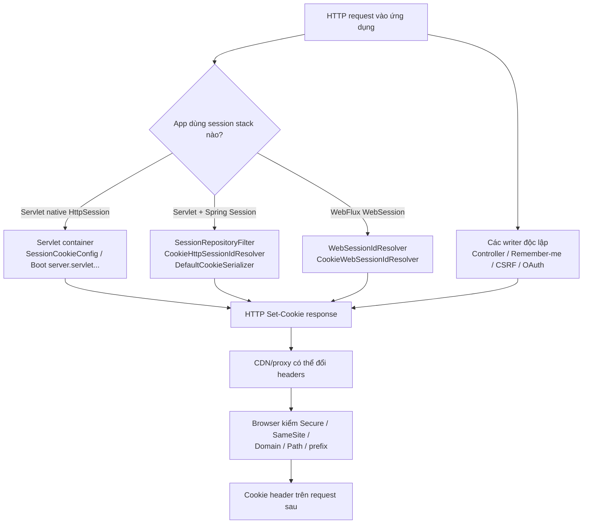
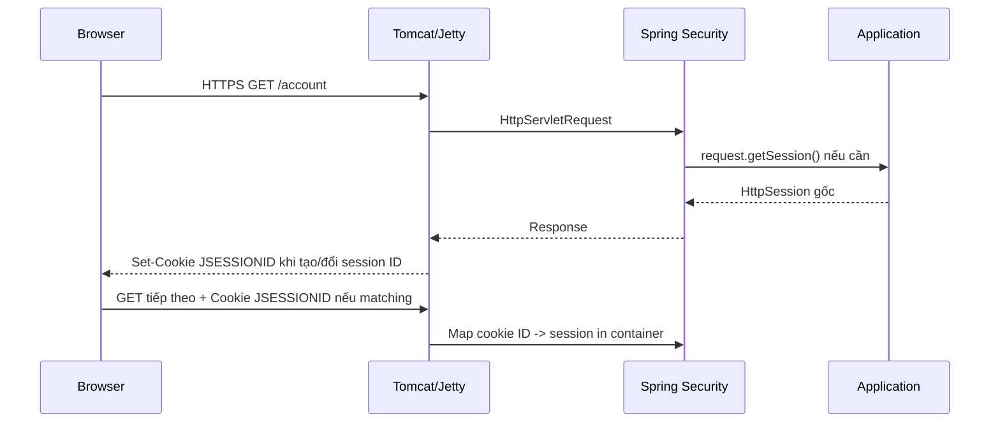
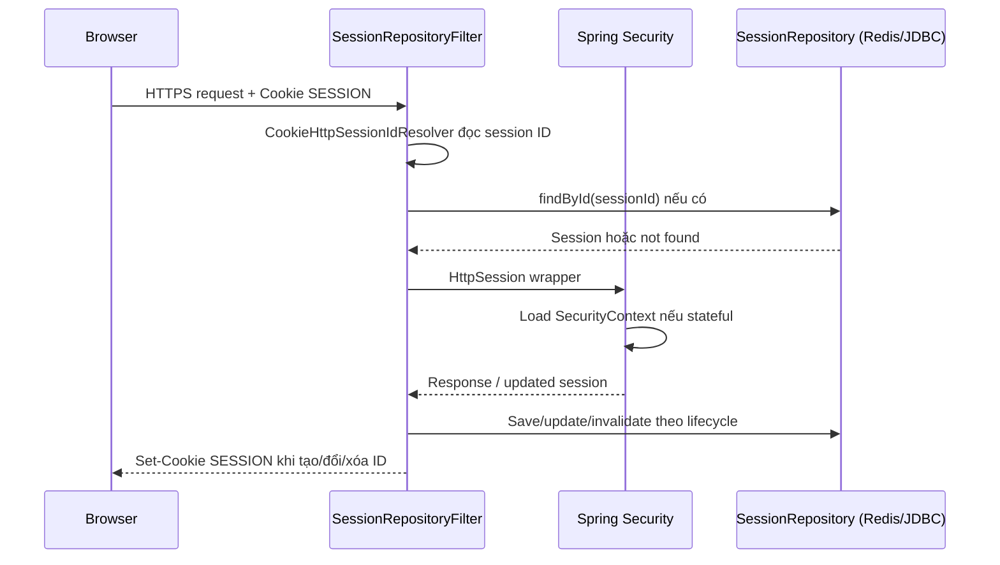
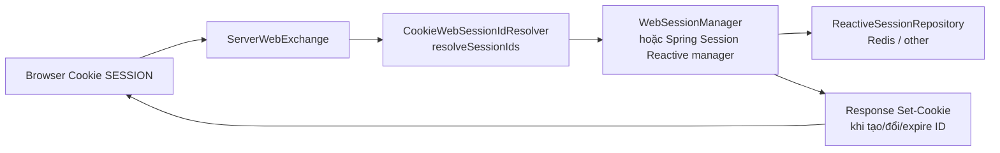
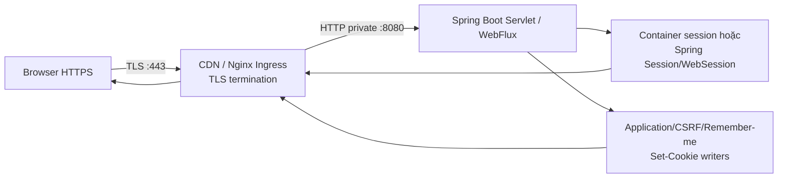
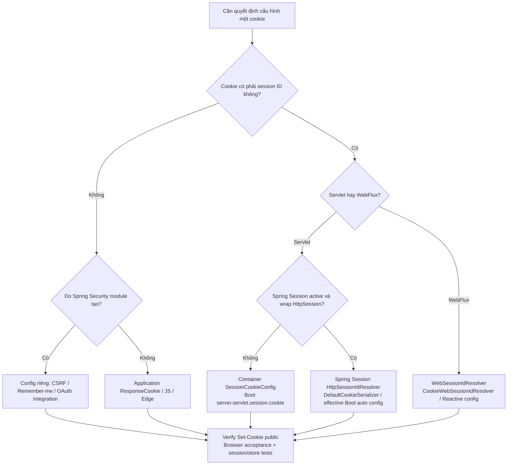

# Đơn vị sở hữu cấu hình cookie: container, Spring Session hoặc ứng dụng

> **Chương:** Session và cookie  
> **Học phần:** `SPRING_SECURITY_HTTP_PROTECTION` — bảo vệ HTTP và trình duyệt trong Spring Security, bao gồm CSRF, CORS, security headers, CSP, HSTS, HTTP firewall và bảo vệ session cho Servlet lẫn Reactive.  
> **Trọng tâm:** xác định **ai thực sự tạo, sửa, gửi và xóa từng cookie**, khi nào cấu hình của Servlet container có hiệu lực, khi nào Spring Session thay cơ chế ấy, và khi nào ứng dụng/Spring Security phải tự chịu trách nhiệm.

## 1. Tình huống: đã bật cookie Secure nhưng scanner vẫn báo lỗi

Một dự án Spring Boot có cấu hình:

```yaml
server:
  servlet:
    session:
      cookie:
        secure: true
        http-only: true
        same-site: lax
```

Người phát triển cho rằng *mọi* cookie từ ứng dụng sẽ có `Secure; HttpOnly; SameSite=Lax`. Sau khi bổ sung Spring Session + Redis, browser lại nhận:

```http
Set-Cookie: SESSION=<opaque-id>; Path=/; HttpOnly; SameSite=Lax
Set-Cookie: XSRF-TOKEN=<opaque-token>; Path=/
Set-Cookie: PREF=compact; Path=/; Max-Age=2592000
```

Ở một môi trường khác, response có thêm:

```http
Set-Cookie: JSESSIONID=<opaque-id>; Path=/; Secure; HttpOnly
```

Vấn đề không chỉ là “một property chưa hoạt động”. **Bốn cookie có thể được tạo bởi bốn code paths khác nhau**:

- `JSESSIONID`: thường là cookie theo dõi `HttpSession` gốc do Servlet container quản lý, hoặc một thành phần khác cố ý dùng tên đó.
- `SESSION`: thường là cookie session ID do Spring Session `CookieHttpSessionIdResolver`/`DefaultCookieSerializer` phát.
- `XSRF-TOKEN`: có thể do `CookieCsrfTokenRepository` của Spring Security hoặc custom CSRF integration tạo.
- `PREF`: cookie nghiệp vụ do application controller/service viết.

**Chỉnh một property của Servlet container không phải là bảo đảm cho mọi writer.** Muốn sửa đúng phải xác định từng cookie đi qua writer nào, session ID được dùng để tra repository nào, và browser cuối cùng có chấp nhận cookie không.

### 1.1. Mục tiêu học tập

Sau bài, người học có thể:

1. Phân biệt **cookie issuer/writer**, **session ID resolver**, **session storage**, **Spring Security authentication persistence** và **browser cookie jar**.
2. Xác định cookie nào do embedded Tomcat/Jetty/Undertow, cookie nào do Spring Session, và cookie nào do application/Spring Security module viết.
3. Giải thích vì sao thêm Spring Session có thể đổi cookie mặc định từ `JSESSIONID` sang `SESSION` và đổi điểm cấu hình.
4. Dùng đúng `server.servlet.session.cookie.*` cho Servlet session tracking, `CookieSerializer`/`DefaultCookieSerializer` cho Spring Session Servlet, `WebSessionIdResolver` cho WebFlux.
5. Chỉ ra giới hạn của Boot auto-configuration khi đã khai báo custom beans/filters/serializers hoặc tự phát `Set-Cookie`.
6. Thiết kế `Secure`, `HttpOnly`, `SameSite`, `Domain`, `Path`, `Max-Age`, prefixes và logout/expiration theo từng cookie.
7. Không nhầm session cookie với remember-me cookie, CSRF cookie, JWT refresh cookie hoặc cookies do load balancer/CDN sinh.
8. Giải thích TLS termination và `request.isSecure()` ảnh hưởng writer nào, không dùng forwarded headers không đáng tin.
9. Xử lý tình huống hai cookies cùng tên, cookies trùng scope, session fixation, session store migration và logout chưa xóa cookie.
10. Xây quy trình kiểm tra browser/Servlet/Reactive, negative CSRF/authorization tests và vận hành nhiều instances.

## 2. Định nghĩa ba chữ “sở hữu” phải tách biệt

Một cookie có thể trải qua **nhiều lớp sở hữu**, không nên hỏi chung “Spring Boot hay Spring Security sở hữu session?”.

| Vai trò | Câu hỏi | Ví dụ |
| --- | --- | --- |
| **Cookie writer** | Ai ghi `Set-Cookie` vào HTTP response? | Servlet container, Spring Session serializer, controller, remember-me service |
| **Session ID resolver** | Ai lấy session ID từ `Cookie` request và gửi ID mới? | Servlet container, `CookieHttpSessionIdResolver`, `CookieWebSessionIdResolver` |
| **Session store** | Session attributes/expiry nằm ở đâu? | Container memory, Redis, JDBC, reactive repository |
| **Authentication context owner** | Ai lưu/nạp principal giữa requests? | Spring Security `SecurityContextRepository` hoặc Reactive context repository |
| **HTTP edge** | Ai terminate TLS, thêm/bỏ/rewrite response headers? | CDN, Nginx, ingress, WAF |
| **Browser** | Có chấp nhận/lưu/gửi cookie không? | Browser cookie jar, same-site/third-party rules |
| **Policy owner** | Ai duyệt tên, attributes, retention và các ngoại lệ? | Application/security/platform owners |

**Quy tắc:** sở hữu cookie writer **không đồng nghĩa** sở hữu data store hoặc authentication. Ví dụ Spring Security lưu `SecurityContext` trong `HttpSession` nhưng `Set-Cookie` của session có thể do **Tomcat** hoặc **Spring Session** viết. <https://docs.spring.io/spring-security/reference/servlet/authentication/persistence.html>

### 2.1. Cookie chỉ thường mang một opaque ID, không phải toàn bộ session

```text
Browser:
  Cookie: SESSION=<opaque-random-id>

Spring Session:
  id -> {createdAt, lastAccessedTime, maxInactiveInterval,
         SecurityContext, CSRF/session attributes, ...}
```

Client mang **session handle**. Server kiểm ID trong repository và quyết định session/authentication state. Cookie `Secure` chỉ bảo vệ cách browser gửi handle trên HTTP(S), không tự kiểm owner/tenant authorization.

Nếu ứng dụng dùng **signed/encrypted client-side session cookie** thay vì server-side repository, mô hình khác; phải kiểm signature/encryption, key rotation và revoke policy riêng. Không mặc định mọi cookie có tên `SESSION` đều là Spring Session.

### 2.2. Một sơ đồ xác định nơi phát cookie



Sơ đồ biểu diễn **những khả năng**, không có nghĩa một request nhất thiết tạo đủ cả cookie của container và Spring Session. Nếu chúng đồng thời xuất hiện, phải xác minh có hai session systems hoặc nhiều writers thật sự cần thiết hay không.

## 3. Phân loại cookie theo mục đích nghiệp vụ

Trước khi sửa cấu hình, lập bảng inventory từ các **Set-Cookie response thực**.

| Cookie minh họa | Mục đích | Writer thường thấy | Không được giả định |
| --- | --- | --- | --- |
| `JSESSIONID` | Servlet native session ID | Tomcat/Jetty/Undertow | Luôn là container; app có thể tự dùng tên này |
| `SESSION` | Spring Session HTTP session ID | `DefaultCookieSerializer` | Luôn có Redis; có thể JDBC hoặc custom repository |
| `XSRF-TOKEN` | CSRF token cho SPA | `CookieCsrfTokenRepository` hoặc app | Là session cookie; thường khác policy `HttpOnly` |
| `remember-me` | Persistent remember-me auth token | Spring Security `RememberMeServices` | Có `server.servlet.session.cookie.*` áp dụng |
| `refresh_token` | Refresh credential | Custom auth service/gateway | Được bảo vệ bởi session timeout |
| `PREF` | UI preferences | Application `ResponseCookie` | Cần HttpOnly=true; có thể cần JS đọc |
| `locale` | Language preference | Spring/app | Có cùng lifetime với session |
| `LB_ROUTE` | Sticky routing | Load balancer/ingress | Có trong Spring filter chain |
| `consent` | Client-side preference/consent | JS/server/CMP | Chỉ server mới có thể tạo |
| OIDC correlation | Auth request/session state | Security integration/app | Có thể tùy biến `Domain` bừa bãi |

**Không dùng tên cookie làm chứng cứ duy nhất.** Có hệ thống cấu hình Spring Session dùng tên `JSESSIONID`; có hệ thống container đổi tên thành `SESSION`. Phải trace library/filter/HTTP response owner.

### 3.1. Browser có thể nhận nhiều `Set-Cookie` trong một response

```http
HTTP/1.1 302 Found
Location: /account
Set-Cookie: SESSION=<opaque-id>; Path=/; Secure; HttpOnly; SameSite=Lax
Set-Cookie: PREF=compact; Path=/; Secure; SameSite=Lax
```

Đây là **hai header fields `Set-Cookie`**, không phải một header nối bằng dấu phẩy. Mỗi cookie có attributes/lifetime riêng; mỗi writer cần policy cụ thể.

### 3.2. `Cookie` request không tiết lộ đủ attributes

Browser gửi:

```http
Cookie: SESSION=<opaque-id>; PREF=compact
```

Request `Cookie` **không gửi lại `Secure`, `HttpOnly`, `SameSite`, `Path` và `Domain`**. Server không thể xác nhận cookie attributes từ request header này. Phải đọc `Set-Cookie` lúc tạo/refresh/expire và xem browser cookie store.

## 4. Servlet native: container là writer cho `HttpSession` tracking

Ở một Servlet app **không dùng Spring Session wrapper**, `HttpSession` được container quản lý.



### 4.1. Vì sao container sở hữu cấu hình này?

Cookie JSESSIONID là cách container cung cấp session tracking theo Servlet API. Các thuộc tính như name/Path/Domain/HttpOnly/Secure được cấu hình ở `SessionCookieConfig` hoặc container-specific settings; Boot có cơ chế binding cho embedded server.

Spring Security có thể:

- Yêu cầu tạo session thông qua request cache/form login.
- Lưu `SecurityContext` vào `HttpSession`.
- Đổi ID khi đăng nhập để giảm session fixation.
- Invalidate session khi logout.

Nhưng những hành động này **không biến Spring Security thành cookie serializer cho native HttpSession**.

### 4.2. Session không nhất thiết được tạo trên mọi GET

Có route `permitAll` không hề tạo session; response có thể không có JSESSIONID. Một route khác có request cache/CSRF/session integration tạo session khiến cookie xuất hiện sớm hơn dự kiến.

Không viết test “mọi HTTP 200 phải có JSESSIONID” hoặc “thiếu JSESSIONID trên /health là lỗi”. Cần biết **khi nào thực sự có tạo/rotate session ID**.

### 4.3. `JSESSIONID` không tự chứng minh Spring Security đã login

Một anonymous browser có thể được cấp session vì CSRF token/request cache hoặc application state. Browser có `JSESSIONID` không có nghĩa principal đã authenticated. Authentication phải được xác định bằng SecurityContext/authorization, không qua tên cookie.

## 5. Spring Boot Servlet: cấu hình container session cookie

Một ví dụ production HTTPS-only **khi native container sở hữu session**:

```yaml
server:
  servlet:
    session:
      timeout: 30m
      cookie:
        name: JSESSIONID
        secure: true
        http-only: true
        same-site: lax
        path: /
```

Các thuộc tính được công bố trong Boot `server.servlet.session.cookie.*`. Kiểm tra metadata và embedded container version thực tế trước triển khai; SameSite support/implementations có khác biệt theo Boot/Tomcat/Jetty/Undertow versions.

### 5.1. `secure: true` để chống sai scheme sau TLS offload

Nếu browser HTTPS→ingress TLS→app HTTP, container có thể thấy `request.isSecure()==false` và tự phát session cookie **không Secure** khi không được cấu hình rõ.

Với app được thiết kế chỉ dùng HTTPS public, đặt `secure: true` để native session cookie luôn mang `Secure`, đồng thời sửa trusted forwarding/canonical URL nếu cần, và đảm bảo HTTPS certificate hợp lệ.

**Không dùng cookie Secure làm cớ truyền credentials qua HTTP ở proxy→app**: nếu hop nội bộ plaintext, vẫn cần network isolation hoặc TLS/mTLS theo threat model.

### 5.2. `same-site: lax` là policy cân bằng, không thay CSRF

`SameSite=Lax` thường thuận lợi cho top-level OAuth/OIDC GET callbacks hơn Strict, nhưng vẫn phải test browser, IdP response mode, session state, third-party policies. `SameSite=None` cần `Secure` và không đảm bảo cookie được browser cho phép trong iframe/cross-site contexts.

CSRF token và object authorization vẫn phải hoạt động; SameSite không loại trừ nguy cơ từ **same-site but cross-origin subdomains**.

### 5.3. Cookie Path là một quyết định về điều hướng

Nếu app ở `/shop`, container default cookie Path có thể theo context root. Khi chuyển app sang public `/` qua ingress rewrite, phải quyết định Path mới; browser chỉ gửi cookie khi request path phù hợp theo rules, và logout cần xóa đúng Path.

Đừng mặc định `Path=/` là bắt buộc cho mọi ứng dụng: Path rộng có thể chia cookie cho nhiều apps cùng host. Nếu dùng `__Host-` prefix, `Path=/` lại là điều kiện bắt buộc.

### 5.4. Tránh đặt `Domain=example.com` tràn lan

Session cookie host-only (không có Domain) giảm việc gửi session ID sang các sibling/tenant-controlled subdomains. Chỉ đặt Domain rộng khi được thiết kế rõ và đã kiểm ownership, cookie tossing/session fixation threats. Spring Security không tự đổi quyết định này vì HSTS includeSubDomains.

### 5.5. `timeout` không phải `cookie.max-age`

`server.servlet.session.timeout` xác định inactivity timeout của server session. `server.servlet.session.cookie.max-age` kiểm tuổi thọ browser cookie (khi áp dụng). Cho cookie tồn tại 30 ngày **không** giữ `HttpSession` trong server 30 ngày nếu maxInactiveInterval chỉ 30 phút.

Ngược lại, server session chưa hết nhưng browser cookie đã expire thì client không còn session ID để truy cập session đó.

## 6. ServletContextInitializer: thay đổi cookie tracking của container, không phải Spring Session

Một lựa chọn ở Servlet native app là cấu hình `SessionCookieConfig` rất sớm trong container startup:

```java
package example.session;

import jakarta.servlet.SessionCookieConfig;
import org.springframework.boot.web.servlet.ServletContextInitializer;
import org.springframework.context.annotation.Bean;
import org.springframework.context.annotation.Configuration;

@Configuration
class NativeContainerSessionCookieConfig {

    @Bean
    ServletContextInitializer nativeSessionCookieSettings() {
        return servletContext -> {
            SessionCookieConfig cookies =
                servletContext.getSessionCookieConfig();

            cookies.setName("JSESSIONID");
            cookies.setHttpOnly(true);
            cookies.setSecure(true);
            cookies.setPath("/");
        };
    }
}
```

**Giới hạn ví dụ:**

- Chỉ dùng khi **container thực sự quản lý native session cookie**, không song song cấu hình trùng lặp rồi dựa vào “property nào thắng”.
- Servlet cookie configuration phải hoàn tất trước khi context init, Boot sẽ áp cấu hình phù hợp; tùy container/Boot version, initializer và built-in customizers có thể có ordering/conflicts.
- Chưa thiết lập SameSite trong ví dụ; dùng Boot property/hỗ trợ container phù hợp, không tự viết chuỗi `Set-Cookie` để vá container một cách mù quáng.
- Không chứng minh `ResponseCookie` tự tạo hay Spring Session `DefaultCookieSerializer` thay đổi.
- Nếu Spring Session filter đang wrap `HttpSession`, **session ID writer chính có thể không còn là container**.

### 6.1. Cách chọn giữa Boot property và initializer

Ưu tiên Boot declarative config khi property đã đáp ứng nhu cầu. Dùng initializer/customizer khi có yêu cầu container-specific thật, có kiểm chứng lifecycle và version. Không config cùng một cookie attribute ở quá nhiều nơi với giá trị mâu thuẫn.

## 7. Spring Session Servlet: chuyển quyền sở hữu từ container sang filter/resolver/serializer

Spring Session thay cách triển khai `HttpSession` thông qua `SessionRepositoryFilter` và repository. Các phần:

- `SessionRepositoryFilter`: wrap Servlet request/response để cung cấp `HttpSession` dựa trên Spring Session thay vì container.
- `SessionRepository<S extends Session>`: lưu/nạp session ở Redis, JDBC hoặc store khác.
- `HttpSessionIdResolver`: đọc session ID từ request và phát/expire ID khi cần.
- `CookieHttpSessionIdResolver`: implementation dùng cookie.
- `CookieSerializer`/`DefaultCookieSerializer`: quyết định **cookie name, Secure, HttpOnly, SameSite, Path, Domain, Max-Age**.
- Spring Security `SecurityContextRepository`: nạp/lưu authentication state qua `HttpSession` đã được wrap khi dùng đúng order.

<https://docs.spring.io/spring-session/reference/http-session.html>

### 7.1. Request/response lifecycle



Sơ đồ là conceptual; chi tiết save/flush và thời điểm gửi Set-Cookie tùy Spring Session version và response commit. Nguyên tắc quan trọng: **Spring Security được đặt sau wrapper** để thấy đúng Spring Session-managed `HttpSession`.

### 7.2. Vì sao Boot native cookie property có thể không còn là nguồn duy nhất?

Spring Session có writer riêng. Boot tự động cấu hình một số thuộc tính, đặc biệt `server.servlet.session.cookie.same-site` cho Spring Session servlet `SessionRepository` beans theo tài liệu Boot. Nhưng nếu dự án khai báo custom `CookieSerializer`, `HttpSessionIdResolver`, annotation configuration hoặc third-party session integration, **effective behavior có thể bị override**.

Vì vậy không nói “`server.servlet.session.cookie.*` không bao giờ áp Spring Session” hay “luôn áp đầy đủ”: phải kiểm đúng version, auto-config/custom bean và response thực. Tham khảo [Spring Boot Servlet SameSite docs](https://docs.spring.io/spring-boot/reference/web/servlet.html).

### 7.3. Tại sao hai cookies có thể xuất hiện?

Một Spring Session app hợp lệ thường dùng `SESSION`, nhưng có thể thấy cả `JSESSIONID` khi:

- Một filter/Servlet/JSP gọi native session **trước** `SessionRepositoryFilter`.
- Security/filter ordering hoặc multiple Servlet contexts chưa đúng.
- Có hai applications cùng hostname/path phát hai cookies.
- Code/controller/custom middleware cố ý phát `JSESSIONID`.
- Browser đang giữ stale cookie từ kiến trúc cũ; response hiện chưa xóa.
- Edge/CDN chèn sticky cookie có tên trùng lạ.
- Migration không dọn cookie cũ và browser tiếp tục gửi cả hai.

Không xóa bừa một cookie trước khi biết **ai dùng nó và path/domain của nó**. Nếu native/JSESSIONID là stale, thiết kế server-side retirement và browser expiration rõ.

## 8. Spring Session `DefaultCookieSerializer`: nơi điều chỉnh cookie cho Servlet

Tài liệu Spring Session định nghĩa `CookieSerializer` là abstraction của cookie/session ID wire format; `DefaultCookieSerializer` là implementation có các setters:

| Thuộc tính | API | Ý nghĩa |
| --- | --- | --- |
| Cookie name | `setCookieName(String)` | Default thường `SESSION` |
| Secure | `setUseSecureCookie(boolean)` | Default thường theo `ServletRequest.isSecure()` |
| HttpOnly | `setUseHttpOnlyCookie(boolean)` | Default true theo docs |
| SameSite | `setSameSite(String)` | Default Lax theo docs version hiện hành |
| Path | `setCookiePath(String)` | Default context path |
| Domain | `setDomainName(String)` | Explicit domain nếu thực sự cần |
| Domain regex | `setDomainNamePattern(String)` | Tính Domain từ request host theo pattern |
| Max-Age | `setCookieMaxAge(int)` | `-1`: session cookie cho browser |
| Partitioned | `setPartitioned(boolean)` nếu version có | CHIPS/browser support riêng |
| JVM route | `setJvmRoute(String)` | Thêm suffix cho routing/tracing theo implementation |
| Remember-me | `setRememberMeRequestAttribute(String)` | Cho Spring Session RememberMeServices integration |

Đừng dựa vào default Secure nếu public TLS terminate ở proxy nhưng app thấy nội bộ HTTP. Cấu hình rõ khi public session luôn phải HTTPS-only.

### 8.1. Một bean serializer riêng, scope Servlet Spring Session

```java
package example.session;

import org.springframework.context.annotation.Bean;
import org.springframework.context.annotation.Configuration;
import org.springframework.session.web.http.CookieSerializer;
import org.springframework.session.web.http.DefaultCookieSerializer;

@Configuration
class SpringSessionCookiePolicy {

    @Bean
    CookieSerializer cookieSerializer() {
        DefaultCookieSerializer serializer =
            new DefaultCookieSerializer();

        serializer.setCookieName("SESSION");
        serializer.setCookiePath("/");
        serializer.setUseSecureCookie(true);
        serializer.setUseHttpOnlyCookie(true);
        serializer.setSameSite("Lax");
        // Không gọi setDomainName: host-only cookie.
        // Giữ cookieMaxAge mặc định cho browser session cookie.
        return serializer;
    }
}
```

**Tiền đề:** dự án đã có Spring Session Servlet module và auto-config/`SessionRepositoryFilter` hợp lệ. Không khai bean này trong native-only app rồi kỳ vọng Tomcat dùng nó. Đối chiếu methods theo version đã ghim.

### 8.2. Một biến thể `__Host-SESSION` cần thẩm định

```java
serializer.setCookieName("__Host-SESSION");
serializer.setCookiePath("/");
serializer.setUseSecureCookie(true);
// Không có setDomainName hoặc setDomainNamePattern.
```

`__Host-` prefix đòi `Secure`, `Path=/` và **không có `Domain` theo browser rules; tạo trên HTTPS origin thích hợp. Nếu reverse proxy sửa `Set-Cookie` hoặc một serializer khác tự thêm Domain, browser có thể reject cookie.

**Lưu ý vận hành:** đổi `SESSION` thành `__Host-SESSION` khiến browsers không tự gửi ID cũ dưới tên mới. Cần migration/login/logout/cookie retirement plan, không chỉ đổi một dòng serializer.

### 8.3. Chỉ chọn domainNamePattern nếu thật sự có SSO cookie sharing

Một regex suy Domain từ request server name có thể phản chiếu hostname không đáng tin hoặc phạm vi rộng hơn mong muốn. Đặc biệt các public suffixes, nhiều cấp TLD, tenant subdomains và tên giống attacker có thể làm pattern sai. Ưu tiên **host-only** nếu không cần shared cookie; nếu cần, dùng known tenant/domain registry và validated allowlist, không suy “parent domain” bằng regex sơ sài.

### 8.4. Cookie Max-Age không quyết định Redis TTL

`cookieMaxAge` điều khiển browser cookie persistence; `SessionRepository` quản lý `maxInactiveInterval`/TTL. Một browser cookie tồn tại lâu hơn server session có thể khiến client liên tục gửi **ID đã hết hạn**, không phục hồi login. Một browser session cookie hết khi browser đóng không bắt Redis xóa record ngay.

### 8.5. `SESSION` không phải `JSESSIONID` chỉ vì đổi tên

Có thể đổi Spring Session cookie name thành `JSESSIONID` để giữ contract với clients; nhưng **writer/resolver/store vẫn là Spring Session**. Tên không chuyển implementation về Tomcat. Khi rollout phải đảm bảo không có container và Spring Session cùng ghi `JSESSIONID` khác giá trị/scope.

## 9. Boot auto-configuration và `CookieSerializer` custom: không dùng “quy tắc thắng” mơ hồ

Một dự án có thể cấu hình cùng một attribute ở nhiều nơi:

```yaml
server:
  servlet:
    session:
      cookie:
        name: SESSION
        secure: true
        same-site: lax
```

và:

```java
@Bean
CookieSerializer cookieSerializer() {
    DefaultCookieSerializer s = new DefaultCookieSerializer();
    s.setCookieName("SESSION");
    s.setSameSite("Strict");
    return s;
}
```

**Không được kết luận bằng suy đoán** rằng Lax hay Strict luôn thắng. Phải kiểm:

1. Spring Boot và Spring Session version.
2. Auto-config path có hiệu lực hay không.
3. Bean `CookieSerializer` do người dùng khai báo có thay default không.
4. Một `HttpSessionIdResolver` khác có dùng bean serializer không.
5. Filter ordering và context có session store nào.
6. `Set-Cookie` cuối trên HTTPS public response.
7. Browser acceptance/sending trong đúng SSO/cross-site flow.

Nếu muốn chính sách minh bạch, **mỗi attribute có một source of truth** và không thiết lập khác nhau trong auto config vs bean tùy chỉnh.

### 9.1. Khi nào nên chỉ dùng Boot properties?

- App native Servlet container session.
- App Spring Session dùng auto-configuration được tài liệu xác nhận có binding thuộc tính cần thiết.
- Không có custom bean override và deployment đơn giản.
- Trên đúng Boot version, integration test xác nhận public `Set-Cookie`.

### 9.2. Khi nào dùng CookieSerializer bean?

- Spring Session Servlet có yêu cầu rõ về cookie name, host-only/Path, `__Host-` prefix, Secure độc lập external scheme, SameSite/Partitioned (nếu API support).
- Cần explicit contract across clusters/apps.
- Có phiên bản/auto config không map đủ properties.
- Team muốn review policy trong một bean cùng tests.

### 9.3. Đừng cấu hình thuộc tính ở cả container và Spring Session rồi tin chúng là một

Nếu Spring Session sở hữu cookie ID, chỉnh `SessionCookieConfig` native để đổi cookie Session có thể không có tác dụng. Ngược lại, đưa `DefaultCookieSerializer` vào native-only app không chạm `JSESSIONID`.

## 10. Phân biệt Servlet Spring Session filter và Spring Security filter

Thứ tự tư duy:

```text
HTTP request
  -> request metadata / trusted forwarded headers (nếu dùng)
  -> SessionRepositoryFilter (wrap HttpSession khi Spring Session active)
  -> Spring Security FilterChainProxy
     -> security context load
     -> CSRF, authentication, authorization, request cache
  -> Controller / service
  -> response/session save/Set-Cookie
```

**Spring Session wrapper phải hoạt động trước các thành phần cần dùng wrapped HttpSession.** Spring Boot/Spring Session có integration về filter ordering; nếu cấu hình thủ công, tuân thủ tài liệu filter order của version đó.

### 10.1. Spring Security nạp authentication state từ đâu?

Với Servlet stateful login, `HttpSessionSecurityContextRepository` có thể lưu/nạp `SecurityContext` từ `HttpSession`; default SecurityContextRepository hiện đại thường là `DelegatingSecurityContextRepository` gồm session và request attribute repositories. <https://docs.spring.io/spring-security/reference/servlet/authentication/persistence.html>

Khi Spring Session filter đang active, `HttpSession` đó là một wrapper cho repository. Spring Security không cần biết cookie ID là `SESSION` hay `JSESSIONID`, nhưng phải thấy session hợp lệ.

### 10.2. Spring Security 6 explicit save khác chuyện cookie attributes

Nếu xây **custom authentication endpoint**, Spring Security 6+ có cơ chế explicit save để lưu context khi cần. Việc có `Set-Cookie` không chứng minh custom login code đã lưu SecurityContext; người dùng có thể login 200 rồi request sau anonymous.

Đây là lỗi **authentication persistence**, khác với cookie serializer thiếu Secure/Path/SameSite. Đừng “sửa” bằng việc bật `Domain=example.com` hoặc tăng TTL.

### 10.3. SessionCreationPolicy.STATELESS có nghĩa gì?

Với policy stateless và `NullSecurityContextRepository`, Spring Security không lưu authentication giữa requests bằng `HttpSession` cho chính security context. Nhưng **controller/third-party filters vẫn có thể tạo session/cookies**, hoặc một service khác ở cùng host phát chúng.

Vì thế `SessionCreationPolicy.STATELESS` **không phải lời hứa “response không bao giờ có Set-Cookie”**. Cần inventory writers thực tế.

## 11. Session, authentication và remember-me: ba vòng đời khác nhau

| Trạng thái | Ai quản lý | Khi nào hết? |
| --- | --- | --- |
| Browser session cookie | Browser | Đóng phiên/expiry theo browser rules |
| Server session | Servlet/Spring Session repository | Inactivity timeout, invalidation/eviction |
| Spring Security authentication | SecurityContext + repo | Logout, session invalidation hoặc mechanism policy |
| Remember-me credential | Spring Security RememberMeServices + token/repo | Token validity/revocation, password/key rotations |
| CSRF token | CSRF repository và frontend | Token lifecycle/session/login/logout |
| HSTS | Browser transport store | HTTPS header max-age/preload status |

### 11.1. Remember-me không phải kéo dài Max-Age của SESSION

Một remember-me cookie có thể tồn tại qua browser restarts, dùng để thực hiện reauthentication khi session không còn. Một session cookie `SESSION` còn 30 ngày nhưng server session chỉ 30 phút **không tự thay remember-me**.

### 11.2. Ai viết cookie remember-me?

Spring Security `RememberMeServices` triển khai cookie riêng và có API như `setUseSecureCookie` ở relevant classes; không mặc định chịu ảnh hưởng bởi `server.servlet.session.cookie.*` hoặc `DefaultCookieSerializer`. Nếu bật remember-me, phải review các attributes/token storage/revocation **riêng**. <https://docs.spring.io/spring-security/reference/servlet/authentication/rememberme.html>

### 11.3. Không lưu dài một opaque session ID chỉ vì “Remember me”

Đặt `SESSION; Max-Age=2592000` trong browser nhưng server session ngắn có thể dẫn tới UI login loops. Đặt server session 30 ngày để khớp lại tăng rủi ro stolen session. Thiết kế remember-me token rotation, anomaly detection, revocation theo risk và product requirements.

## 12. Application-defined cookie: controller/service là writer thực

Ví dụ cookie preference trong Servlet app:

```java
package example.web;

import java.time.Duration;
import jakarta.servlet.http.HttpServletResponse;
import org.springframework.http.HttpHeaders;
import org.springframework.http.ResponseCookie;

class PreferenceCookieService {

    void writePreference(HttpServletResponse response) {
        ResponseCookie cookie = ResponseCookie.from("PREF", "compact")
            .path("/")
            .secure(true)
            .httpOnly(false) // UI JS được phép đọc PREF; không dùng cho session.
            .sameSite("Lax")
            .maxAge(Duration.ofDays(7))
            .build();

        response.addHeader(HttpHeaders.SET_COOKIE, cookie.toString());
    }
}
```

`ResponseCookie` là Spring Framework HTTP abstraction. **Đoạn code này không tự thay native JSESSIONID hay Spring Session SESSION.** Muốn đổi custom cookie phải đổi đúng writer/service đó hoặc một policy interceptor được thiết kế/test rõ.

### 12.1. HttpOnly=false có thể hợp lệ cho preference/CSRF token

`HttpOnly=true` là lựa chọn tốt cho **session/refresh credentials** không cần JS đọc. `HttpOnly=false` có thể phù hợp cho UI preference hoặc CSRF cookie mà frontend phải đọc để đặt token header, nhưng tăng bề mặt đọc bởi XSS. Không áp một quy tắc tuyệt đối “mọi cookie phải HttpOnly”.

### 12.2. Secure, SameSite và Domain phải review theo mục đích

- Preference không nhạy cảm vẫn nên Secure nếu site HTTPS-only; HTTPS links và HSTS giúp tránh mixed transport.
- Cookie có JS read trong same-origin app không cần Domain toàn apex.
- Nếu cookie được dùng trong cross-site iframe, SameSite=None có thể cần Secure và phải xem browser third-party restrictions.
- `Partitioned` (CHIPS) không phải thuốc chữa cho CORS/CSRF; chỉ dùng nếu use case/browser support và privacy policy rõ.
- Max-Age của preference không nên gắn bằng session timeout mặc định.

### 12.3. Viết nhiều cookies phải dùng addHeader

```java
response.addHeader(HttpHeaders.SET_COOKIE, first.toString());
response.addHeader(HttpHeaders.SET_COOKIE, second.toString());
```

Một `setHeader` lần sau có thể thay các `Set-Cookie` trước đó; cũng không nên gộp nhiều cookies vào một trường `Set-Cookie` bằng dấu phẩy. Code phải bảo toàn các writers khác trên response.

## 13. Spring Security `CookieCsrfTokenRepository` không phải session cookie serializer

Spring Security Servlet có `CookieCsrfTokenRepository` dùng cookie (mặc định thường `XSRF-TOKEN`) để client có thể lấy CSRF token cho SPA.

**Đây là CSRF cookie**, không phải `HttpSession` tracking cookie. Dù chọn `CookieCsrfTokenRepository`, session cookie gốc vẫn có writer riêng.

### 13.1. Bẫy của HttpOnly

Một SPA cần đọc CSRF token cookie bằng JS có thể dùng `CookieCsrfTokenRepository.withHttpOnlyFalse()` khi đã hiểu threat model và các xử lý token phù hợp. Điều đó **không** có nghĩa cần đặt session cookie `HttpOnly=false`.

```java
import org.springframework.security.web.csrf.CookieCsrfTokenRepository;

CookieCsrfTokenRepository csrf =
    CookieCsrfTokenRepository.withHttpOnlyFalse();

// Ví dụ riêng của CSRF token cookie; không tùy chỉnh SESSION/JSESSIONID.
```

Tùy Spring Security 6+ version, SPA CSRF flow có XOR/BREACH protection và token refresh/deferred loading. Cần theo chính tài liệu SPA CSRF của phiên bản đó, không chỉ copy một dòng repository.

### 13.2. CSRF vẫn cần dù cookie Secure và SameSite

`Secure` bảo vệ transport của cookie; `SameSite` hạn chế một số cross-site contexts. Khi browser gửi session cookie tự động với unsafe requests, server cần token/origin CSRF policy phù hợp. Sibling subdomains có thể same-site nhưng khác trust boundary.

### 13.3. Token cookie và session cookie cần hai test cases

Một ứng dụng có thể có:

```http
Set-Cookie: SESSION=<opaque-id>; Path=/; Secure; HttpOnly; SameSite=Lax
Set-Cookie: XSRF-TOKEN=<opaque-token>; Path=/; Secure; SameSite=Lax
```

Test `HttpOnly=false` của `XSRF-TOKEN` (nếu SPA yêu cầu) không áp cho `SESSION`. Test CSRF POST thiếu token phải từ chối và không thay đổi state; đừng “đồng nhất hóa” cả hai cookies thành một policy.

## 14. Spring Session WebFlux: không có Servlet container quản lý HttpSession

Trong **WebFlux** (Netty thông dụng), abstractions là `WebSession`, `WebSessionManager`, `WebSessionIdResolver` và `ServerWebExchange`, không phải Servlet `HttpSession`/`SessionCookieConfig`.

Khi có Spring Session Reactive, một `ReactiveSessionRepository` có thể thay session storage. `CookieWebSessionIdResolver` thường được dùng để đọc/ghi cookie web session ID; Spring Session docs hướng dẫn expose một `WebSessionIdResolver` bean để tùy biến. <https://docs.spring.io/spring-session/reference/configuration/common.html>

### 14.1. Vai trò của WebSessionIdResolver



Nếu WebFlux dùng một `CookieWebSessionIdResolver`, cấu hình Servlet `server.servlet.session.cookie.*` **không áp cho resolver ấy**. Màu sắc của hệ thống là Reactive vs Servlet, không phải tên cookie `SESSION` hay `JSESSIONID`.

### 14.2. Spring Boot Reactive session cookie properties

Trong các Boot versions có hỗ trợ, `server.reactive.session.cookie.*` cung cấp cấu hình web session cookie:

```yaml
server:
  reactive:
    session:
      timeout: 30m
      cookie:
        name: SESSION
        secure: true
        http-only: true
        same-site: lax
        path: /
```

Theo Boot properties metadata, các nhóm domain/name/path/secure/http-only/same-site/max-age/partitioned có thể có, nhưng phụ thuộc version. **Không giả định** Boot reactive property sẽ tự ghi đè một `WebSessionIdResolver` bean tùy chỉnh hoặc mọi third-party cookie writer.

### 14.3. Custom WebSessionIdResolver bean

```java
package example.session;

import org.springframework.context.annotation.Bean;
import org.springframework.context.annotation.Configuration;
import org.springframework.web.server.session.CookieWebSessionIdResolver;
import org.springframework.web.server.session.WebSessionIdResolver;

@Configuration
class ReactiveSessionCookiePolicy {

    @Bean
    WebSessionIdResolver webSessionIdResolver() {
        CookieWebSessionIdResolver resolver =
            new CookieWebSessionIdResolver();

        resolver.setCookieName("SESSION");
        resolver.addCookieInitializer(cookie -> cookie
            .path("/")
            .secure(true)
            .httpOnly(true)
            .sameSite("Lax"));

        return resolver;
    }
}
```

Đây là pattern được Spring Session WebFlux guides mô tả. Nếu resolver bean thay auto-config, kiểm xem các properties ở `server.reactive.session.cookie.*` còn được áp không. Chọn **một nơi quyết định attributes** và đọc response thực.

### 14.4. `DefaultCookieSerializer` Servlet không dùng cho Reactive

`DefaultCookieSerializer` thuộc `org.springframework.session.web.http`, viết dựa trên Servlet `HttpServletRequest`/response abstractions. Không tạo bean này trong WebFlux rồi mong nó đổi cookie `WebSession`. Dùng `CookieWebSessionIdResolver` và relevant Boot/Spring Session Reactive integration.

## 15. Spring Security WebFlux authentication persistence và session

Spring Security Reactive có `WebSessionServerSecurityContextRepository` (khi dùng session-based authentication) lưu/nạp `SecurityContext` vào `WebSession`. Khác Servlet `HttpSessionSecurityContextRepository` nhưng cùng ý tưởng: security context là **attribute/state**, cookie chỉ là **handle** để định vị session.

### 15.1. Cookie hợp lệ không đủ để user authenticated

Browser gửi `Cookie: SESSION=<id>`, resolver đọc ID, nhưng:

- Session có thể expired/not found.
- Authentication có thể bị invalidate/revoked.
- Application có thể dùng stateless bearer auth thay vì session.
- Cookie tên SESSION có thể thuộc service khác cùng host/path.
- SecurityContext có thể chưa được lưu sau custom authentication.

Do đó backend phải kiểm principal/authentication/authorization, không tin “có cookie là đã login”.

### 15.2. Khi nào WebFlux sinh Set-Cookie?

Một WebFlux route `GET /health` không đụng `WebSession` có thể không tạo cookie. Khi session thực sự start/rotate/expire, resolver có thể ghi Set-Cookie. Test phải tạo/đổi WebSession theo contract thay vì assert mọi response có SESSION.

### 15.3. WebFlux có thể dùng Redis sessions nhưng cookie vẫn do resolver quyết định

Redis là **session data store**. Nó không tự định Secure/HttpOnly/SameSite của browser cookie. Những attributes nằm trong response writer/`CookieWebSessionIdResolver`/custom configuration, bất kể Redis/JDBC/Map session repository.

## 16. Ngộ nhận về “Spring Security sở hữu cookie”

Spring Security là framework bảo vệ HTTP và authentication. Nó có thể tạo **những cookies riêng** như remember-me, CSRF token, state/nonce integration theo module, nhưng **không đồng nghĩa** mọi `Set-Cookie` đều do Spring Security tạo.

| Câu hỏi | Câu trả lời có điều kiện |
| --- | --- |
| Ai tạo `JSESSIONID` native? | Container thường là writer |
| Ai tạo `SESSION` khi Spring Session Servlet active? | Spring Session resolver/serializer |
| Ai tạo `SESSION` trong WebFlux? | WebSessionIdResolver/Reactive session integration |
| Ai tạo `remember-me`? | Spring Security RememberMeServices |
| Ai tạo `XSRF-TOKEN`? | CSRF repository nếu được cấu hình dùng cookie |
| Ai tạo `PREF`? | Application code hoặc JS |
| Ai có thể đổi mọi response trước browser? | Reverse proxy/CDN response header rewrite nếu được cấu hình |
| Ai xác minh cookie có gửi lại? | Browser cookie jar theo rules; server kiểm dữ liệu và session repository |
| Ai quyết định user có quyền? | Spring Security authorization và business-level ACL |

**Một thay đổi ở `SecurityFilterChain` không có bảo đảm đổi attributes của mọi writer.** Hãy trace từng nguồn phát trên response thực, sau đó cấu hình đúng owner.

## 17. Bốn hợp đồng cookie quan trọng phải thống nhất

Thay vì bắt đầu bằng một YAML property, hãy viết **cookie contract** cho từng issuer:

| Thuộc tính | Session ID | CSRF token cookie | Remember-me | Preference |
| --- | --- | --- | --- | --- |
| Tên | `SESSION` hoặc `JSESSIONID` | `XSRF-TOKEN` nếu dùng | Tên theo services config | `PREF` |
| Giá trị | Opaque, entropy cao, không log | Token repository tạo/rotate | Token/ký hiệu persist theo cơ chế | Giá trị giới hạn, không chứa PII |
| `Secure` | **Bắt buộc với public HTTPS session** | Nên có trên HTTPS | Bắt buộc cho auth cookie qua HTTPS | Nên có nếu HTTPS-only |
| `HttpOnly` | **true** | Có thể false nếu JS SPA phải đọc | Thường true | Theo nhu cầu UI |
| `SameSite` | Lax/Strict/None theo flow | Theo CSRF/SPA flow | Theo remember-me flow | Theo use case |
| `Domain` | Ưu tiên host-only | Ưu tiên host-only | Ưu tiên host-only | Không mở rộng bừa |
| `Path` | Hẹp hợp lý hoặc "/" | Phù hợp API/SPA | Phù hợp login/application | Theo scope |
| Tuổi thọ | Server session & browser cookie tách | Theo token/repository | Theo token validity | TTL nghiệp vụ |
| Xóa | Invalidate server + expire cookie đúng scope | Token invalidation/rotation | Revoke/delete token | Expire/cập nhật |
| Owner | Container hoặc Spring Session/WebSession resolver | CSRF repository | RememberMeServices | App/controller/JS |

Từ đây mới đi xác minh thư viện cụ thể và chỗ cấu hình.

### 17.1. Ownership matrix dùng khi review

Một checklist code review nên có một hàng cho mỗi cookie:

```text
Cookie name:          SESSION
Purpose:              server session handle
Platform:             Servlet + Spring Session JDBC
Actual writer:        CookieHttpSessionIdResolver -> DefaultCookieSerializer
Effective config:     SpringSessionCookiePolicy bean
Session data store:   JdbcIndexedSessionRepository
Security context:     HttpSessionSecurityContextRepository
Public URL:           https://app.example.com
Cookie policy:        Secure; HttpOnly; SameSite=Lax; Path=/; no Domain
Creation:             login/request saved when session required
Rotation:             on authentication according to configured strategy
Expiration:           server idle timeout 30m; browser session cookie
Revocation:           session invalidated + ID expired in browser
Public E2E evidence:  HTTPS Set-Cookie + browser stored/sent/cleared
Owner:                platform/security/application team
```

Đây là **mẫu ghi nhận**, không phải kết quả từ dự án. Nếu app dùng Redis hoặc WebFlux thì thay các thành phần tương ứng theo thực tế.

### 17.2. Một cookie chưa có owner là một rủi ro

Ví dụ trang login trả thêm `Set-Cookie: LEGACY_SESSION=...` từ một ứng dụng cũ mà không ai biết module nào tạo. Không tự xóa nó nếu còn dùng, nhưng phải truy nguồn, đánh giá nội dung, quyền scope, retention và plan retirement. Unknown session/auth cookies có thể là bề mặt replay hoặc session confusion.

## 18. Cookie attributes: browser là nơi quyết định cuối cùng

`Set-Cookie` là **chỉ thị từ HTTP server**, không phải lời cam kết browser sẽ lưu. Browser có thể reject cookie do syntax, prefix, domain/public suffix, Secure/SameSite restrictions, third-party policy hoặc nhiều rules khác.

### 18.1. Secure

```http
Set-Cookie: SESSION=<opaque>; Path=/; Secure; HttpOnly; SameSite=Lax
```

Browser thông thường chỉ gửi cookie Secure trong requests qua HTTPS và một số special-case local contexts. Với public session, phải dùng HTTPS trực tiếp và Secure attribute. Nếu proxy đang terminate TLS, `Secure` phản ánh **browser-facing transport policy**, không có nghĩa backend hop HTTP được mã hóa.

### 18.2. HttpOnly

`HttpOnly` giúp hạn chế JavaScript đọc cookie qua `document.cookie`, nhưng không ngăn script ác ý **tạo requests** khiến browser gửi ambient cookie. CSRF/XSS defenses và authorization vẫn phải có.

### 18.3. SameSite

- `Strict`: hạn chế cookie trong nhiều cross-site navigations; có thể làm OAuth/OIDC callback từ IdP không có session state.
- `Lax`: thường cân bằng cho top-level GET navigations; **không thay CSRF** và có nuances browser default/POST grace behavior khi attribute thiếu.
- `None`: chỉ cho phép cross-site nếu kèm `Secure` theo browser hiện đại; vẫn có third-party privacy/partitioning restrictions.

**Same-site không bằng same-origin**. `https://app.example.com` và `https://api.example.com` thường cùng site (schemeful), nhưng khác origin và cần CORS để frontend JS đọc response API.

### 18.4. Domain và host-only

Không có `Domain` → host-only cookie, mặc định gắn chính xác hostname phát cookie. Có `Domain=example.com` → cookies có thể gửi đến nhiều subdomains phù hợp. Một tenant-controlled subdomain cùng parent có thể tạo cookie collision/tossing hoặc khai thác trust boundary; ưu tiên host-only cho auth cookies.

### 18.5. Path

`Path=/admin` khiến browser giới hạn requests theo path matching; nhưng **Path không là security isolation** vì same-origin JS/response behavior có các đường đọc/ghi khác. Đừng dựa Path thay authz.

Một cookie xóa bằng `Set-Cookie` phải match name, Domain, Path của cookie cũ; nếu không, browser vẫn giữ entry khác.

### 18.6. Max-Age và Expires

`Max-Age` của browser cookie không giống `HttpSession` inactivity timeout hoặc Redis TTL. Cookie có thể tồn tại sau khi server session expired, và ngược lại. Nếu chuyển TTL, test session expiry và invalidation thực chứ không chỉ quan sát cookie biến mất.

### 18.7. Cookie prefixes

Ví dụ:

```http
Set-Cookie: __Host-SESSION=<opaque>; Path=/; Secure; HttpOnly; SameSite=Lax
```

Với `__Host-`: phải `Secure`, `Path=/` và không có `Domain`; được set từ secure origin theo user-agent rules. `__Secure-` yêu cầu Secure, nhưng không buộc host-only như `__Host-`.

Cookie prefix hữu ích để chống cấu hình sai scope, **không tự tạo session fixation protection hoặc CSRF check**.

### 18.8. Partitioned

`Partitioned` (CHIPS) có thể hữu ích cho ứng dụng nhúng thực sự cần cookie được phân vùng theo top-level site, thường kèm `Secure` và phụ thuộc browser support. Không bật trên session login thông thường chỉ để “chặn third-party cookies”; đây là thay đổi semantics cần test.

## 19. TLS termination và `request.isSecure()`: tác động mỗi writer khác nhau

Mô hình production:



Cookie writer có thể quyết định Secure theo những nguồn khác nhau:

| Writer | Điều kiện hay nguồn hay gặp | Cách khắc phục khi sau proxy |
| --- | --- | --- |
| Servlet native JSESSIONID | Container request secure flag và config | `server.servlet.session.cookie.secure=true` + trusted forwarding nếu cần |
| Spring Session `DefaultCookieSerializer` | Default theo `request.isSecure()` | `setUseSecureCookie(true)` hoặc auto-config đã xác minh |
| WebFlux `CookieWebSessionIdResolver` | Reactive request/context, cookie initializer | `secure(true)` trong resolver hoặc Boot config hiệu lực |
| App `ResponseCookie` | Code writer trực tiếp | Explicit `secure(true)` cho public auth/session cookie |
| RememberMeServices | Spring Security remember-me config | Customize remember-me cookie policy riêng |
| CookieCsrfTokenRepository | Spring Security CSRF cookie writer | Config/repository đúng version riêng |
| Edge sticky cookie | Load balancer/CDN settings | Chỉnh edge cookie settings |
| JS `document.cookie` | Client script/browser rules | Frontend policy; JS không thể đặt HttpOnly |

### 19.1. Không coi forwarded header là bằng chứng HTTPS mật mã

Proxy có thể gửi `Forwarded`/`X-Forwarded-Proto` để backend biết public client dùng HTTPS. Nhưng các headers này là HTTP text và có thể giả nếu edge không loại incoming values. Cần:

1. Sanitize/overwrite forwarded headers từ untrusted clients.
2. Hạn chế direct backend access.
3. Validate public hostname/port/prefix ở ingress.
4. Chọn đúng framework/container processing strategy; tránh double parsing.
5. Test app generated redirects, cookie attributes và CSRF origin checks.
6. Nếu hop ingress→app cần encrypted-in-transit, dùng TLS/mTLS thực, không dựa vào forwarded metadata.

### 19.2. HSTS không tự thêm Secure

`Strict-Transport-Security: max-age=31536000` là HTTPS browser policy; `Secure` là cookie attribute. Một `Set-Cookie` thiếu Secure vẫn là lỗi policy dù browser đã học HSTS. Ngược lại `Secure` không bảo vệ HTML HTTP response đầu.

### 19.3. Nginx rewrite Set-Cookie không nên là nơi vá mặc định

Một số proxies có khả năng sửa `Domain`/`Path`/`Secure`/`SameSite` trên response. Dùng làm safety net có thể hợp lý nếu edge chịu policy, nhưng tiềm ẩn:

- Writer gốc vẫn sai và các đường bypass edge nguy hiểm.
- Mất scope của custom cookies hoặc CSRF tokens.
- Hai flags mâu thuẫn, duplicate Set-Cookie hoặc cookie bị browser reject.
- Edge-generated cookies có contract khác.
- Không sửa được server session store/rotation/revocation.

Ưu tiên sửa **đúng writer**, sau đó kiểm final response qua edge và đặt additional defense-in-depth tại proxy nếu được review.

### 19.4. Browser→edge và edge→backend là hai hop

`Secure` bảo vệ browser gửi cookie qua HTTPS tới edge. Nếu edge→app HTTP, session ID có thể truyền plaintext bên trong mạng; NetworkPolicy, TLS bridging hoặc mTLS cần phù hợp threat model. Đừng gọi toàn đường mã hóa end-to-end nếu có HTTP hop.

## 20. Nhiều app/channels cùng hostname: cookie collision

Giả sử:

```text
https://example.com/shop    -> Spring MVC native JSESSIONID; Path=/shop
https://example.com/admin   -> Spring Session SESSION; Path=/admin
https://example.com/api     -> WebFlux SESSION; Path=/
```

Một request `/admin` có thể có nhiều cookies phù hợp nếu names/scopes overlap. Browser có thể gửi cùng cookie name nhiều lần với Path khác; Servlet API/request cookie parsing và resolver interpretation có thể khác khi duplicate names.

### 20.1. Không cho hai services cùng viết `SESSION; Path=/` khác values

Nếu MVC app A và WebFlux app B độc lập nhưng cùng host và cùng `SESSION; Path=/`, cookies có thể ghi đè nhau và tạo “login ở A thì logout B” hoặc session confusion.

Biện pháp:

- Dùng hostnames khác nhau để cô lập session cookies nếu apps không share trust/session.
- Hoặc dùng cookie name/path tách biệt có review.
- Nếu chủ đích share session, phải thiết kế **cùng repository, compatible serialization/security context**, session rotation, cookies và authorization; không chỉ đặt cùng name.
- Kiểm callback paths và authentication/security chain cho từng app.

### 20.2. Cookies cùng tên nhưng khác Path không đơn giản vô hại

Browser có thể gửi cả hai trong `Cookie` request. Server nhận header không có Path metadata, khó chọn đúng nếu resolver chỉ tìm theo tên. Không dựa vào trình tự cookies trong header để phân quyền. Tách names/hosts rõ ràng dễ kiểm soát hơn.

### 20.3. Cookie legacy trong browser có thể phá migration

Chuyển app từ container `JSESSIONID` sang Spring Session `SESSION` không tự xóa legacy cookie. Browser vẫn có thể gửi `JSESSIONID` tới routes cũ/new; nếu code/hạ tầng vô tình dùng cả hai, session confusion xuất hiện.

Migration phải có detection, compatibility window, retirement/expiration cookie old scope và invalidation server-side khi cần.

## 21. Session fixation protection thuộc Spring Security, không thuộc CookieSerializer

Khi login, một session ID trước auth (anonymous/pre-login) có thể bị thay đổi để giảm nguy cơ fixation. Servlet Spring Security có session fixation strategies dùng `changeSessionId`/migrate/new session tùy container/version/config.

Nếu dùng Spring Session, strategy có thể đổi ID qua wrapper/repository, rồi `CookieHttpSessionIdResolver` phát ID mới; nếu native Servlet, container phát cookie mới.

**Không dùng `setCookieName()` để thay thế session ID rotation.** Cookie name thay đổi không đủ để vô hiệu ID cũ nếu server vẫn chấp nhận nó.

### 21.1. Bằng chứng test session fixation

1. Tạo anonymous session `ID_A` với session store.
2. Login hợp lệ qua HTTPS.
3. Quan sát session ID sau auth `ID_B` khác `ID_A` theo strategy.
4. Request sau với ID_B authenticated.
5. Request với ID_A không có authentication cũ/không tiếp cận tài nguyên bảo vệ.
6. Cookie ID mới có `Secure`, `HttpOnly`, `SameSite`, host-only/Path đúng.
7. CSRF token/session state sau login phù hợp lifecycle.
8. Không log raw session IDs; test chỉ so equality và ghi masked values.

### 21.2. Concurrent sessions và distributed store

Spring Session Redis/JDBC giúp chia sẻ session state giữa replicas, nhưng concurrency limits, expiry timing, cleanup và atomic invalidation có đặc tính riêng. Không kết luận “Redis session là secure” chỉ vì lưu tập trung: token entropy, permissions, serialization trust, network encryption, repository TTL và access control vẫn cần.

## 22. Logout là hai thao tác: invalidate server session và expire browser handle

Một logout chuẩn stateful:

```mermaid
sequenceDiagram
    participant B as Browser
    participant SEC as Spring Security
    participant S as Session manager/repository
    B->>SEC: HTTPS POST /logout + valid CSRF nếu cần
    SEC->>S: Invalidate current session / security context
    S-->>SEC: Session invalidated
    SEC-->>B: Set-Cookie SESSION=; Max-Age=0; Path=/; Secure...
    Note over B: Browser xóa cookie khớp name/Domain/Path
    B->>SEC: GET protected resource (không có usable session)
    SEC-->>B: Login/401/403 theo contract
```

**Không đồng nhất**:

- `Invalidate session`: server bỏ/đánh dấu record ID không còn hợp lệ.
- `Expire cookie`: browser được yêu cầu xóa handle ở đúng scope.
- `Clear SecurityContext`: Spring Security không tiếp tục dùng authentication.
- `Revoke remember-me/refresh tokens`: nếu có, token riêng phải được thu hồi.
- `Clear HSTS`: **không liên quan logout**, không được làm.

### 22.1. Cookie expiration phải đúng name/domain/path

Giả sử cookie từng tạo:

```http
Set-Cookie: SESSION=<opaque>; Path=/shop; Secure; HttpOnly; SameSite=Lax
```

Nếu logout gửi:

```http
Set-Cookie: SESSION=; Max-Age=0; Path=/; Secure
```

đó là **cookie khác Path**, nên cookie cũ `Path=/shop` vẫn có thể tồn tại. Phải xóa matching name/Path/Domain scope, và bảo đảm server ID đã invalidated ngay cả nếu browser không xóa.

### 22.2. `deleteCookies("JSESSIONID")` không phải lúc nào cũng đúng

Nếu app dùng Spring Session default `SESSION`, xóa `JSESSIONID` bằng Servlet logout helper có thể không xóa cookie thực. Ngược lại, Spring Session resolver khi session invalidated có thể ghi expiration cookie, nhưng phải kiểm integration/logout path và response thực theo version.

Nếu custom `CookieSerializer` đổi name/path/domain, logout/expiration phải thống nhất với serializer. Đừng gửi hai expiration cookies khác scope rồi cho là đã logout.

### 22.3. Stateless JWT/refresh cookie khác session invalidate

Nếu application bỏ stateful sessions nhưng lưu refresh token trong cookie, xóa browser cookie **không tự revoke** token đã cấp. Cần rotation/revocation/server-side token family policy. Native session logout configuration không điều khiển custom refresh cookie writer.

## 23. HTTP redirect và cookie scope sau login

Một 302/303 có thể chứa `Set-Cookie` và `Location`:

```http
HTTP/1.1 302 Found
Location: /account
Set-Cookie: SESSION=<opaque>; Path=/; Secure; HttpOnly; SameSite=Lax
```

Browser nhận cookie theo rules rồi tạo request mới tới URL `Location`. Nếu redirect sang host khác hoặc HTTP, cookie có thể không gửi:

| Đích Location | Cookie host-only `shop.example.com` | Vì sao |
| --- | --- | --- |
| `/account` từ HTTPS shop | Có thể gửi | Resolve same host/scheme/path |
| `https://shop.example.com/account` | Có thể gửi | Host và Secure match |
| `http://shop.example.com/account` | Không gửi nếu browser thật sự đi HTTP | Secure disallows plaintext; HSTS có thể che lỗi |
| `https://auth.example.com/account` | Không gửi | Sibling host không match |
| `https://tenant-a.example.com` | Không gửi | Host-only isolation |
| `https://pay.partner.example.net` | Không gửi | Different domain |

### 23.1. Đừng nới cookie Domain vì Location sai

Nếu login thành công nhưng chuyển tới `www.example.com` khiến SESSION host-only của `shop.example.com` không gửi, sửa canonical location hoặc thiết kế SSO proper. Không vội đổi `Domain=example.com`: có thể mở credential scope sang tenant/vender-controlled siblings.

### 23.2. Open redirect không được chặn bởi Secure cookie

Ngay cả một redirect tới `https://attacker.example.net` có TLS hợp lệ, đó vẫn là đích không được app cho phép. Validate `next`/`redirect_uri`/`post_logout_redirect_uri` với route key allowlist, registered partner exact hosts và authorization. HTTP security headers không thay input validation.

### 23.3. SameSite/cross-site OIDC callback

OAuth/OIDC callbacks từ IdP có thể là cross-site navigation. `SameSite=Strict` có thể làm cookie session/correlation vắng mặt, dẫn đến state mismatch. `Lax` thường phù hợp cho top-level GET, còn form_post/iframe flows cần thiết kế khác và test browser versions. **Không tắt state validation hay CSRF để “fix” callback**.

## 24. CSRF/CORS/CSP/HSTS/firewall có cùng owner cookie không?

**Không.** Các lớp bảo mật có nguồn cấu hình riêng và cần regression tests dù cookie session được bảo vệ tốt.

| Lớp | Kiểm soát gì | Lỗi khi trộn với cookie ownership |
| --- | --- | --- |
| HSTS | Browser HTTPS upgrade theo hostname | Nghĩ HSTS tự set `Secure` |
| HTTPS redirect | HTTP 3xx tới TLS endpoint | Nghĩ redirect sửa HTTP POST bí mật đã gửi |
| CSRF | Ý định state-changing request có ambient credentials | Nghĩ `SameSite=Lax` luôn thay CSRF |
| CORS | Browser JS access giữa origins | Nghĩ các siblings same-site nên bỏ CORS |
| CSP | Chặn scripts/resources/frame/form per document | Nghĩ `HttpOnly` đã chống mọi XSS |
| HTTP firewall | URL/path/method normalization và request patterns | Nghĩ `Path=/admin` là ACL |
| Authn | Principal/credential validity | Nghĩ cookie presence đồng nghĩa login |
| Authz | User action/object/tenant permission | Nghĩ secure session đảm bảo data access |
| Session management | ID generation, rotation, timeout, invalidation | Nghĩ cookie Max-Age đồng nghĩa server session TTL |

### 24.1. SameSite không thay CSRF cho same-site hostile subdomains

`https://evil-tenant.example.com` và `https://shop.example.com` có thể same-site theo browser logic nhưng khác origin/trust boundary. Cookies với `SameSite=Lax` có thể được browser gửi trong những same-site requests tùy credentials/matching. CSRF token/origin defenses vẫn cần thiết.

### 24.2. HttpOnly không thay CSP và output encoding

Script bị XSS trên chính origin có thể gửi requests dưới user session dù không đọc giá trị cookie HttpOnly trực tiếp. Cần CSP, output encoding, templating safe defaults, CSRF, authorization và input validation.

### 24.3. CORS với WebFlux/Servlet proxy origins

`https://portal.example.com` gọi `https://api.example.com` là **cross-origin**, dù cùng registrable site và cùng Redis. CORS allowlist phải đúng scheme/hostname/port và credentials. Nếu backend sau TLS proxy thấy HTTP internal, cần trusted external request metadata hoặc canonical config; không đổi cookie Domain làm giải pháp.

### 24.4. HTTP firewall không hiểu cookie Domain như quyền truy cập

Servlet `StrictHttpFirewall` và Reactive firewall/routing policies bảo vệ request path/encoding; cookie `Path` không chống bypass authorization. Kiểm object-level authorization ở service/tenant scope.

## 25. Migration từ container session sang Spring Session Redis/JDBC

Một migration không chỉ thêm dependency; nó đổi writer/ID resolver/store và behavior khi nhiều replicas.

### 25.1. Bản đồ trước/sau

| Khía cạnh | Trước: native Tomcat session | Sau: Spring Session |
| --- | --- | --- |
| Session data | In-memory Tomcat (hoặc manager cụ thể) | Redis/JDBC/other repository |
| Servlet `HttpSession` | Container session | Wrapped Spring Session session |
| ID reader/writer | Container session cookie | `CookieHttpSessionIdResolver` + serializer |
| Cookie default name | Thường `JSESSIONID` | Thường `SESSION` |
| Cookie attributes | Servlet `SessionCookieConfig`/Boot | Spring Session `DefaultCookieSerializer` + effective Boot auto config |
| Scaling | Sticky sessions hoặc replication nếu có | Shared repository across replicas |
| Logout invalidation | Container session invalidation | Repository invalidation + ID cookie expiration |
| SecurityContext | `HttpSession` attribute | Same API, backed by Spring Session wrapper |
| Cookie migration | Legacy browser ID | New cookie ID, possible retire JSESSIONID |

### 25.2. Preflight trước migrate

1. Liệt kê tất cả `Set-Cookie` trên login/anonymous/logout/callback/error responses.
2. Xác định active session store và `SessionCreationPolicy`/authentication persistence.
3. Chọn cookie name, Path/Domain/Secure/HttpOnly/SameSite, browser lifetime và server TTL.
4. Xác định Redis/JDBC HA/TTL/serialization/namespace/isolation requirements.
5. Kiểm session data classes tương thích lưu trữ, versioning, deserialization security.
6. Kiểm filter ordering và forwarded scheme trust.
7. Dự kiến logout/old cookie retirement/rollout khi sessions giữa hai implementations không tương thích.
8. Nếu legacy clients phụ thuộc `JSESSIONID`, quyết định giữ tên với Spring Session hoặc phát hành migration có tác động.
9. Không mặc định giữ nguyên old session IDs giữa two stores; cần design security-compatible migration có phê duyệt.
10. Chuẩn bị rollback không cho replay/stale session IDs khôi phục trái ý định.

### 25.3. Đừng chạy hai session systems song song vô tình

Một cluster có node A dùng Tomcat native `JSESSIONID` và node B Spring Session `SESSION` có thể khiến user “login rồi logout” khi load balancer đổi node. Nếu phải blue/green, dùng sticky routing/rollout strategy có đánh giá rủi ro hoặc triển khai backward-compatible sessions trong một cửa sổ transition rõ ràng. Cần test failover/TTL/logout.

### 25.4. Kế hoạch về cookie name

- **Giữ JSESSIONID:** cấu hình Spring Session serializer name `JSESSIONID`, loại bỏ native writer conflicts, test clients.
- **Đổi SESSION:** xác định browser có nhận cookie mới, server trả API hợp lệ, old JSESSIONID retirement.
- **Đổi __Host-SESSION:** đảm bảo Secure+Path=/+host-only, HTTPS public, migration browser state; không cho proxy thêm Domain.
- **Multiple applications:** tránh chia `SESSION; Path=/` across apps không cùng trust/repository.

## 26. Cookie owner và chính sách quan sát/logging

Session ID và remember-me tokens là **secrets**, không ghi raw trong logs/trace/metrics hay bug report.

### 26.1. Quan sát được mà không lộ bí mật

Có thể ghi:

```text
Cookie:
  name = SESSION
  response issuer = spring-session
  hasSecure = true
  hasHttpOnly = true
  sameSite = Lax
  domainPresent = false
  path = /
  maxAgeCategory = browser-session
  event = CREATED / ROTATED / EXPIRED
  sessionId = <redacted>
```

Nếu cần correlating sessions, dùng request trace IDs không chứa session secrets, hoặc dữ liệu băm/HMAC một chiều với key quản lý đúng và retention hạn chế; không in ID gốc ở debug log.

### 26.2. Browser Developer Tools là nguồn quan sát quan trọng

Vào Network/Storage/Application xem:

- `Set-Cookie` response của **đúng host và response 200/302/401/403**.
- Cookie có được browser **accepted** hay bị blocked, và lý do (prefix/Secure/SameSite/Domain/third-party).
- Request tiếp theo có gửi `Cookie` đúng không (che giá trị).
- Cookie nào bị xóa khi logout và còn entry cùng name khác Path/Domain không.
- HSTS/cookie state giữa fresh vs primed browser profiles nếu đang điều tra HTTPS.
- CORS preflight/OIDC callback có thay đổi SameSite behavior không.

### 26.3. Cookie requester không nhất thiết là issuer

Một request `Cookie: SESSION=...` vào app B không chứng minh app B đã phát cookie đó. Cookie có thể đến từ app A cùng host/domain. Phải dựa vào response history/tracing và cùng chính sách domain/path.

### 26.4. Reverse proxy response headers là điểm cuối cần xác minh

Spring Session có thể viết `Secure` đúng ở origin nhưng edge proxy xóa `Set-Cookie`/rewrite domain/path; hoặc origin thiếu `Secure` nhưng edge sửa lại. Browser chỉ thấy **final public response**. Theo dõi cả app-side và edge-side trong môi trường test an toàn để xác định owner thực.

## 27. Test đơn vị cho CookieSerializer, ResponseCookie và chính sách

Các snippets là ví dụ cho đúng dependencies Spring Session Servlet, Spring Framework, JUnit/AssertJ. Không đưa trực tiếp session IDs thật vào test logs.

### 27.1. Kiểm bean `DefaultCookieSerializer` ở mức cấu hình

```java
package example.session;

import static org.assertj.core.api.Assertions.assertThat;

import org.junit.jupiter.api.Test;
import org.springframework.session.web.http.DefaultCookieSerializer;

class CookieSerializerPolicyTest {

    @Test
    void serializerCanBeConfiguredForHttpsOnlySession() {
        DefaultCookieSerializer serializer =
            new DefaultCookieSerializer();

        serializer.setCookieName("SESSION");
        serializer.setCookiePath("/");
        serializer.setUseSecureCookie(true);
        serializer.setUseHttpOnlyCookie(true);
        serializer.setSameSite("Lax");

        // Kiểm sâu hiệu quả bằng response Set-Cookie integration test.
        assertThat(serializer).isNotNull();
    }
}
```

**Lưu ý:** `assertThat(serializer).isNotNull()` chỉ chứng minh khởi tạo/config methods không ném exception, **không xác minh wire-format**. Test có giá trị bảo mật phải mô phỏng writer `CookieSerializer.writeCookieValue(...)` hoặc kiểm `Set-Cookie` trong full Spring Session integration test. Không được báo cookie Secure PASS chỉ từ test này.

### 27.2. `ResponseCookie` custom writer unit test

```java
package example.web;

import static org.assertj.core.api.Assertions.assertThat;

import java.time.Duration;
import org.junit.jupiter.api.Test;
import org.springframework.http.ResponseCookie;

class PreferenceCookieContractTest {

    @Test
    void preferenceCookieHasExpectedFlags() {
        ResponseCookie cookie = ResponseCookie.from("PREF", "compact")
            .secure(true)
            .httpOnly(false)
            .sameSite("Lax")
            .path("/")
            .maxAge(Duration.ofDays(7))
            .build();

        String header = cookie.toString();
        assertThat(header)
            .contains("Secure")
            .contains("SameSite=Lax")
            .contains("Path=/")
            .doesNotContain("Domain=");
    }
}
```

Đây là test **application cookie writer**, không kiểm native session cookie, Spring Session session ID hoặc browser acceptance.

### 27.3. Cần kiểm nhiều Set-Cookie fields

Một `ResponseCookie` test riêng không đảm bảo server không làm mất cookie của writer khác. Dùng integration test đảm bảo response có nhiều `Set-Cookie` fields độc lập khi app tạo nhiều cookies, và không writer nào gọi `setHeader(Set-Cookie, ...)` ghi đè writer trước.

## 28. Servlet integration tests: xác minh đúng writer trong request thực

### 28.1. Test native container phải chạy embedded servlet server

Vì native JSESSIONID có thể do Tomcat/Jetty phát vào response khi session được tạo/rotate, `MockMvc` đơn thuần không luôn mô phỏng đúng cookie commit behavior của embedded server. Muốn kiểm native container, tạo endpoint test phát sinh `HttpSession` thật rồi gọi server đang chạy cổng test.

Một test Java minh họa controller (chỉ trong môi trường test):

```java
package example.test;

import jakarta.servlet.http.HttpServletRequest;
import org.springframework.web.bind.annotation.GetMapping;
import org.springframework.web.bind.annotation.RestController;

@RestController
class TestSessionEndpoint {

    @GetMapping("/test/session/start")
    String start(HttpServletRequest request) {
        request.getSession(true).setAttribute("probe", "ok");
        return "created";
    }
}
```

**Không** giữ endpoint test này public production; nó tạo session theo yêu cầu và có thể gây session store exhaustion. Đặt trong test configuration được kiểm soát.

Kiểm real `Set-Cookie: JSESSIONID=...` qua server HTTP client/curl trên trusted test environment (với HTTPS public ingress), không chỉ assert `getSession()` mock.

### 28.2. Test Spring Session Servlet phải có filter + repository thật

Trong Spring Session integration:

1. Tạo session qua endpoint được permit test.
2. Ghi `Set-Cookie` (có thể là `SESSION` hoặc tên custom).
3. Gửi cookie ID ở request sau.
4. Assert session attribute `probe` được tìm lại từ repository.
5. Invalidate session; request với ID cũ không còn attribute/authentication.
6. Assert expiration cookie đúng name/Path/Domain và flags.
7. Kiểm no unexpected native `JSESSIONID` trong cùng response, nếu architecture chỉ dùng Spring Session.

Dùng Redis/JDBC test repository có isolation, clean-up và TTL theo version; không dùng fake writer test để tuyên bố Redis persistence PASS.

### 28.3. Spring Security session fixation test

Trong một ứng dụng stateful với Spring Security form login:

- Anonymous/pre-login session ID A.
- Authentication hợp lệ/CSRF được cung cấp.
- Sau login session ID B mới theo configured strategy.
- ID A không truy cập protected resources; ID B authenticated.
- Browser cookie mới Secure/HttpOnly/SameSite đúng.
- Không lưu A/B raw trong logs; code test giữ trong bộ nhớ và dùng masked reporting.

### 28.4. `MockMvc` vẫn hữu ích ở tầng filter behavior

`MockMvc` với `spring-security-test` giúp test CSRF/authentication/authorization, Spring Session filter chain khi được cấu hình. Nhưng **native container Set-Cookie behavior và public TLS** nên được E2E trong embedded server/edge.

## 29. WebFlux tests: kiểm `WebSessionIdResolver` và browser session thực

### 29.1. Tạo WebSession trong endpoint test

Ví dụ ở WebFlux test context:

```java
package example.test;

import org.springframework.web.bind.annotation.GetMapping;
import org.springframework.web.bind.annotation.RestController;
import org.springframework.web.server.WebSession;
import reactor.core.publisher.Mono;

@RestController
class ReactiveTestSessionEndpoint {

    @GetMapping("/test/session/start")
    Mono<String> start(WebSession session) {
        session.getAttributes().put("probe", "ok");
        session.start();
        return Mono.just("created");
    }
}
```

`WebSession.start()` trả về `void` theo Spring Framework Javadoc; `save()`/`invalidate()` mới là những thao tác trả về `Mono<Void>`. Ở đây `start()` đánh dấu session cần tạo; web session infrastructure sẽ lưu tại thời điểm response commit theo contract. Endpoint chỉ đặt trong test fixture, không triển khai public production.

### 29.2. WebTestClient: tạo session rồi xem cookie

```java
@Test
void reactiveSessionWriterEmitsCookie() {
    webTestClient.get()
        .uri("/test/session/start")
        .exchange()
        .expectStatus().isOk()
        .expectHeader().exists("Set-Cookie");
}
```

Đây là assertion **khởi đầu**, chưa đủ để kết luận `SESSION; Secure; HttpOnly; SameSite=Lax`; test tiếp phải parse `Set-Cookie` thành cookies theo đúng names, verify attributes/Path/Domain, thử request sau và session expiry, và kiểm browser public HTTPS.

### 29.3. `WebTestClient` bind-to-app không thực hiện TLS handshake

Một test dùng `https://example.com` URI trong `WebTestClient.bindToApplicationContext(...)` có thể chỉ mô phỏng scheme. Nó không chứng minh public certificate/edge forwarding đúng; phải E2E qua actual HTTPS public endpoint bằng client có hostname verification.

## 30. Kiểm thử public HTTPS và browser cookie jar

Chỉ dùng hostname/endpoint mà bạn được phép kiểm tra. Với GET/HEAD test, không gửi session tokens, passwords, CSRF secrets hoặc bearer credentials qua HTTP.

### 30.1. Xác minh public TLS trước khi nói Secure

```bash
curl -v -D - -o /dev/null \
  https://app.example.com/health
```

Kiểm certificate chain, hostname/SAN, TLS verification và public response headers. Không dùng `-k`/`--insecure` rồi báo TLS PASS.

Nếu browser→proxy HTTPS nhưng proxy→app HTTP, `Secure` cookie từ browser đến proxy vẫn phải có. Song không được suy rằng proxy→app đã mã hóa.

### 30.2. Quan sát Set-Cookie ở response tạo session thật

```bash
curl -sS -D - -o /dev/null \
  https://app.example.com/test/session/start
```

**Giả định:** endpoint được cấp riêng trong môi trường test được phép, không có trên production public. Nếu không có test endpoint, dùng luồng hợp lệ cho phép tạo session **mà không ghi dữ liệu nhạy cảm lên terminal**; lưu trace với values đã redacted.

Quan sát:

- Có một hay nhiều `Set-Cookie`?
- Cookie name nào được phát?
- `Secure`, `HttpOnly`, `SameSite`, `Path`, `Domain` và `Max-Age` có đúng?
- Response 302/303 có phát cookie không?
- Có `JSESSIONID` lẫn `SESSION` không? Có chủ ý không?
- Header có bị CDN/ingress rewrite so với app không?

### 30.3. Không dùng chỉ `curl` để chứng minh browser accept/send

`curl` và browser có cookie/redirect rules khác nhau, nhất là SameSite, third-party restrictions, CHIPS/Partitioned và cookie prefixes. Sau khi xem headers bằng curl, bắt buộc test browser real:

1. Storage/Application view: cookie đã được lưu hay bị blocked?
2. Network request tiếp: browser có gửi cookie theo đúng scope không?
3. Sau redirect đổi host/path: cookie gửi đi đâu?
4. Khi logout: cookie có thực bị xóa và ID cũ không còn dùng được không?
5. Trên profile mới: HSTS dynamic đã được học chưa? HTTP first contact có rủi ro không?
6. Bản browser và settings có được ghi lại không?

### 30.4. Browser test qua nhiều hostname

Tạo lab thuộc quyền kiểm soát, ví dụ:

```text
https://app.example.com
https://api.example.com
https://tenant-a.example.com
https://auth.partner.example.net
```

Đo cookie host-only `app.example.com` không được gửi sang siblings/partner, kể cả khi cùng CDN/Redis backend. Nếu app cần SSO, dùng flow hợp lệ thay vì Domain-wide session cookie không kiểm soát.

### 30.5. Test timeouts và expiry thực

Một script/browser test có thể:

- Tạo session và lưu masked ID/hash **trong test memory**.
- Đợi qua server inactivity interval ngắn dành riêng cho lab.
- Gửi cookie cũ và xác nhận server không còn authentication.
- Kiểm browser cookie có thể vẫn hiện (do Max-Age dài hơn server TTL); đây **không phải** bug server session.
- Login lại, kiểm ID rotation.
- Logout, kiểm server invalidation và client expiry.
- Test another replica trong clustered setup, bảo đảm repository availability.

**Không** đổi clocks production, disable certificate validation hoặc làm cạn session store để thử.

## 31. Ma trận kiểm thử 64 trường hợp về cookie ownership

Đây là **thiết kế test**, chưa phải các kết quả đã chạy. Điền observed evidence, version/dependencies, session store và hostname trước khi báo PASS.

| ID | Chủ đề | Đầu vào/điều kiện | PASS khi |
| --- | --- | --- | --- |
| OWN-01 | Native Servlet | Servlet container tạo `HttpSession` | `JSESSIONID`/cookie thực do container writer được nhận diện |
| OWN-02 | Native Servlet | `server.servlet.session.cookie.secure=true` | Public Set-Cookie native có Secure |
| OWN-03 | Native Servlet | SameSite=Lax | Native session cookie đúng theo container/Boot version |
| OWN-04 | Native Servlet | `SessionCookieConfig` custom | Không mâu thuẫn Boot customizer |
| OWN-05 | Native Servlet | Request không tạo session | Không assert cookie luôn hiện trên mọi GET |
| OWN-06 | Native Servlet | TLS offload | Public session cookie vẫn Secure |
| OWN-07 | Spring Session | `SessionRepositoryFilter` active | Wrapped HttpSession/real repository được dùng |
| OWN-08 | Spring Session | Default CookieHttpSessionIdResolver | Cookie mặc định `SESSION` theo docs/version |
| OWN-09 | Spring Session | Custom CookieSerializer | Name/Path/Secure/HttpOnly/SameSite đúng trên response |
| OWN-10 | Spring Session | `useSecureCookie=true` | Secure dù backend thấy HTTP nội bộ |
| OWN-11 | Spring Session | `sameSite=Lax` | Attribute đúng và browser accepts |
| OWN-12 | Spring Session | Không cấu hình Domain | Host-only cookie |
| OWN-13 | Spring Session | Cookie `__Host-SESSION` | Secure, Path=/, không Domain |
| OWN-14 | Spring Session | DomainNamePattern | Không sinh wildcard/domain không tin |
| OWN-15 | Spring Session | Cookie Max-Age dài hơn Redis TTL | Server rejects expired session ID |
| OWN-16 | Spring Session | Change Spring Session cookie name | Không xung đột native JSESSIONID |
| OWN-17 | Spring Session | Hai Set-Cookie SESSION/JSESSIONID | Tìm đúng owners, xử lý intentional/legacy |
| OWN-18 | Spring Session | Session filter ordering | Spring Security thấy repository-backed session |
| OWN-19 | Spring Session | Two app replicas | Session đọc đúng/không lost login |
| OWN-20 | Spring Session | Redis/JDBC unavailable | Fail policy rõ, không tạo phantom auth |
| OWN-21 | Spring Session | Custom serializer vs Boot properties | Effective settings được chứng minh, không đoán precedence |
| OWN-22 | Spring Session | Logout | Repository invalidation + cookie expiry đúng |
| OWN-23 | Spring Session | Session fixation | Pre-login ID không còn authenticated |
| OWN-24 | Spring Session | Session after authentication | ID mới valid, đúng cookie flags |
| OWN-25 | WebFlux | `WebSessionIdResolver` active | WebSession ID cookie đúng writer |
| OWN-26 | WebFlux | `server.reactive.session.cookie.*` | Attributes theo Boot version được áp |
| OWN-27 | WebFlux | `CookieWebSessionIdResolver` custom | CookieInitializer chính là source of truth |
| OWN-28 | WebFlux | WebSession chỉ được đọc | Không tạo cookie không cần thiết |
| OWN-29 | WebFlux | WebSession.start() | Session start có cookie ID phù hợp |
| OWN-30 | WebFlux | Reactive repository | Session được tìm lại qua cookie ID |
| OWN-31 | WebFlux | Cookie host-only | Không gửi sang unrelated subdomain |
| OWN-32 | WebFlux | Resolver đổi tên | Không xung đột auth session từ app khác |
| OWN-33 | App custom | `ResponseCookie` PREF | Secure/SameSite/Path/HttpOnly theo purpose |
| OWN-34 | App custom | Multi `Set-Cookie` fields | Không ghi đè bởi `setHeader` |
| OWN-35 | App custom | UI JS cần đọc PREF | HttpOnly false chỉ cho PREF, không SESSION |
| OWN-36 | App custom | Refresh auth token cookie | Rotation/revocation riêng, không suy native session |
| OWN-37 | Spring Security | Remember-me cookie | Attributes/token lifecycle riêng |
| OWN-38 | Spring Security | Cookie CSRF token | Cookie writer khác session serializer |
| OWN-39 | Spring Security | SPA CSRF cookie JS-readable | Chỉ CSRF token theo policy, không mở session HttpOnly |
| OWN-40 | Spring Security | CSRF unsafe POST không token | Bị từ chối; state không đổi |
| OWN-41 | Spring Security | Stateless filter chain | Không lưu SecurityContext, nhưng phát hiện cookies từ writers khác |
| OWN-42 | Spring Security | Custom login không explicit save | Không nhầm cookie hợp lệ với persisted SecurityContext |
| OWN-43 | Browser | Secure cookie trên HTTP URL | Không gửi cookie qua plaintext theo rules |
| OWN-44 | Browser | Cookie `SameSite=None` không Secure | Browser reject/block theo policy |
| OWN-45 | Browser | Cookie `__Host-` có Domain | Browser reject |
| OWN-46 | Browser | Different Path cookies cùng tên | Detect ambiguity, không dựa Cookie header order |
| OWN-47 | Browser | Cross-site OIDC callback + Strict | Behavior được xác minh, không tắt state validation |
| OWN-48 | Browser | Same-site malicious subdomain | CSRF/tenant isolation vẫn hoạt động |
| OWN-49 | Browser | Logout xóa cookie sai Path | Test phát hiện cookie còn và sửa scope |
| OWN-50 | Browser | Cookie Max-Age vs server timeout | Phân biệt browser lưu ID và session hết |
| OWN-51 | Proxy | Edge rewrite Set-Cookie | Biết policy owner và final header |
| OWN-52 | Proxy | Spoofed X-Forwarded-Proto | Không bypass Secure/session transport logic |
| OWN-53 | Proxy | Backend port trực tiếp Internet | Network block |
| OWN-54 | Proxy | CDN sticky cookie | Không nhầm với application session ID |
| OWN-55 | TLS/HSTS | Browser HSTS đã học | Không suy cookie tự có Secure |
| OWN-56 | TLS/HSTS | First HTTP visit browser mới | Không gửi credential HTTP, HTTPS direct links |
| OWN-57 | Redirect | Set-Cookie + Location trên 302 | Browser gửi cookie đúng host/Path ở hop sau |
| OWN-58 | Redirect | Đổi app→auth sibling | Host-only session không bị share vô ý |
| OWN-59 | CORS | SPA portal→API khác origin | Exact allowlist, credential mode đúng |
| OWN-60 | CSP | HTML có script attacker | CSP/output encoding không regression |
| OWN-61 | HTTP firewall | Encoded URL/path anomalies | Không bypass route/security |
| OWN-62 | Authorization | Tenant B đọc object A | Từ chối dù cookie authenticated |
| OWN-63 | Logging | Debug app/edge/proxy | Không log raw session IDs/tokens |
| OWN-64 | Migration | Native→Spring Session canary | Không double cookies/session confusion |

### 31.1. Nhóm test nào thuộc lớp nào?

| Công cụ | Có thể chứng minh | Không chứng minh |
| --- | --- | --- |
| Unit test `ResponseCookie` | Writer tạo đúng text flags | Browser chấp nhận/gửi cookie |
| `MockMvc` Servlet | Filter/CSRF/authz với mocked session | Native container thực phát JSESSIONID lúc commit |
| Spring Session integration test | Filter/repository/resolver/serializer behavior | CDN public TLS/cookie rewrite |
| `WebTestClient` | Reactive resolver/WebSession behavior | Browser third-party cookie policy hoặc TLS thật khi bind-to-app |
| Real embedded server HTTP test | Container/native Set-Cookie và session lifecycle | Public TLS nếu test chỉ localhost HTTP |
| HTTPS client có certificate verification | Public TLS và final headers | Browser SameSite/CHIPS hay session owner |
| Browser E2E | Accepted/sent/blocked cookies qua navigation | Repo implementation nếu không có server instrumentation |
| DB/Redis integration test | TTL/invalidation/session persistence | Secure cookie browser flags |
| Multi-user/tenant test | Authorization/cache isolation | Thay TLS/HSTS checks |

### 31.2. Ví dụ report đúng phạm vi

```text
Environment: staging
Public host: app.example.com
Runtime: Spring Boot [version], Spring Session [version]
Session writer: CookieHttpSessionIdResolver + DefaultCookieSerializer
Session repository: Redis (test env)
Cookie: SESSION
Observed attributes: Secure, HttpOnly, SameSite=Lax, Path=/, no Domain
Browser build: [recorded version]
Browser accepted: yes
Browser sent on HTTPS follow-up: yes
Browser sent on HTTP: no (controlled safe test)
Session read from Redis: yes
Logout invalidated Redis record: yes
Cookie expired with matching scope: yes
Native JSESSIONID created: no (observed in test)
Conclusion: cookie/session contract PASS for this environment.
```

Không dùng report này làm kết luận cho mọi environments/browsers trước khi có bằng chứng tương ứng.

## 32. Bảng chẩn đoán cookie ownership

| Triệu chứng | Suy đoán dễ sai | Thực tế cần xem |
| --- | --- | --- |
| `secure=true` nhưng SESSION thiếu Secure | “Spring Boot bỏ qua YAML” | Cookie writer đang là Spring Session/custom bean, proxy scheme |
| `JSESSIONID` không đổi sau bật CookieSerializer | “Serializer bug” | Native container mới là writer |
| `SESSION` không đổi sau chỉnh SessionCookieConfig | “Tomcat bug” | Spring Session mới là writer |
| Có cả JSESSIONID và SESSION | “Cookie ngẫu nhiên” | Two session systems/filter order/stale cookies |
| SESSION bị mất qua redirect | “Redis mất dữ liệu” | Cookie Domain/Path/Secure/SameSite vs Location |
| Browser từ chối `__Host-SESSION` | “Browser không hỗ trợ” | Prefix constraints: Domain, Secure, Path=/ |
| Session cookie không gửi từ HTTP | “HSTS lỗi” | Cookie Secure cố ý chặn plaintext |
| SESSION vẫn có trong browser sau logout | “Logout không chạy” | Expiration cookie sai Path/Domain/name hoặc browser state |
| Cookie mất nhưng session Redis còn | “Invalidate lỗi chắc chắn” | Browser expiry tách server TTL; kiểm Redis invalidation |
| SESSION tồn tại nhưng authenticated=false | “Cookie invalid” | Server session expired/SecurityContext chưa save/invalidated |
| Một replica login, replica khác logout | “Cookie SameSite” | Repository/sticky/load balancer/session config mismatch |
| Session cookie Max-Age dài nhưng login hết | “Max-Age không chạy” | Server maxInactiveInterval/TTL ngắn |
| Remember-me biến mất khi sửa SESSION | “Spring Session xóa nó” | RememberMeServices riêng, cookie/scope/expiry |
| XSRF-TOKEN không HttpOnly | “Lỗ hổng tự động” | Có thể SPA cố ý đọc token; kiểm threat model |
| API có cookie dù stateless | “Spring Security tạo session” | App/remember-me/proxy/third-party writer |
| Session cookie bị ghi đè bởi PREF | “Browser tự xóa” | App `setHeader(Set-Cookie)` thay existing |
| Cross-site callback mất state | “TLS/CSRF hỏng” | SameSite/Domain/Path/correlation cookie |
| Cookie Domain thành attacker | “Cookie policy do server tốt rồi” | Proxy forwarded Host/domainNamePattern/Host spoof |
| Browser mới HTTP first visit | “HSTS writer chưa bật” | HSTS dynamic first-visit gap, HTTPS source links |
| POST bị 403 dù cookie đã có | “Cookie Secure làm lỗi” | CSRF token/authorization/session context |
| Login 200 rồi request sau anonymous | “Cookie không được gửi” | SecurityContextRepository explicit save/lifecycle |
| Cookie cùng tên hai Path | “Server sẽ chọn đúng tự động” | Browser gửi hai, parser/resolver ambiguity |
| CDN trả Set-Cookie không thấy ở app logs | “App chưa log” | Edge/CDN sticky/load-balancer cookie owner |
| Cookie PREF thiếu HttpOnly | “Mọi cookie phải HttpOnly” | Nếu JS cần đọc preference, có thể intentional |
| Cookie thuộc subdomain tenant | “SameSite bảo vệ” | Host-only Domain policy và cross-tenant session |
| Browser mới có SESSION nhưng không có Set-Cookie trong GET | “Cookie tự phát” | Có thể cookie đã từ prior response/other app |
| HSTS có nhưng cookie không Secure | “HSTS đủ” | Hai mechanisms độc lập |

### 32.1. Quy trình điều tra theo từng cookie

1. Xác định **cookie name** và request/response hostname thật.
2. Ghi public `Set-Cookie` ở response **tạo, rotate, xóa** cookie.
3. Phân biệt cookie host-only hay Domain, Path, Secure, HttpOnly, SameSite, expiry.
4. Tìm **writer**: container, Spring Session, WebSession resolver, custom app/Security module, proxy.
5. Tìm **ID resolver**: Servlet native, CookieHttpSessionIdResolver hay WebSessionIdResolver.
6. Tìm **session repository** và timeout/TTL/availability.
7. Tìm **SecurityContext persistence** hoặc stateless mechanism.
8. Kiểm forwarded trust/TLS termination, edge header rewrites và hostnames.
9. Kiểm browser accepted/sent/blocked và redirects/callback.
10. Kiểm logout/server invalidation, ID rotation, CSRF/authorization negative tests.
11. Chỉ sửa đúng policy owner; tránh thêm global filter rewrite cookie không review.
12. Thêm regression test cho cookie **đó**, kèm owner và public response evidence.

## 33. Case study: chuyển Spring MVC sang Redis, login không ổn định

### 33.1. Kiến trúc cũ

- `https://shop.example.com` đi qua Nginx terminate TLS.
- Backend Spring MVC + Tomcat HTTP :8080.
- Native `JSESSIONID` trong Tomcat, Boot cấu hình `server.servlet.session.cookie.secure=true`.
- Session giữ trong memory, load balancer sticky routing.
- Spring Security form login/session authentication, CSRF được bật.

### 33.2. Mục tiêu mới

- Dùng Spring Session Redis, cho phép horizontal scaling không phụ thuộc sticky sessions.
- Cookie `__Host-SESSION`, Secure, HttpOnly, SameSite=Lax, Path=/.
- OIDC login redirects vẫn hoạt động.
- Không còn cookie session ID ngoài ý muốn.
- Logout phải invalidate Redis record và clear browser cookie.
- CORS/CSRF/CSP/firewall và tenant authorization không thay đổi.

### 33.3. Hiện tượng sau deploy

1. Nginx vẫn trả HTTPS; login bình thường ở browser QA.
2. Response có `Set-Cookie: SESSION=...; HttpOnly; SameSite=Lax` **thiếu Secure**.
3. Một endpoint cũ phát `JSESSIONID` nên browser có hai session IDs.
4. `server.servlet.session.cookie.name=__Host-SESSION` đã sửa nhưng browser vẫn nhận `SESSION`.
5. Developer thêm `Domain=example.com` để “share login” giữa shop và auth; tenant subdomains cũng nằm dưới root.
6. Một custom `ResponseCookie` logout chỉ xóa `SESSION; Path=/shop` trong khi cookie được đặt `Path=/`.
7. Cross-site OIDC callback mất state sau khi đổi SameSite sang Strict.
8. Một API chạy stateless vẫn phát `PREF` không Secure, và scanner nhầm đó là SESSION.
9. Một số requests ghi Redis session nhưng SecurityContext chưa được lưu sau custom login, nên request kế tiếp anonymous.

### 33.4. Phân tích đúng owner

| Triệu chứng | Owner/nguồn gốc thực | Cách sửa |
| --- | --- | --- |
| SESSION thiếu Secure | DefaultCookieSerializer theo internal `isSecure()` | Explicit `setUseSecureCookie(true)` hoặc effective auto config đã verify |
| JSESSIONID dư | Native container/legacy route | Điều tra filter order/other app, retire cookie |
| Boot cookie.name không tác động | Writer hiện là Spring Session custom/default | Config `CookieSerializer` chính |
| Domain quá rộng | Serializer/app config | Dùng host-only; SSO qua protocol, không chia cookie cho tenants |
| Logout còn cookie | Expiration writer sai Path/name | Dùng resolver invalidation/cookie expiry đúng |
| OIDC state mismatch | SameSite/correlation flow | Test callback GET/POST, chọn policy phù hợp, giữ state verification |
| PREF thiếu Secure | Application writer | Sửa `ResponseCookie` tạo PREF |
| Auth không persist | SecurityContextRepository/custom login | Explicit save theo version/security configuration |
| CDN status khác app | Edge rewrite/error page | Xác minh public final Set-Cookie |

### 33.5. Kế hoạch remediation theo thứ tự

1. Dừng thay đổi Domain rộng và bảo vệ account sessions.
2. Chọn một source of truth cho Spring Session cookie (serializer bean hoặc verified Boot auto config).
3. Đặt `__Host-SESSION`, Secure, HttpOnly, SameSite theo flows, Path=/, không Domain.
4. Chứng minh browser accepted cookie, request kế tiếp gửi đúng ID và Redis trả session.
5. Bảo đảm Spring Session filter đứng trước các thành phần tương tác với `HttpSession`.
6. Audit native JSESSIONID writers; xóa legacy cookie với đúng scope nếu được phê duyệt.
7. Kiểm SecurityContext save, session rotation và expiry khi login/logout.
8. Tối ưu OIDC callback cookie SameSite (không tắt state/nonce/PKCE).
9. Sửa custom PREF writer và any remember-me/CSRF cookies riêng.
10. Test proxy sanitizer/trusted external scheme và HTTPS public response.
11. Chạy cross-tenant/CSRF/CORS/CSP/http-firewall negative tests.
12. Canary rollout và rollback plan; monitor rate anonymous-after-login, multiple cookies, session store availability.

### 33.6. Nghiệm thu phải xem ba phía

- **Browser:** cookie có đúng name/attributes, được lưu/sent/clear.
- **Edge HTTP:** public HTTPS final headers, redirect/cookie domain/Host không bị rewrite sai.
- **App/store:** session record/lifecycle, principal, CSRF token, rotation, invalidation và tenant ACL.

Một scanner chỉ nhìn `Secure` header không thể chứng minh cả ba phía đúng.

## 34. Cây quyết định chọn owner của cookie session



### 34.1. Cách áp dụng nhanh trong incident

- Thấy `JSESSIONID`: **đừng vội** kết luận container; xem writer/tracking mode/filter thực.
- Thấy `SESSION`: xem Spring Session hay WebFlux resolver đã hoạt động, hoặc app tự dùng tên.
- Thấy `XSRF-TOKEN`: xem CSRF cookie repository/SPA policy.
- Thấy `remember-me`: xem RememberMeServices, token validity, revocation.
- Thấy `PREF`: xem controller/JS/custom cookie services.
- Thấy LB cookie: xem ingress/CDN config.
- Sau khi có owner, sửa **đúng component** và đo public final response.

## 35. Bài tập thực hành

### Bài 1 — Cookie native hay Spring Session?

App dùng Tomcat, ban đầu phát `JSESSIONID`. Sau thêm Spring Session Redis, phát `SESSION`. Developer chỉnh `SessionCookieConfig.setName("HELLO")` nhưng response vẫn có SESSION.

**Câu hỏi:** vì sao? Cần cấu hình ở đâu?

**Gợi ý:** Session cookie writer có thể đã chuyển sang Spring Session `DefaultCookieSerializer`. Cần kiểm `SessionRepositoryFilter`, `HttpSessionIdResolver`, cookie serializer và Boot auto config, không suy chỉ từ tên.

### Bài 2 — Thiếu Secure sau TLS proxy

Browser HTTPS→Nginx TLS→Tomcat HTTP 8080, Spring Session serializer mặc định thấy `isSecure=false`.

**Câu hỏi:** làm sao đảm bảo cookie session Secure?

**Gợi ý:** `setUseSecureCookie(true)` hoặc effective auto-config có test, đồng thời giữ public HTTPS và trusted forwarded boundary. Không tin `X-Forwarded-Proto` tùy ý.

### Bài 3 — Session cookie Max-Age vs Redis TTL

`SESSION` Max-Age=7 ngày nhưng `maxInactiveInterval`=30 phút. User rời app 1 giờ rồi về.

**Câu hỏi:** user còn authenticated không?

**Đáp án:** có thể browser vẫn gửi cookie ID nhưng Redis đã hết session, nên không còn authentication; cookie Max-Age không kéo dài server TTL.

### Bài 4 — Cookie tên `JSESSIONID` có chắc native?

Một Spring Session bean gọi `setCookieName("JSESSIONID")`.

**Câu hỏi:** ai sở hữu Set-Cookie lúc này?

**Đáp án:** vẫn có thể Spring Session serializer; tên cookie không định danh implementation.

### Bài 5 — SecurityContext chưa lưu

Custom login trả 200, SESSION cookie vẫn có, nhưng request kế tiếp anonymous.

**Câu hỏi:** thuộc lớp nào?

**Gợi ý:** kiểm Spring Security `SecurityContextRepository`/explicit save và wrapped session; không chỉ sửa cookie flags.

### Bài 6 — CSRF cookie không HttpOnly

SPA dùng `XSRF-TOKEN` để đưa token vào header, cookie không HttpOnly nhưng SESSION có HttpOnly.

**Câu hỏi:** tất cả cookies bắt buộc HttpOnly không?

**Đáp án:** không. Phân biệt mục đích cookie và threats; session secret cần HttpOnly, CSRF token cookie có thể cần JS đọc theo chính sách được review.

### Bài 7 — Logout xóa sai Path

Cookie tạo `SESSION; Path=/admin`, logout expire `SESSION; Path=/`.

**Câu hỏi:** kết quả browser?

**Đáp án:** cookie cũ ở Path=/admin có thể vẫn tồn tại; server session phải invalidated và expiration cookie phải dùng đúng scope.

### Bài 8 — Hai cookies cùng tên

Hai apps cùng host viết `SESSION` với Path=/ và khác values; browser request mang một `SESSION` không như mong đợi.

**Câu hỏi:** sửa gì?

**Gợi ý:** tách hostnames/names/paths hoặc dùng shared session contract đúng; không dựa order của Cookie header.

### Bài 9 — Prefix `__Host-`

Spring Session phát `__Host-SESSION; Domain=example.com; Secure; Path=/`.

**Câu hỏi:** browser có thể từ chối không?

**Đáp án:** có, vì `__Host-` cấm Domain. Dùng host-only, Path=/ và Secure, HTTPS context.

### Bài 10 — Stateless nhưng vẫn Set-Cookie

Security config `SessionCreationPolicy.STATELESS`, response có `Set-Cookie: PREF=...`.

**Câu hỏi:** có mâu thuẫn?

**Đáp án:** không bắt buộc. Stateless nói về security/session persistence, không cấm application preference cookie.

### Bài 11 — Boot property và Bean xung đột

YAML `same-site: lax`, custom `DefaultCookieSerializer.setSameSite("Strict")`.

**Câu hỏi:** giá trị nào thắng?

**Gợi ý:** không đoán. Kiểm Boot/Spring Session version, auto-config và final HTTPS Set-Cookie. Chọn một policy owner rõ ràng.

### Bài 12 — Cross-site OIDC callback

Session cookie `SameSite=Strict`, IdP redirect GET về app và mất session state.

**Câu hỏi:** xử lý thế nào?

**Gợi ý:** đánh giá SameSite/callback method và OIDC state management; không tắt state/CSRF để “sửa”.

### Bài 13 — Browser cookie Secure nhưng backend HTTP

App nhận request sau TLS termination, cookie `Secure` đã được edge chuyển đến backend bằng HTTP.

**Câu hỏi:** có mã hóa end-to-end không?

**Đáp án:** không. Secure chỉ ảnh hưởng browser-facing request; cần bảo vệ hop nội bộ theo threat model.

### Bài 14 — Reactive WebSession writer

WebFlux có `server.servlet.session.cookie.secure=true`, response `SESSION` thiếu Secure.

**Câu hỏi:** vì sao?

**Gợi ý:** Servlet property không điều khiển Reactive `CookieWebSessionIdResolver`. Dùng Boot Reactive property hoặc custom resolver phù hợp.

### Bài 15 — Remember-me token không bị revoke

Logout invalidates session Redis nhưng browser còn remember-me cookie hợp lệ và đăng nhập tự động lần sau.

**Câu hỏi:** có phải Redis bug không?

**Gợi ý:** không nhất thiết. RememberMeServices/token store có lifecycle riêng, cần logout/revocation đúng.

### Bài 16 — Đăng nhập theo hai ứng dụng

`shop.example.com` và `auth.example.com` cần SSO. Developer đặt `Domain=example.com` cho SESSION.

**Câu hỏi:** giải pháp an toàn hơn?

**Gợi ý:** host-only sessions và OIDC/code flow, tránh cấp session cookie shop cho auth/tenants nếu không thiết kế shared trust.

### Bài 17 — HSTS có thể che cookie lỗi?

Một browser đã HSTS luôn vào HTTPS, cookie SESSION thiếu Secure nên scanner báo warning.

**Câu hỏi:** có bỏ warning được không?

**Đáp án:** không. HSTS và Secure thuộc hai security policies; cần sửa đúng cookie writer.

### Bài 18 — Thiết kế test 3 lớp

Hãy viết test plan chứng minh Spring Session + Redis và browser cookie behavior sau login/logout qua CDN TLS. Tách **app/filter/store**, **public response/edge**, **browser accepted/sent/cleared**, cộng thêm negative CSRF/tenant authorization.

**Gợi ý:** ma trận OWN-xx là starting point; report exact expected/observed evidence, phiên bản dependency và public hostname.

## 36. Checklist kiểm soát nguồn phát session/cookie

- [ ] Mỗi cookie có tên, mục đích, writer, ID resolver, store và security owner được ghi nhận.
- [ ] Không dùng cookie name để kết luận framework owner.
- [ ] Session cookie native hay Spring Session đã được phân biệt bằng active filter/resolver.
- [ ] Đã kiểm Servlet vs WebFlux runtime thay vì áp nhầm config namespaces.
- [ ] Native session: Boot `server.servlet.session.cookie.*` có test trên embedded container.
- [ ] Native session: ServletContextInitializer không override conflict với Boot properties.
- [ ] Spring Session: `SessionRepositoryFilter` hoạt động trước các thành phần cần wrapped HttpSession.
- [ ] Spring Session: repository Redis/JDBC và `HttpSessionIdResolver` được xác nhận active.
- [ ] Spring Session: `DefaultCookieSerializer`/effective Boot auto config là source of truth.
- [ ] Không dựa giả định Boot session properties tự điều khiển mọi custom cookies.
- [ ] `CookieSerializer` custom không mâu thuẫn autoconfiguration.
- [ ] Spring Session WebFlux: `CookieWebSessionIdResolver` hoặc Boot Reactive config đã được kiểm.
- [ ] Không dùng Servlet `DefaultCookieSerializer` để chỉnh WebFlux `WebSession`.
- [ ] Session cookies public luôn `Secure` trên HTTPS deployment.
- [ ] Session cookies authentication có `HttpOnly`, `SameSite` phù hợp flow.
- [ ] Các cookies cần JS đọc được đánh giá riêng, không mở session HttpOnly.
- [ ] Host-only cookie mặc định nếu không có lý do chia subdomains.
- [ ] `Domain=example.com` không được áp vì “tiện SSO” khi có tenants/vendor subdomains.
- [ ] `__Host-` prefixed cookie có Secure, Path=/, no Domain và HTTPS context.
- [ ] Cookie Path phản ánh URL scope và logout expiry Path phù hợp.
- [ ] Browser cookie Max-Age/Expires không được nhầm server inactivity timeout.
- [ ] Spring Session store TTL/invalidation/recovery có tests.
- [ ] Session ID rotation/fixation protection hoạt động sau login.
- [ ] Cookie cũ/session ID cũ không tự khôi phục authentication.
- [ ] Logout invalidates server session, clear SecurityContext và expire cookie đúng scope.
- [ ] Remember-me/refresh tokens có revocation policy riêng.
- [ ] CSRF token cookie writer tách session cookie serializer và có threat model.
- [ ] SessionCreationPolicy.STATELESS không bị xem là cấm mọi Set-Cookie.
- [ ] Public TLS certificate/hostname verification đạt; không bỏ qua cert errors.
- [ ] Proxy sanitize `Forwarded`/`X-Forwarded-*` và chặn direct backend access.
- [ ] Biết public HTTPS không đồng nghĩa backend hop HTTP đã mã hóa.
- [ ] CDN/ingress không rewrite Set-Cookie sai hoặc tạo conflicting cookies.
- [ ] Không dùng global `setHeader(Set-Cookie)` làm mất cookies khác.
- [ ] Không có hai apps cùng host dùng session cookie name/path collision ngoài dự định.
- [ ] CORS exact origins/credentials đúng khi browser gọi sibling API.
- [ ] SameSite không được coi là thay CSRF cho same-site hostile subdomains.
- [ ] CSP/output encoding vẫn bảo vệ XSS dù cookies HttpOnly.
- [ ] HTTP firewall/matchers và tenant/object ACL có negative tests.
- [ ] CDN private cache và Set-Cookie caching policies được kiểm.
- [ ] OAuth/OIDC state/nonce/callback SameSite flow có browser E2E.
- [ ] WebSocket/SSE/API calls giữ session/authn theo security contract phù hợp.
- [ ] Browser acceptance/sending/blocked reasons được quan sát trên phiên bản cụ thể.
- [ ] Public Set-Cookie được đo trên các response tạo/rotate/delete, cả 3xx nếu có.
- [ ] Không log session ID/token/password/CSRF secrets trong app hoặc proxy.
- [ ] Test production-like gồm TLS/ingress, real container, session repository và browser.
- [ ] Có kế hoạch canary/rollback nếu thay session writer hoặc cookie name.
- [ ] Báo cáo PASS phân biệt “header có flag” với “browser đã dùng cookie” và “session còn hợp lệ”.

## 37. Câu hỏi tự đánh giá

**1. Container sở hữu cookie nào trong Servlet native session?**  
Thường là `JSESSIONID` được quản lý qua `SessionCookieConfig`/Boot container settings. Nhưng tên có thể được tùy biến, phải xác minh writer.

**2. Khi dùng Spring Session Servlet, bean nào thường sở hữu attributes của SESSION?**  
`DefaultCookieSerializer` qua `CookieHttpSessionIdResolver`, trong context có `SessionRepositoryFilter` và repository.

**3. `server.servlet.session.cookie.*` có chắc áp cho mọi Spring Session property trong mọi version không?**  
Không. Boot hỗ trợ một số integration như SameSite cho Spring Session servlet, nhưng custom beans/version có thể override. Đọc effective public Set-Cookie.

**4. Một bean `DefaultCookieSerializer` có chỉnh cookie WebFlux không?**  
Không; WebFlux dùng `WebSessionIdResolver`/`CookieWebSessionIdResolver`.

**5. Vì sao Spring Security có thể lưu authentication nhưng không trực tiếp phát session cookie?**  
`SecurityContextRepository` lưu context trong `HttpSession`, còn cookie ID do container hoặc Spring Session/Reactive resolver phát.

**6. SESSION cookie có nghĩa user đã đăng nhập chưa?**  
Không. Session có thể anonymous/expired, hoặc SecurityContext chưa được lưu.

**7. `SameSite=Lax` có thay CSRF token không?**  
Không, nhất là khi có same-site untrusted sibling subdomains hoặc cookie-session unsafe requests.

**8. Cookie `XSRF-TOKEN` không HttpOnly có thể hợp lệ không?**  
Có khi SPA cần JS đọc token và threat model/config đã được đánh giá; session cookie vẫn nên HttpOnly.

**9. Tại sao Secure cookie thiếu sau TLS proxy?**  
Writer có thể lấy Secure theo internal `isSecure=false`; cần explicit policy và trusted forwarding/edge controls.

**10. Có thể đặt cookie Max-Age=7 ngày để giữ server session lâu hơn không?**  
Không. Session repository TTL/maxInactiveInterval riêng.

**11. Logout gửi Max-Age=0 có xóa mọi cookie cùng tên không?**  
Không; phải match name/Domain/Path để xóa đúng cookie entries.

**12. `__Host-SESSION` cần những flags nào?**  
`Secure`, `Path=/`, không `Domain`; set từ HTTPS origin phù hợp.

**13. Spring Session dùng cookie name JSESSIONID có thành container session không?**  
Không. Resolver/serializer/repository mới là nơi quyết định implementation.

**14. Vì sao browser có hai cookie cùng tên?**  
Có thể khác Path/Domain, có nhiều writers/apps hoặc legacy cookies. Phải phân biệt scope và owner, không dựa vào request cookie order.

**15. `SessionCreationPolicy.STATELESS` có bảo đảm zero Set-Cookie không?**  
Không. Application/CSRF/remember-me/proxy vẫn có thể phát cookies riêng.

**16. Remember-me cookie và SESSION cookie do cùng serializer điều khiển không?**  
Không mặc định. RememberMeServices có cơ chế phát/token policy riêng.

**17. Spring Session filter ordering quan trọng vì sao?**  
Security/request cache cần thấy `HttpSession` wrapper backed by repository; nếu native session được tạo trước, có thể sinh cookie phụ/mất authentication continuity.

**18. Proxy rewrite Set-Cookie có thể gây lỗi gì?**  
Sai Domain/Path/SameSite/Secure, duplicate headers, browser rejection và che giấu origin writer sai.

**19. Một MockMvc test có đủ chứng minh native Tomcat session cookie không?**  
Không luôn; native container Set-Cookie nên được kiểm qua embedded server thật/public HTTPS flow.

**20. Phương pháp nghiệm thu phù hợp là gì?**  
Xác minh cookie writer/resolver/store và `SecurityContext`, public `Set-Cookie`, browser accepted/sent/cleared, session rotation/logout/repository TTL và negative CSRF/CORS/authorization tests.

## 38. Nguồn chính thức và phạm vi sử dụng

Những đoạn Java/YAML là **mẫu minh họa**, không khẳng định đã biên dịch/chạy trong dự án thật. API/auto-configuration có thể thay đổi theo phiên bản; cần kiểm exact Spring Boot, Spring Security, Spring Session và Spring Framework dependencies của dự án. Đặc biệt **Spring Session 3.x/4.x** và **Spring Boot 3.x/4.x** có sự khác biệt về Java baseline, package names, configuration/metadata hoặc auto-configuration.

### 38.1. Spring Session Servlet và Reactive

- [Spring Session — HttpSession Integration](https://docs.spring.io/spring-session/reference/http-session.html): `SessionRepositoryFilter`, wrapping `HttpSession`, repository-backed session và filter order.
- [Spring Session — API Documentation](https://docs.spring.io/spring-session/reference/api.html): `CookieSerializer` và `DefaultCookieSerializer`.
- [Spring Session — Common Configurations](https://docs.spring.io/spring-session/reference/configuration/common.html): bean CookieSerializer, cookie defaults, WebSessionIdResolver.
- [Spring Session 3.3 — Servlet Custom Cookie Guide](https://docs.spring.io/spring-session/reference/3.3/guides/java-custom-cookie.html): ví dụ phiên bản cụ thể cho tùy biến cookie Servlet; đối chiếu API ở version dự án.
- [Spring Session — WebFlux Custom Cookie Guide](https://docs.spring.io/spring-session/reference/guides/boot-webflux-custom-cookie.html): `CookieWebSessionIdResolver`.
- [Spring Session — DefaultCookieSerializer Javadoc](https://docs.spring.io/spring-session/reference/api/java/org/springframework/session/web/http/DefaultCookieSerializer.html).
- [Spring Session — CookieHttpSessionIdResolver Javadoc](https://docs.spring.io/spring-session/reference/api/java/org/springframework/session/web/http/CookieHttpSessionIdResolver.html).

### 38.2. Spring Boot/Framework configuration

- [Spring Boot — Servlet Web Applications](https://docs.spring.io/spring-boot/reference/web/servlet.html): container cookie settings và SameSite integration với Spring Session.
- [Spring Boot — Common Application Properties](https://docs.spring.io/spring-boot/appendix/application-properties/): `server.servlet.session.cookie.*`, `server.reactive.session.cookie.*`, timeout, max-age.
- [Spring Framework — WebSession Javadoc](https://docs.spring.io/spring-framework/docs/current/javadoc-api/org/springframework/web/server/WebSession.html): `start()`, `save()`, `invalidate()`.
- [Spring Framework — CookieWebSessionIdResolver Javadoc](https://docs.spring.io/spring-framework/docs/current/javadoc-api/org/springframework/web/server/session/CookieWebSessionIdResolver.html).
- [Spring Framework — Servlet Forwarded Headers](https://docs.spring.io/spring-framework/reference/web/webmvc/filters.html#filters-forwarded-headers).
- [Spring Framework — WebFlux Forwarded Headers](https://docs.spring.io/spring-framework/reference/web/webflux/filters.html#webflux-filters-forwarded-headers).
- [Spring Framework — ResponseCookie Javadoc](https://docs.spring.io/spring-framework/docs/current/javadoc-api/org/springframework/http/ResponseCookie.html).

### 38.3. Spring Security responsibilities

- [Spring Security — Servlet Authentication Persistence](https://docs.spring.io/spring-security/reference/servlet/authentication/persistence.html): `SecurityContextRepository`, session context persistence.
- [Spring Security — Session Management](https://docs.spring.io/spring-security/reference/servlet/authentication/session-management.html): session creation, session fixation, expiration.
- [Spring Security — Remember-Me Authentication](https://docs.spring.io/spring-security/reference/servlet/authentication/rememberme.html): remember-me cookie/token ownership.
- [Spring Security — Servlet CSRF](https://docs.spring.io/spring-security/reference/servlet/exploits/csrf.html): `CookieCsrfTokenRepository`, SPA and token lifecycle.
- [Spring Security — Reactive CSRF](https://docs.spring.io/spring-security/reference/reactive/exploits/csrf.html).
- [Spring Security — Servlet Logout](https://docs.spring.io/spring-security/reference/servlet/authentication/logout.html).
- [Spring Security — Reactive Session Management](https://docs.spring.io/spring-security/reference/reactive/authentication/session-management.html).
- [Spring Security — Servlet HTTP Firewall](https://docs.spring.io/spring-security/reference/servlet/exploits/firewall.html).
- [Spring Security — Reactive HTTP Firewall](https://docs.spring.io/spring-security/reference/reactive/exploits/firewall.html).

### 38.4. Browser/HTTP/session security

- [MDN — Set-Cookie](https://developer.mozilla.org/en-US/docs/Web/HTTP/Reference/Headers/Set-Cookie): Secure, HttpOnly, SameSite, Domain, Path, prefixes, Partitioned.
- [RFC 6265 — HTTP State Management Mechanism](https://www.rfc-editor.org/rfc/rfc6265): cookie storage/matching foundations.
- [MDN — Strict-Transport-Security](https://developer.mozilla.org/en-US/docs/Web/HTTP/Reference/Headers/Strict-Transport-Security): HSTS là chính sách khác cookie Secure.
- [MDN — CORS](https://developer.mozilla.org/en-US/docs/Web/HTTP/Guides/CORS).
- [OWASP — Session Management Cheat Sheet](https://cheatsheetseries.owasp.org/cheatsheets/Session_Management_Cheat_Sheet.html): IDs, transport, fixation, expiration/logout.
- [OWASP — CSRF Prevention Cheat Sheet](https://cheatsheetseries.owasp.org/cheatsheets/Cross-Site_Request_Forgery_Prevention_Cheat_Sheet.html).
- [OWASP — Cookie Theft Mitigation Cheat Sheet](https://cheatsheetseries.owasp.org/cheatsheets/Cookie_Theft_Mitigation_Cheat_Sheet.html).

**Kết luận:** Không có một cấu hình “cookie chung cho mọi Spring Security app”. **Servlet native container** thường sở hữu `JSESSIONID`; **Spring Session Servlet** có thể thay `HttpSession` và dùng `CookieHttpSessionIdResolver`/`DefaultCookieSerializer` để viết `SESSION`; **WebFlux** dùng `WebSessionIdResolver`; còn **application, remember-me và CSRF modules** có writers riêng. Spring Boot hỗ trợ cấu hình tự động cho những tổ hợp được tài liệu công bố, nhưng custom beans/filter order/proxy rewrites có thể thay effective behavior. Thiết kế đúng là **xác định writer thực cho từng Set-Cookie, một source of truth cho attributes, session ID resolver và repository rõ ràng, public HTTPS/Secure/HttpOnly/SameSite/Domain/Path theo mục đích, logout/server invalidation và session fixation tests**, đồng thời giữ CSRF, CORS, CSP, HSTS, HTTP firewall và object authorization hoạt động. Chỉ tuyên bố đạt sau khi đo **public Set-Cookie, browser accepted/sent/expired và backend session/authentication state** trên đúng deployment.


