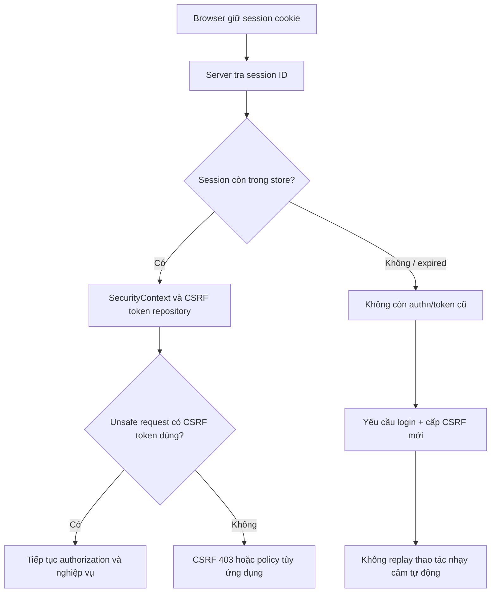
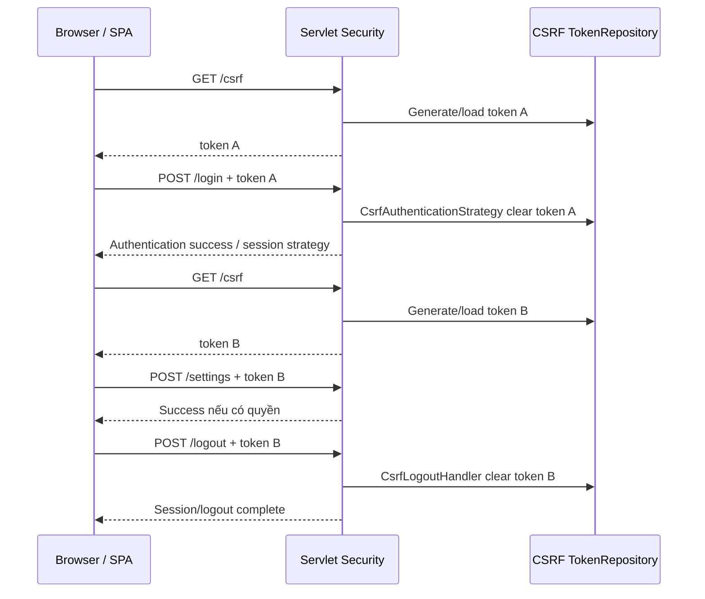
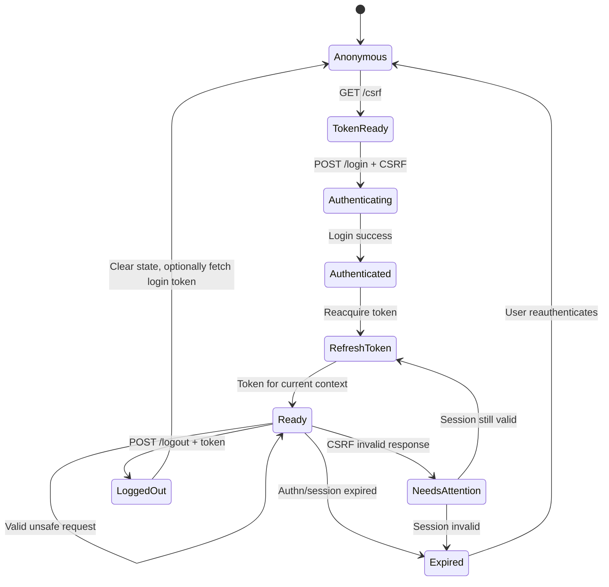

# Session timeout và phối hợp với vòng đời CSRF token

## 1. Khi người dùng bấm “Lưu” trên một biểu mẫu đã mở quá lâu

Một nhân viên đăng nhập vào ứng dụng Spring Security, mở trang chỉnh sửa thông tin và để tab trình duyệt không hoạt động. Sau 20 phút, người dùng bấm **Lưu**. Trình duyệt vẫn có thể giữ cookie session và CSRF token đã được render trong form, nhưng session trên server đã hết hạn.

Kết quả có thể là **403 Forbidden**, **401 Unauthorized**, chuyển hướng về trang đăng nhập hoặc một thông báo “phiên đã hết hạn”, tùy thứ tự xử lý bảo mật và API contract. Điều này khác với lỗi phân quyền trên một tài nguyên mà người dùng không có quyền.

Nếu đội phát triển sửa bằng cách tắt CSRF, vô tình cấp lại session chỉ vì có token cũ hoặc tự động gửi lại yêu cầu POST, họ có thể tạo lỗ hổng bảo mật hay thao tác trùng lặp.

Bài thuộc chương **Session và cookie** của mô-đun **SPRING_SECURITY_HTTP_PROTECTION**. Mô-đun dạy cấu hình và kiểm thử các lớp phòng vệ HTTP/trình duyệt trong Spring Security, từ CSRF, CORS, security headers, CSP, HSTS đến firewall và bảo vệ session trên cả Servlet và Reactive. Bài này giải thích **session timeout và cách phối hợp vòng đời CSRF token**, bao gồm cách lưu token, cấp/làm mới token, login/logout, ứng dụng nhiều tab, hệ thống nhiều instance, UX và các test thực tế.

### Mục tiêu học tập

Sau bài, bạn có thể:

1. Phân biệt session ID, session data, session cookie, CSRF token và token trình bày cho client.
2. Giải thích idle session timeout, cookie expiration và token invalidation là các cơ chế khác nhau.
3. Xác định vì sao CSRF token trong `HttpSession`/`WebSession` cũ không còn hợp lệ khi session server hết hạn.
4. Vẽ vòng đời lấy token → gửi POST → đăng nhập/đăng xuất → session timeout → lấy token mới.
5. Cấu hình timeout và cookie cho Spring MVC/Servlet lẫn WebFlux/Reactive trong Spring Boot 3.5.
6. Dùng `HttpSessionCsrfTokenRepository` và `WebSessionServerCsrfTokenRepository` đúng stack; phân tích khi nào dùng cookie repository.
7. Thiết kế điểm lấy CSRF token an toàn, không cache, không trả raw session ID hoặc token qua logs.
8. Phân biệt 401/302 vì authentication, 403 vì CSRF hoặc authorization và mã 419 do ứng dụng tự quy ước.
9. Kiểm thử MockMvc, WebTestClient, HTTP server thật, session store và các tình huống nhiều tab/sau logout.
10. Đề xuất UX không âm thầm phát lại thao tác nhạy cảm sau khi phiên hết hạn.

## 2. Định nghĩa: năm khái niệm thường bị nhầm

| Khái niệm | Thường nằm ở đâu? | Mục đích | Có phải xác thực không? |
| --- | --- | --- | --- |
| **Session ID** | Cookie của browser, ví dụ `JSESSIONID`/`SESSION` | Tham chiếu tới trạng thái phiên ở server/store | Là bí mật phiên, phải bảo vệ; không tự chứng minh quyền nếu session đã hết |
| **Session data** | Container session, Spring Session Redis/JDBC hoặc `WebSession` store | Lưu security context và dữ liệu theo phiên | Có thể chứa authentication |
| **Session cookie** | Browser cookie jar | Gửi session ID theo Domain/Path/Secure/SameSite | Chỉ là phương tiện gửi ID |
| **CSRF token kỳ vọng** | `HttpSession`/`WebSession` hoặc cookie repo theo cấu hình | So sánh với token client gửi ở unsafe request | **Không** cấp danh tính/quyền |
| **CSRF token client gửi** | Hidden form field hoặc `X-CSRF-TOKEN`/`X-XSRF-TOKEN` | Chứng minh client có token được cấp cho ngữ cảnh phù hợp | Không thay cookie session, authn hoặc authz |

Cần phân biệt hai vòng đời:

- **Vòng đời session** quyết định người dùng còn được xem là authenticated hay không.
- **Vòng đời CSRF token** quyết định request thay đổi trạng thái có token hợp lệ để chống cross-site request forgery hay không.

Chúng liên quan nhưng **không đồng nhất**. CSRF token hợp lệ không phải giấy phép tự khôi phục đăng nhập sau timeout.

### 2.1. CSRF bảo vệ tình huống nào?

Một browser có thể tự gửi session cookies tới website khi trang từ origin khác tạo yêu cầu. CSRF protection yêu cầu một giá trị bổ sung **không được browser tự động gắn** vào request unsafe (ví dụ hidden form field hoặc custom HTTP header), nhằm giảm khả năng website độc hại ép browser thực hiện thao tác thay người dùng.

CSRF đặc biệt quan trọng với **authentication dựa trên cookie**. Nếu một API thực sự không có ambient credentials (ví dụ bearer token được client chủ động gắn và không thể tự động gửi bởi browser), threat model có thể khác; không tự bật/tắt CSRF chỉ dựa vào tên “REST API”.

### 2.2. Safe methods phải thật sự chỉ đọc

Theo nguyên tắc HTTP và Spring Security, `GET`, `HEAD`, `OPTIONS` và `TRACE` được coi là các phương thức safe khi xét CSRF mặc định (dù HTTP firewall có thể từ chối TRACE). Không đưa thao tác xóa, chuyển tiền, cập nhật trạng thái hoặc logout vào GET để “tránh CSRF”.

Nhóm method như `POST`, `PUT`, `PATCH`, `DELETE` thông thường cần kiểm tra CSRF nếu dùng browser credentials có nguy cơ CSRF.

## 3. Ba đồng hồ: idle timeout, cookie lifetime và token lifecycle



### 3.1. Idle session timeout

Server session timeout thường là khoảng **không hoạt động**: nếu session không được truy cập hợp lệ trong khoảng đó, nó hết hiệu lực. Mức cụ thể phụ thuộc container/WebSession/Spring Session store và quy tắc cập nhật last-accessed time.

**Đây không mặc định là thời hạn tuyệt đối từ lúc login.** Nếu trình duyệt gửi requests định kỳ, idle timer có thể tiếp tục được làm mới. Một policy yêu cầu “sau tối đa 8 giờ phải đăng nhập lại” cần **absolute session lifetime** hoặc cơ chế authentication expiry riêng; chỉ đặt `timeout=30m` không đảm bảo logout đúng 8 giờ.

### 3.2. Cookie Max-Age/Expires

Một cookie session có thể được browser giữ **lâu hơn** session server. Khi người dùng gửi cookie cũ, server không tìm thấy session tương ứng. Ngược lại, browser có thể xóa cookie trước khi server store xóa data.

Ví dụ:

```text
Server session idle timeout: 20 phút
Session cookie ở browser: chưa có Expires/Max-Age (session cookie)
Người dùng để tab mở 25 phút
Browser vẫn có cookie trong quá trình chạy
Server không còn session → user không còn authn/CSRF token cũ
```

**Browser session cookie không có nghĩa server session tồn tại cho đến khi đóng browser.**

### 3.3. Thời hạn CSRF token

Khi repository lưu expected CSRF token trong session, token tồn tại **theo session đó** (trừ khi framework/app làm invalidation hoặc rotation sớm hơn). Với cookie repository, token có thể có cookie lifetime khác session; điều đó **không khôi phục authentication**.

**Không giả định CSRF token có một đồng hồ riêng 20 phút** nếu không có implementation TTL độc lập được kiểm chứng.

### 3.4. TTL ở Redis/JDBC và cluster

Khi dùng Spring Session, server session có thể nằm trong Redis/JDBC. TTL/cleanup và session lookup semantics phụ thuộc repository. Cần kiểm tra session đã hết hạn **về mặt ứng dụng**, không chỉ số giây còn lại ở một key Redis.

Với session distributed, không để token repository dùng session in-memory của từng instance một cách vô tình; phải xác nhận tất cả requests dùng cùng session store và cách lưu token nhất quán.

## 4. Vòng đời CSRF token khi dùng session repository

```mermaid
sequenceDiagram
    participant B as Browser
    participant S as Spring Security
    participant R as Session + CSRF repository
    B->>S: GET /form hoặc GET /csrf
    S->>R: Tải/generate expected CSRF token khi cần
    R-->>S: Token gắn session A
    S-->>B: Form field/JSON token + cookie session A
    B->>S: POST /settings + cookie A + token A
    S->>R: Load expected token trong A
    R-->>S: Token A
    S-->>B: 200/204 nếu authn/authz/CSRF hợp lệ
    Note over B,R: Session A hết idle timeout trên server
    B->>S: POST /settings + cookie A + token A cũ
    S->>R: Không tìm thấy session A
    R-->>S: Không còn expected token A
    S-->>B: 403 hoặc authn response theo config
    B->>S: GET /login hoặc GET /csrf để thiết lập ngữ cảnh mới
    S-->>B: Session/token mới; login lại nếu cần
```

**Điểm quan trọng:** Yêu cầu sau timeout không phải “token bị biến đổi ngẫu nhiên” mà là **expected token cũ không còn lưu trong session có hiệu lực**. Nếu framework tạo expected token mới trên một session mới, old submitted token không khớp.

### 4.1. Session timeout không gửi sự kiện realtime tới tab đang mở

Trong HTTP request/response thông thường, khi session phía server hết hạn, tab đang mở **không được server chủ động báo**. Chỉ một request mới, heartbeat/WebSocket message có thiết kế riêng hoặc client-side UX timer mới phát hiện thay đổi.

Một đồng hồ trên UI “còn 1 phút” chỉ là **ước lượng**: request từ tab khác, store TTL, clocks và network có thể làm server hết session vào thời điểm khác.

### 4.2. CSRF không biến expired session thành active

Không xử lý `403` bằng cách đơn giản tạo một token mới rồi tiếp tục hành động với danh tính cũ. Nếu session đã hết, cần **xác thực lại** trước khi thực hiện thao tác cần quyền. Sau đăng nhập, phải lấy CSRF token mới nếu lifecycle đã invalidated token trước đó.

## 5. Khi nào Spring tạo và đọc CSRF token?

Với Spring Security Servlet hiện đại, `CsrfFilter` dùng `CsrfTokenRepository` cùng `CsrfTokenRequestHandler`. Theo mặc định, việc tải expected token có thể **deferred/lazy**, không bắt buộc đọc hoặc tạo session trên mọi GET.

| Request | Token có cần được materialize không? | Lý do |
| --- | --- | --- |
| GET trang công khai không dùng token | Thường không | Deferred loading tránh session IO không cần thiết |
| GET render form POST | **Có** | Form phải có token |
| GET endpoint `/csrf` | **Có** | Client chủ động yêu cầu token |
| POST yêu cầu CSRF | **Có** | Phải đối chiếu submitted/expected token |
| GET trang HTML chỉ đọc, không render token | Không nhất thiết | Đừng cố tạo session trên mọi request |
| POST sau timeout với token cũ | Có kiểm tra, có thể tạo token/session mới tùy config | Không khôi phục authn, old token không hợp lệ |

### 5.1. Deferred không đồng nghĩa token vô hạn hoặc tự luân phiên

Deferred token là **chiến lược thời điểm đọc/generate**, không định nghĩa token TTL. Nếu muốn SPA nhận token sau login/logout, ứng dụng có thể phải **chủ động đọc/cấp token mới** thay vì chờ một GET không đụng CSRF token.

### 5.2. BREACH masking không đồng nghĩa token đổi trong repository mỗi request

Spring Security Servlet 6+ mặc định hỗ trợ chống BREACH thông qua `XorCsrfTokenRequestAttributeHandler`. Giá trị token **được trình bày** trong response có thể thay đổi vì randomness, dù expected token **được lưu** trong repository vẫn giữ nguyên.

Không dùng phép so sánh hai chuỗi token trên hai trang rồi kết luận session đã rotate hoặc không rotate. Phải xác định token ở **repository** và behavior xác minh request đúng stack/version.

Spring Security WebFlux 6+ có `XorServerCsrfTokenRequestAttributeHandler` làm vai trò tương tự. Với SPA đọc raw token từ cookie, cần request handler phù hợp, không chỉ copy cookie value vào header rồi đoán nó luôn hợp lệ với XOR masking.

## 6. Mốc đặc biệt: đăng nhập thành công và đăng xuất

Với Spring Security Servlet, `CsrfAuthenticationStrategy` xóa token trước đó khi authentication thành công, còn `CsrfLogoutHandler` xóa token trên logout. Do deferred loading, token mới **không nhất thiết được phát ngay trong response login/logout** nếu không có một cơ chế chủ động materialize token.



**Không nhất thiết cùng một session ID trước và sau login:** Spring Security có chống session fixation và có thể đổi session ID/khởi tạo session mới theo chiến lược xác thực. Client phải tôn trọng `Set-Cookie` mới và lấy token đang hợp lệ.

### 6.1. Sau login, SPA làm gì?

- Nhận login success.
- Cập nhật session/authentication state từ server.
- Lấy CSRF token mới nếu vòng đời đã clear token trước đó.
- Cập nhật token **trong bộ nhớ của client** hoặc cơ chế đọc cookie đã thiết kế.
- Chỉ sau đó mới gửi unsafe requests cần token.
- Không giữ token tiền đăng nhập làm token vĩnh viễn.

### 6.2. Sau logout, SPA làm gì?

- Xóa thông tin nhạy cảm trong bộ nhớ của tab.
- Không tiếp tục dùng token đã bị clear.
- Nếu muốn hiện form login có CSRF, lấy token mới trong ngữ cảnh anonymous/new session.
- Không tự đăng nhập lại hay phục hồi danh tính bằng CSRF token.
- Kiểm thử logout có thể bị CSRF bảo vệ (`POST /logout` thường cần token) và session cookie được vô hiệu/xóa đúng.

### 6.3. Servlet và Reactive có cùng ý tưởng nhưng khác implementation

Trên Servlet, các strategy/handler vừa nêu là những thành phần tài liệu hóa rõ. Trên WebFlux, `CsrfWebFilter`/`ServerCsrfTokenRepository` chạy trong Reactor chain và có hành vi lifecycle theo cấu hình authentication, logout, session. **Không copy tên `CsrfAuthenticationStrategy` của Servlet như một Bean WebFlux tương đương**; thay vào đó test token/`WebSession` trên đúng version.

## 7. Cấu hình timeout ở Spring Boot 3.5: Servlet, Reactive và Spring Session

Ba nhóm property sau **không nên trộn hoặc coi là đồng nghĩa vô điều kiện**.

### 7.1. Servlet session

Ví dụ `application.properties` cho Spring Boot **3.5.x Servlet**:

```properties
# Timeout ở server cho HttpSession (idle).
server.servlet.session.timeout=20m

# Cookie transport bảo mật; triển khai HTTPS thật.
server.servlet.session.cookie.secure=true
server.servlet.session.cookie.http-only=true
server.servlet.session.cookie.same-site=lax
```

Tham số `same-site=lax` chỉ là **ví dụ**; nếu ứng dụng cần SSO/cross-site flow hợp lệ, phải đánh giá `SameSite=None; Secure` và CSRF/CORS/threat model tương ứng. Đừng sửa thành None để chữa một lỗi mà chưa hiểu.

### 7.2. Reactive WebSession

Ví dụ `application.properties` cho Spring Boot **3.5.x Reactive**:

```properties
# Timeout cho WebSession trong reactive stack.
server.reactive.session.timeout=20m

server.reactive.session.cookie.secure=true
server.reactive.session.cookie.http-only=true
server.reactive.session.cookie.same-site=lax
```

**Không dùng `server.servlet.session.timeout` rồi cho rằng WebFlux sẽ tự áp dụng.** Hãy xác nhận runtime thực sự Reactive. Boot có thể chọn Servlet khi cả starters MVC/WebFlux cùng hiện diện.

### 7.3. Spring Session với Redis/JDBC

Khi dùng Spring Session auto-configuration để chia sẻ session giữa nhiều instances:

```properties
# Session timeout do Spring Session auto-config quản lý.
spring.session.timeout=20m
```

Với Spring Boot 3.5, Spring Session auto-configuration cho Servlet có thể fallback về `server.servlet.session.timeout` nếu `spring.session.timeout` không được đặt; với Reactive Redis, cần xác minh store/auto-config và giá trị thực. Nếu dự án tự bật `@EnableRedisHttpSession`/`@EnableRedisWebSession`, Boot auto-config có thể back off, khiến một số property không tác dụng như mong đợi.

**Quy trình kiểm chứng:** kiểm tra resolved configuration, `maxInactiveInterval`/`maxIdleTime` và thực tế session storage TTL trong môi trường thử nghiệm; không suy chỉ từ dòng properties.

### 7.4. So sánh nhanh

| Kiến trúc | Timeout chính cần xem | Đối tượng phiên | Lưu ý |
| --- | --- | --- | --- |
| MVC/Servlet không Spring Session | `server.servlet.session.timeout` | `HttpSession` | Container/server handling |
| WebFlux không Spring Session | `server.reactive.session.timeout` | `WebSession` | Reactive session store |
| Spring Session auto-config | `spring.session.timeout` | Distributed session repository | Store semantics và TTL |
| Custom session repository | Cấu hình cụ thể của implementation | Session riêng | Properties Boot có thể không đủ |
| OAuth2/JWT ngoài session | Token expiration/refresh policy khác | Access/refresh tokens | Không đồng nhất với CSRF/session timeout |

## 8. Servlet: cấu hình HttpSessionCsrfTokenRepository minh họa

Với Spring Security 6.5 và Servlet, `HttpSessionCsrfTokenRepository` là mặc định khi sử dụng session CSRF. Viết tường minh giúp người học nhìn rõ mối liên hệ:

```java
import org.springframework.context.annotation.Bean;
import org.springframework.context.annotation.Configuration;
import org.springframework.security.config.Customizer;
import org.springframework.security.config.annotation.web.configuration.EnableWebSecurity;
import org.springframework.security.config.annotation.web.builders.HttpSecurity;
import org.springframework.security.web.SecurityFilterChain;
import org.springframework.security.web.csrf.HttpSessionCsrfTokenRepository;

@Configuration
@EnableWebSecurity
class ServletSessionCsrfSecurity {

    @Bean
    SecurityFilterChain securityFilterChain(HttpSecurity http)
            throws Exception {

        return http
            .authorizeHttpRequests(auth -> auth
                .requestMatchers("/csrf", "/login").permitAll()
                .requestMatchers("/api/**").authenticated()
                .anyRequest().denyAll())
            .formLogin(Customizer.withDefaults())
            .csrf(csrf -> csrf.csrfTokenRepository(
                new HttpSessionCsrfTokenRepository()))
            .build();
    }
}
```

**Đây là cấu hình ví dụ một security chain**, không phải config production hoàn chỉnh. `/csrf` được mở cho anonymous vì form login cần token trước đăng nhập; còn CORS, HTTPS, cookie attributes, response headers, resource authorization và controller endpoints phải được thiết kế theo ứng dụng. `permitAll` không có nghĩa response chứa token có thể được cache/chia sẻ qua mọi origin.

### 8.1. Nơi cất expected token

`HttpSessionCsrfTokenRepository` lưu token vào `HttpSession`. Khi session mất, expected token cũng mất. Không cần tạo một database table CSRF token riêng nếu đã chọn mô hình này.

Không ghi raw session ID hoặc raw CSRF token vào log để “theo dõi rotation”; có thể dùng test repository/metadata hoặc các event codes đã chuẩn hóa.

## 9. Servlet: một endpoint lấy token theo yêu cầu

Đối với SPA/API cần chủ động lấy token, Spring Security hướng dẫn `GET /csrf` với `CsrfTokenArgumentResolver`:

```java
import java.util.Map;

import org.springframework.http.CacheControl;
import org.springframework.http.ResponseEntity;
import org.springframework.security.web.csrf.CsrfToken;
import org.springframework.web.bind.annotation.GetMapping;
import org.springframework.web.bind.annotation.RestController;

@RestController
class ServletCsrfEndpoint {

    @GetMapping("/csrf")
    ResponseEntity<Map<String, String>> csrf(CsrfToken token) {
        return ResponseEntity.ok()
            .cacheControl(CacheControl.noStore())
            .body(Map.of(
                "headerName", token.getHeaderName(),
                "token", token.getToken()));
    }
}
```

Ý nghĩa:

- Đọc token làm materialize deferred token và có thể tạo session khi cần.
- Client dùng đúng `headerName` mà server trả, không đoán giữa `X-CSRF-TOKEN` và `X-XSRF-TOKEN`.
- Với XOR/BREACH, giá trị trình bày có thể được mask; hãy gửi **đúng giá trị client nhận** lại theo cơ chế request handler tương ứng.
- `Cache-Control: no-store` giúp response chứa token không bị lưu trong browser/shared cache; CDN vẫn phải được cấu hình không cache.
- Endpoint không trả session ID, username, quyền hoặc thông tin riêng khác.
- Không nhúng CSRF token vào URL/query để tránh access log, referrer và browser history.

**Thận trọng với CORS:** Nếu endpoint này phục vụ frontend cross-origin, chỉ allow đúng trusted origins/credentials, không thêm `Access-Control-Allow-Origin: *` với cookie credentials. CSRF token không được cấp như một “public credential” cho website tùy ý.

### 9.1. Khi nào client gọi GET /csrf?

Một luồng hợp lý:

1. Khi tải trang/form cần unsafe requests.
2. Sau authentication success.
3. Sau logout nếu chuẩn bị lại form login.
4. Sau server phát tín hiệu token không hợp lệ **và** client đã xác nhận trạng thái authn phù hợp.
5. Khi mở một tab/form mới sau idle timeout, trước khi người dùng thao tác.

Không gọi `GET /csrf` liên tục trên mọi request chỉ vì muốn làm mới token; có thể gây tải session store và vô tình kéo dài idle session.

## 10. WebFlux: WebSessionServerCsrfTokenRepository và khác biệt API

Trong Spring Security WebFlux 6.5, `CsrfWebFilter` mặc định lưu expected token vào `WebSession` bằng `WebSessionServerCsrfTokenRepository`.

| Mục | Servlet | Reactive |
| --- | --- | --- |
| CSRF filter | `CsrfFilter` | `CsrfWebFilter` |
| Default repository | `HttpSessionCsrfTokenRepository` | `WebSessionServerCsrfTokenRepository` |
| Session object | `HttpSession` | `WebSession` |
| Repository interface | `CsrfTokenRepository` | `ServerCsrfTokenRepository` |
| Load token | `CsrfToken loadToken(HttpServletRequest)` | `Mono<CsrfToken> loadToken(ServerWebExchange)` |
| Save token | `void saveToken(...)` | `Mono<Void> saveToken(...)` |
| Token attribute | Servlet request attribute | `Mono<CsrfToken>` trong `ServerWebExchange` |
| Test | `MockMvc`, `csrf()` request processor | `WebTestClient`, Reactive `csrf()` configurer |
| Session timeout | Servlet/container store | WebSession/Spring Session store |

**Không trộn Servlet `HttpSessionCsrfTokenRepository` vào WebFlux** và không cố dùng Servlet `InvalidSessionStrategy` để giải quyết mọi session timeout trong Reactive.

### 10.1. Cấu hình WebFlux dùng WebSession repo

```java
import org.springframework.context.annotation.Bean;
import org.springframework.context.annotation.Configuration;
import org.springframework.security.config.Customizer;
import org.springframework.security.config.annotation.web.reactive.EnableWebFluxSecurity;
import org.springframework.security.config.web.server.ServerHttpSecurity;
import org.springframework.security.web.server.SecurityWebFilterChain;
import org.springframework.security.web.server.csrf.WebSessionServerCsrfTokenRepository;

@Configuration
@EnableWebFluxSecurity
class ReactiveSessionCsrfSecurity {

    @Bean
    SecurityWebFilterChain securityWebFilterChain(
            ServerHttpSecurity http) {

        return http
            .authorizeExchange(auth -> auth
                .pathMatchers("/csrf", "/login").permitAll()
                .pathMatchers("/api/**").authenticated()
                .anyExchange().denyAll())
            .formLogin(Customizer.withDefaults())
            .csrf(csrf -> csrf.csrfTokenRepository(
                new WebSessionServerCsrfTokenRepository()))
            .build();
    }
}
```

Một số applications sử dụng OAuth2 resource server, Basic hoặc cookie-based form login khác. Cấu hình authentication phải phản ánh kiến trúc. CSRF được giữ trong ví dụ để bảo vệ browser session flows.

### 10.2. Không block Mono

`ServerCsrfTokenRepository.loadToken(...)` và `saveToken(...)` trả publishers. Không dùng `.block()` trên Netty event loop, không gọi `subscribe()` thủ công. Chỉ return/compose publishers để framework quản lý lifecycle.

## 11. WebFlux: endpoint token an toàn với Mono<CsrfToken>

Spring Security WebFlux expose một `Mono<CsrfToken>` dưới attribute `CsrfToken.class.getName()`. Trong controller Reactive:

```java
import java.util.Map;

import org.springframework.http.CacheControl;
import org.springframework.http.ResponseEntity;
import org.springframework.security.web.server.csrf.CsrfToken;
import org.springframework.web.bind.annotation.GetMapping;
import org.springframework.web.bind.annotation.RestController;
import org.springframework.web.server.ServerWebExchange;
import reactor.core.publisher.Mono;

@RestController
class ReactiveCsrfEndpoint {

    @GetMapping("/csrf")
    Mono<ResponseEntity<Map<String, String>>> csrf(
            ServerWebExchange exchange) {

        Mono<CsrfToken> tokenPublisher =
            exchange.getAttribute(CsrfToken.class.getName());

        if (tokenPublisher == null) {
            // Cấu hình sai: CSRF filter/chain không expose token.
            return Mono.error(new IllegalStateException(
                "CSRF token publisher is unavailable"));
        }

        return tokenPublisher.map(token ->
            ResponseEntity.ok()
                .cacheControl(CacheControl.noStore())
                .body(Map.of(
                    "headerName", token.getHeaderName(),
                    "token", token.getToken())));
    }
}
```

Bài học:

- Truy cập publisher và **return Mono** để WebFlux subscribe.
- `GET /csrf` materialize token khi cần; không đọc session trên mọi GET vô ích.
- `Cache-Control: no-store` là bắt buộc trong contract của ví dụ, cần test qua proxy.
- Nếu `CsrfWebFilter` không nằm trong selected chain, attribute có thể thiếu. Đừng tạo token “không kiểm tra” để che lỗi cấu hình.
- `/csrf` không phải endpoint “kéo dài phiên bất kể đã logout”. Nó chỉ giúp client lấy token cho ngữ cảnh hiện tại; authentication vẫn phải kiểm tra riêng.

**Không mặc định suy rằng WebFlux có cùng hành vi tự động refresh cookie/token như Servlet.** Xác minh login/logout và CSRF publisher trên phiên bản Spring Security thực đang dùng.

## 12. Khi cân nhắc lưu CSRF token trong cookie

Đôi khi SPA framework muốn đọc cookie `XSRF-TOKEN` rồi gửi `X-XSRF-TOKEN`. Spring Security có hai implementation riêng:

| Stack | Cookie CSRF repository | Cấu hình JS-readable |
| --- | --- | --- |
| Servlet | `CookieCsrfTokenRepository` | `CookieCsrfTokenRepository.withHttpOnlyFalse()` |
| Reactive | `CookieServerCsrfTokenRepository` | `CookieServerCsrfTokenRepository.withHttpOnlyFalse()` |

**Không dùng cookie repo chỉ để chữa session timeout mà bỏ qua authentication.** CSRF token nằm trong cookie có thể tồn tại khác thời hạn session. Sau timeout, request vẫn cần xác thực và quyền hợp lệ.

### 12.1. Ví dụ Servlet cookie repo

```java
import org.springframework.security.web.csrf.CookieCsrfTokenRepository;

// Trích đoạn đặt trong HttpSecurity.csrf(...):
.csrf(csrf -> csrf.csrfTokenRepository(
    CookieCsrfTokenRepository.withHttpOnlyFalse()))
```

### 12.2. Ví dụ Reactive cookie repo

```java
import org.springframework.security.web.server.csrf.CookieServerCsrfTokenRepository;

// Trích đoạn đặt trong ServerHttpSecurity.csrf(...):
.csrf(csrf -> csrf.csrfTokenRepository(
    CookieServerCsrfTokenRepository.withHttpOnlyFalse()))
```

**Hai đoạn trên là phương án thay thế repo session mặc định**, không khai báo chung lúc runtime. Chọn đúng version và đúng request handler.

### 12.3. Hệ quả của HttpOnly=false

`withHttpOnlyFalse()` cho phép JavaScript đọc cookie CSRF token. Điều này chỉ nên dùng khi ứng dụng thực sự cần JS đọc cookie để gửi custom header. Nếu không cần, giữ `HttpOnly` bảo vệ cookie theo khả năng.

CSRF token là một **bí mật chống giả mạo request** nhưng **không thay session cookie**. Khi dùng JS-readable token, cần CSP/XSS defenses, bởi XSS có thể đọc token và thực hiện thao tác cùng origin.

### 12.4. BREACH và SPA trên Spring Security 6+

Servlet 6+ mặc định dùng XOR masking. Cookie `XSRF-TOKEN` thường chứa raw token, trong khi value dành cho HTML có thể masked. Nếu SPA lấy raw cookie rồi gửi header mà request handler không được cấu hình tương thích, có thể nhận 403 dù cookie/token không hết hạn.

Spring Security docs nhấn mạnh **SPA cần request handler phù hợp và refresh token sau login/logout**. Trên nhánh mới có tiện ích cấu hình SPA ở một số version; trên nhánh 6.5 có mẫu tùy chỉnh handler. Kiểm tra API version trước khi copy `csrf.spa()` từ tài liệu một phiên bản mới hơn.

**Đừng tắt BREACH protection hàng loạt** chỉ để “đúng token”; hãy hiểu đường raw/masked và áp giải pháp SPA chính thức của phiên bản sử dụng.

### 12.5. Cookie CSRF không bảo đảm token-session binding

Cookie-based CSRF theo cơ chế double-submit cần threat model về domain/subdomain, cookie injection/fixation và cách so sánh giá trị. Không được tin mọi cookie do client gửi như dữ liệu không thể thay đổi. Nếu dùng cookie repository trong app đa tenant/subdomain, cần đánh giá Host-only cookie, Domain, Path, Secure, SameSite và bảo vệ chống subdomain takeover.

## 13. Phân biệt session đã hết, token lỗi và thiếu quyền

Một request unsafe có thể bị từ chối ở nhiều tầng:

| Hiện tượng | Nguồn điển hình | HTTP status thường thấy | Cách kiểm tra |
| --- | --- | --- | --- |
| Session không còn và request cần login | Authentication entry point | `401` hoặc redirect `302` | Kiểm tra identity/session server |
| Token bị thiếu | CSRF validation | `403` | Kiểm tra request header/form field |
| Token khác expected trong session | CSRF validation | `403` | So repository expected trong test, không log raw token |
| Token từ tab cũ sau login/logout | Token rotation/clear | `403` | Lấy token mới rồi thử an toàn |
| Session hết và token cũ được submit | CSRF + authn thứ tự xử lý | `403`, `401` hoặc login redirect | Trace security filters/response |
| User không có role | Authorization | `403` | Kiểm tra authorities |
| User không sở hữu record | Service/object authorization | `403` hoặc `404` theo policy | Test Alice/Bob khác tenant |
| Request sai HTTP shape | Firewall/parser | `400`/khác | Phân biệt ServerExchangeRejectedException |
| App tự dùng mã `419` | Custom session-expired API contract | `419` (không chuẩn chính thức) | Không coi là default Spring Security |
| Server session store lỗi | Redis/JDBC outage | `5xx` tùy lỗi | Health/metrics store, không coi là logout đơn thuần |

**Không suy rằng mọi 403 đều là CSRF timeout.** Một 403 cũng có thể là không đủ quyền; xử lý như “tự refresh rồi retry” có thể che lỗi và tạo hành vi không an toàn.

### 13.1. MissingCsrfTokenException và InvalidCsrfTokenException

Trong Servlet, Spring Security phân biệt trường hợp token thiếu và token không hợp lệ qua các exception tương ứng. Khi cần UX riêng, có thể cấu hình `AccessDeniedHandler` theo tài liệu để trả error code **ổn định**.

Tuy nhiên, không đưa raw token, session ID, exception message hoặc stack trace vào response. Một body an toàn có thể là:

```http
HTTP/1.1 403 Forbidden
Content-Type: application/json
Cache-Control: no-store

{"code":"csrf_invalid","message":"Yêu cầu cần được làm mới trước khi gửi lại"}
```

Nếu hệ thống cần phân biệt session timeout với CSRF invalid, phải xác định **server-side authentication/session state**; không dùng exception type làm bằng chứng duy nhất rằng session đã hết.

### 13.2. Vì sao không tự động replay POST?

Giả sử một request tạo đơn hàng đã gửi tới server, nhưng client mất response vì network timeout. Nếu frontend nhận 403 ở một request khác rồi tự refresh và replay toàn bộ các POST đang chờ, nó có thể tạo giao dịch trùng lặp.

Cần:

- Không tự động replay thao tác nhạy cảm sau session expiry.
- Giữ dữ liệu người dùng tại client theo chính sách an toàn, yêu cầu xác nhận trước khi submit lại.
- Dùng idempotency key/server-side deduplication cho payment/order APIs nếu cần.
- Nếu token hết nhưng session vẫn hợp lệ, có thể refresh token và **hướng dẫn user submit lại**, không tự bỏ qua quyền.

## 14. UX cho biểu mẫu dài và nhiều tab

### 14.1. Form đang mở rất lâu

Một form HTML đã render token khi session còn hợp lệ. Khi server session hết hạn, form vẫn chứa token cũ. Cách xử lý an toàn:

1. Người dùng bấm Lưu.
2. Server từ chối và không áp thay đổi.
3. UI nhận trạng thái authn/CSRF từ API contract.
4. Nếu session hết, hiển thị màn hình đăng nhập lại (không đưa credential vào redirect query).
5. Sau login và lấy CSRF token mới, cho user kiểm tra nội dung form và submit lại.
6. Không đảm bảo session cũ sống lại; không tự reuse CSRF token cũ.

**Không lưu toàn bộ dữ liệu nhạy cảm của form vào LocalStorage lâu dài** chỉ để khôi phục sau timeout. Nếu cần draft recovery, thiết kế lưu nháp được mã hóa/có authorization hoặc giới hạn dữ liệu và lifetime theo threat model.

### 14.2. Nhiều tab dùng chung session cookie

Tab A thực hiện login/logout hoặc làm thay đổi token; Tab B có thể vẫn đang mở form chứa token cũ. Khi B submit, có thể gặp 403.

Nên:

- Phát hiện authentication state thay đổi và thông báo các tab khi phù hợp.
- Lấy token mới khi tab được kích hoạt/chuẩn bị gửi request, nếu session vẫn hợp lệ.
- Không giữ một global token bất biến trong local storage qua nhiều login sessions.
- Không vì một tab báo lỗi mà gửi lại tất cả POST của các tab.
- Bảo vệ mọi endpoint bằng authz ngay cả khi token trùng trong cùng session.

### 14.3. Polling có thể kéo dài idle timeout ngoài dự kiến

Một SPA gọi `/csrf` hoặc `/notifications` mỗi 30 giây có thể làm session được xem là đang hoạt động, tùy store/filter. Vì vậy UI hiển thị “đăng xuất sau 20 phút không hoạt động” nhưng app vẫn online vô hạn.

Nếu doanh nghiệp cần timeout theo **tương tác người dùng thật**, cần giải pháp đo hoạt động có chủ đích và/hoặc absolute lifetime; không dùng kỹ thuật “đọc token định kỳ” như phương án bảo mật.

## 15. Frontend state machine khi session/CSRF không hợp lệ



### 15.1. Quy tắc xử lý client

- **401 hoặc login redirect**: xử lý authentication; không tự dùng CSRF token để bypass.
- **403 + error code CSRF do server định nghĩa**: cân nhắc lấy token mới **chỉ sau khi xác minh session/authentication**; báo người dùng submit lại.
- **403 authorization**: hiển thị không đủ quyền, không vô hạn refresh token.
- **Mất kết nối/5xx**: không đoán request đã thành công hay thất bại; dùng idempotency/server-side status.
- **Logout**: xóa token cũ và auth state, không replay.
- **Refresh CSRF**: không kéo theo refresh user JWT/refresh token tự động trừ khi auth flow đã quy định.

Một response `403` mà client tự gắn nhãn “session expired” **không đủ chứng cứ** để thay đổi session/authentication state.

## 16. Spring Session và các hệ thống nhiều instance

Trong hệ thống có load balancer:

```text
Browser
  ├─ request #1 → instance A
  ├─ request #2 → instance B
  └─ request #3 → instance C
           \       |       /
            Redis / Spring Session
```

Nếu dùng session repository phân tán đúng, authentication context và CSRF token lưu trong session phải được nhìn nhất quán.

### 16.1. Điều gì có thể gây lỗi khó tái hiện?

| Lỗi | Biểu hiện |
| --- | --- |
| Một instance vẫn dùng local session, instance khác dùng Redis | Token/login lúc được lúc mất khi load balancing |
| Redis session TTL không đồng bộ với app timeout | Session hết sớm/muộn so policy |
| User login đổi session ID nhưng tab khác còn cookie cũ | Stale form/old token |
| Proxy cache response `/csrf` | Token bị chia sẻ giữa người dùng |
| Đồng hồ/TTL/cleanup bị cấu hình sai | Session expiration không như test |
| Failover session store hoặc network partition | `5xx`, session read failure hoặc yêu cầu login lại theo policy |
| Cookie Domain/Path không trùng với app route | Request không mang đúng session cookie |
| SameSite/Secure sai khi TLS kết thúc ở proxy | Cookie không được gửi trong flow hợp lệ |
| Custom repository tách CSRF và session store không nhất quán | Token tồn tại sau auth session hoặc bị orphaned |

### 16.2. Một test cần đi qua cả hai instance

Trên staging có session store dùng chung và hai instances:

1. GET `/csrf` qua instance A, nhận cookie và token.
2. Dùng **đúng cookie** gửi POST hợp lệ qua instance B (trong cùng authenticated session).
3. Xác nhận token được kiểm tra và authorization đúng, không tùy thuộc sticky session.
4. Cho session hết hạn trên server rồi kiểm tra request tới cả A và B đều bị từ chối theo cùng policy.
5. Login lại, lấy token mới và đảm bảo old token/cookie không cấp quyền.
6. Không lưu raw tokens trong log hoặc report test.

Nếu dự án dùng sticky sessions như một tối ưu, vẫn phải hiểu failover và cleanup; đừng coi sticky routing là cách sửa trọn vẹn thiếu session consistency.

## 17. Cookie policy, HTTPS và HSTS

CSRF token và session timeout không thể tách khỏi bảo vệ cookie:

| Flag/cơ chế | Mục tiêu | Lưu ý |
| --- | --- | --- |
| `Secure` | Browser không gửi cookie qua HTTP thường | HTTPS end-to-end hoặc TLS edge đúng scheme |
| `HttpOnly` | Hạn chế JS đọc session cookie | Không phải chống XSS tuyệt đối |
| `SameSite=Lax/Strict` | Giảm cross-site cookie sends | Không thay CSRF token |
| `SameSite=None; Secure` | Phù hợp một số flows cross-site có chủ đích | Đòi CORS/CSRF/credential threat model |
| Host-only cookie | Hạn chế cookie scope | Tránh Domain rộng không cần thiết |
| `Path` | Điều khiển cookie gửi ở route | Không phải security boundary độc lập |
| `Max-Age`/`Expires` | Điều khiển tuổi thọ cookie browser | Không đồng nghĩa timeout session server |
| HSTS | Browser ưu tiên HTTPS sau khi ghi nhận policy | Không tự mã hóa backend hop hoặc cấp quyền |
| `Cache-Control: no-store` | Không lưu token/form/body nhạy cảm | Kiểm tra CDN/proxy policies |

**Không để session cookie `HttpOnly=false` chỉ vì CSRF cookie cần JS-readable.** Hai cookie có mục tiêu khác nhau: JS có thể cần đọc `XSRF-TOKEN` trong một số mô hình, nhưng không cần đọc session cookie.

### 17.1. TLS termination và forwarded headers

Nếu HTTPS kết thúc ở reverse proxy, origin có thể nhìn thấy HTTP. Cấu hình `Secure` cookie và absolute redirects phải được test **qua public HTTPS domain**. Nếu proxy cho phép client giả mạo `X-Forwarded-Proto` hoặc Host, origin có thể áp cookie/redirect sai. Tin forwarded metadata chỉ qua trust boundary đã kiểm soát.

### 17.2. Logout và stale cookies

Servlet session invalidation không đảm bảo browser xóa cookie ngay trong mọi container. Spring Security có `logout().deleteCookies("JSESSIONID")` hoặc `Clear-Site-Data` phù hợp trong một số trường hợp; phải kiểm tra tên cookie/session repository và cách browser nhận `Set-Cookie` thực.

Một cookie cũ sau logout **không có nghĩa** old session được khôi phục; nhưng nó có thể gây thông báo invalid-session giả nếu app sử dụng chiến lược redirect cho invalid cookie.

## 18. Server timeout và absolute lifetime: không dùng hai khái niệm thay nhau

Một ứng dụng ngân hàng yêu cầu:

- Không hoạt động 15 phút: yêu cầu đăng nhập lại.
- Tổng thời gian đăng nhập tối đa 8 giờ dù người dùng hoạt động liên tục.
- Trước khi chuyển tiền: yêu cầu step-up authentication nếu cần.

Chỉ đặt `server.servlet.session.timeout=15m` hoặc `server.reactive.session.timeout=15m` đáp ứng **idle timeout**, không tự thực hiện 8 giờ absolute lifetime hay step-up.

Một policy đầy đủ cần thêm timestamp authentication do server quản lý và kiểm tra khi request tiếp diễn, session invalidation, re-auth flow và resource authorization. Đừng dùng CSRF token tuổi đời 8 giờ làm cách thay thế absolute session timeout.

### 18.1. Đồng bộ UI timer và server policy

Có thể cho UI biết **mốc hết hạn ước tính** qua endpoint được bảo vệ, nhưng server phải là nguồn quyết định cuối. User đang offline, nhiều tab hoặc network latency có thể làm client clock không chính xác.

Không trả raw session ID hoặc toàn bộ session state để xây bộ đếm.

## 19. Kiểm thử Servlet với MockMvc: thiếu, sai và đúng CSRF

Spring Security Test cung cấp `csrf()` để tạo request có CSRF token hợp lệ trong **mock integration**. Điều này rất hữu ích để chứng minh CSRF filter được áp, nhưng **không chứng minh session đã hết hạn theo thời gian thực**.

Một endpoint fixture:

```java
import org.springframework.http.ResponseEntity;
import org.springframework.web.bind.annotation.PostMapping;
import org.springframework.web.bind.annotation.RestController;

@RestController
class SettingsController {

    @PostMapping("/api/settings")
    ResponseEntity<Void> save() {
        // Chỉ là fixture; production phải validate user/tenant.
        return ResponseEntity.noContent().build();
    }
}
```

Test Servlet Spring Boot 3.5/Spring Security 6.5:

```java
import org.junit.jupiter.api.Test;
import org.springframework.beans.factory.annotation.Autowired;
import org.springframework.boot.test.autoconfigure.web.servlet.AutoConfigureMockMvc;
import org.springframework.boot.test.context.SpringBootTest;
import org.springframework.security.test.context.support.WithMockUser;
import org.springframework.test.web.servlet.MockMvc;

import static org.springframework.security.test.web.servlet.request.SecurityMockMvcRequestPostProcessors.csrf;
import static org.springframework.test.web.servlet.request.MockMvcRequestBuilders.post;
import static org.springframework.test.web.servlet.result.MockMvcResultMatchers.status;

@SpringBootTest
@AutoConfigureMockMvc
@WithMockUser(username = "alice")
class ServletCsrfIntegrationTest {

    @Autowired MockMvc mvc;

    @Test
    void missingTokenIsForbidden() throws Exception {
        mvc.perform(post("/api/settings"))
            .andExpect(status().isForbidden());
    }

    @Test
    void invalidTokenIsForbidden() throws Exception {
        mvc.perform(post("/api/settings")
                .with(csrf().useInvalidToken()))
            .andExpect(status().isForbidden());
    }

    @Test
    void validTokenCanReachController() throws Exception {
        mvc.perform(post("/api/settings")
                .with(csrf().asHeader()))
            .andExpect(status().isNoContent());
    }
}
```

**Điều kiện:** Endpoint và security chain ở các mục trước được load, MockMvc có Spring Security filters, user mock có quyền route; `@WithMockUser` chỉ tạo authentication giả cho test, không thay một phiên đăng nhập HTTP thực. Nếu service authz khác cần authorities, chỉnh test phù hợp.

### 19.1. Không dùng `csrf()` để “chứng minh token không hết hạn”

`csrf()` có thể tạo/inject token dành cho request test theo `spring-security-test`. Nó không mô phỏng browser đã giữ token trong một phiên bị server xóa sau 20 phút.

Muốn test timeout, cần mô phỏng repository mất session hoặc chạy integration với session store thời gian ngắn/clock có thể điều khiển.

## 20. Test trực tiếp repository khi session cũ không còn

Để chứng minh mối liên hệ giữa CSRF expected token và session ở Servlet mà không chờ 20 phút, có thể kiểm tra trên mock requests khác nhau:

```java
import static org.junit.jupiter.api.Assertions.*;

import org.junit.jupiter.api.Test;
import org.springframework.mock.web.MockHttpServletRequest;
import org.springframework.mock.web.MockHttpServletResponse;
import org.springframework.security.web.csrf.CsrfToken;
import org.springframework.security.web.csrf.HttpSessionCsrfTokenRepository;

class ServletCsrfRepositoryLifecycleTest {

    @Test
    void tokenStoredInOneSessionIsAbsentInFreshRequest() {
        var repo = new HttpSessionCsrfTokenRepository();

        var first = new MockHttpServletRequest();
        var response = new MockHttpServletResponse();

        CsrfToken token = repo.generateToken(first);
        repo.saveToken(token, first, response);

        assertNotNull(repo.loadToken(first));

        // Mô hình một yêu cầu mới KHÔNG có session cũ:
        // đại diện cho việc server không còn tìm thấy session đã hết.
        var withoutOldSession = new MockHttpServletRequest();

        assertNull(repo.loadToken(withoutOldSession));
    }
}
```

Đây là **test repository boundary**, không chạy session clock hay Spring Security filter. Nó chứng minh token trong session cũ không hiện ra ở request không mang session cũ; chưa tự chứng minh khi một POST có stale token sẽ trả 403 trong application thật.

Muốn test luồng đầy đủ, tích hợp security chain, session invalidation và HTTP client có cookie jar.

## 21. Reactive WebTestClient: CSRF protection và giới hạn của mock

Spring Security Test cho WebFlux có `SecurityMockServerConfigurers.csrf()`. Khi request cần authenticated user, dùng `mockUser(...)` trong test.

```java
import org.junit.jupiter.api.Test;
import org.springframework.beans.factory.annotation.Autowired;
import org.springframework.boot.test.autoconfigure.web.reactive.AutoConfigureWebTestClient;
import org.springframework.boot.test.context.SpringBootTest;
import org.springframework.test.web.reactive.server.WebTestClient;

import static org.springframework.security.test.web.reactive.server.SecurityMockServerConfigurers.csrf;
import static org.springframework.security.test.web.reactive.server.SecurityMockServerConfigurers.mockUser;

@SpringBootTest(properties =
    "spring.main.web-application-type=reactive")
@AutoConfigureWebTestClient
class ReactiveCsrfIntegrationTest {

    @Autowired WebTestClient client;

    @Test
    void missingCsrfTokenIsForbidden() {
        client.mutateWith(mockUser("alice"))
            .post().uri("/api/settings")
            .exchange()
            .expectStatus().isForbidden();
    }

    @Test
    void validCsrfTokenCanReachController() {
        client.mutateWith(mockUser("alice"))
            .mutateWith(csrf())
            .post().uri("/api/settings")
            .exchange()
            .expectStatus().isNoContent();
    }
}
```

Cần endpoint `POST /api/settings` phù hợp trong WebFlux context và Spring Security WebFilters đang áp dụng. `mockUser`/`csrf()` là test configurers **cho mock WebFlux integration**, không tự chứng minh cookie/session đã hết hạn qua socket. Nếu ứng dụng bật authorization khác, chỉnh fixture đúng quyền.

### 21.1. Test WebSession repo phải theo Reactor publisher

Nếu cần test `WebSessionServerCsrfTokenRepository` độc lập, dùng `MockServerWebExchange` và `StepVerifier`, kiểm tra `saveToken(...)` hoàn thành rồi `loadToken(...)` trả token mong đợi trong cùng `WebSession`. Khi mô phỏng session mới không có dữ liệu cũ, `loadToken` không nên tìm ra expected token cũ.

Không cố `try/catch` đồng bộ mọi lỗi từ `Mono` và không gọi `.block()` trên event loop.

## 22. Kiểm thử session timeout thực qua HTTP và cookie jar

Test trực tiếp qua HTTP server và proxy cần dùng **cookie jar riêng của test**, không lấy cookie thật của người dùng.

### 22.1. Quy trình thủ công với session timeout ngắn trên staging

1. Đặt timeout nhỏ chỉ trong test profile, ví dụ `server.servlet.session.timeout=30s` hoặc `server.reactive.session.timeout=30s` (tuỳ stack).
2. Khởi động HTTP server thật, bảo đảm phiên bản runtime đúng.
3. Đăng nhập test user hoặc dùng flow anonymous `GET /csrf`.
4. Lưu session cookie trong cookie jar và CSRF token do server trả; không in token vào log/tài liệu công khai.
5. Gửi một POST hợp lệ, có quyền và CSRF token, kiểm tra endpoint thực hiện đúng một lần.
6. Để **không có request** tác động session trong thời gian dài hơn timeout theo test store.
7. Gửi lại stale token/cookie trong một request riêng với dữ liệu giả; xác nhận **không có thay đổi trạng thái**.
8. Phân biệt response 401/302/403 theo ứng dụng và trace backend.
9. Xác thực lại, lấy token mới, thử một POST mới đã được người dùng xác nhận.
10. Xác nhận logout và cookie/token cũ không thể khôi phục quyền.

Không gọi API heartbeat trong lúc chờ timeout; nó có thể làm mới idle timer và khiến test “không bao giờ hết hạn”.

### 22.2. Ví dụ curl cho GET token và cookie jar

```bash
# Chỉ dùng ở staging với dữ liệu giả và HTTPS đáng tin cậy.
# Cookie jar và response có thể chứa secret; bảo vệ file test.
curl --silent --show-error \
  --cookie-jar ./session-test.cookies \
  --cookie ./session-test.cookies \
  --header 'Cache-Control: no-store' \
  'https://staging.example.test/csrf'
```

Ví dụ chỉ minh họa **cách giữ cookie giữa requests**, không gồm parsing JSON token để tránh in raw token ra console/CI logs. Trong script thực, đọc JSON vào biến bí mật bằng parser an toàn, gửi bằng `X-CSRF-TOKEN` hoặc tên header do endpoint trả, rồi xóa file cookie sau test.

Nếu dùng PowerShell, chọn `curl.exe` và quy tắc bảo vệ tệp tương ứng. Không dùng `--insecure` để bypass lỗi TLS certificate.

### 22.3. Vì sao cần hai tầng test?

| Mức | Chứng minh | Không chứng minh |
| --- | --- | --- |
| MockMvc/`csrf()` | CSRF filter chấp nhận/từ chối theo token test | Thời gian server session thật |
| WebTestClient mock/`csrf()` | Reactive security filter behavior | HTTP session cookie/browser lifecycle |
| Direct repository unit | Token lưu/tải trong scope session | HTTP status/authn flow cuối |
| HTTP server thật với cookie jar | Cookie + session store + security chain + endpoint | CDN/Ingress policies nếu gọi origin trực tiếp |
| E2E qua proxy | HTTPS, forwarding, cookie flags, cache, session across hops | Một số browser-specific SameSite/HSTS cases |
| Browser integration | SameSite/Secure, multi-tab/redirect UX | Internal Redis TTL nếu không có telemetry |

## 23. Một bài kiểm thử có đồng hồ điều khiển

Không nên đặt `Thread.sleep(20 * 60 * 1000)` trong CI. Thay vào đó:

- Với session store hỗ trợ clock giả, inject `Clock`/time source nếu có.
- Với Spring Session Redis, dùng test TTL ngắn trong container cô lập và các assertion về session lookup, **không** phụ thuộc exact millisecond cleanup.
- Với servlet container hoặc WebSession store không hỗ trợ time travel, dùng profile timeout ngắn ở lớp E2E và retry bounded phù hợp.
- Dùng fixture với session repository có hành vi hết hạn được điều khiển để test business response.
- Kiểm tra timeout **về mặt read/lookup**; một record chưa được physical cleanup không có nghĩa session còn active.

### 23.1. Cần test cả trước và sau ngưỡng

| Case | Hành động | Kỳ vọng |
| --- | --- | --- |
| X01 | POST trước khi session hết hạn, token đúng | Thành công khi có quyền |
| X02 | POST trước khi hết hạn, token sai | 403, không đổi trạng thái |
| X03 | POST sau hết hạn, stale cookie/token | Không đổi trạng thái, authn/CSRF theo contract |
| X04 | GET /csrf sau hết hạn | Token cho ngữ cảnh mới, không tự restore login |
| X05 | Login lại rồi POST bằng token cũ | Fail nếu token đã bị rotate/clear theo version |
| X06 | Login lại rồi lấy token mới và POST | Thành công khi user có quyền |
| X07 | Logout rồi gửi POST cũ | Không phục hồi quyền |
| X08 | Tab A logout, tab B submit form cũ | Không đổi trạng thái |
| X09 | Two instances dùng session store chung | Không phụ thuộc instance |
| X10 | Idle polling hoạt động liên tục | Hiểu session có được gia hạn theo traffic không |
| X11 | Absolute lifetime policy | Dù heartbeat vẫn yêu cầu re-auth đúng hạn |
| X12 | Cookie vẫn tồn tại sau session server expiry | Không cho truy cập chỉ nhờ cookie |
| X13 | Invalid cookie sau logout | UX đúng, không redirect loop |
| X14 | Timeout trong POST đang xử lý | Không tạo trạng thái nửa vời hoặc retry trùng theo nghiệp vụ |

## 24. Quan sát và chẩn đoán lỗi an toàn

Không nên log:

- Session ID hoặc giá trị `JSESSIONID`/`SESSION`.
- Raw CSRF token, `X-CSRF-TOKEN`, `X-XSRF-TOKEN`.
- Cookie `XSRF-TOKEN` hoặc `Authorization`.
- Toàn bộ request query/body chứa dữ liệu riêng tư.
- Stack trace lặp lại cho mọi CSRF 403 thông thường.

Nên ghi:

| Trường | Ví dụ | Mục đích |
| --- | --- | --- |
| Event code | `CSRF_MISSING`, `CSRF_INVALID`, `SESSION_EXPIRED` | Phân loại |
| Service/instance | `documents-api/instance-2` | Tìm node |
| Timestamp/trace ID hợp lệ | `trace-id` do hạ tầng kiểm soát | Đối chiếu các hop |
| Route category | `/api/settings` template, không raw URL | Xác định nhóm chức năng |
| Status | 401/403/302 | Xem contract |
| Authn presence | anonymous/authenticated dạng nhãn | Phân biệt authn |
| Store health | Redis read/TTL counters | Phát hiện lỗi hạ tầng |
| Client type | browser/SPA/mobile dạng nhãn kiểm soát | So sánh behavior |

Không đưa raw session ID hoặc raw token vào metric labels, vì vừa lộ bí mật vừa tăng cardinality.

### 24.1. Chẩn đoán theo thứ tự

1. Xác định browser có mang session cookie không (chỉ báo presence, không lưu value).
2. Kiểm tra server/store còn session hợp lệ không.
3. Nếu session còn, expected CSRF token có trong repository không.
4. Kiểm tra request gửi header/form token đúng tên theo config không.
5. Xác định login/logout vừa xảy ra và token có bị clear/rotate không.
6. Kiểm tra multi-tab và proxy cache `/csrf`.
7. Phân biệt CSRF 403 với authz 403 và session expired 401/302.
8. Kiểm tra Secure/SameSite/CORS/HTTPS nếu browser không gửi cookie.
9. Với cluster, kiểm tra store và routing thống nhất.
10. Chạy regression negative/positive trước khi sửa policy.

## 25. Những cách “chữa lỗi” cần tránh

| Anti-pattern | Vì sao nguy hiểm | Giải pháp |
| --- | --- | --- |
| `csrf.disable()` vì form cũ trả 403 | Mở lại cross-site state changes | Giữ CSRF, xử lý vòng đời token |
| Auto-submit lại POST sau 403 | Có thể gây giao dịch trùng hoặc bypass UX confirmation | Re-auth/refresh có xác nhận |
| Dùng token cũ để tái tạo authn | CSRF không phải credential | Login lại bằng auth mechanism |
| Gán 419 mặc định cho mọi lỗi | 419 không phải status chuẩn Spring Security | Nếu dùng custom 419, tài liệu hóa và test |
| Tăng timeout lên vô hạn | Tăng cửa sổ rủi ro session bị đánh cắp | Chọn TTL có threat model |
| Poll `/csrf` liên tục để giữ session | Có thể vô hiệu idle timeout | Tách idle/absolute lifetime và UX |
| Lưu CSRF token trong LocalStorage lâu dài | Rủi ro XSS/stale state | Bộ nhớ ngắn hạn hoặc cookie strategy đã review |
| Cache GET `/csrf` ở CDN | Token của user A có thể tới user B | `no-store` và edge bypass |
| Để session cookie JS-readable vì XSRF cookie cần đọc | Lộ session ID qua XSS | Giữ HttpOnly session cookie |
| Tin cookie CSRF thay authentication | Cookie token không cấp quyền | Authn/authz và service checks |
| Bỏ kiểm tra CORS với credentials | Cross-origin đọc token/data không đúng | Allowlist origin/credentials |
| Không test nhiều tab | Stale forms sau logout/login | Multi-tab negative tests |
| Test `csrf()` rồi tuyên bố timeout PASS | Test helper không chạy session clock | E2E session store/clock-controlled tests |
| Dùng sticky session che store lỗi | Failover sẽ thất bại | Shared session repository đúng |
| In token/ID vào log để debug | Lộ bí mật phiên/token | Event codes và trace IDs an toàn |

## 26. Bài thực hành tổng hợp

Một ứng dụng Spring Boot 3.5 cung cấp:

- Form login qua cookie-based session.
- `GET /csrf` cho SPA.
- `POST /api/settings` cập nhật cấu hình người dùng.
- `GET /api/documents/{id}` đọc dữ liệu theo owner/tenant.
- `POST /logout` đăng xuất.
- Một frontend mở nhiều tab và đôi khi bị lỗi 403 sau 20 phút.
- Một cụm hai instances lưu session trong Redis qua Spring Session.
- HTTPS kết thúc tại reverse proxy.
- CDN hiện đang cache một số response 200 và 404 theo URL.

Nhóm phát triển định tắt CSRF để tránh lỗi form sau timeout. Hãy thiết kế lại theo các yêu cầu sau.

### Nhiệm vụ

1. Vẽ sơ đồ Browser → session cookie → server session store → CSRF repository → security chain.
2. Phân biệt idle timeout 20 phút, cookie Max-Age và CSRF token lifecycle.
3. Viết config Servlet với `HttpSessionCsrfTokenRepository` và WebFlux với `WebSessionServerCsrfTokenRepository`.
4. Chọn property `server.servlet.session.timeout`/`server.reactive.session.timeout` cho đúng stack.
5. Khi dùng Spring Session, đánh giá `spring.session.timeout` và Redis TTL.
6. Viết `GET /csrf` không cache, không trả session ID.
7. Thiết kế luồng login success/logout success lấy token mới khi cần.
8. Giải thích sự khác nhau giữa raw expected token và masked token do BREACH protection.
9. Nếu SPA dùng cookie XSRF, đánh giá `withHttpOnlyFalse()`, XSS và custom request handler đúng version.
10. Phân biệt 403 CSRF, 403 authorization, 401 authentication và lỗi store.
11. Thiết kế UX cho tab đã mở quá lâu, không replay unsafe request.
12. Viết MockMvc tests missing/invalid/valid CSRF.
13. Viết WebTestClient tests missing/valid CSRF.
14. Tạo direct repository test chứng minh token trong session khác không được dùng lại.
15. Viết E2E timeout test với cookie jar và session timeout ngắn.
16. Chạy negative test sau login/logout: old token không thể cấp lại quyền.
17. Test multi-tab A logout, tab B submit.
18. Test session Redis shared giữa hai instances và failover.
19. Kiểm tra cookie Secure/HttpOnly/SameSite qua HTTPS proxy.
20. Kiểm tra CDN không cache `/csrf` hoặc dữ liệu tài khoản.
21. Kiểm tra owner/tenant authz riêng với CSRF.
22. Đề xuất telemetry không lộ session ID/token và tiêu chí rollback.

### Gợi ý đáp án

- Session timeout khiến server không còn expected CSRF token trong session repo; tab vẫn giữ stale token/cookie không làm phiên sống lại.
- Lấy token mới phải đi cùng xác minh authn, login lại nếu session mất.
- Login/logout có thể invalidated CSRF token, đặc biệt Servlet `CsrfAuthenticationStrategy`/`CsrfLogoutHandler`; SPA phải chủ động làm mới khi cần.
- `csrf()` của test framework không thay test session timeout theo thời gian/store.
- Cookie repository thay đổi nơi lưu expected token, không tự sửa session expiry hoặc user auth.
- Không tắt CSRF, không tự replay POST và không dùng GET để thực hiện thao tác thay đổi trạng thái.
- Dữ liệu riêng được bảo vệ bằng authentication, service owner/tenant authorization và cache policy.
- SLI cần phân biệt CSRF invalid/missing, session expired, authz deny và lỗi Redis.

## 27. Checklist nghiệm thu

- [ ] Đã xác định app chạy Servlet hay Reactive.
- [ ] Đã đối chiếu Spring Boot/Security version và repository CSRF thực tế.
- [ ] Timeout server được cấu hình đúng namespace.
- [ ] Khi dùng Spring Session, đã xác minh property/TTL thực.
- [ ] Hiểu idle timeout khác absolute lifetime và cookie Max-Age.
- [ ] Session cookie có Secure/HttpOnly/SameSite phù hợp với HTTPS/SSO.
- [ ] Không lưu token/session ID trong URL hoặc log.
- [ ] `GET /csrf` có `no-store` và không được CDN cache.
- [ ] CSRF token được tải khi cần; không ép load mọi GET vô ích.
- [ ] Đã kiểm tra BREACH masking vs repository token.
- [ ] Sau login/logout, client lấy token mới khi lifecycle yêu cầu.
- [ ] Token cũ không khôi phục authentication sau timeout.
- [ ] Không tự replay thao tác nhạy cảm sau 401/403/network lỗi.
- [ ] Đã phân biệt 403 do CSRF với 403 do quyền.
- [ ] Đã kiểm tra redirect/login UX cho expired session và stale cookie.
- [ ] Đã test form đang mở lâu và multi-tab logout/login.
- [ ] Đã test Servlet với MockMvc và Reactive với WebTestClient.
- [ ] Đã test session expiration ở store/HTTP server thực, không chỉ mock token.
- [ ] Đã test cluster nhiều instances và shared store.
- [ ] CORS/cookie/callback đúng khi đi qua reverse proxy.
- [ ] Authn và owner/tenant authorization không phụ thuộc CSRF token.
- [ ] Cache-Control/CSP/HSTS/HTTP firewall tiếp tục được áp theo architecture.
- [ ] Có metric/log event không tiết lộ session ID, CSRF token hoặc credentials.
- [ ] Có test rollback khi timeout/config làm client hợp lệ thất bại.

## Tài liệu tham khảo

- [Spring Security 6.5 — Servlet CSRF](https://docs.spring.io/spring-security/reference/6.5/servlet/exploits/csrf.html): `HttpSessionCsrfTokenRepository`, deferred token, BREACH, SPA, login/logout và session timeout.
- [Spring Security 6.5 — Reactive CSRF](https://docs.spring.io/spring-security/reference/6.5/reactive/exploits/csrf.html): `CsrfWebFilter`, `WebSessionServerCsrfTokenRepository` và session timeout.
- [Spring Security — Servlet Session Management](https://docs.spring.io/spring-security/reference/6.5/servlet/authentication/session-management.html): invalid session, timeout, cookie cleanup.
- [Spring Security — Servlet CSRF Testing](https://docs.spring.io/spring-security/reference/servlet/test/mockmvc/csrf.html): `csrf()` và invalid token test.
- [Spring Security — Reactive CSRF Testing](https://docs.spring.io/spring-security/reference/reactive/test/web/csrf.html): `WebTestClient` `csrf()` configurer.
- [Spring Security — WebSessionServerCsrfTokenRepository Javadoc](https://docs.spring.io/spring-security/reference/6.5/api/java/org/springframework/security/web/server/csrf/WebSessionServerCsrfTokenRepository.html): token lưu theo WebSession.
- [Spring Security — ServerCsrfTokenRepository Javadoc](https://docs.spring.io/spring-security/reference/6.5/api/java/org/springframework/security/web/server/csrf/ServerCsrfTokenRepository.html): Reactive generate/load/save token.
- [Spring Security — CookieServerCsrfTokenRepository Javadoc](https://docs.spring.io/spring-security/reference/api/java/org/springframework/security/web/server/csrf/CookieServerCsrfTokenRepository.html): CSRF cookie trên Reactive.
- [Spring Boot 3.5 — Common Application Properties](https://docs.spring.io/spring-boot/3.5/appendix/application-properties/): session timeout và cookie settings.
- [Spring Boot — Spring Session](https://docs.spring.io/spring-boot/reference/web/spring-session.html): `spring.session.timeout` và Redis/JDBC sessions.
- [Spring Framework — WebSession](https://docs.spring.io/spring-framework/docs/current/javadoc-api/org/springframework/web/server/WebSession.html): Reactive session lifecycle.
- [Spring Session — Reference](https://docs.spring.io/spring-session/reference/): distributed session repositories và timeout.
- [OWASP — Cross-Site Request Forgery Prevention Cheat Sheet](https://cheatsheetseries.owasp.org/cheatsheets/Cross-Site_Request_Forgery_Prevention_Cheat_Sheet.html): synchronizer tokens, cookie patterns và defense in depth.
- [OWASP — Session Management Cheat Sheet](https://cheatsheetseries.owasp.org/cheatsheets/Session_Management_Cheat_Sheet.html): idle/absolute timeout, cookie protection và re-auth.
- [OWASP — HTML5 Security Cheat Sheet](https://cheatsheetseries.owasp.org/cheatsheets/HTML5_Security_Cheat_Sheet.html): client-side storage considerations.
- [RFC 6265 — HTTP State Management Mechanism](https://www.rfc-editor.org/rfc/rfc6265.html): cookie lifetime và attributes.
- [RFC 9110 — HTTP Semantics](https://www.rfc-editor.org/rfc/rfc9110.html): safe/unsafe methods và status.
