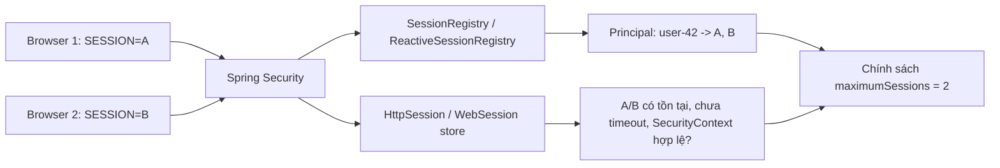
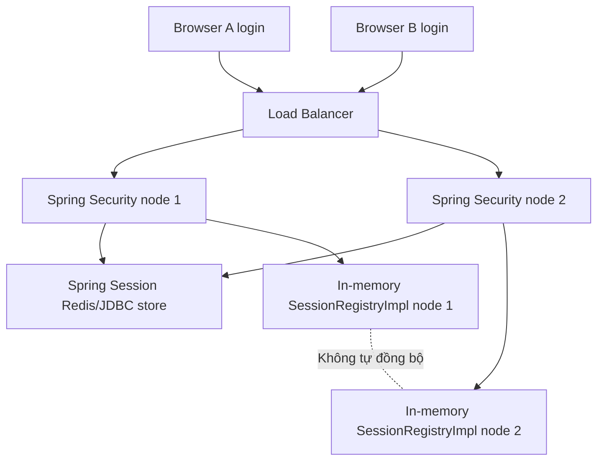
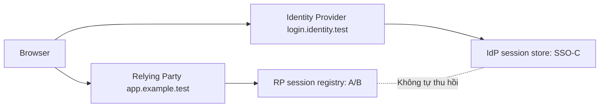
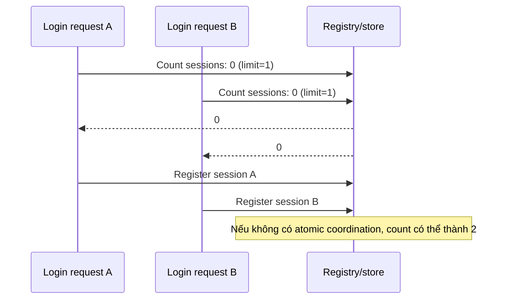

# Giới hạn phiên đồng thời theo yêu cầu bảo vệ tài khoản

> **Chương:** Session và cookie  
> **Module:** `SPRING_SECURITY_HTTP_PROTECTION` — phòng vệ HTTP và trình duyệt trong Spring Security (CSRF, CORS, headers, CSP, HSTS, HTTP firewall, session/cookie) trên cả Servlet và Reactive.  
> **Trọng tâm:** giới hạn số **phiên đăng nhập đã xác thực** của một tài khoản, định nghĩa chính sách khi đăng nhập vượt giới hạn, theo dõi session registry, xử lý đăng xuất/timeout, vận hành nhiều node và kiểm thử tình huống chiếm tài khoản.  
> **Đối tượng:** ứng dụng Spring Security dùng session cookie (`HttpSession` hoặc `WebSession`), không mặc định áp dụng cho mọi loại bearer JWT.

Một tài khoản có thể đăng nhập trên điện thoại, laptop và một trình duyệt công cộng. Nếu chính sách yêu cầu **tối đa hai phiên hoạt động**, chuyện gì xảy ra khi một thiết bị thứ ba đăng nhập? Giữ phiên đầu và chặn thiết bị mới, hay cho thiết bị mới vào rồi thu hồi phiên ít được sử dụng nhất? Khi người dùng đóng tab mà không logout, tài khoản có bị khóa đăng nhập mãi không? Khi hai yêu cầu login chạy đồng thời qua hai backend instances, giới hạn có còn đúng không?

Bài này xây lời giải theo thứ tự **yêu cầu bảo vệ tài khoản → mô hình phiên → cơ chế Spring Security → lựa chọn registry/store → bài test → vận hành và khôi phục**. Chỉ đặt `maximumSessions(1)` chưa đủ nếu danh tính principal không ổn định, session lifecycle event bị bỏ sót hoặc ứng dụng chạy nhiều node với registry riêng lẻ.

## 1. “Phiên đồng thời” thực sự được tính thế nào?

Một **phiên đăng nhập đã xác thực** thường là một session ID đang được registry gắn với một `principal`, có thể phục hồi `Authentication` trên request. Giới hạn `N` trong Spring Security không mặc nhiên là giới hạn:

| Đối tượng | Có phải một phiên đồng thời? | Vì sao dễ nhầm? |
| --- | --- | --- |
| Hai cửa sổ cùng một browser profile, dùng chung session cookie | **Thường là một phiên** | Nhiều tab/window không tự tạo nhiều session IDs. |
| Incognito/private profile khác cookie jar | **Thường là phiên khác** | Không chia session cookie với profile thường. |
| Hai trình duyệt/thiết bị riêng biệt | **Thường là hai phiên** | Mỗi browser giữ cookie riêng. |
| Hai request HTTP chạy song song trong cùng session | **Không phải hai phiên** | Đây là *concurrent requests*, không phải *concurrent logins*. |
| Một session trước login được đổi ID nhờ fixation protection | **Không nên đếm thành hai phiên đã xác thực** | Registry phải quản lý ID sau khi rotation. |
| OAuth2 login trên cùng ứng dụng rồi đăng nhập ở IdP | **Hai hệ thống session khác nhau** | RP registry không tự biết/tước session SSO bên IdP. |
| Bearer access token của mobile app không dùng server session | **Không tự được đếm** | Phải có hệ thống token issuance/revocation riêng. |
| Một `HttpSession` tạo ra để giữ CSRF trước login | **Không mặc nhiên là phiên đã authenticated** | Registry concurrent-login theo principal thường đăng ký sau auth thành công. |

**Điểm mấu chốt:** Đếm **authenticated sessions theo định danh người dùng đáng tin cậy**, không đếm tab, IP, User-Agent hoặc số request. Một user có thể dùng nhiều thiết bị chung NAT/IP; một kẻ tấn công có thể đổi User-Agent, proxy và IP. Các thông tin đó chỉ giúp **đánh giá rủi ro**, không nên là khóa duy nhất của session registry.

### 1.1. Browser cookie ≠ bản ghi registry

Browser có thể giữ cookie `SESSION=A` nhưng bản ghi phiên A trong store đã hết TTL. Ngược lại, registry trong bộ nhớ node A có thể vẫn nhớ A sau khi browser đã xóa cookie nhưng không gửi logout event. **Cả trạng thái phiên thực trong store và registry phải được đồng bộ/thu dọn đúng**.



Registry cho biết *ai có bao nhiêu sessions được theo dõi*; store và security filter xác minh quyền thực của từng request. Không suy từ một bảng registry rằng mọi phiên vẫn còn authenticated, cũng không dùng `Set-Cookie` như dữ liệu duy nhất để quyết định chính sách.

## 2. Threat model: giới hạn phiên giải quyết vấn đề gì?

**Mục đích bảo vệ tài khoản có thể gồm:**

1. **Giảm số phiên còn quyền sau khi mật khẩu bị chia sẻ hoặc bị lộ:** nếu nạn nhân có thể thu hồi phiên lạ, hậu quả được giới hạn.
2. **Phát hiện đăng nhập bất thường:** tạo sự kiện “phiên mới làm phiên khác bị hết hạn”, gửi thông báo bảo mật có nội dung không nhạy cảm.
3. **Thực thi yêu cầu nghiệp vụ:** ví dụ một tài khoản học viên tối đa hai thiết bị; tài khoản vận hành tài chính chỉ một phiên.
4. **Hỗ trợ quản lý thiết bị:** người dùng xem và đăng xuất những phiên không còn sử dụng.
5. **Kiểm soát vòng đời sau thay đổi mật khẩu, khóa tài khoản hoặc phát hiện xâm nhập:** thu hồi các phiên đã được đăng ký.

**Nhưng giới hạn phiên không thay thế:**

- MFA/WebAuthn, xác thực đăng nhập thích nghi, quản lý mật khẩu và rate limiting.
- CSRF protection cho request browser tự gửi session cookie.
- `Secure`/`HttpOnly`/`SameSite`, HTTPS/HSTS, CSP/chống XSS và HTTP firewall.
- Session fixation protection (đổi ID lúc login).
- TTL/idle timeout, absolute max lifetime và server-side invalidation.
- Thu hồi **JWT/access token/refresh token** nếu ứng dụng còn dùng token độc lập session.
- Thu hồi session tại **Identity Provider** (OIDC/SAML SSO) hoặc app khác.

**Chọn `maximumSessions(1)` không tự chặn hijacking:** nếu attacker **đánh cắp chính cookie ID A** và replay, cả nạn nhân và attacker có thể đang dùng **một** session A, registry vẫn chỉ đếm một phiên. Cần bảo vệ ID, phát hiện bất thường và cơ chế thu hồi/multi-factor riêng.

### 2.1. Giới hạn quá chặt có thể tăng rủi ro UX và hỗ trợ

Với chính sách “từ chối login mới”, một user quên logout ở máy cũ có thể không vào được tài khoản dù password/MFA hợp lệ. Nếu ứng dụng không có **cơ chế tự phục hồi an toàn**, họ có thể bị khóa cho tới khi phiên cũ timeout hoặc nhờ support. Trái lại, “đăng nhập mới thay phiên cũ” có thể được attacker dùng để liên tục đẩy người dùng hợp lệ ra ngoài.

Vì thế **chọn chiến lược tràn phiên phải dựa vào mục tiêu bảo vệ**, không chọn đơn giản vì một API có sẵn.

## 3. Hai chiến lược: thay phiên cũ hay chặn login mới?

| Khi vượt giới hạn | **Cho login mới, hết hạn phiên cũ** | **Giữ phiên cũ, chặn login mới** |
| --- | --- | --- |
| Spring Security Servlet | `maximumSessions(N)`; mặc định không ngăn login mới. | `maximumSessions(N).maxSessionsPreventsLogin(true)`. |
| Spring Security Reactive (6.3+) | `maximumSessions(SessionLimit.of(N))`; mặc định invalidate phiên ít dùng nhất. | `maximumSessionsExceededHandler(new PreventLoginMaximumSessionsExceededHandler())`. |
| Phiên A trên thiết bị cũ | Bị đánh dấu expired/invalidated theo cơ chế stack, request sau không được authenticated. | Vẫn có hiệu lực nếu chưa timeout/thu hồi vì nguyên nhân khác. |
| Phiên B khi login mới | Được xác thực, lưu registry khi thành công. | Auth attempt bị từ chối theo handler; không được cấp phiên authenticated mới. |
| Ưu điểm | Người dùng đổi thiết bị dễ dàng; giảm trường hợp bị khóa vì quên logout. | Bảo vệ phiên đang hoạt động, phù hợp chính sách nghiêm ngặt hoặc thiết bị đã đăng ký. |
| Rủi ro/UX | Kẻ đã biết credential có thể “đá” user; cần cảnh báo và MFA. | Có thể gây denial-of-service về khả năng login; cần recovery/revoke workflow. |
| Thích hợp | Ứng dụng tiêu dùng, thay thiết bị thường xuyên, hỗ trợ minh bạch. | Quản trị nhạy cảm, thiết bị vận hành cố định, yêu cầu kiểm soát mạnh. |

### 3.1. Ví dụ giới hạn một phiên

```mermaid
sequenceDiagram
    participant A as Browser A
    participant B as Browser B
    participant S as Spring Security
    participant R as Session registry
    A->>S: POST /login + CSRF hợp lệ
    S->>R: Register A cho user-42
    S-->>A: Login thành công; cookie A
    B->>S: POST /login + CSRF hợp lệ
    S->>R: User-42 đang có A; limit=1
    alt Evict old / allow new
        S->>R: Expire/Invalidate A, register B
        S-->>B: Login thành công; cookie B
        A->>S: GET /account với A
        S-->>A: Session expired / redirect / unauthorized
    else Prevent new login
        S-->>B: Login thất bại do maximum sessions
        A->>S: GET /account với A
        S-->>A: Vẫn authenticated
    end
```

Trạng thái HTTP cụ thể **không luôn là 401/403/429**: form login thường redirect tới trang lỗi đăng nhập, Servlet session expired có thể redirect `expiredUrl`; API JSON có thể dùng strategy tùy chỉnh. Không tự map “quá giới hạn” thành `429 Too Many Requests` như một quy tắc của Spring Security: đây là **auth/session policy**, không nhất thiết rate limiting.

### 3.2. Chọn session nào bị thay?

Khi cho login mới, Spring Security thông thường chọn **phiên ít được sử dụng gần đây nhất** (*least recently used*, LRU) dựa trên thông tin last request. Không phải luôn là phiên được tạo lâu nhất, cũng không chắc là “thiết bị đã ngắt mạng”. Timestamp có thể chịu ảnh hưởng của polling/background requests; cần test với luồng sử dụng thực.

Nếu chính sách yêu cầu **thiết bị đã phê duyệt**, **phiên trusted** hoặc **quyền ưu tiên**, phải thiết kế rule riêng có đầy đủ audit, không dựa vào LRU như một security classification.

## 4. Đưa yêu cầu nghiệp vụ thành một policy có thể test

Trước khi viết code, mô tả cụ thể:

| Phân khúc | Ví dụ limit | Chiến lược | Yêu cầu hỗ trợ |
| --- | --- | --- | --- |
| Người dùng cá nhân | 2–3 (giả định, không phải khuyến nghị chuẩn) | Thay phiên ít dùng hoặc cho chủ động quản lý. | Trang “Thiết bị đang đăng nhập”, thông báo phiên bị thay. |
| Tài khoản hỗ trợ nội bộ | 1–2 (ví dụ) | Chặn phiên mới hoặc step-up authentication. | Cơ chế recovery không cần chờ helpdesk khi thiết bị mất. |
| Quản trị nhạy cảm | 1 (ví dụ) | Chặn login mới + MFA; revoke khi cần. | Audit, quyền hỗ trợ đặc biệt, chính sách emergency access. |
| Service account / API machine-to-machine | **Không gắn số phiên browser máy móc** | Token/service credentials policy riêng. | Rotation, mTLS, token revocation và quản lý secrets. |

Các con số minh họa phải được tổ chức xác định theo **rủi ro, usability, quy định và năng lực vận hành**. Định nghĩa *principal key* phải ổn định (`userId`/subject duy nhất), không dựa vào tên hiển thị có thể trùng hoặc đổi.

### 4.1. Các câu hỏi bắt buộc có đáp án

- Đếm theo **account ID**, identity provider subject hay username? Nếu tenant A và tenant B cùng username, chúng có bị đếm chung không?
- Limit áp dụng cho **đăng nhập bằng form**, OAuth2 login, remember-me, HTTP Basic, custom authentication, mobile clients hay chỉ một vài luồng?
- Một browser có **hai tab** chỉ là một phiên hay sản phẩm đòi **mỗi thiết bị**? Nếu cần device enrollment thì registry session không đủ.
- Một phiên cũ bị hết hạn **khi nào**, người dùng nhận thông báo gì và có thể lưu dữ liệu chưa gửi không?
- Thời gian idle timeout, absolute lifetime, logout events, xử lý browser crash?
- Có thể thu hồi **tất cả phiên trừ phiên hiện tại** không? Ai được phép gọi?
- Ứng dụng có nhiều replicas/regions? Registry/store có **consistent view** không?
- Nếu registry/store không khả dụng, chính sách **fail-open hay fail-closed** được chấp thuận?
- Những API dùng bearer token/JWT có đi cùng một cơ chế revocation hay không?

Không trả lời những câu hỏi này rồi mới phát hiện trong production rằng “một user mở hai tab bị tính hai phiên” hoặc “Redis dùng chung nhưng hai node vẫn cho bốn phiên”.

## 5. Luồng xử lý chung trong Spring Security

Trong **Servlet**, các authentication mechanisms theo cấu hình gọi `SessionAuthenticationStrategy` khi xác thực thành công. Concurrent control sử dụng `SessionRegistry` và `ConcurrentSessionControlAuthenticationStrategy`; việc đăng ký session được phối hợp với session fixation strategy và `RegisterSessionAuthenticationStrategy`. `ConcurrentSessionFilter` kiểm tra session bị đánh dấu expired trên những request phù hợp.

Trong **Reactive WebFlux** (Spring Security 6.3+), concurrent session control tích hợp bằng `ServerAuthenticationSuccessHandler`, với `ConcurrentSessionControlServerAuthenticationSuccessHandler` và `RegisterSessionServerAuthenticationSuccessHandler`, lưu thông tin trong `ReactiveSessionRegistry`.

| Thành phần | Servlet | Reactive WebFlux |
| --- | --- | --- |
| Security DSL | `HttpSecurity.sessionManagement(...)` | `ServerHttpSecurity.sessionManagement(...).concurrentSessions(...)` |
| Session object | `HttpSession` | `WebSession` |
| Theo dõi active sessions | `SessionRegistry`; mặc định `SessionRegistryImpl` in-memory | `ReactiveSessionRegistry`; `InMemoryReactiveSessionRegistry` |
| Điều kiện đạt limit | `ConcurrentSessionControlAuthenticationStrategy` | `ConcurrentSessionControlServerAuthenticationSuccessHandler` |
| Đăng ký phiên khi auth thành công | `RegisterSessionAuthenticationStrategy` | `RegisterSessionServerAuthenticationSuccessHandler` |
| Hết hạn phiên cũ | `SessionInformation.expireNow()`, `ConcurrentSessionFilter` | `InvalidateLeastUsedServerMaximumSessionsExceededHandler` và store/session registry |
| Chặn login mới | `maxSessionsPreventsLogin(true)` | `PreventLoginMaximumSessionsExceededHandler` |
| Multi-node session registry | `SpringSessionBackedSessionRegistry` hoặc implementation distributed | `SpringSessionBackedReactiveSessionRegistry` hoặc distributed implementation |
| Cookie gửi tới client | Servlet container/Spring Session serializer | `CookieWebSessionIdResolver` |

**Lưu ý Spring Security 6+:** `SessionManagementFilter` không còn mặc định được đặt trong chain như đời cũ. Các authentication mechanisms phải tích hợp session strategy khi hoàn tất login. **Một custom authentication filter/controller tự set `SecurityContext` mà không gọi strategy và persist context phù hợp có thể vượt giới hạn phiên.**

## 6. Servlet — cấu hình cho phép phiên mới và hết hạn phiên cũ

Đối với Spring Security Servlet, `maximumSessions(1)` đặt giới hạn **một authenticated session cho một principal**. Khi login trên cookie jar B thành công, phiên A sẽ bị đánh dấu expired; request tiếp theo của A bị xử lý như expired session.

Ví dụ ứng dụng form login trên HTTPS:

```java
import org.springframework.context.annotation.Bean;
import org.springframework.context.annotation.Configuration;
import org.springframework.security.config.Customizer;
import org.springframework.security.config.annotation.web.builders.HttpSecurity;
import org.springframework.security.core.session.SessionRegistry;
import org.springframework.security.core.session.SessionRegistryImpl;
import org.springframework.security.web.SecurityFilterChain;
import org.springframework.security.web.session.HttpSessionEventPublisher;

@Configuration
class ServletEvictOldSessionSecurity {

    @Bean
    SessionRegistry sessionRegistry() {
        // Chỉ phù hợp một node hoặc bài test đơn giản.
        return new SessionRegistryImpl();
    }

    @Bean
    HttpSessionEventPublisher httpSessionEventPublisher() {
        return new HttpSessionEventPublisher();
    }

    @Bean
    SecurityFilterChain securityFilterChain(
            HttpSecurity http, SessionRegistry registry) throws Exception {
        return http
            .authorizeHttpRequests(auth -> auth
                .requestMatchers("/login", "/session-expired", "/public/**")
                    .permitAll()
                .anyRequest().authenticated())
            .formLogin(Customizer.withDefaults())
            .csrf(Customizer.withDefaults())
            .sessionManagement(sessions -> sessions
                .sessionFixation(fixation -> fixation.changeSessionId())
                .maximumSessions(1)
                .expiredUrl("/session-expired")
                .sessionRegistry(registry))
            .build();
    }
}
```

Trong ví dụ, `HttpSessionEventPublisher` gửi lifecycle events từ Servlet container để registry biết session nào đã destroyed/expired; `SessionRegistryImpl` theo dõi sessions trong **memory node hiện tại**. Trang `/session-expired` là một URL ứng dụng cần tự cung cấp (ví dụ page hướng dẫn đăng nhập lại), không mặc nhiên là trang có sẵn chỉ nhờ gọi `expiredUrl(...)`.

### 6.1. Khi thực tế có hai lần login

| Sự kiện | Registry và session | Kết quả user nhìn thấy |
| --- | --- | --- |
| Browser A POST login (CSRF hợp lệ) | A được đăng ký. | A vào tài khoản. |
| Browser B POST login cùng principal | Limit 1 → A bị đánh dấu expired; B được đăng ký. | B vào tài khoản. |
| Browser A GET /account với cookie A | `ConcurrentSessionFilter` thấy expired và áp strategy. | A chuyển tới `/session-expired`/logout tùy thiết kế. |
| Browser B GET /account với cookie B | B còn active. | B được phục vụ nếu còn Authentication và quyền. |

**Không hứa “A bị cắt kết nối ngay lập tức” ở mọi kênh:** request đang chạy, WebSocket đã thiết lập, long-polling/stream hoặc asynchronous tasks không nhất thiết bị ngắt ngay ở thời điểm B login. Cần thêm chính sách cho kênh realtime/những giao dịch dài nếu yêu cầu bảo vệ nghiêm ngặt.

### 6.2. Chọn URL hết phiên và trải nghiệm frontend

Mẫu thông báo an toàn:

> Phiên đăng nhập này đã kết thúc vì tài khoản được đăng nhập trên một phiên khác. Nếu bạn không nhận ra hoạt động này, hãy đổi mật khẩu, xem danh sách phiên và liên hệ hỗ trợ.

Không tự ghi tên thiết bị/địa chỉ IP chi tiết của phiên B vào thông báo A nếu chưa có xác minh thông tin và privacy policy. Tránh thông báo tiết lộ account tồn tại ở endpoint công khai.

**API JSON** không nên chỉ phụ thuộc vào redirect HTML `expiredUrl`: một `fetch` có thể nhận HTML login page 200 sau redirect thay vì JSON lỗi. Có thể dùng `expiredSessionStrategy(...)` cho `401` và mã lỗi ứng dụng rõ ràng, trong khi form login dùng UX riêng.

### 6.3. JSON expired-session strategy cho API Servlet

Ví dụ nếu **toàn bộ protected API** cần JSON khi session bị đẩy ra:

```java
import java.nio.charset.StandardCharsets;
import jakarta.servlet.http.HttpServletResponse;
import org.springframework.http.MediaType;
import org.springframework.security.web.session.SessionInformationExpiredStrategy;

// Dùng THAY CHO .expiredUrl("/session-expired") trên concurrency DSL:
SessionInformationExpiredStrategy jsonExpired = event -> {
    HttpServletResponse response = event.getResponse();
    response.setStatus(HttpServletResponse.SC_UNAUTHORIZED);
    response.setContentType(MediaType.APPLICATION_JSON_VALUE);
    response.setCharacterEncoding(StandardCharsets.UTF_8.name());
    response.setHeader("Cache-Control", "no-store");
    response.getWriter().write(
        "{\"code\":\"SESSION_REPLACED\","
        + "\"message\":\"Phiên đã kết thúc\"}");
};

// Trong .maximumSessions(1) ... :
// .expiredSessionStrategy(jsonExpired)
```

Đây là **đoạn tích hợp** trong Java config có đúng dependency, không phải một class hoàn chỉnh độc lập. **Không cấu hình đồng thời `expiredUrl` và `expiredSessionStrategy` rồi kỳ vọng cả hai luôn chạy**: chọn strategy phù hợp nội dung response. Không đưa session IDs, principal names hoặc stack traces vào JSON. `401` ở đây là **một hợp đồng API do ứng dụng chọn**, không phải HTTP status mặc định bắt buộc khi mọi lần vượt limit.

## 7. Servlet — chặn lần đăng nhập mới và giữ phiên hiện tại

Nếu yêu cầu chính sách “thiết bị đang hoạt động phải được giữ nguyên trừ khi chủ tài khoản chủ động thu hồi”, dùng:

```java
import org.springframework.context.annotation.Bean;
import org.springframework.context.annotation.Configuration;
import org.springframework.security.config.Customizer;
import org.springframework.security.config.annotation.web.builders.HttpSecurity;
import org.springframework.security.core.session.SessionRegistry;
import org.springframework.security.core.session.SessionRegistryImpl;
import org.springframework.security.web.SecurityFilterChain;
import org.springframework.security.web.session.HttpSessionEventPublisher;

@Configuration
class ServletPreventNewSessionSecurity {

    @Bean
    SessionRegistry sessionRegistry() {
        return new SessionRegistryImpl();
    }

    @Bean
    HttpSessionEventPublisher httpSessionEventPublisher() {
        return new HttpSessionEventPublisher();
    }

    @Bean
    SecurityFilterChain securityFilterChain(
            HttpSecurity http, SessionRegistry registry) throws Exception {
        return http
            .authorizeHttpRequests(auth -> auth
                .requestMatchers("/login", "/public/**").permitAll()
                .anyRequest().authenticated())
            .formLogin(Customizer.withDefaults())
            .csrf(Customizer.withDefaults())
            .sessionManagement(sessions -> sessions
                .maximumSessions(1)
                .maxSessionsPreventsLogin(true)
                .sessionRegistry(registry))
            .build();
    }
}
```

**Đây là phương án thay thế hoàn toàn mục 6**, không đăng ký cả hai `SecurityFilterChain` có matcher giống nhau. Khi B cố login, Spring Security có thể phát `SessionAuthenticationException` và chuyển tới *authentication failure URL* của form login; A vẫn authenticated.

### 7.1. Phải có đường thoát cho người mất thiết bị

Một chính sách chỉ chặn login mới mà không có đường phục hồi có thể bị lợi dụng gây **account lockout**:

- A đang ở thiết bị đã mất, không thể bấm logout.
- User thay mật khẩu nhưng cơ chế hiện hành không tự invalidate mọi session.
- A hết thời gian làm việc nhưng session store chưa timeout vì heartbeat.
- Một actor biết mật khẩu/MFA đăng nhập chiếm slot duy nhất.

Thiết kế **quy trình thu hồi an toàn**: xác thực lại bằng MFA/WebAuthn/step-up, người dùng chọn revoke phiên cũ (hoặc revoke-all); có audit và thông báo; không để anonymous caller tự thu hồi sessions của username bất kỳ.

### 7.2. Phân biệt lỗi login do policy và do credentials

Không mô tả “sai mật khẩu” khi credentials đã hợp lệ nhưng bị từ chối vì limit. Cũng không tiết lộ các phiên của một tài khoản chưa xác thực, tránh account enumeration. Có thể đưa mã lỗi chung ở form sau **khi xác thực hợp lệ**, hướng tới trang quản lý thiết bị; mọi thông điệp chi tiết cần được bảo vệ chống CSRF, rate limiting và abuse.

**Không sửa bằng cách giảm `server.servlet.session.timeout` xuống vài giây**: timeout thấp làm mất UX và tạo thêm cửa sổ race, không thay một recovery flow được thiết kế.

## 8. Servlet — SessionRegistry và vòng đời session

`SessionRegistry` là abstraction theo dõi principal → danh sách `SessionInformation`. `SessionRegistryImpl` là triển khai **in-memory**; nó cần nhận lifecycle events để không đếm các sessions đã kết thúc mãi mãi.

### 8.1. Xem và hết hạn sessions của một principal (chỉ trong service có kiểm soát)

```java
import org.springframework.security.core.session.SessionInformation;
import org.springframework.security.core.session.SessionRegistry;

public final class AccountSessionService {
    private final SessionRegistry registry;

    public AccountSessionService(SessionRegistry registry) {
        this.registry = registry;
    }

    public long countActiveSessions(Object principal) {
        return registry.getAllSessions(principal, false).stream()
            .filter(session -> !session.isExpired())
            .count();
    }

    public void expireAllRegisteredSessions(Object principal) {
        for (SessionInformation session :
                registry.getAllSessions(principal, false)) {
            session.expireNow();
        }
    }
}
```

**Cảnh báo:** `expireNow()` **đánh dấu expired trong registry**, không bảo đảm destroy vật lý session store và chấm dứt ngay các kết nối đang mở. Với registry Servlet in-memory, request tiếp theo của session đó được `ConcurrentSessionFilter` nhận biết. Nếu cần **thu hồi ngay ở backend** hoặc multi-node, phối hợp với session repository/invalidation và kiểm thử semantics của implementation.

Đừng phát triển `POST /admin/revoke?username=...` cho bất kỳ authenticated user nào. Dịch vụ quản lý sessions phải có **ownership check, CSRF, step-up authentication, audit, rate limiting**; registry có thể lưu principal object với `equals/hashCode` riêng.

### 8.2. `HttpSessionEventPublisher` và lỗi “không bao giờ hết slot”

Ví dụ bean:

```java
@Bean
HttpSessionEventPublisher httpSessionEventPublisher() {
    return new HttpSessionEventPublisher();
}
```

Spring Boot thường auto-register `HttpSessionListener` bean ở Servlet container. Không tự vừa khai bean **vừa** đăng ký listener tương đương trong `web.xml` mà không kiểm tra lifecycle events trùng lặp. Với `SessionRegistryImpl`, session destroyed event là quan trọng để session cũ không tiếp tục bị đếm; trong Spring Session/Redis, event delivery và indexing có cơ chế riêng cần kiểm thử.

### 8.3. Principal equality không ổn định là lỗi logic

`SessionRegistryImpl` dùng principal như key trong cấu trúc map. Nếu mỗi lần login trả một instance `UserDetails` mới nhưng `equals()`/`hashCode()` dựa trên object identity, hai lần đăng nhập của **cùng account** có thể bị coi là hai principals khác nhau và không áp giới hạn.

Với custom `UserDetails`, cần bảo đảm equality phản ánh **định danh ổn định và bất biến**; tránh lấy danh sách roles thay đổi, tên hiển thị hay mutable fields làm `hashCode`. Đối với multi-tenant, key nên bao gồm **tenant + account ID** để không đếm chung tài khoản ở hai tenants vô tình có username giống nhau.

**Không đưa password/hash, OTP hoặc dữ liệu nhạy cảm vào `equals/hashCode/toString`**. Nếu dùng principal object để expose device list, redaction là yêu cầu riêng.

### 8.4. Session fixation và concurrency phải dùng cùng ID sau login

Khi user có session ẩn danh A và login thành công, Spring Security có thể đổi ID thành B bằng `changeSessionId()`. Registry cần ghi nhận ID sau khi rotation, không đếm A và B như hai phiên authenticated. Nếu tự xây login filter, trình tự quan trọng là **authenticate → áp session authentication strategy gồm kiểm tra limit/fixation/registration → lưu SecurityContext** theo integration của Spring Security version đang dùng.

Đừng tự tạo `HttpSession` và gọi `registry.registerNewSession(...)` riêng mà bỏ qua strategies/cookies/CSRF: có thể dẫn đến ghost sessions, chưa xoay session ID hoặc sai thứ tự kiểm tra.

## 9. Servlet nhiều node — Spring Session backed registry

Một deployment có hai pods A và B:



Ngay cả khi `HttpSession` được lưu vào **cùng Redis**, **`SessionRegistryImpl` trên hai node vẫn là hai registry riêng** nếu không được thay bằng một triển khai shared. Khi B login vào node 2, node 2 có thể không thấy phiên A do node 1 đã đăng ký; giới hạn `maximumSessions(1)` vì thế **không bảo đảm toàn cluster**.

### 9.1. Dùng `SpringSessionBackedSessionRegistry` khi phù hợp

Spring Session cung cấp `SpringSessionBackedSessionRegistry` để truy vấn sessions từ `FindByIndexNameSessionRepository`:

```java
import org.springframework.context.annotation.Bean;
import org.springframework.context.annotation.Configuration;
import org.springframework.security.core.session.SessionRegistry;
import org.springframework.session.FindByIndexNameSessionRepository;
import org.springframework.session.Session;
import org.springframework.session.security.SpringSessionBackedSessionRegistry;

@Configuration
class SharedServletSessionRegistryConfig {

    @Bean
    <S extends Session> SessionRegistry sessionRegistry(
            FindByIndexNameSessionRepository<S> repository) {
        return new SpringSessionBackedSessionRegistry<>(repository);
    }
}
```

**Điều kiện:** phải có Spring Session module/repository thực hỗ trợ `FindByIndexNameSessionRepository` và principal index được tạo đúng; dùng **bean registry này** trong Servlet security chain `.maximumSessions(...).sessionRegistry(registry)`. Không khai thêm `SessionRegistryImpl` bean cùng tên rồi để injection nhập nhằng.

**Giới hạn API quan trọng:** `SpringSessionBackedSessionRegistry.getAllPrincipals()` không được hỗ trợ vì Spring Session không lưu toàn bộ principal enumeration theo API đó. Nếu muốn trang admin liệt kê mọi account/sessions, **không** dựa vào method này: xây dữ liệu chỉ mục/management riêng có phân quyền, tối thiểu hóa dữ liệu và chính sách xóa.

### 9.2. Principal index phải đáng tin

Spring Session tìm sessions theo principal name. Với Redis/JDBC, index phụ thuộc repository và Spring Security integration. Nếu lưu `Authentication` thủ công, sửa serialization hoặc tạo principal name không ổn định, session có thể tồn tại nhưng **không được trả về từ `findByPrincipalName(...)`**.

Test:

- User login vào node 1 → session được lập chỉ mục theo account key ổn định.
- Query repository qua node 2 → tìm được session.
- Login vào node 2 → chính sách limit nhìn thấy active session ở node 1.
- Logout/expiry ở một node → node còn lại không đếm ghost session.
- Tài khoản tenant A và B trùng username không bị gộp chung nếu policy là theo tenant.

**Không tự gắn principal index theo giá trị client gửi** (`?username=...`, cookie `USER_ID`). Registry phải lấy định danh từ **Authentication đã được xác thực**.

### 9.3. “Có shared Redis” không phải bảo đảm tuyệt đối chống race

Ngay cả khi registry được backed bởi store phân tán, **hai login đồng thời ở hai nodes** có thể đọc cùng số sessions trước khi cả hai cập nhật. Nếu hệ thống đòi **hard limit luôn đúng ở mọi millisecond**, cần review atomic check-and-register, transaction/lock per account, idempotency, độ trễ replication và cách xử lý failover theo implementation đang triển khai.

Đừng tự thêm Redis lock toàn hệ thống không TTL hoặc gọi các lệnh quét `KEYS *` trong production: gây nghẽn store và có thể tự khóa account. Sử dụng thiết kế atomic có timeouts/fencing và test race thực tế khi mức bảo đảm pháp lý/nghiệp vụ yêu cầu.

### 9.4. Idle timeout, registry cleanup và cookie expiry

`server.servlet.session.timeout`/Redis TTL ảnh hưởng session store, trong khi `Max-Age` của cookie là tuổi browser giữ ID. Session có thể hết server TTL nhưng browser còn cookie; ID đó phải bị coi là unauthenticated.

Khi dùng Spring Session, đánh giá session-expired events, principal indexing cleanup và cách store xử lý xóa/invalidations. **Không đặt event publisher của Servlet như giải pháp duy nhất cho ghost sessions ở cluster**; phải kiểm tra đúng loại repository và luồng events mà ứng dụng dùng.

## 10. Reactive WebFlux — giới hạn một phiên với Spring Security 6.3+

Spring Security hỗ trợ **Reactive concurrent sessions control từ 6.3**. API này **khác** Servlet: không gọi `HttpSecurity.maximumSessions(int)`, không dùng `HttpSessionEventPublisher`, không dùng `SessionRegistryImpl`.

Ví dụ **cho login mới, invalidate phiên ít dùng nhất**:

```java
import org.springframework.context.annotation.Bean;
import org.springframework.context.annotation.Configuration;
import org.springframework.security.config.Customizer;
import org.springframework.security.config.annotation.web.reactive.EnableWebFluxSecurity;
import org.springframework.security.config.web.server.ServerHttpSecurity;
import org.springframework.security.core.session.InMemoryReactiveSessionRegistry;
import org.springframework.security.core.session.ReactiveSessionRegistry;
import org.springframework.security.web.server.SecurityWebFilterChain;
import org.springframework.security.web.server.authentication.SessionLimit;

@Configuration
@EnableWebFluxSecurity
class ReactiveEvictOldSessionSecurity {

    @Bean
    ReactiveSessionRegistry reactiveSessionRegistry() {
        // Chỉ phù hợp một node/demo; multi-node cần registry chia sẻ.
        return new InMemoryReactiveSessionRegistry();
    }

    @Bean
    SecurityWebFilterChain securityWebFilterChain(ServerHttpSecurity http) {
        return http
            .authorizeExchange(auth -> auth
                .pathMatchers("/login", "/public/**").permitAll()
                .anyExchange().authenticated())
            .formLogin(Customizer.withDefaults())
            .csrf(Customizer.withDefaults())
            .sessionManagement(sessions -> sessions
                .concurrentSessions(concurrent -> concurrent
                    .maximumSessions(SessionLimit.of(1))))
            .build();
    }
}
```

Spring Security dùng `ReactiveSessionRegistry` để theo dõi các phiên đăng ký. Mặc định, khi đạt limit sẽ sử dụng chiến lược **`InvalidateLeastUsedServerMaximumSessionsExceededHandler`**; handler invalidates những phiên ít dùng theo framework semantics và loại chúng khỏi `WebSessionStore` tương ứng.

**Không sao chép vào Spring Security 6.2 hoặc cũ hơn:** các API `SessionLimit`, `ReactiveSessionRegistry` và DSL `concurrentSessions(...)` ở trên yêu cầu dòng hỗ trợ 6.3+. Kiểm tra Spring Boot BOM/Spring Security dependencies mà dự án thực dùng.

### 10.1. Reactive session cookie cần policy riêng

Ví dụ cho Spring Boot Reactive hỗ trợ properties session:

```yaml
server:
  reactive:
    session:
      cookie:
        name: __Host-SESSION
        path: /
        secure: true
        http-only: true
        same-site: lax
      timeout: 30m
```

Cookie flags **không thay giới hạn phiên**. `HttpOnly` hạn chế JS đọc ID, `Secure` yêu cầu HTTPS, `SameSite=Lax` giúp một số luồng điều hướng; limit được thực thi khi authentication được ghi vào `WebSession` và registry. Đặt `__Host-SESSION` cần `Path=/` và **không `Domain`** trong header thực.

Không dùng `server.servlet.session.cookie.*` cho ứng dụng chỉ chạy WebFlux rồi tưởng đã cấu hình được `WebSession`. Với Spring Session Reactive, phải xác định `WebSessionIdResolver`/`WebSessionManager` thực tế.

## 11. Reactive — chặn login mới khi đủ giới hạn

Để giữ phiên cũ và từ chối login B, dùng **`PreventLoginServerMaximumSessionsExceededHandler`**:

```java
import org.springframework.context.annotation.Bean;
import org.springframework.context.annotation.Configuration;
import org.springframework.security.config.Customizer;
import org.springframework.security.config.annotation.web.reactive.EnableWebFluxSecurity;
import org.springframework.security.config.web.server.ServerHttpSecurity;
import org.springframework.security.core.session.InMemoryReactiveSessionRegistry;
import org.springframework.security.core.session.ReactiveSessionRegistry;
import org.springframework.security.web.server.SecurityWebFilterChain;
import org.springframework.security.web.server.authentication.SessionLimit;
import org.springframework.security.web.server.authentication.PreventLoginServerMaximumSessionsExceededHandler;

@Configuration
@EnableWebFluxSecurity
class ReactivePreventNewLoginSecurity {

    @Bean
    ReactiveSessionRegistry reactiveSessionRegistry() {
        return new InMemoryReactiveSessionRegistry();
    }

    @Bean
    SecurityWebFilterChain securityWebFilterChain(ServerHttpSecurity http) {
        return http
            .authorizeExchange(auth -> auth
                .pathMatchers("/login", "/public/**").permitAll()
                .anyExchange().authenticated())
            .formLogin(Customizer.withDefaults())
            .csrf(Customizer.withDefaults())
            .sessionManagement(sessions -> sessions
                .concurrentSessions(concurrent -> concurrent
                    .maximumSessions(SessionLimit.of(1))
                    .maximumSessionsExceededHandler(
                        new PreventLoginServerMaximumSessionsExceededHandler())))
            .build();
    }
}
```

**Lưu ý tên API:** một số ví dụ văn bản rút gọn tên thành `PreventLoginMaximumSessionsExceededHandler`; Javadoc class thực ở package `org.springframework.security.web.server.authentication` là **`PreventLoginServerMaximumSessionsExceededHandler`**. Chọn đúng class của version phụ thuộc và xem imports từ IDE/Javadoc, không sao chép thiếu tên.

Handler `handle(...)` trả `Mono` lỗi với `SessionAuthenticationException` khi vượt limit. Hình thức trả lỗi cho client phụ thuộc authentication failure handler và request; không mặc định mọi SPA sẽ nhận JSON `409`/`429`.

**Không bật hai cấu hình Reactive ở mục 10 và 11 cùng lúc.** Chúng là **hai phương án thay thế**, không phải hai filter chains cùng có matcher mọi request.

### 11.1. Giữ reactive pipeline non-blocking

Khi tùy chỉnh `ServerMaximumSessionsExceededHandler` hoặc registry, sử dụng Reactor `Mono`/`Flux` và API repository reactive; không gọi JDBC blocking/`Thread.sleep`/`Mono.block()` trên Netty event loop. Không `subscribe()` thủ công chỉ để ghi event session vì có thể mất lỗi, phá thứ tự và làm policy không được thực thi đúng.

### 11.2. Kiểm soát login flow có success handler custom

Spring Security Reactive gắn concurrent-control handlers vào những authentication mechanisms thông thường như form login, OAuth2 login, HTTP Basic **khi chúng không bị thay success handler theo cách loại bỏ integration**. Nếu gọi:

```java
// CẢNH BÁO: tự thay toàn bộ success handler có thể làm
// concurrent-session control không được gắn vào form login.
.formLogin(login -> login.authenticationSuccessHandler(
    new RedirectServerAuthenticationSuccessHandler("/")))
```

thì có thể **bỏ qua concurrent control** dù `sessionManagement().concurrentSessions(...)` vẫn hiện diện. Ưu tiên API thêm success handler vào danh sách của framework (nếu version hỗ trợ) hoặc tự phối hợp các concurrent/register handlers đúng thứ tự; luôn test login thật trên **hai browser contexts**.

## 12. Reactive — giới hạn động theo Authentication

API `SessionLimit` của Reactive là một function từ `Authentication` tới `Mono<Integer>`; `Mono.empty()` biểu thị không giới hạn. Có thể áp policy khác cho nhóm tài khoản:

```java
import org.springframework.security.core.authority.SimpleGrantedAuthority;
import org.springframework.security.web.server.authentication.SessionLimit;
import reactor.core.publisher.Mono;

// Phương thức được gọi trong lớp @Configuration.
private SessionLimit accountSessionLimits() {
    return authentication -> {
        var authorities = authentication.getAuthorities();

        if (authorities.contains(
                new SimpleGrantedAuthority("ROLE_SERVICE_UNLIMITED"))) {
            return Mono.empty(); // UNLIMITED theo quy tắc này.
        }
        if (authorities.contains(
                new SimpleGrantedAuthority("ROLE_ADMIN"))) {
            return Mono.just(1); // Admin chỉ một phiên.
        }
        return Mono.just(3); // User thường tối đa ba phiên.
    };
}

// Thay .maximumSessions(SessionLimit.of(1)) bằng:
// .maximumSessions(accountSessionLimits())
```

Đây là **ví dụ policy minh họa**, không phải khuyến nghị cho phép mọi service account không giới hạn. Quyết định giới hạn cần dựa trên yêu cầu bảo vệ thực, không coi role là bằng chứng thiết bị đáng tin. **Không** lấy limit từ cookie `MAX_SESSIONS=999` hoặc `?role=admin` do client gửi.

### 12.1. Thay đổi quyền trong một phiên đã tồn tại

Nếu user được thăng quyền giữa phiên, **giới hạn động có thể được đánh giá ở thời điểm authentication success**, không mặc nhiên kiểm tra lại trên mọi request. Chính sách buộc “admin phải chỉ một phiên ngay sau khi đổi role” cần event-driven session revocation hoặc reauthentication/step-up và test đảm bảo các phiên cũ bị thu hồi.

### 12.2. Principal identity vẫn phải nhất quán

`ReactiveSessionRegistry` cũng theo dõi sessions theo principal. Khi tạo `Authentication` custom, không để principal key phụ thuộc mutable fields hoặc object identity khác nhau giữa login requests; với principal từ OAuth2, cân nhắc `issuer + subject + tenant` làm identity ổn định. Tên hiển thị/OIDC email có thể thay đổi hoặc trùng; không dùng để vô tình gộp hai users.

## 13. Reactive nhiều node — Spring Session backed registry

`InMemoryReactiveSessionRegistry` **không chia sẻ state giữa pods**, dù `WebSession` có thể được lưu trong Redis. Spring Session có `SpringSessionBackedReactiveSessionRegistry` (Spring Session 3.3+ theo Javadoc) tích hợp với indexed reactive session repository:

```java
import org.springframework.context.annotation.Bean;
import org.springframework.context.annotation.Configuration;
import org.springframework.security.core.session.ReactiveSessionRegistry;
import org.springframework.session.ReactiveFindByIndexNameSessionRepository;
import org.springframework.session.ReactiveSessionRepository;
import org.springframework.session.Session;
import org.springframework.session.security.SpringSessionBackedReactiveSessionRegistry;

@Configuration
class SharedReactiveSessionRegistryConfig {

    @Bean
    <S extends Session> ReactiveSessionRegistry reactiveSessionRegistry(
            ReactiveSessionRepository<S> sessionRepository,
            ReactiveFindByIndexNameSessionRepository<S> indexedRepository) {
        return new SpringSessionBackedReactiveSessionRegistry<>(
            sessionRepository, indexedRepository);
    }
}
```

**Điều kiện:** repository phải hỗ trợ các interfaces cần thiết; principal index phải phản ánh danh tính từ `Authentication`; các node phải dùng cùng cấu hình/namespace và session serialization/version tương thích. Trong deployment này **không khai thêm `InMemoryReactiveSessionRegistry`**.

Spring Session backed registry giúp nhìn sessions ở quy mô cluster, nhưng phải kiểm thử login cùng lúc trên hai nodes, refresh last-access, revoke, TTL, eventual consistency và hành vi khi Redis lỗi. Nếu sản phẩm đòi limit cứng tuyệt đối, cần cơ chế atomic coordination phù hợp thay vì chỉ suy từ “đã dùng Redis”.

### 13.1. Không trộn Servlet và Reactive repositories

| Servlet | Reactive |
| --- | --- |
| `FindByIndexNameSessionRepository<S>` | `ReactiveFindByIndexNameSessionRepository<S>` |
| `SpringSessionBackedSessionRegistry<S>` | `SpringSessionBackedReactiveSessionRegistry<S>` |
| `SessionRegistry` | `ReactiveSessionRegistry` |
| `HttpSession` | `WebSession` |
| `HttpSecurity` | `ServerHttpSecurity` |

Đây là hai stacks khác nhau; có cả `spring-webmvc` và `spring-webflux` trên classpath không có nghĩa Boot đang chạy cả hai loại session infrastructure. Kiểm tra actual web application type và filters đang hoạt động.

### 13.2. Thu hồi Reactive sessions đã đăng ký

Theo hướng dẫn Spring Security, muốn invalidate sessions của user cần phối hợp `ReactiveSessionRegistry` với store, không chỉ sửa cookie browser:

```text
load registered sessions for authenticated principal
    -> invalidate từng ReactiveSessionInformation
    -> remove corresponding session from WebSessionStore
    -> bảo đảm request tiếp theo không phục hồi SecurityContext
    -> ghi audit event không chứa raw session ID
```

Tùy runtime và Spring Session integration, dùng API store/repository tương ứng (xem `WebSessionStore` trong hướng dẫn chính thức). **Không** tự gọi `session.invalidate()` rồi không chain publisher; trong Reactive phải **return/compose Mono** để các thao tác thật được thực thi. Khi revoke-by-user, phải giới hạn quyền truy cập bằng verified principal/step-up, không dùng username từ query làm target mà thiếu authorization.

## 14. Authentication mechanisms nào thực sự được áp giới hạn?

Một lỗ hổng phổ biến không nằm trong `maximumSessions` mà nằm ở **đường đi authentication**.

| Cơ chế | Servlet | Reactive | Điều cần xác nhận |
| --- | --- | --- | --- |
| Form login mặc định | Hỗ trợ qua session authentication strategy. | Tích hợp concurrent success handlers trên phiên bản hỗ trợ. | Login thật với hai cookie jars. |
| OAuth2/OIDC login ở RP | Phải gắn với authentication strategy khi thành công. | Có tích hợp sẵn trong cơ chế theo docs nếu không thay success handler theo cách mất handlers. | RP session registry có ghi nhận B sau OAuth2 callback không? |
| HTTP Basic | Tùy filter/security context persistence và phiên bản. | Docs Reactive mô tả tích hợp với HTTP Basic khi auth success được xử lý. | Có stateful session thật hay mỗi request tạo một auth success? |
| Remember-me | Có thể kích hoạt session authentication control theo chain/strategy. | Tùy cơ chế authentication và handler đang dùng. | Có bỏ qua CSRF/cookie/limit khi tự động login lại không? |
| Login controller tự viết | **Không bảo đảm** nếu chỉ set `SecurityContext`. | **Không bảo đảm** nếu chỉ gọi `ReactiveAuthenticationManager`. | Strategy/registry, context persistence, session ID rotation có chạy không? |
| JWT bearer resource server stateless | **Không tự giới hạn bằng session registry.** | **Không tự giới hạn bằng reactive session registry.** | Cần quản lý token issuance, refresh token, grant revocation riêng. |
| SAML2 login | Tùy cụ thể phiên bản/authentication integration. | Tùy stack/support. | Validate giao thức, registry và logout; không suy từ một `SecurityFilterChain` chung. |

### 14.1. OAuth2/OIDC: RP session khác IdP session

Khi user login vào ứng dụng `app.example.test` qua IdP `login.identity.test`, có thể có **hai cookies/sessions**:



`maximumSessions(1)` của RP **không hủy session SSO-C tại IdP**. Khi A bị đá khỏi RP, IdP có thể vẫn giữ SSO và người dùng được đăng nhập lại rất nhanh, tùy OIDC prompt/policy. Nếu yêu cầu bảo vệ là **logout toàn hệ sinh thái**, cần OIDC back-channel/front-channel logout hoặc giao thức revocation phù hợp, verify issuer/audience/signature, phối hợp các RPs. Không lộ auth code/`state`/session ID trong log.

**Cảnh báo Strict/Lax/None:** `SameSite=Strict` có thể không gửi cookie RP ở top-level GET OAuth callback cross-site, làm mất request `state`; `Lax` thường phù hợp GET callback. `form_post` cross-site POST là tình huống khác cần thiết kế cookie + CSRF + protocol validation riêng. Lỗi cookie scope không được “sửa” bằng cách bỏ `state`/PKCE/nonce.

### 14.2. Custom authentication success handler có thể vô hiệu giới hạn

Trong Reactive, nếu tự đặt `authenticationSuccessHandler(...)` thay thế toàn bộ handler của `formLogin`, các handler do concurrent session DSL cung cấp có thể **không còn được chạy**. Spring Security docs có ví dụ minh họa chính vấn đề này; khi cần thêm logic, dùng overload thêm success handler vào danh sách (nếu version hỗ trợ), thay vì thay thế một cách mù quáng.

Trong Servlet, custom `UsernamePasswordAuthenticationFilter` phải gọi `SessionAuthenticationStrategy` hợp lệ và persist `SecurityContext` với `SecurityContextRepository` đúng. Các logout/login handlers tự viết cũng phải đồng bộ registry/store. Cần test **mọi authentication entry point**: login form, OAuth2 callback, API login custom, remember-me và đường phục hồi tài khoản.

### 14.3. WebSocket/SSE và request đang chạy

Giới hạn số phiên browser HTTP không phải **số kết nối WebSocket**. Một phiên A có thể thiết lập STOMP/WebSocket trước khi B login; đánh dấu A expired không đồng nghĩa mọi socket tự đóng ngay. Nếu nghiệp vụ nhạy cảm, ở message boundary cần xác minh quyền/khả năng phiên bị thu hồi, có cơ chế disconnect và test thực; không chỉ kiểm tra lúc HTTP handshake.

**Hệ thống streaming/giao dịch dài** có thể cần token/permission checks trong từng thao tác, cancellation và idempotency để tránh tiếp tục hoàn thành giao dịch sau khi session đã bị thu hồi.

## 15. Device management: thiết kế trang “Các phiên đang đăng nhập”

Một sản phẩm có limit nên có giao diện giúp chủ tài khoản hiểu và kiểm soát các phiên:

| Trường hiển thị | Cách thu thập an toàn | Không nên làm |
| --- | --- | --- |
| Loại thiết bị/browser gần đúng | User-Agent parse thành nhãn generic, ghi khi login. | Xem User-Agent là danh tính thiết bị bất biến. |
| Thời gian đăng nhập/hoạt động gần nhất | Registry/store metadata đã kiểm soát. | Hiển thị chính xác những sự kiện nhạy cảm không cần thiết. |
| Vị trí gần đúng (nếu thật sự cần) | Tùy chọn dựa trên IP với privacy policy/độ chính xác có giới hạn. | Gắn nhãn “kẻ tấn công” chỉ từ IP thay đổi. |
| “Phiên này” | So với session ID server-side của request hiện tại. | Gửi raw ID xuống frontend để so sánh bằng JS. |
| Hành động revoke | Token/ID nội bộ mờ, ánh xạ server-side và ownership check. | `DELETE /sessions/{rawSessionId}` công khai không phân quyền. |
| Lý do phiên kết thúc | Mã sự kiện `SESSION_REPLACED`, `REVOKED_BY_OWNER`, `EXPIRED_IDLE`. | Thông báo tiết lộ thông tin account/thiết bị cho anonymous. |

### 15.1. Thu hồi một phiên khác: nguyên tắc bảo vệ

Một endpoint `POST /account/sessions/revoke` nên:

1. Yêu cầu user đang authenticated và có **CSRF token hợp lệ** khi dựa vào cookie.
2. Kiểm tra **ownership**: phiên target thực sự thuộc tài khoản của `Authentication` hiện tại.
3. Với hành động “thu hồi tất cả phiên”, yêu cầu **reauthentication/step-up MFA** theo mức rủi ro; không dùng một username tự truyền làm quyền.
4. Thu hồi **server-side** trong registry/session store, không chỉ set cookie `Max-Age=0` cho browser hiện tại (browser khác không thể nhận header xóa đó).
5. Có idempotency khi session đã hết hạn, xử lý race với login mới và ghi audit **không chứa session ID**.
6. Không xóa những phiên service accounts/tenants khác do trùng tên hiển thị.

**Không lộ raw session ID:** frontend chỉ cần một **opaque management handle** được cấp ở trang authenticated, ánh xạ tới ID thật trên backend theo TTL/quyền; hoặc backend nhận lựa chọn device qua một short-lived signed reference. Nếu dùng handle có thể đoán/tuần tự, vẫn cần ownership check và rate limiting.

### 15.2. Password reset và security events

“Đổi mật khẩu” **không mặc nhiên làm mọi session đã xác thực biến mất** trong mọi cấu hình. Nếu policy yêu cầu revoke-all khi đổi password, disable account, revoke MFA device hoặc phát hiện credential breach, phải gọi đúng API session registry/store và revoke token độc lập. Khi sử dụng OAuth2 Resource Server hoặc refresh tokens, quản lý các token grants đó riêng.

Với chiến lược *prevent new login*, **recovery flow không nên cấp quyền cho attacker giữ slot**: yêu cầu step-up, xác minh ownership và có thông báo/alert. Với *evict old*, thông báo login mới giúp user biết phiên bị thay nhưng tránh gửi thông tin nhạy cảm về thiết bị không đáng tin.

## 16. Kiểm thử Servlet bằng hai sessions thật trong MockMvc

**Không dùng `@WithMockUser`/`mockUser()` để kiểm thử concurrent login**: các helper đó cấp Authentication trực tiếp cho request test, không chạy form login/authentication success strategy. Cần thực hiện **POST login thật** từ hai cookie jars, xác minh quyền sau login.

### 16.1. Controller protected làm đích kiểm tra

```java
import org.springframework.security.core.Authentication;
import org.springframework.web.bind.annotation.GetMapping;
import org.springframework.web.bind.annotation.RestController;

@RestController
class ProtectedAccountController {

    @GetMapping("/account")
    String account(Authentication authentication) {
        return authentication.getName();
    }
}
```

Trong môi trường test, định nghĩa user bằng `UserDetailsService` hoặc authentication provider thật của app. Không dùng account production trong CI.

### 16.2. Test “login B đẩy A ra”

Đặt cấu hình **`ServletEvictOldSessionSecurity`** của mục 6 trong test context, có `MockMvc` và Spring Security Test:

```java
import org.junit.jupiter.api.Test;
import org.springframework.beans.factory.annotation.Autowired;
import org.springframework.boot.test.autoconfigure.web.servlet.AutoConfigureMockMvc;
import org.springframework.boot.test.context.SpringBootTest;
import org.springframework.mock.web.MockHttpSession;
import org.springframework.test.web.servlet.MockMvc;
import org.springframework.test.web.servlet.MvcResult;

import static org.springframework.security.test.web.servlet.request.SecurityMockMvcRequestBuilders.formLogin;
import static org.springframework.security.test.web.servlet.response.SecurityMockMvcResultMatchers.authenticated;
import static org.springframework.security.test.web.servlet.response.SecurityMockMvcResultMatchers.unauthenticated;
import static org.springframework.test.web.servlet.request.MockMvcRequestBuilders.get;

@SpringBootTest
@AutoConfigureMockMvc
class EvictOldSessionMvcTest {

    @Autowired MockMvc mvc;

    @Test
    void secondLoginExpiresFirstSession() throws Exception {
        MvcResult first = mvc.perform(
                formLogin().user("alice").password("test-password"))
            .andExpect(authenticated())
            .andReturn();

        MockHttpSession a =
            (MockHttpSession) first.getRequest().getSession(false);

        mvc.perform(get("/account").session(a))
            .andExpect(authenticated());

        mvc.perform(
                formLogin().user("alice").password("test-password"))
            .andExpect(authenticated());

        // Phải có request mới trên A để ConcurrentSessionFilter xử lý.
        mvc.perform(get("/account").session(a))
            .andExpect(unauthenticated());
    }
}
```

Đây là test minh họa dựa trên **Spring Security Test formLogin request builder**; cần fixture user `alice/test-password` và đúng `SecurityFilterChain`, endpoint `/account`. Nếu test project bật CSRF tùy chỉnh, builder/test client phải cấp token phù hợp. Không tạo hai form login requests bằng cách **tái sử dụng cùng `MockHttpSession`**: như vậy bạn có thể chỉ đăng nhập lại trong một phiên.

### 16.3. Test “B bị từ chối, A vẫn còn”

Đặt cấu hình **`ServletPreventNewSessionSecurity`** của mục 7 vào **một test application context khác**, không load cả hai security configs:

```java
import org.junit.jupiter.api.Test;
import org.springframework.mock.web.MockHttpSession;
import org.springframework.test.web.servlet.MvcResult;

import static org.springframework.security.test.web.servlet.request.SecurityMockMvcRequestBuilders.formLogin;
import static org.springframework.security.test.web.servlet.response.SecurityMockMvcResultMatchers.authenticated;
import static org.springframework.security.test.web.servlet.response.SecurityMockMvcResultMatchers.unauthenticated;
import static org.springframework.test.web.servlet.request.MockMvcRequestBuilders.get;

// Trong test class có MockMvc mvc.
@Test
void secondLoginIsPrevented() throws Exception {
    MvcResult first = mvc.perform(
            formLogin().user("alice").password("test-password"))
        .andExpect(authenticated())
        .andReturn();

    MockHttpSession a =
        (MockHttpSession) first.getRequest().getSession(false);

    mvc.perform(
            formLogin().user("alice").password("test-password"))
        .andExpect(unauthenticated());

    mvc.perform(get("/account").session(a))
        .andExpect(authenticated());
}
```

Test cần **isolated application context** hoặc reset session registry giữa cases để không có sessions dư. Đừng cho các test song song đăng nhập cùng user `alice` khi dùng registry shared; test sẽ bị flaky vì can thiệp trạng thái của nhau.

### 16.4. Test khác biệt một cookie jar / hai cookie jars

**Negative test quan trọng:** user mở hai tab trong cùng browser profile, cả hai dùng cookie `SESSION=A` → registry chỉ có một phiên. Khi user mở Incognito/Firefox khác, cookie jar khác → login tạo B, và policy mới thực sự bị kích hoạt.

Một kiểm thử chỉ gọi `POST /login` hai lần trong cùng `MockHttpSession` không thể xác minh số phiên trên nhiều thiết bị; phải dùng hai clients/sessions độc lập.

## 17. Reactive: kiểm thử registry và luồng đăng nhập thật

### 17.1. StepVerifier kiểm tra lưu/đọc registry

Đây là **unit test registry**, không thay kiểm thử `ServerHttpSecurity` authentication:

```java
import java.time.Instant;
import org.junit.jupiter.api.Test;
import org.springframework.security.core.session.InMemoryReactiveSessionRegistry;
import org.springframework.security.core.session.ReactiveSessionInformation;
import reactor.test.StepVerifier;

import static org.junit.jupiter.api.Assertions.*;

class ReactiveRegistryUnitTest {

    @Test
    void registryAssociatesSessionsWithPrincipal() {
        var registry = new InMemoryReactiveSessionRegistry();
        var a = new ReactiveSessionInformation(
            "alice", "session-A", Instant.now());
        var b = new ReactiveSessionInformation(
            "alice", "session-B", Instant.now());

        StepVerifier.create(registry.saveSessionInformation(a)
                .then(registry.saveSessionInformation(b))
                .thenMany(registry.getAllSessions("alice"))
                .collectList())
            .assertNext(sessions -> assertEquals(2, sessions.size()))
            .verifyComplete();

        StepVerifier.create(registry.removeSessionInformation("session-A"))
            .expectNextCount(1)
            .verifyComplete();

        StepVerifier.create(registry.getAllSessions("alice").count())
            .expectNext(1L)
            .verifyComplete();
    }
}
```

Khi thêm registry vào app thực, Spring Security concurrent login handlers mới chịu trách nhiệm **kiểm tra limit và invalidate sessions**. Unit test trên chỉ kiểm tra `saveSessionInformation`/`getAllSessions`/`removeSessionInformation`.

### 17.2. WebTestClient integration — tách cookie jars

Với `@SpringBootTest(webEnvironment = RANDOM_PORT)` và ứng dụng có `ReactiveEvictOldSessionSecurity`, tạo **hai clients độc lập** hoặc hai cookie jars. Flow cần thực thi:

```text
Client A:
  GET /login              -> token CSRF + cookie session A (nếu được tạo)
  POST /login             -> credential + CSRF đúng, nhận cookie authenticated A
  GET /account            -> 200 "alice"

Client B:
  GET /login              -> token CSRF/cookie riêng
  POST /login             -> cùng user "alice" + CSRF hợp lệ
  GET /account            -> 200 "alice" (policy evict old)

Client A:
  GET /account            -> không còn Authentication (policy evict old)

Policy prevent new:
  Client B POST /login    -> thất bại do limit
  Client A GET /account   -> vẫn authenticated
```

**Không chỉ dùng `mutateWith(mockUser("alice"))`**: mock authentication có thể bỏ qua handler đăng ký session. Cần test login thật và giữ nguyên `Set-Cookie` theo từng client. Với WebTestClient, test code cần **tự quản cookie jar hoặc dùng browser E2E**; không giả định mọi WebTestClient tự lưu/gửi cookies giữa các exchanges.

### 17.3. Playwright với hai browser contexts

Hai `browser.newContext()` cho hai cookie jars tách biệt. Ví dụ cho app test có form labels `Username`/`Password`, nút `Sign in`, redirect `/account` và `/session-expired` khi bị thay phiên:

```typescript
import { test, expect } from "@playwright/test";

async function signIn(page: import("@playwright/test").Page) {
  await page.goto("https://app.example.test/login");
  await page.getByLabel("Username").fill("alice");
  await page.getByLabel("Password").fill("test-password");
  await page.getByRole("button", { name: "Sign in" }).click();
  await expect(page).toHaveURL(/\/account/);
}

test("new login replaces session from another browser context",
  async ({ browser }) => {
    const contextA = await browser.newContext();
    const contextB = await browser.newContext();
    const pageA = await contextA.newPage();
    const pageB = await contextB.newPage();

    await signIn(pageA);
    await signIn(pageB);

    await pageA.goto("https://app.example.test/account");
    await expect(pageA).toHaveURL(/\/session-expired/);

    await pageB.goto("https://app.example.test/account");
    await expect(pageB).toHaveURL(/\/account/);

    await contextA.close();
    await contextB.close();
  });
```

Đây là **mẫu E2E cho Servlet `expiredUrl`** ở mục 6, không áp nguyên URL vào WebFlux hoặc policy prevent-new; các stacks có failure UX khác. Form login thực phải có CSRF token và test accounts. Không dump cookies từ Playwright vào logs/screenshot vì `HttpOnly` chỉ chặn page JavaScript, **test runner vẫn có thể thấy giá trị ID**.

### 17.4. Test WebFlux khi registry không cùng node

Với Reactive multi-node, cấu hình session store dùng chung và `SpringSessionBackedReactiveSessionRegistry`, đặt LB test để lần A login tới node 1 và lần B tới node 2, rồi gọi A lần nữa qua cả hai nodes. Kỳ vọng không có thêm Authentication vượt limit; nếu test chỉ chạy trên một node, không thể chứng minh distributed behavior.

## 18. Giới hạn phiên trong thực tế: race conditions, consistency, failure modes

### 18.1. Hai login cùng lúc có thể cùng thấy “còn chỗ”

Một policy đơn giản “đọc danh sách phiên → kiểm tra count → thêm phiên” có thể bị race:



Đây là **một minh họa race của mô hình triển khai thiếu atomicity**, không phải khẳng định mọi implementation của Spring Session đều bị race như nhau. Với một yêu cầu limit cứng ở môi trường cluster, phải **stress test đúng repository và version**, rồi thêm cơ chế transaction/lock per principal/conditional update hoặc reconciler phù hợp khi cần.

Tránh transaction giữ khóa theo thời gian user nhập MFA/password; **chỉ đồng bộ đoạn quyết định/register ngắn**. Có giới hạn thời gian/TTL, quản lý lỗi và phân tích deadlock. Nếu dùng eventual consistency, định nghĩa thời gian cho phép có số phiên vượt ngưỡng và policy cleanup.

### 18.2. Registry không khả dụng: fail-open hay fail-closed?

| Khi registry/store bị lỗi | Fail-open | Fail-closed |
| --- | --- | --- |
| Đăng nhập mới | Cho vào tạm thời, có thể vượt limit. | Từ chối đăng nhập để bảo vệ giới hạn. |
| Ảnh hưởng | Bảo đảm “không quá N” yếu đi, khó thu hồi tất cả. | Người dùng hợp lệ có thể mất khả năng đăng nhập. |
| Use case phù hợp | Một số ứng dụng ưu tiên availability và có reconciliation. | Một số hệ thống yêu cầu compliance/rủi ro cao. |
| Yêu cầu đi kèm | Audit, cảnh báo, TTL ngắn, reconcile khi store hồi phục. | Recovery flow, SLO cho store, tránh lockout quy mô lớn. |

**Không có lựa chọn đúng cho mọi hệ thống.** Phải có quyết định từ security/product/compliance và kiểm thử chaos/failure, thay vì mặc định catch exception rồi âm thầm cho login khi Redis down.

### 18.3. Eventual invalidation và request đang chạy

Khi A bị expire bởi login B, những request đang chạy của A có thể đã vượt authentication filter và đang thao tác nghiệp vụ; logic không nhất thiết dừng tức thì. Với nghiệp vụ rủi ro cao:

- Kiểm tra trạng thái/authorization **tại transaction boundary** hoặc action quan trọng.
- Dùng idempotency keys, transaction authorization và chống replay.
- Khi revoke một quyền nhạy cảm, ưu tiên server-side permission checks không chỉ dựa vào context snapshot cũ.
- Có cơ chế đóng kênh WebSocket/SSE nếu chính sách cần, đồng thời xử lý tác vụ background đã được tạo.

**Đừng tuyên bố “logout tất cả phiên có hiệu lực trên mọi kết nối ngay lập tức”** trừ khi có test cụ thể cho HTTP, WebSocket, tokens và tasks trên tất cả nodes.

### 18.4. Session timeout vs heartbeats/polling

Last-request timestamp có thể được cập nhật do AJAX polling/heartbeat, khiến một tab bị bỏ quên vẫn trông “hoạt động”, gây bất ngờ khi chọn LRU. Đặt idle timeout/absolute lifetime theo threat model, cân nhắc `session idle` khác `business user activity`. Không tự kéo TTL vô hạn chỉ vì frontend cứ gọi /health hoặc polling.

Nếu dùng Spring Session Redis, kiểm tra TTL, cleanup, session expiration events và data-index refresh. Monitoring nên nhận ra **registry count khác session store count** thay vì chỉ ghi “last login success”.

## 19. Observability, security logging và audit

Để vận hành giới hạn phiên, tối thiểu cần những sự kiện:

| Sự kiện | Dữ liệu log an toàn có thể ghi | Không ghi |
| --- | --- | --- |
| `SESSION_REGISTERED` | account key đã pseudonymize, auth flow, policy limit, timestamp, request ID. | Raw session ID, cookie value, password, access token. |
| `SESSION_LIMIT_EXCEEDED` | policy name, count trước/trong event, action evict/reject. | Danh sách cookie IDs, tên thiết bị nhạy cảm chưa kiểm chứng. |
| `SESSION_EVICTED` | reason enum, account pseudonym, source flow, node. | Session ID/địa chỉ IP chi tiết của người khác đưa vào UI. |
| `SESSION_REVOKED_BY_OWNER` | actor/target ownership verified boolean, policy, timestamp. | Token reset/recovery, nội dung OAuth `state`. |
| `SESSION_EXPIRED_IDLE` | loại TTL/timeout, store type, node. | Raw `Set-Cookie`/`Cookie` hoặc stack trace chứa credential. |
| `SESSION_REGISTRY_ERROR` | repository/operation, error class, fail-open/closed status. | Redis secrets, connection strings có password. |

Đo các chỉ số **tổng hợp**, không tạo metric label theo session ID/user ID để tránh cardinality vô hạn:

- `security_session_active_count` theo application/tenant bucket.
- `security_session_limit_rejections_total` theo policy/flow.
- `security_session_evictions_total` theo reason.
- `security_session_registry_lookup_errors_total` và latency.
- `security_session_revoke_failures_total`.
- `security_session_count_drift` từ reconciliation test/ops, khi có thể.

Các tên là **gợi ý metric do ứng dụng định nghĩa**, không mặc định được Spring Security/Actuator tạo ra. Ứng dụng phải instrument có chủ đích, không suy từ dashboard trống rằng chưa từng có session evictions.

### 19.1. Thông báo bảo mật cho người dùng

Khi phát hiện phiên mới hoặc phiên bị thay:

1. Gửi thông báo **không chứa cookie/session ID**.
2. Thông tin vừa đủ: thời gian, loại trình duyệt gần đúng, “đăng nhập mới” hoặc “phiên cũ đã kết thúc”.
3. Nếu user không nhận ra, dẫn tới trang đăng nhập first-party/đổi mật khẩu/MFA và revoke sessions.
4. Không chèn nút “revoke all” bằng GET không CSRF hoặc link có token quyền cao tồn tại lâu.
5. Có rate limit alert, tránh attacker tạo notification storm bằng cách liên tục đăng nhập/đẩy phiên.

### 19.2. Sự kiện audit không là “bằng chứng pháp lý tuyệt đối”

Một User-Agent có thể bị giả mạo; IP theo NAT/VPN thay đổi; mốc last access có độ trễ. Nếu sản phẩm hiển thị “Thiết bị Windows ở thành phố X”, cần ghi rõ đây chỉ là **ước lượng**. Nếu tổ chức không có nhu cầu định vị, không cần thu thập chỉ vì làm trang quản lý phiên.

## 20. Ma trận kiểm thử hồi quy bảo vệ tài khoản

| ID | Kịch bản | Kỳ vọng |
| --- | --- | --- |
| S01 | Limit 1, login A lần đầu | A authenticated, registry đếm một phiên. |
| S02 | Limit 1, B login cùng principal, policy evict | B authenticated, A bị expired/invalidate theo stack. |
| S03 | Sau S02, A gửi GET protected mới | A không còn authenticated; UX expired-session phù hợp. |
| S04 | Sau S02, B GET protected | B vẫn authenticated. |
| S05 | Limit 1, B login, policy prevent | B bị từ chối; A vẫn authenticated. |
| S06 | Limit 2, login A và B | Cả hai active. |
| S07 | Limit 2, C login, policy evict | Chỉ những phiên theo lựa chọn LRU bị expire; có tối đa hai active. |
| S08 | Limit 2, C login, policy prevent | C bị chặn; A/B còn active. |
| S09 | Hai tabs cùng browser cookie A | Không tự đếm thành hai sessions. |
| S10 | Hai browser contexts độc lập | Session IDs/registry records khác nhau. |
| S11 | GET /login hoặc /csrf tạo anonymous session | Không mặc nhiên đếm như authenticated session. |
| S12 | Session fixation A-guest → B-auth | Registry không giữ hai phiên authenticated vì A→B rotation. |
| S13 | UserDetails custom có equality ổn định | Cùng account được giới hạn xuyên các lần login. |
| S14 | UserDetails dựa object identity (negative test) | Phát hiện false multiple principals/session cap bypass. |
| S15 | Tenant A và B trùng username | Không đếm chung nếu policy theo tenant+account. |
| S16 | Servlet session destroyed event/logout | `SessionRegistryImpl` dọn bản ghi; slot được giải phóng. |
| S17 | Browser đóng không logout, session store chưa timeout | Registry vẫn có thể đếm phiên đến khi TTL/event; có recovery. |
| S18 | A hết idle timeout | Login mới không bị chặn bởi ghost session sau cleanup đúng. |
| S19 | A heartbeat liên tục | Phân tích LRU/TTL theo real request activity, không coi idle tuyệt đối. |
| S20 | Servlet expiredUrl HTML | Browser A thấy trang hướng dẫn rõ; API không nhận HTML bất ngờ. |
| S21 | Servlet JSON expiredSessionStrategy | Trả code `SESSION_REPLACED` + no-store, không lộ credential. |
| S22 | Reactive 6.3+ SessionLimit.of(1) | Handler limit chạy sau form login thật. |
| S23 | Reactive prevent handler | B bị chặn; A vẫn có quyền. |
| S24 | Reactive custom success handler | Concurrent handlers không bị vô tình bỏ qua. |
| S25 | Reactive custom `SessionLimit` theo role | Chính sách 1/3/unlimited được tính từ Authentication tin cậy. |
| S26 | Custom Servlet authentication filter | `SessionAuthenticationStrategy` và context persistence được gọi. |
| S27 | OAuth2 login trên RP | RP registry đếm đúng session, không giả định đã logout IdP. |
| S28 | OAuth2 callback state/PKCE sai | Login fail closed, không đăng ký phiên authenticated. |
| S29 | Resource server JWT stateless | Không coi cookie session registry là cơ chế revoke JWT. |
| S30 | Spring Session backed registry node 1/2 | Node 2 nhìn sessions từ node 1 và áp limit. |
| S31 | Hai login race đúng một account qua hai nodes | Đo oversubscription và đáp ứng atomicity policy. |
| S32 | Redis/session registry outage | Fail-open/fail-closed theo policy đã duyệt, có alert/audit. |
| S33 | Revoke own other session | Chỉ phiên thuộc principal hiện tại bị thu hồi, có CSRF/step-up phù hợp. |
| S34 | Revoke session của người khác bằng forged handle | Bị từ chối dù handle biết được. |
| S35 | Revoke all sau password change | Sessions server-side bị thu hồi, browser cookie cũ không phục hồi Authentication. |
| S36 | Long-running task/WebSocket sau session revoke | Hành vi tuân theo yêu cầu transaction/message-boundary policy. |
| S37 | User có session A ở mobile và B web | Đếm đúng hai phiên nếu đều stateful và cùng registry scope. |
| S38 | Bị mất thiết bị với policy prevent-new | Có recovery flow đã xác minh, không khóa user vô thời hạn. |
| S39 | Anonymous thử đọc danh sách sessions | Không lộ thông tin tài khoản/device enumeration. |
| S40 | Session/cookie ID xuất hiện trong CI/debug logs | Test redaction phát hiện và ngăn lộ credential. |

**Không chạy 40 trường hợp trên một cookie jar/test account/registry duy nhất** rồi coi kết quả ổn định. Các case thay đổi policy phải có **test contexts/profiles riêng**, fixture user IDs khác nhau, cleanup session store, và test phân tán chỉ chạy khi có ít nhất hai backend nodes thực.

## 21. Chẩn đoán sự cố: giới hạn phiên không hoạt động

| Triệu chứng | Khả năng cao | Cách điều tra |
| --- | --- | --- |
| B đăng nhập thành công nhưng A không bị hết hạn | Không bật DSL, principal khác key, custom success handler bỏ registration, registry tách node. | Kiểm tra security chain đang được match, authentication flow, registry bean và sessions sau login. |
| B bị từ chối dù chỉ có một browser tab | Browser chưa logout và server còn phiên; registry ghost record, anonymous/account principal bị nhầm. | Kiểm tra sessions thực/TTL, event publisher và recovery. |
| Mở thêm tab Chrome mà không tăng count | Hai tab chung cookie jar. | Dùng Incognito/Firefox/context riêng cho concurrency test. |
| B login vào node 2 và không thấy A ở node 1 | `SessionRegistryImpl`/`InMemoryReactiveSessionRegistry` per-node. | Dùng Spring Session backed registry đúng stack, test qua LB. |
| Login thành công A/B cùng lúc vượt limit | Race check-then-register/replication delay. | Stress test multi-node, atomic coordination khi policy đòi hard limit. |
| Logout rồi vẫn bị “đã đủ thiết bị” | Session destroyed event thiếu, registry không cleanup, principal index stale. | Kiểm tra `HttpSessionEventPublisher` hoặc session store expiry event/index. |
| App bị đăng xuất liên tục dù user chỉ dùng một máy | Session ID bị rotate quá thường xuyên, reverse proxy/cookie scope sai, session store không lưu, auth success handler chạy lại. | Quan sát cookie name/scope, SecurityContext persistence, login events, registry. |
| `maxSessionsPreventsLogin(true)` không chặn custom login | Custom filter/controller không gọi SessionAuthenticationStrategy. | Tích hợp đúng strategy, request cache, fixation và registry; test login thật. |
| WebFlux `maximumSessions` không compile | Dùng Spring Security trước 6.3 hoặc sai package `SessionLimit`. | Kiểm tra BOM, import `org.springframework.security.web.server.authentication.SessionLimit`. |
| WebFlux PreventLogin handler không tìm thấy | Dùng tên class rút gọn trong ví dụ hoặc phiên bản cũ. | Import `PreventLoginServerMaximumSessionsExceededHandler` từ package web.server.authentication. |
| Spring Session backed registry thiếu principal | `FindByIndexNameSessionRepository` không có index hoặc principal key không nhất quán. | Kiểm tra server-side index/security context, không tin query params. |
| Gọi `getAllPrincipals()` với SpringSessionBackedSessionRegistry lỗi | Method không được hỗ trợ. | Tránh phụ thuộc enumeration; xây management index riêng. |
| Reactives sessions không thực sự bị revoke | `Mono` không được compose/subscribe bởi framework, store chưa xóa. | Return publisher, dùng API registry + WebSessionStore phù hợp. |
| WebSocket vẫn nhận messages sau khi A expired | Realtime connection không tự bị đóng theo HTTP session limit. | Kiểm tra quyền ở message/action boundary và thực hiện disconnect. |
| Login bị reject sau đổi password | Password update không đồng nghĩa invalidate sessions; policy prevent giữ slot. | Revoke sessions có step-up trước khi cho login mới. |
| OAuth2 login lại ngay sau khi RP session A bị expire | IdP SSO cookie còn hiệu lực. | Thiết kế OIDC logout/back-channel, không giả định RP tự xóa IdP. |
| API nhận `302`/HTML thay vì JSON khi A bị thay | Servlet `expiredUrl` dành cho browser. | Dùng expiredSessionStrategy API, test content type và status. |
| Session ID A/B hiển thị trong logs | HTTP header logging, exception body hoặc CI dumps. | Redact Cookie/Set-Cookie, đừng log raw IDs, tránh metric labels theo user. |

### 21.1. Thứ tự debug có hệ thống

1. **Xác minh authentication flow**: form login, OAuth2, custom filter, Basic, remember-me hay stateless JWT?
2. **Kiểm tra hai cookie jars**: session A/B có thực sự khác ID không, đã rotate sau login chưa?
3. **Kiểm tra principal key**: accountId/tenant và `equals/hashCode` có ổn định không?
4. **Xác nhận security DSL có hiệu lực** trên đúng `SecurityFilterChain`/`SecurityWebFilterChain` của login request.
5. **Kiểm tra registry/store**: active count, expired flag, session TTL, cleanup events và node scope.
6. **Kiểm tra handler response**: evict hay reject, expired URL/JSON, user được thông báo và recovery ra sao?
7. **Kiểm tra concurrency phân tán**: hai login cùng lúc có vượt hard limit không; failover/Redis outage được xử lý theo policy?
8. **Kiểm tra bảo vệ khác**: CSRF, session fixation, MFA, authorization, cookie flags, CORS/SSO.

Không bắt đầu bằng việc tắt CSRF, xóa toàn bộ Redis session keys hoặc bỏ `HttpOnly` trên cookie: những hành động đó **không sửa mô hình registry** và có thể tạo lỗ hổng mới.

## 22. Bài thực hành từ cơ bản đến production-like

**Bối cảnh:** xây một ứng dụng quản lý tài khoản có `GET /account` chỉ dành cho authenticated users, `POST /login` và `POST /logout` theo Spring Security; CSRF bật và cookie session có `Secure; HttpOnly; SameSite=Lax` trên HTTPS.

### Bài 1 — Chứng minh hai tab không phải hai sessions

1. Login bằng Chrome profile thường và mở thêm tab vào `/account`.
2. Ghi nhận **cùng session cookie** được browser tự gửi khi scope khớp.
3. Mở cửa sổ Incognito hoặc Firefox với cookie jar riêng, đăng nhập cùng account.
4. So sánh registry count trong test service, **không ghi raw cookie value**.

**Tiêu chí đạt:** hai tabs chung jar thường chỉ là một authenticated session; một context mới có cookie riêng mới được tính như một session khác.

### Bài 2 — Servlet cho login mới, đẩy phiên cũ

1. Khai `HttpSessionEventPublisher` và `SessionRegistryImpl` trong **một test application context**.
2. Bật `maximumSessions(1)`, `expiredUrl("/session-expired")`, `csrf` và `formLogin`.
3. Login A và B bằng hai contexts độc lập.
4. GET `/account` từ B được authenticated, từ A được xử lý expired khi có request mới.
5. Logout B, bảo đảm session state bị thu hồi và registry được cleanup.

**Tiêu chí đạt:** A không có quyền sau khi B login; B vẫn có quyền; thông báo không chứa ID/password.

### Bài 3 — Servlet chặn login mới

1. Chuyển sang context riêng cấu hình `maxSessionsPreventsLogin(true)`.
2. Login A thành công.
3. Login B cùng account bị từ chối; A vẫn vào `/account` được.
4. Từ một cơ chế management **được xác minh** hoặc sau khi A logout/timeout, xác nhận B có thể login.
5. Mô phỏng người dùng làm mất thiết bị A; kiểm tra recovery bằng step-up, không cần support đọc cookie của họ.

**Tiêu chí đạt:** chính sách không khiến account bị khóa vô thời hạn, đồng thời không cho anonymous user thu hồi tùy ý phiên của người khác.

### Bài 4 — Spring Session Redis/JDBC Servlet

1. Thay `SessionRegistryImpl` bằng `SpringSessionBackedSessionRegistry`, repository có principal index.
2. Chạy **hai backend nodes** với session store chung, cân bằng tải theo test có thể định tuyến tới node cụ thể.
3. A login qua node 1, B login qua node 2 và kiểm tra policy từ cả hai nodes.
4. Logout/timeout ở node 1, kiểm tra node 2 giải phóng slot.
5. Cố tình đăng nhập A/B đồng thời nhiều lượt; đo race và đánh giá mức bảo đảm của store implementation.

**Tiêu chí đạt:** giới hạn được áp giữa nodes, lỗi index/TTL được phát hiện, không dùng `getAllPrincipals()` để liệt kê tùy tiện.

### Bài 5 — WebFlux 6.3+ cho login mới, evict cũ

1. Dùng `ServerHttpSecurity.sessionManagement().concurrentSessions(...)` với `SessionLimit.of(1)`.
2. Dùng `InMemoryReactiveSessionRegistry` để chạy single-node test.
3. Test StepVerifier cho registry; sau đó **form login thật** từ hai WebTestClient cookie jars/Playwright contexts.
4. Xác nhận A bị invalidate khi B login theo handler mặc định.
5. Kiểm tra `Mono` trong custom handlers/revocation được compose, không `block()` trên event loop.

**Tiêu chí đạt:** cả unit test và browser/integration test pass, không đánh đồng `mutateWith(mockUser())` với login thật.

### Bài 6 — WebFlux ngăn login mới và phân hạn theo user

1. Chạy một profile riêng có `PreventLoginServerMaximumSessionsExceededHandler`.
2. Test B không được login khi A còn active.
3. Thay `SessionLimit.of(1)` bằng function cho các roles/tenants theo yêu cầu bảo vệ.
4. Thử principal khác username nhưng cùng internal account ID (nếu hệ thống dùng nhiều identities) và xác minh policy không bị bypass.
5. Nếu dùng Spring Session Reactive, thay memory registry bằng `SpringSessionBackedReactiveSessionRegistry` và lặp kiểm thử hai nodes.

**Tiêu chí đạt:** giới hạn dựa trên `Authentication` tin cậy, không dựa client-controlled cookie/role.

### Bài 7 — Thay mật khẩu, thu hồi thiết bị và cảnh báo

1. User có sessions A/B, thực hiện đổi mật khẩu và xác thực step-up.
2. Thu hồi tất cả sessions theo chính sách (có thể loại phiên hiện tại nếu sản phẩm cho phép).
3. Thử replay A/B từ hai clients độc lập: không còn quyền.
4. Test user cố revoke session của account khác bằng một management handle giả mạo.
5. Kiểm tra audit/metrics **không log credential**, email cảnh báo không kèm raw ID.

**Tiêu chí đạt:** ownership/CSRF/step-up/rate limiting có hiệu lực, cookie cũ không thể hồi sinh Authentication.

### Bài 8 — OAuth2, realtime và failure injection

1. Login qua OIDC Authorization Code Flow và xác nhận **RP** session được registry đếm.
2. Login lần B làm A expired nhưng kiểm tra SSO session ở IdP **có thể vẫn còn**; lập chính sách logout riêng.
3. Mở WebSocket ở A, sau khi B login gửi message nhạy cảm; xác nhận rule message-boundary không cho A tiếp tục quyền ngoài policy.
4. Mô phỏng registry/store unavailable, xác nhận hành vi fail-open/fail-closed đã được tổ chức quyết định.
5. Cố tình tạo hai login race cùng account, đo consistency và bảo đảm không có privilege escalation.

**Tiêu chí đạt:** các điểm không nằm trong giới hạn mặc định được nhận diện rõ, không có tuyên bố “maxSessions đã revoke cả JWT, IdP và WebSocket”.

### Tự đánh giá

1. Vì sao hai tabs cùng browser profile thường vẫn chỉ là một phiên?
2. Vì sao `maximumSessions(1)` không ngăn một attacker replay **cùng session cookie A** đã bị đánh cắp?
3. `maxSessionsPreventsLogin(true)` khác mặc định như thế nào về **người dùng bị mất phiên** và **nguy cơ bị khóa đăng nhập**?
4. `SessionRegistryImpl` cần `HttpSessionEventPublisher` trong tình huống nào? Vì sao Spring Session multi-node vẫn cần shared registry?
5. Vì sao principal `equals/hashCode` có thể làm limit bị bypass?
6. Vì sao `SpringSessionBackedSessionRegistry.getAllPrincipals()` không phù hợp để xây dashboard enumeration?
7. Vì sao Reactive cần `SessionLimit.of(1)` và `ReactiveSessionRegistry`, không thể thay bằng Servlet `HttpSecurity`?
8. Trong WebFlux, vì sao custom authentication success handler có thể bỏ qua concurrent control?
9. Vì sao OAuth2 logout ở RP không mặc nhiên logout session SSO của IdP?
10. Vì sao một phiên bị marked expired chưa chắc ngắt WebSocket và request đang chạy ngay lập tức?
11. Nếu Redis mất kết nối, fail-open hay fail-closed là quyết định bảo mật hay quyết định thuần kỹ thuật?
12. Kiểm thử race ở hai pods khác gì kiểm thử MockMvc một JVM?

## 23. Checklist trước khi đưa vào production

| Câu hỏi nghiệm thu | Cần có bằng chứng |
| --- | --- |
| Policy limit theo user/tenant đã được security/product chốt chưa? | Tài liệu policy, use cases, exception rules và UX. |
| Mọi authentication mechanisms chính đều chịu limit? | Login tests cho form/OAuth2/custom login/remember-me nếu dùng. |
| Hai sessions độc lập được tạo đúng cách? | Hai cookie jars, không dùng hai tabs cùng cookie jar. |
| Servlet session events và principal equality hoạt động? | Logout/timeout tests và registry count đúng. |
| Reactive version hỗ trợ concurrency DSL và handler đúng? | BOM/javadoc, compile test ở version thực. |
| Multi-node registry có shared view? | Test login/expire trên 2+ replicas và indexed session store. |
| Hard-limit cần atomic guarantee? | Load/race test, chiến lược transaction/coordination. |
| Cookie flags, HTTPS, SameSite, Path/Domain hợp lệ? | Browser/network response `Set-Cookie` thực qua gateway. |
| Session fixation, CSRF, authz vẫn bật? | Bị từ chối khi CSRF sai/quyền sai, session ID A không còn quyền B. |
| Password reset và revoke-all xử lý token ngoài session? | Test sessions + OAuth tokens/refresh tokens riêng nếu dùng. |
| Thiết bị bị mất có đường recovery? | Test E2E có step-up và audit. |
| WebSocket/async/IdP được xử lý theo scope policy? | Integration tests ngoài HTTP sessions. |
| Có quan sát được limit hit và registry failure? | Metrics, alerts và failure injection. |
| Không rò raw IDs/credentials trong logs? | Redaction tests ở app, proxy, APM, CI. |

Nếu một ô chưa có bằng chứng, kết luận đúng là **“chưa xác minh”**, không phải “đã bảo vệ” chỉ vì DSL có `maximumSessions`.

## 24. Tổng kết

- **Giới hạn phiên đồng thời đếm các authenticated sessions theo principal**, không đếm tabs, số request, IP hay thiết bị một cách đáng tin tuyệt đối.
- Có hai chính sách: **cho login mới và đẩy phiên ít dùng**, hoặc **chặn login mới, giữ phiên cũ**. Lựa chọn phải tính tới trải nghiệm, denial-of-service và recovery.
- **Servlet:** `HttpSecurity.sessionManagement().maximumSessions(N)`; `maxSessionsPreventsLogin(true)` để chặn login; `HttpSessionEventPublisher` và `SessionRegistry` theo dõi vòng đời. `SessionRegistryImpl` là in-memory.
- **Reactive WebFlux 6.3+:** `ServerHttpSecurity.sessionManagement().concurrentSessions(...maximumSessions(SessionLimit.of(N)))`; `ReactiveSessionRegistry`/`InMemoryReactiveSessionRegistry`; `PreventLoginServerMaximumSessionsExceededHandler` để chặn login mới.
- **Multi-node:** Spring Session có `SpringSessionBackedSessionRegistry` và `SpringSessionBackedReactiveSessionRegistry`; cần indexed repository, principal key ổn định, kiểm thử cleanup và race. Shared session store **không tự biến registry in-memory thành shared**.
- **Custom login và OAuth2:** phải xác minh đúng các authentication success handlers/strategies tham gia registry. RP session limit **không tự revoke IdP sessions**; JWT/WebSocket/async có policy riêng.
- **Bảo vệ account cần đầy đủ vòng đời:** session fixation protection, `Secure`/`HttpOnly`/`SameSite`, HTTPS, CSRF, authorization, timeout, MFA, revoke và audit. Limit một phiên **không chặn attacker dùng lại chính session ID bị đánh cắp**.
- **Kiểm thử phân tầng:** MockMvc/WebTestClient với login thật, StepVerifier cho registry, browser hai cookie jars, multi-node Redis/JDBC và failure/race tests. Không dùng `@WithMockUser` làm bằng chứng concurrency control.
- **Vận hành có trách nhiệm:** không log session ID; không để user bị khóa vì mất thiết bị; cảnh báo nhưng không tiết lộ dữ liệu phiên của account khác.

## Tài liệu tham khảo chính thức

- [Spring Security — Servlet Authentication Persistence and Session Management (Concurrent Sessions Control)](https://docs.spring.io/spring-security/reference/servlet/authentication/session-management.html)
- [Spring Security — Reactive Concurrent Sessions Control (Spring Security 6.3+)](https://docs.spring.io/spring-security/reference/reactive/authentication/concurrent-sessions-control.html)
- [Spring Security — SessionManagementConfigurer.ConcurrencyControlConfigurer API](https://docs.spring.io/spring-security/reference/api/java/org/springframework/security/config/annotation/web/configurers/SessionManagementConfigurer.ConcurrencyControlConfigurer.html)
- [Spring Security — ConcurrentSessionControlAuthenticationStrategy API](https://docs.spring.io/spring-security/reference/api/java/org/springframework/security/web/authentication/session/ConcurrentSessionControlAuthenticationStrategy.html)
- [Spring Security — SessionRegistry and SessionRegistryImpl APIs](https://docs.spring.io/spring-security/reference/api/java/org/springframework/security/core/session/SessionRegistryImpl.html)
- [Spring Security — HttpSessionEventPublisher API](https://docs.spring.io/spring-security/reference/api/java/org/springframework/security/web/session/HttpSessionEventPublisher.html)
- [Spring Security — Reactive SessionLimit API](https://docs.spring.io/spring-security/reference/api/java/org/springframework/security/web/server/authentication/SessionLimit.html)
- [Spring Security — ReactiveSessionRegistry API](https://docs.spring.io/spring-security/reference/api/java/org/springframework/security/core/session/ReactiveSessionRegistry.html)
- [Spring Security — PreventLoginServerMaximumSessionsExceededHandler API](https://docs.spring.io/spring-security/reference/api/java/org/springframework/security/web/server/authentication/PreventLoginServerMaximumSessionsExceededHandler.html)
- [Spring Security — ReactiveSessionInformation API](https://docs.spring.io/spring-security/reference/api/java/org/springframework/security/core/session/ReactiveSessionInformation.html)
- [Spring Session — Common Configurations, ReactiveSessionRegistry integration](https://docs.spring.io/spring-session/reference/configuration/common.html)
- [Spring Session — SpringSessionBackedSessionRegistry API](https://docs.spring.io/spring-session/reference/api/java/org/springframework/session/security/SpringSessionBackedSessionRegistry.html)
- [Spring Session — SpringSessionBackedReactiveSessionRegistry API](https://docs.spring.io/spring-session/reference/api/java/org/springframework/session/security/SpringSessionBackedReactiveSessionRegistry.html)
- [Spring Session — FindByIndexNameSessionRepository API and Principal Index](https://docs.spring.io/spring-session/reference/api.html)
- [Spring Session — Spring Boot with Redis](https://docs.spring.io/spring-session/reference/guides/boot-redis.html)
- [Spring Security — Servlet CSRF Protection](https://docs.spring.io/spring-security/reference/servlet/exploits/csrf.html)
- [Spring Security — Reactive CSRF Protection](https://docs.spring.io/spring-security/reference/reactive/exploits/csrf.html)
- [Spring Security — FAQ: Session Management and browser windows](https://docs.spring.io/spring-security/reference/servlet/appendix/faq.html)
- [OWASP — Session Management Cheat Sheet](https://cheatsheetseries.owasp.org/cheatsheets/Session_Management_Cheat_Sheet.html)
- [OWASP — Authentication Cheat Sheet](https://cheatsheetseries.owasp.org/cheatsheets/Authentication_Cheat_Sheet.html)
- [OWASP — Cross-Site Request Forgery Prevention Cheat Sheet](https://cheatsheetseries.owasp.org/cheatsheets/Cross-Site_Request_Forgery_Prevention_Cheat_Sheet.html)
