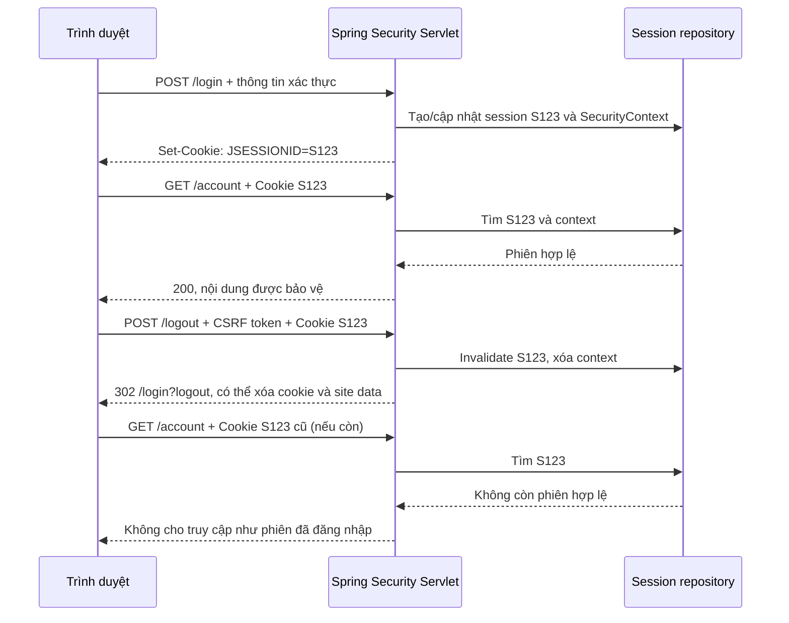

# Thu hồi, xóa session và hiệu lực của dữ liệu client còn giữ

## 1. Vì sao xóa cookie không đồng nghĩa với kết thúc phiên?

Trong ứng dụng Spring Security, người dùng thường coi việc bấm **Đăng xuất** là kết thúc hoàn toàn quyền truy cập. Trên thực tế, trạng thái xác thực có thể nằm ở **máy chủ**, **cookie của trình duyệt**, **token do máy chủ phát hành** và **bộ nhớ hoặc vùng lưu trữ phía client**. Muốn biết một phiên đã thực sự hết hiệu lực, cần xác định thành phần nào đang được máy chủ tin cậy khi xử lý yêu cầu tiếp theo.

Xét ứng dụng quản trị tại `https://admin.example.com`:

1. Alice đăng nhập. Máy chủ tạo phiên `S123`, lưu `SecurityContext` và gửi cookie `JSESSIONID=S123`.
2. Kẻ tấn công có được bản sao `JSESSIONID=S123`. Trình duyệt của Alice vẫn đang dùng cookie gốc.
3. Alice nhấn đăng xuất. Nếu máy chủ **vô hiệu hóa S123**, cả cookie gốc lẫn bản sao bị đánh cắp đều không còn mở được phiên xác thực đó.
4. Nếu ứng dụng **chỉ xóa cookie trên trình duyệt Alice** nhưng để `S123` còn hiệu lực ở máy chủ, bản sao cookie của kẻ tấn công vẫn có thể dùng được cho đến khi phiên hết hạn hoặc bị thu hồi.
5. Dù S123 đã bị vô hiệu hóa, giao diện vẫn có thể hiện dữ liệu cũ trong DOM, bộ nhớ JavaScript, `localStorage` hay cache. Dữ liệu còn hiển thị không chứng minh rằng quyền gọi API vẫn còn.

**Quy tắc cốt lõi:** quyết định cho phép truy cập phải dựa trên trạng thái xác thực còn hiệu lực **tại nơi xử lý yêu cầu**. Dọn dữ liệu trình duyệt giúp giảm rò rỉ thông tin và tránh lỗi trải nghiệm, nhưng không thay thế thu hồi phiên hoặc token phía máy chủ.

Trong phạm vi bảo vệ HTTP của Spring Security, vấn đề này liên hệ trực tiếp với logout, session management, CSRF, security headers, cache và ranh giới giữa Servlet và Reactive.

### Mục tiêu học tập

Sau bài này, người học có thể:

- Phân biệt **thu hồi phiên**, **vô hiệu hóa session**, **xóa cookie** và **xóa dữ liệu client**.
- Thiết kế logout an toàn cho Spring Security Servlet và WebFlux, hiểu trạng thái còn sót lại sau logout.
- Thu hồi một phiên của thiết bị khác hoặc mọi phiên của tài khoản khi dùng cơ chế lưu session tập trung.
- Phân tích sự khác nhau giữa session dựa trên cookie và access token kiểu stateless.
- Kiểm thử việc truy cập lại bằng session ID cũ, dữ liệu lưu trình duyệt và những race condition thực tế.

## 2. Bản đồ các loại trạng thái và phạm vi thu hồi

| Loại trạng thái | Thường nằm ở đâu? | Cách làm mất hiệu lực | Nếu client vẫn giữ bản sao? |
| --- | --- | --- | --- |
| `HttpSession` / `WebSession` | Bộ nhớ ứng dụng hoặc kho session chia sẻ (ví dụ Redis qua Spring Session) | `invalidate()` hoặc xóa session khỏi repository | Cookie ID cũ có thể vẫn được gửi, nhưng không nên xác thực được thành phiên cũ. |
| `SecurityContext` | Context của request, repository gắn với session hoặc nguồn khác | `SecurityContextLogoutHandler` / `SecurityContextServerLogoutHandler` và vô hiệu hóa phiên khi cần | Dọn context hiện tại chưa chắc hủy các phiên của thiết bị khác. |
| Cookie phiên `JSESSIONID` | Cookie jar của trình duyệt | Gửi `Set-Cookie` hết hạn đúng phạm vi hoặc dùng `Clear-Site-Data` | Xóa cookie làm trình duyệt ngừng gửi ID; session còn ở server vẫn cần được thu hồi. |
| Cookie remember-me | Trình duyệt; có thể kèm token ở cơ sở dữ liệu | Logout handler của remember-me, xóa cookie và thu hồi token bền vững nếu dùng persistent-token | Nếu chưa thu hồi đúng, ứng dụng có thể xác thực lại tự động. |
| CSRF token | Session, cookie hoặc bộ nhớ client tùy `CsrfTokenRepository` | `CsrfLogoutHandler` và chính sách cấp lại token | CSRF token cũ không phải là bằng chứng phiên còn xác thực; client cần lấy token mới khi đăng nhập lại. |
| Access token JWT | Client hoặc cookie, có chữ ký và hạn dùng | Hết hạn, danh sách thu hồi / kiểm tra version / introspection nếu kiến trúc hỗ trợ | JWT bị đánh cắp có thể tiếp tục hợp lệ cho đến khi hết hạn nếu server không kiểm tra thu hồi. |
| Refresh token | Client và thường có trạng thái quản lý tại Authorization Server | Thu hồi và vô hiệu hóa token family theo chính sách rotation | Xóa token ở client không đủ nếu bản sao đã bị đánh cắp. |
| `localStorage`, `sessionStorage`, IndexedDB | Trình duyệt, theo origin | JS ứng dụng hoặc `Clear-Site-Data: "storage"` nếu được hỗ trợ | Dữ liệu cá nhân có thể vẫn nhìn thấy sau logout dù API trả 401/403. |
| Cache HTTP, DOM, state của SPA, service worker | Trình duyệt và bộ nhớ đang chạy | `Cache-Control`, xử lý lifecycle/logout, `Clear-Site-Data` khi phù hợp | Nút Back hoặc tab cũ vẫn có thể hiện nội dung trước khi được xác minh lại. |

Khái niệm **session ID** và **session** cần phân biệt. Cookie `JSESSIONID` thường chỉ mang một mã tham chiếu. Dữ liệu xác thực thực sự ở phía máy chủ. Việc nhìn thấy cookie cũ trong DevTools sau logout **không đủ** để kết luận có lỗi xác thực; phép thử quan trọng là gửi lại ID cũ và quan sát máy chủ còn cho vào tài nguyên bảo vệ hay không.

### Ba câu hỏi phải trả lời trước khi thiết kế logout

1. **Ai quyết định request được xác thực?** Session repository, SecurityContextRepository, JWT validation hay hệ thống SSO bên ngoài?
2. **Thu hồi có phạm vi nào?** Phiên hiện tại, một thiết bị khác, tất cả các thiết bị hay cả phiên với Identity Provider?
3. **Dữ liệu nào client cần dọn?** Cookie, cache HTML/API, bộ nhớ UI, storage theo origin hay chỉ một cookie cụ thể?

Trả lời rõ ba câu này giúp tránh tình trạng giao diện báo “Đã đăng xuất” trong khi credential bị sao chép vẫn hoạt động.

## 3. Vòng đời của một session trên Servlet stack



Trong cấu hình đăng nhập bằng session thông thường, logout mặc định của Spring Security Servlet sử dụng các `LogoutHandler` để vô hiệu hóa `HttpSession`, xóa `SecurityContextHolder`/repository, làm sạch remember-me và CSRF token nếu các thành phần này được cấu hình, sau đó gọi `LogoutSuccessHandler`.

Phân biệt bốn sự kiện:

| Sự kiện | Thời điểm và tác động |
| --- | --- |
| **Logout chủ động** | Request khớp `LogoutFilter`, các logout handler chạy. Thường là `POST /logout` kèm CSRF token hợp lệ. |
| **Session timeout** | Phiên không hoạt động quá thời gian cấu hình và bị hết hạn. Không nhất thiết có response nào gửi lệnh xóa dữ liệu đến trình duyệt. |
| **Thu hồi từ quản trị / thiết bị khác** | Server đánh dấu hoặc xóa session đích. Trình duyệt của thiết bị đó có thể chỉ biết khi gửi request tiếp theo. |
| **Đóng tab, xóa cookie hoặc đóng trình duyệt** | Không mặc định kích hoạt logout phía máy chủ. Session có thể tồn tại cho đến timeout hoặc thu hồi; cookie phiên thường biến mất theo chính sách trình duyệt, không nên coi đó là bằng chứng thu hồi. |

Lưu ý: Timeout do không hoạt động (idle timeout) khác với **giới hạn thời gian sống tuyệt đối**. Nếu cần buộc đăng nhập lại sau một khoảng thời gian cố định kể từ lúc xác thực, phải thiết kế chính sách absolute lifetime riêng; chỉ cấu hình idle timeout có thể cho phép phiên được duy trì lâu nhờ hoạt động liên tục.

## 4. Cấu hình logout cho Spring Security Servlet

Ví dụ sau áp dụng cho ứng dụng Spring Security 6.x/7.x dùng `HttpSecurity`, form login, session server-side và HTTPS:

```java
import org.springframework.context.annotation.Bean;
import org.springframework.context.annotation.Configuration;
import org.springframework.security.config.Customizer;
import org.springframework.security.config.annotation.web.builders.HttpSecurity;
import org.springframework.security.web.SecurityFilterChain;

@Configuration
public class SecurityConfig {
    @Bean
    SecurityFilterChain securityFilterChain(HttpSecurity http) throws Exception {
        http
            .authorizeHttpRequests(authorize -> authorize
                .requestMatchers("/login", "/public/**").permitAll()
                .anyRequest().authenticated())
            .formLogin(Customizer.withDefaults())
            .logout(logout -> logout
                .logoutUrl("/logout")
                .invalidateHttpSession(true)
                .clearAuthentication(true)
                .deleteCookies("APP_PREFERENCE")
                .logoutSuccessUrl("/login?logout")
                .permitAll());

        return http.build();
    }
}
```

Giải thích:

- `invalidateHttpSession(true)` yêu cầu vô hiệu hóa `HttpSession` gắn với logout; mặc định của Spring Security Servlet đã là `true`. Viết tường minh để làm rõ chính sách.
- `clearAuthentication(true)` yêu cầu xóa thông tin xác thực khỏi security context hiện tại; mặc định cũng là `true`.
- `deleteCookies("APP_PREFERENCE")` là ví dụ **cookie riêng của ứng dụng** cần xóa bổ sung. Không phải cấu hình bắt buộc; chỉ nên khai báo cookie thực sự tồn tại và thuộc ứng dụng.
- `logoutSuccessUrl("/login?logout")` quy định điểm đến sau logout. Việc redirect không chứng minh logout thành công nếu không có các bước dọn dẹp phía server.
- `LogoutFilter` phối hợp các handler mặc định; không cần tạo controller `@PostMapping("/logout")` chỉ để gọi `HttpSession.invalidate()`.

Ví dụ form trên trang server-rendered dùng Thymeleaf:

```html
<form th:action="@{/logout}" method="post">
    <button type="submit">Đăng xuất</button>
</form>
```

Với Thymeleaf được tích hợp đúng cơ chế Spring MVC/Spring Security, CSRF token thường được thêm vào form POST. Cần xác nhận token được gửi trong request thực tế. Không tắt CSRF chỉ vì client muốn gọi logout bằng JavaScript; nếu dùng `fetch`, gửi token theo `CsrfTokenRepository` mà ứng dụng đang cấu hình.

**Tại sao không nhất thiết phải `deleteCookies("JSESSIONID")`?** Spring Security xử lý vô hiệu hóa phiên phía server; việc dọn cookie phiên còn phụ thuộc servlet container và cách cookie được thiết lập. Có hệ thống thấy cookie phiên cũ vẫn tồn tại sau logout; điều này có thể gây thông báo “invalid session” khi truy cập lại. Nếu cần xóa cookie rõ ràng, kiểm tra khả năng cookie hết hạn được gửi với `Path`/`Domain` chính xác, hoặc cân nhắc `Clear-Site-Data` trên HTTPS. Dù cookie được xóa hay chưa, **điều bắt buộc là session ID cũ không được xác thực**.

### Cấu hình timeout và cookie

Với Spring Boot dùng Servlet session, có thể đặt chính sách nền:

```properties
server.servlet.session.timeout=30m
server.servlet.session.cookie.http-only=true
server.servlet.session.cookie.secure=true
server.servlet.session.cookie.same-site=lax
```

- `timeout=30m` là thời gian session không hoạt động trước khi hết hạn theo cấu hình triển khai; không phải thời gian sống tuyệt đối.
- `HttpOnly` ngăn JavaScript đọc cookie, nhưng không thay thế biện pháp chống CSRF.
- `Secure` yêu cầu cookie chỉ được gửi qua kết nối an toàn theo hành vi trình duyệt; môi trường production cần chạy HTTPS.
- `SameSite` giúp hạn chế một số luồng cookie cross-site; phải chọn theo yêu cầu SSO/embedded app và vẫn cân nhắc CSRF riêng.

Khi dùng Spring Session thay cho session container, cần kiểm tra cấu hình timeout/cookie của repository và cách reverse proxy xử lý HTTPS. Các thuộc tính trên là ví dụ định hướng cho Servlet ứng dụng Spring Boot, cần đối chiếu với stack và phiên bản thực tế.

## 5. Thu hồi một phiên hoặc tất cả phiên trên các thiết bị

### 5.1. Logout thông thường chỉ nhắm vào phiên hiện tại

Người dùng có thể đăng nhập từ laptop, điện thoại và trình duyệt ở nơi làm việc. `POST /logout` từ laptop thường hủy **session hiện tại của laptop**; không có cơ chế mặc định nào bảo đảm mọi session khác đều bị hủy.

Yêu cầu “Đăng xuất khỏi tất cả thiết bị” cần một cách **liệt kê và thu hồi các session liên quan tới tài khoản**. Cách triển khai tùy mô hình lưu session:

| Kiến trúc | Cách tiếp cận phù hợp | Điều kiện cần chú ý |
| --- | --- | --- |
| Servlet session trong bộ nhớ một node | Theo dõi session bằng `SessionRegistry` và cơ chế session concurrency tương ứng. | Registry mặc định trong bộ nhớ không đại diện cho toàn cluster; thu hồi đánh dấu `expireNow()` có thể chỉ được thực thi ở request kế tiếp. |
| Session dùng Spring Session với Redis/JDBC và repository hỗ trợ index theo principal | Tìm các session của người dùng, kiểm tra quyền sở hữu, gọi `deleteById(sessionId)`. | Phải dùng repository có hỗ trợ index principal và định danh session nhất quán trên mọi node. |
| JWT stateless | Thu hồi token bằng thiết kế riêng hoặc giới hạn TTL; xử lý refresh token tại Authorization Server. | Không có bản ghi `HttpSession` để `invalidate()`; xóa cookie/localStorage không thu hồi JWT đã sao chép. |
| Phiên SSO/OIDC | Kết hợp logout nội bộ với luồng đăng xuất của Identity Provider nếu mục tiêu yêu cầu. | Session của RP (ứng dụng) và session của IdP là hai thực thể khác nhau. |

### 5.2. Spring Session: xóa session của thiết bị đã chọn

Khi sử dụng **Spring Session với repository có index principal** (ví dụ cấu hình Redis indexed session repository), API `FindByIndexNameSessionRepository` cho phép lấy các phiên của người dùng đã xác thực và xóa bản ghi session tương ứng:

```java
import java.util.Map;
import org.springframework.session.FindByIndexNameSessionRepository;
import org.springframework.session.Session;
import org.springframework.stereotype.Service;

@Service
public class SessionRevocationService {
    private final FindByIndexNameSessionRepository<? extends Session> sessions;

    public SessionRevocationService(
            FindByIndexNameSessionRepository<? extends Session> sessions) {
        this.sessions = sessions;
    }

    public boolean revokeOwnedSession(String currentUsername, String sessionId) {
        Map<String, ? extends Session> owned =
            sessions.findByPrincipalName(currentUsername);

        if (!owned.containsKey(sessionId)) {
            return false;
        }

        sessions.deleteById(sessionId);
        return true;
    }

    public int revokeAllSessions(String currentUsername) {
        Map<String, ? extends Session> owned =
            sessions.findByPrincipalName(currentUsername);

        owned.keySet().forEach(sessions::deleteById);
        return owned.size();
    }
}
```

Các phương thức trên là phần **service minh họa**, không phải endpoint sẵn có của Spring Security. `currentUsername` phải lấy từ `Authentication` đã được xác thực hoặc nguồn danh tính tin cậy, **không** được nhận tùy ý từ request để xóa session người khác. Nếu tạo REST endpoint chọn session theo ID, phải xác thực CSRF/ủy quyền theo kiểu credential đang dùng và kiểm tra session thuộc tài khoản hiện tại.

Việc `deleteById` làm session biến mất khỏi kho lưu trữ chung; browser của thiết bị bị thu hồi chưa chắc biết ngay và có thể vẫn giữ `JSESSIONID` cũ cho đến khi request tiếp theo. Nếu index bị stale, cấu hình session repository chưa hỗ trợ principal index, hoặc có request đang chạy đồng thời, cần kiểm tra thêm cách phát hiện thu hồi trong ứng dụng thực tế.

Với `SessionRegistry` thông thường, gọi:

```java
sessionRegistry.getAllSessions(principal, false)
    .forEach(session -> session.expireNow());
```

thường có nghĩa **đánh dấu** phiên là đã hết hiệu lực để thành phần session concurrency xử lý ở lần truy cập kế tiếp; không đồng nghĩa đang xóa vật lý tất cả `HttpSession` ngay lập tức. Cách này cần hạ tầng giám sát phiên tương ứng (ví dụ `ConcurrentSessionFilter` và cấu hình concurrency); không nên coi `SessionRegistryImpl` trong bộ nhớ là cơ chế thu hồi xuyên cluster.

### 5.3. Giới hạn thu hồi “ngay lập tức”

Nếu request A đã được xác thực và bắt đầu xử lý trước khi phiên bị thu hồi ở request B, A có thể vẫn hoàn thành. Việc xóa session không tự đảo ngược những thao tác đã được cho phép trước đó. Với giao dịch nhạy cảm như chuyển tiền, đổi mật khẩu hoặc cấp quyền, hệ thống có thể cần kiểm tra thêm trạng thái phiên/tài khoản ngay trước khi thực hiện hành động.

Tương tự, sự kiện thu hồi từ thiết bị khác có thể chỉ đến browser sau khi browser polling, tải lại trang hoặc nhận notification. Giao diện hiển thị “còn đăng nhập” trong vài giây không nhất thiết có nghĩa backend còn chấp nhận phiên. Hai trạng thái phải được kiểm thử độc lập.

## 6. Reactive WebFlux: hủy WebSession cùng SecurityContext

Spring Security WebFlux có pipeline và kiểu handler riêng. Không dùng `SecurityContextLogoutHandler` của Servlet cho `WebSession`.

Tài liệu Spring Security minh họa việc kết hợp `SecurityContextServerLogoutHandler` với `WebSessionServerLogoutHandler` để xử lý cả security context lẫn `WebSession`:

```java
import org.springframework.context.annotation.Bean;
import org.springframework.context.annotation.Configuration;
import org.springframework.security.config.Customizer;
import org.springframework.security.config.web.server.ServerHttpSecurity;
import org.springframework.security.web.server.SecurityWebFilterChain;
import org.springframework.security.web.server.authentication.logout.DelegatingServerLogoutHandler;
import org.springframework.security.web.server.authentication.logout.SecurityContextServerLogoutHandler;
import org.springframework.security.web.server.authentication.logout.WebSessionServerLogoutHandler;

@Configuration
public class ReactiveSecurityConfig {
    @Bean
    SecurityWebFilterChain springSecurityFilterChain(ServerHttpSecurity http) {
        var handlers = new DelegatingServerLogoutHandler(
            new SecurityContextServerLogoutHandler(),
            new WebSessionServerLogoutHandler());

        return http
            .authorizeExchange(authorize -> authorize
                .anyExchange().authenticated())
            .formLogin(Customizer.withDefaults())
            .logout(logout -> logout.logoutHandler(handlers))
            .build();
    }
}
```

Phản hồi logout, CSRF và điều hướng trong WebFlux cần kiểm tra theo cấu hình `ServerHttpSecurity` thực tế. Không lấy ví dụ trên làm cơ sở để kết luận WebFlux luôn tự vô hiệu hóa `WebSession` nếu chưa thêm handler phù hợp. Nếu session dùng kho chia sẻ, việc xóa session cũng cần được quan sát qua backend lưu trữ.

## 7. Cookie, storage và cache có thể còn gì sau logout?

### 7.1. Cookie cũ vẫn được gửi

Trình duyệt có thể tiếp tục gửi một cookie `JSESSIONID` hết hiệu lực vì cookie chưa bị xóa hoặc xóa sai `Domain`/`Path`. Máy chủ phải từ chối liên kết cookie đó với phiên xác thực cũ.

Ví dụ diễn giải:

```http
# Trước khi logout
GET /account HTTP/1.1
Host: admin.example.com
Cookie: JSESSIONID=S123

# Sau khi S123 bị vô hiệu hóa, cố gửi lại cùng cookie:
GET /account HTTP/1.1
Host: admin.example.com
Cookie: JSESSIONID=S123

# Kỳ vọng: không trả nội dung /account như người dùng đã xác thực;
# có thể trả 302 /login hoặc 401 tùy chính sách ứng dụng.
```

Nếu ứng dụng dùng `invalidSessionUrl(...)`, cookie cũ có thể khiến browser bị chuyển đến trang “session không hợp lệ” ngay cả sau khi logout bình thường. Giải quyết bằng cách dọn cookie đúng phạm vi hoặc điều chỉnh cách xử lý invalid session; không bỏ cơ chế vô hiệu hóa ở server.

### 7.2. Xóa dữ liệu trình duyệt bằng Clear-Site-Data

Với Servlet, muốn trình duyệt hỗ trợ chủ động xóa cookie hoặc storage trên logout, có thể thêm `HeaderWriterLogoutHandler`:

```java
import org.springframework.security.web.authentication.logout.HeaderWriterLogoutHandler;
import org.springframework.security.web.header.writers.ClearSiteDataHeaderWriter;
import org.springframework.security.web.header.writers.ClearSiteDataHeaderWriter.Directive;

HeaderWriterLogoutHandler clearBrowserData =
    new HeaderWriterLogoutHandler(
        new ClearSiteDataHeaderWriter(Directive.COOKIES, Directive.STORAGE));

http.logout(logout -> logout.addLogoutHandler(clearBrowserData));
```

Đây là **đoạn cấu hình bổ sung minh họa** cho cùng `HttpSecurity`, không phải yêu cầu tạo thêm một `SecurityFilterChain`. Với request HTTPS được nhận diện là secure, response logout dự kiến có:

```http
Clear-Site-Data: "cookies", "storage"
```

`"cookies"` có phạm vi rộng: theo hành vi được MDN mô tả, việc xóa cookie có thể ảnh hưởng cả **registered domain và các subdomain**. Ví dụ `portal.example.com` và `sso.example.com` có thể cùng mất cookie, tác động đến SSO. `"storage"` xóa vùng lưu trữ của origin như `localStorage`, `sessionStorage`, IndexedDB và service worker registration theo khả năng hỗ trợ. Chỉ bật đúng directive đã được kiểm tra về ảnh hưởng tới dữ liệu của các ứng dụng liên quan.

Header này dùng **secure context/HTTPS** và phụ thuộc hỗ trợ của trình duyệt. Trường hợp reverse proxy kết thúc TLS khiến ứng dụng Java nhìn request là HTTP, cần kiểm tra cấu hình forwarded headers đáng tin cậy để writer nhận biết request secure. Ngay cả khi backend phát header thành công, vẫn cần kiểm thử việc trình duyệt thực sự xóa dữ liệu.

Nếu chỉ cần xóa một cookie riêng, dùng `logout.deleteCookies("COOKIE_NAME")` hoặc cookie hết hạn có `Name`, `Path`, `Domain` chính xác thường kiểm soát phạm vi tốt hơn việc xóa mọi cookie của website.

### 7.3. Cache và trang cũ khi nhấn Back

Spring Security mặc định gửi nhóm header hạn chế cache cho nhiều phản hồi:

```http
Cache-Control: no-cache, no-store, max-age=0, must-revalidate
Pragma: no-cache
Expires: 0
```

Điều này giúp giảm rủi ro nội dung được lưu lại trong HTTP cache. Tuy nhiên, ứng dụng có thể tự đặt cache header khác; SPA có state lưu trong bộ nhớ, service worker có chiến lược cache riêng, hoặc trình duyệt khôi phục giao diện qua lịch sử điều hướng. Vì thế, nút **Back** vẫn có thể làm hiện nội dung cũ mà không phát sinh request mới.

Đối với trang chứa dữ liệu nhạy cảm, cần phối hợp chính sách cache, dọn UI state khi logout và kiểm tra lại quyền truy cập lúc quay lại màn hình. Mọi API bảo vệ vẫn phải xác minh session/token trong request mới, bất kể client đã xóa cache hay chưa.

### 7.4. Nhiều tab và SPA

Một tab có thể đã logout trong khi tab khác vẫn hiển thị dữ liệu trong bộ nhớ. Với ứng dụng SPA, khi logout thành công nên:

- Xóa state chứa hồ sơ người dùng, dữ liệu tài khoản và bản sao response trong cache của client.
- Bỏ dữ liệu nhạy cảm mà ứng dụng tự lưu trong storage; tránh mặc định xóa mọi cài đặt không liên quan.
- Đồng bộ sự kiện logout qua các tab cùng origin (ví dụ `BroadcastChannel` hoặc `storage` event) và kiểm tra xác thực lại khi tab được kích hoạt.
- Dùng điều hướng thay thế trang hiện tại khi phù hợp, nhưng không coi thao tác chuyển trang là một cơ chế bảo mật server-side.

Nếu gọi logout qua JavaScript mà request thất bại hoặc trả 403 CSRF, client phải thể hiện **trạng thái chưa chắc đã thu hồi thành công**, đồng thời vẫn có thể ẩn ngay dữ liệu nhạy cảm đang hiển thị. Tránh báo “đã đăng xuất khỏi mọi thiết bị” khi backend mới chỉ xóa state local.

## 8. Token stateless, remember-me và SSO: các trường hợp cần xử lý riêng

### JWT và refresh token

Nếu API xác thực bằng JWT bearer token mà không tra session, `HttpSession.invalidate()` không làm JWT đó mất hiệu lực. Nếu access token bị sao chép trước logout, bên giữ token có thể tiếp tục truy cập khi chữ ký và các claim còn hợp lệ.

Cần lựa chọn theo yêu cầu bảo mật:

| Cơ chế | Có tác động đến token bị đánh cắp không? | Đánh đổi |
| --- | --- | --- |
| Access token sống ngắn | Giới hạn khoảng thời gian có thể dùng token cũ. | Không thu hồi tức thời; yêu cầu refresh nhiều hơn. |
| Danh sách thu hồi theo `jti` / token hash | Có, nếu mọi request đều tra nguồn thu hồi. | Thêm lưu trữ, đồng bộ và chi phí kiểm tra; TTL của bản ghi thu hồi phải phù hợp hạn token. |
| Version xác thực gắn với user/session | Có, nếu mỗi request đối chiếu version mới nhất. | Cần kiểm tra trạng thái tập trung, nhất là khi có cache. |
| Opaque token + introspection | Có thể từ chối token đã thu hồi tại Authorization Server. | Phụ thuộc độ trễ/cache introspection và cấu hình hệ thống. |
| Refresh token rotation + revoke token family | Ngăn phát thêm access token từ chuỗi refresh bị thu hồi. | Access token đã phát có thể còn hiệu lực đến hết hạn nếu không có kiểm tra bổ sung. |

Đặc biệt, **xóa JWT khỏi `localStorage` chỉ xóa một bản sao ở client hiện tại**. Không thể suy ra token đã phát hành trên server hoặc các thiết bị khác không còn sử dụng được. Hạn chế lưu bearer token trong `localStorage` nếu chưa đánh giá rủi ro XSS và chiến lược lưu trữ phù hợp.

### Remember-me

Với form login hỗ trợ remember-me, cookie remember-me có thể giúp đăng nhập lại sau khi session hết hạn. Logout do Spring Security quản lý thường kết hợp remember-me handler nếu được cấu hình. Với persistent remember-me token, phải xác nhận token tương ứng được dọn khỏi kho dữ liệu và cookie hết hạn, nhất là khi có yêu cầu thu hồi tất cả thiết bị.

### OAuth 2.0 / OpenID Connect

Một ứng dụng có thể hủy session riêng mà trình duyệt vẫn còn session đăng nhập tại Identity Provider. Khi vào lại luồng OAuth/OIDC, người dùng có thể được đăng nhập lại nhanh chóng. Đó là **hai vòng đời phiên khác nhau**; nhu cầu đăng xuất toàn hệ thống có thể cần RP-initiated logout hoặc các cơ chế logout mà IdP hỗ trợ. Header `Clear-Site-Data` của ứng dụng không tự xóa session trên domain khác do IdP sở hữu.

## 9. Kiểm thử hiệu lực thực tế, không chỉ kiểm tra thông báo logout

### 9.1. Kiểm thử phiên Servlet bị vô hiệu hóa

Trong test có tích hợp `MockMvc` và `spring-security-test`, minh họa:

```java
import static org.junit.jupiter.api.Assertions.assertTrue;
import static org.springframework.security.test.web.servlet.request.SecurityMockMvcRequestPostProcessors.csrf;
import static org.springframework.security.test.web.servlet.request.SecurityMockMvcRequestPostProcessors.user;
import static org.springframework.test.web.servlet.request.MockMvcRequestBuilders.post;
import static org.springframework.test.web.servlet.result.MockMvcResultMatchers.redirectedUrl;
import static org.springframework.test.web.servlet.result.MockMvcResultMatchers.status;

import org.junit.jupiter.api.Test;
import org.springframework.mock.web.MockHttpSession;

// Trong lớp test có MockMvc mvc được tích hợp Spring Security:
@Test
void logoutInvalidatesCurrentHttpSession() throws Exception {
    MockHttpSession session = new MockHttpSession();

    mvc.perform(post("/logout")
            .session(session)
            .with(user("alice"))
            .with(csrf()))
        .andExpect(status().is3xxRedirection())
        .andExpect(redirectedUrl("/login?logout"));

    assertTrue(session.isInvalid());
}
```

Test này chứng minh session đã được invalidated trong mô hình MockMvc. Nó **chưa chứng minh** cookie trên trình duyệt bị xóa hay backend distributed session đã được cập nhật. Để kiểm tra tính bảo mật đầu cuối, cần gửi lại cookie ID đã lưu trước logout trên một phiên HTTP mới và xác nhận endpoint bảo vệ không chấp nhận quyền của người dùng cũ.

### 9.2. Ma trận kiểm thử cần có

| Kịch bản | Hành động | Kết quả bảo mật mong đợi |
| --- | --- | --- |
| Logout hợp lệ | `POST /logout` với session hợp lệ và CSRF token đúng | Session cũ bị thu hồi; phản hồi theo success handler; request tiếp theo không còn xác thực bằng session đó. |
| Logout thiếu CSRF | `POST /logout` không có token khi CSRF bật | Thường trả 403; không có tác động logout thành công. |
| Replay cookie cũ | Giữ `JSESSIONID` trước logout rồi gửi lại sau logout | Không thể đọc API/trang bảo vệ với danh tính cũ. |
| Xóa cookie nhưng không logout | Xóa cookie thủ công ở browser, sau đó replay bản sao đã lưu ở client thử nghiệm | Cho thấy vì sao xóa cookie client không đồng nghĩa thu hồi session phía server. |
| Thu hồi thiết bị khác | Xóa session của thiết bị B từ thiết bị A | B mất quyền tại request tiếp theo; B có thể còn UI cũ đến khi refresh. |
| Timeout | Để session không hoạt động vượt timeout | Request với session cũ bị từ chối; storage của browser có thể vẫn còn. |
| Hai tab | Đăng xuất tab A, tab B vẫn hiển thị trang cũ | Gọi API mới từ tab B không được chấp nhận; UI xóa state khi đồng bộ logout/refresh. |
| Multi-node/Redis | Đăng nhập qua node A, thu hồi trên node B, yêu cầu lại qua A | Session bị thu hồi nhất quán trên các node, tùy cấu hình repository và cache. |
| JWT stateless | Xóa token ở client rồi gửi bản sao token đã chụp trước đó | Kết quả phụ thuộc TTL và chính sách thu hồi thực tế; không được mặc định xem đã vô hiệu hóa. |
| Browser data | Nhận `Clear-Site-Data` trên HTTPS | Kiểm tra từng loại dữ liệu bị xóa trên các trình duyệt mục tiêu và tác động tới SSO/subdomain. |

Khi kiểm tra qua reverse proxy/CDN, ghi nhận request thực tế, cookie `Set-Cookie`, header `Clear-Site-Data` và chính sách cache. Đừng chỉ assert `302` tới trang đăng nhập: một endpoint giả lập redirect cũng có thể trả `302` mà không thu hồi thứ gì.

### 9.3. Các điều kiện đua và luồng biên

- **Hai request chạy cùng lúc:** một request nhạy cảm có thể vượt qua bước xác thực trước khi logout thu hồi session. Cần đánh giá kiểm tra tại điểm thực hiện hành động quan trọng.
- **Request mới vừa tạo session:** sau khi logout, browser có thể nhận session mới cho luồng anonymous hoặc trang login. Có cookie mới không nhất thiết là phiên cũ còn hợp lệ; so sánh session ID và kiểm tra danh tính.
- **Cookie đã hết hạn nhưng remember-me còn:** người dùng được xác thực lại tự động; cần kiểm tra handler remember-me và chính sách token bền vững.
- **Frontend giữ dữ liệu offline:** xóa session server không bắt buộc xóa bản sao offline hoặc log tải xuống; quy định lưu trữ và xóa dữ liệu phải được thiết kế riêng.
- **Thiết bị ngắt mạng:** server vẫn có thể thu hồi session trung tâm; client offline chưa biết ngay và có thể hiện cache cũ. Khi kết nối lại phải kiểm tra auth trước khi gọi API.

## 10. Chẩn đoán các vấn đề thường gặp

| Triệu chứng | Nguyên nhân khả dĩ | Cách xác minh và xử lý |
| --- | --- | --- |
| Sau logout vẫn truy cập được API bằng cookie cũ | Logout handler chưa chạy, custom endpoint bỏ qua `SecurityContextLogoutHandler`, hoặc session storage chưa thu hồi. | Xem `LogoutFilter`, CSRF, repository, rồi replay cookie cũ trên request mới. |
| Cookie `JSESSIONID` vẫn thấy trong DevTools | Cookie chưa được xóa đúng scope; container vẫn để client giữ ID cũ. | Kiểm tra `Set-Cookie`/`Domain`/`Path`; nếu API đã từ chối ID cũ thì phần thu hồi server có thể đã đúng. |
| Trang cá nhân còn hiện khi Back | DOM, cache, SPA state hay service worker còn dữ liệu. | Kiểm tra `Cache-Control` và state; thử request API mới để phân biệt dữ liệu hiển thị với quyền truy cập. |
| Người dùng vừa logout lại tự đăng nhập | Remember-me còn hoạt động hoặc SSO tại IdP chưa đăng xuất. | Kiểm tra cookie remember-me, persistent token, OIDC session và luồng logout phối hợp. |
| Thu hồi “mọi thiết bị” nhưng một node vẫn nhận session | Session/registry không chia sẻ, cache stale hoặc chỉ gọi `expireNow()` trên node khác. | Kiểm tra session repository tập trung, registry, routing và thời điểm kiểm tra trạng thái. |
| Header `Clear-Site-Data` không xuất hiện | Request không secure theo nhận diện backend hoặc writer không gắn vào logout. | Kiểm tra HTTPS, proxy forwarding và response đúng từ `POST /logout`. |
| Reactivate bằng JWT cũ | JWT chưa hết hạn và hệ thống không kiểm tra revocation. | Bổ sung chính sách token TTL, revoke/denylist/introspection hay thay đổi mô hình theo nhu cầu. |
| `POST /logout` trả 403 | Thiếu hoặc sai CSRF token. | Xác minh token gửi từ client; giữ CSRF khi session cookie được dùng tự động. |

## 11. Checklist triển khai trong hệ thống thực

Trước khi phát hành cơ chế logout hoặc “đăng xuất khỏi tất cả thiết bị”, xác minh:

1. **Nguồn xác thực:** phân định session server-side, JWT, remember-me và IdP; mỗi nguồn có cách thu hồi riêng.
2. **Luồng logout:** sử dụng handler phù hợp của Spring Security; request logout được bảo vệ CSRF khi cần; không chỉ redirect.
3. **Phạm vi thu hồi:** một session hiện tại, một session theo thiết bị, mọi session hay cả refresh token/SSO.
4. **Lưu trữ session:** repository ở một node hay chia sẻ nhiều node; cách thu hồi có được các node quan sát nhất quán không?
5. **Cookie:** kiểm tra `Secure`, `HttpOnly`, `SameSite`, `Domain`, `Path` và hành vi cookie khi phiên mất hiệu lực.
6. **Dữ liệu client:** dọn state nhạy cảm và cache thích hợp; đánh giá tác động `Clear-Site-Data` tới origin, subdomain, SSO.
7. **Kiểm thử:** replay session ID/token cũ, đa tab, đa thiết bị, timeout, CSRF, reverse proxy và request đồng thời.

Giới hạn cần nhớ: **thu hồi quyền truy cập trên server** có thể có hiệu lực ngay với các request tiếp theo, nhưng không thể làm nội dung đã tải trước đó tự biến mất khỏi mọi bộ nhớ, tab, ảnh chụp hay thiết bị offline. Cần quản lý cả hai phía để bảo vệ thông tin và bảo đảm người dùng hiểu đúng trạng thái đăng xuất.

### Tài liệu tham khảo

- [Spring Security — Handling Logouts (Servlet)](https://docs.spring.io/spring-security/reference/servlet/authentication/logout.html): logout handler mặc định, cookie cleanup và `Clear-Site-Data`.
- [Spring Security — Authentication Persistence and Session Management](https://docs.spring.io/spring-security/reference/servlet/authentication/session-management.html): session invalidation, concurrency, timeout và `SessionRegistry`.
- [Spring Security — Logout (Reactive)](https://docs.spring.io/spring-security/reference/reactive/authentication/logout.html): `SecurityContextServerLogoutHandler` và `WebSessionServerLogoutHandler`.
- [Spring Session — Redis Configurations](https://docs.spring.io/spring-session/reference/configuration/redis.html): indexed repository, tìm session theo principal và xóa session.
- [Spring Security — Security HTTP Response Headers](https://docs.spring.io/spring-security/reference/features/exploits/headers.html): mặc định `Cache-Control` và các security headers.
- [MDN — Clear-Site-Data](https://developer.mozilla.org/en-US/docs/Web/HTTP/Reference/Headers/Clear-Site-Data): phạm vi cookie/storage và hỗ trợ theo trình duyệt.
