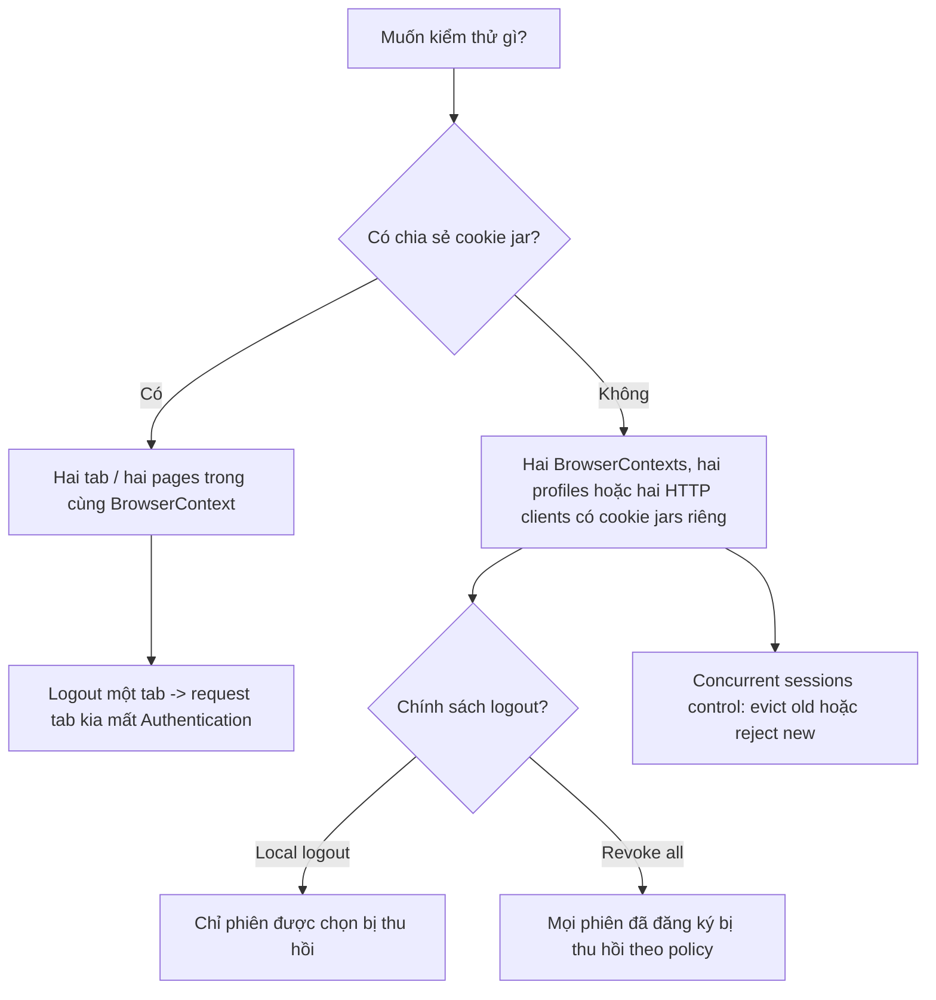
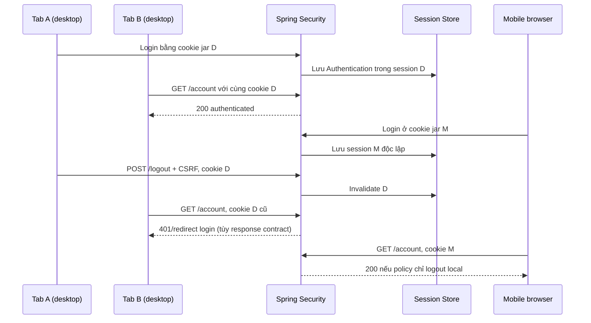
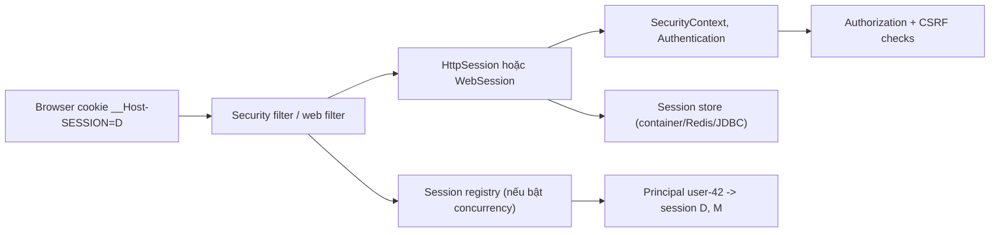
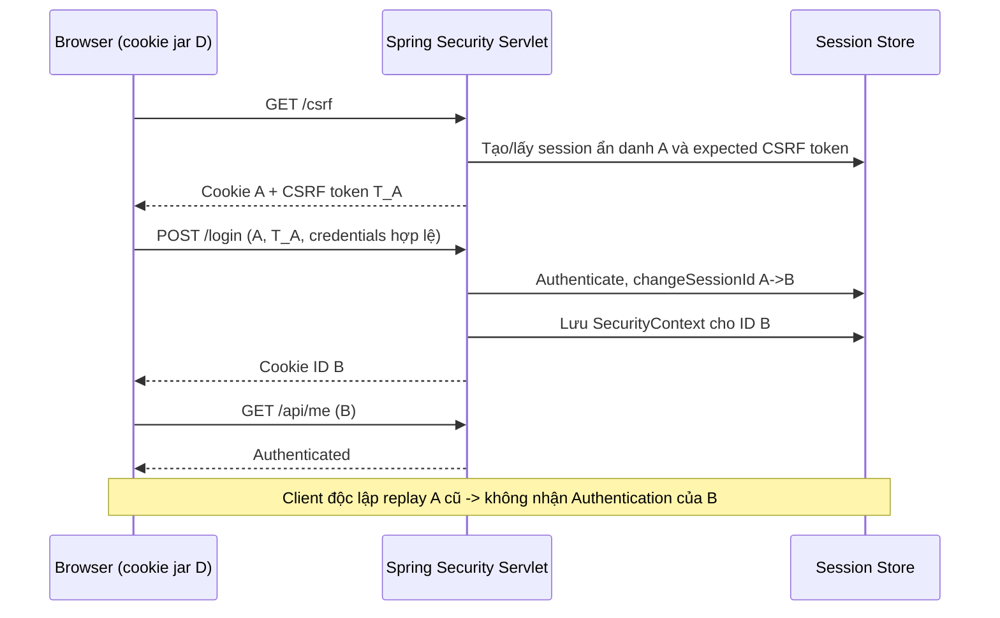
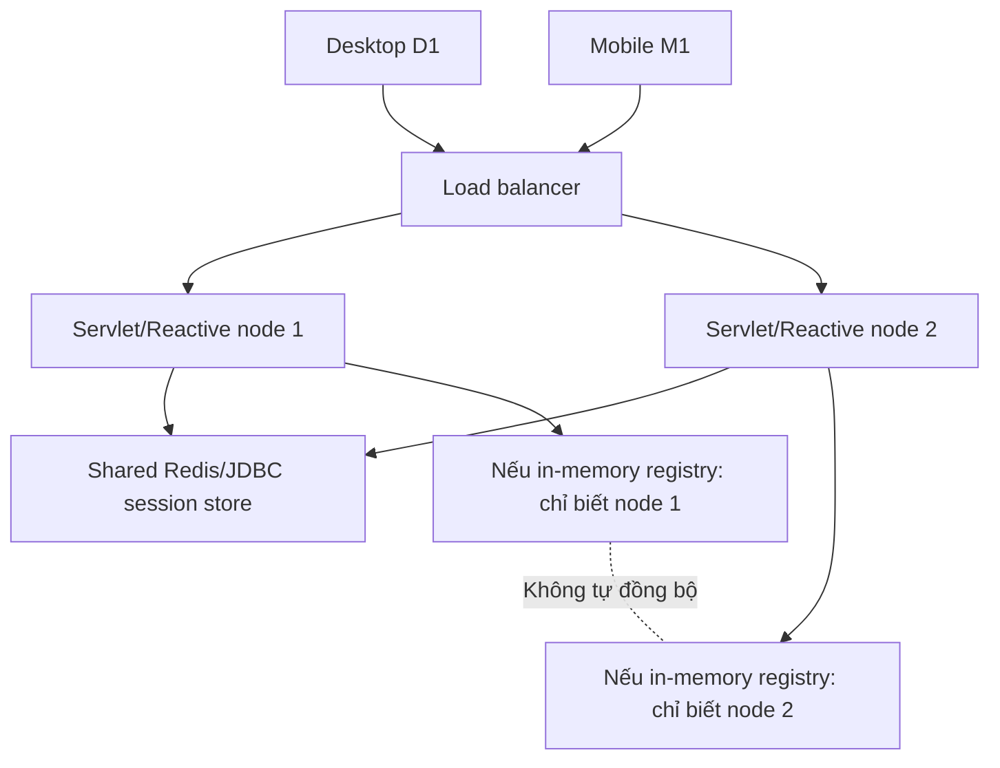
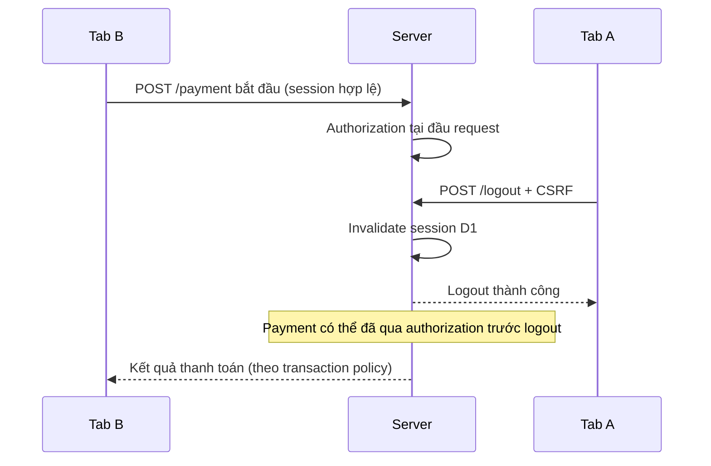

# Kiểm thử nhiều tab, đổi phiên và đăng xuất trên các thiết bị

> **Chương:** Session và cookie  
> **Module:** `SPRING_SECURITY_HTTP_PROTECTION` — áp dụng các lớp phòng vệ HTTP và trình duyệt trong Spring Security: CSRF, CORS, security headers, CSP, HSTS, HTTP firewall, session và cookie.  
> **Đối tượng:** Ứng dụng Spring Security **Servlet (Spring MVC)** và **Reactive (WebFlux)** dùng session-based authentication.  
> **Mục tiêu:** Thiết kế và kiểm thử đúng vòng đời đăng nhập ở nhiều tab, xoay session ID (session fixation protection), logout một browser context, đăng nhập trên nhiều thiết bị, giới hạn phiên đồng thời và thu hồi phiên từ xa; phân biệt kết quả kiểm thử HTTP và hành vi browser thật.

Một người dùng mở trang quản trị ở tab A và tab B, sau đó bấm **Đăng xuất** ở tab A. Tab B đang hiển thị một trang chứa dữ liệu nhạy cảm có mất quyền ngay không? Một laptop khác vẫn đăng nhập tài khoản đó có bị đăng xuất không? Khi user login từ session ẩn danh, cookie ID mới có thay thế ID cũ chưa? Câu trả lời phụ thuộc **cùng cookie jar hay khác cookie jar**, **cơ chế đăng xuất/thay phiên server-side**, **request đã thực sự đi qua security chain hay chưa**, và **trình duyệt có làm mới màn hình đang mở hay không**.

Điểm cốt lõi:

- **Nhiều tab cùng một browser profile thường chia sẻ một session cookie**, không phải nhiều authenticated sessions.
- **Hai browser profiles/thiết bị độc lập** thường có cookie jars và session IDs khác nhau.
- **Logout mặc định** thường chỉ làm mất quyền của **phiên đang đăng xuất**, không tự thu hồi mọi phiên trên mọi thiết bị.
- **Đổi session ID sau login** là chống *session fixation*, không phải “đăng xuất tất cả thiết bị”.
- **Quyền server-side bị thu hồi** và **giao diện tab đang mở lập tức che dữ liệu** là hai yêu cầu khác nhau; cả hai phải được kiểm thử.

## 1. Xác định phạm vi: tab, browser context, thiết bị, session

| Tình huống | Cookie jar | Session ID | Điều cần test |
| --- | --- | --- | --- |
| Hai tab cùng profile Chrome bình thường | Thường **chung** | Thường **chung** | Login/logout ở một tab ảnh hưởng request kế tiếp của tab kia. |
| Hai cửa sổ cùng profile Chrome bình thường | Thường **chung** | Thường **chung** | Không đếm thành hai “thiết bị” chỉ vì có hai cửa sổ. |
| Profile thường và Incognito/private | **Tách biệt** | Thường **khác** | Login/logout ở một profile không tự xóa cookie của profile còn lại. |
| Chrome và Firefox | **Tách biệt** | Thường **khác** | Kiểm thử session concurrency và logout đa browser. |
| Laptop và điện thoại | **Tách biệt** | Thường **khác** | Thu hồi phiên từ xa, TTL, session registry. |
| Hai request AJAX đồng thời từ một tab | **Chung** | **Chung** | Race sau logout, không đếm là hai sessions. |
| Hai subdomains dùng chung cookie Domain và session store | Có thể chia sẻ cookie nếu policy cho phép | Có thể chung | Kiểm tra kiến trúc, không giả định từ “same-site”. |
| App RP và IdP trong OAuth2/OIDC | **Các phiên độc lập về mặt hệ thống** | ID khác nhau | Logout RP không mặc nhiên logout IdP. |

**“Thiết bị” trong trang quản lý phiên thường là nhãn trải nghiệm**, không phải một thuộc tính có thể suy ra chính xác từ session. User-Agent có thể giả, IP thay đổi theo NAT/VPN, và một điện thoại có nhiều profiles/browsers. Nếu doanh nghiệp thực sự cần *device enrollment* hoặc *trusted-device binding*, phải có cơ chế đăng ký/xác minh thiết bị riêng.

### 1.1. Chọn mô hình kiểm thử phù hợp mục tiêu



Trong Playwright, **`browser.newContext()` tạo cookie jar độc lập**. `context.newPage()` tạo tab mới **trong cùng jar**. Trong MockMvc, dùng chung `MockHttpSession` để mô phỏng cùng phiên; trong WebTestClient và HTTP integration cần **tự giữ/cấp lại cookie** của mỗi client hoặc dùng một cookie jar có chủ đích. Không dùng hai test requests cùng cookie jar để chứng minh giới hạn nhiều thiết bị.

## 2. Bốn sự kiện không được đánh đồng

| Sự kiện | Hệ quả mong đợi | Không đồng nghĩa |
| --- | --- | --- |
| **Đăng nhập (authenticate)** | Identity được xác minh, security context được lưu, session có thể được tạo. | Mọi thiết bị khác bị logout. |
| **Đổi session ID** | ID cũ trước auth không được dùng để hưởng quyền của phiên mới; ID mới còn quyền. | Tạo thêm một phiên đăng nhập hoặc thu hồi các phiên khác. |
| **Logout local** | Security context/session của browser context hiện tại được clear/invalidate theo cấu hình. | Tự thu hồi session của laptop/điện thoại khác. |
| **Revoke session(s) từ xa** | Server-side store/registry từ chối session ID được chọn trên request tiếp theo. | Xóa cookie vật lý trong browser khác hoặc xóa tức thì dữ liệu đã render ở UI đó. |

### 2.1. Timeline một người dùng có ba tab và một điện thoại



**Không nhầm “Tab B còn hiển thị màn hình cũ” với “Tab B vẫn được server cấp quyền”.** Nếu B không gửi request mới, HTML/DOM trong RAM có thể vẫn hiện ra; nếu quay lại bằng Back/Forward Cache (bfcache), trang cũ có thể được phục hồi tùy browser. Cần cơ chế làm mới trạng thái giao diện và kiểm tra server-side cho mọi request nhạy cảm.

## 3. Threat model: bốn lỗi thường gặp

**Lỗi 1 — Session fixation:** Attacker dụ user dùng một session ID đã biết trước login. Nếu server giữ nguyên ID và cấp Authentication cho ID đó, attacker có thể truy cập tài khoản. **Cách kiểm tra**: tạo session ẩn danh A, login thành công có ID B khác A (với chiến lược phù hợp), A không được hưởng quyền của B.

**Lỗi 2 — Logout chỉ xóa cookie trên client:** Browser không gửi cookie trong request sau, nhưng session server vẫn còn. Attacker/thiết bị khác có ID cũ vẫn có thể replay. **Cách kiểm tra**: sau logout, request có **ID cũ** phải bị server từ chối, không chỉ kiểm tra `document.cookie`.

**Lỗi 3 — Nhầm “logout local” với “logout mọi thiết bị”:** User bấm logout trên desktop, mobile vẫn authenticated. Điều này có thể đúng nếu sản phẩm chỉ yêu cầu logout local; nếu UI ghi “Đăng xuất khỏi tất cả thiết bị” thì là lỗi policy. **Cách kiểm tra**: hai cookie jars độc lập và expected results rõ.

**Lỗi 4 — Tab khác vẫn thực hiện hành động sau logout:** Tab B còn JS state hoặc một POST đang chờ. Nếu server kiểm tra phiên mỗi request, POST mới sẽ bị chặn sau invalidate; nếu tác vụ đã được authorize trước logout, nó có thể hoàn thành. **Cách kiểm tra**: test request trước/đúng lúc/sau logout và nghiệp vụ idempotency/transaction boundary.

### 3.1. Biện pháp phòng vệ bổ sung

Giới hạn phiên, logout và xoay ID đều cần phối hợp với **HTTPS/HSTS, `Secure`, `HttpOnly`, `SameSite`, CSRF, CORS, CSP/chống XSS, HTTP firewall, authorization, MFA, timeouts, audit và hạn chế rò credentials trong log**. Không một biện pháp nào trong số đó một mình ngăn mọi replay:

- `HttpOnly` chặn JavaScript đọc cookie ID, **không** ngăn XSS sử dụng trình duyệt đã đăng nhập để gọi API.
- `SameSite` giảm một số CSRF, **không** thay token/Origin checks phù hợp.
- Session ID khác nhau sau login **không** đảm bảo phiên cũ đã bị vô hiệu trong distributed store nếu custom strategy sai.
- `maximumSessions(1)` không phát hiện được attacker replay **chính session ID đã bị đánh cắp**, bởi registry vẫn có thể chỉ thấy một session.

## 4. Kiến trúc phiên: cookie, SecurityContext, registry, store

Một ứng dụng stateful thường có:



**Cookie ID** là bearer credential dùng tra phiên, **SecurityContext** là trạng thái xác thực được lưu/đọc theo security infrastructure, **session registry** là danh sách phiên đang theo dõi (khi bật concurrency). **Ba thứ này không phải một**. Một cookie có thể còn sau khi server session hết hạn; một registry entry có thể stale; một ID hợp lệ vẫn có thể chỉ là session ẩn danh.

| Thành phần | Servlet | Reactive |
| --- | --- | --- |
| Session API | `HttpSession` | `WebSession` |
| Security chain | `HttpSecurity`, `SecurityFilterChain` | `ServerHttpSecurity`, `SecurityWebFilterChain` |
| Security context repository mặc định có phiên | Thường `HttpSessionSecurityContextRepository`/`DelegatingSecurityContextRepository` tùy version | `WebSessionServerSecurityContextRepository` |
| Session ID cookie | `JSESSIONID`, hoặc `SESSION` nếu Spring Session; tùy config | Thường `SESSION` của `CookieWebSessionIdResolver`; tùy config |
| Fixation protection | `changeSessionId`, `migrateSession`, `newSession` | `WebSession.changeSessionId()` khi repository lưu context theo cơ chế hỗ trợ |
| CSRF repository mặc định | `HttpSessionCsrfTokenRepository` | `WebSessionServerCsrfTokenRepository` |
| Concurrent-session tracking (tùy chọn) | `SessionRegistry` | `ReactiveSessionRegistry` trên Spring Security hỗ trợ |
| Logout lifecycle | `LogoutFilter` + `LogoutHandler` | `LogoutWebFilter` + `ServerLogoutHandler` |

**Cần xác định phiên bản và kiến trúc trước khi sao chép code.** Những đoạn dùng `ReactiveSessionRegistry`/`SessionLimit` thuộc Spring Security 6.3+; đường đi Servlet khác. Cấu hình Boot cookie cho Servlet không tự áp dụng cho WebFlux và ngược lại.

## 5. Thiết kế test: trạng thái nào phải quan sát?

Một test đáng tin phải tách ít nhất **năm lớp assertion**:

| Lớp | Câu hỏi | Cách kiểm chứng |
| --- | --- | --- |
| 1. Cookie transport | Browser nhận và gửi cookie session nào? | HTTP `Set-Cookie` và browser network/cookie jars, **không log ID**. |
| 2. Rotation / invalidation | A→B sau login? A/B cũ bị server từ chối khi logout? | Test with old-ID replay qua client độc lập, server store/registry. |
| 3. Authentication | `/api/me` có trả đúng user không? | Kiểm tra `200`/JSON cho current user, `401`/redirect cho anonymous. |
| 4. Authorization/CSRF | Session hợp lệ nhưng quyền/token sai có bị chặn không? | `403` cho CSRF hoặc role thiếu theo policy. |
| 5. UI synchronization | Tab khác có cập nhật UI sau logout không? | Playwright reload, `pageshow`, visibility/focus, BroadcastChannel (chỉ UX). |

Các test chỉ xác nhận response `Set-Cookie` **không chứng minh browser thực đã lưu/gửi** cookie do `Secure`/`SameSite`/Domain/Path. Các test dùng `@WithMockUser`/`mockUser()` **không chứng minh login success handler, session rotation hoặc registry đã chạy**.

### 5.1. Chuẩn hóa các tình huống

Đặt tên để test không nhầm:

- **D0:** Session ẩn danh trước login (có thể chưa được tạo nếu không cần).
- **D1:** Session desktop đã xác thực sau login.
- **D2:** Session mới trên cùng desktop nếu người dùng login lại hoặc chính sách rotate ID.
- **M1:** Session mobile/browser context riêng.
- **R0:** ID cũ bị thu hồi, replay bằng client test độc lập.

Khi báo cáo, ghi `rotated=true`, `oldSessionRejected=true`, `mobileStillAuthenticated=true/false`, không in D1/M1 raw values. Một test **đúng về mặt kỹ thuật** có thể đòi mobile tiếp tục authenticated sau desktop local logout; không phải mọi kết quả “chưa logout mobile” là một bug.

## 6. Servlet: security chain mẫu để kiểm thử login, logout và session fixation

Trong ứng dụng Spring MVC có form login, giữ **CSRF bật mặc định**, session fixation protection và logout chuẩn của Spring Security.

```java
import org.springframework.context.annotation.Bean;
import org.springframework.context.annotation.Configuration;
import org.springframework.security.config.Customizer;
import org.springframework.security.config.annotation.web.builders.HttpSecurity;
import org.springframework.security.web.SecurityFilterChain;

@Configuration
class ServletSessionLifecycleSecurity {

    @Bean
    SecurityFilterChain webSecurity(HttpSecurity http) throws Exception {
        return http
            .authorizeHttpRequests(auth -> auth
                .requestMatchers("/login", "/csrf", "/public/**").permitAll()
                .requestMatchers("/admin/**").hasRole("ADMIN")
                .anyRequest().authenticated())
            .formLogin(Customizer.withDefaults())
            .csrf(Customizer.withDefaults())
            .sessionManagement(session -> session
                .sessionFixation(fixation -> fixation.changeSessionId()))
            .logout(logout -> logout
                .logoutUrl("/logout")
                .logoutSuccessUrl("/login?logout")
                .invalidateHttpSession(true)
                .clearAuthentication(true))
            .build();
    }
}
```

**Đây là ví dụ Servlet hiện đại** với Servlet 3.1+; `changeSessionId()` thường đã là mặc định trên container tương thích, nhưng cấu hình rõ để thể hiện mục tiêu. `POST /logout` cần CSRF token khi CSRF đang bật; `GET /logout` thường hiển thị trang xác nhận chứ không được dùng để thay request đăng xuất có thay đổi trạng thái.

**Không tự gọi `session.invalidate()` trong một controller tùy ý rồi coi logout hoàn thành:** còn `SecurityContextHolder`, `SecurityContextRepository`, remember-me/CSRF cleanup và logout handlers của Spring Security. Nên dùng `logout()` DSL; nếu bắt buộc tạo endpoint riêng, phải gọi đúng `SecurityContextLogoutHandler` và các handlers liên quan.

### 6.1. Cấu hình session cookie cho môi trường HTTPS

```yaml
# application.yml — app Servlet production HTTPS, sở hữu toàn host.
server:
  servlet:
    session:
      cookie:
        name: __Host-SESSION
        path: /
        secure: true
        http-only: true
        same-site: lax
      timeout: 30m
```

Cookie `__Host-SESSION` yêu cầu HTTPS + `Secure` + `Path=/` + **không có Domain** ở browser hỗ trợ prefix. Không đặt `Domain=example.test` rồi dùng `__Host-`. Với Spring Session Redis/JDBC, serializer/session cookie writer có thể quyết định header thay Servlet container; **phải nhìn `Set-Cookie` cuối cùng qua proxy**, không chỉ dựa vào YAML.

`HttpOnly` giúp JavaScript không đọc giá trị session ID; Playwright/HTTP test runner vẫn có thể thấy nó, nên không xuất raw cookie vào logs. `SameSite=Lax` là lớp hỗ trợ chống CSRF, không thay `CsrfFilter`.

### 6.2. Endpoint test có quyền và trạng thái đăng nhập

Một API trả **danh tính hiện tại**, không trả session ID:

```java
import org.springframework.http.CacheControl;
import org.springframework.http.ResponseEntity;
import org.springframework.security.core.Authentication;
import org.springframework.web.bind.annotation.GetMapping;
import org.springframework.web.bind.annotation.RestController;

record AccountSummary(String username) {}

@RestController
class ServletAccountController {
    @GetMapping("/api/me")
    ResponseEntity<AccountSummary> me(Authentication authentication) {
        return ResponseEntity.ok()
            .cacheControl(CacheControl.noStore())
            .body(new AccountSummary(authentication.getName()));
    }
}
```

`/api/me` chỉ dành cho authenticated request theo `SecurityFilterChain`. Khi hết quyền:

- Với form login mặc định, unauthenticated request có thể được chuyển tới `/login` bằng **302**.
- Với API dành cho SPA, có thể cấu hình một **entry point JSON `401`** cụ thể cho `/api/**`.
- Với authenticated user nhưng thiếu role, Spring Security có thể trả **403**.

Đừng viết test bắt buộc tất cả ứng dụng phải trả `401` nếu security chain thực đang dùng form-login redirect. **Phải kiểm tra nội dung response**, tránh tình huống `fetch` tự theo 302 và nhận HTML login với HTTP 200 khiến frontend tưởng API thành công.

### 6.3. Endpoint cung cấp CSRF token cho nhiều tab

`HttpSessionCsrfTokenRepository` là mặc định trong Servlet Spring Security và lưu **expected token trong `HttpSession`**, không mặc nhiên tạo cookie `XSRF-TOKEN`. Endpoint tùy chọn:

```java
import jakarta.servlet.http.HttpServletRequest;
import org.springframework.http.CacheControl;
import org.springframework.http.ResponseEntity;
import org.springframework.security.web.csrf.CsrfToken;
import org.springframework.web.bind.annotation.GetMapping;
import org.springframework.web.bind.annotation.RestController;

record CsrfPayload(String headerName, String parameterName, String token) {}

@RestController
class ServletCsrfController {
    @GetMapping("/csrf")
    ResponseEntity<CsrfPayload> csrf(HttpServletRequest request) {
        CsrfToken csrf = (CsrfToken)
            request.getAttribute(CsrfToken.class.getName());
        if (csrf == null) {
            throw new IllegalStateException("CSRF filter chưa công bố token");
        }
        return ResponseEntity.ok()
            .cacheControl(CacheControl.noStore())
            .body(new CsrfPayload(csrf.getHeaderName(),
                csrf.getParameterName(), csrf.getToken()));
    }
}
```

Endpoint này trả token **chỉ dùng làm CSRF proof**, không phải session ID. Theo Spring Security version, token được sinh/lấy một cách deferred; gọi `getToken()` trong view/endpoint giúp materialize token khi cần. Trong Spring Security 6+, token dùng để submit có thể được XOR-mask để chống BREACH; frontend gửi **token do handler cung cấp**, không tự suy giá trị từ session cookie.

**Sau login/logout** token cũ có thể bị clear; một tab đã mở trước login cần lấy token mới trước POST tiếp theo. Đừng tắt CSRF hay cache `GET /csrf` qua CDN/shared cache. Với CORS cross-origin, chỉ cho phép những origins thật sự tin cậy đọc token; không dùng `Access-Control-Allow-Origin: *` cùng credentials.

## 7. Session fixation: kiểm thử A→B trước và sau login

Tình huống cố ý tạo một session **ẩn danh A**:



**Các assertion tối thiểu:**

1. Trước login có session ẩn danh thật (đã consume token nếu cần); lấy ID A trong memory test.
2. POST login đúng credential và CSRF token → xác thực thành công, server phát ID B.
3. A khác B khi chính sách `changeSessionId()` được sử dụng.
4. B vào `/api/me` thành công.
5. A cũ **không còn nhận được Authentication của B** khi replay từ client test riêng.
6. Đăng nhập thất bại (password sai) **không cấp quyền**, không mặc nhiên rotate thành authenticated B.

**Không khẳng định “đã chống fixation” chỉ bằng việc A != B.** Nếu backend giữ mapping alias A→session authenticated B, attacker biết A vẫn vào được. Cần replay A và xác minh server từ chối quyền.

### 7.1. Các session-fixation strategies ở Servlet

| Strategy | Điều gì thay đổi? | Điều cần test |
| --- | --- | --- |
| `changeSessionId()` | Container đổi ID trên cùng `HttpSession`. | ID cũ mất hiệu lực; session attributes phù hợp có thể còn. |
| `migrateSession()` | Tạo session mới và sao chép attributes theo strategy. | Dữ liệu giỏ hàng/CSRF/request cache không bị copy sai, ID cũ bị vô hiệu. |
| `newSession()` | Tạo session mới với ít state được chuyển hơn (Spring Security attributes cần thiết). | Các attributes nghiệp vụ có/không còn theo yêu cầu; không mất auth. |
| `none()` | Bỏ fixation protection. | **Không khuyến nghị** vì attacker có thể tận dụng ID trước login. |

Với Servlet 3.1+ `changeSessionId()` thường là default. Một số `HttpSessionIdListener` cũng nhận sự kiện đổi ID; không xây logic tự rotate lần hai chỉ vì cả listener và `SessionFixationProtectionEvent` được phát.

### 7.2. Đổi ID không phải tạo phiên authenticated thứ hai

Nếu trước login có ID A, sau login là B, registry của concurrent-sessions control phải theo dõi **phiên authenticated B**, không tính A và B thành hai lượt đăng nhập. Nếu custom session registration code ghi A rồi ghi B mà không dọn A, user có thể gặp “vượt số phiên” dù chỉ đăng nhập một lần.

Một người dùng có **cùng account** trên điện thoại M1 là phiên độc lập khác; rotation D0→D1 trên desktop không được tự làm điện thoại M1 logout trừ khi policy concurrent-limit hoặc revoke-all quy định.

## 8. Logout local: kiểm tra server invalidation, không chỉ xóa cookie

Theo luồng Servlet mặc định, Spring Security xử lý `POST /logout` với CSRF token hợp lệ và:

- `SecurityContextLogoutHandler` invalidate `HttpSession` (mặc định), clear `SecurityContextHolderStrategy` và security context persistence.
- Cleanup remember-me khi được cấu hình.
- `CsrfLogoutHandler` có thể clear CSRF token cũ, tránh dùng lại token sau logout.
- Phát logout event và điều hướng tới `/login?logout` theo cấu hình mặc định.

**Có thể** có cookie xóa/expire trên response, nhưng **đừng dùng sự hiện diện của `Set-Cookie: SESSION=; Max-Age=0` làm điều kiện duy nhất**. Một logout handler có thể invalidate session nhưng container xử lý response cookie khác nhau; điều cần xác minh là **ID D1 cũ không lấy lại được Authentication** trên server.

### 8.1. Khi logout một tab, tab khác nhận kết quả gì?

| Trạng thái tab B | Sau khi A logout local | Kết quả bảo mật |
| --- | --- | --- |
| B đang hiển thị HTML/DOM cũ, chưa request lại | Màn hình có thể vẫn hiển thị tạm thời. | **Không đồng nghĩa** server vẫn cấp quyền; UX cần ẩn/refresh khi thích hợp. |
| B gọi `GET /api/me` với cookie cũ | Server không khôi phục Authentication. | `401` hoặc redirect theo entry point. |
| B POST unsafe action với token cũ | Có thể bị CSRF/unauthenticated từ chối. | Không được thực hiện tác vụ có quyền. |
| B mở lại trang từ bfcache | DOM có thể quay lại tùy cache/browser. | Client cần revalidate; server bảo vệ mọi API. |
| B đang có request dài đã qua authorization trước logout | Request đó có thể hoàn tất tùy transaction boundary. | Cần thêm kiểm tra/revocation cho nghiệp vụ cực nhạy cảm. |

Để bảo vệ tốt hơn trước “tab B trông vẫn đang đăng nhập”, phối hợp **`Cache-Control: no-store` cho dữ liệu nhạy cảm**, kiểm tra session khi tab focus/visibility/pageshow, và optional BroadcastChannel để cập nhật UI nhanh. **BroadcastChannel không thực thi thu hồi quyền**.

### 8.2. `deleteCookies` khác `invalidateHttpSession`

`invalidateHttpSession(true)` làm mất session server-side; `deleteCookies("...")` phát cookie hết hạn theo scope phù hợp nhưng **chỉ tác động browser nhận response**. Để revoke trên thiết bị khác, phải thay đổi state **phía server** của session đó.

Nếu app dùng custom cookie name `__Host-SESSION`, đừng chỉ xóa `JSESSIONID` rồi cho rằng mọi session cookie đã biến mất. Cần kiểm tra actual cookie writer, Path/Domain/Secure và migration; cookie trùng tên khác Path có thể còn trong browser.

### 8.3. Logout GET là anti-pattern khi CSRF đang bật

`GET /logout` mặc định thường dẫn tới trang xác nhận để người dùng gửi **POST có CSRF**. Không thiết kế `GET /logout` trực tiếp hủy session chỉ để frontend “dễ gọi”, vì website khác có thể tạo top-level GET hoặc nhúng resource để gây logout CSRF. Khi tự dựng logout endpoint, dùng method an toàn đúng nghĩa và Spring Security logout infrastructure.

## 9. Đăng xuất trên nhiều thiết bị: ba chính sách khác nhau

| Tên hành động | Phạm vi | Điều cần test |
| --- | --- | --- |
| **Đăng xuất tại đây** | Invalidate session D1 của browser hiện tại. | Tab chung jar mất quyền; session M1 trên mobile **có thể vẫn được phép**. |
| **Đăng xuất một thiết bị khác** | Revoke session M1 được user chọn qua UI có quyền. | M1 bị từ chối trên request tiếp theo; D1 có thể vẫn hoạt động. |
| **Đăng xuất tất cả thiết bị** | Revoke mọi session được server quản lý cho account (theo policy có/không bao gồm D1). | D1/M1 và mọi node đều không còn Authentication; token độc lập được xử lý riêng. |

**Spring Security logout mặc định không tự định nghĩa “logout all devices”**. Đây là một capability ứng dụng cần có registry/repository và chính sách xác thực lại/thu hồi. Không gắn nhãn “logout all” cho nút chỉ POST `/logout`.

### 9.1. Phân biệt session local với IdP SSO và JWT

Nếu app dùng `oauth2Login()`, có thể tồn tại:

- RP session của `app.example.test`.
- IdP SSO session của `login.identity.test`.
- Sessions của các relying parties khác.
- Access/refresh tokens trong grant store (tùy architecture).

Logout RP/session registry **không tự logout IdP**. Nếu cần single logout, tích hợp OIDC/SAML logout/back-channel theo protocol, xác minh signed logout token/issuer/audience và chống replay. JWT stateless đã phát vẫn có thể hợp lệ tới khi hết hạn nếu không có revocation/denylist/refresh-token controls.

### 9.2. Remote revoke cần ownership và step-up

Endpoint thu hồi session khác tối thiểu phải:

1. Yêu cầu user authenticated; dùng **CSRF token** cho unsafe cookie-authenticated request.
2. Kiểm tra target session thuộc đúng **account ID/tenant ID** của principal hiện tại.
3. Với revoke-all/thay đổi mật khẩu, cân nhắc **MFA/step-up** và audit theo rủi ro.
4. Invalidate session **trong store/registry**, không chỉ tạo `Set-Cookie` cho browser hiện tại.
5. Xử lý phiên đã hết hạn idempotently; không cho replay từ client khác phục hồi Authentication.
6. Không đưa raw session ID vào URL/JSON/log. Dùng **opaque management handle** ngắn hạn, server-side mapping và authorization.

Không tạo endpoint `POST /sessions/revoke?username=alice` cho user bất kỳ, vì attacker có thể làm gián đoạn tài khoản khác. Không tự gửi cookie của thiết bị B trong response của A: browser A không thể xóa trực tiếp cookie jar của browser B.

## 10. Servlet: kiểm thử giới hạn nhiều phiên đồng thời

Chính sách **maximum sessions** là lựa chọn bổ sung, không tự bật cho mọi ứng dụng. Nếu cho phép hai thiết bị hoạt động cùng lúc, đặt `maximumSessions(2)`. Khi thiết bị thứ ba login, Spring Security theo chính sách mặc định thường **đánh dấu phiên ít được dùng gần đây nhất là expired**; có thể chọn chặn login mới với `maxSessionsPreventsLogin(true)`.

```java
import org.springframework.context.annotation.Bean;
import org.springframework.context.annotation.Configuration;
import org.springframework.security.config.Customizer;
import org.springframework.security.config.annotation.web.builders.HttpSecurity;
import org.springframework.security.core.session.SessionRegistry;
import org.springframework.security.core.session.SessionRegistryImpl;
import org.springframework.security.web.SecurityFilterChain;
import org.springframework.security.web.session.HttpSessionEventPublisher;

@Configuration
class ServletConcurrencySecurity {
    @Bean
    SessionRegistry sessionRegistry() {
        // In-memory registry: chỉ dùng cho một node/demo.
        return new SessionRegistryImpl();
    }

    @Bean
    HttpSessionEventPublisher httpSessionEventPublisher() {
        return new HttpSessionEventPublisher();
    }

    @Bean
    SecurityFilterChain webSecurity(HttpSecurity http,
            SessionRegistry registry) throws Exception {
        return http
            .authorizeHttpRequests(auth -> auth
                .requestMatchers("/login", "/csrf", "/public/**").permitAll()
                .anyRequest().authenticated())
            .formLogin(Customizer.withDefaults())
            .csrf(Customizer.withDefaults())
            .sessionManagement(session -> session
                .sessionFixation(fixation -> fixation.changeSessionId())
                .maximumSessions(2)
                .sessionRegistry(registry))
            .build();
    }
}
```

**Đây là phương án thay thế** `ServletSessionLifecycleSecurity` của mục 6 (mỗi test application context chọn **một** cấu hình/chain, không đăng ký hai chains có matcher rộng). Nếu muốn chặn phiên mới, đổi đoạn:

```java
// Trích đoạn DSL thay thế ở mục 10, KHÔNG chạy đồng thời cả hai policy:
.maximumSessions(2)
.maxSessionsPreventsLogin(true)
.sessionRegistry(registry)
```

### 10.1. Ma trận với ba browser contexts

| Tình huống | `maximumSessions(2)` và evict cũ | `maxSessionsPreventsLogin(true)` |
| --- | --- | --- |
| A login | A authenticated | A authenticated |
| B login cùng principal | A và B authenticated | A và B authenticated |
| C login cùng principal | C được login; A hoặc B ít dùng hơn bị expired. | C bị từ chối login; A/B vẫn active. |
| A và B là **hai tab cùng cookie jar** | Registry thường chỉ thấy một session. | Không trigger limit vì tab count. |
| Logout A trước khi C login | Giải phóng slot A; C có thể login. | Giải phóng slot A; C có thể login. |

Test dựa trên **last request timestamp**, không giả định “oldest created session” luôn bị chọn. Polling ở tab nền có thể cập nhật độ hoạt động và ảnh hưởng LRU. Phiên expired có thể chỉ bị xử lý khi có request mới; không nói mọi socket/long-running request đều bị đóng ngay lúc C login.

### 10.2. Bị đánh dấu expired khác logout local

Ở Servlet, `SessionInformation.expireNow()` đánh dấu phiên trong registry là expired; `ConcurrentSessionFilter` áp strategy khi request tiếp theo đi vào chain. Một số code remote revoke chỉ gọi `expireNow()` **không đảm bảo loại bỏ vật lý record khỏi session store ngay tức thì**, hoặc đóng WebSocket đang tồn tại. Để có revocation tức thời trong cluster, phối hợp store và policy session validation.

### 10.3. Principal identity và lifecycle events

`SessionRegistryImpl` cần principal identity ổn định (`equals/hashCode` trên custom `UserDetails`). Nếu mỗi lần login tạo một object `UserDetails` khác nhau mà chỉ so theo object identity, cùng một tài khoản có thể bị đếm như nhiều principals.

`HttpSessionEventPublisher` giúp registry nhận sự kiện session destroyed/expired ở Servlet; thiếu cleanup có thể gây “quá số thiết bị” dù session thực đã timeout. Nhưng **HttpSessionEventPublisher không giải quyết registry nhiều node chỉ vì dùng Redis**; cần registry có distributed view.

## 11. Multi-node: logout mọi thiết bị và sự thật về session store

Giả sử app có hai pods phía sau load balancer và session state trong Redis:



**Shared session store không đồng nghĩa shared concurrent-session registry.** Nếu bật session concurrency hoặc cần liệt kê/revoke tất cả phiên của một account, registry cần có **chỉ mục principal** hoặc một cơ chế lookup đáng tin và nhất quán.

### 11.1. Spring Session Servlet: tìm sessions theo principal

Spring Session cung cấp `FindByIndexNameSessionRepository`, thường được các implementations Redis/JDBC hỗ trợ:

```java
import java.util.Map;
import org.springframework.session.FindByIndexNameSessionRepository;
import org.springframework.session.Session;

// Service trong môi trường dùng Spring Session có indexed repository.
final class AccountSessionRevocationService<S extends Session> {
    private final FindByIndexNameSessionRepository<S> repository;

    AccountSessionRevocationService(
            FindByIndexNameSessionRepository<S> repository) {
        this.repository = repository;
    }

    // 'principalName' PHẢI lấy từ Authentication đã xác minh,
    // không nhận trực tiếp từ query param của client.
    int revokeOtherSessions(
            String principalName, String currentSessionId) {
        Map<String, S> sessions =
            repository.findByPrincipalName(principalName);
        int revoked = 0;
        for (String id : sessions.keySet()) {
            if (!id.equals(currentSessionId)) {
                repository.deleteById(id);
                revoked++;
            }
        }
        return revoked;
    }
}
```

**Đây là ví dụ service-level, không phải REST endpoint hoàn chỉnh**: cần bảo vệ controller bằng Authentication/authorization, CSRF, ownership, step-up và audit. Với multi-tenant, principal name/index phải là key **tenant + account ID** hoặc tương đương, không gộp accounts cùng username. Vì đây là bản scan rồi delete, **login mới xuất hiện trong lúc scan có thể thoát khỏi lệnh thu hồi**; nếu yêu cầu “tất cả phiên kể cả những phiên đồng thời” phải thiết kế atomic/account epoch.

Đối với Spring Security Servlet concurrent control, có thể dùng `SpringSessionBackedSessionRegistry` với indexed repository. Nó không hỗ trợ `getAllPrincipals()` để liệt kê toàn bộ accounts; trang quản lý thiết bị của user nên làm lookup **chỉ user hiện tại**, không truy vấn enumeration toàn hệ thống một cách tùy tiện.

### 11.2. Revoke một session bằng handle, không bằng raw ID

Một frontend không nên nhận raw `JSESSIONID`/`SESSION` để chọn thiết bị. Có thể lưu ở backend:

```text
managementHandle = random opaque value, short TTL
mapping: handle -> {tenantId, accountId, internalSessionId}

POST /account/sessions/revoke
body: {handle:"opaque-ephemeral-handle"}

server checks:
 - session của caller còn authenticated?
 - CSRF token có hợp lệ?
 - caller thuộc đúng tenant/account owner?
 - step-up đã đạt nếu policy yêu cầu?
 - handle có còn hạn và chưa bị dùng?
 - tìm server session ID thật, revoke/invalidate, ghi audit?
```

Ngay cả khi handle bị đoán hay bị lộ, **ownership và authorization phải được kiểm tra lại**. Không dùng query `?sessionId=raw-cookie-id` (lộ qua browser history, access logs, analytics, referrer). Nếu revoke current session, sau khi server thu hồi cần buộc client tải lại login state; nếu revoke một session khác, browser hiện tại có thể giữ đăng nhập.

### 11.3. Revoke-all “hard guarantee” có thể cần account session version

Nếu nghiệp vụ yêu cầu logout-all **ngay cả khi có một login đang diễn ra**, scan `findByPrincipalName()` rồi xóa sessions có thể có race. Một mô hình tăng cường:

1. Mỗi account có một **server-side session epoch/version** đang hiệu lực.
2. Khi login, session ghi nhận account epoch hiện tại.
3. Khi revoke-all, server **tăng epoch một cách atomic** và xóa/expire những sessions có trong registry.
4. Những request sử dụng session có epoch cũ bị từ chối ở **security boundary**, dù session record còn hay bị tạo trong race.

Đây là một **mẫu kiến trúc tùy chỉnh** chứ Spring Security không tự kích hoạt khi gọi `logout()`. Cần thiết kế cache invalidation, consistency, read latency, handling of in-flight requests và bảo vệ epoch store. Với đơn vị không có yêu cầu hard guarantee, indexed-store revocation + TTL/monitoring có thể đủ; không tự tăng phức tạp trước khi phân tích rủi ro.

### 11.4. Redis/session TTL và browser cookie expiry là hai đồng hồ

`Max-Age` của cookie do browser kiểm soát, **session idle timeout/TTL** do server/store kiểm soát. Browser có thể gửi ID D1 sau khi Redis xóa session D1, nhưng server phải coi nó **không còn Authentication**. Ngược lại, browser xóa cookie không hủy session server; nếu ID bị lộ trước đó vẫn còn hợp lệ, attacker có thể replay nếu backend chưa revoke.

Kiểm thử hết hạn phiên phải assert phía server, không chỉ kiểm tra Cookie đã biến mất trong DevTools.

## 12. WebFlux: session fixation và logout handler thực sự

Với **Reactive WebFlux**, dùng `WebSession`, `ServerHttpSecurity` và `SecurityWebFilterChain`. Spring Security Reactive mặc định xử lý logout thông qua `LogoutWebFilter`; tài liệu chính thức cho biết handler mặc định **clear CSRF repository và security context**. Nếu muốn **invalidate cả `WebSession`**, hãy đăng ký `WebSessionServerLogoutHandler` rõ ràng.

```java
import org.springframework.context.annotation.Bean;
import org.springframework.context.annotation.Configuration;
import org.springframework.security.config.Customizer;
import org.springframework.security.config.annotation.web.reactive.EnableWebFluxSecurity;
import org.springframework.security.config.web.server.ServerHttpSecurity;
import org.springframework.security.web.server.SecurityWebFilterChain;
import org.springframework.security.web.server.authentication.logout.DelegatingServerLogoutHandler;
import org.springframework.security.web.server.authentication.logout.SecurityContextServerLogoutHandler;
import org.springframework.security.web.server.authentication.logout.WebSessionServerLogoutHandler;

@Configuration
@EnableWebFluxSecurity
class ReactiveLocalLogoutSecurity {

    @Bean
    SecurityWebFilterChain webSecurity(ServerHttpSecurity http) {
        var logoutHandler = new DelegatingServerLogoutHandler(
            new SecurityContextServerLogoutHandler(),
            new WebSessionServerLogoutHandler());

        return http
            .authorizeExchange(auth -> auth
                .pathMatchers("/login", "/csrf", "/public/**").permitAll()
                .pathMatchers("/admin/**").hasRole("ADMIN")
                .anyExchange().authenticated())
            .formLogin(Customizer.withDefaults())
            .csrf(Customizer.withDefaults())
            .logout(logout -> logout.logoutHandler(logoutHandler))
            .build();
    }
}
```

**Quan trọng:** `DelegatingServerLogoutHandler` ở đây là **phương án để bảo đảm xóa security context và invalidate WebSession**. Nếu thay toàn bộ logout handler, hãy kiểm tra version/framework có còn xử lý CSRF logout như mong muốn và có các handlers bổ sung cần giữ; không mặc định custom handler sẽ gọi mọi thành phần trước đó.

`WebSessionServerSecurityContextRepository.save(...)` có cơ chế đổi ID của WebSession khi lưu SecurityContext để chống fixation trong Spring Security hiện đại. Với custom `ServerSecurityContextRepository`, test phải xác nhận session ID cũ không mang Authentication sau login. Không dùng Servlet `HttpSession` hay `HttpSecurity.sessionManagement().sessionFixation()` trong Reactive.

### 12.1. Cấu hình cookie phiên WebFlux

```yaml
# application.yml — Spring Boot Reactive hỗ trợ session-cookie properties.
server:
  reactive:
    session:
      cookie:
        name: __Host-SESSION
        path: /
        secure: true
        http-only: true
        same-site: lax
      timeout: 30m
```

Hoặc dùng `CookieWebSessionIdResolver`:

```java
import org.springframework.context.annotation.Bean;
import org.springframework.context.annotation.Configuration;
import org.springframework.web.server.session.CookieWebSessionIdResolver;
import org.springframework.web.server.session.WebSessionIdResolver;

@Configuration
class ReactiveSessionCookiePolicy {
    @Bean
    WebSessionIdResolver webSessionIdResolver() {
        var resolver = new CookieWebSessionIdResolver();
        resolver.setCookieName("__Host-SESSION");
        resolver.addCookieInitializer(cookie -> cookie
            .path("/")
            .secure(true)
            .httpOnly(true)
            .sameSite("Lax"));
        return resolver;
    }
}
```

**Chọn một nguồn cấu hình thực** giữa Boot properties, custom resolver và Spring Session Reactive integration. Kiểm tra HTTP `Set-Cookie` ở public HTTPS URL. Một session chưa được start hoặc chưa lưu state có thể không phát cookie sau GET; không gọi đó là lỗi browser SameSite.

### 12.2. CSRF token trên WebFlux và nhiều tab

`CsrfWebFilter` đặt `Mono<CsrfToken>` trong `ServerWebExchange`, expected token mặc định ở `WebSessionServerCsrfTokenRepository`. Nếu frontend cần token:

```java
import org.springframework.http.CacheControl;
import org.springframework.http.ResponseEntity;
import org.springframework.security.web.server.csrf.CsrfToken;
import org.springframework.web.bind.annotation.GetMapping;
import org.springframework.web.bind.annotation.RestController;
import org.springframework.web.server.ServerWebExchange;
import reactor.core.publisher.Mono;

record ReactiveCsrfPayload(
    String headerName, String parameterName, String token) {}

@RestController
class ReactiveCsrfController {
    @GetMapping("/csrf")
    Mono<ResponseEntity<ReactiveCsrfPayload>> csrf(
            ServerWebExchange exchange) {
        Mono<CsrfToken> publisher =
            exchange.getAttribute(CsrfToken.class.getName());
        if (publisher == null) {
            return Mono.error(new IllegalStateException(
                "CSRF filter chưa công bố publisher"));
        }
        return publisher.map(token -> ResponseEntity.ok()
            .cacheControl(CacheControl.noStore())
            .body(new ReactiveCsrfPayload(
                token.getHeaderName(),
                token.getParameterName(), token.getToken())));
    }
}
```

**Return/compose `Mono`, không `block()`/`subscribe()` thủ công** trên event loop. Token được trả qua endpoint **không phải session ID**. Sau login/logout, token cũ có thể không còn hợp lệ; refresh token khi cần.

## 13. WebFlux 6.3+: kiểm thử giới hạn nhiều phiên với ReactiveSessionRegistry

Với Spring Security 6.3+ có API `SessionLimit` và `ReactiveSessionRegistry`:

```java
import org.springframework.context.annotation.Bean;
import org.springframework.context.annotation.Configuration;
import org.springframework.security.config.Customizer;
import org.springframework.security.config.annotation.web.reactive.EnableWebFluxSecurity;
import org.springframework.security.config.web.server.ServerHttpSecurity;
import org.springframework.security.core.session.InMemoryReactiveSessionRegistry;
import org.springframework.security.core.session.ReactiveSessionRegistry;
import org.springframework.security.web.server.SecurityWebFilterChain;
import org.springframework.security.web.server.authentication.SessionLimit;

@Configuration
@EnableWebFluxSecurity
class ReactiveConcurrentSessionsSecurity {
    @Bean
    ReactiveSessionRegistry reactiveSessionRegistry() {
        return new InMemoryReactiveSessionRegistry();
    }

    @Bean
    SecurityWebFilterChain webSecurity(ServerHttpSecurity http) {
        return http
            .authorizeExchange(auth -> auth
                .pathMatchers("/login", "/csrf", "/public/**").permitAll()
                .anyExchange().authenticated())
            .formLogin(Customizer.withDefaults())
            .csrf(Customizer.withDefaults())
            .sessionManagement(sessions -> sessions
                .concurrentSessions(concurrent -> concurrent
                    .maximumSessions(SessionLimit.of(2))))
            .build();
    }
}
```

**Đây là test profile thay thế** mục 12 (không load đồng thời hai `SecurityWebFilterChain` matcher toàn app). Khi đăng nhập quá giới hạn, mặc định Spring Security Reactive xử lý phiên ít dùng nhất; có thể dùng `PreventLoginServerMaximumSessionsExceededHandler` để **từ chối login mới**. Nếu muốn **vừa concurrency vừa WebSession invalidation khi local logout**, thêm `.logout(...)` phù hợp mục 12 vào **cùng một chain** thay vì đăng ký hai chains.

`InMemoryReactiveSessionRegistry` **chỉ thấy sessions trong một instance**. Với hệ thống nhiều nodes dùng Spring Session indexed repository, dùng `SpringSessionBackedReactiveSessionRegistry` hoặc distributed implementation đúng stack; test login qua **hai pods** để phát hiện oversubscription. **Không tự assume Redis store shared nghĩa registry cũng shared**.

### 13.1. Cảnh báo custom Reactive authentication success handler

Reactive concurrent-session control hook vào success handlers của các cơ chế authentication (form login, OAuth2 Login, HTTP Basic tùy cấu hình). Nếu custom code **thay** `authenticationSuccessHandler(...)` và bỏ handlers do Spring Security thêm, registry có thể không nhận phiên mới, làm mọi test `maximumSessions` cho kết quả sai.

Nên dùng API **bổ sung** handler vào danh sách theo version hỗ trợ hoặc phối hợp logic tương đương, và test login thật thay vì `mutateWith(mockUser())`. Với stateless bearer JWT, session registry không tự quản JWT/tokens; cần token issuance/revocation policy riêng.

## 14. MockMvc: tạo phiên ẩn danh, POST login thật, kiểm tra ID đổi

Spring Security Test `formLogin()` helper tự cung cấp CSRF token hợp lệ, nhưng để **kiểm thử cụ thể phiên A trước login**, có thể gọi `GET /csrf` trước và POST login cùng `MockHttpSession`.

Ví dụ sau cần:

- Spring Boot test + `spring-security-test`; `@AutoConfigureMockMvc` hoặc `MockMvcBuilders.webAppContextSetup(...).apply(springSecurity())`.
- Chỉ **một** cấu hình security chain Servlet ở mục 6 cho test này.
- `UserDetailsService`/authentication provider thật trong test có user `alice / test-password` (password được encode theo cấu hình).
- Controller `/csrf` và `/api/me` như mục 6.

```java
import com.fasterxml.jackson.databind.JsonNode;
import com.fasterxml.jackson.databind.ObjectMapper;
import org.junit.jupiter.api.Test;
import org.springframework.beans.factory.annotation.Autowired;
import org.springframework.boot.test.autoconfigure.web.servlet.AutoConfigureMockMvc;
import org.springframework.boot.test.context.SpringBootTest;
import org.springframework.mock.web.MockHttpSession;
import org.springframework.test.web.servlet.MockMvc;
import org.springframework.test.web.servlet.MvcResult;

import static org.junit.jupiter.api.Assertions.*;
import static org.springframework.test.web.servlet.request.MockMvcRequestBuilders.get;
import static org.springframework.test.web.servlet.request.MockMvcRequestBuilders.post;
import static org.springframework.test.web.servlet.result.MockMvcResultMatchers.jsonPath;
import static org.springframework.test.web.servlet.result.MockMvcResultMatchers.status;

@SpringBootTest
@AutoConfigureMockMvc
class ServletSessionRotationTest {
    @Autowired MockMvc mvc;
    @Autowired ObjectMapper mapper;

    @Test
    void loginRotatesAnonymousSessionIdAndKeepsAuthentication()
            throws Exception {
        MvcResult csrfResult = mvc.perform(get("/csrf"))
            .andExpect(status().isOk())
            .andExpect(jsonPath("$.token").isNotEmpty())
            .andReturn();

        JsonNode csrf = mapper.readTree(
            csrfResult.getResponse().getContentAsString());
        MockHttpSession session = (MockHttpSession)
            csrfResult.getRequest().getSession(false);
        assertNotNull(session);

        String anonymousId = session.getId(); // Chỉ giữ trong test memory.
        mvc.perform(post("/login")
                .session(session)
                .param("username", "alice")
                .param("password", "test-password")
                .param(csrf.get("parameterName").asText(),
                    csrf.get("token").asText()))
            .andExpect(status().is3xxRedirection());

        String authenticatedId = session.getId();
        assertNotEquals(anonymousId, authenticatedId);

        mvc.perform(get("/api/me").session(session))
            .andExpect(status().isOk())
            .andExpect(jsonPath("$.username").value("alice"));
    }
}
```

**Giới hạn quan trọng:** `MockHttpSession` đổi ID **trên cùng object** khi strategy gọi `changeSessionId()`; nếu giữ tham chiếu `session`, `session.getId()` sau login đã là ID mới. Không thể “replay ID A cũ” chỉ bằng việc gọi `.session(session)` trên chính object đó. **Replay A cần HTTP integration với cookie A được lưu độc lập trước login** hoặc test session store trực tiếp; test trên chỉ chứng minh rotation và Authentication B.

Nếu user chưa có session ẩn danh (ví dụ `GET /csrf` không tạo session do cấu hình tùy chỉnh), test phải tạo/consume token đúng repository trước khi đưa ra kỳ vọng có A. Không cố gắng khởi tạo session giả với ID attacker-chosen trong production.

### 14.1. Test logout Servlet làm session hiện tại invalid

Sau login thành công, **CSRF token cũ có thể không còn hợp lệ**. Phải lấy lại token mới từ `GET /csrf` với session authenticated:

```java
// Trích method thêm vào ServletSessionRotationTest (cùng field mvc, mapper).
@Test
void logoutInvalidatesAuthenticatedSession() throws Exception {
    MvcResult before = mvc.perform(get("/csrf"))
        .andExpect(status().isOk())
        .andReturn();
    MockHttpSession session = (MockHttpSession)
        before.getRequest().getSession(false);
    assertNotNull(session);
    JsonNode firstToken = mapper.readTree(
        before.getResponse().getContentAsString());

    mvc.perform(post("/login").session(session)
            .param("username", "alice")
            .param("password", "test-password")
            .param(firstToken.get("parameterName").asText(),
                firstToken.get("token").asText()))
        .andExpect(status().is3xxRedirection());

    MvcResult afterLogin = mvc.perform(get("/csrf").session(session))
        .andExpect(status().isOk()).andReturn();
    JsonNode freshToken = mapper.readTree(
        afterLogin.getResponse().getContentAsString());

    mvc.perform(post("/logout").session(session)
            .param(freshToken.get("parameterName").asText(),
                freshToken.get("token").asText()))
        .andExpect(status().is3xxRedirection());

    assertTrue(session.isInvalid());
}
```

Đây là **test server-side invalidation trong MockMvc**, chưa kiểm tra browser có thực xóa cookie hay old ID replay có bị từ chối ở một HTTP server nhiều node không. Bổ sung bài test đó ở mục 15–17.

### 14.2. Test POST logout thiếu CSRF

```java
import org.junit.jupiter.api.Test;

import static org.springframework.test.web.servlet.request.MockMvcRequestBuilders.post;
import static org.springframework.test.web.servlet.result.MockMvcResultMatchers.status;

// Trong class đã có mvc.
@Test
void logoutWithoutCsrfIsRejected() throws Exception {
    mvc.perform(post("/logout"))
        .andExpect(status().isForbidden());
}
```

Khi request anonymous không có token, `403` có thể đến từ CSRF trước authentication. Test mạnh hơn là POST logout **với session đã đăng nhập nhưng không có submitted token**, sau đó GET protected vẫn được authenticated; điều đó chứng minh server chưa logout nhầm. Test riêng theo security chain nếu có exception/error handling tùy chỉnh.

## 15. Servlet: kiểm thử hai cookie jars và giới hạn phiên

Với `ServletConcurrencySecurity` ở mục 10 đặt `maximumSessions(2)`, tạo **ba phiên authenticated** bằng ba POST login thật; không truyền `MockHttpSession` của A cho B/C. Spring Security Test có builder:

```java
import org.junit.jupiter.api.Test;
import org.springframework.beans.factory.annotation.Autowired;
import org.springframework.boot.test.autoconfigure.web.servlet.AutoConfigureMockMvc;
import org.springframework.boot.test.context.SpringBootTest;
import org.springframework.mock.web.MockHttpSession;
import org.springframework.test.web.servlet.MockMvc;
import org.springframework.test.web.servlet.MvcResult;

import static org.springframework.security.test.web.servlet.request.SecurityMockMvcRequestBuilders.formLogin;
import static org.springframework.security.test.web.servlet.response.SecurityMockMvcResultMatchers.authenticated;
import static org.springframework.security.test.web.servlet.response.SecurityMockMvcResultMatchers.unauthenticated;
import static org.springframework.test.web.servlet.request.MockMvcRequestBuilders.get;

@SpringBootTest
@AutoConfigureMockMvc
class ServletThreeDevicesTest {
    @Autowired MockMvc mvc;

    private MockHttpSession login() throws Exception {
        MvcResult login = mvc.perform(formLogin()
                .user("alice").password("test-password"))
            .andExpect(authenticated())
            .andReturn();
        return (MockHttpSession) login.getRequest().getSession(false);
    }

    @Test
    void thirdDeviceExpiresLeastUsedSession() throws Exception {
        MockHttpSession a = login();
        MockHttpSession b = login();

        // Cố ý làm B được truy cập gần hơn A.
        mvc.perform(get("/api/me").session(b))
            .andExpect(authenticated());

        MockHttpSession c = login();
        mvc.perform(get("/api/me").session(c))
            .andExpect(authenticated());

        // A là phiên cũ hơn theo last access trong fixture này,
        // request tiếp theo phải bị xử lý expired.
        mvc.perform(get("/api/me").session(a))
            .andExpect(unauthenticated());
    }
}
```

**Cần cô lập test registry** giữa các test methods, dùng account fixture riêng, hoặc reset sessions để test không flaky. Thời gian last-request có độ phân giải phụ thuộc implementation; nếu A/B gần nhau và thứ tự LRU không ổn định trong môi trường test, **không assert cứng A là phiên bị expire**. Thay vào đó kiểm tra chỉ còn tối đa hai phiên active, C đã được login, và **đúng một trong A/B** mất quyền; hoặc dùng clock/test fixture kiểm soát timestamp có chủ đích.

### 15.1. Bài test “prevent new login”

Trong **test context riêng** cấu hình `maximumSessions(2).maxSessionsPreventsLogin(true)`, xác minh:

```java
// Trích đoạn method trong class có mvc.
MockHttpSession a = login();
MockHttpSession b = login();

// Người dùng thứ ba cùng account bị từ chối login.
mvc.perform(formLogin().user("alice").password("test-password"))
    .andExpect(unauthenticated());

mvc.perform(get("/api/me").session(a)).andExpect(authenticated());
mvc.perform(get("/api/me").session(b)).andExpect(authenticated());
```

Không ghép mã test này vào cấu hình `maximumSessions(2)` mặc định **evict cũ**, vì expected result trái ngược. Test B/third login phải có CSRF valid (helper `formLogin()` hỗ trợ) và authentication provider thật.

### 15.2. SessionRegistry và old-session event

Nếu `SessionRegistryImpl` được dùng:

- `HttpSessionEventPublisher` giúp cập nhật session destroyed event, tránh session đã hết hạn vẫn chiếm slot.
- Custom `UserDetails` cần `equals/hashCode` ổn định; nếu không một account có thể bị đếm thành nhiều principals.
- Concurrency in-memory chỉ kiểm thử **single node**; cần Spring Session backed registry khi triển khai nhiều nodes.

Test với `@WithMockUser`/`user()` rất hữu ích cho **authorization**, nhưng **không** chứng minh session authentication strategy đã chạy. Đối với concurrency, luôn POST login thật.

## 16. HTTP integration: replay ID cũ và cookie sau logout

Để test fixation và logout **trên server thật**, chạy app với embedded Servlet/Reactive server, session store và HTTPS gateway tương tự môi trường production. Giữ **hai HTTP clients/cookie jars riêng**:

```text
Client D (desktop)                                Server
GET /csrf
  <- Set-Cookie: __Host-SESSION=A; Secure; HttpOnly; Path=/; SameSite=Lax
  <- CSRF token T_A

POST /login (Cookie A, T_A, username/password)
  <- Set-Cookie: __Host-SESSION=B
  <- login success

Client D: GET /api/me (Cookie B)                 -> authenticated
Client R: GET /api/me (Cookie A cũ)               -> NOT authenticated

Client D: GET /csrf (Cookie B)                    -> fresh T_B
Client D: POST /logout (Cookie B, T_B)            -> logout success

Client R: GET /api/me (Cookie B cũ)               -> NOT authenticated
Client M: GET /api/me (Cookie M1, device khác)    -> vẫn authenticated
                                                    nếu chỉ local logout
```

**Cần chú ý:**

- `Client R` phải giữ bản sao **ID A trước login**; sau A→B cookie jar chính sẽ được update. Test runner chỉ giữ ID trong memory, không in log.
- Để bảo đảm B bị revoke, dùng client R **tự gửi cookie B cũ** tới protected API; một browser có thể đã xóa cookie trên logout nên không thể tự replay.
- Header `Set-Cookie` sau login/logout do framework/container/proxy quyết định; **không chỉ assert có hay không có `deleteCookies`**.
- `GET /api/me` có thể trả 302 login thay vì 401; client test nên **tắt auto-follow redirects** hoặc assert final content type/URL để tránh nhận HTML login 200.
- Token T_A có thể đã invalid sau login; phải lấy T_B mới trước POST logout.

### 16.1. Không vô tình tạo session mới rồi cho rằng A được hồi sinh

Một request với ID A cũ có thể được server xem là anonymous và tạo **session mới C**, ví dụ để cung cấp CSRF token mới. Điều này **không chứng minh fixation failed**. Assertion quan trọng là **Authentication của user không có trên request A**, chứ không phải “server tuyệt đối không được phát bất kỳ session cookie mới nào”.

### 16.2. Kiểm tra caching riêng với session validation

Với private response, kiểm tra `Cache-Control: no-store` và browser bfcache hành vi thực. Không giả định xóa browser cookie sẽ xóa nội dung lịch sử/rendered HTML, hay mọi browser sẽ cùng vô hiệu bfcache. Khi quay lại trang, frontend phải **revalidate session** và che nội dung nếu không còn Authentication.

## 17. WebFlux + WebTestClient: luồng phiên A→B và logout

Trong Reactive, `WebTestClient.mutateWith(mockUser())` dùng để kiểm tra authorization/filter logic **không** thay việc đăng nhập thật qua `POST /login`. Muốn kiểm tra rotation/logout, hãy gọi endpoint thực và giữ cookie theo từng exchange.

### 17.1. Controller Reactive có endpoint bảo vệ

```java
import java.security.Principal;
import org.springframework.http.CacheControl;
import org.springframework.http.ResponseEntity;
import org.springframework.web.bind.annotation.GetMapping;
import org.springframework.web.bind.annotation.RestController;
import reactor.core.publisher.Mono;

record ReactiveAccountSummary(String username) {}

@RestController
class ReactiveAccountController {
    @GetMapping("/api/me")
    Mono<ResponseEntity<ReactiveAccountSummary>> me(
            Mono<Principal> principal) {
        return principal.map(user -> ResponseEntity.ok()
            .cacheControl(CacheControl.noStore())
            .body(new ReactiveAccountSummary(user.getName())));
    }
}
```

Security chain ở mục 12 bảo vệ `/api/me`; method chỉ nhận Principal đã được framework xác minh, không lấy `username` từ request cookie tùy ý.

### 17.2. Test Reactive login với cookie A và CSRF token

Ví dụ cần Spring Boot test trong WebFlux application, `ReactiveLocalLogoutSecurity`, `ReactiveCsrfController` và account fixture `alice/test-password`:

```java
import org.junit.jupiter.api.Test;
import org.springframework.beans.factory.annotation.Autowired;
import org.springframework.boot.test.autoconfigure.web.reactive.AutoConfigureWebTestClient;
import org.springframework.boot.test.context.SpringBootTest;
import org.springframework.http.MediaType;
import org.springframework.http.ResponseCookie;
import org.springframework.test.web.reactive.server.WebTestClient;
import org.springframework.web.reactive.function.BodyInserters;

import static org.junit.jupiter.api.Assertions.*;

@SpringBootTest(webEnvironment = SpringBootTest.WebEnvironment.RANDOM_PORT)
@AutoConfigureWebTestClient
class ReactiveSessionLifecycleWebTest {
    @Autowired WebTestClient client;

    record TokenView(String headerName,
                     String parameterName, String token) {}
    record AnonymousState(String sessionId, TokenView token) {}

    private AnonymousState createAnonymousSession() {
        var response = client.get().uri("/csrf")
            .exchange()
            .expectStatus().isOk()
            .expectBody(TokenView.class)
            .returnResult();
        ResponseCookie session = response.getResponseCookies()
            .getFirst("__Host-SESSION");
        assertNotNull(session, "GET /csrf phải tạo phiên cho test này");
        TokenView token = response.getResponseBody();
        assertNotNull(token);
        return new AnonymousState(session.getValue(), token);
    }

    private String login(AnonymousState state) {
        var response = client.post().uri("/login")
            .cookie("__Host-SESSION", state.sessionId())
            .contentType(MediaType.APPLICATION_FORM_URLENCODED)
            .header(state.token().headerName(), state.token().token())
            .body(BodyInserters.fromFormData("username", "alice")
                .with("password", "test-password"))
            .exchange()
            .expectStatus().is3xxRedirection()
            .expectBody()
            .returnResult();

        ResponseCookie session = response.getResponseCookies()
            .getFirst("__Host-SESSION");
        assertNotNull(session, "Login cần phát ID phiên mới");
        return session.getValue();
    }

    @Test
    void loginRotatesSessionAndOldIdIsNotAuthenticated() {
        AnonymousState before = createAnonymousSession();
        String afterId = login(before);

        assertNotEquals(before.sessionId(), afterId);
        client.get().uri("/api/me")
            .cookie("__Host-SESSION", afterId)
            .exchange()
            .expectStatus().isOk()
            .expectBody()
            .jsonPath("$.username").isEqualTo("alice");

        // Replay ID trước login: không được mang Authentication của B.
        client.get().uri("/api/me")
            .cookie("__Host-SESSION", before.sessionId())
            .exchange()
            .expectStatus().is3xxRedirection(); // Form login entry point.
    }
}
```

**Giới hạn môi trường:** `@AutoConfigureWebTestClient` và server random port phụ thuộc Spring Boot/WebFlux test setup; nếu app có custom login success handler trả `200` hoặc API entry point trả `401`, chỉnh expected status theo contract thật. Với prefix `__Host-`, HTTP test client có thể tự gửi cookie dù server chạy internal HTTP; chỉ **browser HTTPS E2E** xác nhận policy thực. Token `/csrf` phải được repository materialize và lưu để login kiểm tra đúng.

**Không log** `before.sessionId()` hay `afterId` dù test fail. JUnit assert chỉ cần báo "IDs must differ"; không đưa giá trị thực vào câu thông báo.

### 17.3. Test local logout Reactive dùng token mới

Thêm method vào class trên:

```java
@Test
void logoutInvalidatesWebSessionAndDoesNotReauthenticateOldCookie() {
    AnonymousState before = createAnonymousSession();
    String authenticatedId = login(before);

    // Authentication success có thể clear CSRF token cũ:
    var csrfResponse = client.get().uri("/csrf")
        .cookie("__Host-SESSION", authenticatedId)
        .exchange()
        .expectStatus().isOk()
        .expectBody(TokenView.class)
        .returnResult();
    TokenView fresh = csrfResponse.getResponseBody();
    assertNotNull(fresh);

    client.post().uri("/logout")
        .cookie("__Host-SESSION", authenticatedId)
        .header(fresh.headerName(), fresh.token())
        .exchange()
        .expectStatus().is3xxRedirection();

    // Tự gửi lại B cũ bằng HTTP client: server không khôi phục auth.
    client.get().uri("/api/me")
        .cookie("__Host-SESSION", authenticatedId)
        .exchange()
        .expectStatus().is3xxRedirection();
}
```

Test yêu cầu `WebSessionServerLogoutHandler` được đăng ký như mục 12 để bảo đảm invalidate `WebSession`. Nếu muốn **tách biệt** lỗi CSRF khỏi lỗi authentication, thêm test POST /logout **không có token** trước, xác minh status 403 và GET /api/me vẫn authenticated.

### 17.4. Kiểm thử CSRF trong WebTestClient không đồng nghĩa kiểm thử phiên

Spring Security Test hỗ trợ:

```java
import static org.springframework.security.test.web.reactive.server.SecurityMockServerConfigurers.csrf;
import static org.springframework.security.test.web.reactive.server.SecurityMockServerConfigurers.mockUser;

// Chỉ là ví dụ cho test một endpoint POST đã có route:
client.mutateWith(mockUser("alice"))
    .mutateWith(csrf())
    .post()
    .uri("/api/update")
    .exchange();
```

`mockUser` cấp Authentication giả cho **request test** và `csrf` cung cấp token giả hợp lệ; **không** chứng minh login success, session rotation, real cookies hay logout invalidation. Dùng chúng cho test authorization/CSRF riêng, giữ test lifecycle bằng login thật.

## 18. Browser E2E: hai tab cùng cookie jar

Đây là bài kiểm thử quan trọng nhất về UI. Giả định test app có trang `/login` với label `Username`/`Password`, nút `Sign in`, đường dẫn `/account`; trên trang account có form/nút `Log out` thực hiện **POST /logout** kèm CSRF token. Chạy trên HTTPS với account fixture test.

```typescript
import { test, expect, type Page } from "@playwright/test";

async function login(page: Page) {
  await page.goto("https://app.example.test/login");
  await page.getByLabel("Username").fill("alice");
  await page.getByLabel("Password").fill("test-password");
  await page.getByRole("button", { name: "Sign in" }).click();
  await expect(page).toHaveURL(/\/account/);
}

test("logout in tab A removes server access from tab B", async ({ browser }) => {
  const context = await browser.newContext();
  const tabA = await context.newPage();
  const tabB = await context.newPage(); // Cùng cookie jar context.

  await login(tabA);
  await tabB.goto("https://app.example.test/account");
  await expect(tabB).toHaveURL(/\/account/);

  // UI phải submit POST /logout có CSRF token, không logout qua GET.
  await tabA.getByRole("button", { name: "Log out" }).click();
  await expect(tabA).toHaveURL(/\/login/);

  // Tab B có thể còn DOM cũ, nhưng request mới không còn auth.
  await tabB.reload();
  await expect(tabB).toHaveURL(/\/login/);

  await context.close();
});
```

**Không assert tab B tự chuyển hướng tức thì nếu chưa implement thông báo cross-tab.** Đó là một yêu cầu UX bổ sung. Test `reload` xác nhận server-side session đã bị thu hồi. Nếu app dùng JSON API thay vì protected page redirect, test `GET /api/me` từ tab B và assert `401`/auth error theo contract, không chỉ URL.

### 18.1. Hai tab chia sẻ cookie nhưng không chia sẻ mọi state

Browser context chia cookie jar, nhưng **JavaScript heap/state của từng tab khác nhau**. Tab B có thể còn:

- Một React/Vue auth flag cũ `isLoggedIn=true`.
- Một CSRF token đã render trong form trước logout.
- Một request POST đang chờ/hàng đợi retry.
- Nội dung đã cache, service worker state hoặc bfcache.

**Cookie đã thay** không tự cập nhật mọi biến JS. Server phải từ chối các request mới sau logout, còn frontend cần logic ẩn state/refresh và quản lý requests đang chờ.

### 18.2. Test tab đang hiển thị dữ liệu nhạy cảm khi A logout

Thiết kế kiểm thử UX bổ sung:

1. Tab B mở một view dữ liệu nhạy cảm và để đó.
2. Tab A logout thành công.
3. Tab B nhận tín hiệu BroadcastChannel (nếu ứng dụng có), hoặc khi user focus tab B, gửi `GET /api/me` có `Cache-Control: no-store`.
4. Nếu server không còn Authentication, **che nội dung nhạy cảm trước khi cho thao tác tiếp**, chuyển về login route và clear client caches.
5. Nhấn Back/Forward để kiểm tra bfcache. Không cho một form cũ submit thành công với session đã bị thu hồi.

Không tuyên bố rằng client có thể “xóa mọi pixel đã được render ở tab khác ngay lập tức” trong mọi browser/thiết bị. Đối với môi trường bảo mật cao, cân nhắc inactivity lock, screen privacy rules và yêu cầu revalidation trước mọi hành động rủi ro.

## 19. Browser E2E: hai thiết bị độc lập và logout local

Hai `BrowserContext` trong Playwright **không chia cookie jars**, tương đương hai browsers/profiles tách biệt hơn hai tabs.

```typescript
test("local logout does not revoke a separate device by default",
  async ({ browser }) => {
    const desktop = await browser.newContext();
    const mobileLike = await browser.newContext();
    const desktopPage = await desktop.newPage();
    const mobilePage = await mobileLike.newPage();

    await login(desktopPage);
    await login(mobilePage);

    await desktopPage.getByRole("button", { name: "Log out" }).click();
    await expect(desktopPage).toHaveURL(/\/login/);

    // Policy local logout: mobileLike vẫn authenticated.
    await mobilePage.goto("https://app.example.test/account");
    await expect(mobilePage).toHaveURL(/\/account/);

    await desktop.close();
    await mobileLike.close();
  }
);
```

**Chỉ áp test này** với chính sách cho phép nhiều sessions (không bật `maximumSessions(1)` evict cũ hoặc prevent-new), và logout **chỉ tại thiết bị hiện tại**. Nếu sản phẩm cấu hình revoke-all-on-logout, expected result phải thay tương ứng.

### 19.1. E2E khi sản phẩm có nút “Đăng xuất tất cả thiết bị”

Đây là một **contract riêng do ứng dụng xây**, không phải nút có sẵn của Spring Security:

```typescript
test("revoke all sessions terminates both device contexts",
  async ({ browser }) => {
    const desktop = await browser.newContext();
    const anotherDevice = await browser.newContext();
    const pageA = await desktop.newPage();
    const pageB = await anotherDevice.newPage();

    await login(pageA);
    await login(pageB);

    // App phải có UX step-up/confirm + backend revoke-all đúng quyền.
    await pageA.getByRole("button", {
      name: "Sign out all devices"
    }).click();
    await pageA.getByRole("button", {
      name: "Confirm sign out"
    }).click();

    await pageA.goto("https://app.example.test/account");
    await expect(pageA).toHaveURL(/\/login/);
    await pageB.goto("https://app.example.test/account");
    await expect(pageB).toHaveURL(/\/login/);

    await desktop.close();
    await anotherDevice.close();
  }
);
```

**Điều kiện:** test app thực sự có UI và backend revoke-all, trong đó **phiên hiện tại cũng bị thu hồi**. Nếu policy sản phẩm là “logout all other devices”, pageA vẫn authenticated và chỉ pageB bị từ chối. Test phải phản ánh policy đã chốt, không sửa code server để đạt expectation sai.

### 19.2. Session ID có thể kiểm tra qua browser test API, nhưng không in ra

Playwright `context.cookies()` có thể đọc metadata và giá trị `HttpOnly` cookie ở phía **test runner**, mặc dù `document.cookie` trong trang không đọc được. Chỉ kiểm tra flags/name và so sánh ID **trong bộ nhớ**, không làm log/screenshot chứa session ID:

```typescript
const flags = (await desktop.cookies("https://app.example.test"))
  .filter(c => c.name === "__Host-SESSION")
  .map(c => ({ secure: c.secure, httpOnly: c.httpOnly }));

expect(flags).toEqual([{ secure: true, httpOnly: true }]);
```

Sau logout, browser có thể xóa cookie; dù cookie vẫn còn tới khi hết `Max-Age`, **server phải từ chối ID đã revoked**. Vì thế test cookie flags là một phần, không thay server-side authorization test.

## 20. Đồng bộ trạng thái UI giữa các tab — chỉ là UX, không phải xác thực

**Tầng bảo mật** là server session invalidation. **Tầng trải nghiệm** là cho các tabs cùng origin biết rằng user đã logout, để sớm che dữ liệu và chuyển tới login. Có thể sử dụng `BroadcastChannel` (cùng origin và các ràng buộc storage partition hiện hành), kết hợp revalidation lúc tab focus/`pageshow`.

### 20.1. Ví dụ phát sự kiện sau logout đã được xác nhận

Giả sử app cung cấp `POST /logout` trả `204 No Content` cho SPA (tức đã custom logout success handler phù hợp thay vì redirect mặc định):

```javascript
// JavaScript chạy trong từng tab cùng origin.
const events = new BroadcastChannel("account-session");

function hidePrivateData() {
  document.querySelectorAll("[data-private]")
    .forEach(element => element.setAttribute("hidden", ""));
}

async function fetchCsrf() {
  const response = await fetch("/csrf", {
    credentials: "same-origin",
    cache: "no-store"
  });
  if (!response.ok) throw new Error("Không lấy được CSRF token");
  return response.json();
}

async function logoutHere() {
  const csrf = await fetchCsrf();
  const response = await fetch("/logout", {
    method: "POST",
    credentials: "same-origin",
    headers: { [csrf.headerName]: csrf.token },
    cache: "no-store"
  });
  if (response.status !== 204) {
    throw new Error("Logout chưa được xác nhận");
  }
  hidePrivateData();
  events.postMessage({ type: "SESSION_ENDED" });
  location.replace("/login?logout");
}

events.addEventListener("message", (event) => {
  if (event.data?.type === "SESSION_ENDED") {
    hidePrivateData();
    location.replace("/login");
  }
});
```

**Không đưa session ID, CSRF token hay thông tin cá nhân vào `BroadcastChannel`.** Event chỉ là một gợi ý UI; một script có quyền chạy trong origin (bao gồm XSS) có thể phát message giả, vì vậy **không** dùng message `SESSION_ENDED` để ra quyết định authorization. Nếu endpoint logout của app trả `302`, dùng navigation/form POST hoặc custom success handler cho SPA; **đừng sao chép điều kiện `204` mà không thay server contract**.

### 20.2. Revalidate sau bfcache/focus/visibility

```javascript
async function verifySession() {
  // Phải có API contract trả JSON khi authenticated,
  // 401 khi anonymous; không chỉ nhìn response.ok.
  const response = await fetch("/api/me", {
    method: "GET",
    credentials: "same-origin",
    cache: "no-store"
  });
  const type = response.headers.get("Content-Type") || "";
  if (!response.ok || !type.includes("application/json")) {
    hidePrivateData();
    location.replace("/login");
    return;
  }
  // Chỉ hiển thị lại dữ liệu private sau khi backend xác nhận.
  document.querySelectorAll("[data-private]")
    .forEach(element => element.removeAttribute("hidden"));
}

window.addEventListener("pageshow", () => { void verifySession(); });
window.addEventListener("focus", () => { void verifySession(); });
document.addEventListener("visibilitychange", () => {
  if (!document.hidden) void verifySession();
});
```

**Phần mềm thực cần chống nhiều lần revalidation trùng**, timeout, abort requests và xử lý offline theo UX; ví dụ trên chỉ minh họa boundary. Khi trả protected API cho SPA, một **JSON `401`** rõ ràng giúp phân biệt hết session; form login mặc định có thể redirect `302` rồi trả HTML `200`, vì vậy snippet kiểm tra thêm `Content-Type` để không coi HTML login là trạng thái authenticated.

Với dữ liệu thực sự nhạy cảm, nên **ẩn private view ngay khi tab chưa được revalidate**, không chỉ ẩn sau khi một fetch trả lỗi. Trong SPA có cache service worker hoặc state management persisted, phải clear dữ liệu nhạy cảm khi logout/đổi user, tránh user B thấy dữ liệu của user A.

### 20.3. BroadcastChannel không liên lạc giữa hai thiết bị

`BroadcastChannel` có phạm vi browser/context/origin và storage partition, **không phải kênh pub/sub toàn Internet**. Nó không gửi được logout event từ laptop A sang điện thoại B. Với remote revoke, backend phải **invalidate session B**; để UX B cập nhật nhanh có thể dùng websocket/push hoặc kiểm tra khi gửi request/focus, nhưng server vẫn là nguồn sự thật.

**Không dùng localStorage key `isLoggedIn=false` làm cơ chế thu hồi**, vì user/client có thể sửa state đó. `localStorage`/`BroadcastChannel` có thể hỗ trợ giao diện, không thay server authorization.

## 21. Race conditions và những điểm kiểm thử ngoài HTTP thông thường

### 21.1. Request đang chạy khi tab A logout



**Logout không phải thao tác đảo ngược mọi nghiệp vụ đã được phép chạy trước đó.** Với chuyển tiền, cập nhật quyền, xóa dữ liệu hoặc job chạy lâu, cần chính sách transaction boundary, re-check authorization khi cần, idempotency, cancellation/compensating action và audit. Không kết luận “session invalidated = mọi request đang chạy bị rollback”.

### 21.2. Hai logout cùng lúc ở hai tab

Nếu tab A và B cùng POST logout gần nhau:

- Một request có thể invalidate session trước.
- Request còn lại có thể gặp CSRF/token/session hết hiệu lực, bị redirect hoặc nhận lỗi tùy chain.
- **Trạng thái cuối phải an toàn:** session đã logout không phục hồi Authentication.
- UI nên xử lý lỗi “đã đăng xuất” theo cách idempotent về trải nghiệm, không gửi lỗi nghiêm trọng hoặc tự đăng nhập lại.

Không cần tạo lại một session authenticated để “làm cho logout lần hai trả 200”.

### 21.3. Login đồng thời ở hai thiết bị và registry phân tán

Với `maximumSessions(1)`, hai requests login tới hai pods có thể race trong một implementation không có atomicity. Dù Spring Session lưu sessions ở Redis, **check count và register** có thể yêu cầu thiết kế consistency bổ sung nếu tổ chức cần *hard limit*.

Stress test:

1. Chạy hai nodes thật qua LB, dùng indexed session repository chung.
2. Phát login từ 20 cookie jars độc lập đồng thời cho cùng test account.
3. Sau khi hệ thống ổn định, đo số phiên **thực còn Authentication**, không chỉ số record registry.
4. Với policy prevent-new, số phiên active không được vượt limit theo bảo đảm đã cam kết; với evict-old, kiểm tra eventual convergence và session revocation.
5. Gây lỗi Redis/network node trong test, xem policy fail-open/closed và khả năng recovery.

Không tự thêm một Redis lock toàn cluster không TTL hoặc dùng `KEYS *` để đếm sessions; thiết kế distributed coordination có timeout, atomic update và cơ chế tránh deadlock khi mức bảo đảm yêu cầu.

### 21.4. WebSocket/STOMP, SSE và mobile background

HTTP `ConcurrentSessionFilter`/Reactive handlers có thể xử lý session mới trên **request HTTP**, không có nghĩa **WebSocket đã nâng cấp** sẽ tự đóng ngay hoặc SSE stream bị ngắt tức thì. Nếu nghiệp vụ cho phép gửi thông điệp sau khi token bị revoke, phải kiểm tra tại message/action boundary, có server-side disconnect và test thật:

| Kênh | Cần xác minh sau logout/revoke |
| --- | --- |
| HTTP GET/POST mới | Security chain không phục hồi Authentication cho ID cũ. |
| WebSocket/STOMP | Không xử lý messages có quyền từ phiên đã revoke; có cleanup/disconnect. |
| SSE/long polling | Dừng/che dữ liệu sensitive và kết nối khi policy đòi hỏi. |
| Mobile app dùng JWT/refresh token | Revoke/rotate token riêng, không dựa vào logout browser cookie. |
| Background task sau request | Chủ thể/action còn được cho phép tại transaction boundary phù hợp. |

### 21.5. “Đóng trình duyệt” không bằng logout

Người dùng đóng tab/browser không chắc đã gửi `POST /logout`. Cookie phiên có thể còn trong browser session restore; server session còn tới idle timeout. `beforeunload`/`unload` không đáng tin để thực hiện security logout (đặc biệt trên mobile/background). Dùng **server TTL, revocation và UI explicit logout**, không dựa vào một event của browser sẽ luôn chạy.

### 21.6. Lưu tab state có thể lộ dữ liệu sau đổi account

User A logout rồi user B đăng nhập trong cùng browser context:

- Session ID phải đổi phù hợp; security context là B.
- Tab/SPA storage từ A (cache, draft, query cache, IndexedDB) không được tự gắn vào B.
- CSRF token A có thể không còn hợp lệ, cần fetch token mới.
- Service worker caches và browser history có thể giữ response; không cache shared những tài nguyên private.
- `remember-me` hoặc IdP SSO có thể tự xác thực lại A nếu policy không dọn đúng.

Thử tình huống “logout A → login B → mở tab cũ của A → submit form/đọc dữ liệu” để tìm lỗi **cross-account data exposure**, không chỉ kiểm tra một cookie ID mới.

## 22. Ma trận hồi quy 48 trường hợp

Chạy các trường hợp theo từng **policy/profile riêng**. Những case về “logout local vẫn giữ mobile” không áp dụng nguyên xi khi bật `maximumSessions(1)` hoặc revoke-all. Đối chiếu kết quả với yêu cầu sản phẩm, tránh coi mọi kịch bản có outcome khác nhau là bug.

| ID | Tình huống | Kỳ vọng bảo mật và kiểm thử |
| --- | --- | --- |
| T01 | Hai tab cùng một Playwright `BrowserContext` | Chia cookie jar và session khi cùng origin/scope. |
| T02 | Hai cửa sổ cùng browser profile | Thường dùng chung session cookie. |
| T03 | Hai `BrowserContext` độc lập | Cookie jars tách nhau; hai authenticated sessions nếu policy cho phép. |
| T04 | Chrome normal và Incognito | Session state không mặc định dùng chung. |
| T05 | Hai requests AJAX đồng thời trong một tab | Không được đếm thành hai authenticated sessions. |
| T06 | GET public chưa cần state | Có thể chưa phát session cookie; test không assert sai. |
| T07 | GET /csrf tạo session ẩn danh A | Token/repository hoạt động, A chưa phải authenticated session. |
| T08 | Login từ A thành công với `changeSessionId()` | ID B khác A trên Servlet container hỗ trợ. |
| T09 | GET /api/me bằng B | Authentication chính xác, response private không cache shared. |
| T10 | Replay A cũ từ HTTP client riêng | Không có Authentication của B. |
| T11 | Login sai password | Không cấp Authentication, không “đăng ký” một authenticated B. |
| T12 | Login CSRF sai | Bị từ chối; không vô tình authenticate. |
| T13 | POST /logout của B có CSRF hợp lệ | Session/security context bị thu hồi. |
| T14 | Replay B cũ sau logout | Không còn quyền truy cập private endpoint. |
| T15 | POST /logout thiếu CSRF | Bị từ chối; không logout ngoài ý muốn. |
| T16 | Hai tab cùng jar; A logout rồi B GET private | B bị từ chối/redirect trên request tiếp theo. |
| T17 | Tab B chưa reload sau logout A | Có thể còn DOM cũ, nhưng server không cấp quyền mới. |
| T18 | Tab B nhận BroadcastChannel `SESSION_ENDED` | Che UI/điều hướng sớm; không dựa vào event để authorize. |
| T19 | Tab B quay lại từ bfcache | Revalidate khi `pageshow`/focus, không lộ lại dữ liệu nhạy cảm sai chính sách. |
| T20 | A/B cùng POST logout gần đồng thời | Không khôi phục Authentication, UI xử lý đã-logout an toàn. |
| T21 | Logout desktop D1, mobile M1 độc lập | M1 **vẫn authenticated** nếu policy chỉ local logout. |
| T22 | Revoke session M1 từ desktop D1 | M1 bị từ chối ở request tiếp theo, D1 có thể vẫn hoạt động. |
| T23 | Revoke-all gồm D1 và M1 | Cả hai sessions không còn authenticated. |
| T24 | Revoke-all-other-sessions | M1 bị thu hồi, D1 còn quyền theo policy. |
| T25 | Cố revoke session tài khoản khác bằng handle giả | Bị từ chối ownership/authorization. |
| T26 | Revoke-all khi token CSRF sai | Không được thực hiện. |
| T27 | Revoke-all khi chưa step-up theo policy | Không được thực hiện hành động nhạy cảm. |
| T28 | Logout rồi user B login cùng browser A | Không lộ cache/draft/session data của user A sang B. |
| T29 | User mở form với CSRF token cũ trước login/logout | Token cũ có thể bị từ chối; frontend lấy token mới. |
| T30 | Servlet `maximumSessions(2)` login A/B | A và B cùng authenticated. |
| T31 | Servlet `maximumSessions(2)` login thêm C | Chính sách evict-old: tối đa hai phiên active sau xử lý. |
| T32 | Servlet `maxSessionsPreventsLogin(true)` khi đã đủ slot | C bị từ chối, A/B còn quyền. |
| T33 | Session A bị đánh dấu expired nhưng chưa request | Phân biệt registry flag và request-time invalidation. |
| T34 | Servlet session destroyed event/timeout | Registry dọn đúng, không giữ ghost slot vĩnh viễn. |
| T35 | Custom `UserDetails` thiếu equality ổn định | Test phát hiện bypass/đếm sai principal. |
| T36 | Reactive `WebSessionServerLogoutHandler` | Logout làm invalid WebSession khi được cấu hình. |
| T37 | Reactive cookie A→B sau login | ID cũ không mang Authentication, theo security context repository. |
| T38 | Reactive WebTestClient có `mockUser()` | Không dùng kết quả này để khẳng định concurrent-session lifecycle. |
| T39 | Reactive 6.3+ `SessionLimit.of(2)` | Login 3 contexts thực áp policy tương ứng. |
| T40 | Reactive custom success handler | Không làm mất concurrent registration handlers. |
| T41 | Node 1 login D1, node 2 login M1 với shared store | Shared registry nhìn đủ sessions, apply limit đúng. |
| T42 | Hai logins cùng account tới hai nodes đồng thời | Kiểm tra race, hard-limit/consistency policy. |
| T43 | Redis/session store unavailable | Fail-open/closed theo policy và có cảnh báo. |
| T44 | HTTP request đang xử lý lúc logout | Transaction boundary/idempotency bảo đảm nghiệp vụ đúng. |
| T45 | WebSocket/SSE đã mở trước revoke | Không tiếp tục hành động nhạy cảm sau revoke theo policy. |
| T46 | OAuth2 logout RP | Không giả định IdP SSO session đã bị xóa. |
| T47 | Stateless JWT mobile login | Không coi registry session browser đã revoke JWT/refresh tokens. |
| T48 | Cookie/session ID xuất hiện trong logs, APM, CI | Có redaction; test không lộ credentials. |

### 22.1. Phân tầng coverage

| Tầng | Công cụ | Điều có thể chứng minh | Giới hạn |
| --- | --- | --- | --- |
| Unit test security/registry | JUnit, StepVerifier | API lưu/truy vấn/expire và policy nhỏ. | Không kiểm chứng browser cookies hay full login. |
| Spring integration | MockMvc, WebTestClient | Filter chain, CSRF, Authentication, session strategy khi login thật. | Không mô phỏng đầy đủ SameSite/browser privacy. |
| HTTP server + store | RestClient/WebClient/HTTP clients có jars độc lập | Header, old-ID replay, logout backend, Redis/JDBC state. | HTTP client thường không áp các chính sách cookie như browser. |
| Browser E2E | Playwright Chromium/Firefox/WebKit | Cùng vs khác cookie jar, tab UI, navigation, cookie flags, bfcache. | Browser runner không tự chứng minh distributed store atomicity. |
| Cluster/chaos | Hai nodes, shared store, fault injection | Multi-node limit, revoke, failover, race. | Không thay performance/operational monitoring dài hạn. |

**Đừng kết luận PASSED chỉ vì HTTP trả `200`:** với redirect chain, HTML login page cũng có thể có HTTP `200` sau 302. Assert **đúng identity/JSON** hoặc kiểm tra intermediate redirect và status theo contract.

## 23. Chẩn đoán lỗi nhiều tab, đổi phiên và logout

| Triệu chứng | Nguyên nhân đáng kiểm tra | Hướng xử lý |
| --- | --- | --- |
| Tab B vẫn hiển thị dashboard sau logout A | B chưa request lại, React state/bfcache còn dữ liệu. | Test server GET mới; thêm revalidate/BroadcastChannel cho UX. |
| Tab B còn **thực hiện POST có quyền** sau logout | Invalidation không đúng hoặc request đã authorize trước logout. | Phân biệt POST mới và in-flight, kiểm tra session store/transaction. |
| Desktop logout, mobile vẫn login | Logout local **đúng** theo mặc định. | Chỉ revoke-all khi policy yêu cầu và đã triển khai backend. |
| “Logout all” chỉ logout browser hiện tại | Controller chỉ gửi `Set-Cookie` expire hoặc dùng logout() local. | Implement indexed session revocation/epoch, kiểm thử thiết bị khác. |
| Login không đổi session ID | Chưa có session A; custom auth bypass strategy; session fixation disabled. | Tạo A có chủ đích và test A→B, review auth chain. |
| ID khác nhưng ID cũ vẫn authenticated | Session store/alias mapping sai hoặc custom rotation giữ A. | Replay A bằng client khác, sửa persistence/invalidation. |
| MockMvc A cũ không replay được | `MockHttpSession` đã đổi ID trong cùng object. | Dùng HTTP server thật/client giữ raw old ID trong memory. |
| MockMvc `logout` vẫn pass nhưng browser khác chưa mất quyền | Test chỉ current mock session/local logout. | Thêm multi-device E2E/revoke-all theo policy. |
| Logout POST bị 403 | CSRF thiếu/cũ hoặc handler sai format. | GET /csrf mới, dùng token từ repository/handler, giữ CSRF bật. |
| Login POST 403 trước xác thực | Login CSRF protection đang chặn hoặc form token sai. | Sửa form/header, không tắt CSRF toàn app. |
| Tab cũ giữ CSRF token trước login và POST sau login bị 403 | Authentication strategy clear token/deferred/XOR handler. | Làm mới token sau login/logout. |
| Browser cookie biến mất nhưng backend vẫn nhận ID cũ | Chỉ xóa cookie, session server chưa invalidate. | Revoke state server và thử replay ID cũ. |
| Browser còn cookie nhưng trả 401/redirect | Session store hết TTL, đã revoke hoặc context bị xóa. | Đây có thể đúng; xem store/authentication, không chỉ Cookie header. |
| WebFlux logout không invalidate WebSession | Chỉ clear security/CSRF repositories mặc định. | Thêm `WebSessionServerLogoutHandler` và test replay B. |
| WebFlux response GET không có session cookie | `WebSession` chưa start/không có state được lưu. | Consume token/tạo session trong test đúng cách. |
| `maximumSessions(1)` không hoạt động trong custom login | SessionAuthenticationStrategy/success handlers bị bypass. | Tích hợp strategies theo stack/version, test POST login thật. |
| Hai tabs cùng Chrome bị tính thành hai “thiết bị” | App đếm tabs/client IDs thay vì session/principal. | Định nghĩa lại policy, kiểm tra cookie jars. |
| Cùng account nhưng registry ghi hai principals | `equals/hashCode`/tenant key không ổn định. | Dùng stable account key, test custom UserDetails. |
| Logout rồi không giải phóng concurrent-session slot | Destroy event không tới registry, Redis index stale. | Kiểm tra event publisher/store expiry/index cleanup. |
| Node 1 logout nhưng node 2 vẫn authenticated | Store/registry không shared, stale cache hoặc replication delay. | Test qua cả hai nodes, dùng backed registry/store và consistency controls. |
| Sau logout tự login lại ngay | Remember-me cookie, IdP SSO, auto-login frontend. | Cleanup remember-me và thiết kế IdP logout riêng; không suy là local logout failed. |
| `__Host-SESSION` không được browser chấp nhận | Domain có mặt, Path != /, thiếu Secure/HTTPS. | Kiểm tra browser blocked reasons, đúng scope. |
| API sau logout trả HTML `200` thay vì `401` | Fetch tự follow form-login 302. | JSON API entry point hoặc assert response type/URL. |
| Nhiều yêu cầu logout gây exception UI | Session đã invalidated, request song song token sai. | Idempotent UX và an toàn sau logout; không khôi phục session. |
| User B thấy draft của user A sau A logout | Client cache/localStorage/IndexedDB/Redux giữ state. | Clear account-scoped state, backend ownership checks. |
| Logout do attacker tạo GET từ site khác | Endpoint GET có side effect hoặc thiếu CSRF. | Dùng POST + CSRF, không biến logout GET thành bypass. |

### 23.1. Quy trình debug 8 bước

1. **Định nghĩa policy**: local, logout-other, logout-all, concurrent-limit? Không chẩn đoán khi chưa biết expected behavior.
2. **Phân loại client**: cùng tab context/cookie jar hay khác device? Có IP/User-Agent dễ gây nhầm không?
3. **Đọc `Set-Cookie` nhưng không log giá trị**: name, `Domain`, `Path`, `Secure`, `HttpOnly`, `SameSite`, expiry đúng không?
4. **Xác nhận server state**: security context và session store có record? ID đã rotate A→B? Có stale alias?
5. **Xác nhận CSRF**: login/logout POST có token hợp lệ với repository/handler không? Token cũ đã clear chưa?
6. **Xác nhận registry và node**: principal key, timeout events, Spring Session backing/Redis/JDBC, consistency.
7. **Kiểm tra request mới vs DOM cũ**: tab có reload/revalidate chưa? bfcache, cache API, SPA persisted state?
8. **Đánh giá kênh ngoài HTTP**: IdP SSO, JWT, remember-me, WebSocket, SSE, in-flight transactions, mobile background.

### 23.2. Ghi log và đo lường an toàn

Chỉ lưu metadata tối thiểu:

```text
event=SESSION_LOGOUT_SUCCESS
authFlow=FORM_LOGIN
scope=LOCAL
requestId=non-secret-request-correlation
cookiePresent=true
sessionWasAuthenticated=true
sessionInvalidated=true
deviceContext=desktop-test
result=SUCCESS
```

**Không** log request `Cookie`/response `Set-Cookie`, raw session IDs, CSRF tokens, mật khẩu, OAuth `state`/authorization code, access/refresh tokens. Metric labels không dùng ID/user để tránh PII và cardinality. Có thể đo `session_revoke_attempts_total`, `session_logout_errors_total`, `session_fixation_rotation_failures_total` — đây là **gợi ý tên metric của ứng dụng**, không phải Actuator mặc định.

## 24. Bài thực hành: từ hai tab đến hai thiết bị

Chuẩn bị hai demo apps độc lập (Servlet và WebFlux), cơ sở dữ liệu/Redis test nếu cần, TLS test host `https://app.example.test` và một user test `alice`; **không dùng tài khoản người thật**. Mỗi app cần `/login`, `/logout`, `/csrf`, `/api/me`, `/account`. Giữ `Secure; HttpOnly; SameSite=Lax` và CSRF bật.

### Lab A — Hai tab dùng chung session

1. Mở `pageA` và `pageB` trong **cùng một Playwright BrowserContext**.
2. Login tại tab A bằng UI thật.
3. Tab B gọi `GET /api/me`: đúng user alice mà không login lần hai.
4. Tab A POST logout có CSRF token hợp lệ.
5. Tab B reload/request private endpoint: không authenticated.
6. Bật `BroadcastChannel` cho cập nhật UI tức thì; thử tắt JavaScript/bfcache và đảm bảo backend vẫn từ chối.

**Nghiệm thu:** tab B có thể còn DOM cũ trước refresh, nhưng **không thực hiện được request mới có quyền** sau logout.

### Lab B — Session fixation A→B

1. GET `/csrf` để tạo session ẩn danh A và CSRF token.
2. Login thật bằng cookie A, credentials hợp lệ và token.
3. So sánh A và ID B sau login **trong test memory**.
4. Client D dùng B gọi `/api/me` → authenticated.
5. Client R giữ bản sao ID A **trước login** gọi `/api/me` → anonymous.
6. Login sai password, login CSRF sai và thử old ID từ cluster node khác.

**Nghiệm thu:** chỉ ID mới được quyền user, không có mapping alias A được phép truy cập.

### Lab C — Logout idempotent và token rotation

1. Từ session B đã xác thực, gọi `GET /csrf` để lấy token mới.
2. POST logout có token; xác nhận backend revoke B.
3. Replay B cũ bằng client test riêng; phải anonymous.
4. POST logout lần hai gần đồng thời từ tab khác; không được tạo lại Authentication.
5. Thử POST logout thiếu CSRF; phải từ chối, session không logout sai.
6. Mở trang private bằng back button và kiểm tra revalidation.

**Nghiệm thu:** kết quả cuối luôn không có session authenticated sau logout hợp lệ, UI xử lý tình huống hai tab an toàn.

### Lab D — Hai thiết bị và logout local

1. Tạo `contextDesktop` và `contextMobile` độc lập.
2. Login cùng account ở hai contexts khi policy cho phép nhiều sessions.
3. Logout local từ desktop.
4. Desktop mất quyền; mobile vẫn có quyền.
5. Kiểm tra UI không viết “Đăng xuất tất cả thiết bị” cho thao tác này.

**Nghiệm thu:** hiểu và mô tả đúng scope của local logout, không nhầm mobile còn đăng nhập là lỗi server.

### Lab E — Revoke một thiết bị và revoke-all

1. Dùng indexed session repository quản lý sessions theo account/tenant.
2. Xây management handle riêng **không lộ session ID**.
3. Revoke mobile từ desktop với CSRF + ownership + step-up khi yêu cầu.
4. Thử mobile replay ID cũ → anonymous.
5. Revoke-all gồm current session, thử các contexts D/M.
6. User B cố revoke session của user A bằng handle biết trước → bị từ chối.

**Nghiệm thu:** quyền remote revoke dựa vào Authentication server, không vào input `username` hoặc client cookie.

### Lab F — Servlet concurrent sessions

1. Cấu hình `maximumSessions(2)` trong **test profile riêng**.
2. A và B login, C login → một phiên ít dùng bị expire theo policy.
3. Chuyển sang `maxSessionsPreventsLogin(true)` trong profile khác; C bị chặn.
4. Logout một phiên cũ và bảo đảm registry giải phóng slot.
5. Kiểm tra custom `UserDetails.equals/hashCode` và `HttpSessionEventPublisher`.

**Nghiệm thu:** không đếm tab; chỉ đếm authenticated sessions đã đăng ký đúng principal.

### Lab G — WebFlux Reactive

1. Cấu hình `ReactiveLocalLogoutSecurity` với `WebSessionServerLogoutHandler`.
2. Dùng `WebTestClient` giữ A trước login và B sau login; test old ID replay.
3. Logout B với CSRF token đã refresh, replay B cũ.
4. Nếu Spring Security 6.3+, bật `ReactiveSessionRegistry`/`SessionLimit.of(2)` và test C login.
5. Dùng `StepVerifier` cho các thao tác registry/store reactive; **không `block()` trên event loop**.

**Nghiệm thu:** test có request/login thật; không dùng `mutateWith(mockUser())` để thay vòng đời session.

### Lab H — Distributed session và các kênh khác

1. Chạy hai replicas sau LB với Spring Session Redis/JDBC.
2. D1 login node 1, M1 login node 2, logout/revoke từ node 1 rồi replay trên node 2.
3. Stress hai logins đồng thời và kiểm tra giới hạn theo policy.
4. Mô phỏng Redis unavailable/failover và quan sát fail-open/closed đã định.
5. Đăng nhập qua OIDC: kiểm tra logout RP không tự thu hồi IdP session.
6. Mở WebSocket trước khi revoke, thử gửi message nhạy cảm sau revoke; thêm enforcement ở message boundary nếu nghiệp vụ cần.

**Nghiệm thu:** không tuyên bố “logout tất cả” nếu JWT, IdP, WebSocket hoặc in-flight jobs chưa được xử lý theo phạm vi policy.

### Câu hỏi tự đánh giá

1. Vì sao hai tab cùng browser profile thường chỉ tương ứng **một** session?
2. Vì sao hai Playwright `newPage()` cùng context khác với hai `newContext()`?
3. Vì sao `MockHttpSession` không thể replay ID A cũ chỉ bằng giữ nguyên object sau `changeSessionId()`?
4. Vì sao `A != B` sau login chưa đủ chứng minh đã chống session fixation?
5. Vì sao logout local tại tab A không mặc nhiên thu hồi điện thoại M1?
6. Vì sao tab B có thể hiện DOM cũ dù backend đã invalidate session?
7. `BroadcastChannel` giải quyết trải nghiệm gì và **không** giải quyết quyền truy cập gì?
8. Vì sao `HttpOnly` không cản test runner xem cookie nhưng JavaScript trên trang không được đọc?
9. Tại sao `POST /logout` cần CSRF token và `GET /logout` không nên trực tiếp logout?
10. Vì sao token CSRF lấy trước login có thể không dùng được sau login?
11. Vì sao `Set-Cookie` expire không chứng minh server đã thu hồi B?
12. Khi dùng `maximumSessions(2)`, ai bị evict và vì sao LRU không phải luôn “login sớm nhất”?
13. Vì sao dùng Redis cho session chưa đủ nếu registry mỗi node là in-memory?
14. Làm thế nào để revoke session trên thiết bị khác mà không gửi raw ID cho frontend?
15. Vì sao một logout-all scan rồi delete có thể bỏ sót session mới tạo đồng thời?
16. Sau revoke, vì sao WebSocket hoặc request in-flight vẫn có thể cần xử lý bổ sung?
17. Vì sao logout RP không tự logout IdP SSO hoặc revoke JWT đã phát?
18. Khi browser trả HTML login `200` sau fetch, assertion nào mới chứng minh API vẫn authenticated?

## 25. Tổng kết và tiêu chí hoàn thành

- **Nhiều tab thường dùng chung cookie jar và session**, còn nhiều browser contexts/thiết bị có cookie jars độc lập. Test phải chọn đúng mô hình.
- **Session fixation** được kiểm tra bằng việc đổi ID A→B **và replay A cũ không có quyền**; chỉ so ID khác nhau chưa đủ.
- **Logout local** phải clear SecurityContext và invalidate session server-side theo stack; trong Servlet dùng logout infrastructure, trong WebFlux có thể cần thêm `WebSessionServerLogoutHandler` để invalidate WebSession.
- **CSRF là một phần của login/logout**: POST login/logout cần token; sau authentication/logout token cũ có thể bị clear và client phải lấy token mới.
- **Tab khác không tự mất DOM cũ**: server từ chối request mới, còn UI dùng `no-store`, revalidation và optional BroadcastChannel để sớm che private data. Không lấy JavaScript event làm authorization boundary.
- **Logout một thiết bị khác/revoke-all là feature ứng dụng**, không phải tác dụng mặc định của `POST /logout`. Cần indexed sessions, ownership/CSRF/step-up, server-side revocation và audit.
- **Concurrent limits**: Servlet dùng `SessionRegistry`/`maximumSessions`; WebFlux 6.3+ dùng `ReactiveSessionRegistry`/`SessionLimit`. Registry in-memory không tự đồng bộ giữa các pods dù Redis store shared.
- **Không quên phiên ngoài HTTP browser**: OIDC IdP SSO, JWT/refresh tokens, WebSocket/SSE và in-flight requests cần chính sách riêng khi mục tiêu là thu hồi tất cả quyền.
- **Kiểm thử đủ tầng**: JUnit/MockMvc/WebTestClient cho filters và session lifecycle, HTTP server với hai cookie jars để replay old ID, Playwright cho tab/device UX, và cluster tests cho store/registry consistency.
- **Không log secrets**: raw Cookie/Set-Cookie, CSRF token, session IDs, OAuth code/`state`, JWT/access/refresh tokens. Dùng kết quả boolean và mã lý do đã redaction.

### Checklist release

| Tiêu chí | Bằng chứng cần có |
| --- | --- |
| Login tạo đúng Authentication và xoay ID khi có session A | Integration A→B + replay A. |
| Logout local không còn quyền từ ID B | HTTP old-ID replay, not only cookie deletion. |
| Tab B mất quyền server khi A logout | Playwright cùng context + reload/API check. |
| Multi-device local logout đúng scope | Playwright hai contexts + expected results theo policy. |
| Revoke-all thực hiện đúng nếu sản phẩm có | Device M1 bị chặn trên node khác, ownership/CSRF tests. |
| CSRF token được refresh sau login/logout | Browser/form + GET /csrf, no-store. |
| UI không lộ lại private data sau bfcache/account switch | pageshow/visibility tests + cache isolation. |
| Concurrency policy được chọn và test thực | A/B/C login bằng ba cookie jars, evict/reject. |
| Multi-node Redis/JDBC không có ghost session dễ nhận thấy | Test 2+ pods, TTL events, index, race. |
| Kênh OAuth2/JWT/WebSocket được ghi rõ phạm vi revoke | Integration/threat model riêng. |
| Không có credentials trong logs và CI artifacts | Redaction review, failure assertions an toàn. |

Nếu một mục chưa có bằng chứng, kết luận đúng là **“chưa kiểm chứng”**, không phải “đã an toàn” vì security DSL có cấu hình. Vòng Content QA/refactor chuyên môn được thực hiện ở bước riêng, không nằm trong việc lưu bài STEP_4.

## Tài liệu tham khảo chính thức

- [Spring Security — Servlet: Authentication Persistence and Session Management](https://docs.spring.io/spring-security/reference/servlet/authentication/session-management.html)
- [Spring Security — Servlet: Handling Logouts](https://docs.spring.io/spring-security/reference/servlet/authentication/logout.html)
- [Spring Security — Servlet: CSRF Protection, SPA and Login/Logout](https://docs.spring.io/spring-security/reference/servlet/exploits/csrf.html)
- [Spring Security — Servlet: Setting Up MockMvc](https://docs.spring.io/spring-security/reference/servlet/test/mockmvc/setup.html)
- [Spring Security — Servlet: Testing with CSRF](https://docs.spring.io/spring-security/reference/servlet/test/mockmvc/csrf.html)
- [Spring Security — SecurityMockMvcRequestBuilders: formLogin and logout](https://docs.spring.io/spring-security/reference/api/java/org/springframework/security/test/web/servlet/request/SecurityMockMvcRequestBuilders.html)
- [Spring Security — Servlet: SessionRegistryImpl](https://docs.spring.io/spring-security/reference/api/java/org/springframework/security/core/session/SessionRegistryImpl.html)
- [Spring Security — Servlet: HttpSessionEventPublisher](https://docs.spring.io/spring-security/reference/api/java/org/springframework/security/web/session/HttpSessionEventPublisher.html)
- [Spring Security — Reactive: Logout and WebSessionServerLogoutHandler](https://docs.spring.io/spring-security/reference/reactive/authentication/logout.html)
- [Spring Security — Reactive: CSRF Protection](https://docs.spring.io/spring-security/reference/reactive/exploits/csrf.html)
- [Spring Security — Reactive: Testing with CSRF](https://docs.spring.io/spring-security/reference/reactive/test/web/csrf.html)
- [Spring Security — Reactive: Concurrent Sessions Control](https://docs.spring.io/spring-security/reference/reactive/authentication/concurrent-sessions-control.html)
- [Spring Security — ReactiveSessionRegistry API](https://docs.spring.io/spring-security/reference/api/java/org/springframework/security/core/session/ReactiveSessionRegistry.html)
- [Spring Security — WebSessionServerSecurityContextRepository API](https://docs.spring.io/spring-security/reference/api/java/org/springframework/security/web/server/context/WebSessionServerSecurityContextRepository.html)
- [Spring Session — API: SessionRepository and FindByIndexNameSessionRepository](https://docs.spring.io/spring-session/reference/api.html)
- [Spring Session — Common Configurations](https://docs.spring.io/spring-session/reference/configuration/common.html)
- [Spring Session — SpringSessionBackedSessionRegistry](https://docs.spring.io/spring-session/reference/api/java/org/springframework/session/security/SpringSessionBackedSessionRegistry.html)
- [Spring Session — SpringSessionBackedReactiveSessionRegistry](https://docs.spring.io/spring-session/reference/api/java/org/springframework/session/security/SpringSessionBackedReactiveSessionRegistry.html)
- [Spring Framework — CookieWebSessionIdResolver](https://docs.spring.io/spring-framework/docs/current/javadoc-api/org/springframework/web/server/session/CookieWebSessionIdResolver.html)
- [MDN — Set-Cookie: Secure, HttpOnly, SameSite, Domain and Path](https://developer.mozilla.org/en-US/docs/Web/HTTP/Reference/Headers/Set-Cookie)
- [MDN — Broadcast Channel API](https://developer.mozilla.org/en-US/docs/Web/API/Broadcast_Channel_API)
- [MDN — Window pageshow event and bfcache](https://developer.mozilla.org/en-US/docs/Web/API/Window/pageshow_event)
- [Playwright — BrowserContext API](https://playwright.dev/docs/api/class-browsercontext)
- [Playwright — Authentication and Browser Contexts](https://playwright.dev/docs/auth)
- [OWASP — Session Management Cheat Sheet](https://cheatsheetseries.owasp.org/cheatsheets/Session_Management_Cheat_Sheet.html)
- [OWASP — Authentication Cheat Sheet](https://cheatsheetseries.owasp.org/cheatsheets/Authentication_Cheat_Sheet.html)
- [OWASP — Cross-Site Request Forgery Prevention Cheat Sheet](https://cheatsheetseries.owasp.org/cheatsheets/Cross-Site_Request_Forgery_Prevention_Cheat_Sheet.html)
