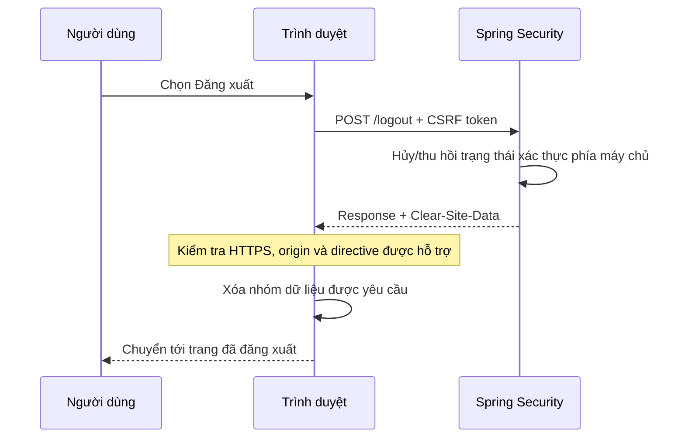

# Clear-Site-Data cùng các nhóm dữ liệu có thể yêu cầu xóa

Trong chương **Đăng nhập và đăng xuất** của **SPRING_SECURITY_HTTP_PROTECTION**, việc đăng xuất an toàn không dừng ở thao tác xóa `Authentication` phía máy chủ. Trình duyệt có thể vẫn giữ cookie, bộ nhớ đệm, dữ liệu offline, Service Worker và thông tin hiển thị ở tab khác. HTTP response header **`Clear-Site-Data`** cho phép máy chủ *đề nghị trình duyệt* xóa một hoặc nhiều nhóm dữ liệu liên quan đến website. Đây là một lớp phòng vệ bổ sung cho các cơ chế bảo vệ HTTP, session và trình duyệt trong Spring Security.

Sau bài học, người học có thể:

1. Giải thích `Clear-Site-Data` tác động tới dữ liệu nào và vì sao phạm vi của từng directive khác nhau.
2. Chọn tập directive phù hợp với logout, ứng dụng SPA/PWA, hệ thống nhiều subdomain và trường hợp cần xóa dữ liệu khẩn cấp.
3. Gắn header vào luồng logout của Spring Security **Servlet** hoặc **Reactive**, đồng thời giữ nguyên cơ chế xác thực, CSRF và thu hồi phiên ở máy chủ.
4. Kiểm thử header trên HTTPS, đối chiếu kết quả thật trong trình duyệt và xử lý các tình huống gây mất dữ liệu hoặc đăng xuất không triệt để.

## 1. Vì sao logout cần quan tâm tới dữ liệu trong trình duyệt?

Giả sử một ứng dụng quản trị tại `https://admin.example.com` có các thành phần sau:

- Cookie `JSESSIONID` dùng để liên kết request tới HTTP session tại máy chủ.
- `localStorage` giữ bộ lọc tìm kiếm, tên người dùng vừa đăng nhập hoặc dữ liệu giao diện.
- `IndexedDB` lưu bản nháp để hỗ trợ làm việc offline.
- HTTP cache giữ tài nguyên hoặc response đã từng được tải.
- Một Service Worker có thể phục vụ nội dung đã lưu khi mất kết nối.
- Hai tab cùng mở trang quản trị; tab thứ hai vẫn đang hiển thị dữ liệu cũ.

Khi người dùng nhấn **Đăng xuất**, Spring Security có thể hủy session và xóa security context, nhưng những thao tác đó **không tự xóa toàn bộ dữ liệu phía trình duyệt**. Ngược lại, xóa dữ liệu trong trình duyệt cũng **không thu hồi được** một session, refresh token hoặc access token còn hiệu lực ở máy chủ. Cần xử lý cả hai phía, tùy kiến trúc xác thực.

Luồng tổng quát:



**Ranh giới cần nhớ:** `Clear-Site-Data` là *tín hiệu từ server tới user agent*. Server không thể dùng header này để bắt mọi trình duyệt xóa dữ liệu theo cách giống nhau; việc thực thi phụ thuộc trình duyệt, phiên bản, ngữ cảnh bảo mật và loại dữ liệu.

## 2. Cú pháp và thời điểm sử dụng

Đây là **HTTP response header**. Mỗi giá trị directive được đặt trong **dấu nháy kép**, nhiều giá trị cách nhau bởi dấu phẩy:

```http
HTTP/1.1 302 Found
Location: /login?logout
Clear-Site-Data: "cookies", "storage", "cache"
Cache-Control: no-store
```

Một số cách viết hợp lệ:

```http
Clear-Site-Data: "cookies"
Clear-Site-Data: "cache", "storage"
Clear-Site-Data: "*"
```

Các cách viết sau **không hợp lệ theo cú pháp directive** vì thiếu dấu nháy kép:

```http
Clear-Site-Data: cookies
Clear-Site-Data: cache, storage
Clear-Site-Data: *
```

Header chỉ nên xuất hiện trên **response của thao tác chủ động cần dọn dữ liệu**, thường là logout thành công. Nếu gắn `Clear-Site-Data: "cookies"` vào mọi response hoặc trang đăng nhập thông thường, cookie vừa cấp có thể bị xóa liên tục, khiến người dùng không giữ được trạng thái đăng nhập.

Trình duyệt hiện đại xử lý header trong **secure context**; khi triển khai thực tế nên sử dụng **HTTPS**. Ở phía Spring Security Servlet, `ClearSiteDataHeaderWriter` cũng chủ động chỉ ghi header cho request được nhận diện là an toàn (`request.isSecure()`). Với hệ thống đứng sau reverse proxy, cấu hình nhận diện HTTPS/forwarded headers phải phản ánh đúng kết nối bên ngoài.

## 3. Các nhóm dữ liệu có thể yêu cầu xóa

| Directive | Dữ liệu mà server yêu cầu trình duyệt xử lý | Phạm vi và lưu ý |
|---|---|---|
| `"cache"` | HTTP cache và một số bộ nhớ đệm liên quan đến nội dung đã tải. | Chủ yếu dựa trên **origin của response**; chi tiết dọn các cache phụ như back-forward cache hay script cache tùy trình duyệt. |
| `"cookies"` | Cookie và, theo đặc tả, thông tin xác thực HTTP liên quan. | **Rộng hơn một origin**: có thể ảnh hưởng toàn bộ registered domain cùng các subdomain. Cần thận trọng khi nhiều ứng dụng chia sẻ `example.com`. |
| `"storage"` | Dữ liệu lưu trữ do website tạo: `localStorage`, `sessionStorage`, `IndexedDB`, đăng ký Service Worker và một số cơ chế lưu trữ khác. | Về nguyên tắc theo **origin của response**; có thể làm mất dữ liệu offline hoặc bản nháp chưa đồng bộ. |
| `"executionContexts"` | Yêu cầu làm vô hiệu hóa và tải lại các ngữ cảnh đang hiển thị cùng origin. | Hữu ích về mặt ý tưởng cho nhiều tab, nhưng **hỗ trợ thực tế không đồng đều**; không được coi là cách duy nhất đồng bộ logout giữa các tab. |
| `"clientHints"` | Các lựa chọn Client Hints đã được ghi nhớ cho origin. | Directive mở rộng; hỗ trợ tùy trình duyệt. Một số trình duyệt cũng xóa thông tin này khi nhận `"cache"`, `"cookies"` hoặc `"*"`. |
| `"prefetchCache"` | Dữ liệu prefetch từ cơ chế *speculation rules*. | Phạm vi liên quan tới **referrer origin** của hoạt động dự đoán điều hướng; hỗ trợ trình duyệt tùy phiên bản. |
| `"prerenderCache"` | Dữ liệu của các trang được prerender để dự đoán điều hướng. | Cũng liên quan tới *speculation rules* và referrer origin; cần kiểm thử trên trình duyệt mục tiêu. |
| `"*"` | Mọi nhóm dữ liệu mà trình duyệt biết và hỗ trợ theo header, kể cả nhóm bổ sung trong tương lai. | Quyền yêu cầu xóa rộng; thuận tiện khi cần dọn toàn bộ nhưng làm tăng nguy cơ ảnh hưởng dữ liệu người dùng. |

### 3.1. `"cache"` — bộ nhớ đệm tài nguyên

Ví dụ: sau logout, ứng dụng không muốn trình duyệt tiếp tục dùng lại response cũ chứa dữ liệu đã cá nhân hóa. Có thể yêu cầu:

```http
Clear-Site-Data: "cache"
```

Tuy nhiên, **`"cache"` không thay cho chính sách cache của từng response**. Các response chứa thông tin riêng tư vẫn cần `Cache-Control: no-store` (hoặc chính sách thích hợp khác) ngay từ khi được trả về. Clear-Site-Data chỉ được trình duyệt xem xét khi response có header đi đến trình duyệt; nó không phải bảo đảm rằng mọi bản sao ở CDN, proxy hoặc phía máy chủ đều đã biến mất.

### 3.2. `"cookies"` — phạm vi có thể vượt qua một subdomain

Giả sử hệ thống có:

```text
https://admin.example.com   (trang quản trị)
https://shop.example.com    (trang bán hàng)
https://login.example.com   (trang đăng nhập tập trung)
```

Khi `admin.example.com` trả về `Clear-Site-Data: "cookies"`, trình duyệt có thể xóa cookie liên quan tới **cả registered domain `example.com` và các subdomain**. Điều này có thể khiến người dùng đồng thời bị đăng xuất khỏi `shop.example.com` hoặc mất cookie trạng thái của ứng dụng khác. Đây là ảnh hưởng có chủ đích của directive, không phải lỗi Spring Security.

Vì vậy, nếu logout chỉ áp dụng cho một ứng dụng trong hệ sinh thái có nhiều dịch vụ cùng miền, hãy xác định trước **miền, path và chủ sở hữu của cookie**, rồi cân nhắc cách hết hạn cookie cụ thể kết hợp vô hiệu hóa session phía máy chủ. `"cookies"` không cho phép chọn chính xác một tên cookie.

### 3.3. `"storage"` — dữ liệu giao diện và dữ liệu offline

Các loại dữ liệu thường gặp gồm:

```javascript
localStorage.setItem("lastUser", "alice");
sessionStorage.setItem("currentTab", "report-42");
// Ứng dụng còn có thể lưu bản nháp trong IndexedDB
// hoặc đăng ký Service Worker để phục vụ dữ liệu offline.
```

Nếu nhận response tương ứng có `Clear-Site-Data: "storage"` và trình duyệt hỗ trợ, các vùng dữ liệu thuộc origin đó được yêu cầu dọn sạch. Điểm đáng chú ý là **dữ liệu không nhạy cảm nhưng có giá trị đối với người dùng** (bản nháp, trạng thái offline, bộ lọc...) cũng có thể bị xóa. Trước khi bật directive, cần phân loại dữ liệu cần giữ lâu dài và dữ liệu cần xóa khi kết thúc phiên.

### 3.4. `"executionContexts"` — xử lý ngữ cảnh đang mở

Directive này hướng tới vấn đề một tab vẫn hiển thị trạng thái cũ sau khi tab khác logout:

```http
Clear-Site-Data: "executionContexts"
```

Tuy nhiên, hỗ trợ của browser cho directive này còn hạn chế, thay đổi theo phiên bản. Trong ứng dụng nhiều tab, có thể bổ sung **`BroadcastChannel`**, sự kiện `storage` hoặc cơ chế thông báo nội bộ để chuyển giao diện về trạng thái chưa đăng nhập; mọi request mới vẫn phải được kiểm soát bởi server. Các giải pháp này hỗ trợ trải nghiệm và đồng bộ UI, không thay cho kiểm tra quyền ở backend.

### 3.5. Directive mở rộng và wildcard

`"clientHints"`, `"prefetchCache"` và `"prerenderCache"` phản ánh các khả năng mới hơn của nền tảng web. Đặc biệt với SPA có *speculative navigation*, việc loại bỏ bản prerender cũ có thể tránh hiện ra giao diện thuộc phiên trước. Hai directive prefetch/prerender có phạm vi và mức hỗ trợ khác các directive cổ điển, nên cần dựa vào ma trận trình duyệt thực tế.

```http
Clear-Site-Data: "prefetchCache", "prerenderCache"
```

`"*"` là một lựa chọn **mở rộng về phía trước**: nếu trình duyệt về sau bổ sung kiểu dữ liệu, wildcard có thể áp dụng luôn cho kiểu mới. Vì vậy không nên bật tùy tiện trong hệ thống có lưu trữ offline quan trọng.

> **Lưu ý API:** `ClearSiteDataHeaderWriter` của Spring Security Servlet hiện cung cấp các giá trị `CACHE`, `COOKIES`, `STORAGE`, `EXECUTION_CONTEXTS` và `ALL`. Những directive mở rộng xuất hiện trên MDN không tương ứng với các enum riêng trong writer này; nếu thật sự cần, phải xây dựng cách ghi header phù hợp và kiểm tra khả năng tương thích của trình duyệt.

## 4. Phân biệt origin, registered domain và phạm vi ứng dụng

Một **origin** gồm *scheme + host + port*. Vì thế:

```text
https://app.example.com        Origin A
https://api.example.com        Origin B (khác host)
https://app.example.com:8443   Origin C (khác port)
http://app.example.com         Origin D (khác scheme)
```

Với một response từ `https://api.example.com/logout`:

- `"storage"` chủ yếu tác động dữ liệu của **`https://api.example.com`**, không tự xóa `localStorage` của `https://app.example.com`.
- `"cookies"` có thể có ảnh hưởng trên nhiều subdomain cùng registered domain `example.com`.
- `"cache"` hướng tới nội dung cache gắn với origin của response; chi tiết thực thi tùy browser.
- Header của API không có quyền xóa dữ liệu origin của một website khác chỉ vì website đó gọi API. CORS cho phép hay từ chối việc đọc response giữa các origin, **không biến các origin thành một nơi lưu trữ chung**.

Điều này đặc biệt quan trọng khi frontend và backend chạy trên origin khác nhau: logout phía backend phải xử lý session/token của backend; frontend cần chủ động dọn trạng thái giao diện do mình sở hữu và có thể dùng một response từ chính origin frontend nếu kiến trúc yêu cầu xóa storage của frontend. Đừng giả định header gửi từ domain API sẽ xóa sạch dữ liệu của trang SPA.

## 5. Chọn directive theo mục tiêu logout

| Bối cảnh | Cách tiếp cận | Điểm phải xác minh |
|---|---|---|
| Ứng dụng session cookie độc lập trên một miền riêng | Có thể dùng `"cookies", "storage"`, bổ sung `"cache"` nếu dữ liệu riêng tư có thể lưu trong cache. | Cookie không ảnh hưởng ứng dụng cùng registered domain; dữ liệu offline có cần giữ không. |
| Nhiều sản phẩm dùng chung `example.com` | Ưu tiên hủy session và hết hạn **cookie cụ thể**; cân nhắc `"storage"` cho origin sở hữu dữ liệu. | `"cookies"` có thể đăng xuất các sản phẩm khác. |
| SPA lưu dữ liệu nhạy cảm trong IndexedDB | Có thể yêu cầu `"storage"` ở đúng origin và xóa state trong ứng dụng. | Bản nháp và dữ liệu offline có được đồng bộ trước logout không. |
| PWA có Service Worker, tài nguyên offline | Đánh giá `"storage"` và `"cache"` cho yêu cầu xóa dữ liệu phiên. | Tác động tới trải nghiệm offline, lần tải lại và chi phí mạng. |
| Nhiều tab cùng hoạt động | Dùng server-side session revocation + thông báo các tab; cân nhắc `"executionContexts"` như lớp bổ sung. | Hỗ trợ browser, tab cũ có yêu cầu mới bị từ chối hay không. |
| Logout sau sự cố hoặc tài khoản nguy cơ cao | Cân nhắc `"*"` cùng thu hồi token/session và quy trình phản ứng sự cố. | Mức mất dữ liệu cục bộ, phạm vi các dịch vụ liên quan, tương thích trình duyệt. |

Không có một tổ hợp directive phù hợp cho mọi website. Quy tắc lựa chọn là **xác định dữ liệu phải xóa, nơi dữ liệu tồn tại và tác động tới các ứng dụng khác**, rồi cấu hình tập nhỏ nhất đáp ứng yêu cầu bảo mật.

## 6. Triển khai với Spring Security Servlet

Spring Security **không tự thêm `Clear-Site-Data` vào mọi response**. Với luồng logout Servlet, có thể dùng `HeaderWriterLogoutHandler` kết hợp `ClearSiteDataHeaderWriter` để gắn header đúng lúc logout.

Ví dụ cấu hình dựa trên Java DSL của Spring Security 6/7:

```java
import org.springframework.context.annotation.Bean;
import org.springframework.context.annotation.Configuration;
import org.springframework.security.config.Customizer;
import org.springframework.security.config.annotation.web.builders.HttpSecurity;
import org.springframework.security.web.SecurityFilterChain;
import org.springframework.security.web.authentication.logout.HeaderWriterLogoutHandler;
import org.springframework.security.web.header.writers.ClearSiteDataHeaderWriter;

import static org.springframework.security.web.header.writers.ClearSiteDataHeaderWriter.Directive.COOKIES;
import static org.springframework.security.web.header.writers.ClearSiteDataHeaderWriter.Directive.STORAGE;

@Configuration
class SecurityConfiguration {

    @Bean
    SecurityFilterChain securityFilterChain(HttpSecurity http) throws Exception {
        HeaderWriterLogoutHandler clearSiteData = new HeaderWriterLogoutHandler(
            new ClearSiteDataHeaderWriter(COOKIES, STORAGE)
        );

        http
            .authorizeHttpRequests(auth -> auth.anyRequest().authenticated())
            .formLogin(Customizer.withDefaults())
            .logout(logout -> logout.addLogoutHandler(clearSiteData));

        return http.build();
    }
}
```

Với logout thành công trên request HTTPS, response sẽ chứa giá trị tương đương:

```http
Clear-Site-Data: "cookies", "storage"
```

Để yêu cầu tất cả các nhóm dữ liệu mà browser biết, Spring Security cũng hỗ trợ:

```java
new HeaderWriterLogoutHandler(
    new ClearSiteDataHeaderWriter(
        ClearSiteDataHeaderWriter.Directive.ALL
    )
);
```

Tuy nhiên, cần đánh giá kỹ phạm vi trước khi dùng `ALL` vì nó ánh xạ thành wildcard `"*"` và có thể xóa nhiều dữ liệu cục bộ hơn dự tính.

**Tại sao dùng `addLogoutHandler`?** Luồng logout do `LogoutFilter` xử lý vẫn thực hiện các thao tác mặc định như invalidating session, xóa security context, remember-me và CSRF token theo cấu hình. Header bổ sung yêu cầu trình duyệt dọn dữ liệu sau khi nhận response. Đừng thay toàn bộ logout bằng một controller chỉ viết header mà quên xử lý trạng thái xác thực phía server.

**Lưu ý về HTTPS phía proxy:** `ClearSiteDataHeaderWriter` kiểm tra request là secure trước khi ghi header. Nếu người dùng truy cập `https://app.example.com` nhưng proxy chuyển request vào ứng dụng bằng HTTP, Spring có thể nhìn thấy request không secure khi cấu hình proxy sai. Trong Spring Boot, có thể xem xét cấu hình forwarded headers phù hợp với hạ tầng (chẳng hạn `server.forward-headers-strategy=framework`) và chỉ tin các header forwarded từ proxy đáng tin cậy. Việc gọi HTTP trực tiếp vào backend để kiểm thử writer có thể không nhận được header, dù logout vẫn chạy.

## 7. Triển khai với Spring Security Reactive (WebFlux)

Trong WebFlux, có thể ghi header bằng `ServerLogoutSuccessHandler` gắn vào `ServerHttpSecurity.logout`. Ví dụ dưới đây trả `204 No Content` khi logout xong; phù hợp API/SPA không muốn redirect mặc định:

```java
import org.springframework.context.annotation.Bean;
import org.springframework.context.annotation.Configuration;
import org.springframework.http.HttpStatus;
import org.springframework.http.server.reactive.ServerHttpResponse;
import org.springframework.security.config.Customizer;
import org.springframework.security.config.annotation.web.reactive.EnableWebFluxSecurity;
import org.springframework.security.config.web.server.ServerHttpSecurity;
import org.springframework.security.web.server.SecurityWebFilterChain;

@Configuration
@EnableWebFluxSecurity
class ReactiveSecurityConfiguration {

    @Bean
    SecurityWebFilterChain securityWebFilterChain(ServerHttpSecurity http) {
        return http
            .authorizeExchange(auth -> auth.anyExchange().authenticated())
            .formLogin(Customizer.withDefaults())
            .logout(logout -> logout.logoutSuccessHandler((exchange, authentication) -> {
                ServerHttpResponse response = exchange.getExchange().getResponse();
                response.getHeaders().set(
                    "Clear-Site-Data", "\"cookies\", \"storage\""
                );
                response.setStatusCode(HttpStatus.NO_CONTENT);
                return response.setComplete();
            }))
            .build();
    }
}
```

`ServerLogoutSuccessHandler` chạy sau các bước logout được cấu hình trong Spring Security Reactive. Ví dụ ghi header trực tiếp, nên **tự chịu trách nhiệm chọn thời điểm và directive**; cách làm này không tự áp dụng điều kiện `request.isSecure()` của `ClearSiteDataHeaderWriter` bên Servlet. Phải phục vụ ứng dụng qua HTTPS và kiểm tra browser thực sự thực thi header. Nếu hệ thống đang có một logout success handler làm redirect sang Identity Provider hoặc xử lý OIDC/SAML, cần **phối hợp** việc ghi header với luồng đó, tránh thay handler rồi vô tình bỏ mất bước logout liên kết.

Trong cả Servlet lẫn Reactive, **CSRF vẫn là vấn đề độc lập**. Với ứng dụng xác thực bằng cookie, logout thường là request thay đổi trạng thái (`POST /logout`) và cần cơ chế CSRF phù hợp. Không tắt CSRF chỉ để gọi thử endpoint logout thuận tiện hơn.

## 8. `Clear-Site-Data` có thay thế invalidate session, logout OIDC hay xóa token không?

**Không.** Ba lớp xử lý phục vụ ba mục đích khác nhau:

| Lớp | Xử lý gì? | Vì sao vẫn cần? |
|---|---|---|
| Máy chủ / hệ thống xác thực | Hủy session, xóa `SecurityContext`, vô hiệu refresh token, thu hồi quyền hoặc điều phối logout với Identity Provider khi cần. | Browser có thể bỏ qua header; token đã bị sao chép vẫn có thể được dùng ở nơi khác nếu server không thu hồi/giới hạn. |
| Trình duyệt | Xóa các nhóm cache, cookie, storage được directive hỗ trợ. | Ngăn dữ liệu cục bộ tiếp tục tồn tại ngoài ý muốn sau logout. |
| Ứng dụng frontend | Xóa state trong bộ nhớ JS, dừng request còn chạy, cập nhật các tab, điều hướng giao diện. | Header không đảm bảo xóa biến đang giữ trong RAM hoặc cập nhật mọi tab trên mọi browser. |

Đặc biệt:

- **JWT access token** còn hiệu lực trên server sẽ không tự bị thu hồi chỉ vì `localStorage` đã được xóa. Cần chiến lược TTL ngắn, thu hồi refresh token hoặc cơ chế từ chối token phù hợp mô hình.
- **OIDC/SAML SSO** có thể duy trì phiên ở Identity Provider khác origin/domain. Header từ ứng dụng không đăng xuất người dùng khỏi IdP; cần giao thức logout tương ứng nếu yêu cầu đăng xuất toàn hệ thống.
- **HTTP Basic** hoặc chứng thực được browser giữ lại có hành vi phụ thuộc browser. Không xây dựng bảo đảm bảo mật duy nhất dựa trên việc browser xóa thông tin đó.
- **Cache của CDN/reverse proxy** và dữ liệu server-side không nằm trong quyền xóa của một response header tại trình duyệt.

## 9. Kiểm thử: từ response của Spring đến trạng thái thật trong browser

### 9.1. Kiểm tra Servlet bằng MockMvc

Với cấu hình Servlet mục 6 và dependency `spring-security-test`, một kiểm thử tập trung vào việc **response logout qua request HTTPS mô phỏng có header mong đợi**:

```java
import org.junit.jupiter.api.Test;
import org.springframework.beans.factory.annotation.Autowired;
import org.springframework.boot.test.autoconfigure.web.servlet.AutoConfigureMockMvc;
import org.springframework.boot.test.context.SpringBootTest;
import org.springframework.test.web.servlet.MockMvc;

import static org.springframework.security.test.web.servlet.request.SecurityMockMvcRequestPostProcessors.csrf;
import static org.springframework.security.test.web.servlet.request.SecurityMockMvcRequestPostProcessors.user;
import static org.springframework.test.web.servlet.request.MockMvcRequestBuilders.post;
import static org.springframework.test.web.servlet.result.MockMvcResultMatchers.header;
import static org.springframework.test.web.servlet.result.MockMvcResultMatchers.status;

@SpringBootTest
@AutoConfigureMockMvc
class LogoutClearSiteDataTest {

    @Autowired
    MockMvc mvc;

    @Test
    void secureLogoutWritesClearSiteData() throws Exception {
        mvc.perform(post("/logout")
                .secure(true)          // Bắt buộc cho ClearSiteDataHeaderWriter
                .with(user("alice"))
                .with(csrf()))
            .andExpect(status().is3xxRedirection())
            .andExpect(header().string(
                "Clear-Site-Data", "\"cookies\", \"storage\""));
    }

    @Test
    void missingCsrfDoesNotExecuteLogout() throws Exception {
        mvc.perform(post("/logout")
                .secure(true)
                .with(user("alice")))
            .andExpect(status().isForbidden())
            .andExpect(header().doesNotExist("Clear-Site-Data"));
    }
}
```

Ở ví dụ này, `secure(true)` ảnh hưởng trực tiếp tới điều kiện ghi header của Spring Security Servlet. Nếu thiếu nó, test có thể báo header không tồn tại mặc dù cấu hình writer đúng. `with(csrf())` là cách mô phỏng CSRF token trong MockMvc; nếu thiếu, `POST /logout` thường bị từ chối trước khi tới logout handler.

Kiểm thử này xác minh hành vi phía Spring; **MockMvc không chạy thuật toán xóa dữ liệu của Chrome, Firefox hay Safari**.

### 9.2. Kiểm tra trên trình duyệt thật

1. Mở ứng dụng bằng **HTTPS**, đăng nhập, bật DevTools ở tab **Network** và **Application/Storage**.
2. Tạo dữ liệu thử của đúng origin, ví dụ `localStorage.setItem("logout-check", "exists")`; ghi nhận cookie, IndexedDB hoặc Service Worker được tạo trong môi trường thử nghiệm.
3. Thực hiện **đúng luồng logout hợp lệ** (ví dụ submit `POST /logout` kèm CSRF token), quan sát response trong Network và xác nhận `Clear-Site-Data` chứa chuỗi directive được trích dẫn bằng dấu nháy kép.
4. Sau khi logout hoàn tất, kiểm tra lại cookie và storage của **origin chịu tác động**, thử tải lại trang, mở tab mới và truy cập tài nguyên cần xác thực. Response mới từ server phải từ chối truy cập hoặc yêu cầu xác thực lại.
5. Lặp lại trên các trình duyệt/phiên bản được hỗ trợ, đặc biệt nếu đang trông cậy vào `"executionContexts"`, `"clientHints"`, prefetch hoặc prerender.

Khi debug, có thể dùng công cụ dòng lệnh để kiểm tra header của response thực, nhưng **`curl` không mô phỏng việc trình duyệt xóa cache, cookie hoặc storage**. Không dùng `curl -I /logout` như một phép thử đầy đủ: `-I` thực hiện HEAD, còn logout có thể yêu cầu POST và CSRF token. Nên quan sát request thực phát sinh từ giao diện hoặc xây dựng test API với dữ liệu xác thực thích hợp.

### 9.3. Các tình huống cần đưa vào kế hoạch thử nghiệm

| Tình huống | Kỳ vọng cần kiểm tra |
|---|---|
| Logout ở một tab, tab khác còn mở | Server không cho thao tác nhạy cảm bằng phiên đã logout; giao diện tab cũ cập nhật theo cơ chế hỗ trợ. |
| `admin.example.com` và `shop.example.com` cùng miền đăng ký | Cookie của sản phẩm khác có bị mất khi bật `"cookies"` không. |
| SPA tại `app.example.com`, API tại `api.example.com` | Storage của frontend có được dọn đúng nơi không; header backend không được giả định xóa storage frontend. |
| PWA offline với bản nháp IndexedDB | Người dùng có mất dữ liệu chưa đồng bộ sau `"storage"` không. |
| Reverse proxy chấm dứt TLS | Ứng dụng có nhận diện request HTTPS để `ClearSiteDataHeaderWriter` ghi header không. |
| Trình duyệt cũ hoặc không hỗ trợ một directive | Session server vẫn vô hiệu và UI vẫn có luồng logout an toàn. |
| Người dùng đăng nhập SSO | App logout có cần logout IdP; có phát sinh đăng nhập lại tự động không. |

## 10. Chẩn đoán những lỗi thường gặp

### Không thấy `Clear-Site-Data` trong response logout

- **Sai endpoint hoặc HTTP method:** kiểm tra request có thật sự đi qua `LogoutFilter`/logout matcher hay không; `GET /logout` có thể chỉ hiển thị trang xác nhận.
- **CSRF bị từ chối:** response `403` không đại diện cho logout thành công; cần sử dụng token hợp lệ.
- **Request không được nhận diện là HTTPS:** `ClearSiteDataHeaderWriter` Servlet có điều kiện chỉ ghi trên request secure; kiểm tra `request.isSecure()` và cấu hình trusted forwarded headers.
- **Code ghi header ở vị trí khác:** nếu cấu hình một filter áp dụng cho mọi request, header có thể xuất hiện không đúng thời điểm hoặc bị ghi đè; nên gắn với luồng logout.
- **Chồng chéo logout handler:** kiểm tra handler tùy biến đang được chạy và response chưa commit trước khi ghi header.

### Có header nhưng dữ liệu vẫn còn

- Kiểm tra **cú pháp có dấu nháy kép**, URL response thật và origin tương ứng.
- Phân biệt dữ liệu ở frontend origin với API origin. `"storage"` từ API không tự xóa `localStorage` của trang khác origin.
- Phân biệt dữ liệu do browser lưu với dữ liệu server, bộ nhớ JS, bộ nhớ cache CDN và dữ liệu đồng bộ qua dịch vụ khác.
- Kiểm tra hỗ trợ của directive trên browser đang thử; đặc biệt không giả định `"executionContexts"` luôn tải lại tab.
- Xác nhận thử nghiệm được thực hiện trên HTTPS, không bị Service Worker hoặc luồng điều hướng che khuất response mong đợi.

### Xóa quá nhiều dữ liệu hoặc người dùng bị đăng xuất ở sản phẩm khác

- Kiểm tra `"cookies"` trên các subdomain cùng registered domain.
- Xác định xem `"*"` hoặc `"storage"` có xóa bản nháp, offline cache và trạng thái quan trọng không.
- Thu hẹp tập directive; nếu chỉ cần xóa một cookie cụ thể thì dùng cơ chế hết hạn cookie theo `Name`/`Path`/`Domain` phù hợp thay vì xóa mọi cookie của site.
- Đánh giá lại yêu cầu sản phẩm về logout cục bộ, logout một ứng dụng hay logout toàn bộ hệ sinh thái.

## 11. Những nguyên tắc triển khai an toàn

1. **Thu hồi trạng thái xác thực phía server trước:** invalidate session, xóa security context, xử lý refresh token và logout SSO theo thiết kế. Không dựa vào `Clear-Site-Data` để thu hồi quyền truy cập.
2. **Chỉ phát header khi có chủ đích:** thường gắn với logout thành công; đừng áp dụng rộng rãi cho tất cả response.
3. **Bảo vệ thao tác logout:** kiểm tra CSRF và method theo mô hình ứng dụng; đừng thay POST bằng GET nhạy cảm chỉ để dễ thử nghiệm.
4. **Chọn phạm vi nhỏ nhất:** hiểu sự khác nhau giữa origin và registered domain, đặc biệt trước khi bật `"cookies"` hoặc `"*"`.
5. **Bảo vệ dữ liệu offline:** đồng bộ hoặc cảnh báo về bản nháp trước khi xóa storage khi nghiệp vụ cần.
6. **Kiểm thử trên HTTPS và browser thật:** xác minh cả sự hiện diện của header, dữ liệu được dọn và khả năng backend từ chối request sau logout.
7. **Giữ các lớp phòng vệ bổ sung:** `Cache-Control`, `Secure`/`HttpOnly`/`SameSite` cho cookie, CORS, CSP, CSRF và session management giải quyết các vấn đề khác nhau; header dọn dữ liệu không thay thế chúng.

## 12. Bài tập vận dụng

**Tình huống:** hệ thống có trang SPA tại `https://portal.example.com`, API Spring Security tại `https://api.example.com` và cửa hàng tại `https://shop.example.com`. SPA giữ tên người dùng trong `localStorage`; API xác thực bằng session cookie; cửa hàng có một phiên đăng nhập riêng. Người dùng bấm logout trên SPA, yêu cầu: phiên API hết hiệu lực, tên người dùng không còn trong SPA và không làm logout khỏi cửa hàng.

Hãy trả lời:

1. Có nên để API gửi `Clear-Site-Data: "cookies", "storage"` như cách giải quyết duy nhất không? Vì sao?
2. Phần nào do backend Spring Security xử lý, phần nào do SPA xử lý?
3. Bạn sẽ kiểm thử những origin và hành vi nào để xác nhận không ảnh hưởng cửa hàng?

**Gợi ý lời giải:**

- API phải vô hiệu hóa session/phiên xác thực của chính nó. Do `"cookies"` có thể ảnh hưởng cookie trên nhiều subdomain của `example.com`, không mặc định dùng directive này nếu yêu cầu phải giữ nguyên đăng nhập cửa hàng; cần xem phạm vi cookie thực tế và cơ chế hết hạn cookie riêng của API.
- `"storage"` trong response từ `api.example.com` không bảo đảm xóa `localStorage` của `portal.example.com`. SPA cần dọn dữ liệu do mình quản lý sau khi xác nhận logout thành công (hoặc sử dụng một cơ chế response cùng origin được thiết kế có chủ đích).
- Kiểm tra phiên API đã không thể gọi endpoint bảo vệ, `localStorage` ở portal đã được xóa, cookie và phiên ở `shop.example.com` còn sử dụng được; thử cả HTTPS, nhiều tab và trình duyệt hỗ trợ thực tế.

## Tài liệu tham khảo

- [MDN — `Clear-Site-Data` HTTP response header](https://developer.mozilla.org/en-US/docs/Web/HTTP/Reference/Headers/Clear-Site-Data): cú pháp, nhóm dữ liệu, phạm vi và lưu ý tương thích.
- [W3C — Clear Site Data](https://www.w3.org/TR/clear-site-data/): nền tảng đặc tả và các ví dụ logout theo origin.
- [Spring Security — Handling Logouts (Servlet)](https://docs.spring.io/spring-security/reference/servlet/authentication/logout.html): `HeaderWriterLogoutHandler`, logout và `ClearSiteDataHeaderWriter`.
- [Spring Security — HTTP Response Headers (Servlet)](https://docs.spring.io/spring-security/reference/servlet/exploits/headers.html): các lớp HTTP headers và trường hợp Clear Site Data.
- [Spring Security — `ClearSiteDataHeaderWriter` API](https://docs.spring.io/spring-security/site/docs/current/api/org/springframework/security/web/header/writers/ClearSiteDataHeaderWriter.html): các directive Spring hỗ trợ và điều kiện secure request.
- [Spring Security — `ServerHttpSecurity` API](https://docs.spring.io/spring-security/reference/api/java/org/springframework/security/config/web/server/ServerHttpSecurity.html): logout DSL cho Reactive/WebFlux.
