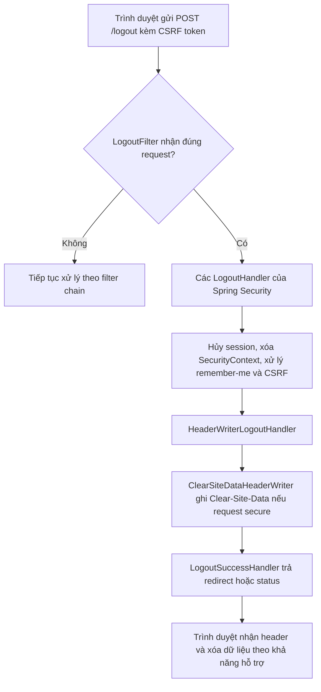

# Gắn `HeaderWriterLogoutHandler` khi phù hợp

## 1. Vấn đề cần giải quyết

Trong ứng dụng Spring Security có đăng nhập, thao tác **đăng xuất** không chỉ là chuyển người dùng về trang `/login`. Máy chủ cần kết thúc trạng thái xác thực; trình duyệt cũng có thể đang giữ cookie, dữ liệu trong bộ nhớ cục bộ hoặc bản sao nội dung nhạy cảm. Hai phần việc này liên quan nhưng không tương đương.

Ví dụ, một ứng dụng quản trị dùng session trên máy chủ và lưu tùy chọn giao diện trong `localStorage`. Khi người dùng bấm **Đăng xuất**, `SecurityContextLogoutHandler` có thể vô hiệu hóa `HttpSession` và xóa `SecurityContext`. Tuy nhiên, nếu muốn trình duyệt chủ động xóa thêm dữ liệu theo phạm vi website, máy chủ phải gửi chỉ dẫn phù hợp trong phản hồi HTTP.

`HeaderWriterLogoutHandler` là một `LogoutHandler` của **Spring Security Servlet** dùng để gọi một `HeaderWriter` khi xử lý logout. Trường hợp sử dụng điển hình là kết hợp với `ClearSiteDataHeaderWriter` để gửi header:

```http
HTTP/1.1 302 Found
Location: /login?logout
Clear-Site-Data: "cookies"
```

Header `Clear-Site-Data` yêu cầu trình duyệt hỗ trợ xóa loại dữ liệu được chỉ định. Nó **không tự thu hồi token ở máy chủ, không thay thế việc hủy session, và không bảo đảm mọi trình duyệt sẽ thực hiện đầy đủ**. Bài này tập trung vào việc chọn đúng trường hợp dùng handler, cấu hình logout Servlet, kiểm thử và nhận diện ảnh hưởng đến các ứng dụng cùng domain.

### Mục tiêu học tập

Sau khi đọc, người học có thể:

- Phân biệt trách nhiệm của `LogoutFilter`, `SecurityContextLogoutHandler`, `HeaderWriterLogoutHandler` và `ClearSiteDataHeaderWriter`.
- Chọn chỉ thị `Clear-Site-Data` theo dữ liệu thực sự cần xóa, tránh ảnh hưởng ngoài ý muốn đến các ứng dụng khác.
- Tích hợp handler vào `SecurityFilterChain` mà vẫn duy trì cơ chế logout và CSRF của Spring Security.
- Kiểm tra header trên phản hồi HTTPS, xử lý trường hợp proxy kết thúc TLS và xác minh kết quả trên trình duyệt.

## 2. Vị trí của handler trong luồng logout

Với cấu hình form login Servlet thông thường, yêu cầu `POST /logout` hợp lệ và mang CSRF token sẽ được `LogoutFilter` xử lý. Spring Security gọi các `LogoutHandler` để làm sạch trạng thái xác thực, sau đó chạy `LogoutSuccessHandler` để trả phản hồi hoặc chuyển hướng.



| Thành phần | Trách nhiệm chính | Điều không nên kỳ vọng |
| --- | --- | --- |
| `LogoutFilter` | Nhận yêu cầu logout theo URL/request matcher đã cấu hình và điều phối handlers. | Không tự chọn dữ liệu cần xóa ở trình duyệt. |
| `SecurityContextLogoutHandler` | Làm sạch `SecurityContext`, repository và thường vô hiệu hóa session. | Không xóa mọi `localStorage` hoặc cache của trình duyệt. |
| `HeaderWriterLogoutHandler` | Khi logout, gọi đúng một đối tượng `HeaderWriter` để ghi header lên `HttpServletResponse`. | Không có chức năng xác thực hay thu hồi token. |
| `ClearSiteDataHeaderWriter` | Tạo header `Clear-Site-Data` với các chỉ thị được chọn, khi request được coi là an toàn (secure). | Không thể ép mọi loại trình duyệt phải hỗ trợ mọi chỉ thị. |
| `LogoutSuccessHandler` | Quyết định phản hồi sau logout, ví dụ redirect hoặc HTTP `204`. | Không thay thế các bước dọn dẹp trạng thái xác thực. |

Khi cấu hình bằng `logout.addLogoutHandler(...)`, handler mới **tham gia vào chuỗi xử lý logout** do Spring Security quản lý. Không cần tự viết controller `@PostMapping("/logout")` chỉ để đặt header. Việc tự xây endpoint logout dễ bỏ sót bước dọn dẹp `SecurityContext`, remember-me hoặc CSRF.

> **Phân biệt:** Cấu hình `http.headers(...)` dành cho các security header áp dụng theo chính sách phản hồi chung, như CSP, HSTS hay `X-Content-Type-Options`. `HeaderWriterLogoutHandler` phù hợp khi header chỉ nên xuất hiện lúc **logout**, đặc biệt với `Clear-Site-Data` vì đây là chỉ dẫn xóa dữ liệu có ảnh hưởng lớn.

## 3. Khi nào nên gắn?

Quyết định phụ thuộc vào **loại dữ liệu cần xóa**, cách người dùng đăng nhập và phạm vi domain.

| Tình huống | Cách xử lý nên cân nhắc | Lý do |
| --- | --- | --- |
| Ứng dụng session riêng, cần dọn cookie trình duyệt sau logout | `HeaderWriterLogoutHandler` + `ClearSiteDataHeaderWriter(Directive.COOKIES)` | Gửi lệnh xóa cookie ở phía trình duyệt, bổ sung cho việc vô hiệu hóa session trên máy chủ. |
| SPA giữ dữ liệu người dùng trong `localStorage`, `sessionStorage`, IndexedDB | Cân nhắc chỉ thị `STORAGE`; ứng dụng phía client cũng xử lý reset state | Hạn chế dữ liệu còn tồn tại khi đổi tài khoản, nhưng vẫn cần thu hồi phiên/token phía máy chủ nếu có. |
| Có cache dữ liệu nhạy cảm của origin cần xóa khi logout | Cân nhắc `CACHE` sau khi đánh giá tác động hiệu năng | Xóa cache của website rộng hơn cơ chế `Cache-Control: no-store` trên từng phản hồi. |
| Nhiều ứng dụng/SSO chia sẻ domain hoặc subdomain | Ưu tiên xóa chính xác cookie của ứng dụng khi có thể; kiểm tra kỹ trước khi dùng `COOKIES` | Chỉ thị `"cookies"` có thể xóa cookie trên toàn bộ *registered domain*, gồm các subdomain; người dùng có thể bị đăng xuất khỏi ứng dụng khác. |
| API nhận Bearer token từ client | Thu hồi/giới hạn vòng đời token, ngừng sử dụng token ở client; chỉ dùng `Clear-Site-Data` nếu thực sự có dữ liệu trình duyệt cần dọn | Header không làm JWT đã phát hành tự mất hiệu lực ở các resource server. |
| Chỉ cần tăng bảo vệ HTTP chung (CSP, HSTS, nosniff) | Dùng `http.headers(...)` | Không nên chờ đến logout mới gửi header bảo vệ thông thường. |
| Ứng dụng WebFlux/Reactive | Dùng `HeaderWriterServerLogoutHandler` và `ClearSiteDataServerHttpHeadersWriter` | Các kiểu `HttpServletRequest`/`HttpServletResponse` không thuộc stack Reactive. |

### Chọn đúng chỉ thị `Clear-Site-Data`

```http
Clear-Site-Data: "cookies"
Clear-Site-Data: "cookies", "storage"
Clear-Site-Data: "cache", "cookies", "storage"
Clear-Site-Data: "*"
```

| Chỉ thị | Tác dụng theo đặc tả/trình duyệt hỗ trợ | Lưu ý thiết kế |
| --- | --- | --- |
| `"cookies"` (`Directive.COOKIES`) | Xóa cookie của website, có thể ảnh hưởng registered domain và subdomain; có thể làm mất thông tin xác thực HTTP. | Ảnh hưởng đáng kể nếu có SSO hoặc nhiều sản phẩm dùng chung domain. |
| `"storage"` (`Directive.STORAGE`) | Dọn các cơ chế lưu trữ của origin như `localStorage`, `sessionStorage`, IndexedDB và đăng ký service worker theo khả năng hỗ trợ. | Dữ liệu offline, giỏ hàng hoặc cài đặt không liên quan đăng nhập có thể bị mất. |
| `"cache"` (`Directive.CACHE`) | Yêu cầu xóa cache liên quan origin theo cơ chế trình duyệt. | Làm giảm hiệu quả cache và có thể tác động thời gian tải lại. |
| `"executionContexts"` (`Directive.EXECUTION_CONTEXTS`) | Yêu cầu làm mới các ngữ cảnh duyệt web của origin. | Hỗ trợ tùy trình duyệt; kiểm thử trước khi sử dụng. |
| `"*"` (`Directive.ALL`) | Yêu cầu xóa toàn bộ loại dữ liệu do header hỗ trợ. | Phạm vi rất rộng; tránh bật theo thói quen. |

Giá trị chỉ thị trong header HTTP **phải có dấu ngoặc kép**, ví dụ `"cookies"`. Constructor `ClearSiteDataHeaderWriter` nhận các giá trị enum và chịu trách nhiệm sinh header đúng cú pháp; không cần tự ghép chuỗi khi dùng class này.

**Nguyên tắc chọn:** bắt đầu từ loại dữ liệu đã xác định cần dọn, rồi mở rộng nếu mô hình bảo mật và kiểm thử xác nhận cần thiết. Ví dụ cổng nghiệp vụ có session riêng thường bắt đầu với `COOKIES`; SPA có dữ liệu tài khoản nhạy cảm lưu ở trình duyệt có thể cần `COOKIES` và `STORAGE`. Không chọn `ALL` chỉ vì muốn “đăng xuất sạch”.

## 4. Cấu hình Spring Security Servlet

Ví dụ dưới đây giả định ứng dụng sử dụng Spring Security 6.x/7.x với Java DSL, đăng nhập bằng form và chạy qua HTTPS. Chỉ thị được chọn là `COOKIES` để hạn chế phạm vi dọn dữ liệu.

```java
import org.springframework.context.annotation.Bean;
import org.springframework.context.annotation.Configuration;
import org.springframework.security.config.Customizer;
import org.springframework.security.config.annotation.web.builders.HttpSecurity;
import org.springframework.security.web.SecurityFilterChain;
import org.springframework.security.web.authentication.logout.HeaderWriterLogoutHandler;
import org.springframework.security.web.header.writers.ClearSiteDataHeaderWriter;
import org.springframework.security.web.header.writers.ClearSiteDataHeaderWriter.Directive;

@Configuration
public class SecurityConfig {

    @Bean
    SecurityFilterChain securityFilterChain(HttpSecurity http) throws Exception {
        HeaderWriterLogoutHandler clearBrowserCookies =
            new HeaderWriterLogoutHandler(
                new ClearSiteDataHeaderWriter(Directive.COOKIES));

        http
            .authorizeHttpRequests(authorize -> authorize
                .anyRequest().authenticated())
            .formLogin(Customizer.withDefaults())
            .logout(logout -> logout
                .addLogoutHandler(clearBrowserCookies)
                .logoutSuccessUrl("/login?logout")
                .permitAll());

        return http.build();
    }
}
```

Giải thích các điểm quan trọng:

1. `new ClearSiteDataHeaderWriter(Directive.COOKIES)` tạo `HeaderWriter` chuyên sinh header `Clear-Site-Data: "cookies"` khi request secure.
2. `new HeaderWriterLogoutHandler(...)` biến hành động ghi header thành một bước trong chuỗi `LogoutHandler`.
3. `logout.addLogoutHandler(clearBrowserCookies)` giữ luồng logout của Spring Security và bổ sung handler. Không cần tự gọi `SecurityContextLogoutHandler.logout(...)` trong trường hợp này.
4. `logoutSuccessUrl("/login?logout")` điều hướng sau logout; `permitAll()` bảo đảm các URL liên quan được cho phép theo cấu hình logout.
5. Không tắt CSRF chỉ để gọi logout. Với cấu hình mặc định có CSRF, giao diện nên gửi `POST /logout` kèm CSRF token hợp lệ.

Với trang server-rendered, form đăng xuất có thể viết như sau (ví dụ dùng Thymeleaf và đã tích hợp CSRF vào form):

```html
<form th:action="@{/logout}" method="post">
    <button type="submit">Đăng xuất</button>
</form>
```

Trong cấu hình sử dụng Thymeleaf với Spring Security, CSRF token thường được gắn tự động vào form POST; vẫn phải xác minh trong ứng dụng thực tế. Nếu viết `fetch` từ JavaScript, client phải lấy và gửi token theo cơ chế CSRF đang cấu hình.

Kết quả mong đợi khi người dùng thực hiện logout qua HTTPS:

```http
POST /logout HTTP/1.1
Host: app.example.com
Cookie: JSESSIONID=...
Content-Type: application/x-www-form-urlencoded

_csrf=<valid-token>

HTTP/1.1 302 Found
Location: /login?logout
Clear-Site-Data: "cookies"
```

> Hai phần request/response trên được ghép để minh họa; giá trị session và CSRF là giả lập. Header có thể cùng xuất hiện với các header bảo mật HTTP khác do filter chain cung cấp.

### Nếu cần xóa thêm storage

Khi đã xác nhận có dữ liệu nhạy cảm trong lưu trữ của trình duyệt, đổi writer thành:

```java
HeaderWriterLogoutHandler clearClientData =
    new HeaderWriterLogoutHandler(
        new ClearSiteDataHeaderWriter(Directive.COOKIES, Directive.STORAGE));

http.logout(logout -> logout.addLogoutHandler(clearClientData));
```

Đoạn này chỉ minh họa phần cấu hình logout để thay cho writer `COOKIES` trong ví dụ trên. **Chỉ cấu hình một lần theo chính sách được chọn** để tránh các header `Clear-Site-Data` trùng nhau hoặc bị ghi đè.

Nếu chỉ cần xóa một số cookie xác định và tránh ảnh hưởng cookie của ứng dụng khác, cân nhắc cấu hình hẹp hơn:

```java
http.logout(logout -> logout
    .deleteCookies("MY_APP_PREFERENCE")
    .logoutSuccessUrl("/login?logout"));
```

`deleteCookies` gửi cookie hết hạn theo thông tin cookie được cấu hình; phải kiểm tra `Domain` và `Path` thực tế để bảo đảm xóa đúng cookie. Trình duyệt có thể vẫn giữ cookie nếu phạm vi cookie hết hạn không khớp. Dù sử dụng cách nào, việc hủy session phía máy chủ vẫn là bước nền tảng.

## 5. Các giới hạn cần hiểu rõ

### 5.1. HTTPS và proxy

`ClearSiteDataHeaderWriter` chỉ ghi header khi request được nhận diện là **secure**. Trên HTTP thông thường, handler có thể được gọi nhưng không sinh `Clear-Site-Data`. Đây là chủ đích của writer, phù hợp với cơ chế secure context của header trên trình duyệt.

Trong hệ thống triển khai qua load balancer hoặc reverse proxy chấm dứt TLS, trình duyệt có thể dùng HTTPS trong khi ứng dụng Java nhận kết nối HTTP từ proxy. Nếu cấu hình forwarded headers không đúng, servlet request có thể bị đánh giá là không secure và bạn không thấy header. Cần kiểm tra cấu hình proxy, các header `Forwarded`/`X-Forwarded-Proto` được tin cậy và cấu hình xử lý forwarded headers của ứng dụng. Không tin các forwarded header tùy ý từ client bên ngoài.

### 5.2. Header trình duyệt không thay thế logout phía server

Việc trả `Clear-Site-Data: "cookies"` không tự:

- Thu hồi access token hoặc refresh token trên máy chủ/Identity Provider.
- Hủy mọi session trên các thiết bị hoặc tab/trình duyệt khác.
- Kết thúc phiên SSO của nhà cung cấp danh tính chỉ bằng một lệnh logout nội bộ.
- Ngăn việc tái sử dụng JWT chưa hết hạn nếu hệ thống không có chính sách thu hồi hay giới hạn hiệu lực tương ứng.

Với OAuth 2.0/OIDC, cần thiết kế logout của ứng dụng và, nếu yêu cầu, logout với Authorization Server/Identity Provider theo giao thức tương ứng. Header dọn dữ liệu trình duyệt chỉ là một lớp bổ sung.

### 5.3. Ảnh hưởng trên subdomain và dữ liệu không liên quan

Giả sử `portal.example.com`, `shop.example.com` và `sso.example.com` hoạt động dưới cùng registered domain. Khi portal phản hồi `Clear-Site-Data: "cookies"`, trình duyệt hỗ trợ có thể xóa cookie liên quan tới toàn bộ `example.com`, kể cả các subdomain. Một người đăng xuất portal có thể mất trạng thái đăng nhập ở shop hoặc SSO.

Vì vậy, trước khi bật `COOKIES`, cần xác minh ownership của domain, cách đặt cookie, yêu cầu SSO và hành vi giữa các sản phẩm. Nếu chỉ cần xóa cookie ứng dụng, cân nhắc `deleteCookies(...)` hoặc cookie hết hạn với đúng `Domain`/`Path`. Nếu nhiều ứng dụng chung origin, cả `STORAGE` cũng có thể xóa dữ liệu không liên quan.

### 5.4. Tính tương thích và thời điểm áp dụng

`Clear-Site-Data` là tín hiệu trình duyệt thực thi sau khi nhận phản hồi. Mức hỗ trợ có thể khác nhau giữa các trình duyệt, phiên bản và chỉ thị. Kiểm thử phản hồi bằng `MockMvc` chứng minh **máy chủ gửi đúng header**, nhưng chưa chứng minh **trình duyệt xóa dữ liệu như mong muốn**.

Một request logout bị chặn bởi CSRF, không trúng `LogoutFilter`, hoặc một đường dẫn logout tự viết không gọi handler sẽ không tạo ra header từ handler này. Tương tự, session hết hạn tự nhiên hoặc người dùng đóng tab không nhất thiết tạo một response logout; không thể kỳ vọng handler tự chạy trong các trường hợp đó.

## 6. Kiểm thử với MockMvc và trình duyệt

Trên Servlet stack, thêm `spring-security-test` và cấu hình `MockMvc` cùng Spring Security. Hai phép thử có giá trị nhất là **POST logout hợp lệ qua HTTPS** và **POST không có CSRF token**:

```java
import static org.springframework.security.test.web.servlet.request.SecurityMockMvcRequestPostProcessors.csrf;
import static org.springframework.test.web.servlet.request.MockMvcRequestBuilders.post;
import static org.springframework.test.web.servlet.result.MockMvcResultMatchers.header;
import static org.springframework.test.web.servlet.result.MockMvcResultMatchers.redirectedUrl;
import static org.springframework.test.web.servlet.result.MockMvcResultMatchers.status;

// Trong lớp test đã khởi tạo và tích hợp MockMvc với Spring Security:

@Test
void logoutOverHttpsWritesClearSiteDataHeader() throws Exception {
    mvc.perform(post("/logout").secure(true).with(csrf()))
        .andExpect(status().is3xxRedirection())
        .andExpect(redirectedUrl("/login?logout"))
        .andExpect(header().string("Clear-Site-Data", "\"cookies\""));
}

@Test
void logoutWithoutCsrfTokenIsRejected() throws Exception {
    mvc.perform(post("/logout").secure(true))
        .andExpect(status().isForbidden())
        .andExpect(header().doesNotExist("Clear-Site-Data"));
}

@Test
void insecureRequestDoesNotReceiveClearSiteData() throws Exception {
    mvc.perform(post("/logout").secure(false).with(csrf()))
        .andExpect(status().is3xxRedirection())
        .andExpect(header().doesNotExist("Clear-Site-Data"));
}
```

Đây là **các phương thức kiểm thử minh họa**, giả định lớp test đã có `@Test` và biến `MockMvc mvc` được khởi tạo; import/thư viện test phụ thuộc cấu hình Spring Boot/Spring Framework của dự án. Trường hợp dự án có chính sách chuyển hướng HTTPS bắt buộc hoặc custom `LogoutSuccessHandler`, điều chỉnh kỳ vọng status/redirect tương ứng nhưng vẫn kiểm tra header tại phản hồi thực sự xử lý logout.

Trong môi trường tích hợp, thực hiện thêm kiểm tra thực tế:

1. Đăng nhập qua **HTTPS**, mở DevTools → Network và giữ lại các request khi điều hướng.
2. Gửi `POST /logout` với CSRF token hợp lệ. Mở chính response của logout (thường `302` hoặc `204`), xác minh có `Clear-Site-Data` và các chỉ thị mong đợi.
3. Xem trạng thái cookie và storage sau logout bằng DevTools → Application/Storage, đăng nhập lại và kiểm tra không dùng lại dữ liệu người dùng trước.
4. Với hệ thống nhiều subdomain, mở đồng thời ứng dụng liên quan để kiểm tra ảnh hưởng của `"cookies"`.
5. Thử cả trình duyệt mục tiêu và luồng reverse proxy/CDN thực tế. Đánh giá khác biệt giữa việc **header xuất hiện** và **trình duyệt đã xóa thành công**.

## 7. Chẩn đoán lỗi thường gặp

| Triệu chứng | Nguyên nhân nên kiểm tra | Hướng xử lý |
| --- | --- | --- |
| Logout thành công nhưng không thấy `Clear-Site-Data` | Request được xem là HTTP; header writer chỉ chạy ở secure context. | Kiểm tra HTTPS và forwarding từ TLS proxy; thử `secure(true)` trong MockMvc. |
| `POST /logout` trả `403` | Thiếu/sai CSRF token. | Giữ CSRF; gửi token hợp lệ từ form hoặc frontend. |
| `GET /logout` không xóa dữ liệu | Khi bật CSRF, GET thường hiển thị trang xác nhận thay vì thực hiện logout. | Gửi `POST /logout` hợp lệ. |
| Header xuất hiện nhưng dữ liệu vẫn còn | Trình duyệt không hỗ trợ chỉ thị cụ thể, đang xem sai origin hoặc chưa hoàn tất quá trình dọn. | Kiểm thử trên trình duyệt mục tiêu, dùng DevTools và bổ sung dọn state tại client khi cần. |
| Ứng dụng khác trên subdomain bị đăng xuất | `"cookies"` có phạm vi xóa rộng. | Xem lại thiết kế domain; thay bằng xóa cookie chọn lọc nếu phù hợp. |
| Người dùng quay lại vẫn truy cập được API | Token còn hiệu lực hoặc backend chưa thu hồi quyền truy cập. | Kiểm tra session, token, refresh token, cơ chế thu hồi và chính sách cache API. |
| Header không xuất hiện ở endpoint logout tự viết | Endpoint không đi qua cấu hình `logout()`/handler đang dùng. | Ưu tiên `LogoutFilter` và `logout.addLogoutHandler(...)`; nếu tự xử lý phải gọi đủ các handler thích hợp. |

## 8. Ghi nhớ khi áp dụng trong hệ thống thực

Một chính sách logout tốt cần kết hợp **làm sạch xác thực ở máy chủ**, **bảo vệ request logout bằng CSRF khi phù hợp**, **dọn đúng dữ liệu trình duyệt** và **giữ ranh giới domain rõ ràng**. `HeaderWriterLogoutHandler` là công cụ phù hợp khi cần đưa việc ghi header vào đúng thời điểm logout; `ClearSiteDataHeaderWriter` là trường hợp điển hình.

Với ứng dụng Servlet dùng session và độc lập về domain, cấu hình `Directive.COOKIES` thường là điểm bắt đầu có thể đánh giá. Nếu trình duyệt lưu dữ liệu nhạy cảm của tài khoản, cân nhắc thêm `Directive.STORAGE`. Trước khi áp dụng `Directive.ALL` hoặc `Directive.COOKIES` trong môi trường SSO, xác minh kỹ các ứng dụng chia sẻ cookie/domain để không làm mất trạng thái đăng nhập ngoài phạm vi mong đợi. Với WebFlux, hãy sử dụng các lớp Reactive tương ứng, không sao chép trực tiếp `HeaderWriterLogoutHandler` của Servlet.

### Tài liệu tham khảo

- [Spring Security — Handling Logouts](https://docs.spring.io/spring-security/reference/servlet/authentication/logout.html): luồng logout, các handler mặc định và ví dụ `Clear-Site-Data`.
- [Spring Security — Security HTTP Response Headers](https://docs.spring.io/spring-security/reference/servlet/exploits/headers.html): cấu hình `ClearSiteDataHeaderWriter` và security headers.
- [Spring Security API — HeaderWriterLogoutHandler](https://docs.spring.io/spring-security/reference/api/java/org/springframework/security/web/authentication/logout/HeaderWriterLogoutHandler.html): constructor và `logout(...)`.
- [Spring Security API — ClearSiteDataHeaderWriter](https://docs.spring.io/spring-security/reference/api/java/org/springframework/security/web/header/writers/ClearSiteDataHeaderWriter.html): các directive và điều kiện request secure.
- [MDN — Clear-Site-Data](https://developer.mozilla.org/en-US/docs/Web/HTTP/Reference/Headers/Clear-Site-Data): cú pháp, phạm vi xóa và hỗ trợ trình duyệt.
