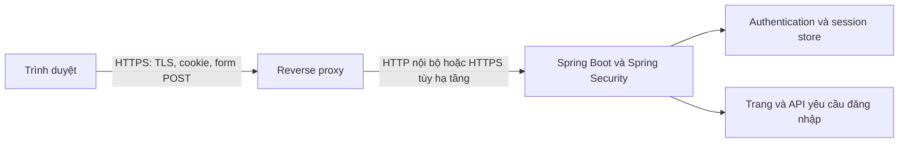

# Giới hạn hỗ trợ trình duyệt và yêu cầu kết nối an toàn

## Mục tiêu bài học

Đăng nhập và đăng xuất trong ứng dụng Spring Security không chỉ phụ thuộc vào `SecurityFilterChain`. Mật khẩu, session cookie, CSRF token và trang chuyển hướng đi qua trình duyệt, giao thức HTTPS, bộ cân bằng tải và đôi khi cả hệ thống đăng nhập tập trung. Một flow hoạt động tốt trên máy lập trình viên vẫn có thể thất bại ở Safari khi trình duyệt hạn chế cookie, hoặc tạo vòng lặp đăng nhập khi reverse proxy báo sai giao thức.

Bài học thuộc chương **Đăng nhập và đăng xuất**, tập trung vào hai câu hỏi:

1. Ứng dụng phải đặt **giới hạn hỗ trợ trình duyệt** như thế nào để không hứa hẹn những hành vi mà browser hoặc thiết bị không bảo đảm?
2. Những **yêu cầu về kết nối an toàn** nào phải được đáp ứng để Spring Security xử lý phiên đăng nhập/đăng xuất đúng và bảo vệ được thông tin xác thực?

Sau khi học, bạn có thể thiết lập chính sách hỗ trợ browser, cấu hình nền tảng HTTPS cho ứng dụng Servlet, đánh giá rủi ro cookie/CSRF/SSO và thiết kế kiểm thử tương thích. Ví dụ chính sử dụng Spring Boot 3.x và Spring Security 6.x trên **Servlet**. Với WebFlux/Reactive, ý tưởng về TLS, cookie, CSRF, Origin và phiên vẫn áp dụng, nhưng API cấu hình là `SecurityWebFilterChain` và `ServerHttpSecurity`, không sao chép nguyên `HttpSecurity` của Servlet.

## 1. Xác định ranh giới bảo vệ

Giả sử ứng dụng nội bộ có đường dẫn `/login`, `/account` và `/logout`. Người dùng truy cập `https://app.example.com`; TLS được kết thúc tại reverse proxy trước khi request tới Spring Boot.



Các lớp bảo vệ phối hợp nhưng giải quyết những vấn đề khác nhau:

| Lớp | Bảo vệ điều gì? | Điều **không** được suy ra |
| --- | --- | --- |
| TLS/HTTPS | Nội dung request/response trên đoạn kết nối được mã hóa và server được xác thực bằng certificate | TLS không quyết định user được phép xem tài nguyên nào |
| HTTP redirect và HSTS | Hướng browser tới HTTPS; HSTS giúp browser đã tin cậy chính sách tự nâng cấp truy cập | HSTS không sửa chứng chỉ sai, cũng không tự bảo vệ lượt truy cập HTTP đầu tiên trước khi browser biết chính sách |
| Cookie `Secure` | Hạn chế gửi cookie qua kênh HTTP thông thường | Cookie vẫn cần `HttpOnly`, `SameSite` và session server hợp lệ |
| Cookie `HttpOnly` | JavaScript trên trang không đọc trực tiếp cookie | Không ngăn XSS gửi request dưới phiên đã đăng nhập |
| Cookie `SameSite` | Giảm trường hợp cookie được gửi trong request khác site | Không thay thế CSRF token hoặc kiểm tra quyền |
| CSRF protection | Chặn yêu cầu thay đổi trạng thái do site khác khiến browser gửi dưới phiên có sẵn | Không thay thế xác thực người dùng hoặc bảo vệ khỏi mọi XSS |
| Session invalidation | Vô hiệu phiên server khi logout | Không mặc định đăng xuất khỏi nhà cung cấp SSO hoặc xóa mọi dữ liệu cache |

**Phân biệt “origin” và “site”:** origin gồm scheme, host và port; “site” trong chính sách cookie thường dựa vào scheme và registrable domain. Hai ứng dụng khác **origin** vẫn có thể cùng **site**. Vì vậy CORS, cookie `SameSite` và CSRF là ba cơ chế riêng; không thể chỉ cấu hình một trong ba rồi xem các luồng đăng nhập khác origin là an toàn.

## 2. Chọn chính sách hỗ trợ trình duyệt có thể kiểm chứng

Spring Security xử lý yêu cầu HTTP ở phía server; không thể bảo đảm mọi browser đều lưu cookie hay cho phép API xác thực của frontend hoạt động. Một bảng hỗ trợ cần kết hợp **phiên bản browser**, **hệ điều hành**, **mô hình đăng nhập** và **các hạn chế quyền riêng tư**.

| Nhóm môi trường | Kỳ vọng cơ bản | Cần kiểm tra thêm |
| --- | --- | --- |
| Chrome và Edge hiện hành trên desktop/Android | Form HTTPS, cookie phiên, CSRF, redirect | Cookie bị hạn chế, extension, chế độ riêng tư, khung nhúng |
| Firefox hiện hành | Flow chuẩn với cookie cùng site | Enhanced Tracking Protection, thiết lập chặn cookie và cross-site redirect |
| Safari trên macOS/iOS | Đăng nhập trực tiếp trên site bằng HTTPS, cookie first-party | Intelligent Tracking Prevention, session sau chuyển hướng SSO, WebView |
| Trình duyệt bên trong ứng dụng/WebView | Chỉ hỗ trợ khi sản phẩm đã thử nghiệm rõ ràng | Cookie store riêng, chuyển app, popup, redirect sang trình duyệt hệ thống |
| Browser cũ hoặc thiết bị chỉ dùng TLS đã lỗi thời | Cần tuyên bố mức hỗ trợ hoặc ngừng hỗ trợ công khai | TLS, cipher suite, SameSite, API JavaScript và cập nhật bảo mật |
| Thiết bị chặn hoàn toàn cookie | Đăng nhập dựa trên HTTP session thường không duy trì được | Thông báo lỗi dễ hiểu hoặc luồng xác thực khác được thiết kế an toàn |

Nên công bố **bảng phiên bản được hỗ trợ** theo chu kỳ phát hành sản phẩm (ví dụ browser hiện hành và một số phiên bản trước, nếu QA thật sự bao phủ). Không khẳng định “tất cả trình duyệt” hoặc gắn vĩnh viễn một phiên bản cụ thể vào tài liệu: cơ chế kiểm soát cookie, API và chính sách bảo mật của browser thay đổi theo bản cập nhật.

Những nguyên tắc thiết kế bền vững:

- Form đăng nhập cơ bản nên dùng HTML chuẩn `<form method="post">` và không bắt buộc JavaScript, nếu sản phẩm không yêu cầu tính năng đặc biệt. Các chức năng dùng JavaScript cần thông báo rõ phạm vi hỗ trợ.
- Phát hiện tính năng khi thật sự cần, ví dụ `window.isSecureContext` hoặc sự hiện diện của `PublicKeyCredential` trước khi cung cấp WebAuthn/passkey; không chỉ dựa vào chuỗi User-Agent.
- Với passkey/WebAuthn, **secure context** là điều kiện của browser API (HTTPS và một số ngoại lệ phát triển như `localhost`). Mức hỗ trợ và giao diện xác thực phụ thuộc browser, hệ điều hành, authenticator; nếu passkey bắt buộc phải có chính sách hỗ trợ thiết bị cụ thể.
- Giữ đường đăng nhập same-origin ở mức có thể; tránh nhúng trang đăng nhập trong iframe khác site, nơi cookie của bên thứ ba có thể bị chặn dù header đã cấu hình hợp lệ.
- Khi lưu lượng đi qua nhà cung cấp danh tính (OIDC/SAML), kiểm thử vòng redirect và cookie ở tất cả browser đã cam kết hỗ trợ. Luồng redirect GET, form POST callback và pop-up có thể chịu chính sách cookie khác nhau.

**Điểm quan trọng:** `SameSite=None; Secure` cho phép một số trường hợp cookie cross-site theo chuẩn, nhưng không thể ép browser bỏ qua chính sách chặn third-party cookie hoặc tracking prevention. Nếu việc nhúng đăng nhập vào iframe bắt đầu thất bại, hướng xử lý tốt hơn thường là chuyển sang đăng nhập first-party bằng điều hướng top-level, không yêu cầu người dùng tắt các lớp bảo vệ riêng tư của browser.

## 3. Yêu cầu HTTPS/TLS cho đăng nhập và đăng xuất

### 3.1 Mật khẩu và session không được đi qua HTTP công khai

Ứng dụng production phải phục vụ trang đăng nhập và mọi thao tác có session qua **HTTPS với certificate hợp lệ cho hostname**, chuỗi chứng chỉ đáng tin cậy và cấu hình TLS hiện đại. Ở hạ tầng phổ biến, TLS 1.2/1.3 được sử dụng; chính sách cipher, gia hạn chứng chỉ và giao thức cụ thể thuộc cấu hình reverse proxy/web server.

Không chỉ endpoint `POST /login` cần HTTPS. Nếu trả form qua HTTP, kẻ tấn công trên đường truyền có thể sửa HTML, JavaScript hoặc `action` của form **trước khi browser gửi mật khẩu**. Vì vậy toàn bộ trang, tài nguyên tải kèm, redirect, callback và trang sau đăng nhập phải ở HTTPS.

Đặt HTTP thành đường chuyển hướng tới HTTPS; tránh dùng HTTP để thực hiện bất kỳ thao tác nhạy cảm nào. Chuyển hướng không bảo vệ được form đã bị phát qua HTTP trong lượt đầu tiên. HSTS và cấu hình domain từ trước giúp giảm rủi ro đó, nhưng chỉ hoạt động trong phạm vi browser đã ghi nhận chính sách hoặc domain thuộc danh sách preload.

```text
Đúng:
  GET  https://app.example.com/login
  POST https://app.example.com/login
  POST https://app.example.com/logout

Cần tránh:
  GET  http://app.example.com/login   -> trả form nhập password trên HTTP
  POST http://app.example.com/login   -> browser đã gửi thông tin nhạy cảm
  GET  https://app.example.com/logout -> thay đổi trạng thái bằng GET
```

Tránh password, mã khôi phục, session ID và access token trong query string; URL dễ xuất hiện trong history, referer, log, telemetry và ảnh chụp màn hình. Việc dùng HTTPS không làm URL trở thành nơi lưu bí mật phù hợp.

### 3.2 Bảo đảm app hiểu đúng giao thức khi có reverse proxy

Trong triển khai TLS termination, đường browser → proxy có thể là HTTPS trong khi proxy → Spring Boot dùng HTTP nội bộ. Nếu ứng dụng chỉ nhìn `request.isSecure() == false`, nó có thể tạo redirect sai, bỏ `Secure` hoặc sinh callback thành `http://...`.

```properties
# application-prod.properties — chỉ minh họa cho Spring Boot 3.x.
# Chỉ dùng khi ứng dụng ở sau reverse proxy tin cậy có Forwarded/X-Forwarded-* chuẩn hóa.
server.forward-headers-strategy=framework

# Session cookie của môi trường production qua HTTPS.
server.servlet.session.cookie.secure=true
server.servlet.session.cookie.http-only=true
server.servlet.session.cookie.same-site=lax
server.servlet.session.cookie.path=/
```

`server.forward-headers-strategy=framework` cho phép xử lý forwarded headers theo framework. Tùy nền tảng có thể dùng chiến lược native; phải kiểm thử trên proxy thực. **Chỉ tin cậy `Forwarded` hoặc `X-Forwarded-Proto` do proxy được kiểm soát đặt**, và chặn client bên ngoài tự tiêm các header đó. Nếu chấp nhận header tùy ý từ Internet, kẻ tấn công có thể khiến server hiểu sai scheme, host hoặc URL redirect.

Khi HTTPS được kết thúc ở proxy, đoạn proxy → app cũng cần bảo vệ phù hợp mô hình đe dọa (ví dụ mạng riêng được kiểm soát hoặc TLS/mTLS). `server.forward-headers-strategy` chỉ sửa nhận thức về request, không tự mã hóa đoạn kết nối phía sau proxy.

Dấu hiệu cấu hình proxy sai:

- Login xong chuyển lặp lại giữa `http://` và `https://`.
- Callback OAuth2/OIDC sai scheme hoặc port, nhà cung cấp danh tính từ chối `redirect_uri`.
- Cookie `Secure` không xuất hiện như mong đợi, hoặc session mất sau redirect.
- Server liên tục trả redirect HTTPS dù trình duyệt đã ở HTTPS.

### 3.3 HTTPS enforcement và HSTS trong Spring Security

Ví dụ minh họa cách yêu cầu kênh HTTPS cho ứng dụng Servlet dùng Spring Security 6.x. Mẫu này giả định endpoint login mặc định của Spring Security và cấu hình reverse proxy đã xử lý đúng scheme:

```java
import org.springframework.context.annotation.Bean;
import org.springframework.context.annotation.Configuration;
import org.springframework.security.config.annotation.web.builders.HttpSecurity;
import org.springframework.security.web.SecurityFilterChain;

import static org.springframework.security.config.Customizer.withDefaults;

@Configuration
class LoginHttpSecurityConfig {

    @Bean
    SecurityFilterChain loginFilterChain(HttpSecurity http) throws Exception {
        http
            .requiresChannel(channel -> channel
                .anyRequest().requiresSecure())
            .authorizeHttpRequests(authorize -> authorize
                .requestMatchers("/assets/**").permitAll()
                .anyRequest().authenticated())
            .formLogin(withDefaults())
            .logout(logout -> logout
                .logoutUrl("/logout")
                .logoutSuccessUrl("/login?logout")
                .invalidateHttpSession(true)
                .clearAuthentication(true)
                .deleteCookies("JSESSIONID"))
            .headers(headers -> headers
                .httpStrictTransportSecurity(hsts -> hsts
                    // Thời hạn ngắn để kiểm tra trước khi áp dụng dài hạn.
                    .maxAgeInSeconds(86400)
                    .includeSubDomains(false)));

        // Giữ bảo vệ CSRF mặc định; POST login/logout phải gửi token hợp lệ.
        return http.build();
    }
}
```

`requiresSecure()` dùng trạng thái request mà ứng dụng nhận được để áp dụng chuyển hướng. Production cũng nên cấu hình chuyển hướng và TLS trực tiếp tại reverse proxy/ingress, vì proxy là thành phần đầu tiên nhận HTTP từ Internet. Không dùng rule buộc HTTPS trên port HTTP nội bộ mà không xử lý forwarded headers: rất dễ tạo redirect loop.

**HSTS** (`Strict-Transport-Security`) ra lệnh cho browser ưu tiên HTTPS trong các lần truy cập sau. Spring Security có hỗ trợ HSTS khi request được nhận diện là secure; header gửi trên HTTP không tạo chính sách HSTS hợp lệ trong browser. Khi rollout, kiểm tra hành vi thật trên HTTPS, sau đó mới tăng `max-age`. Chỉ bật `includeSubDomains` khi **tất cả subdomain liên quan** phục vụ HTTPS ổn định. `preload` là cam kết vận hành dài hạn và cần thỏa yêu cầu riêng của chương trình preload; không bật chỉ để “tăng điểm bảo mật”.

Ở ví dụ trên, `deleteCookies("JSESSIONID")` giả định cookie session có tên đó và thuộc đúng domain/path. Nếu đổi tên cookie (ví dụ dùng tiền tố `__Host-`), áp dụng session store riêng hoặc thay đổi path/domain, phải đồng bộ cách xóa cookie với cookie thực tế.

## 4. Session cookie: tương thích và bảo mật phải cùng đúng

### 4.1 Các thuộc tính cần kiểm tra

Trong ứng dụng form login dùng `HttpSession`, cookie session thường mang tên `JSESSIONID`. Cấu hình đúng không chỉ là “browser có cookie”; phải quan sát từng thuộc tính tại response và hành vi của browser.

| Thuộc tính | Khuyến nghị phổ biến | Vì sao quan trọng |
| --- | --- | --- |
| `Secure` | `true` trong production HTTPS | Không gửi cookie qua HTTP thông thường |
| `HttpOnly` | `true` đối với session cookie | Giảm khả năng JavaScript đọc trực tiếp session ID |
| `SameSite` | Thường bắt đầu với `Lax` nếu flow cho phép | Hạn chế cookie trong nhiều request cross-site |
| `Path` | Giới hạn hợp lý theo ứng dụng; `/` nếu cần cookie cho cả site | Browser chỉ gửi cookie khi path phù hợp |
| `Domain` | Ưu tiên không khai báo để cookie gắn đúng host | Hạn chế chia sẻ phiên không cần thiết với subdomain |
| `Max-Age/Expires` | Dùng session cookie nếu không chủ đích lưu bền | Session dài hạn cần chính sách riêng về timeout, remember-me |
| Tên cookie | Cân nhắc tiền tố `__Host-` nếu phù hợp | Yêu cầu `Secure`, `Path=/`, không có `Domain` theo chuẩn cookie |

`HttpOnly` không ngăn việc browser tự đính kèm cookie vào request. Một đoạn JavaScript độc hại vẫn có thể gửi request dưới quyền user nếu XSS tồn tại; vì thế vẫn cần CSP, mã hóa output và kiểm tra quyền. `SameSite` có thể hỗ trợ chống CSRF nhưng không thay thế bảo vệ CSRF của Spring Security.

Ví dụ một header mong đợi trên HTTPS:

```http
Set-Cookie: JSESSIONID=<opaque-session-value>; Path=/; Secure; HttpOnly; SameSite=Lax
```

Đây là hình minh họa; giá trị session ID là bí mật, không đưa giá trị thật vào tài liệu, log hoặc test snapshot. `Set-Cookie` là response header; JavaScript phía browser không thể đọc trực tiếp header đó như header thông thường.

### 4.2 Khi nào `SameSite=Lax` gây khó khăn?

Ví dụ người dùng truy cập link từ email ngoài site đến `https://app.example.com/account`. Điều hướng top-level qua GET thường tương thích với `SameSite=Lax`. Tuy nhiên callback đăng nhập từ IdP sang ứng dụng bằng **cross-site POST** có thể không gửi cookie `Lax` theo quy tắc chung, khiến ứng dụng mất state/session và báo lỗi đăng nhập.

Cần xác định chính xác:

1. Browser đi qua những origin/site nào?
2. Callback từ IdP dùng GET redirect, POST form hay JavaScript?
3. Session dùng cookie nào, cookie đó được tạo trên host/path nào?
4. Browser đang có chính sách chặn third-party cookie, tracking protection hoặc chế độ riêng tư nào?

Đừng đổi tất cả cookie sang `SameSite=None` chỉ để giải quyết một trường hợp: cookie `None` phải có `Secure` và vẫn có thể bị browser chặn trong bối cảnh bên thứ ba. Nếu ứng dụng cần SSO, hãy chọn và kiểm thử flow phù hợp, có cơ chế `state`/`nonce` và xử lý cookie theo tài liệu của provider. Đối với đăng nhập trong iframe khác site, nên ưu tiên giải pháp thiết kế lại theo top-level navigation khi có thể.

### 4.3 Tạo lại session sau khi đăng nhập

Spring Security bảo vệ session fixation trong cấu hình session thông thường; trên container Servlet hiện đại, cơ chế phù hợp có thể thay session ID khi user xác thực thành công. Khi kiểm thử login, không nên giả định session ID trước và sau login luôn giống nhau, cũng không đưa session ID vào URL để “giữ phiên”.

Session timeout, session concurrency, remember-me và đăng xuất trên thiết bị khác là các tính năng **khác nhau**. Xóa cookie phía client không thay thế việc vô hiệu session/token ở server. Nếu dùng remember-me, cần kiểm tra cookie và persistent token của tính năng đó trong quy trình logout thực tế.

## 5. CSRF và trình tự đăng nhập/đăng xuất an toàn

### 5.1 Login là POST có CSRF protection

Với form login dựa trên cookie/session, Spring Security bảo vệ CSRF theo mặc định cho các HTTP method thay đổi trạng thái, bao gồm `POST /login` và `POST /logout` khi sử dụng cơ chế logout mặc định. Form cần chứa CSRF token server sinh theo đúng cấu hình; với Thymeleaf/Spring MVC, tích hợp template có thể chèn token tự động.

Minh họa HTML đã được server render:

```html
<form method="post" action="/login">
  <label for="username">Tên đăng nhập</label>
  <input id="username" name="username" autocomplete="username" required>

  <label for="password">Mật khẩu</label>
  <input id="password" type="password" name="password"
         autocomplete="current-password" required>

  <!-- Giá trị là token thực được server gắn cho phiên/request hiện tại. -->
  <input type="hidden" name="_csrf" value="SERVER_RENDERED_CSRF_TOKEN">

  <button type="submit">Đăng nhập</button>
</form>
```

`SERVER_RENDERED_CSRF_TOKEN` chỉ là placeholder giải thích; tuyệt đối không hardcode token vào mã nguồn. Với ứng dụng SPA hoặc frontend tách origin, cách trao đổi CSRF token và cookie cần được thiết kế, chẳng hạn endpoint cấp token hoặc `CookieCsrfTokenRepository` phù hợp, kết hợp CORS và chính sách cookie. Không tắt CSRF trên toàn bộ ứng dụng chỉ vì form chưa gửi token đúng.

Đối với endpoint đăng nhập, đừng hiển thị thông báo lỗi quá chi tiết gây lộ tài khoản tồn tại hay không. Browser cache không nên lưu trang chứa dữ liệu nhạy cảm hoặc response có thông tin phiên; chú ý response redirect và trang sau đăng nhập.

### 5.2 Logout phải thay đổi trạng thái bằng POST

Một trang đăng xuất thường có form dùng phương thức POST:

```html
<form method="post" action="/logout">
  <input type="hidden" name="_csrf" value="SERVER_RENDERED_CSRF_TOKEN">
  <button type="submit">Đăng xuất</button>
</form>
```

Khi CSRF đang bật theo cấu hình thông thường, Spring Security xử lý logout hiệu lực thông qua POST với CSRF token hợp lệ. `GET /logout` có thể hiển thị trang xác nhận khi dùng trang mặc định; không lấy một lần GET đơn lẻ làm bằng chứng phiên đã bị xóa. Không thiết kế logout kiểu `<a href="/logout">` khiến GET làm thay đổi trạng thái, vì link có thể bị mở ngoài ý muốn, prefetch hoặc dùng trong tấn công cross-site.

Một quy trình logout đáng tin cậy cần chứng minh được:

- Request logout hợp lệ vô hiệu `HttpSession`/`SecurityContext` theo chính sách đã chọn và xử lý cookie session/remember-me đúng cách.
- Request sau logout tới tài nguyên bảo vệ bị yêu cầu đăng nhập lại hoặc bị từ chối.
- Tài liệu nhạy cảm không còn truy cập qua request mới bằng session cũ. Nút **Back** có thể hiển thị bản sao từ bfcache/history của trình duyệt; kiểm thử thêm refresh/revalidate và cấu hình `Cache-Control` phù hợp cho nội dung nhạy cảm.
- Nếu dùng SSO, logout khỏi app nội bộ chưa chắc logout khỏi IdP. Cần định nghĩa rõ người dùng mong đợi “logout app”, “logout tất cả phiên” hay “logout provider”.
- Nếu có WebSocket hoặc SSE được mở trước logout, hệ thống phải có chính sách chấm dứt/hạn chế các kết nối còn sống; chỉ vô hiệu HTTP session không bảo đảm mọi kết nối realtime đã dừng tức thì.

`Clear-Site-Data` có thể hỗ trợ dọn một số dữ liệu lưu phía browser trong môi trường hỗ trợ, nhưng mức hỗ trợ browser khác nhau và phạm vi tác động rộng. Không dùng nó thay thế việc thu hồi session/token phía server.

## 6. Những tình huống trình duyệt dễ làm flow thất bại

| Triệu chứng | Nguyên nhân thường gặp | Cách kiểm tra và sửa |
| --- | --- | --- |
| Đăng nhập thành công rồi lại về `/login` | Cookie `Secure`/`SameSite`/Domain/Path sai; proxy sai scheme; session store không chia sẻ | Xem `Set-Cookie`, cookie bị browser chặn, redirect chain, session server |
| Chrome hoạt động nhưng Safari trong iframe không giữ phiên | Third-party cookie/tracking prevention | Chuyển sang đăng nhập first-party top-level; kiểm thử trên Safari/iOS |
| SSO trả về “invalid state” sau callback | Cookie phiên không được gửi do callback cross-site hoặc đổi host/scheme | So sánh callback method, origin, `SameSite`, cookie và state |
| Browser báo “not secure” | URL HTTP, certificate hết hạn, hostname không khớp, chuỗi CA không tin cậy | Sửa TLS/certificate tại điểm kết thúc HTTPS; kiểm tra tải tài nguyên hỗn hợp |
| Redirect liên tục HTTP ↔ HTTPS | Reverse proxy không truyền hoặc app không xử lý scheme đúng | Kiểm tra forwarded headers từ proxy tin cậy, `requiresSecure` và port mapping |
| Logout chuyển trang nhưng phiên vẫn truy cập được | Session/token chưa vô hiệu, cookie cùng tên khác Path, SSO tự đăng nhập lại | Kiểm tra request bảo vệ mới, server session store, cookie và hành vi IdP |
| Browser Back hiện thông tin sau logout | Trang cũ phục hồi từ cache/bfcache | Kiểm tra cache policy, request lại server; phân biệt ảnh hiển thị với quyền truy cập thật |
| `POST /login`/`POST /logout` bị 403 | CSRF token thiếu/sai; token thuộc session khác; request qua proxy sai cookie | Theo dõi cookie cùng phiên và hidden field/header CSRF |
| Passkey hoạt động ở local nhưng không trên thiết bị đích | Secure context hoặc hỗ trợ browser/OS/authenticator khác nhau | Kiểm tra HTTPS, `isSecureContext`, `PublicKeyCredential` và ma trận thiết bị |

Trong tab **Network** của DevTools, hãy quan sát status code, redirect `Location`, response `Set-Cookie`, request `Cookie`, header `Origin`/`Referer` (nếu có), HSTS và CSRF. Trong tab **Application/Storage**, xem thuộc tính cookie và lý do browser không lưu hoặc không gửi. Không ghi lại password, session ID, CSRF token hay authorization headers vào ticket công khai.

## 7. Kiểm thử ở ba lớp: server, hạ tầng, browser thực

Một bộ test Spring MVC như `MockMvc` rất hữu ích để kiểm tra filter chain, CSRF và redirect. Tuy nhiên nó **không thay browser** quyết định có gửi cookie trong cross-site request hay từ chối certificate/TLS không. Cần test trên môi trường triển khai có HTTPS, proxy, domain và browser thật.

### 7.1 Kiểm thử Spring Security bằng MockMvc

Ví dụ sau giả định `SecurityFilterChain` ở mục 3 và dependency `spring-security-test` đã có. `secure(true)` mô phỏng request HTTPS ở Servlet layer để không bị bộ lọc HTTPS redirect trước khi kiểm tra CSRF:

```java
import org.junit.jupiter.api.Test;
import org.springframework.beans.factory.annotation.Autowired;
import org.springframework.boot.test.autoconfigure.web.servlet.AutoConfigureMockMvc;
import org.springframework.boot.test.context.SpringBootTest;
import org.springframework.test.web.servlet.MockMvc;

import static org.springframework.security.test.web.servlet.request.SecurityMockMvcRequestPostProcessors.csrf;
import static org.springframework.security.test.web.servlet.request.SecurityMockMvcRequestPostProcessors.user;
import static org.springframework.test.web.servlet.request.MockMvcRequestBuilders.get;
import static org.springframework.test.web.servlet.request.MockMvcRequestBuilders.post;
import static org.springframework.test.web.servlet.result.MockMvcResultMatchers.header;
import static org.springframework.test.web.servlet.result.MockMvcResultMatchers.redirectedUrl;
import static org.springframework.test.web.servlet.result.MockMvcResultMatchers.status;
import static org.hamcrest.Matchers.containsString;

@SpringBootTest
@AutoConfigureMockMvc
class LoginTransportSecurityTest {

    @Autowired MockMvc mvc;

    @Test
    void httpRequestRedirectsToHttps() throws Exception {
        mvc.perform(get("/account").secure(false))
            .andExpect(status().is3xxRedirection());
    }

    @Test
    void secureResponseIncludesHsts() throws Exception {
        mvc.perform(get("/login").secure(true))
            .andExpect(header().string(
                "Strict-Transport-Security", containsString("max-age=")));
    }

    @Test
    void logoutWithoutCsrfIsRejected() throws Exception {
        mvc.perform(post("/logout").secure(true).with(user("alice")))
            .andExpect(status().isForbidden());
    }

    @Test
    void logoutWithCsrfRedirects() throws Exception {
        mvc.perform(post("/logout").secure(true)
                .with(user("alice")).with(csrf()))
            .andExpect(status().is3xxRedirection())
            .andExpect(redirectedUrl("/login?logout"));
    }
}
```

Bổ sung kiểm tra nguyên nhân redirect tới **đúng HTTPS host/port** theo topology triển khai; chỉ khẳng định status 3xx là chưa đủ. Khi ứng dụng dùng nhiều `SecurityFilterChain` hoặc cấu hình khác mặc định, điều chỉnh endpoint/test principal đúng với sản phẩm. MockMvc không thể xác nhận browser giữ session sau redirect, HSTS đã được browser ghi nhớ hay cookie có bị chính sách riêng tư chặn hay không.

### 7.2 Kiểm thử trên trình duyệt bằng Playwright

Đây là khung minh họa cho ứng dụng đã có form và nút logout trong UI. Thay hostname, dữ liệu tài khoản **test** và selector theo ứng dụng thực; chạy với chứng chỉ HTTPS hợp lệ, không bật `ignoreHTTPSErrors` để che lỗi TLS.

```typescript
import { test, expect } from '@playwright/test';

test('login/logout qua HTTPS và cookie phiên an toàn', async ({ browser }) => {
  const context = await browser.newContext({
    ignoreHTTPSErrors: false
  });
  const page = await context.newPage();

  await page.goto('https://app.example.test/account');
  await expect(page).toHaveURL(/\/login/);
  expect(await page.evaluate(() => window.isSecureContext)).toBe(true);

  await page.locator('input[name="username"]').fill('alice');
  await page.locator('input[name="password"]').fill('test-only-password');
  await page.locator('button[type="submit"]').click();
  await expect(page).toHaveURL(/\/account/);

  const cookies = await context.cookies('https://app.example.test');
  const session = cookies.find(cookie => cookie.name === 'JSESSIONID');

  expect(session).toBeDefined();
  expect(session?.secure).toBe(true);
  expect(session?.httpOnly).toBe(true);
  expect(session?.sameSite).toBe('Lax');

  await page.getByRole('button', { name: 'Đăng xuất' }).click();
  await page.goto('https://app.example.test/account');
  await expect(page).toHaveURL(/\/login/);

  await context.close();
});
```

Test `SameSite=Lax` ở đây phản ánh **chính sách ví dụ**, không phải mọi ứng dụng bắt buộc phải chọn Lax. Nếu dùng login page mặc định của Spring Security, selector và nút logout UI cần điều chỉnh. Nếu có cơ chế tự đăng nhập lại bởi SSO, kết quả sau logout cần so với hợp đồng logout đã xác định ở mục 5.

Kiểm thử trình duyệt phải có ít nhất hai đối chứng: một luồng HTTPS/first-party hợp lệ thành công, và một luồng bị chặn có nguyên nhân cụ thể (ví dụ từ chối cookie hoặc CSRF). Tránh kết luận “an toàn” chỉ vì login thất bại; nguyên nhân có thể là môi trường test hỏng.

### 7.3 Ma trận tích hợp cần thực hiện

| ID | Kịch bản | Kết quả mong đợi |
| --- | --- | --- |
| T01 | Mở `http://app.example.com/login` | Chuyển sang HTTPS ở edge; không render form nhạy cảm qua HTTP |
| T02 | Mở HTTPS với certificate hợp lệ | Login bình thường, không cảnh báo certificate |
| T03 | Certificate hết hạn hoặc hostname không đúng | Browser chặn/cảnh báo đúng; hệ thống không yêu cầu user bỏ qua cảnh báo |
| T04 | Login HTTPS hợp lệ | Có session cookie `Secure`/`HttpOnly` và `SameSite` theo chính sách |
| T05 | Truy cập HTTP sau khi browser nhận HSTS | Browser tự ưu tiên HTTPS trong phạm vi HSTS |
| T06 | `POST /login` thiếu/sai CSRF | Bị từ chối khi CSRF bật; không xác thực được |
| T07 | `POST /logout` thiếu/sai CSRF | Không logout thành công |
| T08 | `POST /logout` hợp lệ, sau đó truy cập tài nguyên bảo vệ | Session cũ không được dùng; cần xác thực lại |
| T09 | Bấm Back sau logout rồi refresh | Nội dung nhạy cảm không còn truy cập bằng request mới |
| T10 | Lặp lại login/logout qua Chrome/Edge, Firefox, Safari và mobile nằm trong chính sách hỗ trợ | Hành vi tương đương về bảo mật và đường chuyển hướng |
| T11 | Cookie bị chặn hoặc browser riêng tư | Ứng dụng thông báo đúng, không tạo ảo giác đã đăng nhập |
| T12 | SSO callback cross-site | Cookie và `state` hoạt động theo thiết kế trên browser mục tiêu |
| T13 | Reverse proxy đổi `X-Forwarded-Proto`, host hoặc port | Không redirect loop; app dùng scheme/host hợp lệ từ proxy được tin cậy |
| T14 | Có phiên đăng nhập, thử `GET /logout` | Không vô hiệu phiên bằng một GET thông thường |
| T15 | Login/logout khi đang mở hai tab | Trạng thái sau logout nhất quán khi tab còn lại request mới |

Với HSTS, dùng domain test tách biệt: browser có thể nhớ chính sách giữa các lần thử và không cho quay lại HTTP, khiến môi trường test bị “kẹt”. Không dùng production domain để thử chính sách HSTS sai hoặc certificate lỗi.

## 8. Checklist trước khi phát hành

1. **TLS:** Toàn bộ trang login, callback, API sau login và logout sử dụng HTTPS; certificate đúng hostname, còn hạn và không chứa mixed content nguy hiểm.
2. **Proxy:** App nhìn thấy đúng scheme/host từ proxy được tin cậy; không có redirect loop; đoạn proxy → app được bảo vệ theo yêu cầu hạ tầng.
3. **Cookies:** Kiểm tra thuộc tính `Secure`, `HttpOnly`, `SameSite`, Path/Domain, timeout; tên cookie và cách xóa khớp nhau.
4. **CSRF:** Giữ cơ chế CSRF phù hợp với session-based auth; login/logout POST gửi token hợp lệ; không vô hiệu CSRF để che lỗi browser.
5. **Logout:** Session/token cần thiết được vô hiệu; request mới sau logout bị từ chối; phân biệt logout app với logout IdP/remember-me.
6. **HSTS:** Quan sát header trên HTTPS, triển khai `max-age` có kế hoạch, cân nhắc `includeSubDomains` và preload chỉ sau khi đã kiểm chứng hạ tầng.
7. **Trình duyệt:** Có bảng phiên bản/thiết bị hỗ trợ và kiểm thử cookie cross-site, Safari/iOS, WebView nếu sản phẩm hỗ trợ.
8. **Giám sát:** Theo dõi lỗi TLS, login loop, 403 CSRF và số lần login/logout bất thường mà không ghi lộ mật khẩu/token/session ID.

## Bài tập áp dụng

Ứng dụng triển khai tại `https://app.example.com` thông qua ingress. Người dùng đăng nhập được trên Chrome desktop nhưng Safari iOS luôn quay về `/login` sau redirect từ IdP; đồng thời một số người dùng gặp loop `http` ↔ `https`.

Hãy thiết kế cách điều tra theo thứ tự:

1. Vẽ lại toàn bộ luồng browser → ingress → app → IdP, ghi rõ scheme, host, method của callback và những cookie cần đi kèm.
2. Kiểm tra `Set-Cookie` và lý do cookie không được gửi trong Safari; đối chiếu `SameSite` với phương thức callback; không mặc định đổi tất cả cookie sang `None`.
3. Kiểm tra ingress có chuẩn hóa `X-Forwarded-Proto`/`Forwarded` và Boot có xử lý headers từ proxy tin cậy chưa.
4. Bổ sung một integration test dùng browser Safari/iOS thuộc phạm vi hỗ trợ và một test trên hạ tầng proxy thật; quan sát cả đối chứng dương lẫn nguyên nhân bị từ chối.

Một lời giải tốt sẽ phân biệt **lỗi browser cookie**, **lỗi cấu hình proxy**, **lỗi CSRF/state**, và **lỗi session store** bằng bằng chứng ở từng tầng. Hai triệu chứng có thể có hai nguyên nhân độc lập.

## Tài liệu tham khảo

- [Spring Security Reference — Servlet authentication](https://docs.spring.io/spring-security/reference/servlet/authentication/index.html): cơ chế xác thực và phiên ở Servlet.
- [Spring Security Reference — Logout](https://docs.spring.io/spring-security/reference/servlet/authentication/logout.html): logout endpoint, handler và hành vi mặc định.
- [Spring Security Reference — CSRF](https://docs.spring.io/spring-security/reference/servlet/exploits/csrf.html): CSRF token và bảo vệ request thay đổi trạng thái.
- [Spring Security Reference — Security HTTP response headers](https://docs.spring.io/spring-security/reference/servlet/exploits/headers.html): HSTS, cache và các header bảo vệ khác.
- [MDN — Set-Cookie](https://developer.mozilla.org/en-US/docs/Web/HTTP/Reference/Headers/Set-Cookie): thuộc tính `Secure`, `HttpOnly`, `SameSite`, Path và Domain.
- [MDN — Strict-Transport-Security](https://developer.mozilla.org/en-US/docs/Web/HTTP/Reference/Headers/Strict-Transport-Security): thời hạn, phạm vi và hành vi HSTS trong browser.
- [MDN — Secure contexts](https://developer.mozilla.org/en-US/docs/Web/Security/Defenses/Secure_Contexts): yêu cầu secure context đối với một số Web API.
