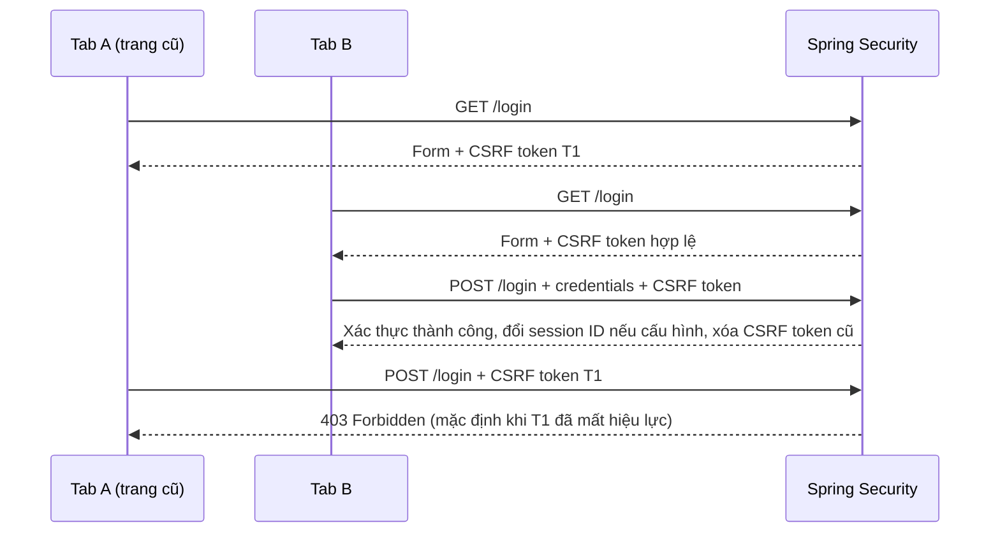

# Kiểm thử gửi lại yêu cầu đăng nhập hoặc đăng xuất từ trang cũ

Một người mở trang đăng nhập ở hai tab, đăng nhập thành công ở tab thứ nhất rồi quay lại tab thứ hai và bấm **Đăng nhập** trên biểu mẫu đã mở trước đó. Tình huống tương tự xảy ra khi người dùng đã đăng xuất nhưng vẫn còn một trang xác nhận đăng xuất trong lịch sử trình duyệt, hoặc nhấn **Back** để quay về biểu mẫu cũ. Đây là các trường hợp cần kiểm thử trong phần **Đăng nhập và đăng xuất** của `SPRING_SECURITY_HTTP_PROTECTION`.

Mục tiêu của bài là xây dựng phép kiểm thử cho HTTP request phát sinh từ giao diện đã lỗi thời: token CSRF có còn hợp lệ không, session hiện tại là gì, endpoint có thực hiện thay đổi trạng thái ngoài ý muốn không, và người dùng cần làm gì để tiếp tục. Kiểm thử được trình bày cho Spring Security trên Servlet và cách chuyển tư duy sang Reactive, kèm các bước kiểm chứng trong trình duyệt thật.

## 1. Phân biệt trang cũ, request cũ và request gửi lại

**Trang cũ** là HTML/DOM được tạo khi trạng thái xác thực hoặc token CSRF khác trạng thái hiện tại. Tab đang mở, trang khôi phục từ lịch sử và trang được trình duyệt phục hồi bằng back/forward cache (bfcache) đều có thể chứa biểu mẫu cũ.

**Gửi lại request** có thể là người dùng bấm nút trên biểu mẫu cũ, trình duyệt đề nghị gửi lại POST khi reload, hoặc mã JavaScript thực hiện lại một `fetch`. Ba hành vi này có thể khác về cookie, header và token. Vì thế, cần ghi rõ request thực tế thay vì kết luận chỉ từ việc thấy trang cũ trên màn hình.

Ví dụ với hai tab dùng chung cookie/session:



Với cấu hình Spring Security thông dụng, `CsrfAuthenticationStrategy` xóa CSRF token khi xác thực thành công và `CsrfLogoutHandler` xóa token khi logout. Token mới được lấy/phát hành khi cần ở request tiếp theo. Chiến lược bảo vệ session fixation cũng có thể đổi session ID khi đăng nhập. Đây là **những cơ chế khác nhau**: đổi session ID không tự nó chứng minh request cũ sẽ bị chặn, và CSRF token không phải cơ chế chống phát lại mọi request.

Một biểu mẫu đăng nhập chứa tên người dùng, mật khẩu và **token CSRF mới hợp lệ** vẫn có thể gửi yêu cầu đăng nhập lần nữa. Nếu yêu cầu nghiệp vụ là không được chuyển tài khoản hoặc không được xác thực lại khi đã đăng nhập, ứng dụng cần đặt quy tắc riêng; không dựa vào CSRF để bảo đảm điều đó.

## 2. Xác định hợp đồng hành vi trước khi kiểm thử

Với ứng dụng web dùng session và CSRF mặc định, đặt ra các kỳ vọng sau:

1. **POST đăng nhập hợp lệ lần đầu**: xác thực thành công, thường chuyển hướng bằng `302`/`303`; session được xử lý theo cấu hình.
2. **POST từ biểu mẫu đăng nhập cũ sau khi đăng nhập thành công**: token CSRF cũ bị từ chối, thông thường là `403`; request không được gây đăng nhập/chuyển tài khoản lần hai.
3. **POST đăng xuất hợp lệ lần đầu**: xử lý logout, hủy hoặc vô hiệu hóa session theo cấu hình, xóa trạng thái xác thực và chuyển hướng đến trang phù hợp.
4. **POST từ biểu mẫu đăng xuất cũ sau khi logout**: token thuộc session cũ không được chấp nhận; không thực hiện thêm thao tác nghiệp vụ và không làm ảnh hưởng một session mới.
5. **Lấy lại trang/CSRF token mới**: người dùng được phép thao tác hợp lệ theo chính sách hiện hành, ví dụ mở lại `/login` rồi đăng nhập.

Mã trạng thái cụ thể phụ thuộc `AuthenticationEntryPoint`, `AccessDeniedHandler`, cấu hình logout và API/frontend. `403` là kỳ vọng điển hình khi `CsrfFilter` chặn một unsafe request có token sai; một ứng dụng có xử lý lỗi riêng có thể trả JSON hoặc chuyển hướng. Do đó phải kiểm tra **cả trạng thái bảo mật sau request**, không chỉ so khớp status code.

Các giả định của ví dụ dưới đây:

```java
@Bean
SecurityFilterChain securityFilterChain(HttpSecurity http) throws Exception {
    return http
        .authorizeHttpRequests(auth -> auth
            .requestMatchers("/login", "/error").permitAll()
            .anyRequest().authenticated())
        .formLogin(Customizer.withDefaults())
        .logout(Customizer.withDefaults())
        .build(); // CSRF bật mặc định; POST /logout mới thực hiện logout
}
```

Đây là ví dụ cho Spring Security Servlet với form login mặc định, cookie session và `HttpSessionCsrfTokenRepository` mặc định. Dữ liệu đăng nhập thử nghiệm phải được khai báo trong môi trường test; không dùng tài khoản thật. Nếu ứng dụng dùng `CookieCsrfTokenRepository`, API JSON hoặc trang login/logout tự viết thì thay selector, cách lấy token và endpoint cho phù hợp, giữ nguyên nguyên tắc kiểm thử.

## 3. Ma trận các tình huống cần bao phủ

| Tình huống | Trạng thái khi tạo trang | Điều thay đổi trước khi gửi | Điều cần khẳng định |
| --- | --- | --- | --- |
| Hai tab cùng có form login | Chưa xác thực, form chứa token T1 | Tab B đăng nhập thành công | POST từ tab A với T1 bị chặn; không xác thực lại hoặc đổi tài khoản |
| Back về form login | Đã đăng nhập | Trang cũ được hiển thị lại | Gửi token cũ thất bại an toàn; tải form mới không bị kẹt |
| Form login cũ sau logout | Form được mở trước khi logout | Login và logout đã hoàn tất | Token cũ không được tin cậy; form mới có token mới và hoạt động |
| Hai tab cùng có form logout | Đang xác thực | Tab B logout thành công | POST logout từ tab A không gây hiệu ứng phụ lần nữa |
| Bấm logout hai lần rất nhanh | Đang xác thực | POST đầu tiên đã logout | POST sau không làm phát sinh thao tác sai hoặc ảnh hưởng session mới |
| Session hết hạn | Trang mở khi session còn sống | Session hết hạn phía server | Form cũ bị từ chối hoặc yêu cầu làm mới; không chấp nhận token thuộc session hết hạn |
| Session khác | Trang/token thuộc session S1 | Browser có session S2 | Token S1 không được dùng để thay đổi trạng thái của S2 |
| Không có token hoặc token sai | Bất kỳ | POST unsafe request | Spring Security từ chối theo chính sách CSRF; không đổi trạng thái |
| GET `/logout` | Đang đăng nhập | Người dùng mở link cũ | Không logout chỉ bởi GET khi CSRF được bật; với cấu hình form mặc định có thể thấy trang xác nhận |

Đối với mỗi hàng, lưu lại **cookie được gửi**, **session ID/phiên phía server**, **CSRF token trong form/header**, **HTTP method**, **response** và **trạng thái xác thực cuối cùng**. Đó là các bằng chứng giúp phân biệt lỗi session, lỗi token và hành vi frontend.

## 4. Kiểm thử tự động bằng MockMvc (Servlet)

`MockMvc` có thể mô phỏng chuỗi request trên cùng một session mà không cần trình duyệt. Trường hợp này phải **giữ token thật đã lấy từ request cũ**. Nếu dùng `with(csrf())` trên cả hai request, Spring Security Test sẽ cung cấp một token hợp lệ cho request thử nghiệm; phép kiểm thử sẽ không còn mô phỏng token lỗi thời. `with(csrf().useInvalidToken())` hữu ích để kiểm tra đường đi của lỗi CSRF nói chung, nhưng không thay thế bài kiểm tra vòng đời token khi login/logout.

Giả sử ứng dụng test có form login mặc định, tài khoản thử `alice` với mật khẩu `correct-password`, cấu hình logout mặc định và đã bật `spring-security-test`:

```java
import static org.assertj.core.api.Assertions.assertThat;
import static org.springframework.test.web.servlet.request.MockMvcRequestBuilders.get;
import static org.springframework.test.web.servlet.request.MockMvcRequestBuilders.post;
import static org.springframework.test.web.servlet.result.MockMvcResultMatchers.status;

import org.junit.jupiter.api.Test;
import org.springframework.beans.factory.annotation.Autowired;
import org.springframework.boot.test.autoconfigure.web.servlet.AutoConfigureMockMvc;
import org.springframework.boot.test.context.SpringBootTest;
import org.springframework.mock.web.MockHttpSession;
import org.springframework.security.web.csrf.CsrfToken;
import org.springframework.test.web.servlet.MockMvc;
import org.springframework.test.web.servlet.MvcResult;

@SpringBootTest
@AutoConfigureMockMvc
class OldLoginLogoutFormTest {

    @Autowired
    MockMvc mvc;

    @Test
    void loginFormOpenedBeforeAuthenticationCannotReuseOldCsrfToken()
            throws Exception {
        // Tab A mở form và giữ nguyên token được render.
        MvcResult oldForm = mvc.perform(get("/login"))
            .andExpect(status().isOk())
            .andReturn();
        MockHttpSession session = sessionFrom(oldForm);
        String oldToken = csrfFrom(oldForm);

        // Tab B đăng nhập trên cùng phiên trình duyệt.
        mvc.perform(post("/login")
                .session(session)
                .param("username", "alice")
                .param("password", "correct-password")
                .param("_csrf", oldToken))
            .andExpect(status().is3xxRedirection());

        // Tab A vẫn gửi biểu mẫu cũ sau khi login đã làm token mất hiệu lực.
        mvc.perform(post("/login")
                .session(session)
                .param("username", "alice")
                .param("password", "correct-password")
                .param("_csrf", oldToken))
            .andExpect(status().isForbidden());
    }

    @Test
    void logoutFormFromInvalidatedSessionCannotBeReplayed() throws Exception {
        MvcResult loginForm = mvc.perform(get("/login"))
            .andExpect(status().isOk())
            .andReturn();
        MockHttpSession session = sessionFrom(loginForm);

        mvc.perform(post("/login")
                .session(session)
                .param("username", "alice")
                .param("password", "correct-password")
                .param("_csrf", csrfFrom(loginForm)))
            .andExpect(status().is3xxRedirection());

        // GET /logout hiển thị trang xác nhận trong cấu hình mặc định.
        MvcResult oldLogoutForm = mvc.perform(get("/logout").session(session))
            .andExpect(status().isOk())
            .andReturn();
        String oldLogoutToken = csrfFrom(oldLogoutForm);

        mvc.perform(post("/logout")
                .session(session)
                .param("_csrf", oldLogoutToken))
            .andExpect(status().is3xxRedirection());

        // Sau logout, server đã vô hiệu hóa session cũ. Mô phỏng browser
        // gửi lại POST với token còn nằm trong tab cũ nhưng ở phiên mới.
        mvc.perform(post("/logout")
                .session(new MockHttpSession())
                .param("_csrf", oldLogoutToken))
            .andExpect(status().isForbidden());
    }

    private static MockHttpSession sessionFrom(MvcResult result) {
        MockHttpSession session =
            (MockHttpSession) result.getRequest().getSession(false);
        assertThat(session).isNotNull();
        return session;
    }

    private static String csrfFrom(MvcResult result) {
        CsrfToken token = (CsrfToken) result.getRequest()
            .getAttribute(CsrfToken.class.getName());
        assertThat(token).isNotNull();
        // Với XorCsrfTokenRequestAttributeHandler, giá trị trả về có thể
        // là giá trị đã mask dành cho HTML form. Hãy dùng nguyên giá trị đó.
        return token.getToken();
    }
}
```

**Cách đọc kết quả:** Nếu request đăng nhập đầu tiên không redirect, hãy kiểm tra trước tài khoản test, URL xử lý đăng nhập, `usernameParameter`/`passwordParameter` và cấu hình của filter chain. Nếu hai request đều thành công, kiểm tra xem cấu hình có vô hiệu hóa CSRF, thay đổi `CsrfAuthenticationStrategy` hoặc vô tình cấp lại token hợp lệ cho lần gửi thứ hai hay không. Với logout, việc sử dụng `new MockHttpSession()` có chủ ý: `MockHttpSession` cũ đã bị invalidated, nên không nên truyền lại đối tượng đã vô hiệu hóa như thể nó vẫn là một phiên sống.

Trong test thực tế nên bổ sung assertion về **người dùng đang xác thực**, **session đã bị hủy**, **số lần audit logout** và **các tác dụng phụ** như thu hồi refresh token hoặc phát event. `403` đơn độc chưa chứng minh mọi invariant nghiệp vụ. Nếu ứng dụng dùng `SecurityContextRepository` khác hoặc logout theo token, hãy kiểm tra đúng nguồn trạng thái tương ứng.

### Kiểm tra token thiếu và token sai riêng biệt

Đặt thêm hai test cơ sở để khoanh vùng nguyên nhân:

```java
// Không cung cấp CSRF token cho POST /logout.
mvc.perform(post("/logout").session(session))
    .andExpect(status().isForbidden());

// Token sai, không phụ thuộc việc trang có cũ hay không.
mvc.perform(post("/logout").session(session)
        .param("_csrf", "tampered-token"))
    .andExpect(status().isForbidden());
```

Đoạn này là **hai request kiểm tra độc lập** trong bối cảnh còn session hợp lệ; không dùng chúng thay cho kiểm tra chuỗi trạng thái ở trên. Nếu ứng dụng custom parameter/header name, phải gửi theo cấu hình thực tế.

## 5. Kiểm thử trình duyệt thật: tab, Back, bfcache và gửi trùng

`MockMvc` không tái hiện hoàn toàn browser history, việc lưu DOM hoặc cách cookie được đồng bộ giữa các tab. Với Chrome/Firefox/Safari, chạy thêm các kịch bản thao tác sau và quan sát Network trong DevTools:

1. Mở hai tab cùng `/login`, giữ tab A nguyên trạng. Ở tab B đăng nhập thành công; quay về tab A, điền thông tin và submit. Ghi lại POST, giá trị `_csrf`, cookie session, status và UI khi lỗi. Xác nhận tab A không đổi tài khoản hay phá phiên đã đăng nhập.
2. Khi đang đăng nhập, mở trang xác nhận `/logout` ở hai tab (hoặc trang logout do ứng dụng tự xây dựng). Logout ở tab B, sau đó submit form logout ở tab A. Kiểm tra phản hồi, log và audit, bảo đảm logout chỉ có hiệu ứng nghiệp vụ một lần.
3. Dùng **Back** sau login hoặc logout; lặp lại với reload và thao tác tiến/lùi. Kiểm tra trường hợp trang được lấy lại từ HTTP cache và trường hợp trình duyệt phục hồi DOM bằng bfcache. Nhìn vào request thực tế, vì chỉ thấy form cũ chưa chứng minh một POST đã được gửi.
4. Thử double-click nút submit, Enter liên tiếp, hai request đồng thời và kết nối mạng chậm. Chặn nút ở UI sau lần submit đầu giúp trải nghiệm tốt, nhưng chỉ server mới quyết định request thứ hai được xử lý đến đâu.
5. Hết hạn session rồi submit form cũ; đăng xuất ở tab khác rồi login lại để tạo phiên mới; kiểm tra một tab cũ không thể làm thay đổi phiên mới bằng token cũ.

Các phép kiểm tra thủ công nên có ảnh chụp Network hoặc bản HAR đã loại bỏ cookie, token, mật khẩu và thông tin nhạy cảm trước khi chia sẻ. Với kiểm thử tự động E2E, tạo hai `Page` trong **cùng một `BrowserContext`** để mô phỏng hai tab chia sẻ cookie; tạo context riêng để thử cô lập phiên. Tránh lấy hai context độc lập rồi cho rằng chúng mô phỏng hai tab của cùng người dùng.

### Cache headers không phải cơ chế duy nhất

Spring Security thông thường thêm các HTTP response header hạn chế cache đối với nội dung nhạy cảm (`Cache-Control`, `Pragma`, `Expires`). Đừng phụ thuộc hoàn toàn vào header để cho rằng nút Back không bao giờ hiện form cũ: hành vi history/bfcache khác nhau giữa trình duyệt và phiên bản. Điểm cần bảo vệ là **server không tin token/session lỗi thời**, đồng thời UI hiển thị cách làm mới trang hoặc đăng nhập lại khi gặp `403` hay session timeout.

Khi ứng dụng dùng POST-Redirect-GET (PRG) sau thao tác thành công, reload trang đích thường không tự gửi lại POST vừa thành công. PRG cải thiện hành vi trình duyệt nhưng không ngăn một tab khác chủ động submit biểu mẫu cũ.

## 6. Với SPA, API và Spring Security Reactive

Trong SPA, request có thể mang token CSRF ở header (`X-CSRF-TOKEN` hoặc `X-XSRF-TOKEN` tùy repository) thay vì hidden field. Client có thể giữ một token trong bộ nhớ của tab ngay cả sau khi session/cookie đã thay đổi. Sau login/logout, frontend cần có cơ chế lấy token hợp lệ cho thao tác tiếp theo, đồng bộ trạng thái đăng nhập giữa các tab nếu cần và xử lý phản hồi token hết hạn một cách dễ hiểu.

Với Spring Security WebFlux, dùng `WebTestClient` để giữ cookie của cùng phiên qua chuỗi request và lấy token được **server thực sự phát ra**. Có thể dùng `.mutateWith(csrf())` của `SecurityMockServerConfigurers` để viết test chức năng của endpoint với token hợp lệ; tuy nhiên, giống `MockMvc`, cách này **không chứng minh token của trang cũ bị từ chối**. Test stale token cần:

1. GET trang hoặc endpoint cấp CSRF token và lưu giá trị trước login/logout cùng cookie session tương ứng.
2. Gửi login/logout hợp lệ, theo dõi cookie/session được thay đổi hoặc hủy.
3. Gửi lại **chính token cũ** trong header/field cùng cookie mà trình duyệt sẽ gửi ở thời điểm đó.
4. Kiểm tra `403` hoặc hợp đồng lỗi đã định nghĩa, sau đó kiểm tra trạng thái xác thực và tác dụng phụ.

Nếu ứng dụng dùng JWT hoặc API hoàn toàn stateless, hãy định nghĩa lại kỳ vọng dựa trên cơ chế xác thực thực tế. CSRF liên quan đặc biệt đến việc browser tự đính kèm credential như session cookie; chống replay ở API token-based có thể đòi hỏi nonce, hạn dùng, idempotency key hoặc kiểm soát trạng thái nghiệp vụ riêng. Không áp máy móc kỳ vọng token CSRF quay vòng của session-based form login lên mọi API.

## 7. Chẩn đoán khi kết quả không như mong đợi

| Dấu hiệu | Nguyên nhân có thể | Cách kiểm chứng |
| --- | --- | --- |
| Request cũ vẫn `302`/đăng nhập thành công | CSRF tắt, matcher bỏ qua `/login`, test cấp token mới thay vì token cũ, hoặc cấu hình token không xoay vòng | Xem `SecurityFilterChain`, request method/path, giá trị token thực và session sau login |
| Logout bằng `GET` vẫn thay đổi trạng thái | Logout matcher cho phép GET hoặc CSRF bị tắt | Kiểm tra `logoutRequestMatcher`, `logoutUrl`, cấu hình CSRF; yêu cầu POST cho tác vụ thay đổi trạng thái |
| POST hợp lệ bị `403` ngay lần đầu | Không gửi token, gửi sai tên field/header, phiên cookie không khớp, hoặc token bị mask/xử lý sai | So sánh token ở response GET với giá trị gửi về; xem cookie và exception của CSRF filter |
| Sau login, SPA liên tiếp bị `403` | Client giữ token cũ khi token bị xóa sau xác thực | Yêu cầu token mới theo luồng của ứng dụng rồi gửi request mới, không lặp vô hạn request lỗi |
| Sau logout, form cũ vẫn hiển thị | Tab cũ, history hoặc bfcache giữ DOM | Quan sát network và kiểm tra server từ chối thao tác; thêm thông điệp/refresh UI theo chính sách |
| Double-click gây hai audit event | Cơ chế xử lý hiệu ứng phụ thiếu idempotency/concurrency guard | Kiểm tra transaction, event handler, session revocation và số sự kiện thực tế |
| Test đôi khi pass, đôi khi fail | Chạy song song trên cùng state, mock session không giống browser, hoặc test phụ thuộc thời gian | Cô lập session/test data; cố định thứ tự sự kiện bằng response, barrier hoặc cơ chế đồng bộ đáng tin |

Khi cần phân tích sâu, quan sát log `org.springframework.security.web.csrf`, chuỗi filter tương ứng và exception như `InvalidCsrfTokenException` hay `MissingCsrfTokenException` (mức log phù hợp môi trường). Không ghi nguyên CSRF token, cookie session hoặc mật khẩu vào log phát hành. `403` không tự chứng minh nguyên nhân là CSRF; một `AccessDeniedHandler` cũng có thể trả `403` vì phân quyền.

## 8. Tiêu chí hoàn thành bài kiểm thử

Một bộ kiểm thử đáng tin cậy phải trả lời được bốn câu hỏi: **request lấy từ trang cũ có bị từ chối đúng theo chính sách không; trạng thái xác thực/session sau request ra sao; tác dụng phụ có xảy ra thêm lần nào không; người dùng có thể phục hồi bằng cách lấy trang/token mới không?**

Để đạt điều đó, tối thiểu cần có một bài test chuỗi login từ tab cũ, một bài test chuỗi logout từ phiên đã bị vô hiệu hóa, test thiếu/sai CSRF token, và một lượt E2E kiểm tra hai tab + Back trên trình duyệt thật. Hãy ghi rõ cấu hình Spring Security và loại token repository khi lưu kết quả, vì kết luận về token cũ chỉ có ý nghĩa trong đúng cấu hình đã kiểm thử.
