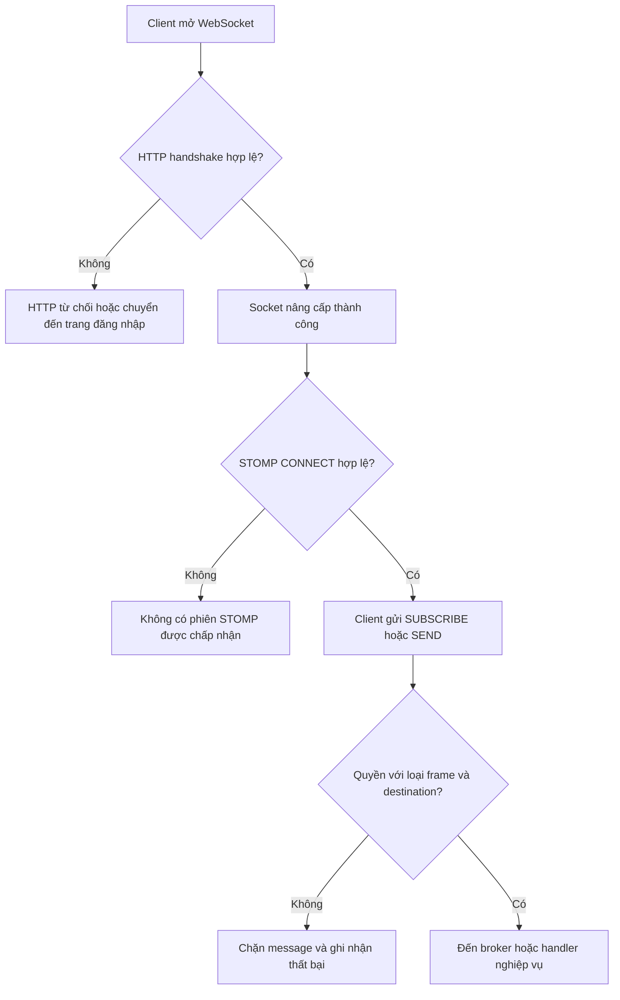

# Kiểm thử kết nối bị từ chối và truy cập message ngoài phạm vi

## Mục tiêu học tập

Trong Spring Security, bảo vệ HTTP handshake mới chỉ là lớp đầu tiên của ứng dụng WebSocket. Sau khi socket được nâng cấp thành công, client còn gửi các frame STOMP như `CONNECT`, `SUBSCRIBE`, `SEND` và `DISCONNECT`. Một người dùng đã đăng nhập vẫn có thể cố gắng đăng ký nhận sự kiện của nhóm khác, gửi lệnh đến tài nguyên không thuộc quyền sở hữu hoặc giả mạo thông báo của hệ thống. Bài này hướng dẫn thiết kế **kiểm thử âm tính (negative tests)** để xác nhận các hành vi đó thực sự bị chặn.

Sau bài học, người học có thể:

- Phân biệt từ chối tại **HTTP handshake**, **STOMP CONNECT** và **ủy quyền từng message**.
- Xây dựng ma trận kiểm thử cho `SUBSCRIBE` và `SEND`, bao gồm trường hợp truy cập chéo project/người dùng.
- Viết kiểm thử đơn vị cho `AuthorizationManager<Message<?>>` và kiểm thử tích hợp bằng WebSocket/STOMP thật.
- Xác minh cả việc **không nhận dữ liệu** lẫn **không phát sinh tác động nghiệp vụ**, tránh kết luận sai chỉ vì client thấy một lỗi hoặc timeout.

Phạm vi ví dụ là ứng dụng Spring Boot dùng **Spring MVC/Servlet, Spring Security và Spring Messaging STOMP**. WebFlux có mô hình `WebSocketHandler` riêng; không mặc định áp dụng nguyên cấu hình `@EnableWebSocketSecurity` và `MessageMatcherDelegatingAuthorizationManager` của STOMP Servlet cho WebFlux.

## 1. Hiểu đúng ba điểm chặn

Giả sử ứng dụng quản lý dự án có hai project `alpha` và `beta`. Người dùng `alice` thuộc `alpha` nhưng không thuộc `beta`; `bob` thuộc `beta`. Ứng dụng có các destination:

| Đường dẫn | Ý nghĩa | Ai được phép? |
| --- | --- | --- |
| `GET /ws` với `Upgrade: websocket` | Handshake tạo kết nối WebSocket | Người dùng có phiên HTTP hợp lệ; Origin được cho phép |
| STOMP `CONNECT` | Khởi tạo phiên giao thức trên socket | Principal hợp lệ và CSRF token STOMP hợp lệ khi lớp bảo vệ yêu cầu |
| `SUBSCRIBE /topic/projects/{projectId}/events` | Nhận sự kiện dự án | Chỉ thành viên được đọc project tương ứng |
| `SEND /app/projects/{projectId}/commands` | Gửi lệnh nghiệp vụ đến `@MessageMapping` | Chỉ người có quyền ghi project tương ứng |
| `SUBSCRIBE /user/queue/notifications` | Nhận thông báo gắn với người dùng hiện tại | Người dùng đã xác thực |
| `SEND /topic/projects/{projectId}/events` | Cố gửi thẳng vào broker để giả mạo sự kiện | Không client nào được phép |

Đường đi khái quát:



**Một HTTP `101 Switching Protocols` không chứng minh STOMP CONNECT được chấp nhận.** Ngược lại, một STOMP `CONNECTED` thành công không có nghĩa client được `SUBSCRIBE` mọi `/topic/**` hay `SEND` mọi `/app/**`.

Spring Security áp dụng ủy quyền message chủ yếu trên **client inbound channel**. Với các message đi từ server/broker ra client, không nên mặc định rằng bộ lọc inbound tiếp tục lọc theo từng người nhận. Vì vậy, kiểm soát quyền ngay tại `SUBSCRIBE` và chỉ cho phép server xuất bản vào broker destinations là hai kiểm soát quan trọng.

## 2. Tạo chính sách để có thể kiểm thử

Ví dụ dưới đây sử dụng Spring Security kiểu `AuthorizationManager`, phù hợp với nhánh Spring Security hiện đại (5.8+, 6.x và 7.x; cần kiểm tra thay đổi matcher khi nâng phiên bản). Ký hiệu `{projectId}` là biến trích từ destination. `ProjectPermissionService` là dịch vụ nghiệp vụ truy vấn quyền từ hệ thống dữ liệu tin cậy, không lấy quyền từ payload do client tự khai báo.

```java
import java.util.function.BiPredicate;

import org.springframework.context.annotation.Bean;
import org.springframework.context.annotation.Configuration;
import org.springframework.messaging.Message;
import org.springframework.messaging.simp.SimpMessageType;
import org.springframework.security.authentication.AnonymousAuthenticationToken;
import org.springframework.security.authorization.AuthorizationDecision;
import org.springframework.security.authorization.AuthorizationManager;
import org.springframework.security.core.Authentication;
import org.springframework.security.config.annotation.web.socket.EnableWebSocketSecurity;
import org.springframework.security.messaging.access.intercept.MessageAuthorizationContext;
import org.springframework.security.messaging.access.intercept.MessageMatcherDelegatingAuthorizationManager;

interface ProjectPermissionService {
    boolean canRead(String username, String projectId);
    boolean canWrite(String username, String projectId);
}

@Configuration
@EnableWebSocketSecurity
class MessageSecurityConfig {

    @Bean
    AuthorizationManager<Message<?>> messageAuthorizationManager(
            MessageMatcherDelegatingAuthorizationManager.Builder messages,
            ProjectPermissionService permissions) {

        messages
            // CONNECT/DISCONNECT/UNSUBSCRIBE... không có destination:
            .nullDestMatcher().authenticated()

            // Chỉ cho phép đăng ký đúng hàng đợi của principal hiện tại.
            .simpSubscribeDestMatchers("/user/queue/notifications")
                .authenticated()

            // Một người dùng đã đăng nhập vẫn phải có quyền đọc project.
            .simpSubscribeDestMatchers("/topic/projects/{projectId}/events")
                .access(projectPermission(permissions::canRead))

            // Client chỉ được SEND đến handler với quyền ghi project.
            .simpMessageDestMatchers("/app/projects/{projectId}/commands")
                .access(projectPermission(permissions::canWrite))

            // Không cho client tự ghi vào /topic, /queue, destination lạ...
            .simpTypeMatchers(SimpMessageType.MESSAGE, SimpMessageType.SUBSCRIBE)
                .denyAll()
            .anyMessage().denyAll();

        return messages.build();
    }

    private static AuthorizationManager<MessageAuthorizationContext<?>> projectPermission(
            BiPredicate<String, String> policy) {

        return (authenticationSupplier, context) -> {
            Authentication authentication = authenticationSupplier.get();
            String projectId = context.getVariables().get("projectId");

            boolean granted = authentication != null
                    && authentication.isAuthenticated()
                    && !(authentication instanceof AnonymousAuthenticationToken)
                    && projectId != null
                    && policy.test(authentication.getName(), projectId);

            return new AuthorizationDecision(granted);
        };
    }
}
```

Một cấu hình STOMP broker đi kèm có thể khai báo `registry.enableSimpleBroker("/topic", "/queue")`, `registry.setApplicationDestinationPrefixes("/app")` và `registry.addEndpoint("/ws")`. HTTP security chain cũng phải áp dụng yêu cầu xác thực cho `/ws` và các URL SockJS liên quan nếu dùng SockJS. Cấu hình Origin nên giới hạn vào những nguồn frontend tin cậy; `Origin` tự nó không thay thế xác thực và phân quyền vì client ngoài trình duyệt có thể tự tạo header.

Thứ tự các matcher có ý nghĩa: quy tắc cụ thể đứng trước, `denyAll()` cuối cùng. Sử dụng `simpSubscribeDestMatchers` cho các kênh đăng ký và `simpMessageDestMatchers` cho lệnh do client gửi; dùng `simpDestMatchers("/topic/**").authenticated()` quá rộng có thể vô tình cho phép cả `SEND` trực tiếp tới broker. Khi có quyền theo project, `authenticated()` chung không đủ để đảm bảo cách ly dữ liệu.

Ở handler, tiếp tục xác thực nội dung lệnh và tài nguyên thực tế: một client có thể gửi đến `/app/projects/alpha/commands` nhưng nhét `projectId=beta` vào JSON. Ví dụ:

```java
@MessageMapping("/projects/{projectId}/commands")
public void onCommand(@DestinationVariable String projectId,
                      @Payload ProjectCommand command,
                      Principal principal) {
    if (!projectId.equals(command.projectId()) ||
            !permissions.canWrite(principal.getName(), projectId)) {
        throw new AccessDeniedException("Project is not writable");
    }
    commandService.execute(projectId, command);
}
```

Đây là lớp kiểm tra nghiệp vụ bổ sung. Chỉ được để handler chạy sau khi xác thực đầu vào và bảo đảm đối tượng trong payload thuộc đúng project trên destination.

## 3. Ma trận kiểm thử trường hợp bị từ chối

Phải chuẩn bị ít nhất hai tài khoản có quyền khác nhau, hai project có dữ liệu phân biệt được và một tài khoản chưa đăng nhập. Mỗi ca phủ định nên dùng kết nối riêng vì server có thể đóng kết nối ngay sau khi từ chối frame.

| Mã | Tiền điều kiện và hành động | Điều bắt buộc xác minh |
| --- | --- | --- |
| H1 | Không cookie/credential, mở WebSocket `/ws` | Handshake không được nâng cấp; không có STOMP session |
| H2 | Có đăng nhập nhưng `Origin` không được cho phép | Handshake từ chối nếu server đang giới hạn Origin |
| C1 | HTTP handshake được phép nhưng STOMP `CONNECT` thiếu CSRF token | Không nhận `CONNECTED`; server ghi nhận kết nối STOMP bị từ chối |
| C2 | Thay CSRF bằng token giả hoặc token của session khác | Không nhận `CONNECTED`; không được tạo phiên sử dụng hợp lệ |
| S1 | `alice` `SUBSCRIBE /topic/projects/alpha/events` | Được chấp nhận và nhận sự kiện `alpha` (đối chứng dương) |
| S2 | `alice` `SUBSCRIBE /topic/projects/beta/events` | Bị từ chối; **không nhận** sự kiện `beta` |
| S3 | `alice` `SUBSCRIBE /user/bob/queue/notifications` | Bị từ chối; **không nhận** thông báo của `bob` |
| S4 | `alice` `SUBSCRIBE /topic/projects/unknown/events` | Bị từ chối theo ACL, kể cả khi project không tồn tại |
| S5 | `alice` `SUBSCRIBE /topic/unlisted` hoặc destination viết gần giống | Bị từ chối theo quy tắc mặc định |
| M1 | `alice` `SEND /topic/projects/alpha/events` | Bị chặn; không thể giả mạo thông báo từ server |
| M2 | `alice` `SEND /app/projects/beta/commands` | Bị chặn; không thay đổi trạng thái `beta` |
| M3 | `alice` `SEND /app/projects/alpha/commands` nhưng JSON chứa `projectId=beta` | Handler từ chối; không thay đổi `beta` |
| R1 | Thu hồi quyền `alice` đối với `alpha`, sau đó kết nối/đăng ký lại | Quyền mới được áp dụng; `SUBSCRIBE` bị từ chối |

Với ứng dụng dùng JWT trong STOMP `CONNECT`, bổ sung ca JWT thiếu, hết hạn, sai chữ ký và header không khớp principal. Chỉ gửi `Authorization` trong STOMP headers **không tự động** làm Spring Security xác thực token theo cơ chế HTTP; nếu kiến trúc xác thực ở mức STOMP thì phải có `ChannelInterceptor` được đăng ký đúng thứ tự để xác thực và gắn principal trước bước ủy quyền. Các trường hợp sử dụng phiên HTTP/cookie từ handshake cần giữ nguyên cookie khi lấy CSRF token và khi kết nối.

## 4. Unit test: bắt sai chính sách trước khi khởi chạy server

Test trực tiếp `AuthorizationManager<Message<?>>` nhanh và ổn định, đặc biệt cho logic phân quyền theo `projectId`. Đây là **test chính sách message**, chưa thay thế được test HTTP handshake, xác thực STOMP CONNECT hoặc đường đi thực tế qua broker.

```java
import java.util.List;

import org.junit.jupiter.api.Test;
import org.springframework.messaging.Message;
import org.springframework.messaging.simp.SimpMessageHeaderAccessor;
import org.springframework.messaging.simp.SimpMessageType;
import org.springframework.messaging.support.MessageBuilder;
import org.springframework.security.authorization.AuthorizationManager;
import org.springframework.security.core.Authentication;
import org.springframework.security.core.authority.SimpleGrantedAuthority;
import org.springframework.security.authentication.UsernamePasswordAuthenticationToken;
import org.springframework.security.messaging.access.intercept.MessageMatcherDelegatingAuthorizationManager;

import static org.assertj.core.api.Assertions.assertThat;

class MessageSecurityConfigTest {

    private final Authentication alice = new UsernamePasswordAuthenticationToken(
            "alice", "n/a", List.of(new SimpleGrantedAuthority("ROLE_MEMBER")));

    private final ProjectPermissionService permissions = new ProjectPermissionService() {
        @Override
        public boolean canRead(String username, String projectId) {
            return "alice".equals(username) && "alpha".equals(projectId);
        }

        @Override
        public boolean canWrite(String username, String projectId) {
            return "alice".equals(username) && "alpha".equals(projectId);
        }
    };

    private final AuthorizationManager<Message<?>> manager =
            new MessageSecurityConfig().messageAuthorizationManager(
                    MessageMatcherDelegatingAuthorizationManager.builder(), permissions);

    private boolean granted(SimpMessageType type, String destination, Authentication user) {
        SimpMessageHeaderAccessor headers = SimpMessageHeaderAccessor.create(type);
        headers.setDestination(destination);
        Message<byte[]> message = MessageBuilder.createMessage(new byte[0],
                headers.getMessageHeaders());

        var result = manager.authorize(() -> user, message);
        // Null không được xem là chấp nhận; anyMessage().denyAll() là lớp chặn cuối.
        return result != null && result.isGranted();
    }

    @Test
    void subscribeChiDuocProjectCoQuyen() {
        assertThat(granted(SimpMessageType.SUBSCRIBE,
                "/topic/projects/alpha/events", alice)).isTrue();
        assertThat(granted(SimpMessageType.SUBSCRIBE,
                "/topic/projects/beta/events", alice)).isFalse();
        assertThat(granted(SimpMessageType.SUBSCRIBE,
                "/topic/projects/unknown/events", alice)).isFalse();
    }

    @Test
    void khongDuocDocQueueCuaNguoiKhacHoacDestinationLa() {
        assertThat(granted(SimpMessageType.SUBSCRIBE,
                "/user/queue/notifications", alice)).isTrue();
        assertThat(granted(SimpMessageType.SUBSCRIBE,
                "/user/bob/queue/notifications", alice)).isFalse();
        assertThat(granted(SimpMessageType.SUBSCRIBE,
                "/topic/unlisted", alice)).isFalse();
    }

    @Test
    void khongDuocGiaMaoBrokerVaGhiProjectKhac() {
        assertThat(granted(SimpMessageType.MESSAGE,
                "/topic/projects/alpha/events", alice)).isFalse();
        assertThat(granted(SimpMessageType.MESSAGE,
                "/app/projects/beta/commands", alice)).isFalse();
        assertThat(granted(SimpMessageType.MESSAGE,
                "/app/projects/alpha/commands", alice)).isTrue();
    }

    @Test
    void nguoiChuaXacThucKhongDuocSubscribe() {
        assertThat(granted(SimpMessageType.SUBSCRIBE,
                "/topic/projects/alpha/events", null)).isFalse();
    }
}
```

Trường hợp `null` ở đây mô phỏng thiếu principal trong kiểm tra message; test thực tế của `CONNECT` cần có CSRF, session và các interceptor của Spring Security. Có thể mở rộng suite với quyền chỉ đọc (được `SUBSCRIBE` nhưng bị chặn `SEND`), tên project có ký tự đặc biệt, chữ hoa/chữ thường, prefix bị giả mạo (`/topic/projects/alpha/events/extra`) và dữ liệu ACL thay đổi. Không nên dùng `@WithMockUser` đơn thuần để khẳng định một handshake hay một phiên STOMP thực đã được bảo vệ.

## 5. Integration test: kiểm chứng từ chối tại handshake

Thử nghiệm HTTP handshake cần khởi chạy HTTP server thật (`@SpringBootTest(webEnvironment = RANDOM_PORT)` hoặc môi trường kiểm thử tương đương), nơi `SecurityFilterChain` yêu cầu xác thực cho `/ws`. Mở WebSocket thực bằng `StandardWebSocketClient` để xác nhận client vô danh **không được nâng cấp kết nối**:

```java
import java.net.URI;
import java.util.concurrent.ExecutionException;
import java.util.concurrent.TimeUnit;

import org.junit.jupiter.api.Test;
import org.springframework.beans.factory.annotation.Autowired;
import org.springframework.boot.test.context.SpringBootTest;
import org.springframework.boot.test.web.server.LocalServerPort;
import org.springframework.web.socket.WebSocketHttpHeaders;
import org.springframework.web.socket.client.standard.StandardWebSocketClient;
import org.springframework.web.socket.handler.TextWebSocketHandler;

import static org.assertj.core.api.Assertions.assertThatThrownBy;

@SpringBootTest(webEnvironment = SpringBootTest.WebEnvironment.RANDOM_PORT)
class HandshakeDeniedIT {

    @LocalServerPort int port;

    @Test
    void anonymousCannotUpgradeSocket() {
        var client = new StandardWebSocketClient();
        var handshake = client.execute(
                new TextWebSocketHandler() {},
                new WebSocketHttpHeaders(),
                URI.create("ws://localhost:" + port + "/ws"));

        assertThatThrownBy(() -> handshake.get(5, TimeUnit.SECONDS))
                .isInstanceOf(ExecutionException.class);
    }
}
```

Đây là khung test dành cho ứng dụng đã cấu hình endpoint `/ws` và yêu cầu xác thực ở HTTP layer. Thực tế nên kiểm tra thêm **nguyên nhân bên trong exception**, bản ghi server và trạng thái HTTP (`401`, `403` hoặc chuyển hướng `302` đến trang đăng nhập tùy cấu hình). Tránh cho test vượt qua vì sai URL, server chưa chạy, TLS hoặc lỗi mạng. Với Origin bị chặn, đặt `Origin` khác miền được cho phép và chứng minh cùng endpoint chấp nhận Origin hợp lệ. `MockMvc` kiểm tra `SecurityFilterChain` rất hữu ích nhưng không tự thực hiện toàn bộ WebSocket upgrade; không dùng riêng một mock HTTP test để kết luận STOMP đã an toàn.

## 6. Integration test: STOMP CONNECT, SUBSCRIBE và SEND

`WebSocketStompClient` cho phép gửi riêng **headers của HTTP handshake** và **headers của STOMP CONNECT**. Đây là khác biệt cần giữ trong test khi dùng cookie đăng nhập, CSRF và token tùy chỉnh:

```java
import java.util.concurrent.TimeUnit;
import org.springframework.http.HttpHeaders;
import org.springframework.messaging.simp.stomp.StompHeaders;
import org.springframework.messaging.simp.stomp.StompSession;
import org.springframework.messaging.simp.stomp.StompSessionHandlerAdapter;
import org.springframework.web.socket.WebSocketHttpHeaders;
import org.springframework.web.socket.client.standard.StandardWebSocketClient;
import org.springframework.web.socket.messaging.WebSocketStompClient;

// sessionCookie, csrfHeaderName và csrfToken là giá trị lấy từ luồng
// đăng nhập + GET /csrf của CÙNG HTTP session trong bộ fixture kiểm thử.
WebSocketHttpHeaders handshakeHeaders = new WebSocketHttpHeaders();
handshakeHeaders.add(HttpHeaders.COOKIE, sessionCookie);

StompHeaders connectHeaders = new StompHeaders();
connectHeaders.add(csrfHeaderName, csrfToken);

WebSocketStompClient client = new WebSocketStompClient(
        new StandardWebSocketClient());
try {
    StompSession session = client.connectAsync(
            "ws://localhost:" + port + "/ws",
            handshakeHeaders,
            connectHeaders,
            new StompSessionHandlerAdapter() {}).get(5, TimeUnit.SECONDS);

    // Từ đây mới kiểm thử SUBSCRIBE/SEND trên phiên STOMP đã CONNECTED.
    // Mỗi trường hợp âm tính dùng session riêng.
    session.disconnect();
} finally {
    client.stop();
}
```

`/csrf` chỉ là ví dụ endpoint cung cấp token an toàn cho frontend đã xác thực; không được công khai token của session người khác. Trên SockJS, một số transport dùng HTTP `POST`: cần kiểm thử cả HTTP CSRF tương ứng, đồng thời STOMP `CONNECT` vẫn cần token theo chính sách đang bật. Không tắt CSRF toàn bộ ứng dụng chỉ để làm test chạy được.

Quy trình kiểm thử message bằng client thật:

1. **Đối chứng dương:** `alice` đăng nhập, lấy đúng CSRF token, kết nối và nhận STOMP `CONNECTED`; gửi `SUBSCRIBE /topic/projects/alpha/events`, chờ xác nhận xử lý nếu broker hỗ trợ receipt; server xuất bản một sự kiện có `testId` duy nhất và client nhận đúng `testId`.
2. **Thử vượt phạm vi:** mở session STOMP độc lập với cùng tài khoản `alice`, gửi `SUBSCRIBE /topic/projects/beta/events` và đăng ký `StompSessionHandler` để thu thập frame `ERROR`, lỗi transport hay việc socket bị đóng. Server xuất bản `testId` của `beta`, xác minh client không nhận payload, đồng thời ghi nhận quyết định từ chối ở server.
3. **Thử giả mạo nguồn sự kiện:** trên session mới, gửi `SEND /topic/projects/alpha/events` với marker riêng. Quan sát log quyết định ủy quyền và chứng minh subscriber hợp lệ khác không nhận marker giả mạo.
4. **Thử ghi trái quyền:** gửi `SEND /app/projects/beta/commands` bằng tài khoản `alice`; kiểm tra bản ghi/database/audit và thông báo phát ra, xác minh hoàn toàn không có cập nhật cho `beta`.
5. **Thử sửa payload:** gửi tới destination của `alpha` nhưng payload trỏ tới `beta`; kiểm tra handler từ chối, bất kể bước kiểm tra destination đã thông qua.
6. **Thử thiếu CSRF:** giữ cookie hợp lệ nhưng bỏ token hoặc thay token ngẫu nhiên trong `StompHeaders`, xác minh không xuất hiện `CONNECTED` và có bằng chứng từ chối ở server.

STOMP có cơ chế `receipt` cho `SEND`/`SUBSCRIBE`, nhưng cách broker xử lý và phản hồi khi quyền bị từ chối phụ thuộc cấu hình. Một số hệ thống trả frame `ERROR`, một số đóng transport hoặc ghi exception rồi hủy message. **Không cố định test âm tính vào một frame `ERROR` hay một mã HTTP** nếu triển khai không cam kết hành vi đó. Kiểm thử cần có timeout hữu hạn và một tín hiệu từ server (ủy quyền bị từ chối, đăng ký không được tạo, hoặc không có side effect). Việc “không nhận message trong 1 giây” đơn độc có thể là lỗi truyền tải hoặc test không gửi đúng sự kiện.

Để giảm test chập chờn, hãy dùng `CountDownLatch`, `CompletableFuture` hoặc queue của client handler; tạo `testId` khác nhau cho từng lượt, chờ đối chứng dương thật sự nhận trước khi đánh giá ca phủ định. Nếu server trả `ERROR` rồi đóng socket, mở kết nối mới cho ca kế tiếp. Với broker relay bên ngoài, xác nhận việc xuất bản và subscription đã sẵn sàng trước khi phát thông điệp; đừng suy luận từ thời gian sleep cố định.

## 7. Những lỗi thường bị bộ test bỏ sót

| Lỗi | Vì sao nguy hiểm | Cách bổ sung test |
| --- | --- | --- |
| Chỉ kiểm thử handshake, bỏ `SUBSCRIBE` | User hợp lệ vẫn đọc được topic của project khác | Hai user/hai project, thử đoán tên topic |
| Chỉ dùng role `USER` trên `/topic/**` | Mọi user cùng role đều đọc được tài nguyên ngoài phạm vi | Kiểm tra membership theo destination thực |
| Cho client `SEND` trực tiếp `/topic/**` | Client giả mạo thông báo của hệ thống | Gửi marker vào broker prefix, xác minh không được phát tán |
| Chỉ kiểm tra đường dẫn, bỏ payload | Handler có thể cập nhật project khác thông qua ID trong body | Gửi destination hợp lệ nhưng body chứa ID trái quyền |
| Dùng token CSRF từ session khác | Test không phản ánh browser/session thật và có thể thất bại vì lý do sai | Gắn cùng cookie vào lần lấy token và kết nối |
| Xem `101` là STOMP đã đăng nhập | Handshake và `CONNECT` là hai giai đoạn khác nhau | Theo dõi frame `CONNECTED`, `ERROR` và trạng thái session |
| Xem timeout là bằng chứng duy nhất | Timeout cũng có thể do mất mạng hoặc broker chậm | Ghép tín hiệu từ chối server, đối chứng dương và không có side effect |
| Chỉ kiểm tra `SUBSCRIBE` tại lúc bắt đầu | Quyền có thể bị thu hồi trong khi subscription tồn tại | Kiểm thử thay đổi ACL, reconnect và chính sách hủy phiên/đăng ký |

Ngoài ra, thử các phiên bản destination có dấu `/` thừa, phân biệt chữ hoa/thường, mẫu wildcard, ký tự mã hóa, route gần giống nhau và các lệnh không được đăng ký. Khi dùng multi-tenancy, tất cả thông tin scope phải được lấy từ nguồn xác thực và bộ dữ liệu quyền của server. Không suy ra quyền chỉ từ STOMP header `login`, `passcode`, tên project do client tự khai hoặc nội dung JSON.

## 8. Tiêu chí hoàn thành kiểm thử bảo mật

Một bộ test có giá trị cho chức năng WebSocket/STOMP phải cho thấy:

- HTTP handshake bị từ chối đúng khi chưa xác thực hoặc vi phạm quy tắc Origin; client không nâng cấp được socket.
- STOMP CONNECT thiếu CSRF/identity hợp lệ không dẫn tới một phiên STOMP đã kết nối.
- User được đọc/ghi project hợp lệ theo đúng quyền, và **không** được đọc/ghi project khác.
- Broker destination không nhận được dữ liệu client tự giả mạo; hàng đợi người dùng khác không bị nghe lén.
- Từ chối được xác nhận bằng quan sát phía server và kết quả nghiệp vụ, bên cạnh dấu hiệu tại client.
- Tất cả ca âm tính có đối chứng dương, thời hạn chờ hữu hạn và dữ liệu test tách biệt; test chạy lặp lại ổn định.

Trong vận hành, có thể theo dõi số lần từ chối theo loại frame và destination đã chuẩn hóa, nhưng phải tránh ghi log CSRF token, session cookie, JWT hoặc payload nhạy cảm. Khi quyền project thay đổi, hãy định nghĩa rõ hệ thống có chủ động hủy subscription cũ hay chỉ kiểm tra lại khi kết nối/đăng ký tiếp theo; test phải phản ánh đúng cam kết đó.

## Tham khảo

- [Spring Security Reference — WebSocket Security](https://docs.spring.io/spring-security/reference/servlet/integrations/websocket.html): mô hình bảo vệ inbound message, STOMP `CONNECT`, CSRF, destination matcher.
- [Spring Framework Reference — STOMP Client](https://docs.spring.io/spring-framework/reference/web/websocket/stomp/client.html): `WebSocketStompClient`, session handler và receipt.
- [Spring Security API — `MessageMatcherDelegatingAuthorizationManager`](https://docs.spring.io/spring-security/reference/api/java/org/springframework/security/messaging/access/intercept/MessageMatcherDelegatingAuthorizationManager.html): API builder và ủy quyền message.
