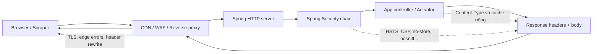

# Phối hợp headers giữa ứng dụng chính và endpoint quản trị

## 1. Bài toán: cùng một service, nhiều loại response bảo mật

Một ứng dụng Spring Boot vận hành API người dùng tại `/api/**`, giao diện quản trị nghiệp vụ ở `/admin/**` và Spring Boot Actuator tại `/actuator/**`. Đội ngũ đã cấu hình `Cache-Control: no-store`, `X-Content-Type-Options: nosniff`, `X-Frame-Options: DENY`, HSTS và CSP cho web app. Khi chuyển Actuator sang management port riêng, một số response quản trị không còn bộ header như main application.

Nguyên nhân có thể là **security chain khác**, **management web context riêng**, **headers được controller/Actuator đặt lại**, hoặc **proxy thêm/xóa/ghi đè header**. Không giải quyết bằng cách bỏ `/actuator/**` khỏi Spring Security để health check hoạt động; bỏ qua filter chain có thể khiến authentication và header writers không chạy.

Bài thuộc chương **Tích hợp ứng dụng** trong mô-đun **SPRING_SECURITY_HTTP_PROTECTION**. Mô-đun áp dụng lớp phòng vệ HTTP/trình duyệt — CSRF, CORS, security headers, CSP, HSTS, firewall và session — trên cả Servlet lẫn Reactive. Chủ đề này tập trung vào **phối hợp response headers giữa ứng dụng chính và endpoint quản trị**, đồng thời giữ ranh giới phân quyền và network topology.

### Kết quả học tập

1. Phân biệt **giao diện admin nghiệp vụ** `/admin/**` với **Actuator/operations endpoints** `/actuator/**`.
2. Hiểu header được tạo tại Spring Security, controller, HTTP server, proxy/CDN và có thể bị ghi đè.
3. Phân biệt Actuator **exposure**, authentication, authorization, header policy và network isolation.
4. Cấu hình nhiều `SecurityFilterChain` hoặc `SecurityWebFilterChain` có thứ tự và default-deny.
5. Áp `Cache-Control`/`nosniff`/CSP/HSTS/frame protection phù hợp nội dung và hostname.
6. Kiểm tra management cùng cổng hoặc khác cổng, bao gồm các HTTP contexts riêng.
7. Phối hợp CORS, CSRF, cookie/session và authentication khi có management operations.
8. Test 200/401/403/404/5xx bằng MockMvc, WebTestClient, curl, reverse proxy.
9. Thiết lập checklist rollout/rollback không làm lộ environment, metrics, logs hoặc heapdump.

## 2. Ba bề mặt cần chính sách rõ ràng

| Bề mặt | URL ví dụ | Ai cần truy cập? | Điều bảo vệ trọng tâm |
| --- | --- | --- | --- |
| API người dùng | `/api/me`, `/api/orders` | End user/client | Authn, object/tenant authz, CSRF theo credential model, no-store |
| Giao diện admin nghiệp vụ | `/admin/dashboard` | `ROLE_APP_ADMIN` | Role/step-up, no-store, CSP cho HTML, clickjacking defense |
| Actuator vận hành | `/actuator/health`, `/actuator/prometheus` | SRE, scraper, OPS | Exposure tối thiểu, OPS auth/mTLS, network boundary, không rò data |

**`/admin/**` không tự động là Actuator.** `ROLE_APP_ADMIN` không mặc nhiên có quyền đọc `/actuator/env` hoặc thay logging level. `ROLE_OPS` không mặc nhiên có quyền khóa user nghiệp vụ.

Với mỗi route, hỏi bốn câu khác nhau: **endpoint có HTTP exposure không; caller có quyền không; response có những headers gì; request đến qua port/host/proxy nào?** Header `X-Frame-Options` không thay cho authorization.

### 2.1. Health endpoint có thể được phép anonymous mà vẫn có security headers

`permitAll()` là một quyết định authorization **trong** security chain, nên Spring Security header writers vẫn có thể chạy. Trái lại `web.ignoring()` của Servlet bỏ qua filter chain; nếu dùng cho health, một số header/security instrumentation không được áp dụng.

Nếu `/actuator/health` đang DOWN, HTTP 503 là hành vi hợp lệ; không sửa health indicator để ép test header 200.

## 3. Luồng tạo response headers



Một response từ edge 502, firewall/parser 400 hoặc management web context khác có thể **không đi qua security chain của main app**. Vì vậy phải test header ở **client-facing edge**, không chỉ assert bean config.

### 3.1. Tránh hai owner cho cùng security policy

| Header | Chủ sở hữu thường phù hợp | Lưu ý |
| --- | --- | --- |
| HSTS | HTTPS TLS edge **hoặc** Spring | Theo hostname, không theo path; đừng có policy trùng/mâu thuẫn |
| CSP cho HTML | Ứng dụng sở hữu HTML/template | Không thêm `default-src 'none'` toàn site ở proxy nếu admin UI cần JS |
| Cache-Control dữ liệu riêng | Controller/Spring Security + CDN bypass | Spring có thể giữ header do controller đặt |
| nosniff | Baseline Spring/edge | Kiểm tra Content-Type thực |
| CORS | Lớp biết route/origin | Không mở management CORS chỉ vì app CORS đang mở |
| Set-Cookie | Session/authn component | Secure/HttpOnly/SameSite; không dựa vào port để cô lập cookie |
| WWW-Authenticate | Authentication entry point | Không ẩn sai 401 challenge khi qua proxy |

## 4. Bảng header policy theo resource

| Header | API private | HTML admin | Actuator JSON/metrics |
| --- | --- | --- | --- |
| `Cache-Control: no-store` | Bắt buộc theo threat model | Bắt buộc cho nội dung nhạy cảm | Cần policy tươi/không shared-cache |
| `X-Content-Type-Options: nosniff` | Nên có | Nên có | Nên có |
| `X-Frame-Options: DENY` | Có thể giữ default | Chống clickjacking | Có thể giữ default |
| `Content-Security-Policy` | Không thay API auth | Cần thiết kế cho HTML/scripts | Không phải biện pháp che dữ liệu khỏi API caller |
| `Strict-Transport-Security` | Theo public HTTPS host | Theo cùng host | Chỉ áp khi HTTP client nhận HTTPS tin cậy |
| `Referrer-Policy` | Theo browser threat model | Thường hữu ích | Không quan trọng bằng auth/network |
| `Access-Control-Allow-Origin` | Frontend trusted origin khi cần | Theo UX | Tắt mặc định, chỉ mở nếu thật sự có browser management client |
| `Set-Cookie` | Nếu session-based | Cookie admin session nếu dùng | Tránh chia sẻ browser session nghiệp vụ |
| `Content-Type` | JSON đúng media type | `text/html` | JSON Actuator / Prometheus text / binary theo endpoint |

### 4.1. CSP không phải authorization

CSP điều khiển nhiều hành vi **browser render document**, không chặn một caller gọi `curl` hay đọc JSON nếu có quyền HTTP. `X-Frame-Options` và `frame-ancestors` bảo vệ giao diện admin trước framing trái phép; chúng cũng không thay `ROLE_APP_ADMIN`.

## 5. Spring Security defaults: cần hiểu giới hạn

Với Spring Security 6.5, một response đi qua security chain và header writers có các defaults điển hình:

```http
Cache-Control: no-cache, no-store, max-age=0, must-revalidate
Pragma: no-cache
Expires: 0
X-Content-Type-Options: nosniff
X-Frame-Options: DENY
X-XSS-Protection: 0
```

HSTS có thể được thêm trên HTTPS request:

```http
Strict-Transport-Security: max-age=31536000; includeSubDomains
```

Spring Security **không thêm CSP mặc định** vì không thể tự biết resource/script nguồn nào của ứng dụng phải được phép. Không đọc danh sách headers rồi kết luận mọi 4xx/5xx từ proxy hoặc port management khác sẽ giống hệt.

`X-XSS-Protection: 0` không có nghĩa ứng dụng bỏ XSS protection; đó là quyết định đối với XSS filter lịch sử của browser. CSP, output encoding và validation theo context mới là biện pháp ứng dụng cần quan tâm.

### 5.1. Cache headers do controller đặt

Spring Security có thể không ghi đè `Cache-Control` do controller/resource handler đã chủ động đặt. Điều này có ích cho hashed static assets nhưng nguy hiểm nếu `/api/me` hoặc `/actuator/env` bị đặt `public, max-age=3600`. Kiểm tra **response cuối** qua ingress/CDN.

Không tắt `headers().cacheControl(...)` toàn cục chỉ để cho CSS/JS cache được. Set cache policy theo resource, không theo kiểu “bỏ toàn bộ baseline”.

## 6. Actuator exposure, security và network là ba lớp độc lập

Spring Boot 3.5 chỉ expose `health` qua HTTP theo mặc định. Nếu ứng dụng có thêm `spring-boot-starter-actuator` và cần metrics scraping nội bộ:

```properties
# Chỉ expose những ID thật cần.
management.endpoints.web.exposure.include=health,info,prometheus
management.endpoint.health.show-details=never
management.endpoint.health.show-components=never
```

`prometheus` chỉ có khi dependency registry tương ứng được cấu hình. Không đặt `management.endpoints.web.exposure.include=*` chỉ vì `/actuator/prometheus` chưa hoạt động; nó có thể làm lộ `env`, `beans`, `configprops`, `mappings`, `httpexchanges`, `heapdump` hoặc operations `loggers`/`shutdown` nếu enable.

### 6.1. Spring Security auto-configuration có thể back off

Khi chưa có user-defined security chain, Boot có thể bảo vệ Actuator endpoints ngoài health theo auto-config. Khi ứng dụng định nghĩa `SecurityFilterChain` hay `SecurityWebFilterChain` riêng, phải chịu trách nhiệm chính sách **cả Actuator lẫn main**. Một chain match `EndpointRequest.toAnyEndpoint()` không tự bảo vệ mọi path ngoài Actuator.

### 6.2. Vì sao no-store của Actuator vẫn quan trọng?

Health cần tươi cho probes; metrics, config, log và operational data không nên vào shared cache. `no-store` là baseline hữu ích nhưng không đủ: exposure tối thiểu, OPS/machine authentication, network isolation, rate limiting và auditing là nền tảng.

## 7. Management cùng cổng và management cổng riêng

### 7.1. Cùng cổng

```text
Public/Private ingress -> server.port=8080
    /public/**  /api/**  /admin/**  /actuator/**
```

Ở một web security context, thứ tự chains và matchers quyết định header policy. Phải có một chain cho Actuator, một chain cho main hoặc chiến lược có coverage tương đương, cùng default-deny.

### 7.2. Cổng riêng

```text
Public gateway  -> server.port=8080           -> main application
Private network -> management.server.port=9090 -> management context
```

Spring Boot có thể tạo management HTTP listener/web context riêng, tùy cấu hình. **Không suy rằng mọi header/filter của main chain tự động áp ở 9090.** Test trên từng cổng, từng context, cả 401/403 và 5xx.

Một management port khác **không phải ranh giới cookie**. Browser cookies được scope theo hostname/domain/path và các attributes, **không theo TCP port**. Dùng hostname/network/auth riêng, không dựa vào `8080` so với `9090` để ngăn session cookie.

## 8. Servlet: hai SecurityFilterChain cho Actuator và main

Ví dụ Spring Boot 3.5 + Spring Security Servlet:

```java
import org.springframework.boot.actuate.autoconfigure.security.servlet.EndpointRequest;
import org.springframework.context.annotation.Bean;
import org.springframework.context.annotation.Configuration;
import org.springframework.core.annotation.Order;
import org.springframework.security.config.Customizer;
import org.springframework.security.config.annotation.web.builders.HttpSecurity;
import org.springframework.security.web.SecurityFilterChain;

@Configuration
class ServletMainAndManagementSecurity {

    @Bean
    @Order(1)
    SecurityFilterChain actuatorChain(HttpSecurity http)
            throws Exception {
        return http
            .securityMatcher(EndpointRequest.toAnyEndpoint())
            .authorizeHttpRequests(auth -> auth
                .requestMatchers(EndpointRequest.to("health"))
                    .permitAll()
                .anyRequest().hasRole("OPS"))
            .httpBasic(Customizer.withDefaults())
            .headers(headers -> headers
                .contentSecurityPolicy(csp -> csp
                    .policyDirectives(
                        "default-src 'none'; object-src 'none'; " +
                        "frame-ancestors 'none'")))
            .build();
    }

    @Bean
    @Order(2)
    SecurityFilterChain mainChain(HttpSecurity http)
            throws Exception {
        return http
            .authorizeHttpRequests(auth -> auth
                .requestMatchers("/public/**").permitAll()
                .requestMatchers("/admin/**").hasRole("APP_ADMIN")
                .requestMatchers("/api/**").authenticated()
                .anyRequest().denyAll())
            .httpBasic(Customizer.withDefaults())
            .headers(headers -> headers
                .contentSecurityPolicy(csp -> csp
                    .policyDirectives(
                        "default-src 'self'; object-src 'none'; " +
                        "base-uri 'self'; frame-ancestors 'none'")))
            .build();
    }
}
```

**Giả định:** hai chains trong cùng security context/cổng, app có role OPS/APP_ADMIN và fixtures tương ứng. HTTP Basic chỉ để minh họa; hệ thống thật có thể dùng OIDC, mTLS, bearer hoặc session. CSRF không bị tắt trong ví dụ.

`EndpointRequest.toAnyEndpoint()` giúp nhận đúng Actuator endpoint mappings khi đổi base path, tốt hơn hardcode `/actuator/**`. Tuy nhiên nó không tự expose endpoint hay quyết định caller nào được phép.

### 8.1. Vì sao hai CSP khác nhau?

Actuator chủ yếu trả JSON/text, nên CSP `default-src 'none'` không thay auth; nó là baseline nếu có content được browser render. HTML admin cần script/css nguồn hợp lệ; CSP ở main chain phải được thử với thực tế giao diện, không áp chính sách Actuator lên toàn bộ HTML.

## 9. Reactive: SecurityWebFilterChain tương ứng

WebFlux dùng `ServerHttpSecurity` và reactive `EndpointRequest`, không dùng import Servlet:

```java
import org.springframework.boot.actuate.autoconfigure.security.reactive.EndpointRequest;
import org.springframework.context.annotation.Bean;
import org.springframework.context.annotation.Configuration;
import org.springframework.core.annotation.Order;
import org.springframework.security.config.Customizer;
import org.springframework.security.config.web.server.ServerHttpSecurity;
import org.springframework.security.web.server.SecurityWebFilterChain;

@Configuration
class ReactiveMainAndManagementSecurity {

    @Bean
    @Order(1)
    SecurityWebFilterChain actuatorChain(ServerHttpSecurity http) {
        return http
            .securityMatcher(EndpointRequest.toAnyEndpoint())
            .authorizeExchange(auth -> auth
                .matchers(EndpointRequest.to("health"))
                    .permitAll()
                .anyExchange().hasRole("OPS"))
            .httpBasic(Customizer.withDefaults())
            .headers(headers -> headers
                .contentSecurityPolicy(csp -> csp
                    .policyDirectives(
                        "default-src 'none'; object-src 'none'; " +
                        "frame-ancestors 'none'")))
            .build();
    }

    @Bean
    @Order(2)
    SecurityWebFilterChain mainChain(ServerHttpSecurity http) {
        return http
            .authorizeExchange(auth -> auth
                .pathMatchers("/public/**").permitAll()
                .pathMatchers("/admin/**").hasRole("APP_ADMIN")
                .pathMatchers("/api/**").authenticated()
                .anyExchange().denyAll())
            .httpBasic(Customizer.withDefaults())
            .headers(headers -> headers
                .contentSecurityPolicy(csp -> csp
                    .policyDirectives(
                        "default-src 'self'; object-src 'none'; " +
                        "base-uri 'self'; frame-ancestors 'none'")))
            .build();
    }
}
```

Với nhiều chains, **chain đầu tiên khớp** quyết định filters và header writers của request đó. `anyExchange().denyAll()` chỉ áp trong chain đã chọn; nếu cấu hình matchers sai và request không vào chain nào, nó không trở thành default-deny toàn cục một cách kỳ diệu.

Nếu management port riêng, context/chain có thể khác; phải test listener thực tế. Không đăng ký đồng thời Servlet và Reactive configs trong một app chỉ để “phủ cả hai”.

## 10. Các Actuator endpoints có rủi ro khác nhau

| Endpoint | Vì sao nhạy cảm? | Chính sách ưu tiên |
| --- | --- | --- |
| `health` | Lộ dependency status/details | Có thể permit status tổng quát trong mạng được duyệt |
| `info` | Lộ version/build/commit | Cân nhắc OPS-only hoặc nội dung công khai tối thiểu |
| `prometheus` | Metrics nội bộ/traffic/business | Scraper authentication, network-only, no-store |
| `metrics` | Metric names/values | OPS, rate limit |
| `env`/`configprops` | Cấu hình, nguy cơ lộ secrets | Không expose công khai |
| `beans`/`mappings` | Sơ đồ ứng dụng, routes/filters | Hạn chế đặc quyền |
| `httpexchanges` | Thông tin HTTP exchanges | Chỉ OPS, scrub headers/tokens |
| `loggers` | Có thể thay runtime log level | Quyền thay đổi và audit, CSRF theo credential model |
| `shutdown` | Có thể dừng service | Mặc định không enable/expose |
| `heapdump`/`threaddump` | Nội dung bộ nhớ/threads nhạy cảm | Không public, đặc quyền cao |

Header `nosniff` không khiến `heapdump` an toàn khi public. Trước hết phải loại khỏi exposure hoặc chặn mạng/authorization.

## 11. Spring Boot management cổng riêng: cấu hình mẫu

```properties
# Main application.
server.port=8080

# Management listener riêng.
management.server.port=9090
management.server.address=127.0.0.1
management.endpoints.web.base-path=/actuator

management.endpoints.web.exposure.include=health,info,prometheus
management.endpoint.health.show-details=never
management.endpoint.health.show-components=never
```

`management.server.address=127.0.0.1` chỉ phù hợp nếu scraper/sidecar ở cùng host hoặc network namespace. Khi metrics server nằm pod khác, cần bind phù hợp và **NetworkPolicy/firewall/mTLS**, không public port.

Spring Boot cho phép `management.server.ssl.*` khi cổng management khác main port. Chỉ tách TLS không có nghĩa đủ authentication; internal HTTP cần mạng tin cậy hay mTLS ở mesh khi thiết kế yêu cầu.

### 11.1. Luôn thử hai contexts

- `server.port` có bảo vệ `/api/**` và `/admin/**` đúng không?
- `management.server.port` có đúng OPS rules/headers không?
- `/actuator/env` có bị giới hạn exposure không?
- Management health 503 còn phản ánh trạng thái đúng không?
- Ingress có vô tình publish port 9090 hoặc route `/actuator/**` ra Internet không?
- Error responses từ từng listener có no-store/nosniff và không rò thông tin không?

## 12. Liveness/readiness khi management ở cổng khác

Một liveness probe trên management 9090 có thể trả OK trong khi main web server 8080 không nhận kết nối. Spring Boot 3.5 cho phép thêm health group paths vào main port:

```properties
management.endpoint.health.probes.enabled=true
management.endpoint.health.probes.add-additional-paths=true
```

Khi bật, thường có `/livez` và `/readyz` ở main port. **Những path này không nằm dưới `/actuator/**` theo string matching thông thường**, nên phải kiểm tra security chain/matcher và headers của main port.

Spring Boot có `EndpointRequest.toAdditionalPaths(...)` cho một số additional paths; không mở `/**` với `permitAll` chỉ để Kubernetes probes không bị 403. Liveness không nên phụ thuộc mọi hệ thống ngoài vì có thể gây restart dây chuyền; readiness dùng policy khác theo nhu cầu service.

## 13. Header cache: giữ no-store mà không phá static assets

`Cache-Control: no-store` thường phù hợp cho:

- `/api/me`, `/admin/dashboard` và HTML chứa dữ liệu riêng tư.
- Token/CSRF endpoints, admin export CSV, internal audit API.
- Management metrics/env/logs và health có yêu cầu freshness.

Các hashed assets như `/assets/app.a1b2c3.js` có thể dùng cache mạnh vì không chứa dữ liệu user và URL thay đổi theo version. Controller có thể set `Cache-Control` riêng và Spring Security thường không ghi đè chủ động, nên test từng loại response.

**Không cấu hình** `headers(cache -> cache.disable())` trên tất cả chains để “cho static cache”, vì có thể làm user data/Actuator mất baseline. Và `no-store` tại origin không đủ nếu CDN đã lưu bản private từ cấu hình cũ; cần edge bypass và purge khi phù hợp.

## 14. HSTS: theo hostname, không theo endpoint path

`Strict-Transport-Security` chỉ được browser học từ HTTPS hợp lệ. Một response HTTPS ở `app.example.test/admin` có thể tạo HSTS cho cả hostname `app.example.test`, không chỉ `/admin`. Với management ở `ops.example.test`, cần đánh giá host này riêng, hoặc ảnh hưởng từ parent `includeSubDomains`.

Chọn **một nơi chịu trách nhiệm HSTS**: Spring Security (nếu biết effective external scheme qua proxy tin cậy) hoặc TLS edge. Không thêm cùng policy khác nhau ở Spring và NGINX rồi để browser xử lý ngẫu nhiên.

Nếu TLS kết thúc ở NGINX nhưng upstream HTTP, Spring có thể không biết external HTTPS nếu forwarded headers chưa được xử lý. Không tin `X-Forwarded-Proto: https` do Internet client tự gửi. Proxy phải xóa/ghi đè headers không đáng tin trước khi chuyển tới origin.

Đừng bật `preload` hoặc `includeSubDomains` nếu các ops/legacy subdomains chưa sẵn sàng HTTPS. Một HTTP-only management listener nội bộ không phải lý do để gửi HSTS qua HTTP rồi cho rằng browser đã được bảo vệ.

## 15. CSP và frame policy: khác nhau giữa admin HTML và Actuator JSON

### 15.1. HTML admin cần CSP thực sự hoạt động

Ví dụ HTML admin với scripts/styles cùng origin:

```http
Content-Security-Policy: default-src 'self'; script-src 'self'; style-src 'self'; object-src 'none'; base-uri 'self'; frame-ancestors 'none'
X-Frame-Options: DENY
```

Nội dung này là một **policy mẫu**. Nếu SPA dùng WebSocket, CDN fonts hoặc inline scripts với nonce/hash, cần mở `connect-src`/`font-src`/`script-src` hẹp theo tài nguyên thật. Nên thử `Content-Security-Policy-Report-Only` trước khi enforce, dùng báo cáo từ browser để tránh làm hỏng giao diện.

### 15.2. CSP trên Actuator JSON không cấp quyền

`Content-Security-Policy: default-src 'none'` có thể là baseline bảo thủ trên response management, nhưng với API JSON hoặc metrics text nó **không ngăn** caller đọc dữ liệu qua HTTP. Phải có exposure, authentication, network policies, owner/tenant authorization nếu endpoint chứa dữ liệu nhiều tenant.

`X-Frame-Options: DENY` hoặc `frame-ancestors 'none'` chủ yếu chống clickjacking khi trang HTML được browser render. Nếu Actuator có custom UI HTML, cần policy theo UI đó thay vì mặc định “Actuator chỉ JSON”.

### 15.3. Hai CSP headers có thể làm trang bị chặn

Nếu Spring thêm CSP `script-src 'self'` mà proxy thêm CSP `default-src 'none'`, browser có thể thực thi **cả hai**, khiến script bị chặn. Đừng xem “hai header đều hợp lệ” là an toàn. Chỉ định nơi sở hữu CSP cho HTML, kiểm tra headers cuối trên public HTTPS, và loại/điều chỉnh chính sách trùng theo thiết kế.

## 16. MIME, nosniff và response tải tệp

`X-Content-Type-Options: nosniff` không thay `Content-Type`. Các endpoint khác nhau có media type riêng:

| Endpoint | Response thường gặp | Kiểm thử thêm |
| --- | --- | --- |
| `/api/users/me` | `application/json` | Không rò data qua cache/JSONP |
| `/admin/dashboard` | `text/html` | CSP, no-store, frame protections |
| `/actuator/health` | Actuator JSON media type | Không đổi thành text/html vì error renderer |
| `/actuator/prometheus` | Prometheus exposition text | Scraper chấp nhận media type/encoding |
| `/admin/export.csv` | `text/csv` | `Content-Disposition`, no-store, auth |
| `/actuator/heapdump` nếu enable | Binary download | Quyền rất cao, no-store, không public |

Với download, `Content-Disposition: attachment` có thể thích hợp, nhưng không bật attachment cho toàn bộ Actuator JSON hoặc Prometheus; client monitoring có thể không tương thích. Mọi định danh file/tên tải xuống phải được escape/validate theo chuẩn tránh response splitting.

## 17. CORS của main API và management phải tách riêng

Spring Boot Actuator hỗ trợ CORS khi cấu hình origins; mặc định không tự mở cho mọi origin. Ví dụ **chỉ khi OPS có browser console cross-origin hợp lệ**:

```properties
management.endpoints.web.cors.allowed-origins=https://ops-ui.example.test
management.endpoints.web.cors.allowed-methods=GET
management.endpoints.web.cors.allowed-headers=Authorization
```

Nếu không có browser gọi Actuator cross-origin, nên giữ CORS tắt. Prometheus/sidecar/curl không cần CORS để gọi HTTP API; chúng cần authentication và network route.

**CORS không phải authentication.** Một CORS allowlist không ngăn một HTTP client ngoài browser gọi endpoint. Một frontend được phép gọi `https://app.example.test/api/**` không mặc nhiên được gọi `/actuator/**`.

### 17.1. CORS preflight và cache

Khi thực sự có browser OPS UI:

- Kiểm tra `OPTIONS` preflight từ origin được phép và bị từ chối từ origin khác.
- Không dùng `Access-Control-Allow-Origin: *` cùng credentials.
- Nếu response theo Origin, `Vary: Origin` và CDN cache key phải đúng.
- CORS preflight pass nhưng actual GET không có role OPS vẫn phải bị từ chối.
- Đừng `permitAll` mọi endpoint chỉ để preflight không 401/403; xử lý CORS ở thứ tự thích hợp.

## 18. CSRF với operation thay đổi trạng thái

Actuator chủ yếu dùng read endpoints, nhưng một số operation như thay đổi log level hoặc shutdown có thể dùng POST/PUT/DELETE khi đã expose và enable. Spring Security có CSRF mặc định đối với unsafe methods.

| Mô hình | Quyết định CSRF |
| --- | --- |
| Admin HTML dựa trên cookie/session | Giữ CSRF trên state-changing methods |
| Machine-to-machine OPS với mTLS/bearer header, không browser ambient credentials | Có thể xem xét ngoại lệ hẹp trên chain OPS sau security review |
| Actuator chỉ expose GET `health/info/prometheus` | Giữ defaults; không cần nới unsafe operations |
| Endpoint loggers/shutdown được mở có chủ đích | Auth mạnh, audit, network isolation và kiểm tra CSRF theo client |

Đừng tắt toàn bộ `csrf.disable()` để sửa `403` của endpoint loggers. Trước tiên xác định 403 đến từ **CSRF**, **thiếu role OPS**, hay proxy policy. Ngay cả khi một operation đã qua CSRF, vẫn phải phân quyền và audit thay đổi.

## 19. Reverse proxy, duplicate headers và early error responses

Một client nhận response cuối theo chuỗi:

```text
App/Actuator → container → internal proxy → TLS edge/CDN → client
```

TLS edge có thể thêm HSTS, xóa CSP, thay Cache-Control hoặc trả `502` trước khi Spring nhận request. Phải kiểm chứng **ai sở hữu từng header** trên response cuối.

### 19.1. Cấu hình NGINX minh họa cho HTTPS edge

```nginx
# Mẫu staging: TLS edge làm owner HSTS.
server {
    listen 443 ssl;
    server_name app.example.test;

    ssl_certificate     /path/to/staging-fullchain.pem;
    ssl_certificate_key /path/to/staging-private-key.pem;

    # HSTS trên HTTPS, kể cả edge-generated error responses.
    add_header Strict-Transport-Security "max-age=300" always;

    location / {
        proxy_pass http://127.0.0.1:8080;
        proxy_set_header Host app.example.test;
        proxy_set_header X-Forwarded-Proto https;

        # Không nhân đôi HSTS nếu origin đã có.
        proxy_hide_header Strict-Transport-Security;
    }
}
```

Đây không phải production-ready TLS config: còn cần TLS versions/certificate renewal, default virtual host, ACL/mTLS, rate limits, timeouts và forwarded-header trust boundary. **Không expose management HTTP port 9090 lên public edge** nếu chưa có nhu cầu và review.

### 19.2. NGINX add_header inheritance

`add_header ... always` giúp thêm header cho nhiều status codes kể cả 4xx/5xx, nhưng **các location/block khác có `add_header` riêng có thể làm thay đổi inheritance**. Test `200`, `302`, `401`, `403`, `404` và `502` ở thực tế. Không chỉ đọc config rồi kết luận edge-generated errors có HSTS.

Không thêm global `Content-Security-Policy: default-src 'none'` trên mọi path vì có thể làm hỏng HTML admin. Giữ CSP theo nội dung; nếu edge cần frame protection baseline, kiểm tra với policy tại app để tránh trùng/mâu thuẫn.

### 19.3. Cẩn trọng Cache-Control ở CDN

Một `Cache-Control: no-store` của origin vẫn có thể bị CDN override bởi rule cấu hình. Kiểm tra với user A và B, với tài nguyên riêng và `Vary` cần thiết. Nếu từng có cache leak, việc sửa origin chưa gỡ bản dữ liệu đã nằm trong shared cache; phải có kế hoạch purge/expiry an toàn.

## 20. Status và header không nhất thiết có cùng nguồn

| HTTP status | Tầng có thể phát | Kiểm tra |
| --- | --- | --- |
| `200` health | Actuator | Chỉ status tối thiểu, headers theo policy |
| `503` health DOWN | Actuator | Header/cache không lộ internals |
| `401` | Authentication entry point | `WWW-Authenticate`/login redirect đúng, không lộ token |
| `403` | Authorization/CSRF/WAF | Phân biệt nguồn và không lộ dữ liệu |
| `404` | Endpoint không expose, sai path, edge | Không tự mở endpoint chỉ vì 404 |
| `400` | HTTP firewall/parser | Selected chain headers có thể chưa chạy |
| `502`/`503` | Edge/upstream | Spring có thể chưa nhận request |
| `302` | Login/HTTPS redirect | Location đúng host/scheme, không cache nhầm |

Một response thiếu CSP hoặc HSTS **không chứng minh security chain lỗi** nếu request bị proxy reject sớm. Đồng thời, không dùng lý do “đó là proxy 502” để bỏ qua header/cache/TLS policies của edge.

## 21. Servlet: kiểm thử MockMvc cho cả Actuator và admin

Giả định sử dụng cấu hình `ServletMainAndManagementSecurity` ở mục 8, Actuator expose `health,info` và ứng dụng có `GET /public/ping`. Test cần dependency `spring-security-test`.

```java
import org.junit.jupiter.api.Test;
import org.springframework.beans.factory.annotation.Autowired;
import org.springframework.boot.test.autoconfigure.web.servlet.AutoConfigureMockMvc;
import org.springframework.boot.test.context.SpringBootTest;
import org.springframework.test.web.servlet.MockMvc;

import static org.hamcrest.Matchers.containsString;
import static org.springframework.security.test.web.servlet.request.SecurityMockMvcRequestPostProcessors.user;
import static org.springframework.test.web.servlet.request.MockMvcRequestBuilders.get;
import static org.springframework.test.web.servlet.result.MockMvcResultMatchers.header;
import static org.springframework.test.web.servlet.result.MockMvcResultMatchers.status;

@SpringBootTest(properties = {
    "management.endpoints.web.exposure.include=health,info"
})
@AutoConfigureMockMvc
class ServletHeadersIntegrationTest {

    @Autowired MockMvc mvc;

    @Test
    void healthIsPublicButStillHasSecurityHeaders() throws Exception {
        mvc.perform(get("/actuator/health"))
            .andExpect(status().isOk())
            .andExpect(header().string(
                "X-Content-Type-Options", "nosniff"))
            .andExpect(header().string(
                "Cache-Control", containsString("no-store")))
            .andExpect(header().string(
                "Content-Security-Policy",
                containsString("frame-ancestors 'none'")));
    }

    @Test
    void ordinaryUserCannotReadActuatorInfo() throws Exception {
        mvc.perform(get("/actuator/info")
                .with(user("regular").roles("USER")))
            .andExpect(status().isForbidden())
            .andExpect(header().string(
                "X-Content-Type-Options", "nosniff"));
    }

    @Test
    void opsCanReadActuatorInfo() throws Exception {
        mvc.perform(get("/actuator/info")
                .with(user("operator").roles("OPS")))
            .andExpect(status().isOk());
    }

    @Test
    void opsIsNotAutomaticallyBusinessAdmin() throws Exception {
        mvc.perform(get("/admin/dashboard")
                .with(user("operator").roles("OPS")))
            .andExpect(status().isForbidden());
    }
}
```

**Điều kiện:** health status UP; khi DOWN có thể là 503. `@AutoConfigureMockMvc` phải tích hợp Spring Security filters. Test này chỉ chạy mock HTTP, không kiểm tra port riêng/TLS/CDN. `@WithMockUser` hoặc `user(...)` dùng danh tính giả kiểm tra authorization; không thay HTTP login production.

### 21.1. Khi Actuator không expose env

Với `management.endpoints.web.exposure.include=health,info`, `/actuator/env` không được truy xuất dữ liệu. Status cụ thể có thể là 401/403/404 tùy security matcher, fallback chain và error mapping. Invariant là **không lộ environment data**, không nhất thiết “đúng 404” trên mọi cấu hình.

### 21.2. Không assert HSTS trong MockMvc HTTP thường

HSTS mặc định gắn với HTTPS. MockMvc có thể mô phỏng `secure(true)` nhưng không thực hiện TLS handshake. Nếu HSTS do edge làm owner, MockMvc sẽ không thấy header đó; test HSTS trên public HTTPS staging.

## 22. WebFlux: kiểm thử WebTestClient

Đối với cấu hình `ReactiveMainAndManagementSecurity` mục 9:

```java
import org.junit.jupiter.api.Test;
import org.springframework.beans.factory.annotation.Autowired;
import org.springframework.boot.test.autoconfigure.web.reactive.AutoConfigureWebTestClient;
import org.springframework.boot.test.context.SpringBootTest;
import org.springframework.test.web.reactive.server.WebTestClient;

import static org.springframework.security.test.web.reactive.server.SecurityMockServerConfigurers.mockUser;

@SpringBootTest(properties = {
    "spring.main.web-application-type=reactive",
    "management.endpoints.web.exposure.include=health,info"
})
@AutoConfigureWebTestClient
class ReactiveHeadersIntegrationTest {

    @Autowired WebTestClient client;

    @Test
    void healthIsPublicWithNosniff() {
        client.get().uri("/actuator/health")
            .exchange()
            .expectStatus().isOk()
            .expectHeader().valueEquals(
                "X-Content-Type-Options", "nosniff")
            .expectHeader().valueMatches(
                "Cache-Control", ".*no-store.*");
    }

    @Test
    void regularUserCannotReadInfo() {
        client.mutateWith(mockUser("regular").roles("USER"))
            .get().uri("/actuator/info")
            .exchange()
            .expectStatus().isForbidden();
    }

    @Test
    void opsCanReadInfoWithActuatorCsp() {
        client.mutateWith(mockUser("operator").roles("OPS"))
            .get().uri("/actuator/info")
            .exchange()
            .expectStatus().isOk()
            .expectHeader().valueMatches(
                "Content-Security-Policy",
                ".*frame-ancestors 'none'.*");
    }
}
```

**Lưu ý:** `@AutoConfigureWebTestClient` có thể bind vào mock WebFlux application context, không nhất thiết vào HTTP server thật. Nếu cần xác minh management 9090 hoặc Netty parsing, dùng `@SpringBootTest(RANDOM_PORT)` và `WebTestClient.bindToServer()` hoặc một E2E môi trường có cổng management đã biết.

### 22.1. Kiểm tra Actuator links và custom base path

`EndpointRequest.toAnyEndpoint()` hỗ trợ Actuator endpoint mappings, bao gồm links endpoint theo Javadoc. Khi đổi `management.endpoints.web.base-path=/manage`, test URLs thực và chain match; không chỉ assume mọi Actuator response vẫn ở `/actuator/**`.

## 23. Test trên HTTP server thật, hai cổng và TLS proxy

Với staging chạy main 8080, management 9090:

```bash
# Main API public.
curl --silent --show-error \
  --dump-header - --output /dev/null \
  'http://127.0.0.1:8080/public/ping'

# Management health: xem status lẫn headers.
curl --silent --show-error \
  --dump-header - --output /dev/null \
  'http://127.0.0.1:9090/actuator/health'

# Management info: caller thiếu OPS phải bị từ chối.
curl --silent --show-error \
  --dump-header - --output /dev/null \
  'http://127.0.0.1:9090/actuator/info'

# Public HTTPS admin: kiểm chứng certificate/Location/HSTS/CSP.
curl --silent --show-error \
  --dump-header - --output /dev/null \
  'https://app.example.test/admin/dashboard'
```

Các lệnh không gửi credentials thật. Khi test operator auth, dùng identity test và secret injection an toàn; không in Authorization, cookie hay CSRF token trong console/CI logs. Không dùng `--insecure` để né lỗi certificate.

### 23.1. So header inventory qua nhiều hop

| Kiểm tra | Origin main | Origin management | TLS edge |
| --- | --- | --- | --- |
| Đúng TCP port | 8080 | 9090 | 443 hoặc ingress port |
| `X-Content-Type-Options` | Theo main chain | Theo management chain/context | Có bị đổi không |
| `Cache-Control` | Private no-store | Operational no-store | Có shared-cache không |
| `Content-Security-Policy` | HTML admin policy | JSON/ops policy nếu dùng | Có bị thêm policy trùng không |
| HSTS | Có thể vắng vì origin HTTP | Có thể vắng vì management HTTP | Có và đúng khi public HTTPS |
| CORS | Frontend allowlist | OPS UI allowlist hoặc tắt | Không wildcard auth |
| Auth | APP_ADMIN/user | OPS/machine | Không bypass/forward sai |
| Errors | 401/403/404 | 401/403/503 | 502/503 và security baseline |

### 23.2. Test từ mạng không được phép

Từ một client staging nằm ngoài mạng quản trị, thử truy cập port 9090. Nó phải bị network layer chặn hoặc bị policy auth nghiêm ngặt, tùy thiết kế. Một cổng “khác 8080” không tự đóng trên Internet.

### 23.3. Test Kubernetes probes trên main port

Khi bật `management.endpoint.health.probes.add-additional-paths=true`, kiểm tra `/livez` và `/readyz` ở 8080. Nếu 403 do fallback denyAll, chỉ sửa rule dành cho additional health paths sau khi review, **không** mở `/**` hay `/actuator/**` công khai.

## 24. Chẩn đoán xung đột headers

| Triệu chứng | Nguyên nhân có thể | Hướng điều tra |
| --- | --- | --- |
| Main API có nosniff, Actuator không | Khác chain/context hoặc edge strip | Xác minh chain/port/headers cuối |
| Actuator health 200 nhưng không cache headers | Ignore bypass hoặc controller/proxy override | Truy nguồn response |
| Actuator info anonymous 200 | PermitAll quá rộng, Boot auto-config backoff | Kiểm tra custom chains/EndpointRequest |
| Admin HTML không tải JS | CSP default-src none quá chặt | Browser console và policy trùng |
| HTTPS 502 thiếu HSTS | Response do edge tạo, không phải Spring | NGINX add_header always/inheritance |
| HSTS hai lần, khác max-age | Edge và Spring cùng owner | Gỡ một chính sách, test final headers |
| HTTP management có HSTS | Phát header không đúng transport context | Browser không tin HTTP HSTS |
| 403 khi PUT/POST Actuator | CSRF hoặc role OPS | Phân loại security exception |
| /livez bị 403 | Additional path không được main chain permit | EndpointRequest additional paths |
| metrics bị CDN cache | No-store/bypass rule sai | CDN rules/headers và purge |
| Admin nghiệp vụ đọc được actuator | Role scopes bị gộp hoặc management route public | Tách OPS/APP_ADMIN, exposure và ACL |
| Set-Cookie xuất hiện trên mgmt port | Same-host cookies không scope theo port | Đổi hostname/auth mechanism/cookie scope |
| CORS error ở browser OPS UI | CORS disabled, preflight/auth/edge | Test Origin và actual request |
| 404 cho env sau hardening | Endpoint không expose | Đó có thể là đúng, không bật expose để sửa |
| Management health OK nhưng main app lỗi | Separate web context/port | Kiểm tra probes trên main port |

## 25. Regression test matrix

| ID | Request/tình huống | Kỳ vọng bảo mật |
| --- | --- | --- |
| R01 | GET main public | Response đúng, header baseline |
| R02 | GET main private anonymous | 401/login flow, không lộ data |
| R03 | GET private user hợp lệ | No-store/tenant authz |
| R04 | GET HTML admin thiếu APP_ADMIN | 401/403, không lộ HTML private |
| R05 | GET HTML admin có APP_ADMIN | CSP/frame/no-store phù hợp |
| R06 | OPS-only user gọi business admin | Không tự có APP_ADMIN |
| R07 | Health anonymous | Chỉ status tối thiểu trong network cho phép |
| R08 | Health DOWN | 503 hợp lệ, không lộ internals |
| R09 | Info anonymous | Bị chặn theo policy |
| R10 | Info OPS | Thành công, headers phù hợp |
| R11 | APP_ADMIN gọi Actuator không OPS | Không tự có OPS |
| R12 | Env/heapdump không expose | Không lộ dữ liệu |
| R13 | Prometheus scraper được phép | Identity/network/caching đúng |
| R14 | Actuator write không enable | Không thao tác được |
| R15 | Actuator write dùng cookie thiếu CSRF | Bị CSRF theo policy |
| R16 | Main/management same port | Matcher đúng, chain fallback tồn tại |
| R17 | Main/management split port | Mỗi listener có đúng policy |
| R18 | Management port ngoài mạng | Không public ngoài mục đích |
| R19 | /livez, /readyz main port | Probe qua matcher đúng, không mở API |
| R20 | HTTPS app | HSTS một owner, TLS hợp lệ |
| R21 | HTTP tới edge | Redirect/reject có chủ đích |
| R22 | CSP HTML admin | Không bị edge áp default-src none ngoài ý định |
| R23 | JSON/metrics Content-Type | Đúng loại, nosniff |
| R24 | 401/403 response | Không lộ token/PII, header phù hợp |
| R25 | Edge 502 | Baseline error headers, không đòi Spring chain |
| R26 | CORS frontend | Không mở management CORS |
| R27 | CORS OPS browser | Chỉ origin/method được duyệt, vẫn auth |
| R28 | Cookie chung hostname khác port | Không dùng port là isolation |
| R29 | CDN với user A/B | Không shared private cache |
| R30 | Boot/Security/NGINX upgrade | Tất cả invariants còn đúng |

Một assert “status không phải 200” chưa đủ: cũng phải xác định **handler nhạy cảm không được gọi** và dữ liệu/credentials không bị phản chiếu hoặc cache.

## 26. Triển khai, canary và rollback

1. Inventory các web contexts, Actuator IDs đã expose, ops/admin roles, public domains, TLS termination và header owners.
2. Khóa version Boot/Security và kiểm tra application type Servlet hay Reactive.
3. Thiết lập exposure nhỏ nhất, network ACL, auth OPS và fallback denyAll.
4. Thiết kế CSP theo HTML admin (khởi đầu Report-Only), không áp một CSP cứng cho toàn bộ JSON.
5. Chọn owner HSTS và bảo đảm no-store/nosniff cho responses đi qua security chain.
6. Chạy MockMvc/WebTestClient; sau đó test real HTTP main/management ports và edge HTTPS.
7. So sánh 200/401/403/404/503/502, TLS, cache, cookies, CORS, CSP và no-store.
8. Canary, quan sát CSP violations, health probe failures, authn/authz errors, cache hit bất thường và header duplication.
9. Nếu lỗi, sửa **đúng lớp**: matcher, management context, proxy headers, CSP, CORS hoặc session policy — không tắt security filters toàn cục.
10. Thu hồi cấu hình nới tạm thời, giữ audit decision và các negative regression tests.

Dừng rollout khi management data được truy cập anonymous ngoài ý định, một user nhận private data của user khác, hoặc management write operation chạy được bởi caller không có OPS quyền.

## 27. Bài thực hành

Một dịch vụ Spring Boot 3.5 có `/api/**`, `/admin/**` và Actuator được dời sang port 9090. `/admin/dashboard` là HTML có JS. Prometheus scrape metrics trong mạng riêng. NGINX terminate TLS, bổ sung HSTS và một CSP `default-src 'none'` globally. Sau thay đổi, admin UI trắng, management health thiếu nosniff, metrics bị cache và một admin nghiệp vụ đọc được actuator info.

### Yêu cầu

1. Phân biệt business admin với Actuator management và vẽ luồng header ở từng port.
2. Thiết kế exposure chỉ `health,info,prometheus`; làm rõ network/OPS auth.
3. Viết hai security chains Servlet dùng `EndpointRequest` và default-deny main app.
4. Viết cấu hình WebFlux tương đương, đúng reactive package.
5. Giải thích vì sao `permitAll()` health khác `web.ignoring()`.
6. Chọn nơi phát HSTS, sửa CSP global để HTML admin có policy phù hợp.
7. Thiết lập no-store cho private/admin/metrics, cho phép caching riêng cho immutable hashed static assets.
8. Kiểm tra Content-Type/nosniff và iframe protections.
9. Phân biệt CORS app với Actuator CORS; test OPTIONS và Origin.
10. Phân biệt CSRF 403 với authorization 403 khi gọi Actuator write.
11. Test MockMvc health headers, OPS info, deny user thường, deny OPS trên business admin.
12. Viết WebTestClient tests tương đương.
13. Dùng curl kiểm thử main port, management port và HTTPS edge.
14. Nếu bật additional health paths, test /livez và /readyz trên main listener.
15. Phân biệt 502 edge với lỗi do Spring, kiểm tra NGINX `add_header ... always`.
16. Kiểm tra session cookie không được scope theo port.
17. Lập ma trận regression, alerts và rollback.

### Gợi ý đáp án

- Expose khác authorization; phải có cả network isolation, OPS role và header policy.
- Mỗi security chain có header writers riêng; port 9090 có thể dùng management context khác.
- HSTS theo hostname/HTTPS; một owner, không duplicate.
- CSP HTML admin phải tương thích ứng dụng; CSP Actuator JSON không thay authn/authz.
- No-store trên dữ liệu riêng/metrics; static asset caching là policy ngoại lệ.
- Khi /livez ở main port, matcher/chain main cần được kiểm chứng.
- Không tắt CSRF toàn cục để giải quyết một 403.
- Header trên NGINX 502 phải do edge bảo đảm, vì Spring chưa xử lý.

## 28. Checklist nghiệm thu

- [ ] Đã inventory main API, business admin và tất cả Actuator/custom management endpoints.
- [ ] Đã xác minh Boot/Security version, Servlet hay WebFlux runtime.
- [ ] Exposure management được giới hạn theo nhu cầu; không mặc định `*`.
- [ ] OPS và APP_ADMIN không có quyền chồng lấn ngoài ý định.
- [ ] Có EndpointRequest chain và fallback/default-deny cho main app.
- [ ] Không bỏ health khỏi Spring Security bằng ignore nếu cần headers.
- [ ] Split-port được test đúng management context/listener.
- [ ] Management port không public ngoài mạng chính sách.
- [ ] Health details chỉ cho người được phép; 503 phản ánh health đúng.
- [ ] Probe main /livez /readyz được kiểm tra nếu enable.
- [ ] No-store cho private/admin/operational data, CDN không shared-cache.
- [ ] Static hashed assets có policy cache riêng, không tắt baseline toàn cục.
- [ ] X-Content-Type-Options và Content-Type đúng với JSON/HTML/metrics/download.
- [ ] Admin HTML có CSP và frame protections theo nhu cầu thực.
- [ ] Không có CSP trùng mâu thuẫn do edge thêm vào.
- [ ] HSTS có owner rõ, một policy cuối, chỉ browser HTTPS tin cậy được bảo vệ.
- [ ] Forwarded/Host được proxy kiểm soát, không tin client spoof.
- [ ] CORS của app và Actuator được xử lý độc lập, không wildcard với credentials.
- [ ] CSRF cho cookie-based unsafe requests vẫn được bảo vệ.
- [ ] Cookies Secure/HttpOnly/SameSite phù hợp, không dùng port làm security boundary.
- [ ] Đã test MockMvc hoặc WebTestClient cho đúng stack.
- [ ] Đã test real HTTP server, management port và public HTTPS reverse proxy.
- [ ] 401/403/404/503/502/error responses được kiểm tra security headers.
- [ ] Log/metric không chứa session cookies, bearer tokens, CSRF tokens hoặc PII.
- [ ] Có rollout/canary, alert cho exposure/cache leak, và rollback.

## Tài liệu tham khảo

- [Spring Boot 3.5 — Actuator Endpoints, exposure và security](https://docs.spring.io/spring-boot/3.5/reference/actuator/endpoints.html): defaults, EndpointRequest, CORS, CSRF, health probes.
- [Spring Boot 3.5 — Monitoring and Management Over HTTP](https://docs.spring.io/spring-boot/3.5/reference/actuator/monitoring.html): management port, address, base path và SSL.
- [Spring Boot 3.5 — Common Application Properties](https://docs.spring.io/spring-boot/3.5/appendix/application-properties/): Actuator, endpoint CORS/exposure và health settings.
- [Spring Boot 3.5 — Servlet EndpointRequest Javadoc](https://docs.spring.io/spring-boot/3.5/api/java/org/springframework/boot/actuate/autoconfigure/security/servlet/EndpointRequest.html): Servlet matching.
- [Spring Boot 3.5 — Reactive EndpointRequest Javadoc](https://docs.spring.io/spring-boot/3.5/api/java/org/springframework/boot/actuate/autoconfigure/security/reactive/EndpointRequest.html): Reactive matching và additional paths.
- [Spring Security 6.5 — Servlet Security HTTP Response Headers](https://docs.spring.io/spring-security/reference/6.5/servlet/exploits/headers.html): cache, nosniff, HSTS, frame protection, CSP.
- [Spring Security 6.5 — Reactive Security HTTP Response Headers](https://docs.spring.io/spring-security/reference/6.5/reactive/exploits/headers.html): WebFlux equivalents.
- [Spring Security — Servlet HTTP Authorization](https://docs.spring.io/spring-security/reference/servlet/authorization/authorize-http-requests.html): security chains, request matching và deny by default.
- [Spring Security — Reactive HTTP Authorization](https://docs.spring.io/spring-security/reference/reactive/authorization/authorize-http-requests.html): exchange matching, reactive authorization.
- [Spring Security — Servlet CSRF](https://docs.spring.io/spring-security/reference/servlet/exploits/csrf.html): session/browser unsafe methods.
- [Spring Security — Reactive CSRF](https://docs.spring.io/spring-security/reference/reactive/exploits/csrf.html): WebFlux CSRF.
- [Spring Framework — MockMvc](https://docs.spring.io/spring-framework/reference/testing/mockmvc.html): Servlet MVC integration tests.
- [Spring Framework — WebTestClient](https://docs.spring.io/spring-framework/reference/testing/webtestclient.html): Reactive client and integration testing.
- [NGINX — ngx_http_headers_module](https://nginx.org/en/docs/http/ngx_http_headers_module.html): add_header, always, inheritance.
- [NGINX — ngx_http_proxy_module](https://nginx.org/en/docs/http/ngx_http_proxy_module.html): proxy_pass, proxy_set_header, proxy_hide_header.
- [RFC 6797 — HTTP Strict Transport Security](https://www.rfc-editor.org/rfc/rfc6797.html): HSTS hostname semantics.
- [MDN — Content-Security-Policy](https://developer.mozilla.org/en-US/docs/Web/HTTP/Headers/Content-Security-Policy): multiple policies, frame-ancestors, browser enforcement.
- [MDN — Cache-Control](https://developer.mozilla.org/en-US/docs/Web/HTTP/Headers/Cache-Control): no-store, cache semantics.
- [OWASP — HTTP Headers Cheat Sheet](https://cheatsheetseries.owasp.org/cheatsheets/HTTP_Headers_Cheat_Sheet.html): header purpose and deployment.
- [OWASP — REST Security Cheat Sheet](https://cheatsheetseries.owasp.org/cheatsheets/REST_Security_Cheat_Sheet.html): authentication, exposure và authorization.
- [OWASP — Content Security Policy Cheat Sheet](https://cheatsheetseries.owasp.org/cheatsheets/Content_Security_Policy_Cheat_Sheet.html): CSP implementation patterns.
